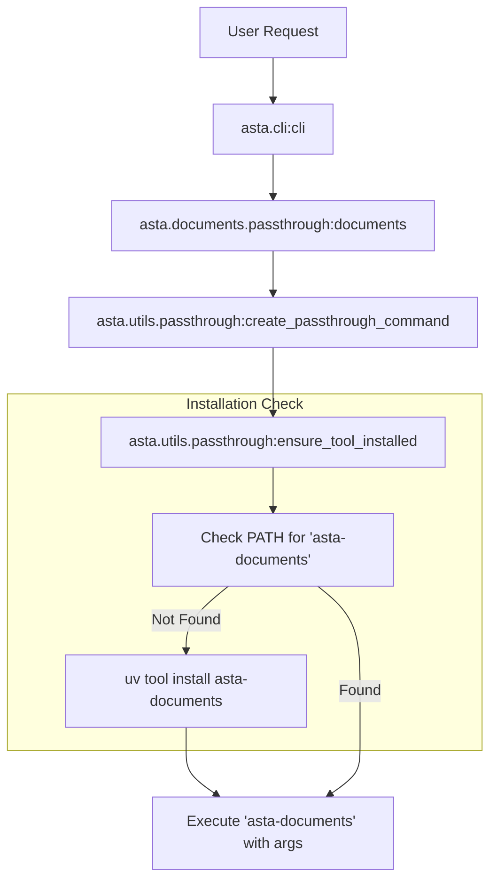
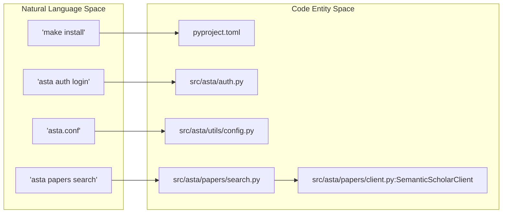

<!-- source: DeepWiki mcp.deepwiki.com · repo allenai/asta-plugins · page 1.1 Getting Started · fetched 2026-10-26 -->

# Getting Started

<details>
<summary>Relevant source files</summary>

The following files were used as context for generating this wiki page:

- [DEVELOPER.md](DEVELOPER.md)
- [README.md](README.md)
- [hooks/sync-cli-version.sh](hooks/sync-cli-version.sh)
- [plugins/asta-preview/hooks/sync-cli-version.sh](plugins/asta-preview/hooks/sync-cli-version.sh)
- [plugins/asta/hooks/sync-cli-version.sh](plugins/asta/hooks/sync-cli-version.sh)
- [pyproject.toml](pyproject.toml)
- [src/asta/__init__.py](src/asta/__init__.py)
- [uv.lock](uv.lock)

</details>


The `asta-plugins` repository provides the `asta` CLI, a unified toolset for scientific research designed to be used by both humans and autonomous coding agents (e.g., Claude Code, Cursor). It centralizes access to literature search, document management, PDF extraction, and experimental orchestration.

## Prerequisites

To develop or run the `asta` CLI from source, ensure your environment meets the following requirements:

*   **Python 3.11+**: The project targets modern Python features and type hinting [pyproject.toml:10]().
*   **uv**: Used for fast dependency resolution and tool management [DEVELOPER.md:71]().
*   **make**: Used for executing development lifecycle targets [DEVELOPER.md:72]().
*   **Node.js 20+ / npx**: Required specifically for running skill discovery tests [DEVELOPER.md:73]().

## Development Setup

The repository uses an editable installation flow to ensure changes in `src/asta/` are reflected immediately without re-installation.

### Installation Steps

1.  **Clone the repository**:
    ```bash
    git clone https://github.com/allenai/asta-plugins.git
    cd asta-plugins
    ```
2.  **Install dependencies**:
    Run `make install` [DEVELOPER.md:81](). This command uses `uv` to create a virtual environment and install the package in editable mode with test dependencies [pyproject.toml:30-34]().
3.  **Verify installation**:
    ```bash
    uv run python -m asta.cli --version
    ```

### Makefile Targets

The `Makefile` provides standardized entry points for common tasks:

| Target | Description |
| :--- | :--- |
| `make install` | Performs an editable install with test dependencies [DEVELOPER.md:81](). |
| `make test` | Runs the full test suite (unit + integration) [DEVELOPER.md:82](). |
| `make lint` | Checks code style using `ruff` [DEVELOPER.md:83](). |
| `make format` | Auto-fixes formatting issues [DEVELOPER.md:84](). |
| `make check` | Runs a pre-commit sequence: format check, lint, and unit tests [DEVELOPER.md:85](). |
| `make build-plugins` | Regenerates the `plugins/` directory from the `skills/` definitions [DEVELOPER.md:89](). |

**Sources:** [DEVELOPER.md:75-91](), [pyproject.toml:1-34]()

---

## Authentication Walkthrough

Several `asta` commands (such as `literature find` or `autodiscovery`) interact with protected Ai2 APIs. Authentication is handled via an Auth0 Device Authorization Flow.

### 1. Login
To authenticate your local environment, run:
```bash
asta auth login
```
This command initiates the device flow, providing a URL and a code to enter in your browser.

### 2. Token Management
The CLI manages tokens locally using the `TokenManager` and `TokenStorage` classes.
*   **Storage**: Tokens are stored securely using the `keyring` library [pyproject.toml:20]().
*   **Environment Variables**: In CI or Docker environments, you can bypass interactive login by setting the `ASTA_TOKEN` environment variable [README.md:66-71]().

### 3. Verification
You can check your current identity and token status:
```bash
asta auth whoami
```

**Sources:** [README.md:66-71](), [src/asta/cli.py:27]() (implied by `asta` entry point), [pyproject.toml:19-20]()

---

## Running the CLI

The CLI is structured into command groups. When running from source, use `uv run python -m asta.cli` to ensure the local environment is used.

### Core Command Groups
*   `asta papers`: Direct interaction with Semantic Scholar (e.g., `get`, `search`, `author`) [DEVELOPER.md:30-36]().
*   `asta literature`: Higher-level research tools like `find` and `interactive` [DEVELOPER.md:27-29]().
*   `asta documents`: Passthrough to `asta-documents` for local metadata indexing [DEVELOPER.md:21-23]().
*   `asta experiment`: Passthrough to `panda` for running computational experiments [DEVELOPER.md:24-26]().

### Passthrough Execution Flow
When you run a passthrough command (like `asta documents`), the system automatically ensures the underlying tool is installed in an isolated environment.

**Passthrough Logic Diagram**
The following diagram illustrates how the `asta` CLI delegates to external tools using the `passthrough.py` utility.



**Sources:** [DEVELOPER.md:53-62](), [src/asta/utils/passthrough.py:1-60]() (implied by architecture description).

---

## Code Entity Mapping

To help navigate the codebase, the following diagram maps high-level "Getting Started" concepts to their specific implementations in the `src/asta` directory.

**System Component Mapping**



**Sources:** [pyproject.toml:5-27](), [DEVELOPER.md:10-36](), [src/asta/__init__.py:3]()

---

