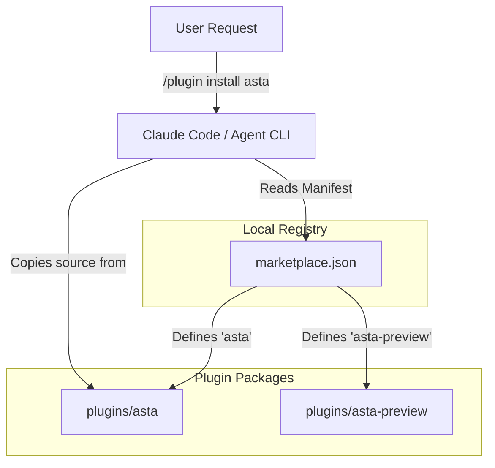
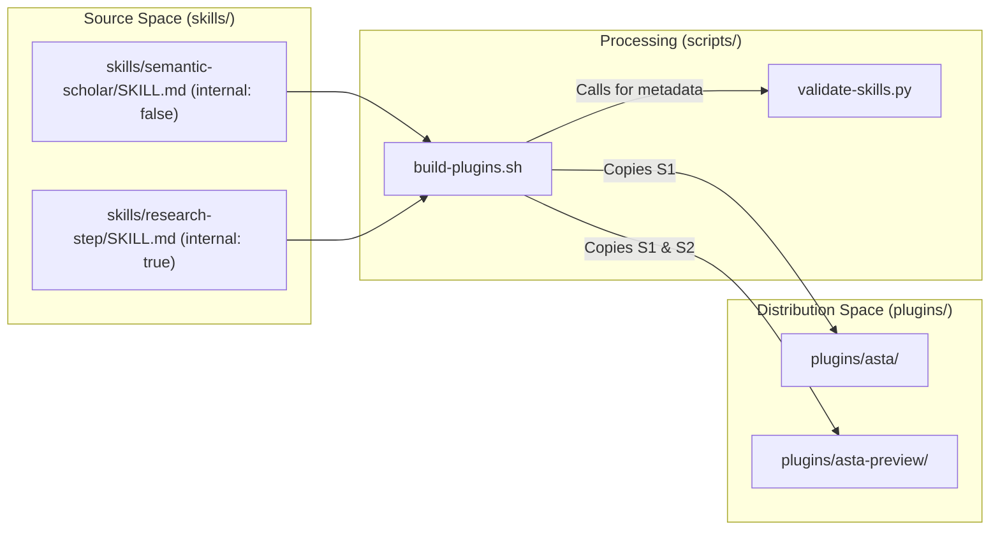

<!-- source: DeepWiki mcp.deepwiki.com · repo allenai/asta-plugins · page 1.2 Plugin Architecture: asta vs asta-preview · fetched 2026-10-26 -->

# Plugin Architecture: asta vs asta-preview

Relevant source files

The following files were used as context for generating this wiki page:

- [.claude-plugin/marketplace.json](.claude-plugin/marketplace.json)
- [.github/workflows/ci.yml](.github/workflows/ci.yml)
- [DEVELOPER.md](DEVELOPER.md)
- [Makefile](Makefile)
- [README.md](README.md)

This page describes the dual-track plugin architecture used by Asta to manage stable and experimental research tools. It details the relationship between the `skills/` source directory and the generated `plugins/` distribution, the role of the `marketplace.json` manifest, and the automated pipeline that maintains these components.

## Two-Track Plugin Model

Asta provides two distinct plugin packages to end-users and agents: `asta` (Stable) and `asta-preview` (Experimental). This separation allows developers to iterate rapidly on complex research workflows without compromising the reliability of core paper search and document management tools.

| Feature | `asta` (Stable) | `asta-preview` (Preview) |
| :--- | :--- | :--- |
| **Purpose** | Production-ready, high-reliability tools. | New features, complex agents, and beta workflows. |
| **Contents** | Core Semantic Scholar lookup, local document indexing, PDF extraction. | Everything in Stable + literature reports, autonomous research steps, and experiments. |
| **Installation** | `/plugin install asta` | `/plugin install asta-preview` |
| **Target Audience** | General research assistance. | Power users and developers testing new agentic loops. |

The distinction is driven by the `metadata.internal` flag within each skill's `SKILL.md` file. Skills marked as `internal: true` are excluded from the stable `asta` plugin but included in `asta-preview` [.claude-plugin/marketplace.json:9-46](), [README.md:16-38]().

### Sources:
- [.claude-plugin/marketplace.json:1-47]()
- [README.md:5-47]()
- [DEVELOPER.md:42-46]()

---

## The Marketplace Manifest

The `.claude-plugin/marketplace.json` file serves as the canonical registry for the Claude Code ecosystem. It defines the metadata, versions, and source locations for both plugin tracks.

### Marketplace Data Flow

The following diagram illustrates how the `marketplace.json` file acts as the entry point for plugin discovery and installation.

**Plugin Discovery and Installation Flow**

### Sources:
- [.claude-plugin/marketplace.json:1-47]()
- [README.md:11-14]()

---

## Plugin Generation Pipeline

The `plugins/` directory is a generated artifact and should never be edited directly [DEVELOPER.md:43-43](). Instead, the `build-plugins.sh` script synchronizes the source of truth in `skills/` and `hooks/` into the two distribution packages.

### Generation Logic

1.  **Clean**: Removes existing `plugins/asta` and `plugins/asta-preview` directories.
2.  **Initialize**: Creates the base structure for both plugins, including copying global `hooks/` (e.g., `check_permission` logic).
3.  **Skill Filtering**: 
    - Iterates through every subdirectory in `skills/`.
    - Parses the `SKILL.md` frontmatter using `scripts/validate-skills.py` [Makefile:101-102]().
    - If `internal: true`, the skill is copied **only** to `plugins/asta-preview`.
    - If `internal: false` (or missing), the skill is copied to **both** `plugins/asta` and `plugins/asta-preview`.
4.  **Verification**: The `make check-plugins` target ensures that the `plugins/` directory in the repository matches what the current `skills/` would generate, preventing stale builds from being committed [Makefile:91-98]().

### Build System Interaction

**Code Entity Mapping: Skill to Plugin Pipeline**

### Sources:
- [Makefile:87-98]()
- [Makefile:101-103]()
- [DEVELOPER.md:38-46]()
- [.github/workflows/ci.yml:29-33]()

---

## Internal vs. Default Skills

The distinction between an internal (preview) skill and a default (stable) skill is managed purely via metadata in the `SKILL.md` file located in each skill's directory.

### SKILL.md Configuration

Each skill must adhere to the **Agent Skills Spec**, which is validated during the build process [Makefile:101-103]().

| Attribute | Description | Impact on Distribution |
| :--- | :--- | :--- |
| `metadata.internal` | Boolean flag. | If `true`, skill is restricted to `asta-preview`. |
| `allowed-tools` | List of CLI commands. | Defines what the agent can execute (e.g., `asta literature find`). |

### Execution Environment

Regardless of whether a skill is installed via `asta` or `asta-preview`, it ultimately invokes the same `asta` CLI binary installed on the system path [DEVELOPER.md:48-64](). The plugins act as thin "capability descriptors" that tell the agent which subcommands of the `asta` CLI are available for use.

### Sources:
- [DEVELOPER.md:48-64]()
- [README.md:48-52]()
- [Makefile:101-103]()

---

