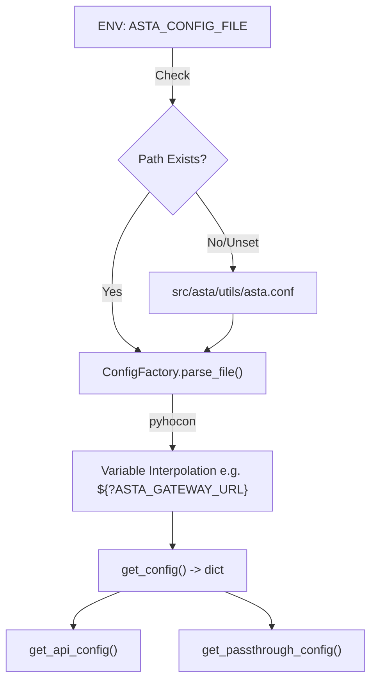
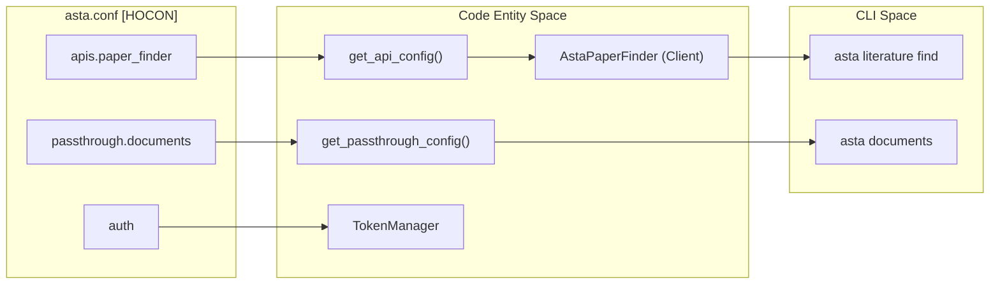

<!-- source: DeepWiki mcp.deepwiki.com · repo allenai/asta-plugins · page 2.1 Configuration System · fetched 2026-10-26 -->

# Configuration System

Relevant source files

The following files were used as context for generating this wiki page:

- [plugins/asta-preview/skills/research-step/SKILL.md](plugins/asta-preview/skills/research-step/SKILL.md)
- [src/asta/auth/device_flow.py](src/asta/auth/device_flow.py)
- [src/asta/cli.py](src/asta/cli.py)
- [src/asta/literature/find.py](src/asta/literature/find.py)
- [src/asta/utils/asta.conf](src/asta/utils/asta.conf)
- [src/asta/utils/config.py](src/asta/utils/config.py)
- [tests/test_auth.py](tests/test_auth.py)
- [tests/test_cli.py](tests/test_cli.py)
- [tests/test_config.py](tests/test_config.py)

The Asta CLI utilizes a hierarchical configuration system based on **HOCON** (Human-Optimized Config Object Notation). This system centralizes the definitions for authentication providers, remote API endpoints, and external tool delegations (passthroughs), allowing for seamless overrides via environment variables.

## HOCON Configuration (`asta.conf`)

The core of the configuration resides in `src/asta/utils/asta.conf` [src/asta/utils/asta.conf:1-109](). This file uses the `pyhocon` library to support features like key-value nesting, variable substitution, and environment variable overrides.

### Key Configuration Sections

| Section | Purpose | Key Entities |
| :--- | :--- | :--- |
| `auth` | Identity provider and Gateway settings | `auth0_domain`, `gateway_url` |
| `apis` | Service-specific base URLs | `semantic_scholar`, `paper_finder`, `theorizer` |
| `passthrough` | External tool installation and versioning | `documents`, `experiment`, `pdf-extraction` |

### Environment Overrides
The system supports dynamic overrides. For example, the `gateway_url` defaults to a production endpoint but can be redirected using `ASTA_GATEWAY_URL` [src/asta/utils/asta.conf:20-21](). Similarly, the entire configuration file path can be changed by setting `ASTA_CONFIG_FILE` [src/asta/utils/config.py:17-20]().

**Sources:** [src/asta/utils/asta.conf:1-109](), [src/asta/utils/config.py:10-21]()

---

## Configuration Management Logic

The `src/asta/utils/config.py` module provides the functional interface for retrieving configuration data. It parses the HOCON file and returns standard Python dictionaries.

### Core Functions

*   **`get_config()`**: Loads the entire configuration as a dictionary [src/asta/utils/config.py:23-37]().
*   **`get_api_config(api_name)`**: Retrieves settings for a specific API (e.g., `semantic_scholar`). Raises `KeyError` if the API is not defined [src/asta/utils/config.py:63-81]().
*   **`get_passthrough_config(command_name)`**: Retrieves installation and execution metadata for external tools [src/asta/utils/config.py:40-60]().

### Data Flow: Configuration Loading
The following diagram illustrates how the system resolves configuration values from the filesystem and environment.

**Configuration Resolution Flow**

**Sources:** [src/asta/utils/config.py:10-81](), [src/asta/utils/asta.conf:21-38]()

---

## API and Passthrough Definitions

The configuration system maps natural language command names to specific code clients and external repositories.

### API Endpoints
API configurations typically define a `base_url`. Many APIs leverage the `gateway_url` variable to construct their endpoints, ensuring that changing the gateway location updates all dependent services [src/asta/utils/asta.conf:28-66]().

### Passthrough Commands
Passthroughs are commands that delegate to external packages. The configuration defines how Asta should install these tools if they are missing [src/asta/utils/asta.conf:81-109]().

| Field | Description |
| :--- | :--- |
| `tool_name` | The name of the package/binary (e.g., `panda`) |
| `install_type` | `pypi`, `git`, or `local` |
| `install_source` | The URI or package name for installation |
| `minimum_version` | SemVer requirement for the tool |

### Code Mapping: From Config to Execution
This diagram bridges the configuration keys in `asta.conf` to the Python entities that consume them.

**Entity Association Diagram**

**Sources:** [src/asta/utils/asta.conf:33-40](), [src/asta/utils/config.py:40-81](), [src/asta/literature/find.py:54-57](), [src/asta/cli.py:58-65]()

---

## Implementation Details

### Validation
The configuration system is validated through `tests/test_config.py`. These tests ensure that:
1.  Required fields (like `auth0_domain`) are present [tests/test_config.py:108-124]().
2.  Passthrough `minimum_version` strings follow Semantic Versioning (x.y.z) [tests/test_config.py:49-52]().
3.  `install_type` is restricted to `pypi`, `git`, or `local` [tests/test_config.py:45-47]().

### Auth Settings Integration
While `get_config()` returns a dictionary, the authentication system often uses a typed helper via `get_auth_settings()` to provide attribute-based access to `auth0_domain`, `auth0_client_id`, and `gateway_url` [tests/test_config.py:126-142]().

**Sources:** [tests/test_config.py:1-189](), [src/asta/utils/auth_config.py]() (referenced via [tests/test_config.py:128]())

---

