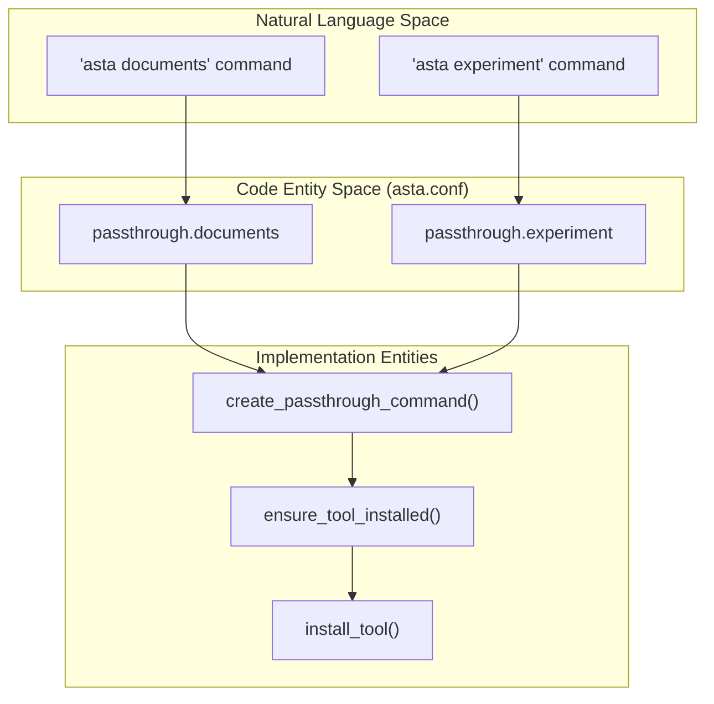
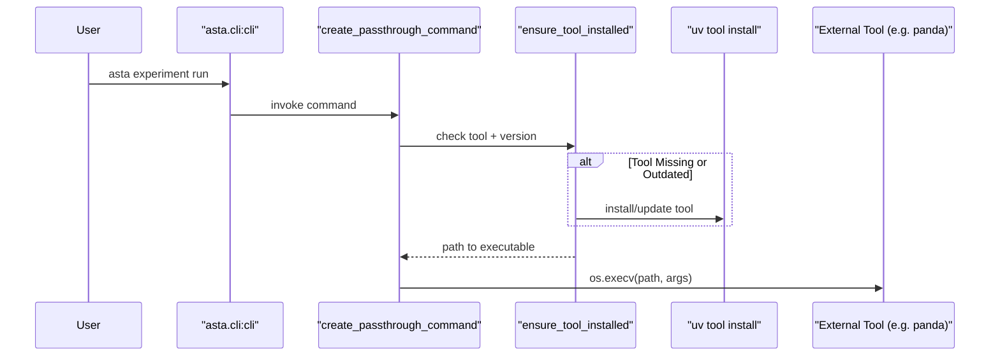

<!-- source: DeepWiki mcp.deepwiki.com · repo allenai/asta-plugins · page 2.2 Passthrough System · fetched 2026-10-26 -->

# Passthrough System

Relevant source files

The following files were used as context for generating this wiki page:

- [plugins/asta-preview/skills/research-step/SKILL.md](plugins/asta-preview/skills/research-step/SKILL.md)
- [src/asta/documents/passthrough.py](src/asta/documents/passthrough.py)
- [src/asta/experiment/passthrough.py](src/asta/experiment/passthrough.py)
- [src/asta/literature/find.py](src/asta/literature/find.py)
- [src/asta/pdf_extraction/passthrough.py](src/asta/pdf_extraction/passthrough.py)
- [src/asta/utils/passthrough.py](src/asta/utils/passthrough.py)
- [tests/test_cli.py](tests/test_cli.py)
- [tests/test_config.py](tests/test_config.py)

The Passthrough System is a core architectural component of `asta` that allows it to delegate specialized commands to external tools such as `asta-documents`, `panda`, and `olmocr` [src/asta/utils/config.py:23-28](). By using a thin delegation layer, `asta` maintains a consistent CLI interface while offloading complex logic—like document indexing or experimental runners—to dedicated packages [src/asta/utils/passthrough.py:1-5]().

## Implementation Logic

The system relies on a combination of HOCON configuration for tool metadata and a set of utility functions to manage tool lifecycles (installation, version validation, and execution) [src/asta/utils/config.py:23-28](), [src/asta/utils/passthrough.py:199-214]().

### Configuration
Each passthrough command is defined in `asta.conf` under the `passthrough` block [src/asta/utils/config.py:96-102](). A configuration entry typically includes:
* `tool_name`: The name of the external executable (e.g., `asta-documents`) [tests/test_config.py:31-31]().
* `command_name`: The subcommand name within `asta` (e.g., `documents`) [tests/test_config.py:32-32]().
* `install_type`: One of `pypi`, `git`, or `local` [tests/test_config.py:45-47]().
* `install_source`: The package name, Git URL, or local path [tests/test_config.py:34-34]().
* `minimum_version`: The required Semantic Version (x.y.z) [tests/test_config.py:49-52]().

### Natural Language to Code Entity Space: Configuration Mapping
The following diagram illustrates how the abstract concept of a "Passthrough Command" is mapped to specific code entities and configuration keys.

Title: Passthrough Command Mapping

Sources: [src/asta/utils/config.py:23-28](), [src/asta/utils/passthrough.py:199-214](), [src/asta/utils/passthrough.py:236-252](), [tests/test_config.py:23-52]()

## Key Components

### 1. Version Validation
The system strictly enforces Semantic Versioning. It uses `get_installed_version` to run the tool with a `--version` flag and parses the output using regex [src/asta/utils/passthrough.py:12-43]().
* **`parse_semver`**: Converts a string like `v1.2.3` into a comparable tuple `(1, 2, 3)` [src/asta/utils/passthrough.py:46-70]().
* **`version_meets_minimum`**: Compares the installed version tuple against the configured minimum [src/asta/utils/passthrough.py:84-116]().

### 2. Tool Management (`uv` integration)
Installation and updates are handled via the `uv` package manager [src/asta/utils/passthrough.py:118-139]().
* **`install_tool`**: Constructs the appropriate `uv tool install` command based on the `install_type` [src/asta/utils/passthrough.py:118-192]().
    * **pypi**: Appends `>=minimum_version` to the package name [src/asta/utils/passthrough.py:157-160]().
    * **git**: Appends `@v{minimum_version}` to the URL [src/asta/utils/passthrough.py:161-164]().
    * **local**: Expands the filesystem path [src/asta/utils/passthrough.py:165-169]().
* **`ensure_tool_installed`**: The primary entry point that checks if a tool exists, validates its version, and triggers `install_tool` if necessary [src/asta/utils/passthrough.py:199-214]().

### 3. Command Creation
The `create_passthrough_command` function is a factory that generates a Click command [src/asta/utils/passthrough.py:236-252](). When this command is invoked:
1. It calls `ensure_tool_installed` [src/asta/utils/passthrough.py:199-214]().
2. It aggregates arguments, including any "lazy" arguments provided via a callable (used for dynamic auth tokens) [src/asta/pdf_extraction/passthrough.py:11-32]().
3. It uses `os.execv` to replace the current process with the external tool, ensuring seamless I/O handling [src/asta/utils/passthrough.py:311-314]().

## Data Flow: Command Execution
The following diagram shows the sequence of events from a user typing a command to the execution of the external tool.

Title: Passthrough Execution Flow

Sources: [src/asta/utils/passthrough.py:118-192](), [src/asta/utils/passthrough.py:199-214](), [src/asta/utils/passthrough.py:236-252](), [src/asta/experiment/passthrough.py:1-17]()

## Example: PDF Extraction (olmOCR)
The `pdf-extraction` command demonstrates an advanced use case where passthrough arguments are evaluated lazily to include a fresh authentication token [src/asta/pdf_extraction/passthrough.py:11-32]().

| Feature | Implementation |
| :--- | :--- |
| **Tool Name** | `olmocr` [src/asta/pdf_extraction/passthrough.py:121-121]() |
| **Lazy Args** | `get_pdf_extraction_tool_args` fetches API keys and server URLs at runtime [src/asta/pdf_extraction/passthrough.py:11-32]() |
| **Help Text** | Overridden with custom `_HELP_TEXT` via `help_transform` [src/asta/pdf_extraction/passthrough.py:35-117]() |

Sources: [src/asta/pdf_extraction/passthrough.py:1-130](), [src/asta/utils/passthrough.py:236-252]()

---

