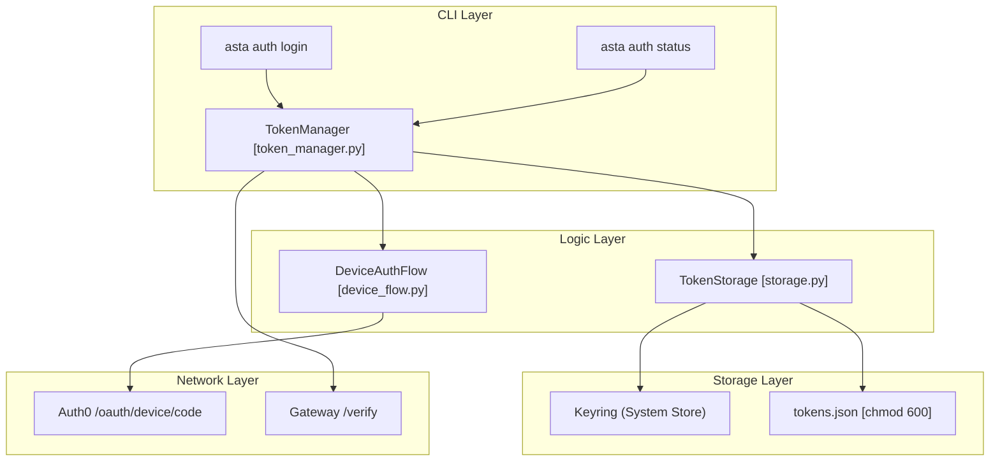
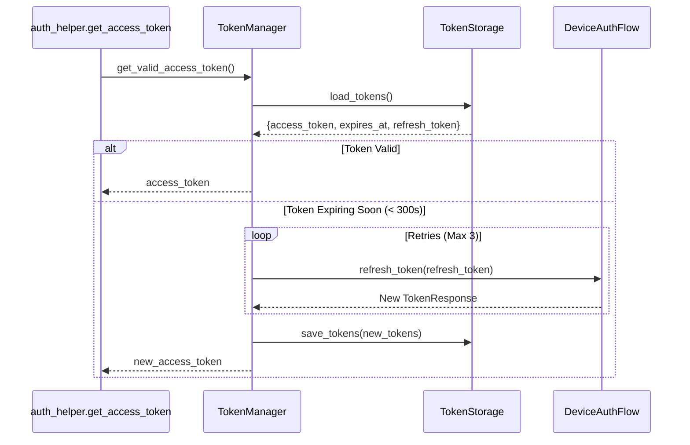

<!-- source: DeepWiki mcp.deepwiki.com · repo allenai/asta-plugins · page 2.3 Authentication System · fetched 2026-10-26 -->

# Authentication System

Relevant source files

The following files were used as context for generating this wiki page:

- [src/asta/auth/device_flow.py](src/asta/auth/device_flow.py)
- [src/asta/auth/storage.py](src/asta/auth/storage.py)
- [src/asta/auth/token_manager.py](src/asta/auth/token_manager.py)
- [src/asta/commands/auth.py](src/asta/commands/auth.py)
- [src/asta/utils/auth_helper.py](src/asta/utils/auth_helper.py)
- [src/asta/utils/config.py](src/asta/utils/config.py)
- [tests/test_auth.py](tests/test_auth.py)
- [tests/test_auth_helper.py](tests/test_auth_helper.py)

The `asta` authentication system implements the **Auth0 Device Authorization Flow** (RFC 8628), allowing users to authenticate via a browser on any device and interact with protected Asta APIs. The system handles token persistence, automatic background refreshing with exponential backoff, and server-side verification through a gateway.

## Core Components

The authentication logic is distributed across several specialized classes and utilities:

*   **`DeviceAuthFlow`**: Implements the low-level OAuth2 device flow protocol [src/asta/auth/device_flow.py:40-41]().
*   **`TokenManager`**: Orchestrates the high-level login/logout logic and manages token lifecycles [src/asta/auth/token_manager.py:28-29]().
*   **`TokenStorage`**: Handles secure persistence using platform-specific keyrings or restricted file permissions [src/asta/auth/storage.py:24-25]().
*   **`get_access_token`**: A global helper used by CLI commands to retrieve a valid token, triggering transparent refreshes if needed [src/asta/utils/auth_helper.py:11-12]().

### Authentication Data Flow

The following diagram illustrates the relationship between the CLI commands, the manager, and the storage backends.

**Auth System Entity Mapping**

Sources: [src/asta/commands/auth.py:35-43](), [src/asta/auth/token_manager.py:39-41](), [src/asta/auth/storage.py:35-41]()

## Device Authorization Flow

The system uses a two-step polling process to obtain tokens without requiring the user to input credentials directly into the terminal:

1.  **Initiation**: `DeviceAuthFlow.initiate()` calls the Auth0 `/oauth/device/code` endpoint to receive a `user_code` and `verification_uri` [src/asta/auth/device_flow.py:57-68]().
2.  **User Interaction**: The CLI displays a URL (and optionally opens a browser) for the user to confirm the code [src/asta/auth/token_manager.py:78-101]().
3.  **Polling**: `DeviceAuthFlow.poll_for_token()` repeatedly checks the `/oauth/token` endpoint [src/asta/auth/device_flow.py:82-115](). It handles `authorization_pending` and `slow_down` (which increases the polling interval) [src/asta/auth/device_flow.py:133-139]().

Sources: [src/asta/auth/device_flow.py:40-150](), [src/asta/auth/token_manager.py:43-76]()

## Token Management & Refresh

Tokens are automatically managed by the `TokenManager.get_valid_access_token()` method [src/asta/auth/token_manager.py:102-103]().

### Refresh Logic
If a token is within 5 minutes (300 seconds) of expiration, the system attempts a refresh [src/asta/auth/token_manager.py:124-125](). This process includes:
*   **Exponential Backoff**: If a transient network error occurs, the system retries up to 3 times, doubling the delay between attempts (2s, 4s, 8s) [src/asta/auth/token_manager.py:134-144]().
*   **Token Rotation Support**: New refresh tokens returned by the server are saved immediately to prevent lock-outs [src/asta/auth/token_manager.py:149-157]().

**Token Refresh Sequence**

Sources: [src/asta/auth/token_manager.py:102-185](), [src/asta/utils/auth_helper.py:11-43]()

## Token Storage

`TokenStorage` ensures credentials are kept securely on the local machine. It uses a dual-write strategy to ensure reliability [src/asta/auth/storage.py:41-48]():

| Backend | Purpose | Implementation |
| :--- | :--- | :--- |
| **Keyring** | Primary Secure Store | Uses `keyring` library to access OS-level credential managers (Keychain, Windows Credential Vault, Secret Service) [src/asta/auth/storage.py:50-53](). |
| **File** | Fallback/Sync | Stores JSON in `~/.config/asta-cli/tokens.json` with `0o600` (owner read/write only) permissions [src/asta/auth/storage.py:35-39](). |

Sources: [src/asta/auth/storage.py:24-62]()

## Gateway Verification

The `asta auth status` command performs an additional server-side check by calling the gateway's verification endpoint [src/asta/commands/auth.py:105-136](). This confirms that the token is not only locally valid (not expired) but also recognized by the Asta infrastructure [src/asta/auth/token_manager.py:222-252]().

## CLI Commands

The authentication system is exposed via the `asta auth` command group [src/asta/commands/auth.py:21-24]():

*   **`login`**: Initiates the device flow [src/asta/commands/auth.py:27-56]().
*   **`logout`**: Deletes tokens from both Keyring and file storage [src/asta/commands/auth.py:58-71]().
*   **`status`**: Displays a table containing local token status, server verification, user email, and time until expiration [src/asta/commands/auth.py:74-189]().
*   **`print-token`**: Outputs the current access token. Use `--raw` for the base64 string or omit it to see a decoded view of the JWT header and payload [src/asta/commands/auth.py:190-216]().

Sources: [src/asta/commands/auth.py:1-216]()

---

