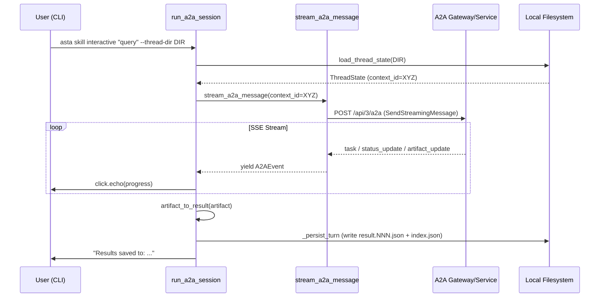
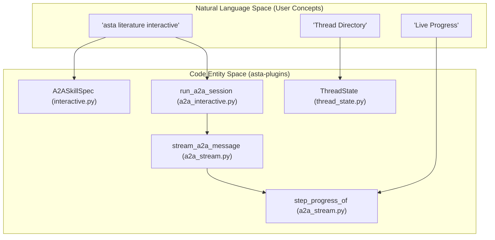

<!-- source: DeepWiki mcp.deepwiki.com · repo allenai/asta-plugins · page 2.4 A2A Interactive Framework · fetched 2026-10-26 -->

# A2A Interactive Framework

Relevant source files

The following files were used as context for generating this wiki page:

- [src/asta/literature/a2a_artifact.py](src/asta/literature/a2a_artifact.py)
- [src/asta/literature/interactive.py](src/asta/literature/interactive.py)
- [src/asta/utils/a2a_interactive.py](src/asta/utils/a2a_interactive.py)
- [src/asta/utils/a2a_stream.py](src/asta/utils/a2a_stream.py)
- [src/asta/utils/thread_state.py](src/asta/utils/thread_state.py)
- [tests/test_a2a_artifact.py](tests/test_a2a_artifact.py)
- [tests/test_a2a_interactive.py](tests/test_a2a_interactive.py)

The Agent-to-Agent (A2A) Interactive Framework provides a generic streaming runner for stateful, multi-turn conversations between the `asta` CLI and remote agentic services. It handles the complexities of Server-Sent Events (SSE), JSON-RPC 2.0 wire formats, thread persistence via local state directories, and authentication resolution.

## Framework Overview

The framework is designed to allow skill developers to implement interactive agents with minimal boilerplate. A typical interactive skill only needs to define an `A2ASkillSpec`, a Click command decorated with `standard_a2a_options`, and a translation function to convert agent artifacts into local domain models.

### Key Components

| Component | File Path | Role |
| :--- | :--- | :--- |
| `A2ASkillSpec` | [src/asta/utils/a2a_interactive.py:48-55]() | Metadata defining the config keys and environment variables for a specific skill. |
| `run_a2a_session` | [src/asta/utils/a2a_interactive.py:122-191]() | The primary entry point that orchestrates the session lifecycle (resolve auth, stream, persist). |
| `stream_a2a_message` | [src/asta/utils/a2a_stream.py:56-104]() | Low-level SSE client handling JSON-RPC over HTTP. |
| `ThreadState` | [src/asta/utils/thread_state.py:47-67]() | Manages the `index.json` and turn-based file indexing for multi-turn continuity. |

**Sources:** [src/asta/utils/a2a_interactive.py:1-37](), [src/asta/utils/a2a_stream.py:1-7](), [src/asta/utils/thread_state.py:1-16]()

---

## Data Flow: CLI to A2A Service

The following diagram illustrates how a user command travels through the interactive framework to the remote A2A service and back to the local filesystem.

### Interactive Turn Sequence

**Sources:** [src/asta/utils/a2a_interactive.py:142-184](), [src/asta/utils/a2a_stream.py:84-103](), [src/asta/utils/thread_state.py:74-97]()

---

## Thread State Management

The framework supports stateful conversations using a `--thread-dir` pattern. When this directory is provided, the runner maintains an `index.json` file that tracks the `thread_id` (used as `contextId` in subsequent requests) and an ordered list of turns.

### On-Disk Schema (`index.json`)
The `ThreadState` class manages the serialization of this metadata:
- `thread_id`: The remote identifier for the conversation [src/asta/utils/thread_state.py:48]().
- `turns`: A list of `TurnEntry` objects containing the turn index, timestamp, and the filename of the result [src/asta/utils/thread_state.py:51]().
- `summary`: A skill-specific blob generated by a `BuildSummary` callback [src/asta/utils/a2a_interactive.py:68]().

### Turn File Naming
Result files are automatically versioned using a padded index (e.g., `result.001.json`, `result.002.json`) via the `turn_filename` utility [src/asta/utils/thread_state.py:106-111]().

**Sources:** [src/asta/utils/thread_state.py:1-16](), [src/asta/utils/thread_state.py:30-44](), [src/asta/utils/a2a_interactive.py:198-214]()

---

## Wire Format: A2A v1.0 Streaming

The framework implements the `SendStreamingMessage` JSON-RPC method over SSE [src/asta/utils/a2a_stream.py:155-172]().

### Event Parsing
The `stream_a2a_message` function yields `A2AEvent` objects. The framework provides extractors to pull specific data from these events:
- `step_progress_of`: Extracts UI-friendly progress messages [src/asta/utils/a2a_stream.py:109-117]().
- `terminal_status_of`: Detects completion or failure states like `TASK_STATE_COMPLETED` or `TASK_STATE_FAILED` [src/asta/utils/a2a_stream.py:120-136]().
- `artifact_data_of`: Retrieves the final data payload produced by the agent [src/asta/utils/a2a_stream.py:139-147]().

### Code Entity Association
The following diagram maps the high-level A2A concepts to the specific Python classes and functions responsible for them.

**Sources:** [src/asta/utils/a2a_interactive.py:48-55](), [src/asta/utils/a2a_stream.py:56-64](), [src/asta/utils/a2a_stream.py:109-112](), [src/asta/utils/thread_state.py:47-51]()

---

## Implementation Example: Literature Interactive

The `literature interactive` skill is a canonical example of a skill built on this framework.

1.  **Skill Specification**: It defines `PAPER_FINDER_SPEC` pointing to the `paper_finder` config block [src/asta/literature/interactive.py:15-18]().
2.  **Command Setup**: It uses `@standard_a2a_options` to inherit flags like `--thread-dir` and `--output` [src/asta/literature/interactive.py:29-38]().
3.  **Artifact Translation**: It passes `parse_artifact` as the `artifact_to_result` callback. This function maps the complex A2A `entities` dictionary into a `LiteratureSearchResult` model [src/asta/literature/a2a_artifact.py:26-58]().
4.  **Summary Building**: It provides a `_build_summary` function to record the query and paper count in the `index.json` [src/asta/literature/interactive.py:90-99]().

**Sources:** [src/asta/literature/interactive.py:70-87](), [src/asta/literature/a2a_artifact.py:1-21]()

---

