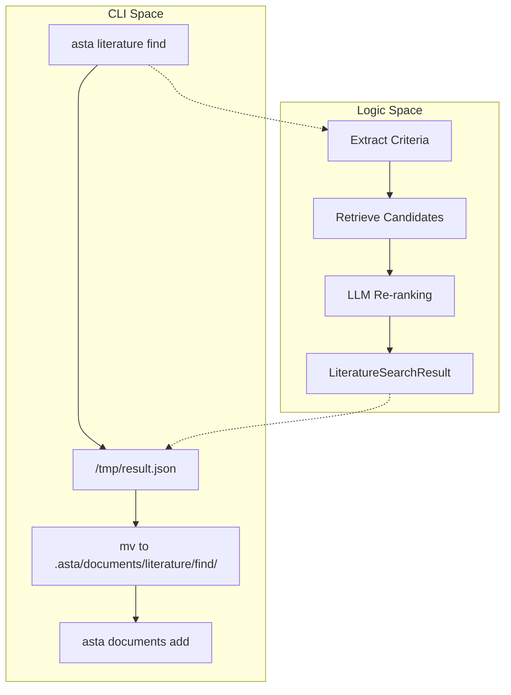
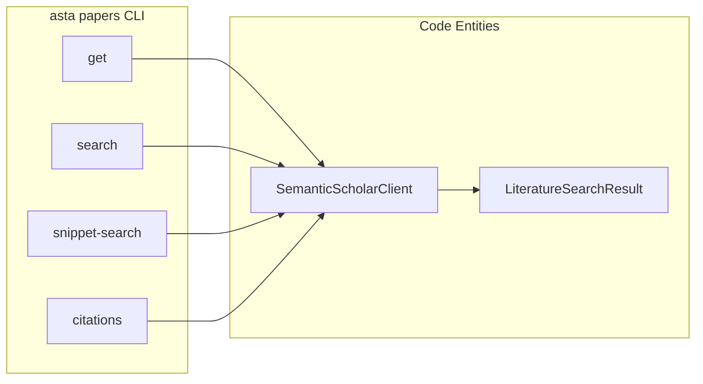

<!-- source: DeepWiki mcp.deepwiki.com · repo allenai/asta-plugins · page 3.1 Literature Research Skills · fetched 2026-10-26 -->

# Literature Research Skills

Relevant source files

The following files were used as context for generating this wiki page:

- [plugins/asta-preview/skills/find-literature/SKILL.md](plugins/asta-preview/skills/find-literature/SKILL.md)
- [plugins/asta-preview/skills/literature-report/SKILL.md](plugins/asta-preview/skills/literature-report/SKILL.md)
- [plugins/asta-preview/skills/semantic-scholar/SKILL.md](plugins/asta-preview/skills/semantic-scholar/SKILL.md)
- [plugins/asta/skills/literature-report/SKILL.md](plugins/asta/skills/literature-report/SKILL.md)
- [plugins/asta/skills/semantic-scholar/SKILL.md](plugins/asta/skills/semantic-scholar/SKILL.md)
- [skills/find-literature/SKILL.md](skills/find-literature/SKILL.md)
- [skills/literature-report/SKILL.md](skills/literature-report/SKILL.md)
- [skills/semantic-scholar/SKILL.md](skills/semantic-scholar/SKILL.md)

The literature research capabilities in `asta` are divided into three primary skills: `find-literature`, `semantic-scholar`, and `literature-report`. These skills provide a tiered approach to academic research, ranging from low-level metadata lookups to high-level agentic exploration and document synthesis.

## Skill Overview and Selection

The system distinguishes between **mechanical lookups** and **agent-mediated discovery**.

| Skill | Primary Tool | Best For |
| :--- | :--- | :--- |
| `semantic-scholar` | `asta papers` | Fast, targeted lookups by ID, author, or keyword. |
| `find-literature` | `asta literature find` | One-shot, criterion-based ranking for sub-steps in workflows. |
| `find-literature` | `asta literature interactive` | Multi-turn, exploratory research sessions with reasoning loops. |
| `literature-report` | BibTeX/Markdown | Synthesizing findings into structured reports with citations. |

**Sources:** [skills/find-literature/SKILL.md:16-38](), [skills/semantic-scholar/SKILL.md:22-57]()

---

## Find Literature Skill

The `find-literature` skill is used for topic-driven search where the system extracts relevance criteria from a query and ranks candidates against those criteria [skills/find-literature/SKILL.md:2-3]().

### Data Flow: Discovery to Indexing
The discovery process often involves background execution due to high latency (30-60s) for comprehensive searches.

**Sources:** [skills/find-literature/SKILL.md:94-111](), [skills/find-literature/SKILL.md:140-161]()

### Interactive vs. One-shot
1.  **`asta literature find`**: A single attempt without an agent loop. It is optimized for speed and used when literature search is a sub-step of a larger task [skills/find-literature/SKILL.md:33-36]().
2.  **`asta literature interactive`**: Built on the A2A (Agent-to-Agent) framework. It uses a reasoning loop to verify results and supports multi-turn refinement via `--thread-dir` [skills/find-literature/SKILL.md:23-31]().

### State Management with `--thread-dir`
For multi-turn sessions, the CLI maintains state in a specific directory structure:
- **`index.json`**: Records turn order, queries, and `thread_id` [skills/find-literature/SKILL.md:44-45]().
- **`.NNN.json`**: Per-turn artifacts containing the `LiteratureSearchResult` [skills/find-literature/SKILL.md:43-44]().

**Sources:** [skills/find-literature/SKILL.md:40-64]()

---

## Semantic Scholar Skill

The `semantic-scholar` skill provides direct access to the Semantic Scholar API for mechanical tasks. It is preferred when IDs or exact phrases are known [skills/semantic-scholar/SKILL.md:33-39]().

### Command Implementation Space

### Key Operations
- **`get`**: Fetches metadata (title, abstract, authors) by ID (ARXIV, DOI, CorpusId) [skills/semantic-scholar/SKILL.md:77-92]().
- **`search`**: Keyword-based search with date filters and limit controls [skills/semantic-scholar/SKILL.md:98-114]().
- **`snippet-search`**: Advanced search over full-text bodies. It returns `snippet.text` (approx. 500 words) and `snippet.section` [skills/semantic-scholar/SKILL.md:118-138]().
- **`citations`**: Retrieves the citation graph for a specific work [skills/semantic-scholar/SKILL.md:150-161]().

**Sources:** [skills/semantic-scholar/SKILL.md:73-161]()

---

## Literature Report Skill

The `literature-report` skill focuses on the synthesis of gathered data into Markdown documents.

### Workflow and Citation Keys
The skill follows a strict convention for maintaining bibliography files (`.bib`):
1.  **Key Generation**: `{firstAuthorSurname}{year}` (e.g., `wei2022`). Conflicts are resolved with alphabetical suffixes [skills/literature-report/SKILL.md:41]().
2.  **Stable IDs**: The `corpus_id` field must be included in BibTeX entries to ensure identification survives key renames [skills/literature-report/SKILL.md:42]().
3.  **Appends Only**: The system is instructed to append to `.bib` files and never rewrite existing entries [skills/literature-report/SKILL.md:43]().

### Data Integration
Reports are expected to integrate data from `.asta/documents/literature/find/`. Agents are instructed to read existing reports before updating and to use the **Preview** skill to verify that all `[@key]` citations resolve correctly [skills/literature-report/SKILL.md:13-21](), [skills/literature-report/SKILL.md:45]().

**Sources:** [skills/literature-report/SKILL.md:1-46]()

---

