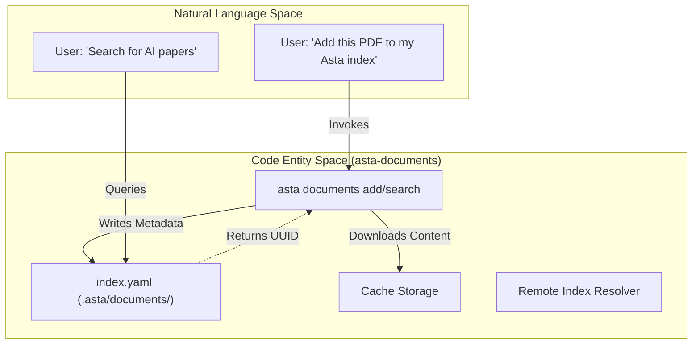
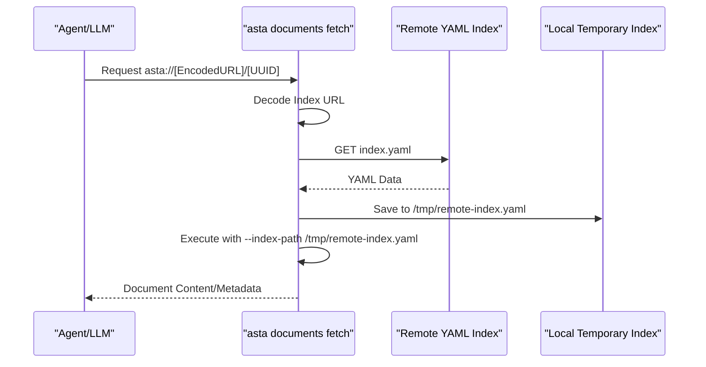

<!-- source: DeepWiki mcp.deepwiki.com · repo allenai/asta-plugins · page 3.2 Document Management Skill · fetched 2026-10-26 -->

# Document Management Skill

Relevant source files

The following files were used as context for generating this wiki page:

- [plugins/asta-preview/skills/asta-documents/SKILL.md](plugins/asta-preview/skills/asta-documents/SKILL.md)
- [plugins/asta/skills/asta-documents/SKILL.md](plugins/asta/skills/asta-documents/SKILL.md)
- [skills/asta-documents/SKILL.md](skills/asta-documents/SKILL.md)

The `asta-documents` skill provides a local metadata index and content management system for research papers, reports, and datasets. It serves as the primary storage abstraction for the Asta ecosystem, allowing skills to track metadata, manage local caches, and resolve documents via a custom URI scheme.

## Overview and Purpose

The skill manages document metadata (URLs, summaries, tags, and custom fields) in a local YAML index. It is designed to act as a "smart bookmark manager" that facilitates retrieval and sharing across different research tasks [skills/asta-documents/SKILL.md:8-12]().

Key capabilities include:
- **Local Indexing**: Persistent storage in `.asta/documents/index.yaml` [skills/asta-documents/SKILL.md:14-14]().
- **Hybrid Search**: Field-based search across names, summaries, and tags [skills/asta-documents/SKILL.md:66-70]().
- **Content Fetching**: Downloading and caching document content from various protocols (HTTP, S3, GS, File) [skills/asta-documents/SKILL.md:93-94, 188-188]().
- **URI Resolution**: Support for the `asta://` scheme to reference remote document collections [skills/asta-documents/SKILL.md:111-113]().

### Sources:
- [skills/asta-documents/SKILL.md:8-14]()
- [skills/asta-documents/SKILL.md:66-70]()
- [skills/asta-documents/SKILL.md:93-94]()
- [skills/asta-documents/SKILL.md:188-188]()

---

## Data Flow: Document Indexing and Retrieval

The document management system bridges natural language requests (e.g., "Find the paper I saved about transformers") to specific CLI operations and file-system state.

### Document Management Lifecycle
Title: "Document Management Logic Flow"

Sources: [skills/asta-documents/SKILL.md:10-14](), [skills/asta-documents/SKILL.md:79-86]()

---

## The `asta://` URI Scheme

The skill implements a custom URI scheme to enable sharing of document collections. An `asta://` URL points to a specific document within a remote index.

**URL Format:** `asta://{url-encoded-index-url}/{uuid}` [skills/asta-documents/SKILL.md:115-117]().

### Remote Resolution Pattern
Title: "Remote URI Resolution Process"

Sources: [skills/asta-documents/SKILL.md:130-160]()

---

## Technical Implementation Details

### 1. Local Index Management
The index is a YAML file located by default at `.asta/documents/index.yaml` [skills/asta-documents/SKILL.md:14-14](). It stores document entries identified by a 10-character UUID [skills/asta-documents/SKILL.md:121-121]().

### 2. Automatic Indexing Patterns
A core integration pattern requires other skills (like literature research) to automatically register generated artifacts. When a skill writes to the `.asta/` directory, it should invoke `asta documents add` with the following metadata [skills/asta-documents/SKILL.md:16-29]():
- **URL**: Absolute `file://` path [skills/asta-documents/SKILL.md:35-35]().
- **Tags**: `asta-generated` and specific skill tags [skills/asta-documents/SKILL.md:38-38]().
- **MIME-Type**: Detected from extension (e.g., `text/markdown`) [skills/asta-documents/SKILL.md:39-39]().

### 3. Search and Filtering
The `search` command supports complex filtering:
- **Union vs. Intersection**: The `--union` flag switches from matching ALL criteria to matching ANY [skills/asta-documents/SKILL.md:72-76]().
- **Extra Field Queries**: Supports querying custom JSON metadata via the `--extra` flag (e.g., `.year > 2020`) [skills/asta-documents/SKILL.md:70-70]().

### 4. Cache Management
The system maintains a local cache for remote documents. Users can monitor and maintain this via the `cache` subcommand group:
- `asta documents cache list`: View cached items [skills/asta-documents/SKILL.md:101-101]().
- `asta documents cache clean --days 7`: Evict items older than a threshold [skills/asta-documents/SKILL.md:103-103]().

### Sources:
- [skills/asta-documents/SKILL.md:14-14]()
- [skills/asta-documents/SKILL.md:16-39]()
- [skills/asta-documents/SKILL.md:70-76]()
- [skills/asta-documents/SKILL.md:101-103]()
- [skills/asta-documents/SKILL.md:121-121]()

---

## Integration Reference

| Feature | CLI Command | Notes |
| :--- | :--- | :--- |
| **Indexing** | `asta documents add <url>` | Supports `file://`, `http://`, `s3://`, `gs://` [skills/asta-documents/SKILL.md:79, 188]() |
| **Metadata** | `asta documents get <uuid>` | Retrieves full JSON metadata [skills/asta-documents/SKILL.md:85-86]() |
| **Retrieval** | `asta documents fetch <uuid>` | Downloads content to local path [skills/asta-documents/SKILL.md:93-94]() |
| **Discovery** | `asta documents search` | Supports field-based and hybrid search [skills/asta-documents/SKILL.md:66-70]() |
| **External** | `--index-path <path>` | Allows using non-default or temporary indexes [skills/asta-documents/SKILL.md:59-59]() |

### Sources:
- [skills/asta-documents/SKILL.md:59-59]()
- [skills/asta-documents/SKILL.md:66-70]()
- [skills/asta-documents/SKILL.md:79-86]()
- [skills/asta-documents/SKILL.md:93-94]()
- [skills/asta-documents/SKILL.md:188-188]()

---

