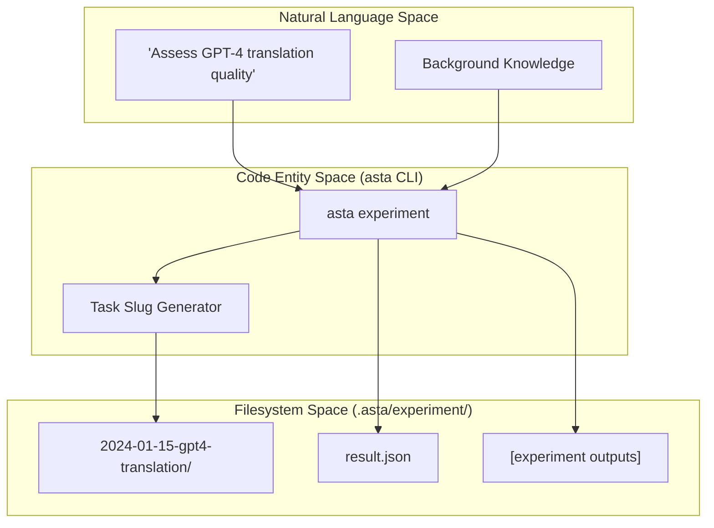
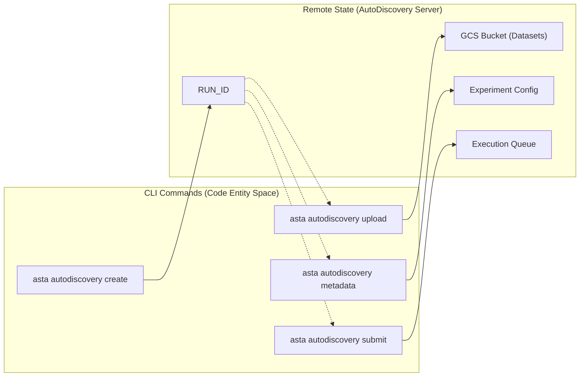

<!-- source: DeepWiki mcp.deepwiki.com · repo allenai/asta-plugins · page 3.3 Experiment and Data Analysis Skills · fetched 2026-10-26 -->

# Experiment and Data Analysis Skills

Relevant source files

The following files were used as context for generating this wiki page:

- [plugins/asta-preview/skills/analyze-data/SKILL.md](plugins/asta-preview/skills/analyze-data/SKILL.md)
- [plugins/asta-preview/skills/autodiscovery/SKILL.md](plugins/asta-preview/skills/autodiscovery/SKILL.md)
- [plugins/asta-preview/skills/experiment/SKILL.md](plugins/asta-preview/skills/experiment/SKILL.md)
- [skills/analyze-data/SKILL.md](skills/analyze-data/SKILL.md)
- [skills/autodiscovery/SKILL.md](skills/autodiscovery/SKILL.md)
- [skills/experiment/SKILL.md](skills/experiment/SKILL.md)

This page describes the specialized skills within the `asta` ecosystem for running computational experiments, performing deep data analysis, and orchestrating automated scientific discovery. These skills leverage external agents—**Panda** for experiments, **DataVoyager** for analysis, and **AutoDiscovery** for MCTS-based research—to move from natural language research questions to concrete data artifacts.

## Experiment Skill (Panda)

The `experiment` skill (internally referred to as **Panda**) is designed to answer research questions by writing and executing software [skills/experiment/SKILL.md:10-11](). It can also analyze existing experimental data to generate research reports [skills/experiment/SKILL.md:13-14]().

### Configuration and Environment
Panda relies on environment variables for LLM selection and provider credentials rather than CLI flags [skills/experiment/SKILL.md:31]().

| Variable | Purpose | Supported Providers |
| :--- | :--- | :--- |
| `PANDA_LLM` | Selects the underlying model | Claude, GPT, Mistral, Llama, OLMo |
| `OPENAI_API_KEY` | Credentials for GPT models | OpenAI |
| `ANTHROPIC_API_KEY` | Credentials for Claude models | Anthropic |
| `TOGETHER_API_KEY` | Credentials for OSS models | Together AI |
| `INFERD_TOKEN` | Credentials for OLMo models | Allen Institute for AI |

Sources: [skills/experiment/SKILL.md:33-40]()

### Run Lifecycle and Output Conventions
Experiments are organized within a local `.asta/experiment/` directory [skills/experiment/SKILL.md:63](). The skill enforces a strict naming convention: `.asta/experiment/<YYYY-MM-DD-slug>/` [skills/experiment/SKILL.md:65]().

1.  **Initialization**: The agent creates the output directory using `mkdir -p` [skills/experiment/SKILL.md:92-93]().
2.  **Execution**: The `asta experiment` command is invoked with a `--task` string or a `--task_file` [skills/experiment/SKILL.md:95-96,135-136]().
3.  **Reporting**: A summary of the findings is saved to a `result.json` file within the slug directory [skills/experiment/SKILL.md:68]().

### Experiment Data Flow
The following diagram maps the Natural Language task description to the Code entities and filesystem structure used by Panda.

**Panda Execution Flow**

Sources: [skills/experiment/SKILL.md:65-79,90-101]()

## Data Analysis Skill (DataVoyager)

The `analyze-data` skill interfaces with **DataVoyager**, a multi-agent data science pipeline that executes code in sandboxed notebooks [skills/analyze-data/SKILL.md:11]().

### Workflow Steps
1.  **Tightened Query**: The agent converts vague requests (e.g., "look at this CSV") into specific analytical questions naming datasets and insights [skills/analyze-data/SKILL.md:13-20]().
2.  **Submission**: A `submit` call mints a session UUID (`contextId`) and a task ID (`id`) [skills/analyze-data/SKILL.md:62-63]().
3.  **Polling**: The skill uses a backgrounded `poll` subcommand to monitor the long-running analysis (up to 2 hours) [skills/analyze-data/SKILL.md:77-83,93]().
4.  **Resumability**: Users can ask follow-up questions by providing the `--context-id` of a previous session, allowing the agent to reuse the existing workspace and datasets [skills/analyze-data/SKILL.md:73-74]().

### Integration with Artifacts
Upon completion, the skill hands off results to the `artifacts` skill, which registers plots, tables, and notebooks into the `asta-documents` index [skills/analyze-data/SKILL.md:95-98]().

Sources: [skills/analyze-data/SKILL.md:11-98]()

## AutoDiscovery Skill

The `autodiscovery` skill manages iterative scientific discovery runs guided by Bayesian surprise and Monte Carlo Tree Search (MCTS) [skills/autodiscovery/SKILL.md:10]().

### Run Configuration (Metadata)
Runs are configured via a `metadata.json` file that defines the search parameters [skills/autodiscovery/SKILL.md:106]().

*   **`n_experiments`**: Number of iterations (each costs 1 credit) [skills/autodiscovery/SKILL.md:166]().
*   **`exploration_weight`**: Controls the breadth of the hypothesis space search (default 1.0) [skills/autodiscovery/SKILL.md:167]().
*   **`surprisal_width`**: The threshold for flagging an experiment as "surprising" [skills/autodiscovery/SKILL.md:169]().
*   **`mcts_selection`**: The strategy used for node selection, typically `ucb1_recursive` [skills/autodiscovery/SKILL.md:168]().

### Discovery Lifecycle
The discovery process follows a multi-step submission pipeline.

**AutoDiscovery Submission Pipeline**

Sources: [skills/autodiscovery/SKILL.md:74-89,106-130]()

### Monitoring and Interpretation
Users monitor runs through status and experiment listing commands.
*   **`asta autodiscovery status <runid>`**: Returns states like `RUNNING`, `SUCCEEDED`, or `FAILED` [skills/autodiscovery/SKILL.md:34,55]().
*   **`asta autodiscovery experiments <runid>`**: Lists individual experiment nodes (e.g., `node_0_0`) with their surprise scores [skills/autodiscovery/SKILL.md:39-40]().
*   **Surprise Score**: A normalized value indicating how much the experimental result deviated from the prior belief distribution [skills/autodiscovery/SKILL.md:57-58]().

Sources: [skills/autodiscovery/SKILL.md:32-58]()

---

