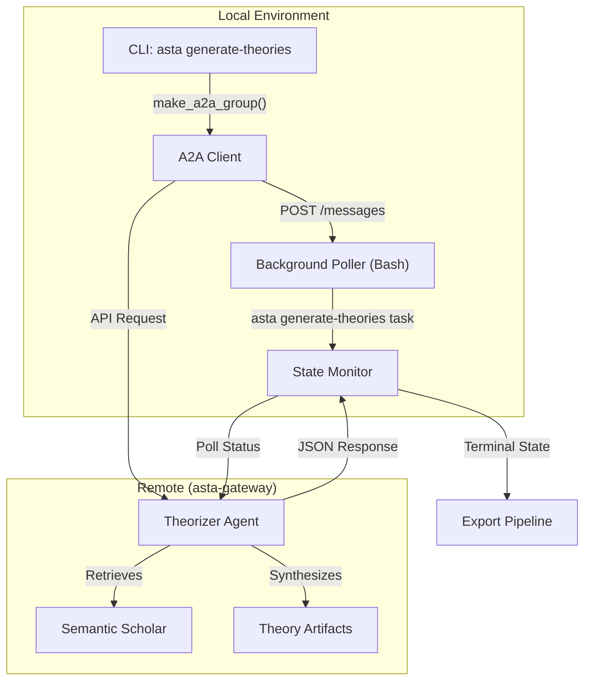
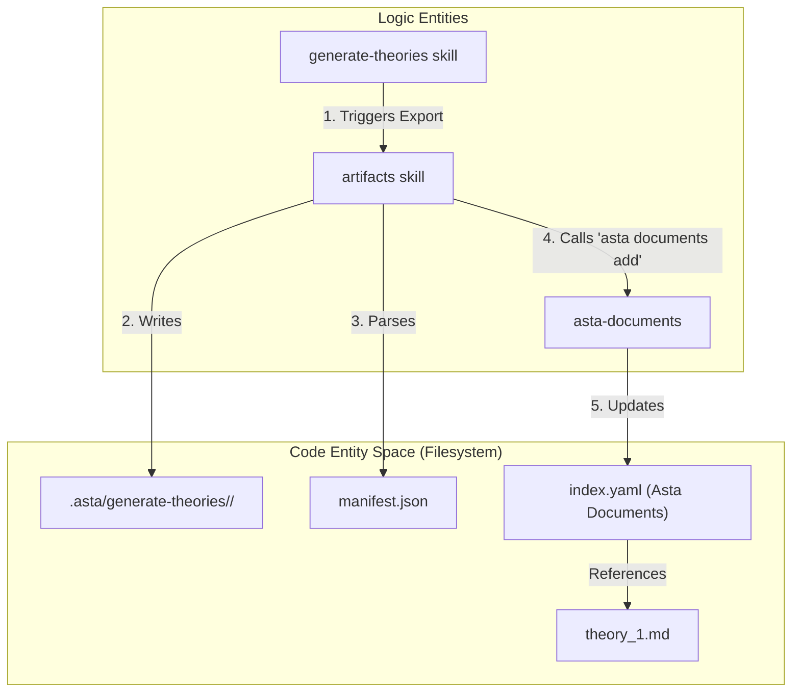

<!-- source: DeepWiki mcp.deepwiki.com · repo allenai/asta-plugins · page 3.4 Theory Generation and Artifacts Skills · fetched 2026-10-26 -->

# Theory Generation and Artifacts Skills

Relevant source files

The following files were used as context for generating this wiki page:

- [plugins/asta-preview/skills/artifacts/SKILL.md](plugins/asta-preview/skills/artifacts/SKILL.md)
- [plugins/asta-preview/skills/generate-theories/SKILL.md](plugins/asta-preview/skills/generate-theories/SKILL.md)
- [skills/artifacts/SKILL.md](skills/artifacts/SKILL.md)
- [skills/generate-theories/SKILL.md](skills/generate-theories/SKILL.md)
- [src/asta/theorizer.py](src/asta/theorizer.py)

The Theory Generation and Artifacts skills provide a pipeline for automated scientific discovery and structured result management. The `generate-theories` skill interfaces with the **Theorizer** agent to produce literature-grounded hypotheses, while the `artifacts` skill manages the export, formatting, and indexing of these outputs into the `asta-documents` system.

## 1. Theory Generation Skill

The `generate-theories` skill uses the Theorizer agent (hosted on Cloud Run) to search literature, extract evidence, and synthesize theories with optional novelty assessment `[skills/generate-theories/SKILL.md:9-11]()`.

### Implementation and Data Flow
The CLI interface for this skill is dynamically generated using `make_a2a_group`, which wires the command group to the Theorizer's A2A (Agent-to-Agent) API endpoints via the `asta-gateway` `[src/asta/theorizer.py:11-20]()`.

**Theory Generation Pipeline:**
1.  **Query Tightening**: The agent analyzes user intent to form a specific scientific question `[skills/generate-theories/SKILL.md:13-20]()`.
2.  **Submission**: A task is submitted via `asta generate-theories send-message` with parameters for paper count, objective (accuracy vs. novelty), and novelty evaluation flags `[skills/generate-theories/SKILL.md:61-73]()`.
3.  **Polling Loop**: Because tasks can take 10–90 minutes, the skill implements a background polling loop using a Bash subshell that monitors the `status.state` field `[skills/generate-theories/SKILL.md:74-94]()`.
4.  **State Management**: Terminal states include `completed`, `failed`, or `input-required`. If input is required, the agent relays the request to the user and resumes the loop after a reply is sent `[skills/generate-theories/SKILL.md:98-104]()`.

### Theorizer Logic Flow
The following diagram illustrates the interaction between the CLI, the A2A Framework, and the remote Theorizer service.

**Theory Generation Logic Flow**

Sources: `[src/asta/theorizer.py:11-20]()`, `[skills/generate-theories/SKILL.md:74-94]()`, `[skills/generate-theories/SKILL.md:106-111]()`

## 2. Artifacts Skill

The `artifacts` skill is a utility used to process the `artifacts[]` field of an A2A task response. It converts raw JSON outputs into human-readable or machine-indexable formats `[skills/artifacts/SKILL.md:9-11]()`.

### Export and Formats
The skill supports two primary output formats:
*   **Markdown (`--format md`)**: Individual `.md` files per artifact, optimized for LLM consumption and version control `[skills/artifacts/SKILL.md:30]()`.
*   **HTML (`--format html`)**: A self-contained directory with an `index.html` for human review `[skills/artifacts/SKILL.md:31]()`.

### Directory Convention
When invoked by another skill (like `generate-theories`), the artifacts are written to a standardized path:
`.asta/<invoking-skill>/<YYYY-MM-DD-slug>/` `[skills/artifacts/SKILL.md:33-40]()`.

### Manifest and Indexing
The export process produces a `manifest.json`. This manifest is used to register the outputs with the `asta-documents` system `[skills/artifacts/SKILL.md:55-57]()`.

| Manifest Field | Asta Document Mapping | Description |
| :--- | :--- | :--- |
| `filename` | `file://<absolute_path>` | The URL of the artifact |
| `name` | `--name` | Display name |
| `description` | `--summary` | Short description of the content |
| `subtype` | `--tags` | Metadata categorization |
| `metadata` | `--extra` | Raw JSON metadata |

Sources: `[skills/artifacts/SKILL.md:57-65]()`

## 3. Integrated Workflow: Theory to Document

The bridge between "Natural Language Space" (the user's research question) and "Code Entity Space" (the files and indices on disk) is managed by the handoff between the Theorizer and the Artifacts pipeline.

**Artifact Indexing and Storage Mapping**

Sources: `[skills/generate-theories/SKILL.md:106-111]()`, `[skills/artifacts/SKILL.md:44-53]()`, `[skills/artifacts/SKILL.md:57-66]()`

### Key Functions and Commands
*   **`make_a2a_group`**: Located in `src/asta/theorizer.py`, this function creates the CLI group for interacting with the Theorizer agent `[src/asta/theorizer.py:11-20]()`.
*   **`asta artifacts --input <DIR> --output <DIR>`**: The primary command for converting task JSON into a structured directory `[skills/artifacts/SKILL.md:15-22]()`.
*   **`asta documents add --root <DIR>`**: Used by the artifacts skill to register exported files into a scoped local index `[skills/artifacts/SKILL.md:66]()`.

Sources: `[src/asta/theorizer.py:11-20]()`, `[skills/artifacts/SKILL.md:15-22]()`, `[skills/artifacts/SKILL.md:66]()`

---

