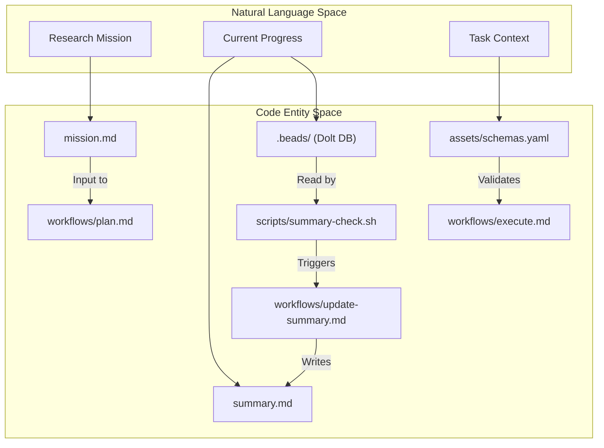
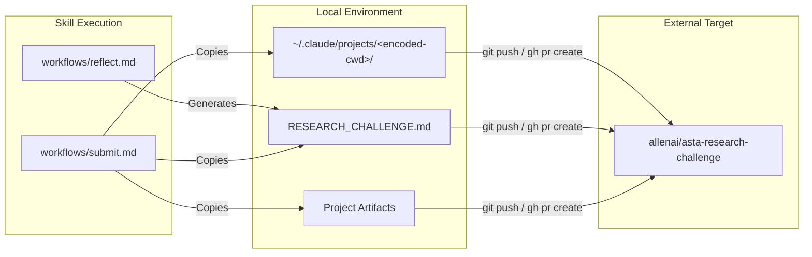

<!-- source: DeepWiki mcp.deepwiki.com · repo allenai/asta-plugins · page 3.5 Research Orchestration Skills · fetched 2026-10-26 -->

# Research Orchestration Skills

Relevant source files

The following files were used as context for generating this wiki page:

- [plugins/asta-preview/skills/research-challenge/SKILL.md](plugins/asta-preview/skills/research-challenge/SKILL.md)
- [plugins/asta-preview/skills/research-step/workflows/execute.md](plugins/asta-preview/skills/research-step/workflows/execute.md)
- [plugins/asta-preview/skills/research-step/workflows/init.md](plugins/asta-preview/skills/research-step/workflows/init.md)
- [plugins/asta-preview/skills/research-step/workflows/plan.md](plugins/asta-preview/skills/research-step/workflows/plan.md)
- [plugins/asta/skills/research-step/SKILL.md](plugins/asta/skills/research-step/SKILL.md)
- [skills/research-challenge/SKILL.md](skills/research-challenge/SKILL.md)
- [skills/research-step/SKILL.md](skills/research-step/SKILL.md)
- [skills/research-step/workflows/brainstorm.md](skills/research-step/workflows/brainstorm.md)
- [skills/research-step/workflows/execute.md](skills/research-step/workflows/execute.md)
- [skills/research-step/workflows/init.md](skills/research-step/workflows/init.md)
- [skills/research-step/workflows/plan.md](skills/research-step/workflows/plan.md)
- [skills/research-step/workflows/update-summary.md](skills/research-step/workflows/update-summary.md)

Research orchestration skills provide the framework for structured, autonomous scientific inquiry. They manage the lifecycle of a research project from initial brainstorming and environment setup to task execution, reflection, and formal submission.

## Research Step Skill (`research-step`)

The `research-step` skill models research as a directed acyclic graph (DAG) of typed tasks. It uses the **Beads** (bd) framework—a Git-integrated issue tracking system—to maintain state and dependencies.

### Core Architecture: The Router Pattern
This skill acts as a **router**. It does not execute logic from memory; instead, it inspects the working directory and dispatches to specific Markdown-based workflows [skills/research-step/SKILL.md:10-11]().

| Workflow | Purpose | Chaining Logic |
| :--- | :--- | :--- |
| **brainstorm** | Conversational exploration and `mission.md` drafting. | None. [skills/research-step/SKILL.md:55]() |
| **init** | Environment setup (installing `bd`, `jq`, initializing `.beads/`). | Chains to **plan**. [skills/research-step/SKILL.md:52]() |
| **plan** | Creates or extends the task graph (Bootstrap or Replan). | Chains to **update-summary**. [skills/research-step/SKILL.md:53]() |
| **execute** | Runs one ready task, validates JSON output against schema. | Chains to **plan** or **update-summary**. [skills/research-step/SKILL.md:54]() |
| **update-summary** | Regenerates `summary.md` from the current Beads state. | None. [skills/research-step/SKILL.md:55]() |

**Sources:** [skills/research-step/SKILL.md:7-60](), [skills/research-step/workflows/brainstorm.md:1-5]()

### Data Flow and State Management
State is persisted in the `.beads/` directory using an embedded Dolt database [plugins/asta-preview/skills/research-step/workflows/init.md:11-13]().

#### Research State Entity Mapping
The following diagram bridges the Natural Language concepts of "Research Progress" to the underlying Code Entities and file structures.

**Title: Research Step Entity Mapping**

**Sources:** [skills/research-step/SKILL.md:19-26](), [skills/research-step/workflows/update-summary.md:1-15](), [skills/research-step/workflows/execute.md:13-17]()

### Workflow: Execute and Validate
The `execute` workflow is the primary driver of work. It picks the oldest "ready" task from Beads, gathers inputs from parent tasks, and produces a structured JSON output [skills/research-step/workflows/execute.md:11-15]().

1.  **Claiming**: Sets task status to `in_progress` via `bd update <id> --status=in_progress` [skills/research-step/workflows/execute.md:13]().
2.  **Validation**: Every output must pass `scripts/validate-output.sh <task_type> <metadata-json-file>` [skills/research-step/workflows/execute.md:17]().
3.  **Persistence**: Outputs are written to the Beads metadata envelope using `scripts/write-meta.sh` [skills/research-step/workflows/execute.md:18]().

**Sources:** [skills/research-step/workflows/execute.md:1-28]()

### Workflow: Planning and Graph Structure
The `plan` workflow manages the "frontier" of the research graph. It operates in two modes: **Bootstrap** (creating the initial epic, scope, and definitions) and **Replan** (adding downstream tasks like `experiment_design` or `analysis` based on closed parents) [skills/research-step/workflows/plan.md:1-6]().

| Task Type | Next Steps (Planning Logic) |
| :--- | :--- |
| `literature_review` | Creates `hypothesis` tasks for each gap found. [skills/research-step/workflows/plan.md:68]() |
| `hypothesis` | Creates `experiment_design` → `evidence_gathering` → `analysis` chain. [skills/research-step/workflows/plan.md:69]() |
| `analysis` | Creates `synthesis` once all hypotheses are analyzed. [skills/research-step/workflows/plan.md:70]() |

**Sources:** [skills/research-step/workflows/plan.md:1-72]()

---

## Research Challenge Skill (`research-challenge`)

The `research-challenge` skill is used for project wrap-up and external submission. It is marked as an internal skill [skills/research-challenge/SKILL.md:5]().

### Reflection and Submission Flow
This skill facilitates the transition from an active research session to a permanent record.

1.  **Reflect**: An interview-style workflow where the agent self-critiques its contribution and suggests skill improvements, resulting in a `RESEARCH_CHALLENGE.md` file [skills/research-challenge/SKILL.md:28]().
2.  **Submit**: Automates the packaging of artifacts, conversation transcripts from `~/.claude/projects/`, and the reflection report into a PR for the `allenai/asta-research-challenge` repository [skills/research-challenge/SKILL.md:19-30]().

#### Artifact Orchestration
The following diagram illustrates how the `research-challenge` skill interacts with system-level conversation logs and the project repository.

**Title: Research Challenge Artifact Flow**

**Sources:** [skills/research-challenge/SKILL.md:15-30]()

### Key Files and Conventions
*   **Encoded Path**: The skill identifies conversation histories by encoding the current working directory path (replacing `/` with `-`) to locate Claude project logs [skills/research-challenge/SKILL.md:22]().
*   **Tooling**: Relies heavily on `git` and `gh` (GitHub CLI) for repository cloning and PR creation [skills/research-challenge/SKILL.md:6]().

**Sources:** [skills/research-challenge/SKILL.md:1-41]()

---

