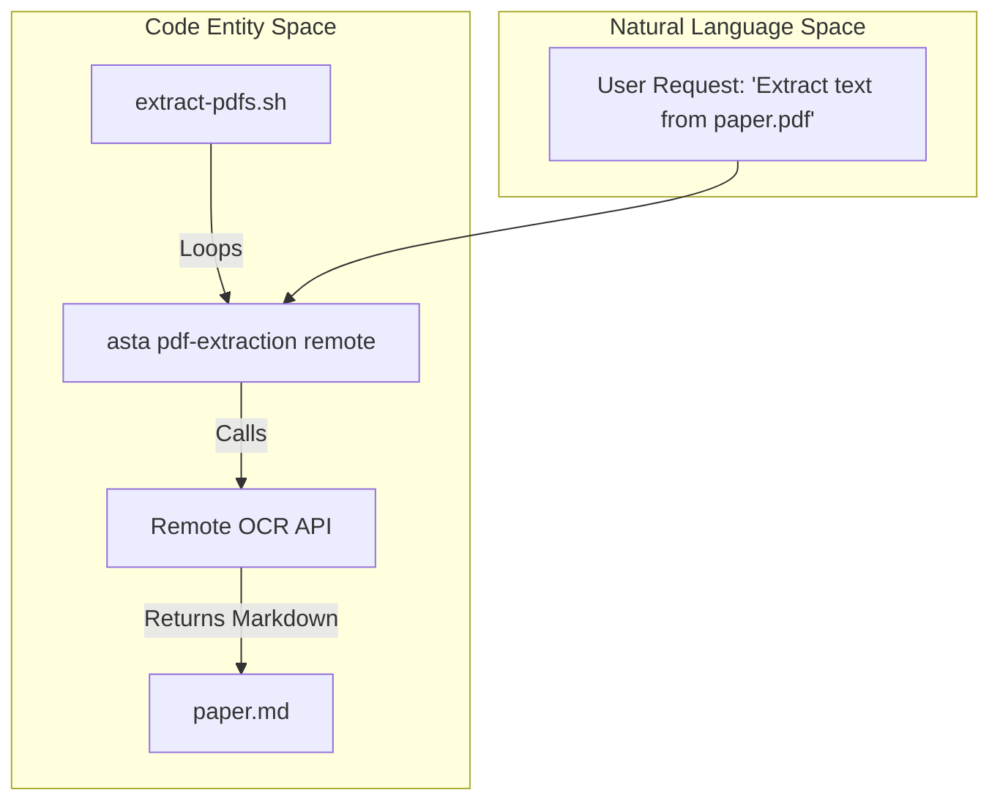
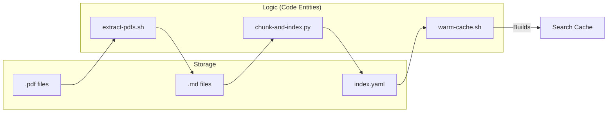

<!-- source: DeepWiki mcp.deepwiki.com · repo allenai/asta-plugins · page 3.6 PDF Extraction, Local Paper Index, and Utility Skills · fetched 2026-10-26 -->

# PDF Extraction, Local Paper Index, and Utility Skills

Relevant source files

The following files were used as context for generating this wiki page:

- [plugins/asta-preview/skills/local-paper-index/SKILL.md](plugins/asta-preview/skills/local-paper-index/SKILL.md)
- [plugins/asta-preview/skills/local-paper-index/assets/chunk-and-index.py](plugins/asta-preview/skills/local-paper-index/assets/chunk-and-index.py)
- [plugins/asta-preview/skills/local-paper-index/assets/extract-pdfs.sh](plugins/asta-preview/skills/local-paper-index/assets/extract-pdfs.sh)
- [plugins/asta-preview/skills/local-paper-index/assets/warm-cache.sh](plugins/asta-preview/skills/local-paper-index/assets/warm-cache.sh)
- [plugins/asta-preview/skills/pdf-extraction/SKILL.md](plugins/asta-preview/skills/pdf-extraction/SKILL.md)
- [plugins/asta-preview/skills/preview/SKILL.md](plugins/asta-preview/skills/preview/SKILL.md)
- [plugins/asta-preview/skills/workspace/assets/devcontainer.json](plugins/asta-preview/skills/workspace/assets/devcontainer.json)
- [plugins/asta/skills/preview/SKILL.md](plugins/asta/skills/preview/SKILL.md)
- [plugins/asta/skills/workspace/SKILL.md](plugins/asta/skills/workspace/SKILL.md)
- [plugins/asta/skills/workspace/assets/devcontainer.json](plugins/asta/skills/workspace/assets/devcontainer.json)
- [skills/local-paper-index/SKILL.md](skills/local-paper-index/SKILL.md)
- [skills/local-paper-index/assets/chunk-and-index.py](skills/local-paper-index/assets/chunk-and-index.py)
- [skills/local-paper-index/assets/extract-pdfs.sh](skills/local-paper-index/assets/extract-pdfs.sh)
- [skills/local-paper-index/assets/warm-cache.sh](skills/local-paper-index/assets/warm-cache.sh)
- [skills/pdf-extraction/SKILL.md](skills/pdf-extraction/SKILL.md)
- [skills/preview/SKILL.md](skills/preview/SKILL.md)
- [skills/preview/assets/_quarto.yml](skills/preview/assets/_quarto.yml)
- [skills/workspace/SKILL.md](skills/workspace/SKILL.md)

This section covers the skills used for document processing, local knowledge base construction, and project utility management. These skills enable the transformation of raw PDF artifacts into structured, searchable markdown indices and provide the infrastructure for document previewing and development environments.

## PDF Extraction Skill

The `pdf-extraction` skill provides high-fidelity text and image extraction from PDF documents. It supports two primary execution modes: a remote single-file API for low-latency tasks and a cloud-based batch processing engine (olmOCR) for large-scale datasets.

### Implementation and Engines

1.  **Remote OCR (`asta pdf-extraction remote`)**: Uses a remote Asta API to process local PDF files. It is optimized for single files up to 50 pages [skills/pdf-extraction/SKILL.md:14-14](). For larger documents, the skill implements a multi-part extraction logic that processes 50-page increments and concatenates the results [plugins/asta-preview/skills/local-paper-index/assets/extract-pdfs.sh:95-113]().
2.  **olmOCR (`asta pdf-extraction olmocr`)**: Integrates with the [olmOCR](https://github.com/allenai/olmOCR) cloud service. This engine is designed for large batches, complex layouts, and supports S3-based workflows [skills/pdf-extraction/SKILL.md:13-13]().

### Data Flow: PDF to Markdown

The following diagram illustrates the transition from a raw PDF file to the structured markdown used by other skills.

**PDF Extraction Logic Flow**

Sources: [skills/pdf-extraction/SKILL.md:68-76](), [plugins/asta-preview/skills/local-paper-index/assets/extract-pdfs.sh:89-113]()

## Local Paper Index Skill

The `local-paper-index` skill automates the creation of a searchable YAML index from a directory of PDFs. It acts as an orchestration layer over `pdf-extraction` and `asta-documents`.

### Indexing Pipeline

The pipeline follows a four-step procedure:
1.  **Discovery**: Scans the `PDF_DIR` for files and provides size/time estimates [skills/local-paper-index/SKILL.md:85-91]().
2.  **Extraction**: Invokes `extract-pdfs.sh` to convert PDFs to markdown. It supports an `--images` flag which creates per-PDF subdirectories to prevent image filename collisions [plugins/asta-preview/skills/local-paper-index/assets/extract-pdfs.sh:71-79]().
3.  **Chunking**: The `chunk-and-index.py` script splits markdown text into ~2000-character segments [plugins/asta-preview/skills/local-paper-index/assets/chunk-and-index.py:38-38](). It attempts to break segments at paragraph (`\n\n`) or sentence (`. `) boundaries to maintain semantic integrity [plugins/asta-preview/skills/local-paper-index/assets/chunk-and-index.py:65-71]().
4.  **Indexing**: Writes document entries directly to a YAML index. Each entry includes metadata such as `source_pdf`, `chunk_index`, and `total_chunks` in the `extra` field [plugins/asta-preview/skills/local-paper-index/assets/chunk-and-index.py:206-220]().

### Portable Indexing Architecture

The system uses relative paths in the `url` field of the index YAML if the markdown files are located within the index's parent directory. This ensures the index remains portable across different environments [plugins/asta-preview/skills/local-paper-index/assets/chunk-and-index.py:83-95]().

**Local Paper Index Component Map**

Sources: [skills/local-paper-index/SKILL.md:30-38](), [plugins/asta-preview/skills/local-paper-index/assets/chunk-and-index.py:11-14]()

## Utility Skills: Preview and Workspace

### Preview Skill
The `preview` skill manages document rendering and deployment using [Quarto](https://quarto.org).
-   **Local Preview**: Uses `quarto preview` for hot-reloading [skills/preview/SKILL.md:17-17]().
-   **CI/CD Integration**: Provides a standardized GitHub Actions workflow (`docs.yml`) that renders documents and deploys them to GitHub Pages with PR preview support [skills/preview/SKILL.md:31-33]().
-   **Configuration**: Relies on a `_quarto.yml` file to define project structure and bibliography [skills/preview/assets/_quarto.yml:1-18]().

### Workspace Skill
The `workspace` skill standardizes the development environment using VS Code Dev Containers or GitHub Codespaces.
-   **DevContainer**: Configures a container via `devcontainer.json` with Quarto and Asta pre-installed [skills/workspace/SKILL.md:8-14]().
-   **Auto-Authentication**: Supports passing `ASTA_TOKEN` from the host environment to the container automatically [skills/workspace/SKILL.md:16-16]().
-   **Port Mapping**: Automatically maps port 4848 for Quarto previews [skills/workspace/SKILL.md:15-15]().

## Summary of Key Assets

| Skill | Asset Path | Purpose |
| :--- | :--- | :--- |
| `local-paper-index` | `assets/extract-pdfs.sh` | Orchestrates batch OCR via CLI [skills/local-paper-index/SKILL.md:34-34]() |
| `local-paper-index` | `assets/chunk-and-index.py` | Performs semantic chunking and YAML generation [skills/local-paper-index/SKILL.md:35-35]() |
| `preview` | `assets/_quarto.yml` | Template for Quarto website configuration [skills/preview/SKILL.md:24-24]() |
| `workspace` | `assets/devcontainer.json` | Template for standardized Asta dev environments [skills/workspace/SKILL.md:14-14]() |

Sources: [skills/local-paper-index/SKILL.md:30-38](), [skills/preview/SKILL.md:24-24](), [skills/workspace/SKILL.md:14-14]()

---

