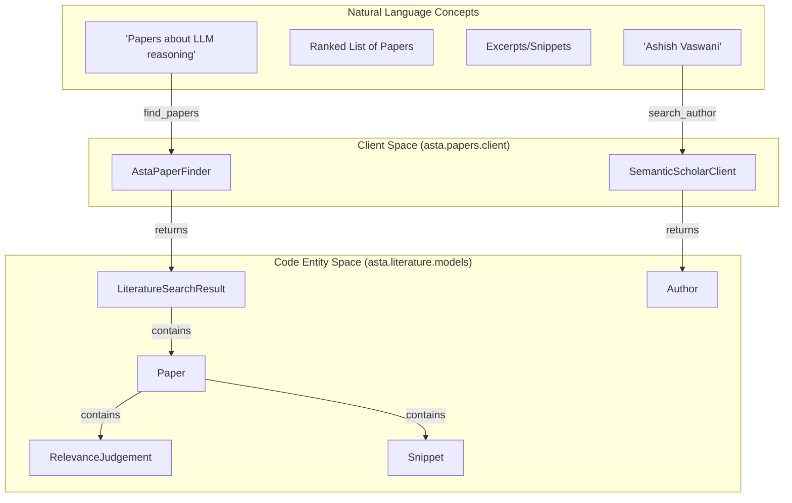
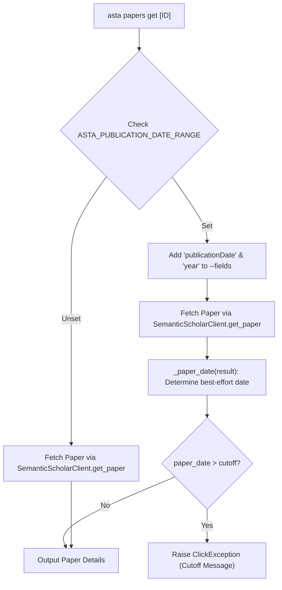

<!-- source: DeepWiki mcp.deepwiki.com · repo allenai/asta-plugins · page 4.1 Papers and Literature Clients · fetched 2026-10-26 -->

# Papers and Literature Clients

Relevant source files

The following files were used as context for generating this wiki page:

- [src/asta/literature/__init__.py](src/asta/literature/__init__.py)
- [src/asta/literature/models.py](src/asta/literature/models.py)
- [src/asta/papers/author.py](src/asta/papers/author.py)
- [src/asta/papers/citations.py](src/asta/papers/citations.py)
- [src/asta/papers/client.py](src/asta/papers/client.py)
- [src/asta/papers/get.py](src/asta/papers/get.py)
- [src/asta/papers/search.py](src/asta/papers/search.py)
- [src/asta/papers/snippet_search.py](src/asta/papers/snippet_search.py)
- [tests/test_client.py](tests/test_client.py)
- [tests/test_models.py](tests/test_models.py)
- [tests/test_papers_cli.py](tests/test_papers_cli.py)

The `asta` codebase provides two primary mechanisms for interacting with academic literature: a direct interface to the **Semantic Scholar API** and a high-level **Asta Paper Finder** service that provides relevance-ranked results with snippet-level evidence.

## SemanticScholarClient

The `SemanticScholarClient` is a lightweight, standard-library-only client used to interact with the Semantic Scholar Graph API. It handles authentication via the `asta` token system and configuration-driven base URLs [src/asta/papers/client.py:13-45]().

### Key Methods
| Method | Description | API Endpoint |
| :--- | :--- | :--- |
| `get_paper` | Retrieve details for a specific paper by ID (ArXiv, DOI, CorpusId) | `/graph/v1/paper/{paper_id}` |
| `search_papers` | Standard keyword search for papers | `/graph/v1/paper/search` |
| `snippet_search` | Full-text search returning matching excerpts from paper bodies | `/graph/v1/snippet/search` |
| `get_paper_citations` | List papers that cite a given paper | `/graph/v1/paper/{id}/citations` |
| `get_author_papers` | Retrieve all papers associated with a specific author ID | `/graph/v1/author/{id}/papers` |

Sources: [src/asta/papers/client.py:62-191]()

### Request Flow and Data Normalization
The client uses `urllib` to maintain zero external dependencies for core API interactions [src/asta/papers/client.py:3-6](). It automatically injects the bearer token from `get_access_token()` into the headers [src/asta/papers/client.py:41-44]().

**Paper Request Flow:**
1. CLI command (e.g., `asta papers get`) invokes `SemanticScholarClient`.
2. Client resolves `base_url` from `asta.conf` [src/asta/papers/client.py:24-32]().
3. `_request` method handles parameter encoding and JSON parsing [src/asta/papers/client.py:46-60]().

Sources: [src/asta/papers/client.py:1-60]()

## AstaPaperFinder and Literature Models

The `AstaPaperFinder` client interacts with an internal "Paper Finder" service. Unlike the raw Semantic Scholar client, this service returns structured `LiteratureSearchResult` objects that include LLM-based relevance judgements and supporting snippets.

### Data Models
The system uses Pydantic models to enforce the schema of literature search results [src/asta/literature/models.py:1-7]().

*   **`Paper`**: Extends standard metadata with `relevanceScore`, `relevanceJudgement`, and `citationContexts` [src/asta/literature/models.py:62-91]().
*   **`RelevanceJudgement`**: Contains an integer score, a summary string, and per-criteria breakdowns [src/asta/literature/models.py:42-50]().
*   **`Snippet`**: Represents a specific excerpt from a paper's body or abstract [src/asta/literature/models.py:17-23]().

### Author Normalization
The `Paper` model includes a validator `convert_author_strings` to handle API responses that might return authors as simple strings or structured objects, ensuring consistency in the `Author` model [src/asta/literature/models.py:99-112]().

Sources: [src/asta/literature/models.py:1-137](), [src/asta/literature/client.py:3-10]()

## CLI Command Implementations

### Papers CLI (`asta papers ...`)
The `papers` group provides direct access to Semantic Scholar functionality.

*   **`get`**: Retrieves paper details. It implements a **Date Cutoff** mechanism via `ASTA_PUBLICATION_DATE_RANGE` to prevent agents from "leaking" information from papers published after a specific evaluation date [src/asta/papers/get.py:51-64]().
*   **`search`**: Standard keyword search with configurable fields [src/asta/papers/search.py:11-40]().
*   **`snippet-search`**: Specialized search for finding specific text within paper bodies [src/asta/papers/snippet_search.py:11-46]().
*   **`author`**: A sub-group for searching authors (`search`) and listing their publications (`papers`) [src/asta/papers/author.py:11-14]().

### Literature CLI (`asta literature ...`)
The `literature` group uses the `AstaPaperFinder` client.
*   **`find`**: A one-shot command to find relevant papers for a query.
*   **`interactive`**: Built on the `A2A` (Agent-to-Agent) framework, this allows multi-turn refinement of a literature search [src/asta/literature/models.py:133-135]().

Sources: [src/asta/papers/get.py:20-87](), [src/asta/papers/search.py:35-70](), [src/asta/papers/snippet_search.py:40-79](), [src/asta/papers/author.py:17-133]()

## Technical Diagrams

### Literature Data Space Mapping
This diagram bridges the Natural Language concepts of "Paper Search" to the specific Pydantic entities and API client methods.

"Natural Language Space to Code Entity Space: Literature"

Sources: [src/asta/literature/models.py:1-137](), [src/asta/papers/client.py:13-169]()

### Date Cutoff Logic Flow
The following diagram illustrates how the `asta papers get` command enforces publication date restrictions to maintain evaluation integrity.

"Logic Flow: Publication Date Cutoff Enforcement"

Sources: [src/asta/papers/get.py:51-83](), [src/asta/papers/get.py:139-161]()

## Summary of Client Features

| Feature | `SemanticScholarClient` | `AstaPaperFinder` |
| :--- | :--- | :--- |
| **Primary Use** | Raw metadata lookup, citations, authors | Research queries, relevance ranking |
| **Dependencies** | `stdlib` (urllib, json) | `pydantic`, `asta.literature.models` |
| **Auth** | Bearer Token (Auth0) | Bearer Token (Auth0) |
| **Data Format** | Raw JSON Dicts | Pydantic Models (`LiteratureSearchResult`) |
| **Special Logic** | Date Cutoff Enforcement | A2A Interactive Session Support |

Sources: [src/asta/papers/client.py:1-45](), [src/asta/literature/models.py:122-137](), [src/asta/papers/get.py:51-65]()

---

