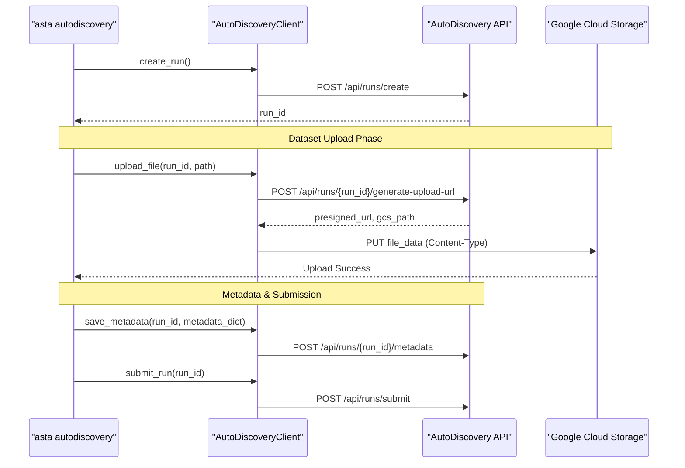
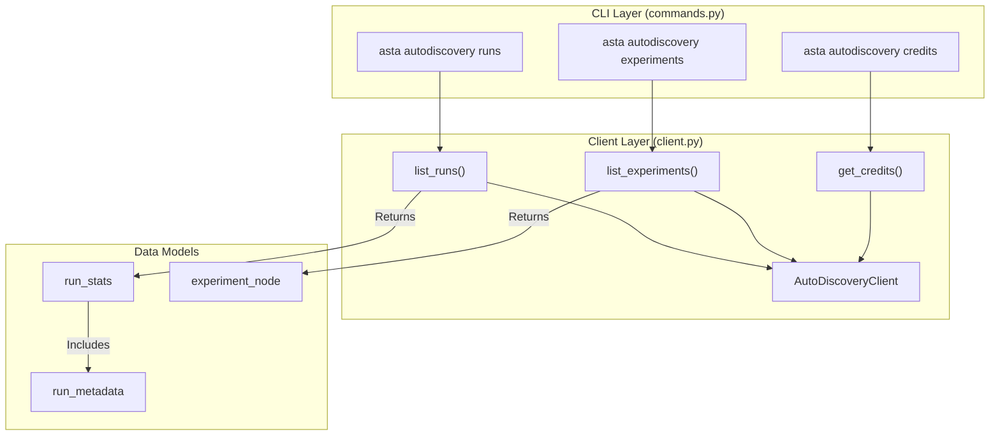

<!-- source: DeepWiki mcp.deepwiki.com · repo allenai/asta-plugins · page 4.2 AutoDiscovery Client · fetched 2026-10-26 -->

# AutoDiscovery Client

Relevant source files

The following files were used as context for generating this wiki page:

- [plugins/asta-preview/skills/autodiscovery/SKILL.md](plugins/asta-preview/skills/autodiscovery/SKILL.md)
- [skills/autodiscovery/SKILL.md](skills/autodiscovery/SKILL.md)
- [src/asta/autodiscovery/__init__.py](src/asta/autodiscovery/__init__.py)
- [src/asta/autodiscovery/client.py](src/asta/autodiscovery/client.py)
- [src/asta/autodiscovery/commands.py](src/asta/autodiscovery/commands.py)

The `AutoDiscoveryClient` is a specialized interface for interacting with the AutoDiscovery API, an AI-driven scientific discovery platform that uses Monte Carlo Tree Search (MCTS) and Bayesian surprise to guide iterative experimentation [skills/autodiscovery/SKILL.md:8-10](). The client facilitates the entire run lifecycle, from initial creation and dataset uploading via presigned GCS URLs to monitoring experiment status and retrieving credits [src/asta/autodiscovery/client.py:15-148]().

## Client Implementation

The `AutoDiscoveryClient` is implemented using the Python standard library to minimize dependencies [src/asta/autodiscovery/client.py:1-8](). It leverages the shared Asta authentication system by extracting the `sub` claim from the JWT access token to identify the user [src/asta/autodiscovery/client.py:44-52]().

### Key Functions and API Mapping

| Function | Method | API Endpoint | Description |
| :--- | :--- | :--- | :--- |
| `list_runs` | GET | `/api/runs/{user_id}/list` | Lists all discovery runs for the user [src/asta/autodiscovery/client.py:76-77](). |
| `get_run` | GET | `/api/runs/{user_id}/{run_id}` | Retrieves full run details, stats, and metadata [src/asta/autodiscovery/client.py:79-80](). |
| `list_experiments`| POST | `/api/runs/{user_id}/{run_id}/experiments` | Lists experiments (nodes) within the MCTS tree [src/asta/autodiscovery/client.py:85-86](). |
| `generate_upload_url`| POST | `/api/runs/{run_id}/generate-upload-url` | Requests a presigned GCS URL for dataset ingestion [src/asta/autodiscovery/client.py:102-116](). |
| `submit_run` | POST | `/api/runs/submit` | Finalizes configuration and triggers the MCTS agent [src/asta/autodiscovery/client.py:144-145](). |
| `get_credits` | GET | `/api/user/me/credits` | Retrieves credit balance (1 credit = 1 experiment) [src/asta/autodiscovery/client.py:150-151](). |

**Sources:** [src/asta/autodiscovery/client.py:76-151]()

## Run Lifecycle and Data Flow

The lifecycle of an AutoDiscovery run involves transitioning from an empty container to a submitted execution state.

### Run Submission Flow
The following diagram illustrates the sequence of operations required to launch a new discovery run, mapping CLI commands to internal client methods and API interactions.

Discovery Run Initialization Sequence

**Sources:** [src/asta/autodiscovery/client.py:93-145](), [skills/autodiscovery/SKILL.md:74-89]()

### Presigned GCS Uploads
The `upload_file` method performs a multi-step handshake:
1. It identifies the file's MIME type and size [src/asta/autodiscovery/client.py:120-122]().
2. It requests a presigned URL from the API via `generate_upload_url` [src/asta/autodiscovery/client.py:124]().
3. It performs a standard HTTP `PUT` request directly to the storage provider (GCS) using `urllib.request` [src/asta/autodiscovery/client.py:128-135]().

**Sources:** [src/asta/autodiscovery/client.py:118-142]()

## CLI Commands and Experiment Tree Retrieval

The CLI provides both JSON and human-readable text output for monitoring the progress of discovery runs.

### Experiment Details
Experiments are the individual nodes of the discovery tree. Each experiment contains:
* **Hypothesis**: The specific scientific claim being tested [src/asta/autodiscovery/commands.py:215]().
* **Surprise Score**: A normalized value indicating how much the experimental result deviated from the model's prior belief [skills/autodiscovery/SKILL.md:56]().
* **Prior/Posterior**: The mean of belief distributions before and after the experiment [skills/autodiscovery/SKILL.md:57]().

### Command Entity Mapping
This diagram maps the CLI surface area to the underlying implementation classes and data structures.

CLI to Internal Entity Mapping

**Sources:** [src/asta/autodiscovery/commands.py:51-240](), [src/asta/autodiscovery/client.py:76-151]()

## Credit System
AutoDiscovery utilizes a credit-based consumption model where one experiment equals one credit [skills/autodiscovery/SKILL.md:166](). The `asta autodiscovery credits` command calls `get_credits()` to display the following fields:
* **Granted**: Total credits allocated to the user [src/asta/autodiscovery/commands.py:236]().
* **Consumed**: Credits used by completed experiments [src/asta/autodiscovery/commands.py:237]().
* **Pending**: Credits reserved for currently running experiments [src/asta/autodiscovery/commands.py:238]().
* **Available**: Remaining balance [src/asta/autodiscovery/commands.py:239]().

**Sources:** [src/asta/autodiscovery/commands.py:225-240](), [src/asta/autodiscovery/client.py:150-151]()

---

