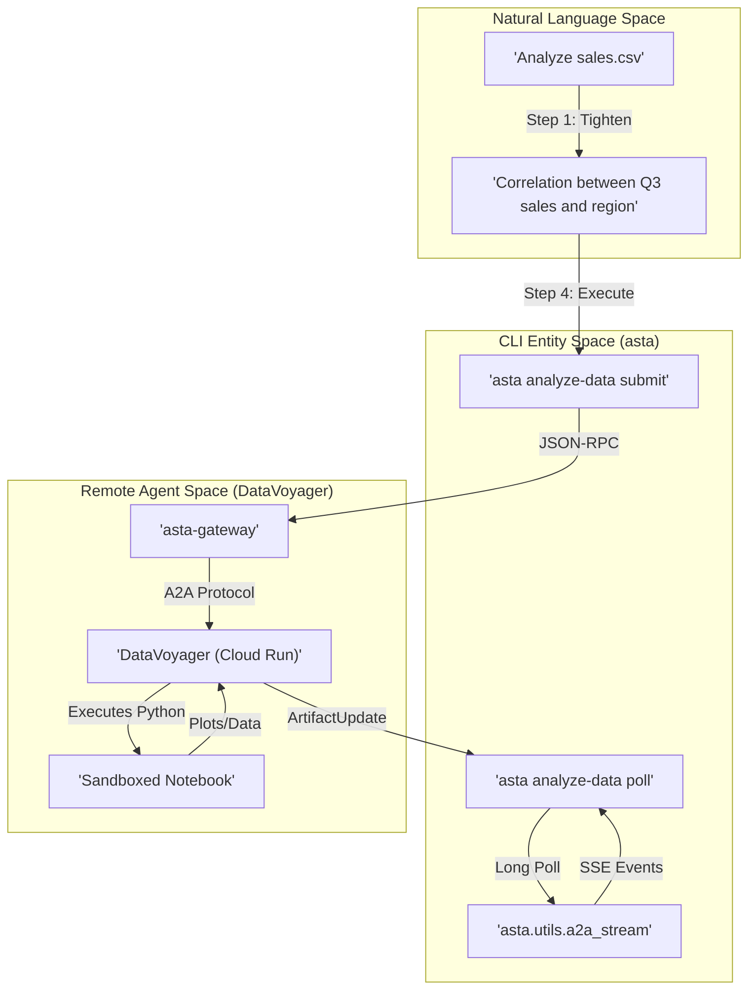
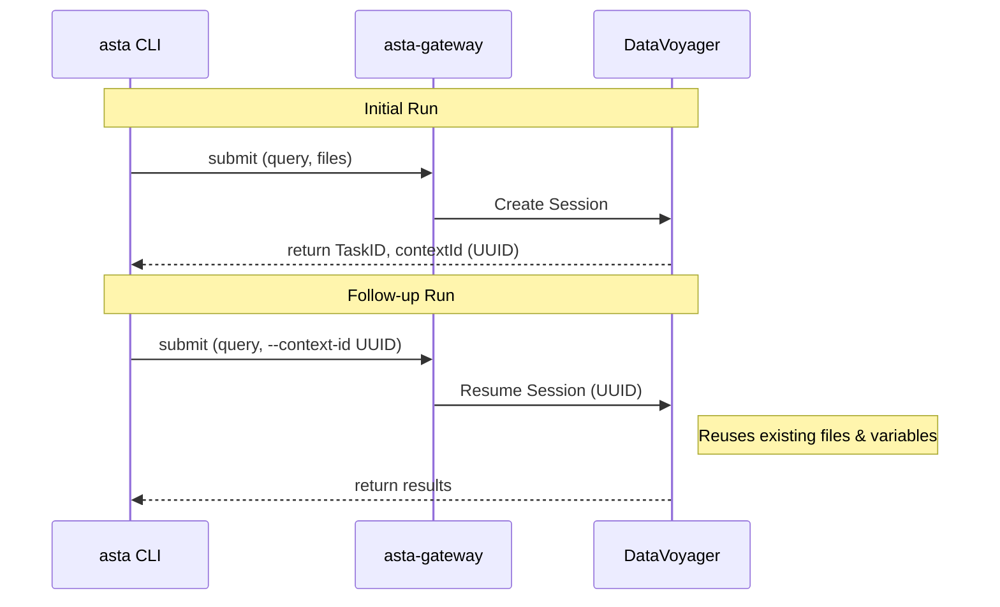

<!-- source: DeepWiki mcp.deepwiki.com · repo allenai/asta-plugins · page 4.3 Analyze Data (DataVoyager) Module · fetched 2026-10-26 -->

# Analyze Data (DataVoyager) Module

Relevant source files

The following files were used as context for generating this wiki page:

- [plugins/asta-preview/skills/analyze-data/SKILL.md](plugins/asta-preview/skills/analyze-data/SKILL.md)
- [skills/analyze-data/SKILL.md](skills/analyze-data/SKILL.md)
- [src/asta/literature/a2a_artifact.py](src/asta/literature/a2a_artifact.py)
- [src/asta/literature/interactive.py](src/asta/literature/interactive.py)
- [src/asta/utils/a2a_interactive.py](src/asta/utils/a2a_interactive.py)
- [src/asta/utils/a2a_stream.py](src/asta/utils/a2a_stream.py)

The `analyze-data` module provides a bridge between the `asta` CLI and **DataVoyager**, an AI-driven data science agent. It enables users to perform complex statistical analysis, visualization, and modeling on tabular datasets through a multi-agent pipeline that writes and executes code in a sandboxed environment.

## Overview and Purpose

The module is built on the **Agent-to-Agent (A2A)** framework, allowing for interactive, stateful conversations where the agent can ask clarifying questions or request additional data.

Key capabilities include:
- **Tightened Query Generation**: Converting vague user requests into precise analytical questions [skills/analyze-data/SKILL.md:13-26]().
- **Contextual Resumability**: Maintaining workspace state (files, variables, history) across multiple CLI invocations using `context-id` [skills/analyze-data/SKILL.md:73-74]().
- **Background Polling**: Executing long-running analysis tasks (up to 2 hours) without blocking the user's primary interface [skills/analyze-data/SKILL.md:77-94]().
- **Artifact Integration**: Exporting plots, notebooks, and summaries into the local `.asta` directory for indexing and search [skills/analyze-data/SKILL.md:96-98]().

---

## System Architecture

The analysis workflow transitions from natural language intent to structured A2A messages processed by the `asta-gateway`.

### Logic Flow: Natural Language to Code Entity
The following diagram maps the conceptual steps of a data analysis request to the specific code entities and CLI commands that handle them.

**Data Analysis Execution Path**

**Sources:** [skills/analyze-data/SKILL.md:13-83](), [src/asta/utils/a2a_stream.py:1-7]()

---

## Implementation Details

### A2A Interactive Framework
The module utilizes the generic interactive runner defined in `src/asta/utils/a2a_interactive.py`. This framework manages the lifecycle of a session, including:
1.  **Thread Management**: Using `--thread-dir` to store `index.json` which tracks the `thread_id` and turn indices [src/asta/utils/a2a_interactive.py:31-37]().
2.  **Streaming**: Leveraging `stream_a2a_message` to handle JSON-RPC over Server-Sent Events (SSE) [src/asta/utils/a2a_stream.py:56-64]().
3.  **Terminal States**: Monitoring for `TASK_STATE_COMPLETED` or `TASK_STATE_FAILED` to end the session [src/asta/utils/a2a_stream.py:22-30]().

### Key Functions and Classes

| Entity | Location | Role |
| :--- | :--- | :--- |
| `A2AEvent` | [src/asta/utils/a2a_stream.py:40-45]() | Dataclass representing raw events (task, status, artifact). |
| `stream_a2a_message` | [src/asta/utils/a2a_stream.py:56-64]() | Low-level SSE client for A2A communication. |
| `run_a2a_session` | [src/asta/utils/a2a_interactive.py:122-133]() | Orchestrator for auth, directory prep, and result persistence. |
| `artifact_data_of` | [src/asta/utils/a2a_stream.py:139-147]() | Extractor for payload data from `artifact_update` events. |

**Sources:** [src/asta/utils/a2a_interactive.py:1-184](), [src/asta/utils/a2a_stream.py:1-149]()

---

## Data Flow and Resumability

The `analyze-data` skill emphasizes **resumability** through the `context-id`. Unlike simple stateless tools, DataVoyager maintains a persistent workspace.

**Context Resumption Sequence**

**Sources:** [skills/analyze-data/SKILL.md:60-74](), [src/asta/utils/a2a_stream.py:155-172]()

### Artifact Export and Indexing
Once an analysis is complete, the results are processed by the **Asta Artifacts** skill. This process:
1.  Captures the final task JSON and associated files (CSV, PNG, IPYNB).
2.  Registers them in a local `index.yaml` within the project's `.asta/analyze-data/<slug>/` directory [skills/analyze-data/SKILL.md:96-108]().
3.  Enables semantic search via `asta documents search` [skills/analyze-data/SKILL.md:106-106]().

**Sources:** [skills/analyze-data/SKILL.md:95-108]()

---

