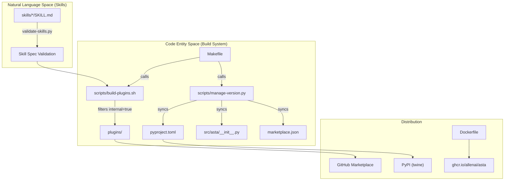

<!-- source: DeepWiki mcp.deepwiki.com · repo allenai/asta-plugins · page 5 Build, CI/CD, and Release · fetched 2026-10-26 -->

# Build, CI/CD, and Release

Relevant source files

The following files were used as context for generating this wiki page:

- [.dockerignore](.dockerignore)
- [.github/workflows/ci.yml](.github/workflows/ci.yml)
- [.github/workflows/docker.yml](.github/workflows/docker.yml)
- [Dockerfile](Dockerfile)
- [Makefile](Makefile)
- [scripts/docker-skill-discovery-test.sh](scripts/docker-skill-discovery-test.sh)
- [scripts/docker-smoke-test.sh](scripts/docker-smoke-test.sh)
- [scripts/manage-version.py](scripts/manage-version.py)

This page provides an overview of the development lifecycle for the `asta-plugins` repository. It covers the automation used to maintain code quality, generate plugin artifacts, manage versions across multiple configuration files, and publish the package to PyPI and Docker registries.

## Lifecycle Overview

The development lifecycle is centered around a `Makefile` that orchestrates `uv` for Python environment management and custom shell scripts for plugin generation. The CI/CD pipeline ensures that every change is validated against linting rules, unit tests, and the Agent Skills specification before release.

### System Workflow Diagram

The following diagram illustrates how source code and skill definitions are transformed into distributable artifacts.

**Artifact Generation Pipeline**

**Sources:** [Makefile:1-37](), [scripts/manage-version.py:22-26](), [scripts/build-plugins.sh:1-10]()

---

## Makefile and CI Workflows

The `Makefile` serves as the primary entry point for all development tasks. It encapsulates complex commands for installation, testing, and plugin management.

*   **Development:** `make install` uses `uv sync` to set up the environment [Makefile:40-41]().
*   **Quality Control:** `make lint` and `make format` utilize `ruff` for rapid feedback [Makefile:61-71]().
*   **Testing:** Supports unit, integration, and coverage reports via `pytest` [Makefile:44-58]().
*   **CI Integration:** The `ci.yml` workflow executes these targets on every push to `main` and all pull requests [ci.yml:1-35]().

For details, see [Makefile and CI Workflows](#5.1).

**Sources:** [Makefile:1-37](), [.github/workflows/ci.yml:1-66]()

---

## Plugin Build Pipeline and Skill Validation

Unlike standard Python packages, `asta-plugins` must generate static plugin manifests for agentic platforms (like Claude Code). 

*   **Generation:** `build-plugins.sh` processes the `skills/` directory to create the `plugins/` directory [Makefile:87-88]().
*   **Filtering:** It distinguishes between public and internal skills based on the `metadata.internal` flag in `SKILL.md`.
*   **Validation:** `scripts/validate-skills.py` ensures that all skill definitions comply with the Agent Skills specification [Makefile:101-102]().
*   **Consistency:** `make check-plugins` enforces that generated artifacts are committed and up-to-date with source skills [Makefile:91-98]().

For details, see [Plugin Build Pipeline and Skill Validation](#5.2).

**Sources:** [Makefile:87-102](), [scripts/manage-version.py:53-60]()

---

## Version Management

Version information is replicated across several files to support different distribution channels (PyPI, GitHub Marketplace, and the CLI itself). The `scripts/manage-version.py` script centralizes this logic.

| File Path | Purpose |
| :--- | :--- |
| `src/asta/__init__.py` | Runtime `asta --version` output [manage-version.py:31-35]() |
| `pyproject.toml` | Python package distribution metadata [manage-version.py:40-44]() |
| `.claude-plugin/marketplace.json` | Plugin discovery for Claude Code [manage-version.py:48-50]() |
| `skills/*/SKILL.md` | Versioning within individual skill manifests [manage-version.py:53-60]() |
| `hooks/sync-cli-version.sh` | Shell hook for environment synchronization [manage-version.py:64-69]() |

The `make set-version VERSION=x.y.z` command updates all these locations simultaneously to prevent drift [Makefile:119-120]().

**Sources:** [scripts/manage-version.py:22-26](), [Makefile:119-135]()

---

## Docker Environment

A standard Docker image is provided to simplify the usage of `asta` in containerized agent environments.

*   **Base Image:** Built on `node:20-slim` to support both Python tools and JS-based agent CLIs [Dockerfile:1]().
*   **Pre-installed Tools:** Includes `uv`, `quarto`, and the `asta` CLI [Dockerfile:6-17]().
*   **Verification:** `docker-smoke-test.sh` validates that the CLI and all subcommands are functional within the container [docker-smoke-test.sh:1-23]().
*   **Skill Discovery:** `docker-skill-discovery-test.sh` ensures that the `npx skills add` command can correctly locate plugins at `/opt/asta-plugins` [docker-skill-discovery-test.sh:1-8]().

For details, see [Docker Environment](#5.3).

**Sources:** [Dockerfile:1-24](), [scripts/docker-smoke-test.sh:1-23](), [scripts/docker-skill-discovery-test.sh:1-8]()

---

## Release Pipeline

Releases are triggered by git tags.

1.  **Tagging:** `make push-version-tag` checks for version consistency across the repo before creating and pushing a `v*` tag [Makefile:123-131]().
2.  **PyPI:** The `publish` target builds the distribution and uploads it to PyPI using `twine` [Makefile:108-111]().
3.  **Docker Registry:** The `docker.yml` workflow automatically builds and pushes the image to `ghcr.io/allenai/asta` when a version tag is detected [docker.yml:1-25]().

**Sources:** [Makefile:108-131](), [.github/workflows/docker.yml:1-25]()

---

