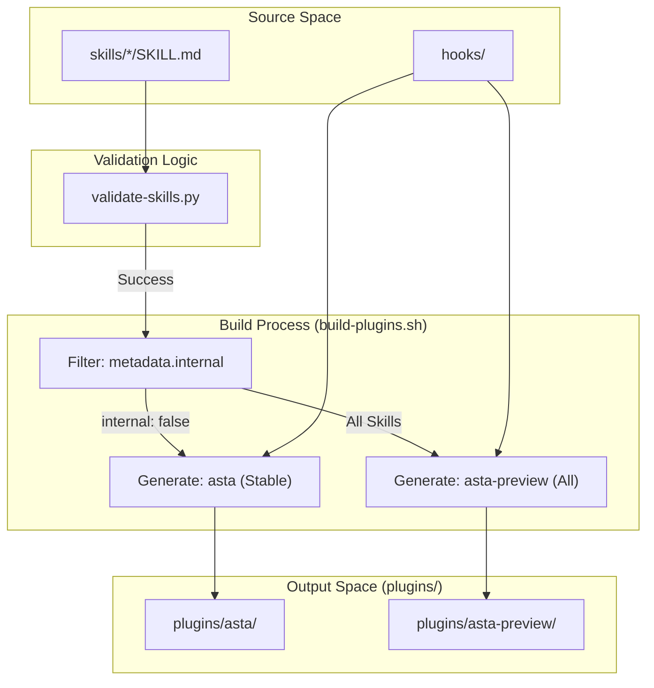
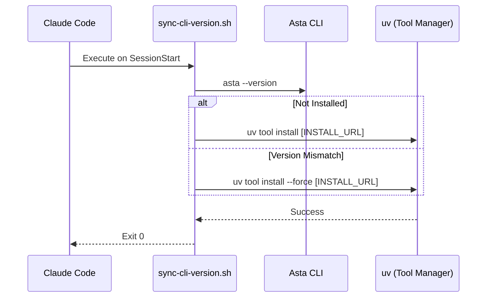

<!-- source: DeepWiki mcp.deepwiki.com · repo allenai/asta-plugins · page 5.2 Plugin Build Pipeline and Skill Validation · fetched 2026-10-26 -->

# Plugin Build Pipeline and Skill Validation

Relevant source files

The following files were used as context for generating this wiki page:

- [.github/workflows/ci.yml](.github/workflows/ci.yml)
- [Makefile](Makefile)
- [hooks/sync-cli-version.sh](hooks/sync-cli-version.sh)
- [plugins/asta-preview/hooks/hooks.json](plugins/asta-preview/hooks/hooks.json)
- [plugins/asta-preview/hooks/sync-cli-version.sh](plugins/asta-preview/hooks/sync-cli-version.sh)
- [plugins/asta/hooks/hooks.json](plugins/asta/hooks/hooks.json)
- [plugins/asta/hooks/sync-cli-version.sh](plugins/asta/hooks/sync-cli-version.sh)
- [scripts/validate-skills.py](scripts/validate-skills.py)

This page details the automated pipeline used to transform raw research skills into deployable Claude Code plugins. The system ensures that all skills comply with the Agent Skills specification, filters internal-only features from public releases, and maintains version parity between the `asta` CLI and the plugin environment.

## Overview of the Build Lifecycle

The build process is managed via the `Makefile` and executed through specialized scripts in the `scripts/` directory. It follows a strictly defined sequence: validation, filtering, and generation.

### Pipeline Data Flow

The following diagram illustrates how raw skills are processed into the final `plugins/` directory structure.

**Skill Transformation Pipeline**

Sources: [Makefile:87-99](), [scripts/validate-skills.py:66-77]()

## Skill Validation

Before any plugin is generated, the `scripts/validate-skills.py` script ensures that every `SKILL.md` file in the `skills/` directory complies with the [Agent Skills specification](https://agentskills.io/specification).

### Validation Rules
The `validate` function in `scripts/validate-skills.py` checks for the following constraints:

| Requirement | Specification | Code Implementation |
| :--- | :--- | :--- |
| **Frontmatter** | Must start and end with `---` | [scripts/validate-skills.py:27-32]() |
| **Name Format** | Kebab-case, max 64 chars | [scripts/validate-skills.py:39-43]() |
| **Directory Match** | `name` must match parent directory name | [scripts/validate-skills.py:44-48]() |
| **Description** | Non-empty, max 1024 characters | [scripts/validate-skills.py:50-54]() |
| **Allowed Tools** | Space-separated string (not a YAML list) | [scripts/validate-skills.py:56-61]() |

This validation is enforced in CI via the `make check-skills` target [Makefile:101-102]().

Sources: [scripts/validate-skills.py:24-63](), [Makefile:101-102]()

## Plugin Generation (`build-plugins.sh`)

The `build-plugins.sh` script (invoked via `make build-plugins`) is responsible for populating the `plugins/` directory. It creates two distinct plugin packages:

1.  **`asta`**: The stable plugin. It filters out any skill where the YAML frontmatter contains `internal: true`.
2.  **`asta-preview`**: The development/preview plugin. It includes all skills regardless of their internal status.

### Git-Diff Enforcement
To prevent the `plugins/` directory from drifting out of sync with `skills/`, the CI pipeline runs `make check-plugins`. This target executes the build script and then uses `git diff --quiet plugins/` to verify that no changes were generated. If the output differs, the build fails, requiring the developer to run `make build-plugins` locally and commit the results [Makefile:91-98]().

Sources: [Makefile:87-98](), [scripts/validate-skills.py:66-77]()

## CLI Version Synchronization

A critical component of the plugin architecture is the `sync-cli-version.sh` hook. This script ensures that the version of the `asta` CLI installed on the user's machine matches the version expected by the plugin.

### Hook Execution Flow
The synchronization logic is triggered during the `SessionStart` event of a Claude Code session, as defined in the `hooks.json` manifest [plugins/asta/hooks/hooks.json:3-17]().

**Version Sync Logic**

### Implementation Details
*   **Hardcoded Version**: The `PLUGIN_VERSION` is hardcoded into the script during the build/release process [plugins/asta/hooks/sync-cli-version.sh:4]().
*   **Installation Source**: It uses `uv tool install` to fetch the specific git tag corresponding to the plugin version [plugins/asta/hooks/sync-cli-version.sh:5-10]().
*   **Force Update**: If a version mismatch is detected (e.g., the CLI is `0.16.0` but the plugin is `0.17.1`), the script uses `--force` to overwrite the existing installation [plugins/asta/hooks/sync-cli-version.sh:23-31]().

Sources: [plugins/asta/hooks/sync-cli-version.sh:1-32](), [plugins/asta/hooks/hooks.json:1-16]()

## CI/CD Integration

The build pipeline is fully integrated into GitHub Actions via `.github/workflows/ci.yml`.

| Job | Target | Purpose |
| :--- | :--- | :--- |
| **code-quality** | `make format-check` | Verifies `ruff` formatting [Makefile:70-71]() |
| **code-quality** | `make lint` | Runs `ruff` linting [Makefile:61-62]() |
| **code-quality** | `make check-plugins` | Ensures `plugins/` matches `skills/` [Makefile:91-98]() |
| **code-quality** | `make check-skills` | Validates `SKILL.md` spec compliance [Makefile:101-102]() |
| **test** | `make test` | Runs the full `pytest` suite [Makefile:44-45]() |
| **docker** | `make docker-test` | Runs `docker-smoke-test.sh` inside the image [Makefile:141-142]() |

Sources: [.github/workflows/ci.yml:10-66](), [Makefile:187-188]()

---

