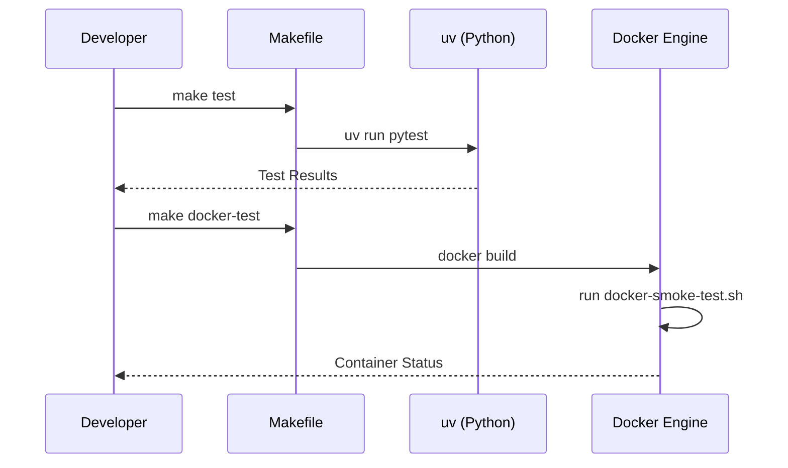

<!-- source: DeepWiki mcp.deepwiki.com · repo allenai/asta-plugins · page 6 Testing · fetched 2026-10-26 -->

# Testing

<details>
<summary>Relevant source files</summary>

The following files were used as context for generating this wiki page:

- [.github/workflows/ci.yml](.github/workflows/ci.yml)
- [Makefile](Makefile)
- [plugins/asta-preview/skills/research-step/SKILL.md](plugins/asta-preview/skills/research-step/SKILL.md)
- [src/asta/literature/find.py](src/asta/literature/find.py)
- [tests/test_cli.py](tests/test_cli.py)
- [tests/test_config.py](tests/test_config.py)

</details>


The `asta-plugins` repository employs a three-tier testing architecture designed to ensure reliability across the core CLI, the skill definitions, and the final Dockerized environment. Testing is managed primarily through `pytest` for Python code and custom shell scripts for environment validation.

### Testing Overview

The testing strategy is divided into three distinct levels of granularity:
1.  **Unit and Integration Tests**: Validates Python logic, API clients, and CLI command structures using `pytest` [Makefile:43-54]().
2.  **Skill Validation**: Ensures that `SKILL.md` files comply with the Agent Skills specification and that generated plugins are in sync with the source skills [Makefile:100-102]().
3.  **Smoke and Docker Tests**: End-to-end validation of the CLI installation and skill discovery within the production Docker environment [Makefile:140-146]().

### Code Entity Mapping

The following diagram illustrates how the test suites interact with the various components of the codebase.

**Test Suite to Codebase Mapping**
```mermaid
graph TD
    subgraph "Test Space"
        ["tests/test_cli.py"]
        ["tests/test_config.py"]
        ["tests/test_client.py"]
        ["scripts/validate-skills.py"]
        ["scripts/docker-smoke-test.sh"]
    end

    subgraph "Code Entity Space"
        ["asta.cli:cli"]
        ["asta.utils.config:get_config"]
        ["asta.literature.client:AstaPaperFinder"]
        ["skills/research-step/SKILL.md"]
        ["Dockerfile"]
    end

    ["tests/test_cli.py"] --> ["asta.cli:cli"]
    ["tests/test_config.py"] --> ["asta.utils.config:get_config"]
    ["tests/test_client.py"] --> ["asta.literature.client:AstaPaperFinder"]
    ["scripts/validate-skills.py"] --> ["skills/research-step/SKILL.md"]
    ["scripts/docker-smoke-test.sh"] --> ["Dockerfile"]
```
**Sources:** [tests/test_cli.py:10-11](), [tests/test_config.py:13-17](), [src/asta/literature/find.py:8-9](), [Makefile:101-102](), [Makefile:141-142]()

---

## 6.1 Unit and Integration Tests
The Python test suite focuses on verifying the core logic of the `asta` package. These tests are located in the `tests/` directory and utilize `pytest` fixtures and mocking to isolate components.

*   **CLI Testing**: Uses `click.testing.CliRunner` to simulate command-line execution and verify exit codes and outputs [tests/test_cli.py:13-17]().
*   **Configuration**: Validates that HOCON-based configurations in `asta.conf` are correctly parsed and that environment variable overrides work as expected [tests/test_config.py:13-22]().
*   **Mocking Patterns**: API clients like `AstaPaperFinder` are mocked using `unittest.mock.patch` to prevent actual network calls during unit tests [tests/test_cli.py:62-65]().

For details on mocking patterns and specific test modules, see [Unit and Integration Tests](#6.1).

**Sources:** [tests/test_cli.py:1-112](), [tests/test_config.py:1-112]()

---

## 6.2 Smoke and Docker Tests
Smoke tests ensure that the entire system functions correctly when packaged. This is critical because `asta-plugins` relies on a complex interaction between Python code, external tools (passthroughs), and Claude Code/Codex CLI plugin discovery.

*   **Docker Smoke Test**: Runs `scripts/docker-smoke-test.sh` inside the container to verify that the `asta` CLI is installed and responsive [Makefile:141-143]().
*   **Skill Discovery**: Validates that the `npx skills add` command correctly identifies the plugins generated from the `skills/` directory [Makefile:145-146]().
*   **CI Integration**: These tests are executed in GitHub Actions for every push to the `main` branch [ci.yml:56-66]().

For details on running these tests locally and the validation logic they contain, see [Smoke and Docker Tests](#6.2).

**Sources:** [Makefile:140-147](), [.github/workflows/ci.yml:56-66]()

---

## Running Tests

The `Makefile` provides standardized targets for executing the test suite.

| Target | Description | Command |
| :--- | :--- | :--- |
| `make test` | Runs all unit and integration tests | `uv run pytest` [Makefile:44-45]() |
| `make test-unit` | Runs only core logic tests | `pytest tests/test_client.py tests/test_cli.py` [Makefile:48-49]() |
| `make test-coverage` | Generates an HTML coverage report | `pytest --cov=src/asta --cov-report=html` [Makefile:56-58]() |
| `make docker-test` | Builds image and runs smoke tests | `docker run ... docker-smoke-test.sh` [Makefile:141-142]() |
| `make check-skills` | Validates `SKILL.md` frontmatter | `python scripts/validate-skills.py` [Makefile:101-102]() |

**Test Execution Flow**

**Sources:** [Makefile:1-58](), [Makefile:137-147]()

---

