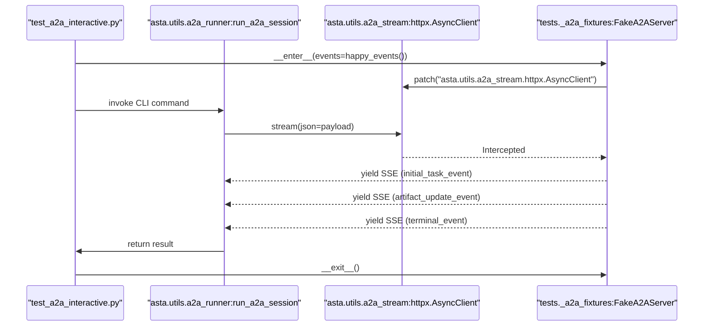
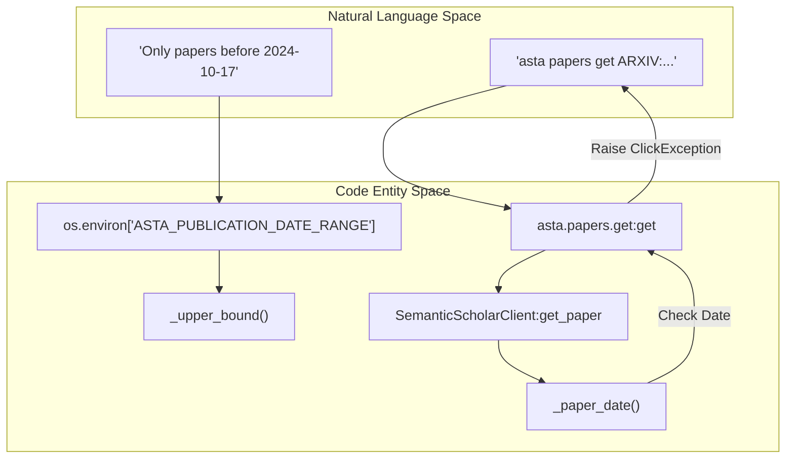

<!-- source: DeepWiki mcp.deepwiki.com · repo allenai/asta-plugins · page 6.1 Unit and Integration Tests · fetched 2026-10-26 -->

# Unit and Integration Tests

Relevant source files

The following files were used as context for generating this wiki page:

- [plugins/asta-preview/skills/research-step/SKILL.md](plugins/asta-preview/skills/research-step/SKILL.md)
- [src/asta/auth/device_flow.py](src/asta/auth/device_flow.py)
- [src/asta/literature/find.py](src/asta/literature/find.py)
- [src/asta/literature/models.py](src/asta/literature/models.py)
- [src/asta/papers/get.py](src/asta/papers/get.py)
- [src/asta/papers/snippet_search.py](src/asta/papers/snippet_search.py)
- [src/asta/utils/config.py](src/asta/utils/config.py)
- [tests/_a2a_fixtures.py](tests/_a2a_fixtures.py)
- [tests/test_a2a_artifact.py](tests/test_a2a_artifact.py)
- [tests/test_a2a_interactive.py](tests/test_a2a_interactive.py)
- [tests/test_auth.py](tests/test_auth.py)
- [tests/test_cli.py](tests/test_cli.py)
- [tests/test_client.py](tests/test_client.py)
- [tests/test_config.py](tests/test_config.py)
- [tests/test_integration.py](tests/test_integration.py)
- [tests/test_models.py](tests/test_models.py)
- [tests/test_papers_cli.py](tests/test_papers_cli.py)

The `asta-plugins` test suite is designed to validate the CLI, configuration management, API clients, and the end-to-end integration of the plugin system. The testing strategy emphasizes high-fidelity mocking of external services (Semantic Scholar, Asta Paper Finder, and Auth0) to ensure reliable CI/CD execution without external dependencies.

## Test Organization

Tests are located in the `tests/` directory and are executed using `pytest`. The suite is categorized into unit tests for core logic and integration tests that verify the directory structure and CLI installation.

| Test Module | Scope | Key Code Entities Tested |
|---|---|---|
| `test_cli.py` | CLI command routing and output | `asta.cli:cli`, `asta.literature.find:find` |
| `test_config.py` | HOCON configuration loading | `asta.utils.config:get_config`, `asta.utils.config:get_passthrough_config` |
| `test_client.py` | API client network logic | `asta.literature.client:AstaPaperFinder` |
| `test_models.py` | Pydantic data validation | `asta.literature.models:Paper`, `asta.literature.models:LiteratureSearchResult` |
| `test_papers_cli.py` | Semantic Scholar commands | `asta.papers.get:get`, `asta.papers.snippet_search:snippet_search` |
| `test_integration.py` | Repository and CLI sanity | Plugin directory structure, `asta --version` |

**Sources:** [tests/test_cli.py:1-10](), [tests/test_config.py:10-15](), [tests/test_client.py:25-26](), [tests/test_models.py:5-14](), [tests/test_integration.py:1-9]()

---

## Mocking Patterns and Fixtures

The codebase utilizes `pytest.fixture` and `unittest.mock` to isolate components. A critical pattern is the use of `CliRunner` for testing Click-based commands.

### CLI Test Runner
The `runner` fixture provides an isolated environment for executing CLI commands and inspecting exit codes and output [tests/test_cli.py:13-17]().

### A2A Stream Mocking
For testing Agent-to-Agent (A2A) interactions, the `FakeA2AServer` context manager stubs the `httpx.AsyncClient`. It simulates Server-Sent Events (SSE) that the `A2AStream` client expects.

**A2A Mock Data Flow**
The diagram below illustrates how `FakeA2AServer` intercepts requests from the `A2ASkillSpec` runner and feeds it canned events.

**Sources:** [tests/_a2a_fixtures.py:27-75](), [tests/_a2a_fixtures.py:90-101]()

---

## Unit Testing Core Modules

### Configuration Validation
`test_config.py` ensures that `asta.conf` is correctly parsed and that all required passthrough tools (e.g., `asta-documents`, `panda`) are defined with valid semantic versions [tests/test_config.py:23-52](). It also validates the environment variable override mechanism via `ASTA_CONFIG_FILE` [tests/test_config.py:187-189]().

### Model Serialization
The `Paper` model in `asta.literature.models` includes complex validation logic, such as converting raw string author lists into `Author` objects [src/asta/literature/models.py:99-112]() and coercing `corpusId` from strings to integers [src/asta/literature/models.py:114-119](). `test_models.py` verifies these transformations [tests/test_models.py:61-76]().

### Semantic Scholar Cutoff Enforcement
A specialized set of tests in `test_papers_cli.py` validates that the CLI respects the `ASTA_PUBLICATION_DATE_RANGE` environment variable. This ensures that agents cannot access papers published after a specific date, maintaining evaluation integrity [tests/test_papers_cli.py:95-128]().

**Logic Mapping: Cutoff Enforcement**

**Sources:** [src/asta/papers/get.py:51-64](), [src/asta/papers/get.py:90-109](), [tests/test_papers_cli.py:119-128]()

---

## Integration Tests

Integration tests verify the structural integrity of the repository and the successful installation of the CLI within the `uv` environment.

### Plugin Structure
`test_plugin_structure` validates the presence of essential directories:
- `.claude-plugin/marketplace.json` [tests/test_integration.py:15]()
- `plugins/asta/skills` and `plugins/asta-preview/skills` [tests/test_integration.py:16-17]()
- `src/asta/cli.py` [tests/test_integration.py:22]()

### CLI Availability
`test_asta_cli_installed` executes `uv run python -m asta.cli --version` to ensure the package is correctly installed and the entry point is functional [tests/test_integration.py:38-48]().

**Sources:** [tests/test_integration.py:13-25](), [tests/test_integration.py:38-49]()

---

## API Client Testing

The `AstaPaperFinder` client is tested by mocking `urllib.request.urlopen`. This allows for simulating various server responses without actual network calls.

### Success and Error Scenarios
- **Success:** Verifies that the client correctly parses the `papers` list and transforms it into the `widget.results` format expected by the CLI [tests/test_client.py:75-112]().
- **File Output:** Validates the `--output` flag by checking if the client writes the JSON response to a `tmp_path` [tests/test_client.py:114-145]().
- **Authentication Failures:** Ensures `AuthenticationError` is raised if the token is missing or invalid [tests/test_client.py:59-73]().

**Sources:** [tests/test_client.py:28-48](), [tests/test_client.py:146-159](), [src/asta/literature/find.py:54-73]()

---

