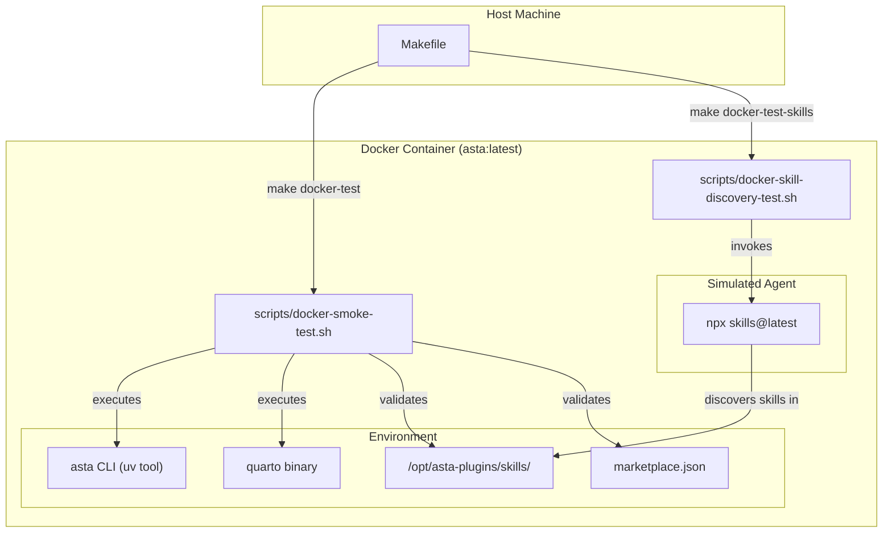
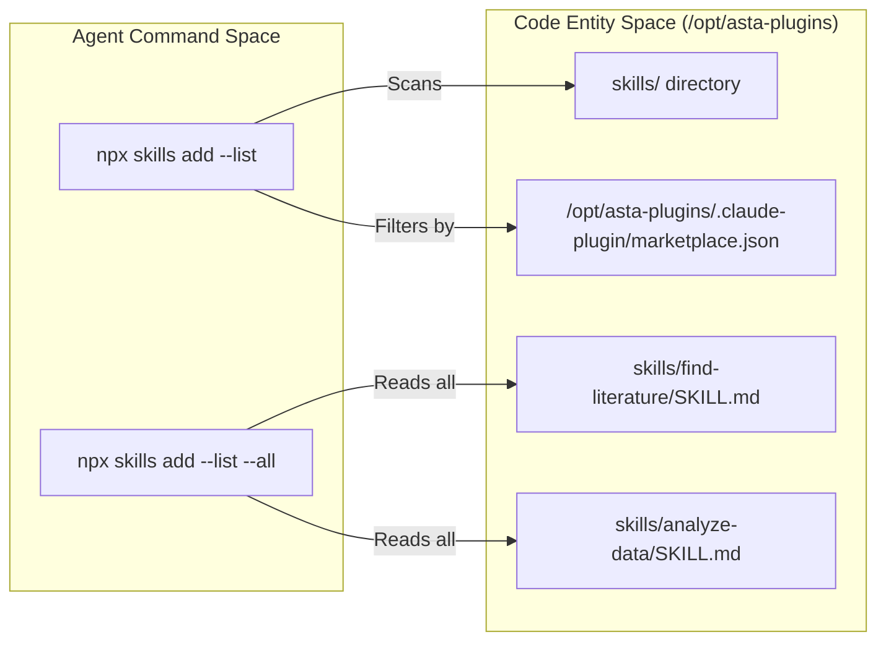

<!-- source: DeepWiki mcp.deepwiki.com · repo allenai/asta-plugins · page 6.2 Smoke and Docker Tests · fetched 2026-10-26 -->

# Smoke and Docker Tests

<details>
<summary>Relevant source files</summary>

The following files were used as context for generating this wiki page:

- [.github/workflows/ci.yml](.github/workflows/ci.yml)
- [Dockerfile](Dockerfile)
- [Makefile](Makefile)
- [scripts/docker-skill-discovery-test.sh](scripts/docker-skill-discovery-test.sh)
- [scripts/docker-smoke-test.sh](scripts/docker-smoke-test.sh)

</details>


Smoke and Docker tests provide the final layer of validation for the `asta-plugins` repository, ensuring that the CLI, its dependencies, and the skill marketplace are correctly packaged and functional within a containerized environment. These tests bridge the gap between Python unit tests and real-world deployment by verifying CLI availability, binary dependencies like Quarto, and the discoverability of skills by external agents.

## Overview of Docker Testing Architecture

The testing strategy utilizes a custom Docker image built from `node:20-slim` [Dockerfile:1]() which incorporates `uv` for Python tool management and `quarto` for document rendering. The smoke tests validate that the environment is correctly provisioned and that the `asta` CLI is globally accessible.

### Test Categories
1.  **Binary & CLI Smoke Test**: Validates that `asta` and `quarto` are in the `$PATH` and respond to `--help` commands.
2.  **Skill Discovery Test**: Simulates an external agent (e.g., Claude Code or Codex) attempting to discover and list skills from the local marketplace.
3.  **Marketplace Integrity**: Verifies the existence of `SKILL.md` files and the generated `marketplace.json` manifest.

### System Interaction Diagram
The following diagram illustrates how the Docker-based tests interact with the repository components and external tool simulators.

**Title: Docker Test Execution Flow**

Sources: [Makefile:140-146](), [Dockerfile:1-24](), [scripts/docker-smoke-test.sh:1-23](), [scripts/docker-skill-discovery-test.sh:1-8]()

---

## Smoke Test Implementation

The script `scripts/docker-smoke-test.sh` is the primary entry point for validating the container's health. It performs a series of non-destructive checks to ensure the CLI is properly installed via `uv tool install` [Dockerfile:16]().

### Validated Components
| Check | Purpose | Code Reference |
| :--- | :--- | :--- |
| `asta --version` | Ensures the Python package is installed and executable. | [scripts/docker-smoke-test.sh:6]() |
| `asta literature --help` | Validates Click command group registration. | [scripts/docker-smoke-test.sh:8]() |
| `quarto --version` | Ensures the Quarto binary (required for preview skills) is functional. | [scripts/docker-smoke-test.sh:12]() |
| `SKILL.md` existence | Iterates through `skills/` to ensure every skill has documentation. | [scripts/docker-smoke-test.sh:17-19]() |
| `marketplace.json` | Verifies the Claude Code manifest exists in `.claude-plugin/`. | [scripts/docker-smoke-test.sh:20]() |

Sources: [scripts/docker-smoke-test.sh:1-23](), [Dockerfile:15-17]()

---

## Skill Discovery Test

The `scripts/docker-skill-discovery-test.sh` script validates that the repository is compatible with the "Agent Skills" specification used by modern LLM CLIs. It uses `npx skills@latest`, a utility that simulates how an agent would interact with the local directory to "add" or "list" available capabilities.

### Skill Discovery Flow
This diagram shows how the `npx skills` utility maps the directory structure to discoverable entities.

**Title: Natural Language Space to Code Entity Discovery**

Sources: [scripts/docker-skill-discovery-test.sh:6-7](), [Dockerfile:19-21](), [Makefile:25]()

---

## Local Execution

Developers can run these tests locally using the `Makefile` targets. This requires a local Docker installation.

### Building and Testing
To build the image and run the basic smoke tests:
```bash
make docker-test
```
This target executes `docker build` followed by a `docker run` that calls the smoke test script [Makefile:141-142]().

### Testing Skill Discovery
To verify that skills are correctly formatted for agent discovery:
```bash
make docker-test-skills
```
This executes the discovery script within the container [Makefile:145-146]().

### Interactive Testing with Agents
The `Makefile` provides targets to launch the container and immediately install `asta` into a specific agent CLI (Claude Code or Codex).

*   **Claude Code**: `make docker-claude-asta` installs the `asta` plugin scope and enters a bash shell [Makefile:149-155]().
*   **Codex**: `make docker-codex-asta` installs `@openai/codex` and adds the local skills via `npx` [Makefile:167-172]().

Sources: [Makefile:137-180]()

---

## CI/CD Integration

The Docker tests are a mandatory gate in the GitHub Actions `ci.yml` workflow. The `docker` job runs on `ubuntu-latest` and executes both the smoke test and the skill discovery test for every pull request [.github/workflows/ci.yml:56-66]().

### Workflow Steps
1.  **Checkout**: Clones the repository [.github/workflows/ci.yml:59]().
2.  **Smoke-test image**: Runs `make docker-test` [.github/workflows/ci.yml:62]().
3.  **Test skill discovery**: Runs `make docker-test-skills` [.github/workflows/ci.yml:65]().

Sources: [.github/workflows/ci.yml:56-66](), [Makefile:140-146]()

---

