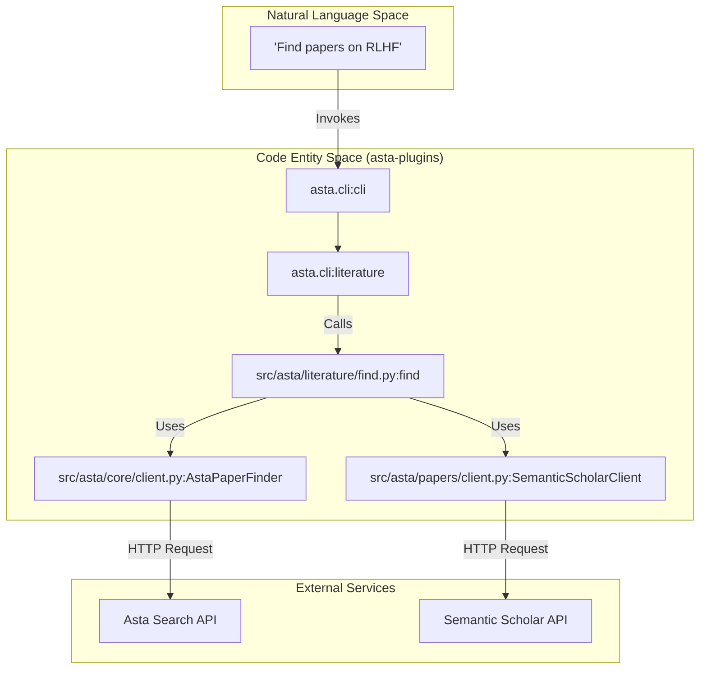
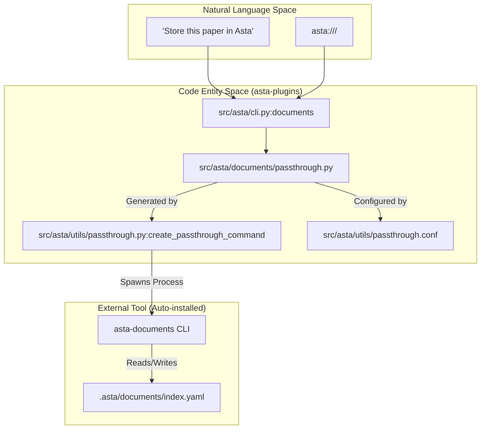

<!-- source: DeepWiki mcp.deepwiki.com · repo allenai/asta-plugins · page 7 Glossary · fetched 2026-10-26 -->

# Glossary

Relevant source files

The following files were used as context for generating this wiki page:

- [.claude-plugin/marketplace.json](.claude-plugin/marketplace.json)
- [DEVELOPER.md](DEVELOPER.md)
- [README.md](README.md)
- [plugins/asta-preview/skills/asta-documents/SKILL.md](plugins/asta-preview/skills/asta-documents/SKILL.md)
- [plugins/asta-preview/skills/autodiscovery/SKILL.md](plugins/asta-preview/skills/autodiscovery/SKILL.md)
- [plugins/asta/skills/asta-documents/SKILL.md](plugins/asta/skills/asta-documents/SKILL.md)
- [pyproject.toml](pyproject.toml)
- [skills/asta-documents/SKILL.md](skills/asta-documents/SKILL.md)
- [skills/autodiscovery/SKILL.md](skills/autodiscovery/SKILL.md)
- [skills/experiment/SKILL.md](skills/experiment/SKILL.md)
- [skills/find-literature/SKILL.md](skills/find-literature/SKILL.md)
- [skills/research-step/SKILL.md](skills/research-step/SKILL.md)
- [src/asta/__init__.py](src/asta/__init__.py)
- [src/asta/literature/a2a_artifact.py](src/asta/literature/a2a_artifact.py)
- [src/asta/literature/interactive.py](src/asta/literature/interactive.py)
- [src/asta/utils/a2a_interactive.py](src/asta/utils/a2a_interactive.py)
- [src/asta/utils/a2a_stream.py](src/asta/utils/a2a_stream.py)
- [src/asta/utils/passthrough.py](src/asta/utils/passthrough.py)
- [uv.lock](uv.lock)

This page provides definitions for codebase-specific terms, abbreviations, and domain concepts used within the `asta-plugins` repository. It serves as a technical reference for onboarding engineers to understand the mapping between conceptual terms and their implementation in code.

## Core Concepts

### Skill
A **Skill** is the primary unit of capability in the Asta ecosystem. It consists of a manifest (`SKILL.md`) that defines the skill's purpose, metadata, and the specific tools (Bash commands or other skills) it is allowed to invoke [skills/find-literature/SKILL.md:1-7]().
*   **Internal Skill**: A skill marked with `metadata.internal: true`. These are filtered out during the standard plugin build process and are typically reserved for the `asta-preview` track [skills/find-literature/SKILL.md:4-5]().
*   **Canonical Skill**: The source-of-truth definition located in the `skills/` directory [DEVELOPER.md:38-38]().

### Passthrough System
A mechanism that allows the `asta` CLI to delegate functionality to external tools (like `asta-documents` or `panda`) without bundling their code directly.
*   **Auto-installation**: Passthrough tools are automatically installed via `uv` on their first invocation if not present [DEVELOPER.md:59-62]().
*   **Configuration**: Settings for these tools (version pinning, git vs. pypi source) are defined in `src/asta/utils/passthrough.conf` [DEVELOPER.md:55-57]().

### A2A (Agent-to-Agent)
Refers to the interaction framework where the `asta` CLI acts as a client to a remote agent service.
*   **A2A Session**: A stateful conversation between the CLI and a remote agent, managed via a `thread_id` [src/asta/utils/a2a_interactive.py:1-20]().
*   **Interactive Skills**: Skills like `asta literature interactive` that use the `run_a2a_session` runner to maintain multi-turn context [skills/find-literature/SKILL.md:23-31]().

---

## Domain Terms & Abbreviations

| Term | Definition | Code Pointer |
|:---|:---|:---|
| **Panda** | Internal project name for the `experiment` skill. Used for running computational research. | [skills/experiment/SKILL.md:3-3]() |
| **Beads (bd)** | A task-tracking framework used by the `research-step` skill to model research as a graph of typed tasks. | [skills/research-step/SKILL.md:1-4]() |
| **Epic** | In the context of `bd`, a high-level research mission containing multiple sub-tasks. | [skills/research-step/SKILL.md:9-9]() |
| **Frontier** | The set of currently available/ready tasks in a research graph. | [skills/research-step/SKILL.md:34-34]() |
| **CorpusId** | The unique identifier for a paper within the Semantic Scholar database. | [skills/find-literature/SKILL.md:148-148]() |
| **olmOCR** | A cloud-based PDF-to-markdown extraction tool used by the `pdf-extraction` skill. | [README.md:20-20]() |
| **Asta URI** | A specialized URI scheme (`asta://`) used to reference documents across different indexes. | [skills/asta-documents/SKILL.md:111-118]() |

---

## Technical Mapping: Natural Language to Code

The following diagrams bridge the gap between user-facing concepts and the underlying code entities.

### Literature Search Execution Flow
This diagram shows how a user's request to "find papers" maps to specific Python classes and external services.

**Sources:** [src/asta/cli.py:1-50](), [src/asta/literature/find.py:1-20](), [src/asta/core/client.py:1-15](), [src/asta/papers/client.py:1-15]()

### Document Management & Passthrough Architecture
This diagram illustrates how the "Asta Documents" concept is implemented via the passthrough utility to an external CLI.

**Sources:** [src/asta/cli.py:1-50](), [src/asta/documents/passthrough.py:1-10](), [src/asta/utils/passthrough.py:1-60](), [skills/asta-documents/SKILL.md:1-15]()

---

## File System & State Locations

| Path | Purpose |
|:---|:---|
| `.asta/documents/index.yaml` | The local metadata store for the `asta-documents` skill [skills/asta-documents/SKILL.md:14-14](). |
| `.asta/experiment/<date>-<slug>/` | Default output directory for `panda` experiment results [skills/experiment/SKILL.md:63-65](). |
| `.asta/literature/threads/` | Storage for A2A interactive session state and turn history [skills/find-literature/SKILL.md:41-41](). |
| `src/asta/utils/passthrough.conf` | Centralized HOCON configuration for all external tools [DEVELOPER.md:56-56](). |
| `plugins/` | Generated directory containing the standalone plugin packages for Claude Code [DEVELOPER.md:43-43](). |

---

## Tooling & Build Abbreviations

*   **uv**: The Python package manager used for environment isolation and tool execution [DEVELOPER.md:71-71]().
*   **HOCON**: Human-Optimized Config Object Notation, the format used for `asta.conf` and `passthrough.conf` [DEVELOPER.md:18-19]().
*   **Editable Install**: A development mode (`pip install -e` or `make install`) where changes to `src/` are immediately reflected in the `asta` command [DEVELOPER.md:101-102]().
*   **Skill Validation**: The process of checking `SKILL.md` files against the Agent Skills specification, performed by `scripts/validate-skills.py` [DEVELOPER.md:86-91]().

**Sources:** [DEVELOPER.md:1-150](), [skills/find-literature/SKILL.md:1-100](), [skills/experiment/SKILL.md:1-100](), [skills/asta-documents/SKILL.md:1-120](), [skills/research-step/SKILL.md:1-60]().