# Page: Overview

# Overview

<details>
<summary>Relevant source files</summary>

The following files were used as context for generating this wiki page:

- [.claude-plugin/marketplace.json](.claude-plugin/marketplace.json)
- [DEVELOPER.md](DEVELOPER.md)
- [README.md](README.md)
- [pyproject.toml](pyproject.toml)
- [src/asta/__init__.py](src/asta/__init__.py)
- [uv.lock](uv.lock)

</details>


Asta is a comprehensive suite of scientific research tools designed to empower local coding agents (such as Claude Code, Cursor, and Copilot) with specialized capabilities for literature review, document management, and experimental analysis [README.md:1-4](). 

The system is built around a central Python-based CLI (`asta`) that serves as the primary interface for both human users and autonomous agents [README.md:48-51](). By providing a unified entry point for scientific workflows, Asta bridges the gap between high-level research objectives and low-level technical execution.

## System Architecture

The Asta ecosystem follows a CLI-first architecture where agent capabilities (skills) are thin wrappers around the `asta` command-line tool [DEVELOPER.md:7-12]().

### Core Components

*   **Asta CLI**: A [Click](https://click.palletsprojects.com/)-based interface organized into logical command groups such as `literature`, `papers`, `documents`, and `experiment` [src/asta/cli.py:12-37]().
*   **Skill System**: A collection of YAML-based definitions in the `skills/` directory that describe tool interfaces to LLM-based agents [DEVELOPER.md:38-46]().
*   **Passthrough Layer**: A mechanism for the `asta` CLI to delegate complex tasks to specialized external tools like `asta-documents` or `panda`, ensuring they are installed and version-matched automatically [DEVELOPER.md:48-63]().
*   **Agent-to-Agent (A2A) Framework**: Integration with `asta-agent` to support long-running, interactive research sessions [pyproject.toml:22-24]().

### Conceptual Model: Natural Language to Code Entity

The following diagram illustrates how a user's research request flows through the system's code entities.

**Diagram: Request Flow from NL to Code**
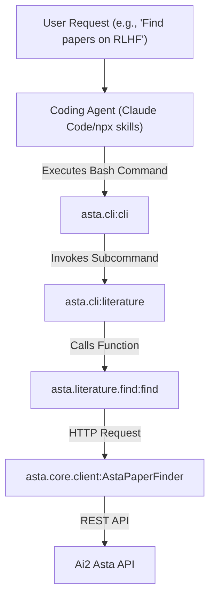
Sources: [src/asta/cli.py:12-37](), [src/asta/literature/find.py:29-30](), [src/asta/core/client.py:15-16]()

## Plugin Distribution Model

Asta uses a two-track plugin system to balance stability with rapid feature iteration. These are managed via the `marketplace.json` manifest [.claude-plugin/marketplace.json:1-47]().

| Plugin | Content | Target Audience |
| :--- | :--- | :--- |
| **asta** | Stable, core research tools (Paper search, metadata, document management) | Production workflows and reliable research tasks. |
| **asta-preview** | All stable tools + experimental features (Literature reports, experiments, autonomous research steps) | Early adopters and developers testing new agentic workflows. |

**Diagram: Plugin Generation Pipeline**
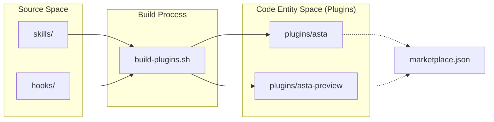
Sources: [DEVELOPER.md:38-46](), [.claude-plugin/marketplace.json:9-46](), [README.md:22-32]()

For a detailed breakdown of how these plugins are constructed and the differences between internal and default skills, see [Plugin Architecture: asta vs asta-preview](#1.2).

## Key Research Capabilities

The system is organized into several specialized skill categories:

*   **Literature Discovery**: High-level searching via `asta literature find` and granular metadata retrieval via `asta papers` [DEVELOPER.md:27-36]().
*   **Document Management**: Local indexing and tracking of scientific PDFs and their metadata [README.md:19-19]().
*   **Automated Extraction**: PDF-to-text conversion utilizing `olmOCR` [README.md:20-20]().
*   **Advanced Orchestration**: Multi-step research loops and automated theory generation [README.md:34-37]().

## Getting Started

To begin using or developing for Asta, ensure you have Python 3.11+ and the `uv` package manager installed [DEVELOPER.md:68-72]().

1.  **Installation**: Use `make install` to set up a development environment with an editable version of the `asta` package [DEVELOPER.md:77-81]().
2.  **Authentication**: Run `asta auth login` to authenticate with Ai2 services [README.md:69-69]().
3.  **Agent Integration**: Use `npx skills add allenai/asta-plugins` to register the tools with your local agent [README.md:9-9]().

For detailed installation steps and first-use walkthroughs, see [Getting Started](#1.1).

Sources: [pyproject.toml:1-24](), [README.md:1-100](), [DEVELOPER.md:1-174]()

---

# Page: Getting Started

# Getting Started

<details>
<summary>Relevant source files</summary>

The following files were used as context for generating this wiki page:

- [DEVELOPER.md](DEVELOPER.md)
- [README.md](README.md)
- [hooks/sync-cli-version.sh](hooks/sync-cli-version.sh)
- [plugins/asta-preview/hooks/sync-cli-version.sh](plugins/asta-preview/hooks/sync-cli-version.sh)
- [plugins/asta/hooks/sync-cli-version.sh](plugins/asta/hooks/sync-cli-version.sh)
- [pyproject.toml](pyproject.toml)
- [src/asta/__init__.py](src/asta/__init__.py)
- [uv.lock](uv.lock)

</details>


The `asta-plugins` repository provides the `asta` CLI, a unified toolset for scientific research designed to be used by both humans and autonomous coding agents (e.g., Claude Code, Cursor). It centralizes access to literature search, document management, PDF extraction, and experimental orchestration.

## Prerequisites

To develop or run the `asta` CLI from source, ensure your environment meets the following requirements:

*   **Python 3.11+**: The project targets modern Python features and type hinting [pyproject.toml:10]().
*   **uv**: Used for fast dependency resolution and tool management [DEVELOPER.md:71]().
*   **make**: Used for executing development lifecycle targets [DEVELOPER.md:72]().
*   **Node.js 20+ / npx**: Required specifically for running skill discovery tests [DEVELOPER.md:73]().

## Development Setup

The repository uses an editable installation flow to ensure changes in `src/asta/` are reflected immediately without re-installation.

### Installation Steps

1.  **Clone the repository**:
    ```bash
    git clone https://github.com/allenai/asta-plugins.git
    cd asta-plugins
    ```
2.  **Install dependencies**:
    Run `make install` [DEVELOPER.md:81](). This command uses `uv` to create a virtual environment and install the package in editable mode with test dependencies [pyproject.toml:30-34]().
3.  **Verify installation**:
    ```bash
    uv run python -m asta.cli --version
    ```

### Makefile Targets

The `Makefile` provides standardized entry points for common tasks:

| Target | Description |
| :--- | :--- |
| `make install` | Performs an editable install with test dependencies [DEVELOPER.md:81](). |
| `make test` | Runs the full test suite (unit + integration) [DEVELOPER.md:82](). |
| `make lint` | Checks code style using `ruff` [DEVELOPER.md:83](). |
| `make format` | Auto-fixes formatting issues [DEVELOPER.md:84](). |
| `make check` | Runs a pre-commit sequence: format check, lint, and unit tests [DEVELOPER.md:85](). |
| `make build-plugins` | Regenerates the `plugins/` directory from the `skills/` definitions [DEVELOPER.md:89](). |

**Sources:** [DEVELOPER.md:75-91](), [pyproject.toml:1-34]()

---

## Authentication Walkthrough

Several `asta` commands (such as `literature find` or `autodiscovery`) interact with protected Ai2 APIs. Authentication is handled via an Auth0 Device Authorization Flow.

### 1. Login
To authenticate your local environment, run:
```bash
asta auth login
```
This command initiates the device flow, providing a URL and a code to enter in your browser.

### 2. Token Management
The CLI manages tokens locally using the `TokenManager` and `TokenStorage` classes.
*   **Storage**: Tokens are stored securely using the `keyring` library [pyproject.toml:20]().
*   **Environment Variables**: In CI or Docker environments, you can bypass interactive login by setting the `ASTA_TOKEN` environment variable [README.md:66-71]().

### 3. Verification
You can check your current identity and token status:
```bash
asta auth whoami
```

**Sources:** [README.md:66-71](), [src/asta/cli.py:27]() (implied by `asta` entry point), [pyproject.toml:19-20]()

---

## Running the CLI

The CLI is structured into command groups. When running from source, use `uv run python -m asta.cli` to ensure the local environment is used.

### Core Command Groups
*   `asta papers`: Direct interaction with Semantic Scholar (e.g., `get`, `search`, `author`) [DEVELOPER.md:30-36]().
*   `asta literature`: Higher-level research tools like `find` and `interactive` [DEVELOPER.md:27-29]().
*   `asta documents`: Passthrough to `asta-documents` for local metadata indexing [DEVELOPER.md:21-23]().
*   `asta experiment`: Passthrough to `panda` for running computational experiments [DEVELOPER.md:24-26]().

### Passthrough Execution Flow
When you run a passthrough command (like `asta documents`), the system automatically ensures the underlying tool is installed in an isolated environment.

**Passthrough Logic Diagram**
The following diagram illustrates how the `asta` CLI delegates to external tools using the `passthrough.py` utility.

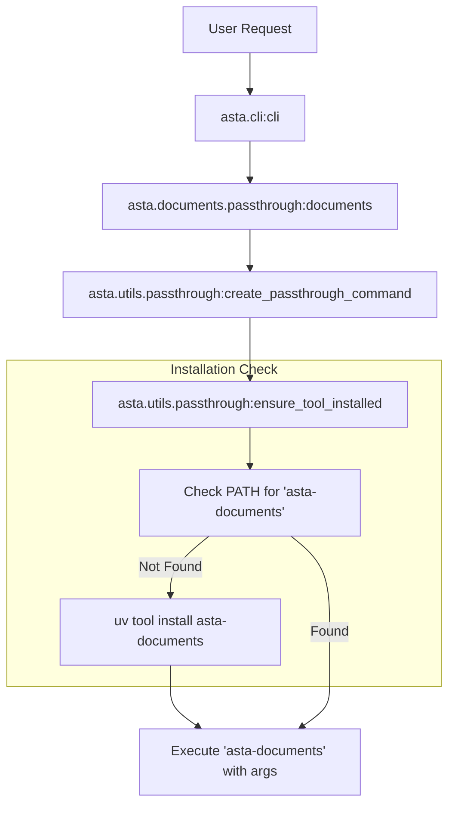

**Sources:** [DEVELOPER.md:53-62](), [src/asta/utils/passthrough.py:1-60]() (implied by architecture description).

---

## Code Entity Mapping

To help navigate the codebase, the following diagram maps high-level "Getting Started" concepts to their specific implementations in the `src/asta` directory.

**System Component Mapping**

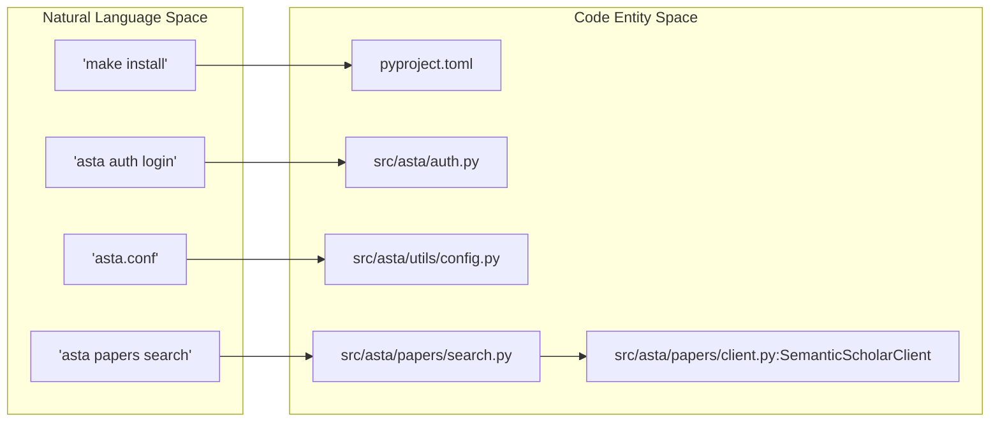

**Sources:** [pyproject.toml:5-27](), [DEVELOPER.md:10-36](), [src/asta/__init__.py:3]()

---

# Page: Plugin Architecture: asta vs asta-preview

# Plugin Architecture: asta vs asta-preview

<details>
<summary>Relevant source files</summary>

The following files were used as context for generating this wiki page:

- [.claude-plugin/marketplace.json](.claude-plugin/marketplace.json)
- [.github/workflows/ci.yml](.github/workflows/ci.yml)
- [DEVELOPER.md](DEVELOPER.md)
- [Makefile](Makefile)
- [README.md](README.md)

</details>


This page describes the dual-track plugin architecture used by Asta to manage stable and experimental research tools. It details the relationship between the `skills/` source directory and the generated `plugins/` distribution, the role of the `marketplace.json` manifest, and the automated pipeline that maintains these components.

## Two-Track Plugin Model

Asta provides two distinct plugin packages to end-users and agents: `asta` (Stable) and `asta-preview` (Experimental). This separation allows developers to iterate rapidly on complex research workflows without compromising the reliability of core paper search and document management tools.

| Feature | `asta` (Stable) | `asta-preview` (Preview) |
| :--- | :--- | :--- |
| **Purpose** | Production-ready, high-reliability tools. | New features, complex agents, and beta workflows. |
| **Contents** | Core Semantic Scholar lookup, local document indexing, PDF extraction. | Everything in Stable + literature reports, autonomous research steps, and experiments. |
| **Installation** | `/plugin install asta` | `/plugin install asta-preview` |
| **Target Audience** | General research assistance. | Power users and developers testing new agentic loops. |

The distinction is driven by the `metadata.internal` flag within each skill's `SKILL.md` file. Skills marked as `internal: true` are excluded from the stable `asta` plugin but included in `asta-preview` [.claude-plugin/marketplace.json:9-46](), [README.md:16-38]().

### Sources:
- [.claude-plugin/marketplace.json:1-47]()
- [README.md:5-47]()
- [DEVELOPER.md:42-46]()

---

## The Marketplace Manifest

The `.claude-plugin/marketplace.json` file serves as the canonical registry for the Claude Code ecosystem. It defines the metadata, versions, and source locations for both plugin tracks.

### Marketplace Data Flow

The following diagram illustrates how the `marketplace.json` file acts as the entry point for plugin discovery and installation.

**Plugin Discovery and Installation Flow**
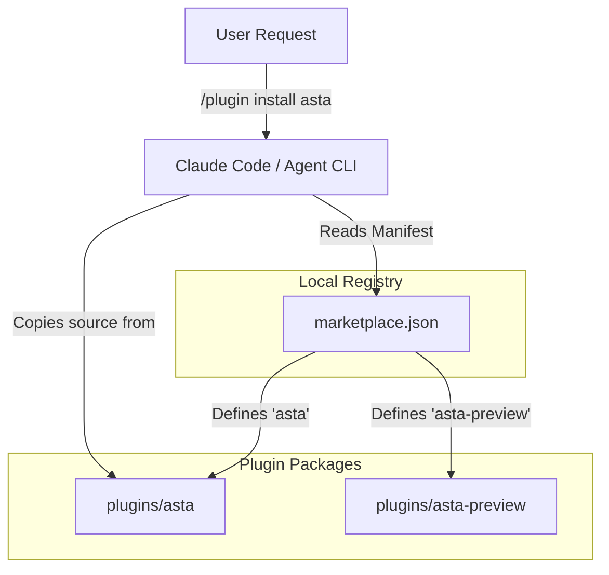

### Sources:
- [.claude-plugin/marketplace.json:1-47]()
- [README.md:11-14]()

---

## Plugin Generation Pipeline

The `plugins/` directory is a generated artifact and should never be edited directly [DEVELOPER.md:43-43](). Instead, the `build-plugins.sh` script synchronizes the source of truth in `skills/` and `hooks/` into the two distribution packages.

### Generation Logic

1.  **Clean**: Removes existing `plugins/asta` and `plugins/asta-preview` directories.
2.  **Initialize**: Creates the base structure for both plugins, including copying global `hooks/` (e.g., `check_permission` logic).
3.  **Skill Filtering**: 
    - Iterates through every subdirectory in `skills/`.
    - Parses the `SKILL.md` frontmatter using `scripts/validate-skills.py` [Makefile:101-102]().
    - If `internal: true`, the skill is copied **only** to `plugins/asta-preview`.
    - If `internal: false` (or missing), the skill is copied to **both** `plugins/asta` and `plugins/asta-preview`.
4.  **Verification**: The `make check-plugins` target ensures that the `plugins/` directory in the repository matches what the current `skills/` would generate, preventing stale builds from being committed [Makefile:91-98]().

### Build System Interaction

**Code Entity Mapping: Skill to Plugin Pipeline**
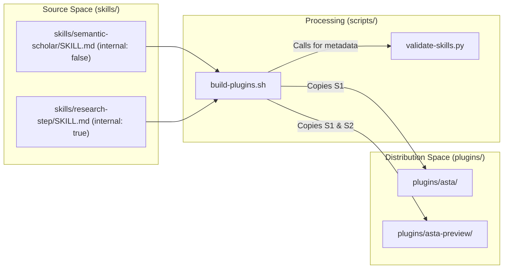

### Sources:
- [Makefile:87-98]()
- [Makefile:101-103]()
- [DEVELOPER.md:38-46]()
- [.github/workflows/ci.yml:29-33]()

---

## Internal vs. Default Skills

The distinction between an internal (preview) skill and a default (stable) skill is managed purely via metadata in the `SKILL.md` file located in each skill's directory.

### SKILL.md Configuration

Each skill must adhere to the **Agent Skills Spec**, which is validated during the build process [Makefile:101-103]().

| Attribute | Description | Impact on Distribution |
| :--- | :--- | :--- |
| `metadata.internal` | Boolean flag. | If `true`, skill is restricted to `asta-preview`. |
| `allowed-tools` | List of CLI commands. | Defines what the agent can execute (e.g., `asta literature find`). |

### Execution Environment

Regardless of whether a skill is installed via `asta` or `asta-preview`, it ultimately invokes the same `asta` CLI binary installed on the system path [DEVELOPER.md:48-64](). The plugins act as thin "capability descriptors" that tell the agent which subcommands of the `asta` CLI are available for use.

### Sources:
- [DEVELOPER.md:48-64]()
- [README.md:48-52]()
- [Makefile:101-103]()

---

# Page: CLI Architecture

# CLI Architecture

<details>
<summary>Relevant source files</summary>

The following files were used as context for generating this wiki page:

- [DEVELOPER.md](DEVELOPER.md)
- [README.md](README.md)
- [plugins/asta-preview/skills/research-step/SKILL.md](plugins/asta-preview/skills/research-step/SKILL.md)
- [src/asta/cli.py](src/asta/cli.py)
- [src/asta/literature/find.py](src/asta/literature/find.py)
- [src/asta/utils/asta.conf](src/asta/utils/asta.conf)
- [tests/test_cli.py](tests/test_cli.py)
- [tests/test_config.py](tests/test_config.py)

</details>


The `asta` CLI is the primary interface for scientific research skills, designed to be used by both human researchers and autonomous agents (e.g., Claude Code, Cursor). It follows a "CLI-first" philosophy where complex research workflows are exposed as standard terminal commands.

## Core Design Principles

The architecture is built around three major principles to ensure portability and ease of integration:

1.  **Thin CLI Layer**: The CLI uses [Click](https://click.palletsprojects.com/) to provide a consistent interface, but logic is delegated to specialized clients or external tools [src/asta/cli.py:1-30]().
2.  **Dependency-Free Clients**: Core API clients (e.g., `SemanticScholarClient`) are implemented using Python standard libraries (`urllib`, `json`) to minimize installation footprint and dependency conflicts [DEVELOPER.md:50-51]().
3.  **Automatic Tool Management**: The "Passthrough" system allows the CLI to offer functionality from other repositories (like `asta-documents` or `panda`) by automatically installing them on first use [src/asta/utils/asta.conf:69-80]().

## Command Structure

The CLI is organized into hierarchical command groups. Each group represents a specific domain of scientific research.

### System Hierarchy

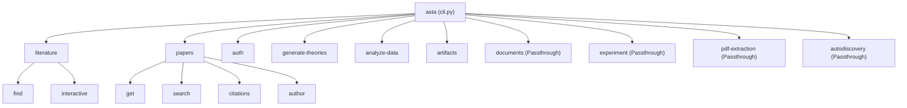
**Sources:** [src/asta/cli.py:33-73](), [DEVELOPER.md:9-36]()

### Primary Command Groups

| Group / Command | Code Entity | Description |
| :--- | :--- | :--- |
| `literature` | `literature.add_command` | High-level research workflows involving multi-paper synthesis. |
| `papers` | `papers.add_command` | Low-level metadata retrieval via Semantic Scholar. |
| `auth` | `cli.add_command(auth)` | Management of Auth0 device tokens and gateway access. |
| `documents` | `cli.add_command(documents)` | Passthrough to `asta-documents` for local library management. |
| `experiment` | `cli.add_command(experiment)` | Passthrough to `panda` for running computational experiments. |

**Sources:** [src/asta/cli.py:45-73]()

## Major Subsystems

The CLI relies on several internal frameworks to handle configuration, authentication, and external tool execution.

### Configuration System
Asta uses HOCON (Human-Optimized Config Object Notation) via `pyhocon`. The central configuration file `asta.conf` defines API endpoints, Auth0 parameters, and passthrough tool versions.
*   **For details, see [Configuration System](#2.1)**
*   **Key Files**: [src/asta/utils/asta.conf:1-109](), [src/asta/utils/config.py]()

### Passthrough System
This system allows the `asta` CLI to act as a wrapper for other standalone tools. If a user runs `asta documents` and the `asta-documents` package is missing, the system uses `ensure_tool_installed` to fetch it via PyPI or Git based on the configuration.
*   **For details, see [Passthrough System](#2.2)**
*   **Key Files**: [src/asta/utils/passthrough.py](), [src/asta/utils/asta.conf:81-109]()

### Authentication System
Most Asta services require authentication through the Allen Institute for AI (AI2) gateway. The CLI implements an Auth0 Device Authorization Flow, allowing users to log in via a browser and storing tokens locally for future use.
*   **For details, see [Authentication System](#2.3)**
*   **Key Files**: [src/asta/commands/auth.py](), [src/asta/utils/auth_config.py]()

### A2A Interactive Framework
The Agent-to-Agent (A2A) framework supports long-running, stateful interactions between the local agent and remote research agents. It manages "thread-dir" state and turn indexing for commands like `asta literature interactive`.
*   **For details, see [A2A Interactive Framework](#2.4)**
*   **Key Files**: [src/asta/literature/interactive.py](), [src/asta/analyze_data/__init__.py]()

## Execution Flow

The following diagram illustrates how a CLI command (e.g., `asta literature find`) moves from the user invocation through the configuration and client layers to the remote API.

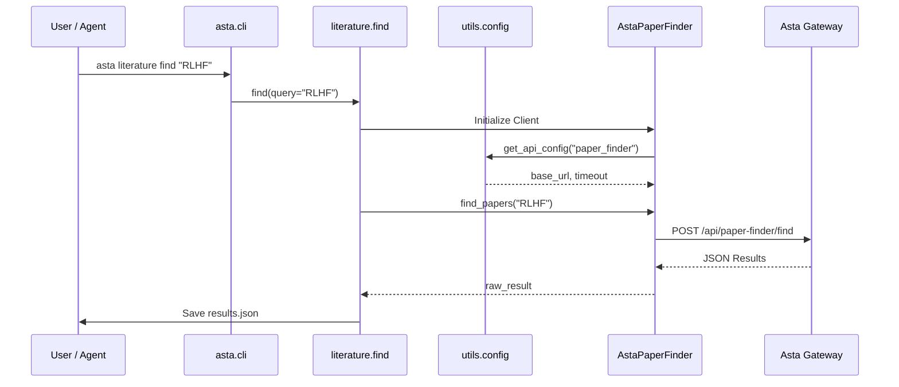
**Sources:** [src/asta/literature/find.py:33-83](), [src/asta/cli.py:64-65](), [src/asta/utils/asta.conf:33-39]()

---

# Page: Configuration System

# Configuration System

<details>
<summary>Relevant source files</summary>

The following files were used as context for generating this wiki page:

- [plugins/asta-preview/skills/research-step/SKILL.md](plugins/asta-preview/skills/research-step/SKILL.md)
- [src/asta/auth/device_flow.py](src/asta/auth/device_flow.py)
- [src/asta/cli.py](src/asta/cli.py)
- [src/asta/literature/find.py](src/asta/literature/find.py)
- [src/asta/utils/asta.conf](src/asta/utils/asta.conf)
- [src/asta/utils/config.py](src/asta/utils/config.py)
- [tests/test_auth.py](tests/test_auth.py)
- [tests/test_cli.py](tests/test_cli.py)
- [tests/test_config.py](tests/test_config.py)

</details>


The Asta CLI utilizes a hierarchical configuration system based on **HOCON** (Human-Optimized Config Object Notation). This system centralizes the definitions for authentication providers, remote API endpoints, and external tool delegations (passthroughs), allowing for seamless overrides via environment variables.

## HOCON Configuration (`asta.conf`)

The core of the configuration resides in `src/asta/utils/asta.conf` [src/asta/utils/asta.conf:1-109](). This file uses the `pyhocon` library to support features like key-value nesting, variable substitution, and environment variable overrides.

### Key Configuration Sections

| Section | Purpose | Key Entities |
| :--- | :--- | :--- |
| `auth` | Identity provider and Gateway settings | `auth0_domain`, `gateway_url` |
| `apis` | Service-specific base URLs | `semantic_scholar`, `paper_finder`, `theorizer` |
| `passthrough` | External tool installation and versioning | `documents`, `experiment`, `pdf-extraction` |

### Environment Overrides
The system supports dynamic overrides. For example, the `gateway_url` defaults to a production endpoint but can be redirected using `ASTA_GATEWAY_URL` [src/asta/utils/asta.conf:20-21](). Similarly, the entire configuration file path can be changed by setting `ASTA_CONFIG_FILE` [src/asta/utils/config.py:17-20]().

**Sources:** [src/asta/utils/asta.conf:1-109](), [src/asta/utils/config.py:10-21]()

---

## Configuration Management Logic

The `src/asta/utils/config.py` module provides the functional interface for retrieving configuration data. It parses the HOCON file and returns standard Python dictionaries.

### Core Functions

*   **`get_config()`**: Loads the entire configuration as a dictionary [src/asta/utils/config.py:23-37]().
*   **`get_api_config(api_name)`**: Retrieves settings for a specific API (e.g., `semantic_scholar`). Raises `KeyError` if the API is not defined [src/asta/utils/config.py:63-81]().
*   **`get_passthrough_config(command_name)`**: Retrieves installation and execution metadata for external tools [src/asta/utils/config.py:40-60]().

### Data Flow: Configuration Loading
The following diagram illustrates how the system resolves configuration values from the filesystem and environment.

**Configuration Resolution Flow**
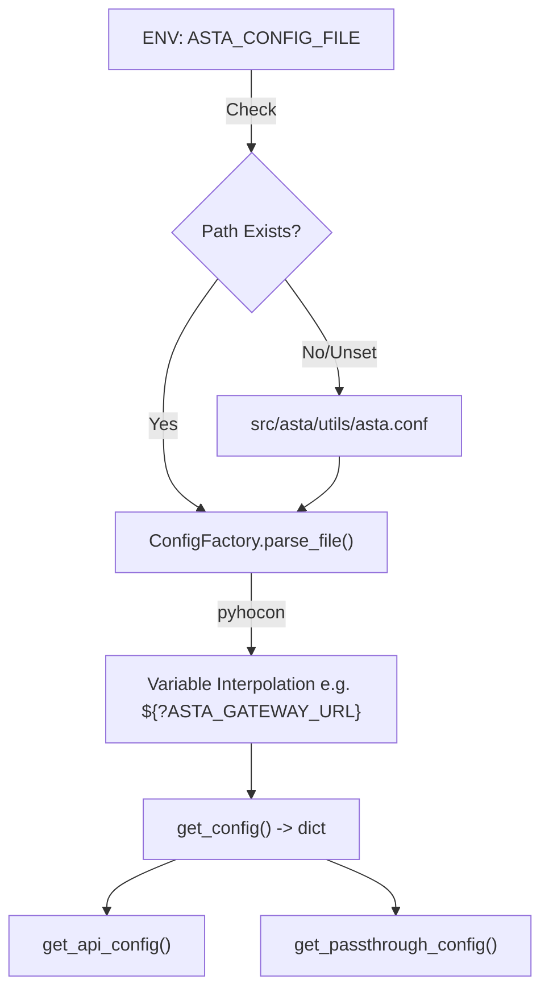
**Sources:** [src/asta/utils/config.py:10-81](), [src/asta/utils/asta.conf:21-38]()

---

## API and Passthrough Definitions

The configuration system maps natural language command names to specific code clients and external repositories.

### API Endpoints
API configurations typically define a `base_url`. Many APIs leverage the `gateway_url` variable to construct their endpoints, ensuring that changing the gateway location updates all dependent services [src/asta/utils/asta.conf:28-66]().

### Passthrough Commands
Passthroughs are commands that delegate to external packages. The configuration defines how Asta should install these tools if they are missing [src/asta/utils/asta.conf:81-109]().

| Field | Description |
| :--- | :--- |
| `tool_name` | The name of the package/binary (e.g., `panda`) |
| `install_type` | `pypi`, `git`, or `local` |
| `install_source` | The URI or package name for installation |
| `minimum_version` | SemVer requirement for the tool |

### Code Mapping: From Config to Execution
This diagram bridges the configuration keys in `asta.conf` to the Python entities that consume them.

**Entity Association Diagram**
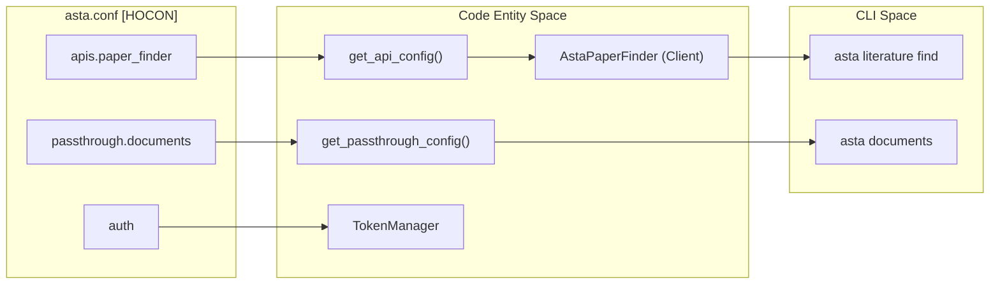
**Sources:** [src/asta/utils/asta.conf:33-40](), [src/asta/utils/config.py:40-81](), [src/asta/literature/find.py:54-57](), [src/asta/cli.py:58-65]()

---

## Implementation Details

### Validation
The configuration system is validated through `tests/test_config.py`. These tests ensure that:
1.  Required fields (like `auth0_domain`) are present [tests/test_config.py:108-124]().
2.  Passthrough `minimum_version` strings follow Semantic Versioning (x.y.z) [tests/test_config.py:49-52]().
3.  `install_type` is restricted to `pypi`, `git`, or `local` [tests/test_config.py:45-47]().

### Auth Settings Integration
While `get_config()` returns a dictionary, the authentication system often uses a typed helper via `get_auth_settings()` to provide attribute-based access to `auth0_domain`, `auth0_client_id`, and `gateway_url` [tests/test_config.py:126-142]().

**Sources:** [tests/test_config.py:1-189](), [src/asta/utils/auth_config.py]() (referenced via [tests/test_config.py:128]())

---

# Page: Passthrough System

# Passthrough System

<details>
<summary>Relevant source files</summary>

The following files were used as context for generating this wiki page:

- [plugins/asta-preview/skills/research-step/SKILL.md](plugins/asta-preview/skills/research-step/SKILL.md)
- [src/asta/documents/passthrough.py](src/asta/documents/passthrough.py)
- [src/asta/experiment/passthrough.py](src/asta/experiment/passthrough.py)
- [src/asta/literature/find.py](src/asta/literature/find.py)
- [src/asta/pdf_extraction/passthrough.py](src/asta/pdf_extraction/passthrough.py)
- [src/asta/utils/passthrough.py](src/asta/utils/passthrough.py)
- [tests/test_cli.py](tests/test_cli.py)
- [tests/test_config.py](tests/test_config.py)

</details>


The Passthrough System is a core architectural component of `asta` that allows it to delegate specialized commands to external tools such as `asta-documents`, `panda`, and `olmocr` [src/asta/utils/config.py:23-28](). By using a thin delegation layer, `asta` maintains a consistent CLI interface while offloading complex logic—like document indexing or experimental runners—to dedicated packages [src/asta/utils/passthrough.py:1-5]().

## Implementation Logic

The system relies on a combination of HOCON configuration for tool metadata and a set of utility functions to manage tool lifecycles (installation, version validation, and execution) [src/asta/utils/config.py:23-28](), [src/asta/utils/passthrough.py:199-214]().

### Configuration
Each passthrough command is defined in `asta.conf` under the `passthrough` block [src/asta/utils/config.py:96-102](). A configuration entry typically includes:
* `tool_name`: The name of the external executable (e.g., `asta-documents`) [tests/test_config.py:31-31]().
* `command_name`: The subcommand name within `asta` (e.g., `documents`) [tests/test_config.py:32-32]().
* `install_type`: One of `pypi`, `git`, or `local` [tests/test_config.py:45-47]().
* `install_source`: The package name, Git URL, or local path [tests/test_config.py:34-34]().
* `minimum_version`: The required Semantic Version (x.y.z) [tests/test_config.py:49-52]().

### Natural Language to Code Entity Space: Configuration Mapping
The following diagram illustrates how the abstract concept of a "Passthrough Command" is mapped to specific code entities and configuration keys.

Title: Passthrough Command Mapping
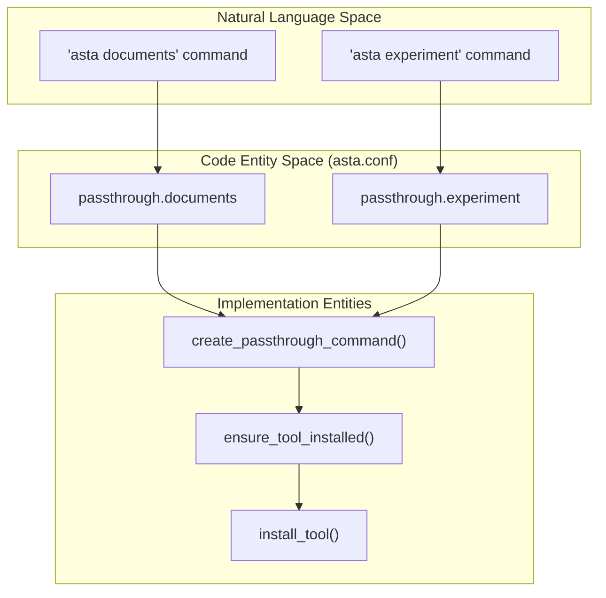
Sources: [src/asta/utils/config.py:23-28](), [src/asta/utils/passthrough.py:199-214](), [src/asta/utils/passthrough.py:236-252](), [tests/test_config.py:23-52]()

## Key Components

### 1. Version Validation
The system strictly enforces Semantic Versioning. It uses `get_installed_version` to run the tool with a `--version` flag and parses the output using regex [src/asta/utils/passthrough.py:12-43]().
* **`parse_semver`**: Converts a string like `v1.2.3` into a comparable tuple `(1, 2, 3)` [src/asta/utils/passthrough.py:46-70]().
* **`version_meets_minimum`**: Compares the installed version tuple against the configured minimum [src/asta/utils/passthrough.py:84-116]().

### 2. Tool Management (`uv` integration)
Installation and updates are handled via the `uv` package manager [src/asta/utils/passthrough.py:118-139]().
* **`install_tool`**: Constructs the appropriate `uv tool install` command based on the `install_type` [src/asta/utils/passthrough.py:118-192]().
    * **pypi**: Appends `>=minimum_version` to the package name [src/asta/utils/passthrough.py:157-160]().
    * **git**: Appends `@v{minimum_version}` to the URL [src/asta/utils/passthrough.py:161-164]().
    * **local**: Expands the filesystem path [src/asta/utils/passthrough.py:165-169]().
* **`ensure_tool_installed`**: The primary entry point that checks if a tool exists, validates its version, and triggers `install_tool` if necessary [src/asta/utils/passthrough.py:199-214]().

### 3. Command Creation
The `create_passthrough_command` function is a factory that generates a Click command [src/asta/utils/passthrough.py:236-252](). When this command is invoked:
1. It calls `ensure_tool_installed` [src/asta/utils/passthrough.py:199-214]().
2. It aggregates arguments, including any "lazy" arguments provided via a callable (used for dynamic auth tokens) [src/asta/pdf_extraction/passthrough.py:11-32]().
3. It uses `os.execv` to replace the current process with the external tool, ensuring seamless I/O handling [src/asta/utils/passthrough.py:311-314]().

## Data Flow: Command Execution
The following diagram shows the sequence of events from a user typing a command to the execution of the external tool.

Title: Passthrough Execution Flow
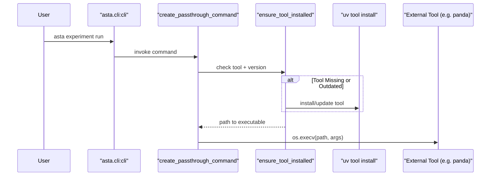
Sources: [src/asta/utils/passthrough.py:118-192](), [src/asta/utils/passthrough.py:199-214](), [src/asta/utils/passthrough.py:236-252](), [src/asta/experiment/passthrough.py:1-17]()

## Example: PDF Extraction (olmOCR)
The `pdf-extraction` command demonstrates an advanced use case where passthrough arguments are evaluated lazily to include a fresh authentication token [src/asta/pdf_extraction/passthrough.py:11-32]().

| Feature | Implementation |
| :--- | :--- |
| **Tool Name** | `olmocr` [src/asta/pdf_extraction/passthrough.py:121-121]() |
| **Lazy Args** | `get_pdf_extraction_tool_args` fetches API keys and server URLs at runtime [src/asta/pdf_extraction/passthrough.py:11-32]() |
| **Help Text** | Overridden with custom `_HELP_TEXT` via `help_transform` [src/asta/pdf_extraction/passthrough.py:35-117]() |

Sources: [src/asta/pdf_extraction/passthrough.py:1-130](), [src/asta/utils/passthrough.py:236-252]()

---

# Page: Authentication System

# Authentication System

<details>
<summary>Relevant source files</summary>

The following files were used as context for generating this wiki page:

- [src/asta/auth/device_flow.py](src/asta/auth/device_flow.py)
- [src/asta/auth/storage.py](src/asta/auth/storage.py)
- [src/asta/auth/token_manager.py](src/asta/auth/token_manager.py)
- [src/asta/commands/auth.py](src/asta/commands/auth.py)
- [src/asta/utils/auth_helper.py](src/asta/utils/auth_helper.py)
- [src/asta/utils/config.py](src/asta/utils/config.py)
- [tests/test_auth.py](tests/test_auth.py)
- [tests/test_auth_helper.py](tests/test_auth_helper.py)

</details>


The `asta` authentication system implements the **Auth0 Device Authorization Flow** (RFC 8628), allowing users to authenticate via a browser on any device and interact with protected Asta APIs. The system handles token persistence, automatic background refreshing with exponential backoff, and server-side verification through a gateway.

## Core Components

The authentication logic is distributed across several specialized classes and utilities:

*   **`DeviceAuthFlow`**: Implements the low-level OAuth2 device flow protocol [src/asta/auth/device_flow.py:40-41]().
*   **`TokenManager`**: Orchestrates the high-level login/logout logic and manages token lifecycles [src/asta/auth/token_manager.py:28-29]().
*   **`TokenStorage`**: Handles secure persistence using platform-specific keyrings or restricted file permissions [src/asta/auth/storage.py:24-25]().
*   **`get_access_token`**: A global helper used by CLI commands to retrieve a valid token, triggering transparent refreshes if needed [src/asta/utils/auth_helper.py:11-12]().

### Authentication Data Flow

The following diagram illustrates the relationship between the CLI commands, the manager, and the storage backends.

**Auth System Entity Mapping**
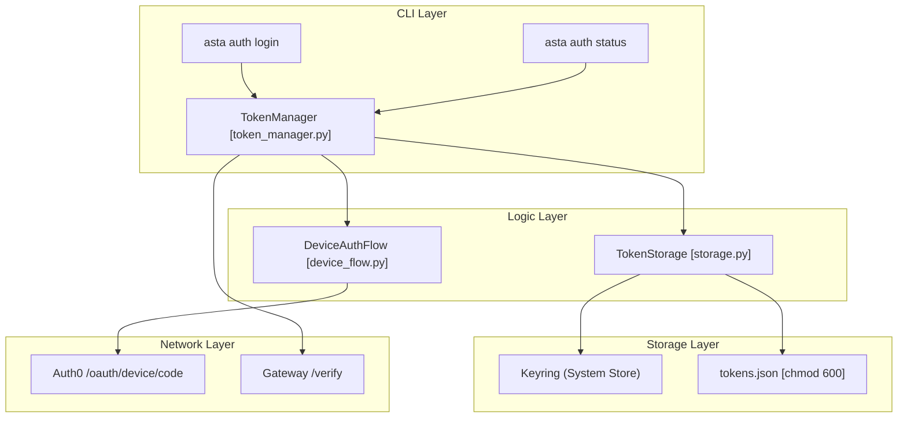
Sources: [src/asta/commands/auth.py:35-43](), [src/asta/auth/token_manager.py:39-41](), [src/asta/auth/storage.py:35-41]()

## Device Authorization Flow

The system uses a two-step polling process to obtain tokens without requiring the user to input credentials directly into the terminal:

1.  **Initiation**: `DeviceAuthFlow.initiate()` calls the Auth0 `/oauth/device/code` endpoint to receive a `user_code` and `verification_uri` [src/asta/auth/device_flow.py:57-68]().
2.  **User Interaction**: The CLI displays a URL (and optionally opens a browser) for the user to confirm the code [src/asta/auth/token_manager.py:78-101]().
3.  **Polling**: `DeviceAuthFlow.poll_for_token()` repeatedly checks the `/oauth/token` endpoint [src/asta/auth/device_flow.py:82-115](). It handles `authorization_pending` and `slow_down` (which increases the polling interval) [src/asta/auth/device_flow.py:133-139]().

Sources: [src/asta/auth/device_flow.py:40-150](), [src/asta/auth/token_manager.py:43-76]()

## Token Management & Refresh

Tokens are automatically managed by the `TokenManager.get_valid_access_token()` method [src/asta/auth/token_manager.py:102-103]().

### Refresh Logic
If a token is within 5 minutes (300 seconds) of expiration, the system attempts a refresh [src/asta/auth/token_manager.py:124-125](). This process includes:
*   **Exponential Backoff**: If a transient network error occurs, the system retries up to 3 times, doubling the delay between attempts (2s, 4s, 8s) [src/asta/auth/token_manager.py:134-144]().
*   **Token Rotation Support**: New refresh tokens returned by the server are saved immediately to prevent lock-outs [src/asta/auth/token_manager.py:149-157]().

**Token Refresh Sequence**
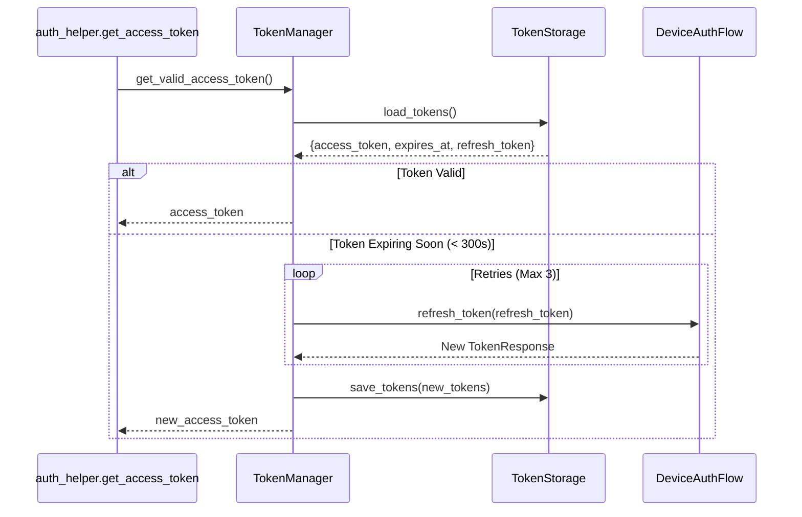
Sources: [src/asta/auth/token_manager.py:102-185](), [src/asta/utils/auth_helper.py:11-43]()

## Token Storage

`TokenStorage` ensures credentials are kept securely on the local machine. It uses a dual-write strategy to ensure reliability [src/asta/auth/storage.py:41-48]():

| Backend | Purpose | Implementation |
| :--- | :--- | :--- |
| **Keyring** | Primary Secure Store | Uses `keyring` library to access OS-level credential managers (Keychain, Windows Credential Vault, Secret Service) [src/asta/auth/storage.py:50-53](). |
| **File** | Fallback/Sync | Stores JSON in `~/.config/asta-cli/tokens.json` with `0o600` (owner read/write only) permissions [src/asta/auth/storage.py:35-39](). |

Sources: [src/asta/auth/storage.py:24-62]()

## Gateway Verification

The `asta auth status` command performs an additional server-side check by calling the gateway's verification endpoint [src/asta/commands/auth.py:105-136](). This confirms that the token is not only locally valid (not expired) but also recognized by the Asta infrastructure [src/asta/auth/token_manager.py:222-252]().

## CLI Commands

The authentication system is exposed via the `asta auth` command group [src/asta/commands/auth.py:21-24]():

*   **`login`**: Initiates the device flow [src/asta/commands/auth.py:27-56]().
*   **`logout`**: Deletes tokens from both Keyring and file storage [src/asta/commands/auth.py:58-71]().
*   **`status`**: Displays a table containing local token status, server verification, user email, and time until expiration [src/asta/commands/auth.py:74-189]().
*   **`print-token`**: Outputs the current access token. Use `--raw` for the base64 string or omit it to see a decoded view of the JWT header and payload [src/asta/commands/auth.py:190-216]().

Sources: [src/asta/commands/auth.py:1-216]()

---

# Page: A2A Interactive Framework

# A2A Interactive Framework

<details>
<summary>Relevant source files</summary>

The following files were used as context for generating this wiki page:

- [src/asta/literature/a2a_artifact.py](src/asta/literature/a2a_artifact.py)
- [src/asta/literature/interactive.py](src/asta/literature/interactive.py)
- [src/asta/utils/a2a_interactive.py](src/asta/utils/a2a_interactive.py)
- [src/asta/utils/a2a_stream.py](src/asta/utils/a2a_stream.py)
- [src/asta/utils/thread_state.py](src/asta/utils/thread_state.py)
- [tests/test_a2a_artifact.py](tests/test_a2a_artifact.py)
- [tests/test_a2a_interactive.py](tests/test_a2a_interactive.py)

</details>


The Agent-to-Agent (A2A) Interactive Framework provides a generic streaming runner for stateful, multi-turn conversations between the `asta` CLI and remote agentic services. It handles the complexities of Server-Sent Events (SSE), JSON-RPC 2.0 wire formats, thread persistence via local state directories, and authentication resolution.

## Framework Overview

The framework is designed to allow skill developers to implement interactive agents with minimal boilerplate. A typical interactive skill only needs to define an `A2ASkillSpec`, a Click command decorated with `standard_a2a_options`, and a translation function to convert agent artifacts into local domain models.

### Key Components

| Component | File Path | Role |
| :--- | :--- | :--- |
| `A2ASkillSpec` | [src/asta/utils/a2a_interactive.py:48-55]() | Metadata defining the config keys and environment variables for a specific skill. |
| `run_a2a_session` | [src/asta/utils/a2a_interactive.py:122-191]() | The primary entry point that orchestrates the session lifecycle (resolve auth, stream, persist). |
| `stream_a2a_message` | [src/asta/utils/a2a_stream.py:56-104]() | Low-level SSE client handling JSON-RPC over HTTP. |
| `ThreadState` | [src/asta/utils/thread_state.py:47-67]() | Manages the `index.json` and turn-based file indexing for multi-turn continuity. |

**Sources:** [src/asta/utils/a2a_interactive.py:1-37](), [src/asta/utils/a2a_stream.py:1-7](), [src/asta/utils/thread_state.py:1-16]()

---

## Data Flow: CLI to A2A Service

The following diagram illustrates how a user command travels through the interactive framework to the remote A2A service and back to the local filesystem.

### Interactive Turn Sequence
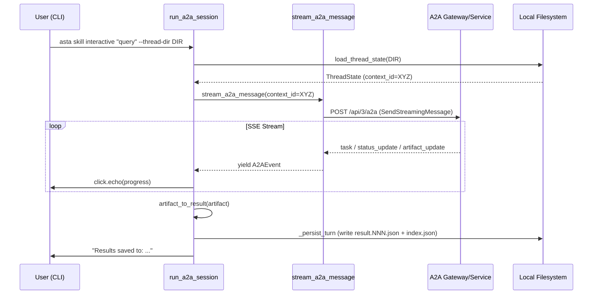
**Sources:** [src/asta/utils/a2a_interactive.py:142-184](), [src/asta/utils/a2a_stream.py:84-103](), [src/asta/utils/thread_state.py:74-97]()

---

## Thread State Management

The framework supports stateful conversations using a `--thread-dir` pattern. When this directory is provided, the runner maintains an `index.json` file that tracks the `thread_id` (used as `contextId` in subsequent requests) and an ordered list of turns.

### On-Disk Schema (`index.json`)
The `ThreadState` class manages the serialization of this metadata:
- `thread_id`: The remote identifier for the conversation [src/asta/utils/thread_state.py:48]().
- `turns`: A list of `TurnEntry` objects containing the turn index, timestamp, and the filename of the result [src/asta/utils/thread_state.py:51]().
- `summary`: A skill-specific blob generated by a `BuildSummary` callback [src/asta/utils/a2a_interactive.py:68]().

### Turn File Naming
Result files are automatically versioned using a padded index (e.g., `result.001.json`, `result.002.json`) via the `turn_filename` utility [src/asta/utils/thread_state.py:106-111]().

**Sources:** [src/asta/utils/thread_state.py:1-16](), [src/asta/utils/thread_state.py:30-44](), [src/asta/utils/a2a_interactive.py:198-214]()

---

## Wire Format: A2A v1.0 Streaming

The framework implements the `SendStreamingMessage` JSON-RPC method over SSE [src/asta/utils/a2a_stream.py:155-172]().

### Event Parsing
The `stream_a2a_message` function yields `A2AEvent` objects. The framework provides extractors to pull specific data from these events:
- `step_progress_of`: Extracts UI-friendly progress messages [src/asta/utils/a2a_stream.py:109-117]().
- `terminal_status_of`: Detects completion or failure states like `TASK_STATE_COMPLETED` or `TASK_STATE_FAILED` [src/asta/utils/a2a_stream.py:120-136]().
- `artifact_data_of`: Retrieves the final data payload produced by the agent [src/asta/utils/a2a_stream.py:139-147]().

### Code Entity Association
The following diagram maps the high-level A2A concepts to the specific Python classes and functions responsible for them.

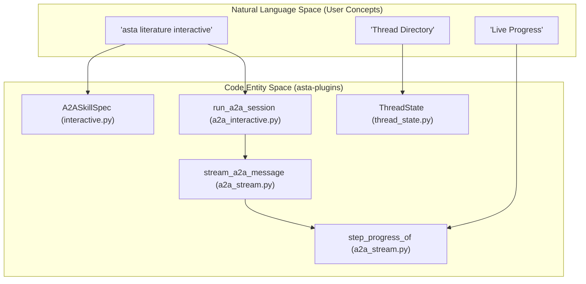
**Sources:** [src/asta/utils/a2a_interactive.py:48-55](), [src/asta/utils/a2a_stream.py:56-64](), [src/asta/utils/a2a_stream.py:109-112](), [src/asta/utils/thread_state.py:47-51]()

---

## Implementation Example: Literature Interactive

The `literature interactive` skill is a canonical example of a skill built on this framework.

1.  **Skill Specification**: It defines `PAPER_FINDER_SPEC` pointing to the `paper_finder` config block [src/asta/literature/interactive.py:15-18]().
2.  **Command Setup**: It uses `@standard_a2a_options` to inherit flags like `--thread-dir` and `--output` [src/asta/literature/interactive.py:29-38]().
3.  **Artifact Translation**: It passes `parse_artifact` as the `artifact_to_result` callback. This function maps the complex A2A `entities` dictionary into a `LiteratureSearchResult` model [src/asta/literature/a2a_artifact.py:26-58]().
4.  **Summary Building**: It provides a `_build_summary` function to record the query and paper count in the `index.json` [src/asta/literature/interactive.py:90-99]().

**Sources:** [src/asta/literature/interactive.py:70-87](), [src/asta/literature/a2a_artifact.py:1-21]()

---

# Page: Skills Reference

# Skills Reference

<details>
<summary>Relevant source files</summary>

The following files were used as context for generating this wiki page:

- [.github/workflows/ci.yml](.github/workflows/ci.yml)
- [DEVELOPER.md](DEVELOPER.md)
- [Makefile](Makefile)
- [README.md](README.md)
- [scripts/validate-skills.py](scripts/validate-skills.py)

</details>


Asta is built around a modular **Skill System** designed to extend the capabilities of AI agents (like Claude Code, Cursor, or Copilot) into the scientific research domain. A "skill" in this ecosystem is a packaged set of capabilities that allow an agent to perform specific research tasks—such as searching for literature, managing document indices, or running computational experiments—using the `asta` CLI as the underlying execution engine.

### What is a Skill?

In the Asta ecosystem, a skill is defined by a directory in the canonical `skills/` directory [DEVELOPER.md:38-38](). Each skill contains a `SKILL.md` file that follows the [Agent Skills specification](https://agentskills.io/specification) [scripts/validate-skills.py:9-10]().

#### The SKILL.md Format
The `SKILL.md` file uses YAML frontmatter to define how an agent interacts with the skill. Key fields include:
*   **`name`**: A kebab-case identifier (e.g., `find-literature`) that must match the parent directory name [scripts/validate-skills.py:35-48]().
*   **`description`**: A concise explanation (up to 1024 characters) of what the skill does, helping the agent decide when to invoke it [scripts/validate-skills.py:50-55]().
*   **`allowed-tools`**: A space-separated string of commands the agent is permitted to run (e.g., `asta literature find`) [scripts/validate-skills.py:56-62]().
*   **`metadata.internal`**: A flag used by the build pipeline to distinguish between "stable" skills (included in the default `asta` plugin) and "preview" or internal skills (included in `asta-preview`) [scripts/build-plugins.sh]().

### Skill Discovery and Distribution

Asta uses a dual-track distribution model to manage the lifecycle of research tools. The `build-plugins.sh` script processes the `skills/` directory to generate the `plugins/` marketplace packages [Makefile:87-88]().

| Track | Target Plugin | Description |
| :--- | :--- | :--- |
| **Stable** | `asta` | Production-ready skills like Semantic Scholar lookup and Document Management [README.md:16-20](). |
| **Preview** | `asta-preview` | Experimental or high-velocity skills like `research-step` and `find-literature` [README.md:22-37](). |

#### Skill Architecture Overview

The following diagram illustrates how the natural language requests from a user are mapped to specific code entities via the Skill System.

**Skill Mapping: NL Space to Code Entity Space**
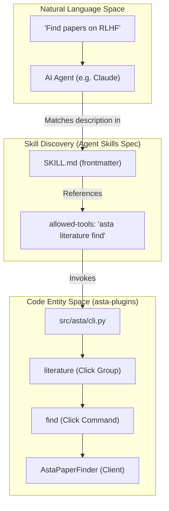
**Sources:** [README.md:39-47](), [scripts/validate-skills.py:35-62](), [src/asta/cli.py:12-12](), [src/asta/literature/find.py:29-29](), [src/asta/core/client.py:15-15]()

---

### Skill Categories

The Asta skills are grouped into several functional categories. Detailed documentation for each category can be found in the sub-pages linked below.

#### [Literature Research Skills](#3.1)
Covers skills for discovering and reporting on scientific literature.
*   **`find-literature`**: High-level paper searching and citation discovery [README.md:34-34]().
*   **`semantic-scholar`**: Direct metadata queries via the Semantic Scholar API (`asta papers` commands) [README.md:18-18]().
*   **`literature-report`**: Automated generation of comprehensive synthesis reports [README.md:35-35]().

#### [Document Management Skill](#3.2)
Focuses on the `asta-documents` tool, which maintains a local YAML-based index of research papers. It supports the `asta://` URI scheme and hybrid search (BM25 + semantic) [README.md:19-19](), [src/asta/documents/passthrough.py:23-23]().

#### [Experiment and Data Analysis Skills](#3.3)
Tools for performing active research and analyzing results.
*   **`experiment`**: Interfaces with the `panda` CLI for computational experiments [README.md:36-36](), [src/asta/experiment/passthrough.py:26-26]().
*   **`analyze-data`**: Uses DataVoyager for automated data visualization and analysis.
*   **`autodiscovery`**: MCTS-based scientific discovery engine.

#### [Theory Generation and Artifacts Skills](#3.4)
Skills for higher-level synthesis and output management.
*   **`generate-theories`**: The "Theorizer" agent loop for novelty assessment and theory generation.
*   **`artifacts`**: Manages the export pipeline and `manifest.json` for research outputs.

#### [Research Orchestration Skills](#3.5)
The framework for autonomous research loops.
*   **`research-step`**: Implements the "Beads" (bd) framework, managing the transition between brainstorming, planning, and execution [README.md:37-37]().
*   **`research-challenge`**: Specific workflows for submission and reflection on research tasks.

#### [PDF Extraction, Local Paper Index, and Utility Skills](#3.6)
Support utilities for the research workflow.
*   **`pdf-extraction`**: Cloud-based OCR using `olmOCR` [README.md:20-20]().
*   **`preview`**: Quarto-based rendering for viewing research reports [README.md:60-60]().
*   **`workspace`**: Standardized devcontainer and VS Code configurations [README.md:89-92]().

---

### Skill Execution Flow

When an agent invokes a skill, it typically flows through the `asta` CLI, which may either execute logic directly or pass the command through to a specialized external tool.

**CLI Passthrough Execution Flow**
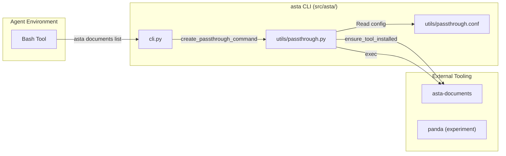
**Sources:** [DEVELOPER.md:52-63](), [src/asta/utils/passthrough.py:20-20](), [src/asta/utils/passthrough.conf:19-19]()

---

# Page: Literature Research Skills

# Literature Research Skills

<details>
<summary>Relevant source files</summary>

The following files were used as context for generating this wiki page:

- [plugins/asta-preview/skills/find-literature/SKILL.md](plugins/asta-preview/skills/find-literature/SKILL.md)
- [plugins/asta-preview/skills/literature-report/SKILL.md](plugins/asta-preview/skills/literature-report/SKILL.md)
- [plugins/asta-preview/skills/semantic-scholar/SKILL.md](plugins/asta-preview/skills/semantic-scholar/SKILL.md)
- [plugins/asta/skills/literature-report/SKILL.md](plugins/asta/skills/literature-report/SKILL.md)
- [plugins/asta/skills/semantic-scholar/SKILL.md](plugins/asta/skills/semantic-scholar/SKILL.md)
- [skills/find-literature/SKILL.md](skills/find-literature/SKILL.md)
- [skills/literature-report/SKILL.md](skills/literature-report/SKILL.md)
- [skills/semantic-scholar/SKILL.md](skills/semantic-scholar/SKILL.md)

</details>


The literature research capabilities in `asta` are divided into three primary skills: `find-literature`, `semantic-scholar`, and `literature-report`. These skills provide a tiered approach to academic research, ranging from low-level metadata lookups to high-level agentic exploration and document synthesis.

## Skill Overview and Selection

The system distinguishes between **mechanical lookups** and **agent-mediated discovery**.

| Skill | Primary Tool | Best For |
| :--- | :--- | :--- |
| `semantic-scholar` | `asta papers` | Fast, targeted lookups by ID, author, or keyword. |
| `find-literature` | `asta literature find` | One-shot, criterion-based ranking for sub-steps in workflows. |
| `find-literature` | `asta literature interactive` | Multi-turn, exploratory research sessions with reasoning loops. |
| `literature-report` | BibTeX/Markdown | Synthesizing findings into structured reports with citations. |

**Sources:** [skills/find-literature/SKILL.md:16-38](), [skills/semantic-scholar/SKILL.md:22-57]()

---

## Find Literature Skill

The `find-literature` skill is used for topic-driven search where the system extracts relevance criteria from a query and ranks candidates against those criteria [skills/find-literature/SKILL.md:2-3]().

### Data Flow: Discovery to Indexing
The discovery process often involves background execution due to high latency (30-60s) for comprehensive searches.

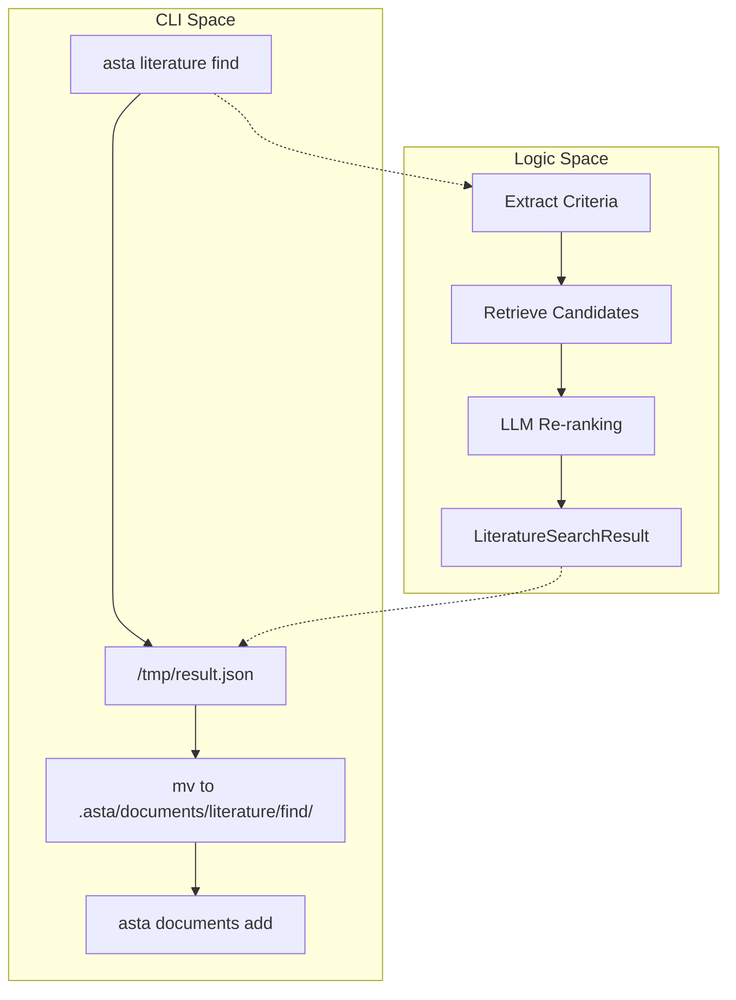
**Sources:** [skills/find-literature/SKILL.md:94-111](), [skills/find-literature/SKILL.md:140-161]()

### Interactive vs. One-shot
1.  **`asta literature find`**: A single attempt without an agent loop. It is optimized for speed and used when literature search is a sub-step of a larger task [skills/find-literature/SKILL.md:33-36]().
2.  **`asta literature interactive`**: Built on the A2A (Agent-to-Agent) framework. It uses a reasoning loop to verify results and supports multi-turn refinement via `--thread-dir` [skills/find-literature/SKILL.md:23-31]().

### State Management with `--thread-dir`
For multi-turn sessions, the CLI maintains state in a specific directory structure:
- **`index.json`**: Records turn order, queries, and `thread_id` [skills/find-literature/SKILL.md:44-45]().
- **`.NNN.json`**: Per-turn artifacts containing the `LiteratureSearchResult` [skills/find-literature/SKILL.md:43-44]().

**Sources:** [skills/find-literature/SKILL.md:40-64]()

---

## Semantic Scholar Skill

The `semantic-scholar` skill provides direct access to the Semantic Scholar API for mechanical tasks. It is preferred when IDs or exact phrases are known [skills/semantic-scholar/SKILL.md:33-39]().

### Command Implementation Space

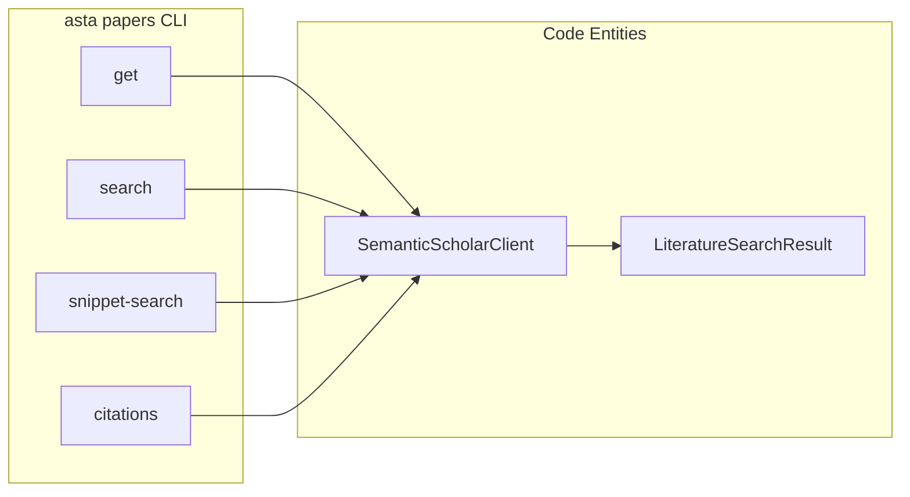

### Key Operations
- **`get`**: Fetches metadata (title, abstract, authors) by ID (ARXIV, DOI, CorpusId) [skills/semantic-scholar/SKILL.md:77-92]().
- **`search`**: Keyword-based search with date filters and limit controls [skills/semantic-scholar/SKILL.md:98-114]().
- **`snippet-search`**: Advanced search over full-text bodies. It returns `snippet.text` (approx. 500 words) and `snippet.section` [skills/semantic-scholar/SKILL.md:118-138]().
- **`citations`**: Retrieves the citation graph for a specific work [skills/semantic-scholar/SKILL.md:150-161]().

**Sources:** [skills/semantic-scholar/SKILL.md:73-161]()

---

## Literature Report Skill

The `literature-report` skill focuses on the synthesis of gathered data into Markdown documents.

### Workflow and Citation Keys
The skill follows a strict convention for maintaining bibliography files (`.bib`):
1.  **Key Generation**: `{firstAuthorSurname}{year}` (e.g., `wei2022`). Conflicts are resolved with alphabetical suffixes [skills/literature-report/SKILL.md:41]().
2.  **Stable IDs**: The `corpus_id` field must be included in BibTeX entries to ensure identification survives key renames [skills/literature-report/SKILL.md:42]().
3.  **Appends Only**: The system is instructed to append to `.bib` files and never rewrite existing entries [skills/literature-report/SKILL.md:43]().

### Data Integration
Reports are expected to integrate data from `.asta/documents/literature/find/`. Agents are instructed to read existing reports before updating and to use the **Preview** skill to verify that all `[@key]` citations resolve correctly [skills/literature-report/SKILL.md:13-21](), [skills/literature-report/SKILL.md:45]().

**Sources:** [skills/literature-report/SKILL.md:1-46]()

---

# Page: Document Management Skill

# Document Management Skill

<details>
<summary>Relevant source files</summary>

The following files were used as context for generating this wiki page:

- [plugins/asta-preview/skills/asta-documents/SKILL.md](plugins/asta-preview/skills/asta-documents/SKILL.md)
- [plugins/asta/skills/asta-documents/SKILL.md](plugins/asta/skills/asta-documents/SKILL.md)
- [skills/asta-documents/SKILL.md](skills/asta-documents/SKILL.md)

</details>


The `asta-documents` skill provides a local metadata index and content management system for research papers, reports, and datasets. It serves as the primary storage abstraction for the Asta ecosystem, allowing skills to track metadata, manage local caches, and resolve documents via a custom URI scheme.

## Overview and Purpose

The skill manages document metadata (URLs, summaries, tags, and custom fields) in a local YAML index. It is designed to act as a "smart bookmark manager" that facilitates retrieval and sharing across different research tasks [skills/asta-documents/SKILL.md:8-12]().

Key capabilities include:
- **Local Indexing**: Persistent storage in `.asta/documents/index.yaml` [skills/asta-documents/SKILL.md:14-14]().
- **Hybrid Search**: Field-based search across names, summaries, and tags [skills/asta-documents/SKILL.md:66-70]().
- **Content Fetching**: Downloading and caching document content from various protocols (HTTP, S3, GS, File) [skills/asta-documents/SKILL.md:93-94, 188-188]().
- **URI Resolution**: Support for the `asta://` scheme to reference remote document collections [skills/asta-documents/SKILL.md:111-113]().

### Sources:
- [skills/asta-documents/SKILL.md:8-14]()
- [skills/asta-documents/SKILL.md:66-70]()
- [skills/asta-documents/SKILL.md:93-94]()
- [skills/asta-documents/SKILL.md:188-188]()

---

## Data Flow: Document Indexing and Retrieval

The document management system bridges natural language requests (e.g., "Find the paper I saved about transformers") to specific CLI operations and file-system state.

### Document Management Lifecycle
Title: "Document Management Logic Flow"
```mermaid
graph TD
    subgraph "Natural Language Space"
        UserReq["User: 'Add this PDF to my Asta index'"]
        SearchReq["User: 'Search for AI papers'"]
    end

    subgraph "Code Entity Space (asta-documents)"
        CLI["asta documents add/search"]
        IndexFile["index.yaml (.asta/documents/)"]
        CacheDir["Cache Storage"]
        RemoteResolver["Remote Index Resolver"]
    end

    UserReq -->|"Invokes"| CLI
    CLI -->|"Writes Metadata"| IndexFile
    CLI -->|"Downloads Content"| CacheDir
    
    SearchReq -->|"Queries"| IndexFile
    IndexFile -.->|"Returns UUID"| CLI
```
Sources: [skills/asta-documents/SKILL.md:10-14](), [skills/asta-documents/SKILL.md:79-86]()

---

## The `asta://` URI Scheme

The skill implements a custom URI scheme to enable sharing of document collections. An `asta://` URL points to a specific document within a remote index.

**URL Format:** `asta://{url-encoded-index-url}/{uuid}` [skills/asta-documents/SKILL.md:115-117]().

### Remote Resolution Pattern
Title: "Remote URI Resolution Process"
```mermaid
sequenceDiagram
    participant Agent as "Agent/LLM"
    participant CLI as "asta documents fetch"
    participant Remote as "Remote YAML Index"
    participant Storage as "Local Temporary Index"

    Agent->>CLI: Request asta://[EncodedURL]/[UUID]
    CLI->>CLI: Decode Index URL
    CLI->>Remote: GET index.yaml
    Remote-->>CLI: YAML Data
    CLI->>Storage: Save to /tmp/remote-index.yaml
    CLI->>CLI: Execute with --index-path /tmp/remote-index.yaml
    CLI-->>Agent: Document Content/Metadata
```
Sources: [skills/asta-documents/SKILL.md:130-160]()

---

## Technical Implementation Details

### 1. Local Index Management
The index is a YAML file located by default at `.asta/documents/index.yaml` [skills/asta-documents/SKILL.md:14-14](). It stores document entries identified by a 10-character UUID [skills/asta-documents/SKILL.md:121-121]().

### 2. Automatic Indexing Patterns
A core integration pattern requires other skills (like literature research) to automatically register generated artifacts. When a skill writes to the `.asta/` directory, it should invoke `asta documents add` with the following metadata [skills/asta-documents/SKILL.md:16-29]():
- **URL**: Absolute `file://` path [skills/asta-documents/SKILL.md:35-35]().
- **Tags**: `asta-generated` and specific skill tags [skills/asta-documents/SKILL.md:38-38]().
- **MIME-Type**: Detected from extension (e.g., `text/markdown`) [skills/asta-documents/SKILL.md:39-39]().

### 3. Search and Filtering
The `search` command supports complex filtering:
- **Union vs. Intersection**: The `--union` flag switches from matching ALL criteria to matching ANY [skills/asta-documents/SKILL.md:72-76]().
- **Extra Field Queries**: Supports querying custom JSON metadata via the `--extra` flag (e.g., `.year > 2020`) [skills/asta-documents/SKILL.md:70-70]().

### 4. Cache Management
The system maintains a local cache for remote documents. Users can monitor and maintain this via the `cache` subcommand group:
- `asta documents cache list`: View cached items [skills/asta-documents/SKILL.md:101-101]().
- `asta documents cache clean --days 7`: Evict items older than a threshold [skills/asta-documents/SKILL.md:103-103]().

### Sources:
- [skills/asta-documents/SKILL.md:14-14]()
- [skills/asta-documents/SKILL.md:16-39]()
- [skills/asta-documents/SKILL.md:70-76]()
- [skills/asta-documents/SKILL.md:101-103]()
- [skills/asta-documents/SKILL.md:121-121]()

---

## Integration Reference

| Feature | CLI Command | Notes |
| :--- | :--- | :--- |
| **Indexing** | `asta documents add <url>` | Supports `file://`, `http://`, `s3://`, `gs://` [skills/asta-documents/SKILL.md:79, 188]() |
| **Metadata** | `asta documents get <uuid>` | Retrieves full JSON metadata [skills/asta-documents/SKILL.md:85-86]() |
| **Retrieval** | `asta documents fetch <uuid>` | Downloads content to local path [skills/asta-documents/SKILL.md:93-94]() |
| **Discovery** | `asta documents search` | Supports field-based and hybrid search [skills/asta-documents/SKILL.md:66-70]() |
| **External** | `--index-path <path>` | Allows using non-default or temporary indexes [skills/asta-documents/SKILL.md:59-59]() |

### Sources:
- [skills/asta-documents/SKILL.md:59-59]()
- [skills/asta-documents/SKILL.md:66-70]()
- [skills/asta-documents/SKILL.md:79-86]()
- [skills/asta-documents/SKILL.md:93-94]()
- [skills/asta-documents/SKILL.md:188-188]()

---

# Page: Experiment and Data Analysis Skills

# Experiment and Data Analysis Skills

<details>
<summary>Relevant source files</summary>

The following files were used as context for generating this wiki page:

- [plugins/asta-preview/skills/analyze-data/SKILL.md](plugins/asta-preview/skills/analyze-data/SKILL.md)
- [plugins/asta-preview/skills/autodiscovery/SKILL.md](plugins/asta-preview/skills/autodiscovery/SKILL.md)
- [plugins/asta-preview/skills/experiment/SKILL.md](plugins/asta-preview/skills/experiment/SKILL.md)
- [skills/analyze-data/SKILL.md](skills/analyze-data/SKILL.md)
- [skills/autodiscovery/SKILL.md](skills/autodiscovery/SKILL.md)
- [skills/experiment/SKILL.md](skills/experiment/SKILL.md)

</details>


This page describes the specialized skills within the `asta` ecosystem for running computational experiments, performing deep data analysis, and orchestrating automated scientific discovery. These skills leverage external agents—**Panda** for experiments, **DataVoyager** for analysis, and **AutoDiscovery** for MCTS-based research—to move from natural language research questions to concrete data artifacts.

## Experiment Skill (Panda)

The `experiment` skill (internally referred to as **Panda**) is designed to answer research questions by writing and executing software [skills/experiment/SKILL.md:10-11](). It can also analyze existing experimental data to generate research reports [skills/experiment/SKILL.md:13-14]().

### Configuration and Environment
Panda relies on environment variables for LLM selection and provider credentials rather than CLI flags [skills/experiment/SKILL.md:31]().

| Variable | Purpose | Supported Providers |
| :--- | :--- | :--- |
| `PANDA_LLM` | Selects the underlying model | Claude, GPT, Mistral, Llama, OLMo |
| `OPENAI_API_KEY` | Credentials for GPT models | OpenAI |
| `ANTHROPIC_API_KEY` | Credentials for Claude models | Anthropic |
| `TOGETHER_API_KEY` | Credentials for OSS models | Together AI |
| `INFERD_TOKEN` | Credentials for OLMo models | Allen Institute for AI |

Sources: [skills/experiment/SKILL.md:33-40]()

### Run Lifecycle and Output Conventions
Experiments are organized within a local `.asta/experiment/` directory [skills/experiment/SKILL.md:63](). The skill enforces a strict naming convention: `.asta/experiment/<YYYY-MM-DD-slug>/` [skills/experiment/SKILL.md:65]().

1.  **Initialization**: The agent creates the output directory using `mkdir -p` [skills/experiment/SKILL.md:92-93]().
2.  **Execution**: The `asta experiment` command is invoked with a `--task` string or a `--task_file` [skills/experiment/SKILL.md:95-96,135-136]().
3.  **Reporting**: A summary of the findings is saved to a `result.json` file within the slug directory [skills/experiment/SKILL.md:68]().

### Experiment Data Flow
The following diagram maps the Natural Language task description to the Code entities and filesystem structure used by Panda.

**Panda Execution Flow**
```mermaid
graph TD
    subgraph "Natural Language Space"
        Task["'Assess GPT-4 translation quality'"]
        BK["Background Knowledge"]
    end

    subgraph "Code Entity Space (asta CLI)"
        CMD["asta experiment"]
        SlugGen["Task Slug Generator"]
    end

    subgraph "Filesystem Space (.asta/experiment/)"
        Dir["2024-01-15-gpt4-translation/"]
        Res["result.json"]
        Out["[experiment outputs]"]
    end

    Task --> CMD
    BK --> CMD
    CMD --> SlugGen
    SlugGen --> Dir
    CMD --> Res
    CMD --> Out
```
Sources: [skills/experiment/SKILL.md:65-79,90-101]()

## Data Analysis Skill (DataVoyager)

The `analyze-data` skill interfaces with **DataVoyager**, a multi-agent data science pipeline that executes code in sandboxed notebooks [skills/analyze-data/SKILL.md:11]().

### Workflow Steps
1.  **Tightened Query**: The agent converts vague requests (e.g., "look at this CSV") into specific analytical questions naming datasets and insights [skills/analyze-data/SKILL.md:13-20]().
2.  **Submission**: A `submit` call mints a session UUID (`contextId`) and a task ID (`id`) [skills/analyze-data/SKILL.md:62-63]().
3.  **Polling**: The skill uses a backgrounded `poll` subcommand to monitor the long-running analysis (up to 2 hours) [skills/analyze-data/SKILL.md:77-83,93]().
4.  **Resumability**: Users can ask follow-up questions by providing the `--context-id` of a previous session, allowing the agent to reuse the existing workspace and datasets [skills/analyze-data/SKILL.md:73-74]().

### Integration with Artifacts
Upon completion, the skill hands off results to the `artifacts` skill, which registers plots, tables, and notebooks into the `asta-documents` index [skills/analyze-data/SKILL.md:95-98]().

Sources: [skills/analyze-data/SKILL.md:11-98]()

## AutoDiscovery Skill

The `autodiscovery` skill manages iterative scientific discovery runs guided by Bayesian surprise and Monte Carlo Tree Search (MCTS) [skills/autodiscovery/SKILL.md:10]().

### Run Configuration (Metadata)
Runs are configured via a `metadata.json` file that defines the search parameters [skills/autodiscovery/SKILL.md:106]().

*   **`n_experiments`**: Number of iterations (each costs 1 credit) [skills/autodiscovery/SKILL.md:166]().
*   **`exploration_weight`**: Controls the breadth of the hypothesis space search (default 1.0) [skills/autodiscovery/SKILL.md:167]().
*   **`surprisal_width`**: The threshold for flagging an experiment as "surprising" [skills/autodiscovery/SKILL.md:169]().
*   **`mcts_selection`**: The strategy used for node selection, typically `ucb1_recursive` [skills/autodiscovery/SKILL.md:168]().

### Discovery Lifecycle
The discovery process follows a multi-step submission pipeline.

**AutoDiscovery Submission Pipeline**
```mermaid
graph LR
    subgraph "CLI Commands (Code Entity Space)"
        Create["asta autodiscovery create"]
        Upload["asta autodiscovery upload"]
        Meta["asta autodiscovery metadata"]
        Submit["asta autodiscovery submit"]
    end

    subgraph "Remote State (AutoDiscovery Server)"
        RunID["RUN_ID"]
        GCS["GCS Bucket (Datasets)"]
        Config["Experiment Config"]
        Queue["Execution Queue"]
    end

    Create --> RunID
    Upload --> GCS
    Meta --> Config
    Submit --> Queue
    RunID -.-> Upload
    RunID -.-> Meta
    RunID -.-> Submit
```
Sources: [skills/autodiscovery/SKILL.md:74-89,106-130]()

### Monitoring and Interpretation
Users monitor runs through status and experiment listing commands.
*   **`asta autodiscovery status <runid>`**: Returns states like `RUNNING`, `SUCCEEDED`, or `FAILED` [skills/autodiscovery/SKILL.md:34,55]().
*   **`asta autodiscovery experiments <runid>`**: Lists individual experiment nodes (e.g., `node_0_0`) with their surprise scores [skills/autodiscovery/SKILL.md:39-40]().
*   **Surprise Score**: A normalized value indicating how much the experimental result deviated from the prior belief distribution [skills/autodiscovery/SKILL.md:57-58]().

Sources: [skills/autodiscovery/SKILL.md:32-58]()

---

# Page: Theory Generation and Artifacts Skills

# Theory Generation and Artifacts Skills

<details>
<summary>Relevant source files</summary>

The following files were used as context for generating this wiki page:

- [plugins/asta-preview/skills/artifacts/SKILL.md](plugins/asta-preview/skills/artifacts/SKILL.md)
- [plugins/asta-preview/skills/generate-theories/SKILL.md](plugins/asta-preview/skills/generate-theories/SKILL.md)
- [skills/artifacts/SKILL.md](skills/artifacts/SKILL.md)
- [skills/generate-theories/SKILL.md](skills/generate-theories/SKILL.md)
- [src/asta/theorizer.py](src/asta/theorizer.py)

</details>


The Theory Generation and Artifacts skills provide a pipeline for automated scientific discovery and structured result management. The `generate-theories` skill interfaces with the **Theorizer** agent to produce literature-grounded hypotheses, while the `artifacts` skill manages the export, formatting, and indexing of these outputs into the `asta-documents` system.

## 1. Theory Generation Skill

The `generate-theories` skill uses the Theorizer agent (hosted on Cloud Run) to search literature, extract evidence, and synthesize theories with optional novelty assessment `[skills/generate-theories/SKILL.md:9-11]()`.

### Implementation and Data Flow
The CLI interface for this skill is dynamically generated using `make_a2a_group`, which wires the command group to the Theorizer's A2A (Agent-to-Agent) API endpoints via the `asta-gateway` `[src/asta/theorizer.py:11-20]()`.

**Theory Generation Pipeline:**
1.  **Query Tightening**: The agent analyzes user intent to form a specific scientific question `[skills/generate-theories/SKILL.md:13-20]()`.
2.  **Submission**: A task is submitted via `asta generate-theories send-message` with parameters for paper count, objective (accuracy vs. novelty), and novelty evaluation flags `[skills/generate-theories/SKILL.md:61-73]()`.
3.  **Polling Loop**: Because tasks can take 10–90 minutes, the skill implements a background polling loop using a Bash subshell that monitors the `status.state` field `[skills/generate-theories/SKILL.md:74-94]()`.
4.  **State Management**: Terminal states include `completed`, `failed`, or `input-required`. If input is required, the agent relays the request to the user and resumes the loop after a reply is sent `[skills/generate-theories/SKILL.md:98-104]()`.

### Theorizer Logic Flow
The following diagram illustrates the interaction between the CLI, the A2A Framework, and the remote Theorizer service.

**Theory Generation Logic Flow**
```mermaid
graph TD
    subgraph "Local Environment"
        A["CLI: asta generate-theories"] -- "make_a2a_group()" --> B["A2A Client"]
        B -- "POST /messages" --> C["Background Poller (Bash)"]
        C -- "asta generate-theories task <ID>" --> D["State Monitor"]
    end

    subgraph "Remote (asta-gateway)"
        E["Theorizer Agent"] -- "Retrieves" --> F["Semantic Scholar"]
        E -- "Synthesizes" --> G["Theory Artifacts"]
    end

    B -- "API Request" --> E
    D -- "Poll Status" --> E
    E -- "JSON Response" --> D
    D -- "Terminal State" --> H["Export Pipeline"]
```
Sources: `[src/asta/theorizer.py:11-20]()`, `[skills/generate-theories/SKILL.md:74-94]()`, `[skills/generate-theories/SKILL.md:106-111]()`

## 2. Artifacts Skill

The `artifacts` skill is a utility used to process the `artifacts[]` field of an A2A task response. It converts raw JSON outputs into human-readable or machine-indexable formats `[skills/artifacts/SKILL.md:9-11]()`.

### Export and Formats
The skill supports two primary output formats:
*   **Markdown (`--format md`)**: Individual `.md` files per artifact, optimized for LLM consumption and version control `[skills/artifacts/SKILL.md:30]()`.
*   **HTML (`--format html`)**: A self-contained directory with an `index.html` for human review `[skills/artifacts/SKILL.md:31]()`.

### Directory Convention
When invoked by another skill (like `generate-theories`), the artifacts are written to a standardized path:
`.asta/<invoking-skill>/<YYYY-MM-DD-slug>/` `[skills/artifacts/SKILL.md:33-40]()`.

### Manifest and Indexing
The export process produces a `manifest.json`. This manifest is used to register the outputs with the `asta-documents` system `[skills/artifacts/SKILL.md:55-57]()`.

| Manifest Field | Asta Document Mapping | Description |
| :--- | :--- | :--- |
| `filename` | `file://<absolute_path>` | The URL of the artifact |
| `name` | `--name` | Display name |
| `description` | `--summary` | Short description of the content |
| `subtype` | `--tags` | Metadata categorization |
| `metadata` | `--extra` | Raw JSON metadata |

Sources: `[skills/artifacts/SKILL.md:57-65]()`

## 3. Integrated Workflow: Theory to Document

The bridge between "Natural Language Space" (the user's research question) and "Code Entity Space" (the files and indices on disk) is managed by the handoff between the Theorizer and the Artifacts pipeline.

**Artifact Indexing and Storage Mapping**
```mermaid
graph TD
    subgraph "Code Entity Space (Filesystem)"
        DIR[".asta/generate-theories/<slug>/"]
        MAN["manifest.json"]
        INDEX["index.yaml (Asta Documents)"]
        MD["theory_1.md"]
    end

    subgraph "Logic Entities"
        SKILL["generate-theories skill"]
        ART["artifacts skill"]
        DOC["asta-documents"]
    end

    SKILL -- "1. Triggers Export" --> ART
    ART -- "2. Writes" --> DIR
    ART -- "3. Parses" --> MAN
    ART -- "4. Calls 'asta documents add'" --> DOC
    DOC -- "5. Updates" --> INDEX
    INDEX -- "References" --> MD
```
Sources: `[skills/generate-theories/SKILL.md:106-111]()`, `[skills/artifacts/SKILL.md:44-53]()`, `[skills/artifacts/SKILL.md:57-66]()`

### Key Functions and Commands
*   **`make_a2a_group`**: Located in `src/asta/theorizer.py`, this function creates the CLI group for interacting with the Theorizer agent `[src/asta/theorizer.py:11-20]()`.
*   **`asta artifacts --input <DIR> --output <DIR>`**: The primary command for converting task JSON into a structured directory `[skills/artifacts/SKILL.md:15-22]()`.
*   **`asta documents add --root <DIR>`**: Used by the artifacts skill to register exported files into a scoped local index `[skills/artifacts/SKILL.md:66]()`.

Sources: `[src/asta/theorizer.py:11-20]()`, `[skills/artifacts/SKILL.md:15-22]()`, `[skills/artifacts/SKILL.md:66]()`

---

# Page: Research Orchestration Skills

# Research Orchestration Skills

<details>
<summary>Relevant source files</summary>

The following files were used as context for generating this wiki page:

- [plugins/asta-preview/skills/research-challenge/SKILL.md](plugins/asta-preview/skills/research-challenge/SKILL.md)
- [plugins/asta-preview/skills/research-step/workflows/execute.md](plugins/asta-preview/skills/research-step/workflows/execute.md)
- [plugins/asta-preview/skills/research-step/workflows/init.md](plugins/asta-preview/skills/research-step/workflows/init.md)
- [plugins/asta-preview/skills/research-step/workflows/plan.md](plugins/asta-preview/skills/research-step/workflows/plan.md)
- [plugins/asta/skills/research-step/SKILL.md](plugins/asta/skills/research-step/SKILL.md)
- [skills/research-challenge/SKILL.md](skills/research-challenge/SKILL.md)
- [skills/research-step/SKILL.md](skills/research-step/SKILL.md)
- [skills/research-step/workflows/brainstorm.md](skills/research-step/workflows/brainstorm.md)
- [skills/research-step/workflows/execute.md](skills/research-step/workflows/execute.md)
- [skills/research-step/workflows/init.md](skills/research-step/workflows/init.md)
- [skills/research-step/workflows/plan.md](skills/research-step/workflows/plan.md)
- [skills/research-step/workflows/update-summary.md](skills/research-step/workflows/update-summary.md)

</details>


Research orchestration skills provide the framework for structured, autonomous scientific inquiry. They manage the lifecycle of a research project from initial brainstorming and environment setup to task execution, reflection, and formal submission.

## Research Step Skill (`research-step`)

The `research-step` skill models research as a directed acyclic graph (DAG) of typed tasks. It uses the **Beads** (bd) framework—a Git-integrated issue tracking system—to maintain state and dependencies.

### Core Architecture: The Router Pattern
This skill acts as a **router**. It does not execute logic from memory; instead, it inspects the working directory and dispatches to specific Markdown-based workflows [skills/research-step/SKILL.md:10-11]().

| Workflow | Purpose | Chaining Logic |
| :--- | :--- | :--- |
| **brainstorm** | Conversational exploration and `mission.md` drafting. | None. [skills/research-step/SKILL.md:55]() |
| **init** | Environment setup (installing `bd`, `jq`, initializing `.beads/`). | Chains to **plan**. [skills/research-step/SKILL.md:52]() |
| **plan** | Creates or extends the task graph (Bootstrap or Replan). | Chains to **update-summary**. [skills/research-step/SKILL.md:53]() |
| **execute** | Runs one ready task, validates JSON output against schema. | Chains to **plan** or **update-summary**. [skills/research-step/SKILL.md:54]() |
| **update-summary** | Regenerates `summary.md` from the current Beads state. | None. [skills/research-step/SKILL.md:55]() |

**Sources:** [skills/research-step/SKILL.md:7-60](), [skills/research-step/workflows/brainstorm.md:1-5]()

### Data Flow and State Management
State is persisted in the `.beads/` directory using an embedded Dolt database [plugins/asta-preview/skills/research-step/workflows/init.md:11-13]().

#### Research State Entity Mapping
The following diagram bridges the Natural Language concepts of "Research Progress" to the underlying Code Entities and file structures.

**Title: Research Step Entity Mapping**
```mermaid
graph TD
    subgraph "Natural Language Space"
        A["Research Mission"]
        B["Current Progress"]
        C["Task Context"]
    end

    subgraph "Code Entity Space"
        A --> MISSION["mission.md"]
        B --> SUMMARY["summary.md"]
        B --> BEADS[".beads/ (Dolt DB)"]
        C --> SCHEMAS["assets/schemas.yaml"]
        
        MISSION -- "Input to" --> PLAN_WF["workflows/plan.md"]
        BEADS -- "Read by" --> SUM_CHECK["scripts/summary-check.sh"]
        SUM_CHECK -- "Triggers" --> UPD_SUM["workflows/update-summary.md"]
        UPD_SUM -- "Writes" --> SUMMARY
        SCHEMAS -- "Validates" --> EXEC_WF["workflows/execute.md"]
    end
```
**Sources:** [skills/research-step/SKILL.md:19-26](), [skills/research-step/workflows/update-summary.md:1-15](), [skills/research-step/workflows/execute.md:13-17]()

### Workflow: Execute and Validate
The `execute` workflow is the primary driver of work. It picks the oldest "ready" task from Beads, gathers inputs from parent tasks, and produces a structured JSON output [skills/research-step/workflows/execute.md:11-15]().

1.  **Claiming**: Sets task status to `in_progress` via `bd update <id> --status=in_progress` [skills/research-step/workflows/execute.md:13]().
2.  **Validation**: Every output must pass `scripts/validate-output.sh <task_type> <metadata-json-file>` [skills/research-step/workflows/execute.md:17]().
3.  **Persistence**: Outputs are written to the Beads metadata envelope using `scripts/write-meta.sh` [skills/research-step/workflows/execute.md:18]().

**Sources:** [skills/research-step/workflows/execute.md:1-28]()

### Workflow: Planning and Graph Structure
The `plan` workflow manages the "frontier" of the research graph. It operates in two modes: **Bootstrap** (creating the initial epic, scope, and definitions) and **Replan** (adding downstream tasks like `experiment_design` or `analysis` based on closed parents) [skills/research-step/workflows/plan.md:1-6]().

| Task Type | Next Steps (Planning Logic) |
| :--- | :--- |
| `literature_review` | Creates `hypothesis` tasks for each gap found. [skills/research-step/workflows/plan.md:68]() |
| `hypothesis` | Creates `experiment_design` → `evidence_gathering` → `analysis` chain. [skills/research-step/workflows/plan.md:69]() |
| `analysis` | Creates `synthesis` once all hypotheses are analyzed. [skills/research-step/workflows/plan.md:70]() |

**Sources:** [skills/research-step/workflows/plan.md:1-72]()

---

## Research Challenge Skill (`research-challenge`)

The `research-challenge` skill is used for project wrap-up and external submission. It is marked as an internal skill [skills/research-challenge/SKILL.md:5]().

### Reflection and Submission Flow
This skill facilitates the transition from an active research session to a permanent record.

1.  **Reflect**: An interview-style workflow where the agent self-critiques its contribution and suggests skill improvements, resulting in a `RESEARCH_CHALLENGE.md` file [skills/research-challenge/SKILL.md:28]().
2.  **Submit**: Automates the packaging of artifacts, conversation transcripts from `~/.claude/projects/`, and the reflection report into a PR for the `allenai/asta-research-challenge` repository [skills/research-challenge/SKILL.md:19-30]().

#### Artifact Orchestration
The following diagram illustrates how the `research-challenge` skill interacts with system-level conversation logs and the project repository.

**Title: Research Challenge Artifact Flow**
```mermaid
graph LR
    subgraph "Local Environment"
        TRANSCRIPTS["~/.claude/projects/&lt;encoded-cwd&gt;/"]
        REPORT["RESEARCH_CHALLENGE.md"]
        PROJECT_FILES["Project Artifacts"]
    end

    subgraph "Skill Execution"
        REFLECT_WF["workflows/reflect.md"]
        SUBMIT_WF["workflows/submit.md"]
    end

    subgraph "External Target"
        CHALLENGE_REPO["allenai/asta-research-challenge"]
    end

    REFLECT_WF -- "Generates" --> REPORT
    SUBMIT_WF -- "Copies" --> TRANSCRIPTS
    SUBMIT_WF -- "Copies" --> REPORT
    SUBMIT_WF -- "Copies" --> PROJECT_FILES
    TRANSCRIPTS & REPORT & PROJECT_FILES -- "git push / gh pr create" --> CHALLENGE_REPO
```
**Sources:** [skills/research-challenge/SKILL.md:15-30]()

### Key Files and Conventions
*   **Encoded Path**: The skill identifies conversation histories by encoding the current working directory path (replacing `/` with `-`) to locate Claude project logs [skills/research-challenge/SKILL.md:22]().
*   **Tooling**: Relies heavily on `git` and `gh` (GitHub CLI) for repository cloning and PR creation [skills/research-challenge/SKILL.md:6]().

**Sources:** [skills/research-challenge/SKILL.md:1-41]()

---

# Page: PDF Extraction, Local Paper Index, and Utility Skills

# PDF Extraction, Local Paper Index, and Utility Skills

<details>
<summary>Relevant source files</summary>

The following files were used as context for generating this wiki page:

- [plugins/asta-preview/skills/local-paper-index/SKILL.md](plugins/asta-preview/skills/local-paper-index/SKILL.md)
- [plugins/asta-preview/skills/local-paper-index/assets/chunk-and-index.py](plugins/asta-preview/skills/local-paper-index/assets/chunk-and-index.py)
- [plugins/asta-preview/skills/local-paper-index/assets/extract-pdfs.sh](plugins/asta-preview/skills/local-paper-index/assets/extract-pdfs.sh)
- [plugins/asta-preview/skills/local-paper-index/assets/warm-cache.sh](plugins/asta-preview/skills/local-paper-index/assets/warm-cache.sh)
- [plugins/asta-preview/skills/pdf-extraction/SKILL.md](plugins/asta-preview/skills/pdf-extraction/SKILL.md)
- [plugins/asta-preview/skills/preview/SKILL.md](plugins/asta-preview/skills/preview/SKILL.md)
- [plugins/asta-preview/skills/workspace/assets/devcontainer.json](plugins/asta-preview/skills/workspace/assets/devcontainer.json)
- [plugins/asta/skills/preview/SKILL.md](plugins/asta/skills/preview/SKILL.md)
- [plugins/asta/skills/workspace/SKILL.md](plugins/asta/skills/workspace/SKILL.md)
- [plugins/asta/skills/workspace/assets/devcontainer.json](plugins/asta/skills/workspace/assets/devcontainer.json)
- [skills/local-paper-index/SKILL.md](skills/local-paper-index/SKILL.md)
- [skills/local-paper-index/assets/chunk-and-index.py](skills/local-paper-index/assets/chunk-and-index.py)
- [skills/local-paper-index/assets/extract-pdfs.sh](skills/local-paper-index/assets/extract-pdfs.sh)
- [skills/local-paper-index/assets/warm-cache.sh](skills/local-paper-index/assets/warm-cache.sh)
- [skills/pdf-extraction/SKILL.md](skills/pdf-extraction/SKILL.md)
- [skills/preview/SKILL.md](skills/preview/SKILL.md)
- [skills/preview/assets/_quarto.yml](skills/preview/assets/_quarto.yml)
- [skills/workspace/SKILL.md](skills/workspace/SKILL.md)

</details>


This section covers the skills used for document processing, local knowledge base construction, and project utility management. These skills enable the transformation of raw PDF artifacts into structured, searchable markdown indices and provide the infrastructure for document previewing and development environments.

## PDF Extraction Skill

The `pdf-extraction` skill provides high-fidelity text and image extraction from PDF documents. It supports two primary execution modes: a remote single-file API for low-latency tasks and a cloud-based batch processing engine (olmOCR) for large-scale datasets.

### Implementation and Engines

1.  **Remote OCR (`asta pdf-extraction remote`)**: Uses a remote Asta API to process local PDF files. It is optimized for single files up to 50 pages [skills/pdf-extraction/SKILL.md:14-14](). For larger documents, the skill implements a multi-part extraction logic that processes 50-page increments and concatenates the results [plugins/asta-preview/skills/local-paper-index/assets/extract-pdfs.sh:95-113]().
2.  **olmOCR (`asta pdf-extraction olmocr`)**: Integrates with the [olmOCR](https://github.com/allenai/olmOCR) cloud service. This engine is designed for large batches, complex layouts, and supports S3-based workflows [skills/pdf-extraction/SKILL.md:13-13]().

### Data Flow: PDF to Markdown

The following diagram illustrates the transition from a raw PDF file to the structured markdown used by other skills.

**PDF Extraction Logic Flow**
```mermaid
graph TD
    subgraph "Natural Language Space"
        User["User Request: 'Extract text from paper.pdf'"]
    end

    subgraph "Code Entity Space"
        CLI["asta pdf-extraction remote"]
        Assets["extract-pdfs.sh"]
        API["Remote OCR API"]
        Output["paper.md"]
        
        CLI -->|Calls| API
        Assets -->|Loops| CLI
        API -->|Returns Markdown| Output
    end

    User --> CLI
```
Sources: [skills/pdf-extraction/SKILL.md:68-76](), [plugins/asta-preview/skills/local-paper-index/assets/extract-pdfs.sh:89-113]()

## Local Paper Index Skill

The `local-paper-index` skill automates the creation of a searchable YAML index from a directory of PDFs. It acts as an orchestration layer over `pdf-extraction` and `asta-documents`.

### Indexing Pipeline

The pipeline follows a four-step procedure:
1.  **Discovery**: Scans the `PDF_DIR` for files and provides size/time estimates [skills/local-paper-index/SKILL.md:85-91]().
2.  **Extraction**: Invokes `extract-pdfs.sh` to convert PDFs to markdown. It supports an `--images` flag which creates per-PDF subdirectories to prevent image filename collisions [plugins/asta-preview/skills/local-paper-index/assets/extract-pdfs.sh:71-79]().
3.  **Chunking**: The `chunk-and-index.py` script splits markdown text into ~2000-character segments [plugins/asta-preview/skills/local-paper-index/assets/chunk-and-index.py:38-38](). It attempts to break segments at paragraph (`\n\n`) or sentence (`. `) boundaries to maintain semantic integrity [plugins/asta-preview/skills/local-paper-index/assets/chunk-and-index.py:65-71]().
4.  **Indexing**: Writes document entries directly to a YAML index. Each entry includes metadata such as `source_pdf`, `chunk_index`, and `total_chunks` in the `extra` field [plugins/asta-preview/skills/local-paper-index/assets/chunk-and-index.py:206-220]().

### Portable Indexing Architecture

The system uses relative paths in the `url` field of the index YAML if the markdown files are located within the index's parent directory. This ensures the index remains portable across different environments [plugins/asta-preview/skills/local-paper-index/assets/chunk-and-index.py:83-95]().

**Local Paper Index Component Map**
```mermaid
graph LR
    subgraph "Storage"
        PDF[".pdf files"]
        MD[".md files"]
        YAML["index.yaml"]
    end

    subgraph "Logic (Code Entities)"
        E_SH["extract-pdfs.sh"]
        C_PY["chunk-and-index.py"]
        W_SH["warm-cache.sh"]
    end

    PDF --> E_SH
    E_SH --> MD
    MD --> C_PY
    C_PY --> YAML
    YAML --> W_SH
    W_SH -->|Builds| BM25["Search Cache"]
```
Sources: [skills/local-paper-index/SKILL.md:30-38](), [plugins/asta-preview/skills/local-paper-index/assets/chunk-and-index.py:11-14]()

## Utility Skills: Preview and Workspace

### Preview Skill
The `preview` skill manages document rendering and deployment using [Quarto](https://quarto.org).
-   **Local Preview**: Uses `quarto preview` for hot-reloading [skills/preview/SKILL.md:17-17]().
-   **CI/CD Integration**: Provides a standardized GitHub Actions workflow (`docs.yml`) that renders documents and deploys them to GitHub Pages with PR preview support [skills/preview/SKILL.md:31-33]().
-   **Configuration**: Relies on a `_quarto.yml` file to define project structure and bibliography [skills/preview/assets/_quarto.yml:1-18]().

### Workspace Skill
The `workspace` skill standardizes the development environment using VS Code Dev Containers or GitHub Codespaces.
-   **DevContainer**: Configures a container via `devcontainer.json` with Quarto and Asta pre-installed [skills/workspace/SKILL.md:8-14]().
-   **Auto-Authentication**: Supports passing `ASTA_TOKEN` from the host environment to the container automatically [skills/workspace/SKILL.md:16-16]().
-   **Port Mapping**: Automatically maps port 4848 for Quarto previews [skills/workspace/SKILL.md:15-15]().

## Summary of Key Assets

| Skill | Asset Path | Purpose |
| :--- | :--- | :--- |
| `local-paper-index` | `assets/extract-pdfs.sh` | Orchestrates batch OCR via CLI [skills/local-paper-index/SKILL.md:34-34]() |
| `local-paper-index` | `assets/chunk-and-index.py` | Performs semantic chunking and YAML generation [skills/local-paper-index/SKILL.md:35-35]() |
| `preview` | `assets/_quarto.yml` | Template for Quarto website configuration [skills/preview/SKILL.md:24-24]() |
| `workspace` | `assets/devcontainer.json` | Template for standardized Asta dev environments [skills/workspace/SKILL.md:14-14]() |

Sources: [skills/local-paper-index/SKILL.md:30-38](), [skills/preview/SKILL.md:24-24](), [skills/workspace/SKILL.md:14-14]()

---

# Page: Source Code Internals

# Source Code Internals

<details>
<summary>Relevant source files</summary>

The following files were used as context for generating this wiki page:

- [DEVELOPER.md](DEVELOPER.md)
- [README.md](README.md)
- [pyproject.toml](pyproject.toml)
- [src/asta/__init__.py](src/asta/__init__.py)
- [uv.lock](uv.lock)

</details>


This page provides a high-level technical overview of the `src/asta` Python package structure, its internal design principles, and the relationship between core modules. The codebase is designed as a CLI-first system where thin command wrappers delegate logic to specialized clients or external tools.

## Package Structure

The `asta` package is organized into functional sub-packages, separating core API clients from the CLI command definitions.

| Sub-package | Responsibility | Key Files |
| :--- | :--- | :--- |
| `asta.core` | Internal API clients (AstaPaperFinder) | [src/asta/core/client.py:1-16]() |
| `asta.papers` | Semantic Scholar integration | [src/asta/papers/client.py:1-36]() |
| `asta.literature` | High-level research workflows | [src/asta/literature/find.py:1-29]() |
| `asta.utils` | Shared infrastructure (Config, Passthrough, Auth) | [src/asta/utils/passthrough.py:1-20]() |
| `asta.documents` | Document management delegation | [src/asta/documents/passthrough.py:1-23]() |
| `asta.experiment` | Experiment execution delegation | [src/asta/experiment/passthrough.py:1-26]() |

**Sources:** [DEVELOPER.md:10-36](), [pyproject.toml:36-37]()

## Design Principles

The architecture follows three primary principles to ensure maintainability and agent compatibility:

1.  **Dependency-Free Core Clients**: Core logic in `asta.core.client` and `asta.papers.client` uses only the Python standard library (e.g., `urllib`, `json`) to minimize installation overhead and environment conflicts [DEVELOPER.md:50-50]().
2.  **Thin CLI Layer**: Click commands are kept lightweight, acting as entry points that parse arguments and invoke the core clients [DEVELOPER.md:51-51]().
3.  **Generic Passthrough Architecture**: Utilities in `asta.utils.passthrough` allow the CLI to act as a gateway for other tools (like `asta-documents` or `panda`), handling automatic installation and version pinning [DEVELOPER.md:52-58]().

**Sources:** [DEVELOPER.md:48-65]()

## System Context: Code to Concept Mapping

The following diagrams illustrate how natural language research concepts map to specific internal code entities and how data flows through the system.

### Research Workflow Mapping
This diagram bridges the "Natural Language Space" (user/agent intent) to the "Code Entity Space" (internal Python modules).

```mermaid
graph TD
    subgraph "Natural Language Space (User Intent)"
        A["'Find papers on RLHF'"]
        B["'Search my local index'"]
        C["'Run a physics experiment'"]
    end

    subgraph "Code Entity Space (src/asta/)"
        direction LR
        A -->|invokes| CLI_LIT["asta.literature.find:find"]
        B -->|delegates| PASSTHRU_DOCS["asta.documents.passthrough:documents"]
        C -->|delegates| PASSTHRU_EXP["asta.experiment.passthrough:experiment"]
        
        CLI_LIT -->|calls| CORE_CLIENT["asta.core.client:AstaPaperFinder"]
        PASSTHRU_DOCS -->|executes| BIN_DOCS["asta-documents (external)"]
        PASSTHRU_EXP -->|executes| BIN_PANDA["panda (external)"]
    end
```
**Sources:** [DEVELOPER.md:9-36](), [src/asta/cli.py:27-27]()

### Command Delegation and Configuration
This diagram shows how the `asta.utils` modules manage the lifecycle of a command execution.

```mermaid
graph TD
    USER["User/Agent Command"] --> CLI["asta.cli:cli"]
    
    subgraph "Infrastructure Layer"
        CLI --> CONFIG["asta.utils.config:get_config"]
        CONFIG -.-> CONF_FILE["src/asta/utils/passthrough.conf"]
        
        CLI --> PASS["asta.utils.passthrough:create_passthrough_command"]
        PASS --> INST["asta.utils.passthrough:ensure_tool_installed"]
    end
    
    INST -->|installs| TOOL["External Tool (e.g. olmocr)"]
    PASS -->|runs| TOOL
```
**Sources:** [DEVELOPER.md:52-62](), [src/asta/utils/passthrough.py:1-20]()

## Subsystem Overviews

### Papers and Literature Clients
The literature subsystem provides both direct access to Semantic Scholar and higher-level "Paper Finder" logic. The `SemanticScholarClient` is a specialized, dependency-free implementation for paper metadata, while `AstaPaperFinder` handles complex discovery tasks.

For details, see [Papers and Literature Clients](#4.1).

### AutoDiscovery Client
The AutoDiscovery subsystem manages MCTS-based scientific discovery runs. It handles the lifecycle of experiments, including creating runs, uploading data via presigned GCS URLs, and polling for completion status.

For details, see [AutoDiscovery Client](#4.2).

### Analyze Data (DataVoyager)
The `analyze_data` module integrates with the A2A (Agent-to-Agent) framework. It allows the `asta` CLI to submit data analysis tasks to a specialized DataVoyager agent and manage the resulting session state.

For details, see [Analyze Data (DataVoyager) Module](#4.3).

---
**Sources:** [DEVELOPER.md:10-46](), [pyproject.toml:5-27](), [README.md:48-58]()

---

# Page: Papers and Literature Clients

# Papers and Literature Clients

<details>
<summary>Relevant source files</summary>

The following files were used as context for generating this wiki page:

- [src/asta/literature/__init__.py](src/asta/literature/__init__.py)
- [src/asta/literature/models.py](src/asta/literature/models.py)
- [src/asta/papers/author.py](src/asta/papers/author.py)
- [src/asta/papers/citations.py](src/asta/papers/citations.py)
- [src/asta/papers/client.py](src/asta/papers/client.py)
- [src/asta/papers/get.py](src/asta/papers/get.py)
- [src/asta/papers/search.py](src/asta/papers/search.py)
- [src/asta/papers/snippet_search.py](src/asta/papers/snippet_search.py)
- [tests/test_client.py](tests/test_client.py)
- [tests/test_models.py](tests/test_models.py)
- [tests/test_papers_cli.py](tests/test_papers_cli.py)

</details>


The `asta` codebase provides two primary mechanisms for interacting with academic literature: a direct interface to the **Semantic Scholar API** and a high-level **Asta Paper Finder** service that provides relevance-ranked results with snippet-level evidence.

## SemanticScholarClient

The `SemanticScholarClient` is a lightweight, standard-library-only client used to interact with the Semantic Scholar Graph API. It handles authentication via the `asta` token system and configuration-driven base URLs [src/asta/papers/client.py:13-45]().

### Key Methods
| Method | Description | API Endpoint |
| :--- | :--- | :--- |
| `get_paper` | Retrieve details for a specific paper by ID (ArXiv, DOI, CorpusId) | `/graph/v1/paper/{paper_id}` |
| `search_papers` | Standard keyword search for papers | `/graph/v1/paper/search` |
| `snippet_search` | Full-text search returning matching excerpts from paper bodies | `/graph/v1/snippet/search` |
| `get_paper_citations` | List papers that cite a given paper | `/graph/v1/paper/{id}/citations` |
| `get_author_papers` | Retrieve all papers associated with a specific author ID | `/graph/v1/author/{id}/papers` |

Sources: [src/asta/papers/client.py:62-191]()

### Request Flow and Data Normalization
The client uses `urllib` to maintain zero external dependencies for core API interactions [src/asta/papers/client.py:3-6](). It automatically injects the bearer token from `get_access_token()` into the headers [src/asta/papers/client.py:41-44]().

**Paper Request Flow:**
1. CLI command (e.g., `asta papers get`) invokes `SemanticScholarClient`.
2. Client resolves `base_url` from `asta.conf` [src/asta/papers/client.py:24-32]().
3. `_request` method handles parameter encoding and JSON parsing [src/asta/papers/client.py:46-60]().

Sources: [src/asta/papers/client.py:1-60]()

## AstaPaperFinder and Literature Models

The `AstaPaperFinder` client interacts with an internal "Paper Finder" service. Unlike the raw Semantic Scholar client, this service returns structured `LiteratureSearchResult` objects that include LLM-based relevance judgements and supporting snippets.

### Data Models
The system uses Pydantic models to enforce the schema of literature search results [src/asta/literature/models.py:1-7]().

*   **`Paper`**: Extends standard metadata with `relevanceScore`, `relevanceJudgement`, and `citationContexts` [src/asta/literature/models.py:62-91]().
*   **`RelevanceJudgement`**: Contains an integer score, a summary string, and per-criteria breakdowns [src/asta/literature/models.py:42-50]().
*   **`Snippet`**: Represents a specific excerpt from a paper's body or abstract [src/asta/literature/models.py:17-23]().

### Author Normalization
The `Paper` model includes a validator `convert_author_strings` to handle API responses that might return authors as simple strings or structured objects, ensuring consistency in the `Author` model [src/asta/literature/models.py:99-112]().

Sources: [src/asta/literature/models.py:1-137](), [src/asta/literature/client.py:3-10]()

## CLI Command Implementations

### Papers CLI (`asta papers ...`)
The `papers` group provides direct access to Semantic Scholar functionality.

*   **`get`**: Retrieves paper details. It implements a **Date Cutoff** mechanism via `ASTA_PUBLICATION_DATE_RANGE` to prevent agents from "leaking" information from papers published after a specific evaluation date [src/asta/papers/get.py:51-64]().
*   **`search`**: Standard keyword search with configurable fields [src/asta/papers/search.py:11-40]().
*   **`snippet-search`**: Specialized search for finding specific text within paper bodies [src/asta/papers/snippet_search.py:11-46]().
*   **`author`**: A sub-group for searching authors (`search`) and listing their publications (`papers`) [src/asta/papers/author.py:11-14]().

### Literature CLI (`asta literature ...`)
The `literature` group uses the `AstaPaperFinder` client.
*   **`find`**: A one-shot command to find relevant papers for a query.
*   **`interactive`**: Built on the `A2A` (Agent-to-Agent) framework, this allows multi-turn refinement of a literature search [src/asta/literature/models.py:133-135]().

Sources: [src/asta/papers/get.py:20-87](), [src/asta/papers/search.py:35-70](), [src/asta/papers/snippet_search.py:40-79](), [src/asta/papers/author.py:17-133]()

## Technical Diagrams

### Literature Data Space Mapping
This diagram bridges the Natural Language concepts of "Paper Search" to the specific Pydantic entities and API client methods.

"Natural Language Space to Code Entity Space: Literature"
```mermaid
graph TD
    subgraph "Natural Language Concepts"
        Query["'Papers about LLM reasoning'"]
        Result["Ranked List of Papers"]
        Evidence["Excerpts/Snippets"]
        AuthorName["'Ashish Vaswani'"]
    end

    subgraph "Code Entity Space (asta.literature.models)"
        LSR["LiteratureSearchResult"]
        PM["Paper"]
        RJ["RelevanceJudgement"]
        SN["Snippet"]
        AM["Author"]
    end

    subgraph "Client Space (asta.papers.client)"
        SSC["SemanticScholarClient"]
        APF["AstaPaperFinder"]
    end

    Query -->|find_papers| APF
    APF -->|returns| LSR
    LSR -->|contains| PM
    PM -->|contains| RJ
    PM -->|contains| SN
    AuthorName -->|search_author| SSC
    SSC -->|returns| AM
```
Sources: [src/asta/literature/models.py:1-137](), [src/asta/papers/client.py:13-169]()

### Date Cutoff Logic Flow
The following diagram illustrates how the `asta papers get` command enforces publication date restrictions to maintain evaluation integrity.

"Logic Flow: Publication Date Cutoff Enforcement"
```mermaid
graph TD
    START["asta papers get [ID]"] --> ENV{Check ASTA_PUBLICATION_DATE_RANGE}
    ENV -->|Unset| FETCH_NORMAL["Fetch Paper via SemanticScholarClient.get_paper"]
    ENV -->|Set| AUGMENT["Add 'publicationDate' & 'year' to --fields"]
    
    AUGMENT --> FETCH_CUTOFF["Fetch Paper via SemanticScholarClient.get_paper"]
    FETCH_CUTOFF --> CALC["_paper_date(result): Determine best-effort date"]
    
    CALC --> COMPARE{paper_date > cutoff?}
    COMPARE -->|Yes| ERROR["Raise ClickException (Cutoff Message)"]
    COMPARE -->|No| RENDER["Output Paper Details"]
    FETCH_NORMAL --> RENDER
```
Sources: [src/asta/papers/get.py:51-83](), [src/asta/papers/get.py:139-161]()

## Summary of Client Features

| Feature | `SemanticScholarClient` | `AstaPaperFinder` |
| :--- | :--- | :--- |
| **Primary Use** | Raw metadata lookup, citations, authors | Research queries, relevance ranking |
| **Dependencies** | `stdlib` (urllib, json) | `pydantic`, `asta.literature.models` |
| **Auth** | Bearer Token (Auth0) | Bearer Token (Auth0) |
| **Data Format** | Raw JSON Dicts | Pydantic Models (`LiteratureSearchResult`) |
| **Special Logic** | Date Cutoff Enforcement | A2A Interactive Session Support |

Sources: [src/asta/papers/client.py:1-45](), [src/asta/literature/models.py:122-137](), [src/asta/papers/get.py:51-65]()

---

# Page: AutoDiscovery Client

# AutoDiscovery Client

<details>
<summary>Relevant source files</summary>

The following files were used as context for generating this wiki page:

- [plugins/asta-preview/skills/autodiscovery/SKILL.md](plugins/asta-preview/skills/autodiscovery/SKILL.md)
- [skills/autodiscovery/SKILL.md](skills/autodiscovery/SKILL.md)
- [src/asta/autodiscovery/__init__.py](src/asta/autodiscovery/__init__.py)
- [src/asta/autodiscovery/client.py](src/asta/autodiscovery/client.py)
- [src/asta/autodiscovery/commands.py](src/asta/autodiscovery/commands.py)

</details>


The `AutoDiscoveryClient` is a specialized interface for interacting with the AutoDiscovery API, an AI-driven scientific discovery platform that uses Monte Carlo Tree Search (MCTS) and Bayesian surprise to guide iterative experimentation [skills/autodiscovery/SKILL.md:8-10](). The client facilitates the entire run lifecycle, from initial creation and dataset uploading via presigned GCS URLs to monitoring experiment status and retrieving credits [src/asta/autodiscovery/client.py:15-148]().

## Client Implementation

The `AutoDiscoveryClient` is implemented using the Python standard library to minimize dependencies [src/asta/autodiscovery/client.py:1-8](). It leverages the shared Asta authentication system by extracting the `sub` claim from the JWT access token to identify the user [src/asta/autodiscovery/client.py:44-52]().

### Key Functions and API Mapping

| Function | Method | API Endpoint | Description |
| :--- | :--- | :--- | :--- |
| `list_runs` | GET | `/api/runs/{user_id}/list` | Lists all discovery runs for the user [src/asta/autodiscovery/client.py:76-77](). |
| `get_run` | GET | `/api/runs/{user_id}/{run_id}` | Retrieves full run details, stats, and metadata [src/asta/autodiscovery/client.py:79-80](). |
| `list_experiments`| POST | `/api/runs/{user_id}/{run_id}/experiments` | Lists experiments (nodes) within the MCTS tree [src/asta/autodiscovery/client.py:85-86](). |
| `generate_upload_url`| POST | `/api/runs/{run_id}/generate-upload-url` | Requests a presigned GCS URL for dataset ingestion [src/asta/autodiscovery/client.py:102-116](). |
| `submit_run` | POST | `/api/runs/submit` | Finalizes configuration and triggers the MCTS agent [src/asta/autodiscovery/client.py:144-145](). |
| `get_credits` | GET | `/api/user/me/credits` | Retrieves credit balance (1 credit = 1 experiment) [src/asta/autodiscovery/client.py:150-151](). |

**Sources:** [src/asta/autodiscovery/client.py:76-151]()

## Run Lifecycle and Data Flow

The lifecycle of an AutoDiscovery run involves transitioning from an empty container to a submitted execution state.

### Run Submission Flow
The following diagram illustrates the sequence of operations required to launch a new discovery run, mapping CLI commands to internal client methods and API interactions.

Discovery Run Initialization Sequence
```mermaid
sequenceDiagram
    participant CLI as "asta autodiscovery"
    participant Client as "AutoDiscoveryClient"
    participant API as "AutoDiscovery API"
    participant GCS as "Google Cloud Storage"

    CLI->>Client: create_run()
    Client->>API: POST /api/runs/create
    API-->>CLI: run_id

    Note over CLI, GCS: Dataset Upload Phase
    CLI->>Client: upload_file(run_id, path)
    Client->>API: POST /api/runs/{run_id}/generate-upload-url
    API-->>Client: presigned_url, gcs_path
    Client->>GCS: PUT file_data (Content-Type)
    GCS-->>CLI: Upload Success

    Note over CLI, API: Metadata & Submission
    CLI->>Client: save_metadata(run_id, metadata_dict)
    Client->>API: POST /api/runs/{run_id}/metadata
    CLI->>Client: submit_run(run_id)
    Client->>API: POST /api/runs/submit
```
**Sources:** [src/asta/autodiscovery/client.py:93-145](), [skills/autodiscovery/SKILL.md:74-89]()

### Presigned GCS Uploads
The `upload_file` method performs a multi-step handshake:
1. It identifies the file's MIME type and size [src/asta/autodiscovery/client.py:120-122]().
2. It requests a presigned URL from the API via `generate_upload_url` [src/asta/autodiscovery/client.py:124]().
3. It performs a standard HTTP `PUT` request directly to the storage provider (GCS) using `urllib.request` [src/asta/autodiscovery/client.py:128-135]().

**Sources:** [src/asta/autodiscovery/client.py:118-142]()

## CLI Commands and Experiment Tree Retrieval

The CLI provides both JSON and human-readable text output for monitoring the progress of discovery runs.

### Experiment Details
Experiments are the individual nodes of the discovery tree. Each experiment contains:
* **Hypothesis**: The specific scientific claim being tested [src/asta/autodiscovery/commands.py:215]().
* **Surprise Score**: A normalized value indicating how much the experimental result deviated from the model's prior belief [skills/autodiscovery/SKILL.md:56]().
* **Prior/Posterior**: The mean of belief distributions before and after the experiment [skills/autodiscovery/SKILL.md:57]().

### Command Entity Mapping
This diagram maps the CLI surface area to the underlying implementation classes and data structures.

CLI to Internal Entity Mapping
```mermaid
graph TD
    subgraph "CLI Layer (commands.py)"
        C_RUNS["asta autodiscovery runs"]
        C_EXP["asta autodiscovery experiments"]
        C_CRED["asta autodiscovery credits"]
    end

    subgraph "Client Layer (client.py)"
        ADC["AutoDiscoveryClient"]
        LIST_R["list_runs()"]
        LIST_E["list_experiments()"]
        GET_C["get_credits()"]
    end

    subgraph "Data Models"
        RUN_MD["run_metadata"]
        RUN_ST["run_stats"]
        EXP_NODE["experiment_node"]
    end

    C_RUNS --> LIST_R
    C_EXP --> LIST_E
    C_CRED --> GET_C
    
    LIST_R --> ADC
    LIST_E --> ADC
    GET_C --> ADC

    LIST_R -- "Returns" --> RUN_ST
    LIST_E -- "Returns" --> EXP_NODE
    RUN_ST -- "Includes" --> RUN_MD
```
**Sources:** [src/asta/autodiscovery/commands.py:51-240](), [src/asta/autodiscovery/client.py:76-151]()

## Credit System
AutoDiscovery utilizes a credit-based consumption model where one experiment equals one credit [skills/autodiscovery/SKILL.md:166](). The `asta autodiscovery credits` command calls `get_credits()` to display the following fields:
* **Granted**: Total credits allocated to the user [src/asta/autodiscovery/commands.py:236]().
* **Consumed**: Credits used by completed experiments [src/asta/autodiscovery/commands.py:237]().
* **Pending**: Credits reserved for currently running experiments [src/asta/autodiscovery/commands.py:238]().
* **Available**: Remaining balance [src/asta/autodiscovery/commands.py:239]().

**Sources:** [src/asta/autodiscovery/commands.py:225-240](), [src/asta/autodiscovery/client.py:150-151]()

---

# Page: Analyze Data (DataVoyager) Module

# Analyze Data (DataVoyager) Module

<details>
<summary>Relevant source files</summary>

The following files were used as context for generating this wiki page:

- [plugins/asta-preview/skills/analyze-data/SKILL.md](plugins/asta-preview/skills/analyze-data/SKILL.md)
- [skills/analyze-data/SKILL.md](skills/analyze-data/SKILL.md)
- [src/asta/literature/a2a_artifact.py](src/asta/literature/a2a_artifact.py)
- [src/asta/literature/interactive.py](src/asta/literature/interactive.py)
- [src/asta/utils/a2a_interactive.py](src/asta/utils/a2a_interactive.py)
- [src/asta/utils/a2a_stream.py](src/asta/utils/a2a_stream.py)

</details>


The `analyze-data` module provides a bridge between the `asta` CLI and **DataVoyager**, an AI-driven data science agent. It enables users to perform complex statistical analysis, visualization, and modeling on tabular datasets through a multi-agent pipeline that writes and executes code in a sandboxed environment.

## Overview and Purpose

The module is built on the **Agent-to-Agent (A2A)** framework, allowing for interactive, stateful conversations where the agent can ask clarifying questions or request additional data.

Key capabilities include:
- **Tightened Query Generation**: Converting vague user requests into precise analytical questions [skills/analyze-data/SKILL.md:13-26]().
- **Contextual Resumability**: Maintaining workspace state (files, variables, history) across multiple CLI invocations using `context-id` [skills/analyze-data/SKILL.md:73-74]().
- **Background Polling**: Executing long-running analysis tasks (up to 2 hours) without blocking the user's primary interface [skills/analyze-data/SKILL.md:77-94]().
- **Artifact Integration**: Exporting plots, notebooks, and summaries into the local `.asta` directory for indexing and search [skills/analyze-data/SKILL.md:96-98]().

---

## System Architecture

The analysis workflow transitions from natural language intent to structured A2A messages processed by the `asta-gateway`.

### Logic Flow: Natural Language to Code Entity
The following diagram maps the conceptual steps of a data analysis request to the specific code entities and CLI commands that handle them.

**Data Analysis Execution Path**
```mermaid
graph TD
    subgraph "Natural Language Space"
        UserIntent["'Analyze sales.csv'"]
        RefinedQuery["'Correlation between Q3 sales and region'"]
    end

    subgraph "CLI Entity Space (asta)"
        SubmitCmd["'asta analyze-data submit'"]
        PollCmd["'asta analyze-data poll'"]
        A2AStream["'asta.utils.a2a_stream'"]
    end

    subgraph "Remote Agent Space (DataVoyager)"
        Gateway["'asta-gateway'"]
        DVCore["'DataVoyager (Cloud Run)'"]
        Sandbox["'Sandboxed Notebook'"]
    end

    UserIntent -->|Step 1: Tighten| RefinedQuery
    RefinedQuery -->|Step 4: Execute| SubmitCmd
    SubmitCmd -->|JSON-RPC| Gateway
    Gateway -->|A2A Protocol| DVCore
    DVCore -->|Executes Python| Sandbox
    PollCmd -->|Long Poll| A2AStream
    A2AStream -->|SSE Events| PollCmd
    Sandbox -->|Plots/Data| DVCore
    DVCore -->|ArtifactUpdate| PollCmd
```
**Sources:** [skills/analyze-data/SKILL.md:13-83](), [src/asta/utils/a2a_stream.py:1-7]()

---

## Implementation Details

### A2A Interactive Framework
The module utilizes the generic interactive runner defined in `src/asta/utils/a2a_interactive.py`. This framework manages the lifecycle of a session, including:
1.  **Thread Management**: Using `--thread-dir` to store `index.json` which tracks the `thread_id` and turn indices [src/asta/utils/a2a_interactive.py:31-37]().
2.  **Streaming**: Leveraging `stream_a2a_message` to handle JSON-RPC over Server-Sent Events (SSE) [src/asta/utils/a2a_stream.py:56-64]().
3.  **Terminal States**: Monitoring for `TASK_STATE_COMPLETED` or `TASK_STATE_FAILED` to end the session [src/asta/utils/a2a_stream.py:22-30]().

### Key Functions and Classes

| Entity | Location | Role |
| :--- | :--- | :--- |
| `A2AEvent` | [src/asta/utils/a2a_stream.py:40-45]() | Dataclass representing raw events (task, status, artifact). |
| `stream_a2a_message` | [src/asta/utils/a2a_stream.py:56-64]() | Low-level SSE client for A2A communication. |
| `run_a2a_session` | [src/asta/utils/a2a_interactive.py:122-133]() | Orchestrator for auth, directory prep, and result persistence. |
| `artifact_data_of` | [src/asta/utils/a2a_stream.py:139-147]() | Extractor for payload data from `artifact_update` events. |

**Sources:** [src/asta/utils/a2a_interactive.py:1-184](), [src/asta/utils/a2a_stream.py:1-149]()

---

## Data Flow and Resumability

The `analyze-data` skill emphasizes **resumability** through the `context-id`. Unlike simple stateless tools, DataVoyager maintains a persistent workspace.

**Context Resumption Sequence**
```mermaid
sequenceDiagram
    participant CLI as asta CLI
    participant G as asta-gateway
    participant DV as DataVoyager

    Note over CLI, DV: Initial Run
    CLI->>G: submit (query, files)
    G->>DV: Create Session
    DV-->>CLI: return TaskID, contextId (UUID)
    
    Note over CLI, DV: Follow-up Run
    CLI->>G: submit (query, --context-id UUID)
    G->>DV: Resume Session (UUID)
    Note right of DV: Reuses existing files & variables
    DV-->>CLI: return results
```
**Sources:** [skills/analyze-data/SKILL.md:60-74](), [src/asta/utils/a2a_stream.py:155-172]()

### Artifact Export and Indexing
Once an analysis is complete, the results are processed by the **Asta Artifacts** skill. This process:
1.  Captures the final task JSON and associated files (CSV, PNG, IPYNB).
2.  Registers them in a local `index.yaml` within the project's `.asta/analyze-data/<slug>/` directory [skills/analyze-data/SKILL.md:96-108]().
3.  Enables semantic search via `asta documents search` [skills/analyze-data/SKILL.md:106-106]().

**Sources:** [skills/analyze-data/SKILL.md:95-108]()

---

# Page: Build, CI/CD, and Release

# Build, CI/CD, and Release

<details>
<summary>Relevant source files</summary>

The following files were used as context for generating this wiki page:

- [.dockerignore](.dockerignore)
- [.github/workflows/ci.yml](.github/workflows/ci.yml)
- [.github/workflows/docker.yml](.github/workflows/docker.yml)
- [Dockerfile](Dockerfile)
- [Makefile](Makefile)
- [scripts/docker-skill-discovery-test.sh](scripts/docker-skill-discovery-test.sh)
- [scripts/docker-smoke-test.sh](scripts/docker-smoke-test.sh)
- [scripts/manage-version.py](scripts/manage-version.py)

</details>


This page provides an overview of the development lifecycle for the `asta-plugins` repository. It covers the automation used to maintain code quality, generate plugin artifacts, manage versions across multiple configuration files, and publish the package to PyPI and Docker registries.

## Lifecycle Overview

The development lifecycle is centered around a `Makefile` that orchestrates `uv` for Python environment management and custom shell scripts for plugin generation. The CI/CD pipeline ensures that every change is validated against linting rules, unit tests, and the Agent Skills specification before release.

### System Workflow Diagram

The following diagram illustrates how source code and skill definitions are transformed into distributable artifacts.

**Artifact Generation Pipeline**
```mermaid
graph TD
    subgraph "Natural Language Space (Skills)"
        S["skills/*/SKILL.md"] -- "validate-skills.py" --> V["Skill Spec Validation"]
    end

    subgraph "Code Entity Space (Build System)"
        M["Makefile"] -- "calls" --> BP["scripts/build-plugins.sh"]
        M -- "calls" --> MV["scripts/manage-version.py"]
        BP -- "filters internal=true" --> P["plugins/"]
        MV -- "syncs" --> PYP["pyproject.toml"]
        MV -- "syncs" --> INIT["src/asta/__init__.py"]
        MV -- "syncs" --> MP["marketplace.json"]
    end

    subgraph "Distribution"
        P --> GH["GitHub Marketplace"]
        PYP --> PYPI["PyPI (twine)"]
        D["Dockerfile"] --> GHCR["ghcr.io/allenai/asta"]
    end

    V --> BP
```
**Sources:** [Makefile:1-37](), [scripts/manage-version.py:22-26](), [scripts/build-plugins.sh:1-10]()

---

## Makefile and CI Workflows

The `Makefile` serves as the primary entry point for all development tasks. It encapsulates complex commands for installation, testing, and plugin management.

*   **Development:** `make install` uses `uv sync` to set up the environment [Makefile:40-41]().
*   **Quality Control:** `make lint` and `make format` utilize `ruff` for rapid feedback [Makefile:61-71]().
*   **Testing:** Supports unit, integration, and coverage reports via `pytest` [Makefile:44-58]().
*   **CI Integration:** The `ci.yml` workflow executes these targets on every push to `main` and all pull requests [ci.yml:1-35]().

For details, see [Makefile and CI Workflows](#5.1).

**Sources:** [Makefile:1-37](), [.github/workflows/ci.yml:1-66]()

---

## Plugin Build Pipeline and Skill Validation

Unlike standard Python packages, `asta-plugins` must generate static plugin manifests for agentic platforms (like Claude Code). 

*   **Generation:** `build-plugins.sh` processes the `skills/` directory to create the `plugins/` directory [Makefile:87-88]().
*   **Filtering:** It distinguishes between public and internal skills based on the `metadata.internal` flag in `SKILL.md`.
*   **Validation:** `scripts/validate-skills.py` ensures that all skill definitions comply with the Agent Skills specification [Makefile:101-102]().
*   **Consistency:** `make check-plugins` enforces that generated artifacts are committed and up-to-date with source skills [Makefile:91-98]().

For details, see [Plugin Build Pipeline and Skill Validation](#5.2).

**Sources:** [Makefile:87-102](), [scripts/manage-version.py:53-60]()

---

## Version Management

Version information is replicated across several files to support different distribution channels (PyPI, GitHub Marketplace, and the CLI itself). The `scripts/manage-version.py` script centralizes this logic.

| File Path | Purpose |
| :--- | :--- |
| `src/asta/__init__.py` | Runtime `asta --version` output [manage-version.py:31-35]() |
| `pyproject.toml` | Python package distribution metadata [manage-version.py:40-44]() |
| `.claude-plugin/marketplace.json` | Plugin discovery for Claude Code [manage-version.py:48-50]() |
| `skills/*/SKILL.md` | Versioning within individual skill manifests [manage-version.py:53-60]() |
| `hooks/sync-cli-version.sh` | Shell hook for environment synchronization [manage-version.py:64-69]() |

The `make set-version VERSION=x.y.z` command updates all these locations simultaneously to prevent drift [Makefile:119-120]().

**Sources:** [scripts/manage-version.py:22-26](), [Makefile:119-135]()

---

## Docker Environment

A standard Docker image is provided to simplify the usage of `asta` in containerized agent environments.

*   **Base Image:** Built on `node:20-slim` to support both Python tools and JS-based agent CLIs [Dockerfile:1]().
*   **Pre-installed Tools:** Includes `uv`, `quarto`, and the `asta` CLI [Dockerfile:6-17]().
*   **Verification:** `docker-smoke-test.sh` validates that the CLI and all subcommands are functional within the container [docker-smoke-test.sh:1-23]().
*   **Skill Discovery:** `docker-skill-discovery-test.sh` ensures that the `npx skills add` command can correctly locate plugins at `/opt/asta-plugins` [docker-skill-discovery-test.sh:1-8]().

For details, see [Docker Environment](#5.3).

**Sources:** [Dockerfile:1-24](), [scripts/docker-smoke-test.sh:1-23](), [scripts/docker-skill-discovery-test.sh:1-8]()

---

## Release Pipeline

Releases are triggered by git tags.

1.  **Tagging:** `make push-version-tag` checks for version consistency across the repo before creating and pushing a `v*` tag [Makefile:123-131]().
2.  **PyPI:** The `publish` target builds the distribution and uploads it to PyPI using `twine` [Makefile:108-111]().
3.  **Docker Registry:** The `docker.yml` workflow automatically builds and pushes the image to `ghcr.io/allenai/asta` when a version tag is detected [docker.yml:1-25]().

**Sources:** [Makefile:108-131](), [.github/workflows/docker.yml:1-25]()

---

# Page: Makefile and CI Workflows

# Makefile and CI Workflows

<details>
<summary>Relevant source files</summary>

The following files were used as context for generating this wiki page:

- [.dockerignore](.dockerignore)
- [.github/workflows/ci.yml](.github/workflows/ci.yml)
- [.github/workflows/docker.yml](.github/workflows/docker.yml)
- [Makefile](Makefile)

</details>


The `asta-plugins` repository utilizes a structured build and automation system centered around a `Makefile` for local development and GitHub Actions for continuous integration and delivery. This system ensures code quality, validates the integrity of the plugin marketplace manifests, and automates the release of Python packages and Docker images.

### 1. Makefile Targets

The `Makefile` serves as the primary entry point for development tasks. It orchestrates the Python environment (via `uv`), linting tools, and the plugin generation pipeline.

#### Development and Testing
- **`install`**: Synchronizes the project environment and installs the package with `test` dependencies using `uv sync --extra test` [[Makefile:40-41]]().
- **`test`**: Executes the full suite of tests using `pytest` [[Makefile:44-45]]().
- **`test-unit`**: Runs a subset of tests focused on core logic, specifically `tests/test_client.py` and `tests/test_cli.py` [[Makefile:48-49]]().
- **`test-integration`**: Runs tests that interact with external logic, specifically `tests/test_integration.py` and `tests/test_paper_finder.py` [[Makefile:52-53]]().
- **`test-coverage`**: Generates an HTML coverage report for the `src/asta` directory [[Makefile:56-58]]().

#### Linting and Formatting
- **`lint`**: Uses `ruff` to check code style [[Makefile:61-62]]().
- **`format`**: Automatically fixes code formatting and linting errors using `ruff format` and `ruff check --fix` [[Makefile:65-67]]().
- **`format-check`**: Verifies that the code adheres to formatting standards without applying changes [[Makefile:70-71]]().

#### Plugin and Skill Validation
- **`build-plugins`**: Triggers the `./scripts/build-plugins.sh` script to regenerate the `plugins/` directory from the `skills/` definitions [[Makefile:87-88]]().
- **`check-plugins`**: A CI-critical target that regenerates plugins and runs `git diff --quiet plugins/`. It fails if the generated plugins in the workspace do not match the committed versions [[Makefile:91-97]]().
- **`check-skills`**: Validates the frontmatter of every `SKILL.md` file against the Agent Skills specification using `scripts/validate-skills.py` [[Makefile:101-102]]().

#### Release Management
- **`set-version`**: Updates the version string across all project files via `scripts/manage-version.py` [[Makefile:119-120]]().
- **`push-version-tag`**: Retrieves the current version, creates a git tag (e.g., `v1.2.3`), and pushes it to the remote repository [[Makefile:123-130]]().
- **`publish`**: Builds the distribution packages and uploads them to PyPI using `twine` [[Makefile:109-111]]().

**Sources:** [[Makefile:1-189]]()

---

### 2. CI Workflow (`ci.yml`)

The primary CI workflow is defined in `.github/workflows/ci.yml` and triggers on every push or pull request to the `main` branch [[.github/workflows/ci.yml:3-7]]().

#### Logic Flow of CI Jobs

The workflow is divided into three parallel jobs: `code-quality`, `test`, and `docker`.

| Job | Responsibility | Key Commands |
| :--- | :--- | :--- |
| **`code-quality`** | Ensures standards and plugin integrity. | `make format-check`, `make lint`, `make check-plugins`, `make check-skills` [[.github/workflows/ci.yml:10-34]]() |
| **`test`** | Executes the test suite across a matrix of Python versions (3.11, 3.12, 3.13). | `make test` [[.github/workflows/ci.yml:35-55]]() |
| **`docker`** | Validates the container image and skill discovery. | `make docker-test`, `make docker-test-skills` [[.github/workflows/ci.yml:56-66]]() |

#### CI Execution Diagram
The following diagram illustrates the dependencies and flow of the CI pipeline.

**CI Pipeline Architecture**
```mermaid
graph TD
    subgraph "Trigger"
        "push/PR"["Push or Pull Request"]
    end

    subgraph "Job: code-quality"
        "fmt"["make format-check"]
        "lint"["make lint"]
        "shc"["shellcheck (scripts/hooks)"]
        "p-chk"["make check-plugins"]
        "s-chk"["make check-skills"]
    end

    subgraph "Job: test (Matrix)"
        "py311"["Python 3.11"]
        "py312"["Python 3.12"]
        "py313"["Python 3.13"]
    end

    subgraph "Job: docker"
        "d-build"["make docker"]
        "d-smoke"["make docker-test"]
        "d-skill"["make docker-test-skills"]
    end

    "push/PR" --> "fmt"
    "push/PR" --> "py311"
    "push/PR" --> "d-build"

    "d-build" --> "d-smoke"
    "d-build" --> "d-skill"
```
**Sources:** [[.github/workflows/ci.yml:1-66]](), [[Makefile:141-146]]()

---

### 3. Release and Docker Pipeline

The release process is triggered by the creation of a version tag (e.g., `v1.0.0`).

#### Docker Publishing
The `.github/workflows/docker.yml` workflow listens for tags matching `v*` [[.github/workflows/docker.yml:3-5]](). It builds the Docker image and pushes it to the GitHub Container Registry (`ghcr.io/allenai/asta`) with both the specific version tag and the `latest` tag [[.github/workflows/docker.yml:19-24]]().

#### Docker Testing and Environment
The `Makefile` provides targets to test the Docker image locally before release:
- **`docker-test`**: Runs `/opt/asta-plugins/scripts/docker-smoke-test.sh` inside the container [[Makefile:141-142]]().
- **`docker-test-skills`**: Runs `/opt/asta-plugins/scripts/docker-skill-discovery-test.sh` to ensure the skill marketplace is discoverable via `npx skills add` [[Makefile:145-146]]().

#### Interactive Docker Environments
Developers can launch containers pre-configured with the `asta` CLI and various agent interfaces:
- **`docker-claude-asta`**: Installs Claude Code and the `asta` plugin within the container [[Makefile:149-155]]().
- **`docker-codex-asta`**: Installs the Codex CLI and adds the `asta` skills marketplace [[Makefile:167-172]]().

**Release Data Flow**
```mermaid
graph LR
    "Developer" -- "make set-version" --> "scripts/manage-version.py"
    "Developer" -- "make push-version-tag" --> "Git Tag (v*)"
    "Git Tag (v*)" -- "Trigger" --> "docker.yml"
    "docker.yml" -- "docker build" --> "Dockerfile"
    "docker build" -- "docker push" --> "ghcr.io/allenai/asta"
    
    subgraph "Validation Scripts"
        "scripts/docker-smoke-test.sh"
        "scripts/docker-skill-discovery-test.sh"
    end
```

**Sources:** [[.github/workflows/docker.yml:1-25]](), [[Makefile:119-180]]()

---

### 4. Summary of Key Files and Scripts

| File/Script | Role in CI/Build |
| :--- | :--- |
| `scripts/build-plugins.sh` | Generates the `plugins/` manifest from `skills/` metadata [[Makefile:88]](). |
| `scripts/validate-skills.py` | Validates `SKILL.md` frontmatter against Agent Skills spec [[Makefile:102]](). |
| `scripts/manage-version.py` | Centralized version management for the CLI and plugins [[Makefile:120]](). |
| `scripts/docker-smoke-test.sh` | Basic sanity check for the Docker image [[Makefile:142]](). |
| `scripts/docker-skill-discovery-test.sh` | Verifies that plugins are discoverable by external toolkits [[Makefile:146]](). |
| `.dockerignore` | Prevents build artifacts and caches from bloating the Docker image [[.dockerignore:1-10]](). |

**Sources:** [[Makefile:86-146]](), [[.dockerignore:1-10]]()

---

# Page: Plugin Build Pipeline and Skill Validation

# Plugin Build Pipeline and Skill Validation

<details>
<summary>Relevant source files</summary>

The following files were used as context for generating this wiki page:

- [.github/workflows/ci.yml](.github/workflows/ci.yml)
- [Makefile](Makefile)
- [hooks/sync-cli-version.sh](hooks/sync-cli-version.sh)
- [plugins/asta-preview/hooks/hooks.json](plugins/asta-preview/hooks/hooks.json)
- [plugins/asta-preview/hooks/sync-cli-version.sh](plugins/asta-preview/hooks/sync-cli-version.sh)
- [plugins/asta/hooks/hooks.json](plugins/asta/hooks/hooks.json)
- [plugins/asta/hooks/sync-cli-version.sh](plugins/asta/hooks/sync-cli-version.sh)
- [scripts/validate-skills.py](scripts/validate-skills.py)

</details>


This page details the automated pipeline used to transform raw research skills into deployable Claude Code plugins. The system ensures that all skills comply with the Agent Skills specification, filters internal-only features from public releases, and maintains version parity between the `asta` CLI and the plugin environment.

## Overview of the Build Lifecycle

The build process is managed via the `Makefile` and executed through specialized scripts in the `scripts/` directory. It follows a strictly defined sequence: validation, filtering, and generation.

### Pipeline Data Flow

The following diagram illustrates how raw skills are processed into the final `plugins/` directory structure.

**Skill Transformation Pipeline**
```mermaid
graph TD
    subgraph "Source Space"
        S["skills/*/SKILL.md"]
        H["hooks/"]
    end

    subgraph "Validation Logic"
        VS["validate-skills.py"]
    end

    subgraph "Build Process (build-plugins.sh)"
        BP["Filter: metadata.internal"]
        GA["Generate: asta (Stable)"]
        GP["Generate: asta-preview (All)"]
    end

    subgraph "Output Space (plugins/)"
        P1["plugins/asta/"]
        P2["plugins/asta-preview/"]
    end

    S --> VS
    VS -- "Success" --> BP
    BP -- "internal: false" --> GA
    BP -- "All Skills" --> GP
    H --> GA
    H --> GP
    GA --> P1
    GP --> P2
```
Sources: [Makefile:87-99](), [scripts/validate-skills.py:66-77]()

## Skill Validation

Before any plugin is generated, the `scripts/validate-skills.py` script ensures that every `SKILL.md` file in the `skills/` directory complies with the [Agent Skills specification](https://agentskills.io/specification).

### Validation Rules
The `validate` function in `scripts/validate-skills.py` checks for the following constraints:

| Requirement | Specification | Code Implementation |
| :--- | :--- | :--- |
| **Frontmatter** | Must start and end with `---` | [scripts/validate-skills.py:27-32]() |
| **Name Format** | Kebab-case, max 64 chars | [scripts/validate-skills.py:39-43]() |
| **Directory Match** | `name` must match parent directory name | [scripts/validate-skills.py:44-48]() |
| **Description** | Non-empty, max 1024 characters | [scripts/validate-skills.py:50-54]() |
| **Allowed Tools** | Space-separated string (not a YAML list) | [scripts/validate-skills.py:56-61]() |

This validation is enforced in CI via the `make check-skills` target [Makefile:101-102]().

Sources: [scripts/validate-skills.py:24-63](), [Makefile:101-102]()

## Plugin Generation (`build-plugins.sh`)

The `build-plugins.sh` script (invoked via `make build-plugins`) is responsible for populating the `plugins/` directory. It creates two distinct plugin packages:

1.  **`asta`**: The stable plugin. It filters out any skill where the YAML frontmatter contains `internal: true`.
2.  **`asta-preview`**: The development/preview plugin. It includes all skills regardless of their internal status.

### Git-Diff Enforcement
To prevent the `plugins/` directory from drifting out of sync with `skills/`, the CI pipeline runs `make check-plugins`. This target executes the build script and then uses `git diff --quiet plugins/` to verify that no changes were generated. If the output differs, the build fails, requiring the developer to run `make build-plugins` locally and commit the results [Makefile:91-98]().

Sources: [Makefile:87-98](), [scripts/validate-skills.py:66-77]()

## CLI Version Synchronization

A critical component of the plugin architecture is the `sync-cli-version.sh` hook. This script ensures that the version of the `asta` CLI installed on the user's machine matches the version expected by the plugin.

### Hook Execution Flow
The synchronization logic is triggered during the `SessionStart` event of a Claude Code session, as defined in the `hooks.json` manifest [plugins/asta/hooks/hooks.json:3-17]().

**Version Sync Logic**
```mermaid
sequenceDiagram
    participant C as Claude Code
    participant H as sync-cli-version.sh
    participant A as Asta CLI
    participant U as uv (Tool Manager)

    C->>H: Execute on SessionStart
    H->>A: asta --version
    alt Not Installed
        H->>U: uv tool install [INSTALL_URL]
    else Version Mismatch
        H->>U: uv tool install --force [INSTALL_URL]
    end
    U-->>H: Success
    H-->>C: Exit 0
```

### Implementation Details
*   **Hardcoded Version**: The `PLUGIN_VERSION` is hardcoded into the script during the build/release process [plugins/asta/hooks/sync-cli-version.sh:4]().
*   **Installation Source**: It uses `uv tool install` to fetch the specific git tag corresponding to the plugin version [plugins/asta/hooks/sync-cli-version.sh:5-10]().
*   **Force Update**: If a version mismatch is detected (e.g., the CLI is `0.16.0` but the plugin is `0.17.1`), the script uses `--force` to overwrite the existing installation [plugins/asta/hooks/sync-cli-version.sh:23-31]().

Sources: [plugins/asta/hooks/sync-cli-version.sh:1-32](), [plugins/asta/hooks/hooks.json:1-16]()

## CI/CD Integration

The build pipeline is fully integrated into GitHub Actions via `.github/workflows/ci.yml`.

| Job | Target | Purpose |
| :--- | :--- | :--- |
| **code-quality** | `make format-check` | Verifies `ruff` formatting [Makefile:70-71]() |
| **code-quality** | `make lint` | Runs `ruff` linting [Makefile:61-62]() |
| **code-quality** | `make check-plugins` | Ensures `plugins/` matches `skills/` [Makefile:91-98]() |
| **code-quality** | `make check-skills` | Validates `SKILL.md` spec compliance [Makefile:101-102]() |
| **test** | `make test` | Runs the full `pytest` suite [Makefile:44-45]() |
| **docker** | `make docker-test` | Runs `docker-smoke-test.sh` inside the image [Makefile:141-142]() |

Sources: [.github/workflows/ci.yml:10-66](), [Makefile:187-188]()

---

# Page: Docker Environment

# Docker Environment

<details>
<summary>Relevant source files</summary>

The following files were used as context for generating this wiki page:

- [.dockerignore](.dockerignore)
- [.github/workflows/docker.yml](.github/workflows/docker.yml)
- [Dockerfile](Dockerfile)
- [scripts/docker-skill-discovery-test.sh](scripts/docker-skill-discovery-test.sh)
- [scripts/docker-smoke-test.sh](scripts/docker-smoke-test.sh)

</details>


The `asta-plugins` repository provides a standardized Docker environment designed for both CI/CD validation and as a portable execution context for AI agents (like Claude Code or Codex CLI). The environment encapsulates the `asta` CLI, its dependencies, and the full suite of research skills, ensuring that agents have immediate access to the `asta` toolset without local installation overhead.

## Docker Image Architecture

The Docker image (`ghcr.io/allenai/asta`) is built on a Node.js base to support agentic CLI tools while integrating Python-based tools via `uv`.

### Base and Dependencies
- **Base Image**: `node:20-slim` [Dockerfile:1]().
- **Package Manager**: `uv` is injected from the official `ghcr.io/astral-sh/uv` image to manage Python tool installation [Dockerfile:6]().
- **System Utilities**: Includes `git`, `curl`, and `ca-certificates` for network operations and repository management [Dockerfile:3-4]().
- **Quarto**: The Quarto CLI is installed (default version `1.7.29`) to support the `preview` skill and document rendering [Dockerfile:9-13]().

### Image Composition
The source code is staged at `/opt/asta-plugins` [Dockerfile:15](). The `asta` CLI is installed as a global tool using `uv tool install`, and the resulting binary path is added to the system `PATH` [Dockerfile:16-17]().

### Data Flow: Container Provisioning
The following diagram illustrates how the `Dockerfile` assembles the environment and where key entities reside.

**Diagram: Docker Environment Assembly**
```mermaid
graph TD
    subgraph "Build Phase"
        "node:20-slim"["node:20-slim Base"] --> "apt-get"["apt-get install (git, curl)"]
        "uv_bin"["uv/uvx binaries"] -- "COPY --from" --> "bin_dir"["/bin/"]
        "quarto_deb"["Quarto .deb"] -- "curl/dpkg" --> "system_bin"["System Binaries"]
    end

    subgraph "Application Phase"
        "src"["asta-plugins source"] -- "COPY" --> "opt_dir"["/opt/asta-plugins"]
        "opt_dir" -- "uv tool install" --> "root_bin"["/root/.local/bin/asta"]
    end

    subgraph "Agent Integration"
        "opt_dir" -- "marketplace.json" --> "ClaudeCode"["Claude Code Plugin"]
        "opt_dir" -- "SKILL.md" --> "SkillDiscovery"["Agent Skill Discovery"]
    end
```
Sources: [Dockerfile:1-24]().

## Validation Scripts

The environment includes two primary shell scripts used to verify the integrity of the image during CI and local development.

### Smoke Testing (`docker-smoke-test.sh`)
This script validates that the `asta` CLI and its primary subcommands are functional within the container. It performs the following checks:
1. **Binary Availability**: Ensures `asta` and `quarto` versions can be queried [scripts/docker-smoke-test.sh:6-12]().
2. **Skill Integrity**: Iterates through the `/opt/asta-plugins/skills` directory to verify that every skill contains a `SKILL.md` file [scripts/docker-smoke-test.sh:14-19]().
3. **Plugin Manifest**: Confirms the existence of the `.claude-plugin/marketplace.json` file required for Claude Code integration [scripts/docker-smoke-test.sh:20]().

### Skill Discovery Testing (`docker-skill-discovery-test.sh`)
This script tests the compatibility of the skills directory with the standard `npx skills` discovery mechanism. It runs the discovery tool against `/opt/asta-plugins` to ensure that both default and internal skills are correctly parsed and listable [scripts/docker-skill-discovery-test.sh:6-7]().

Sources: [scripts/docker-smoke-test.sh:1-23](), [scripts/docker-skill-discovery-test.sh:1-8]().

## Agent Integration Patterns

The Docker image is specifically optimized to serve as a "Toolbox" for LLM-based agents. Because the `asta` CLI is pre-installed and the source repository is available at `/opt/asta-plugins`, agents can be configured to use these skills with minimal commands.

### Running Claude Code
To add `asta` skills to Claude Code within the container:
```bash
claude plugin marketplace add /opt/asta-plugins
```
Sources: [Dockerfile:20]().

### Running via Skill Discovery
For agents utilizing the `skills` CLI (Codex):
```bash
npx skills add /opt/asta-plugins
```
Sources: [Dockerfile:21]().

## CI/CD and Publishing

The Docker image is automatically built and pushed to the GitHub Container Registry (GHCR) upon the creation of a version tag (e.g., `v1.2.3`).

### GitHub Actions Workflow
The `docker.yml` workflow handles the authentication and multi-tagging logic:
- **Registry**: `ghcr.io` [.github/workflows/docker.yml:16]().
- **Tags**: The image is tagged with both the specific git tag (e.g., `v0.1.53`) and `latest` [.github/workflows/docker.yml:22-24]().

**Diagram: Docker Release Pipeline**
```mermaid
graph LR
    "GitTag"["Git Tag (v*)"] --> "GHA"["GitHub Actions (docker.yml)"]
    "GHA" --> "Build"["docker/build-push-action"]
    "Build" --> "GHCR"["ghcr.io/allenai/asta:latest"]
    "Build" --> "GHCR_Version"["ghcr.io/allenai/asta:v*"]
    
    subgraph "Verification"
        "Build" -- "Trigger" --> "SmokeTest"["docker-smoke-test.sh"]
        "Build" -- "Trigger" --> "DiscoveryTest"["docker-skill-discovery-test.sh"]
    end
```
Sources: [.github/workflows/docker.yml:1-25](), [scripts/docker-smoke-test.sh:1-5]().

## Build Configuration
The `.dockerignore` file ensures that the image remains slim by excluding development artifacts, caches, and local environment files:
- Python artifacts: `__pycache__`, `.pytest_cache`, `.ruff_cache`, `*.egg-info` [.dockerignore:2-5]().
- Build/Distribution: `dist`, `build` [.dockerignore:6-7]().
- Coverage: `.coverage`, `htmlcov` [.dockerignore:8-9]().

Sources: [.dockerignore:1-10]().

---

# Page: Testing

# Testing

<details>
<summary>Relevant source files</summary>

The following files were used as context for generating this wiki page:

- [.github/workflows/ci.yml](.github/workflows/ci.yml)
- [Makefile](Makefile)
- [plugins/asta-preview/skills/research-step/SKILL.md](plugins/asta-preview/skills/research-step/SKILL.md)
- [src/asta/literature/find.py](src/asta/literature/find.py)
- [tests/test_cli.py](tests/test_cli.py)
- [tests/test_config.py](tests/test_config.py)

</details>


The `asta-plugins` repository employs a three-tier testing architecture designed to ensure reliability across the core CLI, the skill definitions, and the final Dockerized environment. Testing is managed primarily through `pytest` for Python code and custom shell scripts for environment validation.

### Testing Overview

The testing strategy is divided into three distinct levels of granularity:
1.  **Unit and Integration Tests**: Validates Python logic, API clients, and CLI command structures using `pytest` [Makefile:43-54]().
2.  **Skill Validation**: Ensures that `SKILL.md` files comply with the Agent Skills specification and that generated plugins are in sync with the source skills [Makefile:100-102]().
3.  **Smoke and Docker Tests**: End-to-end validation of the CLI installation and skill discovery within the production Docker environment [Makefile:140-146]().

### Code Entity Mapping

The following diagram illustrates how the test suites interact with the various components of the codebase.

**Test Suite to Codebase Mapping**
```mermaid
graph TD
    subgraph "Test Space"
        ["tests/test_cli.py"]
        ["tests/test_config.py"]
        ["tests/test_client.py"]
        ["scripts/validate-skills.py"]
        ["scripts/docker-smoke-test.sh"]
    end

    subgraph "Code Entity Space"
        ["asta.cli:cli"]
        ["asta.utils.config:get_config"]
        ["asta.literature.client:AstaPaperFinder"]
        ["skills/research-step/SKILL.md"]
        ["Dockerfile"]
    end

    ["tests/test_cli.py"] --> ["asta.cli:cli"]
    ["tests/test_config.py"] --> ["asta.utils.config:get_config"]
    ["tests/test_client.py"] --> ["asta.literature.client:AstaPaperFinder"]
    ["scripts/validate-skills.py"] --> ["skills/research-step/SKILL.md"]
    ["scripts/docker-smoke-test.sh"] --> ["Dockerfile"]
```
**Sources:** [tests/test_cli.py:10-11](), [tests/test_config.py:13-17](), [src/asta/literature/find.py:8-9](), [Makefile:101-102](), [Makefile:141-142]()

---

## 6.1 Unit and Integration Tests
The Python test suite focuses on verifying the core logic of the `asta` package. These tests are located in the `tests/` directory and utilize `pytest` fixtures and mocking to isolate components.

*   **CLI Testing**: Uses `click.testing.CliRunner` to simulate command-line execution and verify exit codes and outputs [tests/test_cli.py:13-17]().
*   **Configuration**: Validates that HOCON-based configurations in `asta.conf` are correctly parsed and that environment variable overrides work as expected [tests/test_config.py:13-22]().
*   **Mocking Patterns**: API clients like `AstaPaperFinder` are mocked using `unittest.mock.patch` to prevent actual network calls during unit tests [tests/test_cli.py:62-65]().

For details on mocking patterns and specific test modules, see [Unit and Integration Tests](#6.1).

**Sources:** [tests/test_cli.py:1-112](), [tests/test_config.py:1-112]()

---

## 6.2 Smoke and Docker Tests
Smoke tests ensure that the entire system functions correctly when packaged. This is critical because `asta-plugins` relies on a complex interaction between Python code, external tools (passthroughs), and Claude Code/Codex CLI plugin discovery.

*   **Docker Smoke Test**: Runs `scripts/docker-smoke-test.sh` inside the container to verify that the `asta` CLI is installed and responsive [Makefile:141-143]().
*   **Skill Discovery**: Validates that the `npx skills add` command correctly identifies the plugins generated from the `skills/` directory [Makefile:145-146]().
*   **CI Integration**: These tests are executed in GitHub Actions for every push to the `main` branch [ci.yml:56-66]().

For details on running these tests locally and the validation logic they contain, see [Smoke and Docker Tests](#6.2).

**Sources:** [Makefile:140-147](), [.github/workflows/ci.yml:56-66]()

---

## Running Tests

The `Makefile` provides standardized targets for executing the test suite.

| Target | Description | Command |
| :--- | :--- | :--- |
| `make test` | Runs all unit and integration tests | `uv run pytest` [Makefile:44-45]() |
| `make test-unit` | Runs only core logic tests | `pytest tests/test_client.py tests/test_cli.py` [Makefile:48-49]() |
| `make test-coverage` | Generates an HTML coverage report | `pytest --cov=src/asta --cov-report=html` [Makefile:56-58]() |
| `make docker-test` | Builds image and runs smoke tests | `docker run ... docker-smoke-test.sh` [Makefile:141-142]() |
| `make check-skills` | Validates `SKILL.md` frontmatter | `python scripts/validate-skills.py` [Makefile:101-102]() |

**Test Execution Flow**
```mermaid
sequenceDiagram
    participant Dev as Developer
    participant Make as Makefile
    participant UV as uv (Python)
    participant Dock as Docker Engine

    Dev->>Make: make test
    Make->>UV: uv run pytest
    UV-->>Dev: Test Results

    Dev->>Make: make docker-test
    Make->>Dock: docker build
    Dock->>Dock: run docker-smoke-test.sh
    Dock-->>Dev: Container Status
```
**Sources:** [Makefile:1-58](), [Makefile:137-147]()

---

# Page: Unit and Integration Tests

# Unit and Integration Tests

<details>
<summary>Relevant source files</summary>

The following files were used as context for generating this wiki page:

- [plugins/asta-preview/skills/research-step/SKILL.md](plugins/asta-preview/skills/research-step/SKILL.md)
- [src/asta/auth/device_flow.py](src/asta/auth/device_flow.py)
- [src/asta/literature/find.py](src/asta/literature/find.py)
- [src/asta/literature/models.py](src/asta/literature/models.py)
- [src/asta/papers/get.py](src/asta/papers/get.py)
- [src/asta/papers/snippet_search.py](src/asta/papers/snippet_search.py)
- [src/asta/utils/config.py](src/asta/utils/config.py)
- [tests/_a2a_fixtures.py](tests/_a2a_fixtures.py)
- [tests/test_a2a_artifact.py](tests/test_a2a_artifact.py)
- [tests/test_a2a_interactive.py](tests/test_a2a_interactive.py)
- [tests/test_auth.py](tests/test_auth.py)
- [tests/test_cli.py](tests/test_cli.py)
- [tests/test_client.py](tests/test_client.py)
- [tests/test_config.py](tests/test_config.py)
- [tests/test_integration.py](tests/test_integration.py)
- [tests/test_models.py](tests/test_models.py)
- [tests/test_papers_cli.py](tests/test_papers_cli.py)

</details>


The `asta-plugins` test suite is designed to validate the CLI, configuration management, API clients, and the end-to-end integration of the plugin system. The testing strategy emphasizes high-fidelity mocking of external services (Semantic Scholar, Asta Paper Finder, and Auth0) to ensure reliable CI/CD execution without external dependencies.

## Test Organization

Tests are located in the `tests/` directory and are executed using `pytest`. The suite is categorized into unit tests for core logic and integration tests that verify the directory structure and CLI installation.

| Test Module | Scope | Key Code Entities Tested |
|---|---|---|
| `test_cli.py` | CLI command routing and output | `asta.cli:cli`, `asta.literature.find:find` |
| `test_config.py` | HOCON configuration loading | `asta.utils.config:get_config`, `asta.utils.config:get_passthrough_config` |
| `test_client.py` | API client network logic | `asta.literature.client:AstaPaperFinder` |
| `test_models.py` | Pydantic data validation | `asta.literature.models:Paper`, `asta.literature.models:LiteratureSearchResult` |
| `test_papers_cli.py` | Semantic Scholar commands | `asta.papers.get:get`, `asta.papers.snippet_search:snippet_search` |
| `test_integration.py` | Repository and CLI sanity | Plugin directory structure, `asta --version` |

**Sources:** [tests/test_cli.py:1-10](), [tests/test_config.py:10-15](), [tests/test_client.py:25-26](), [tests/test_models.py:5-14](), [tests/test_integration.py:1-9]()

---

## Mocking Patterns and Fixtures

The codebase utilizes `pytest.fixture` and `unittest.mock` to isolate components. A critical pattern is the use of `CliRunner` for testing Click-based commands.

### CLI Test Runner
The `runner` fixture provides an isolated environment for executing CLI commands and inspecting exit codes and output [tests/test_cli.py:13-17]().

### A2A Stream Mocking
For testing Agent-to-Agent (A2A) interactions, the `FakeA2AServer` context manager stubs the `httpx.AsyncClient`. It simulates Server-Sent Events (SSE) that the `A2AStream` client expects.

**A2A Mock Data Flow**
The diagram below illustrates how `FakeA2AServer` intercepts requests from the `A2ASkillSpec` runner and feeds it canned events.

```mermaid
sequenceDiagram
    participant Test as "test_a2a_interactive.py"
    participant Runner as "asta.utils.a2a_runner:run_a2a_session"
    participant Client as "asta.utils.a2a_stream:httpx.AsyncClient"
    participant Fake as "tests._a2a_fixtures:FakeA2AServer"

    Test->>Fake: __enter__(events=happy_events())
    Fake->>Client: patch("asta.utils.a2a_stream.httpx.AsyncClient")
    Test->>Runner: invoke CLI command
    Runner->>Client: stream(json=payload)
    Client-->>Fake: Intercepted
    Fake-->>Runner: yield SSE (initial_task_event)
    Fake-->>Runner: yield SSE (artifact_update_event)
    Fake-->>Runner: yield SSE (terminal_event)
    Runner->>Test: return result
    Test->>Fake: __exit__()
```
**Sources:** [tests/_a2a_fixtures.py:27-75](), [tests/_a2a_fixtures.py:90-101]()

---

## Unit Testing Core Modules

### Configuration Validation
`test_config.py` ensures that `asta.conf` is correctly parsed and that all required passthrough tools (e.g., `asta-documents`, `panda`) are defined with valid semantic versions [tests/test_config.py:23-52](). It also validates the environment variable override mechanism via `ASTA_CONFIG_FILE` [tests/test_config.py:187-189]().

### Model Serialization
The `Paper` model in `asta.literature.models` includes complex validation logic, such as converting raw string author lists into `Author` objects [src/asta/literature/models.py:99-112]() and coercing `corpusId` from strings to integers [src/asta/literature/models.py:114-119](). `test_models.py` verifies these transformations [tests/test_models.py:61-76]().

### Semantic Scholar Cutoff Enforcement
A specialized set of tests in `test_papers_cli.py` validates that the CLI respects the `ASTA_PUBLICATION_DATE_RANGE` environment variable. This ensures that agents cannot access papers published after a specific date, maintaining evaluation integrity [tests/test_papers_cli.py:95-128]().

**Logic Mapping: Cutoff Enforcement**
```mermaid
graph TD
    subgraph "Natural Language Space"
        UserReq["'asta papers get ARXIV:...'"]
        CutoffRule["'Only papers before 2024-10-17'"]
    end

    subgraph "Code Entity Space"
        EnvVar["os.environ['ASTA_PUBLICATION_DATE_RANGE']"]
        GetCmd["asta.papers.get:get"]
        UpperBound["_upper_bound()"]
        PaperDate["_paper_date()"]
        S2Client["SemanticScholarClient:get_paper"]
    end

    UserReq --> GetCmd
    CutoffRule --> EnvVar
    EnvVar --> UpperBound
    GetCmd --> S2Client
    S2Client --> PaperDate
    PaperDate -- "Check Date" --> GetCmd
    GetCmd -- "Raise ClickException" --> UserReq
```
**Sources:** [src/asta/papers/get.py:51-64](), [src/asta/papers/get.py:90-109](), [tests/test_papers_cli.py:119-128]()

---

## Integration Tests

Integration tests verify the structural integrity of the repository and the successful installation of the CLI within the `uv` environment.

### Plugin Structure
`test_plugin_structure` validates the presence of essential directories:
- `.claude-plugin/marketplace.json` [tests/test_integration.py:15]()
- `plugins/asta/skills` and `plugins/asta-preview/skills` [tests/test_integration.py:16-17]()
- `src/asta/cli.py` [tests/test_integration.py:22]()

### CLI Availability
`test_asta_cli_installed` executes `uv run python -m asta.cli --version` to ensure the package is correctly installed and the entry point is functional [tests/test_integration.py:38-48]().

**Sources:** [tests/test_integration.py:13-25](), [tests/test_integration.py:38-49]()

---

## API Client Testing

The `AstaPaperFinder` client is tested by mocking `urllib.request.urlopen`. This allows for simulating various server responses without actual network calls.

### Success and Error Scenarios
- **Success:** Verifies that the client correctly parses the `papers` list and transforms it into the `widget.results` format expected by the CLI [tests/test_client.py:75-112]().
- **File Output:** Validates the `--output` flag by checking if the client writes the JSON response to a `tmp_path` [tests/test_client.py:114-145]().
- **Authentication Failures:** Ensures `AuthenticationError` is raised if the token is missing or invalid [tests/test_client.py:59-73]().

**Sources:** [tests/test_client.py:28-48](), [tests/test_client.py:146-159](), [src/asta/literature/find.py:54-73]()

---

# Page: Smoke and Docker Tests

# Smoke and Docker Tests

<details>
<summary>Relevant source files</summary>

The following files were used as context for generating this wiki page:

- [.github/workflows/ci.yml](.github/workflows/ci.yml)
- [Dockerfile](Dockerfile)
- [Makefile](Makefile)
- [scripts/docker-skill-discovery-test.sh](scripts/docker-skill-discovery-test.sh)
- [scripts/docker-smoke-test.sh](scripts/docker-smoke-test.sh)

</details>


Smoke and Docker tests provide the final layer of validation for the `asta-plugins` repository, ensuring that the CLI, its dependencies, and the skill marketplace are correctly packaged and functional within a containerized environment. These tests bridge the gap between Python unit tests and real-world deployment by verifying CLI availability, binary dependencies like Quarto, and the discoverability of skills by external agents.

## Overview of Docker Testing Architecture

The testing strategy utilizes a custom Docker image built from `node:20-slim` [Dockerfile:1]() which incorporates `uv` for Python tool management and `quarto` for document rendering. The smoke tests validate that the environment is correctly provisioned and that the `asta` CLI is globally accessible.

### Test Categories
1.  **Binary & CLI Smoke Test**: Validates that `asta` and `quarto` are in the `$PATH` and respond to `--help` commands.
2.  **Skill Discovery Test**: Simulates an external agent (e.g., Claude Code or Codex) attempting to discover and list skills from the local marketplace.
3.  **Marketplace Integrity**: Verifies the existence of `SKILL.md` files and the generated `marketplace.json` manifest.

### System Interaction Diagram
The following diagram illustrates how the Docker-based tests interact with the repository components and external tool simulators.

**Title: Docker Test Execution Flow**
```mermaid
graph TD
    subgraph "Host Machine"
        M["Makefile"]
    end

    subgraph "Docker Container (asta:latest)"
        direction TB
        DST["scripts/docker-smoke-test.sh"]
        DSDT["scripts/docker-skill-discovery-test.sh"]
        
        subgraph "Environment"
            CLI["asta CLI (uv tool)"]
            QRT["quarto binary"]
            MKT["/opt/asta-plugins/skills/"]
            JSON["marketplace.json"]
        end
        
        subgraph "Simulated Agent"
            NPX["npx skills@latest"]
        end
    end

    M -- "make docker-test" --> DST
    M -- "make docker-test-skills" --> DSDT
    
    DST -- "executes" --> CLI
    DST -- "executes" --> QRT
    DST -- "validates" --> MKT
    DST -- "validates" --> JSON
    
    DSDT -- "invokes" --> NPX
    NPX -- "discovers skills in" --> MKT
```
Sources: [Makefile:140-146](), [Dockerfile:1-24](), [scripts/docker-smoke-test.sh:1-23](), [scripts/docker-skill-discovery-test.sh:1-8]()

---

## Smoke Test Implementation

The script `scripts/docker-smoke-test.sh` is the primary entry point for validating the container's health. It performs a series of non-destructive checks to ensure the CLI is properly installed via `uv tool install` [Dockerfile:16]().

### Validated Components
| Check | Purpose | Code Reference |
| :--- | :--- | :--- |
| `asta --version` | Ensures the Python package is installed and executable. | [scripts/docker-smoke-test.sh:6]() |
| `asta literature --help` | Validates Click command group registration. | [scripts/docker-smoke-test.sh:8]() |
| `quarto --version` | Ensures the Quarto binary (required for preview skills) is functional. | [scripts/docker-smoke-test.sh:12]() |
| `SKILL.md` existence | Iterates through `skills/` to ensure every skill has documentation. | [scripts/docker-smoke-test.sh:17-19]() |
| `marketplace.json` | Verifies the Claude Code manifest exists in `.claude-plugin/`. | [scripts/docker-smoke-test.sh:20]() |

Sources: [scripts/docker-smoke-test.sh:1-23](), [Dockerfile:15-17]()

---

## Skill Discovery Test

The `scripts/docker-skill-discovery-test.sh` script validates that the repository is compatible with the "Agent Skills" specification used by modern LLM CLIs. It uses `npx skills@latest`, a utility that simulates how an agent would interact with the local directory to "add" or "list" available capabilities.

### Skill Discovery Flow
This diagram shows how the `npx skills` utility maps the directory structure to discoverable entities.

**Title: Natural Language Space to Code Entity Discovery**
```mermaid
graph LR
    subgraph "Agent Command Space"
        ADD["npx skills add --list"]
        ALL["npx skills add --list --all"]
    end

    subgraph "Code Entity Space (/opt/asta-plugins)"
        DIR["skills/ directory"]
        S1["skills/find-literature/SKILL.md"]
        S2["skills/analyze-data/SKILL.md"]
        MAN["/opt/asta-plugins/.claude-plugin/marketplace.json"]
    end

    ADD -- "Scans" --> DIR
    ADD -- "Filters by" --> MAN
    ALL -- "Reads all" --> S1
    ALL -- "Reads all" --> S2
```
Sources: [scripts/docker-skill-discovery-test.sh:6-7](), [Dockerfile:19-21](), [Makefile:25]()

---

## Local Execution

Developers can run these tests locally using the `Makefile` targets. This requires a local Docker installation.

### Building and Testing
To build the image and run the basic smoke tests:
```bash
make docker-test
```
This target executes `docker build` followed by a `docker run` that calls the smoke test script [Makefile:141-142]().

### Testing Skill Discovery
To verify that skills are correctly formatted for agent discovery:
```bash
make docker-test-skills
```
This executes the discovery script within the container [Makefile:145-146]().

### Interactive Testing with Agents
The `Makefile` provides targets to launch the container and immediately install `asta` into a specific agent CLI (Claude Code or Codex).

*   **Claude Code**: `make docker-claude-asta` installs the `asta` plugin scope and enters a bash shell [Makefile:149-155]().
*   **Codex**: `make docker-codex-asta` installs `@openai/codex` and adds the local skills via `npx` [Makefile:167-172]().

Sources: [Makefile:137-180]()

---

## CI/CD Integration

The Docker tests are a mandatory gate in the GitHub Actions `ci.yml` workflow. The `docker` job runs on `ubuntu-latest` and executes both the smoke test and the skill discovery test for every pull request [.github/workflows/ci.yml:56-66]().

### Workflow Steps
1.  **Checkout**: Clones the repository [.github/workflows/ci.yml:59]().
2.  **Smoke-test image**: Runs `make docker-test` [.github/workflows/ci.yml:62]().
3.  **Test skill discovery**: Runs `make docker-test-skills` [.github/workflows/ci.yml:65]().

Sources: [.github/workflows/ci.yml:56-66](), [Makefile:140-146]()

---

# Page: Glossary

# Glossary

<details>
<summary>Relevant source files</summary>

The following files were used as context for generating this wiki page:

- [.claude-plugin/marketplace.json](.claude-plugin/marketplace.json)
- [DEVELOPER.md](DEVELOPER.md)
- [README.md](README.md)
- [plugins/asta-preview/skills/asta-documents/SKILL.md](plugins/asta-preview/skills/asta-documents/SKILL.md)
- [plugins/asta-preview/skills/autodiscovery/SKILL.md](plugins/asta-preview/skills/autodiscovery/SKILL.md)
- [plugins/asta/skills/asta-documents/SKILL.md](plugins/asta/skills/asta-documents/SKILL.md)
- [pyproject.toml](pyproject.toml)
- [skills/asta-documents/SKILL.md](skills/asta-documents/SKILL.md)
- [skills/autodiscovery/SKILL.md](skills/autodiscovery/SKILL.md)
- [skills/experiment/SKILL.md](skills/experiment/SKILL.md)
- [skills/find-literature/SKILL.md](skills/find-literature/SKILL.md)
- [skills/research-step/SKILL.md](skills/research-step/SKILL.md)
- [src/asta/__init__.py](src/asta/__init__.py)
- [src/asta/literature/a2a_artifact.py](src/asta/literature/a2a_artifact.py)
- [src/asta/literature/interactive.py](src/asta/literature/interactive.py)
- [src/asta/utils/a2a_interactive.py](src/asta/utils/a2a_interactive.py)
- [src/asta/utils/a2a_stream.py](src/asta/utils/a2a_stream.py)
- [src/asta/utils/passthrough.py](src/asta/utils/passthrough.py)
- [uv.lock](uv.lock)

</details>


This page provides definitions for codebase-specific terms, abbreviations, and domain concepts used within the `asta-plugins` repository. It serves as a technical reference for onboarding engineers to understand the mapping between conceptual terms and their implementation in code.

## Core Concepts

### Skill
A **Skill** is the primary unit of capability in the Asta ecosystem. It consists of a manifest (`SKILL.md`) that defines the skill's purpose, metadata, and the specific tools (Bash commands or other skills) it is allowed to invoke [skills/find-literature/SKILL.md:1-7]().
*   **Internal Skill**: A skill marked with `metadata.internal: true`. These are filtered out during the standard plugin build process and are typically reserved for the `asta-preview` track [skills/find-literature/SKILL.md:4-5]().
*   **Canonical Skill**: The source-of-truth definition located in the `skills/` directory [DEVELOPER.md:38-38]().

### Passthrough System
A mechanism that allows the `asta` CLI to delegate functionality to external tools (like `asta-documents` or `panda`) without bundling their code directly.
*   **Auto-installation**: Passthrough tools are automatically installed via `uv` on their first invocation if not present [DEVELOPER.md:59-62]().
*   **Configuration**: Settings for these tools (version pinning, git vs. pypi source) are defined in `src/asta/utils/passthrough.conf` [DEVELOPER.md:55-57]().

### A2A (Agent-to-Agent)
Refers to the interaction framework where the `asta` CLI acts as a client to a remote agent service.
*   **A2A Session**: A stateful conversation between the CLI and a remote agent, managed via a `thread_id` [src/asta/utils/a2a_interactive.py:1-20]().
*   **Interactive Skills**: Skills like `asta literature interactive` that use the `run_a2a_session` runner to maintain multi-turn context [skills/find-literature/SKILL.md:23-31]().

---

## Domain Terms & Abbreviations

| Term | Definition | Code Pointer |
|:---|:---|:---|
| **Panda** | Internal project name for the `experiment` skill. Used for running computational research. | [skills/experiment/SKILL.md:3-3]() |
| **Beads (bd)** | A task-tracking framework used by the `research-step` skill to model research as a graph of typed tasks. | [skills/research-step/SKILL.md:1-4]() |
| **Epic** | In the context of `bd`, a high-level research mission containing multiple sub-tasks. | [skills/research-step/SKILL.md:9-9]() |
| **Frontier** | The set of currently available/ready tasks in a research graph. | [skills/research-step/SKILL.md:34-34]() |
| **CorpusId** | The unique identifier for a paper within the Semantic Scholar database. | [skills/find-literature/SKILL.md:148-148]() |
| **olmOCR** | A cloud-based PDF-to-markdown extraction tool used by the `pdf-extraction` skill. | [README.md:20-20]() |
| **Asta URI** | A specialized URI scheme (`asta://`) used to reference documents across different indexes. | [skills/asta-documents/SKILL.md:111-118]() |

---

## Technical Mapping: Natural Language to Code

The following diagrams bridge the gap between user-facing concepts and the underlying code entities.

### Literature Search Execution Flow
This diagram shows how a user's request to "find papers" maps to specific Python classes and external services.

```mermaid
graph TD
    subgraph "Natural Language Space"
        UserQuery["'Find papers on RLHF'"]
    end

    subgraph "Code Entity Space (asta-plugins)"
        CLI["asta.cli:cli"]
        LitGroup["asta.cli:literature"]
        FindCmd["src/asta/literature/find.py:find"]
        FinderClient["src/asta/core/client.py:AstaPaperFinder"]
        SSClient["src/asta/papers/client.py:SemanticScholarClient"]
    end

    subgraph "External Services"
        API["Asta Search API"]
        S2["Semantic Scholar API"]
    end

    UserQuery -->|"Invokes"| CLI
    CLI --> LitGroup
    LitGroup -->|"Calls"| FindCmd
    FindCmd -->|"Uses"| FinderClient
    FindCmd -->|"Uses"| SSClient
    FinderClient -->|"HTTP Request"| API
    SSClient -->|"HTTP Request"| S2
```
**Sources:** [src/asta/cli.py:1-50](), [src/asta/literature/find.py:1-20](), [src/asta/core/client.py:1-15](), [src/asta/papers/client.py:1-15]()

### Document Management & Passthrough Architecture
This diagram illustrates how the "Asta Documents" concept is implemented via the passthrough utility to an external CLI.

```mermaid
graph TD
    subgraph "Natural Language Space"
        DocReq["'Store this paper in Asta'"]
        AstaURI["asta://<index-url>/<uuid>"]
    end

    subgraph "Code Entity Space (asta-plugins)"
        DocGroup["src/asta/cli.py:documents"]
        DocPass["src/asta/documents/passthrough.py"]
        PassUtil["src/asta/utils/passthrough.py:create_passthrough_command"]
        Conf["src/asta/utils/passthrough.conf"]
    end

    subgraph "External Tool (Auto-installed)"
        ExternalCLI["asta-documents CLI"]
        LocalIndex[".asta/documents/index.yaml"]
    end

    DocReq --> DocGroup
    AstaURI --> DocGroup
    DocGroup --> DocPass
    DocPass -->|"Configured by"| Conf
    DocPass -->|"Generated by"| PassUtil
    PassUtil -->|"Spawns Process"| ExternalCLI
    ExternalCLI -->|"Reads/Writes"| LocalIndex
```
**Sources:** [src/asta/cli.py:1-50](), [src/asta/documents/passthrough.py:1-10](), [src/asta/utils/passthrough.py:1-60](), [skills/asta-documents/SKILL.md:1-15]()

---

## File System & State Locations

| Path | Purpose |
|:---|:---|
| `.asta/documents/index.yaml` | The local metadata store for the `asta-documents` skill [skills/asta-documents/SKILL.md:14-14](). |
| `.asta/experiment/<date>-<slug>/` | Default output directory for `panda` experiment results [skills/experiment/SKILL.md:63-65](). |
| `.asta/literature/threads/` | Storage for A2A interactive session state and turn history [skills/find-literature/SKILL.md:41-41](). |
| `src/asta/utils/passthrough.conf` | Centralized HOCON configuration for all external tools [DEVELOPER.md:56-56](). |
| `plugins/` | Generated directory containing the standalone plugin packages for Claude Code [DEVELOPER.md:43-43](). |

---

## Tooling & Build Abbreviations

*   **uv**: The Python package manager used for environment isolation and tool execution [DEVELOPER.md:71-71]().
*   **HOCON**: Human-Optimized Config Object Notation, the format used for `asta.conf` and `passthrough.conf` [DEVELOPER.md:18-19]().
*   **Editable Install**: A development mode (`pip install -e` or `make install`) where changes to `src/` are immediately reflected in the `asta` command [DEVELOPER.md:101-102]().
*   **Skill Validation**: The process of checking `SKILL.md` files against the Agent Skills specification, performed by `scripts/validate-skills.py` [DEVELOPER.md:86-91]().

**Sources:** [DEVELOPER.md:1-150](), [skills/find-literature/SKILL.md:1-100](), [skills/experiment/SKILL.md:1-100](), [skills/asta-documents/SKILL.md:1-120](), [skills/research-step/SKILL.md:1-60]().