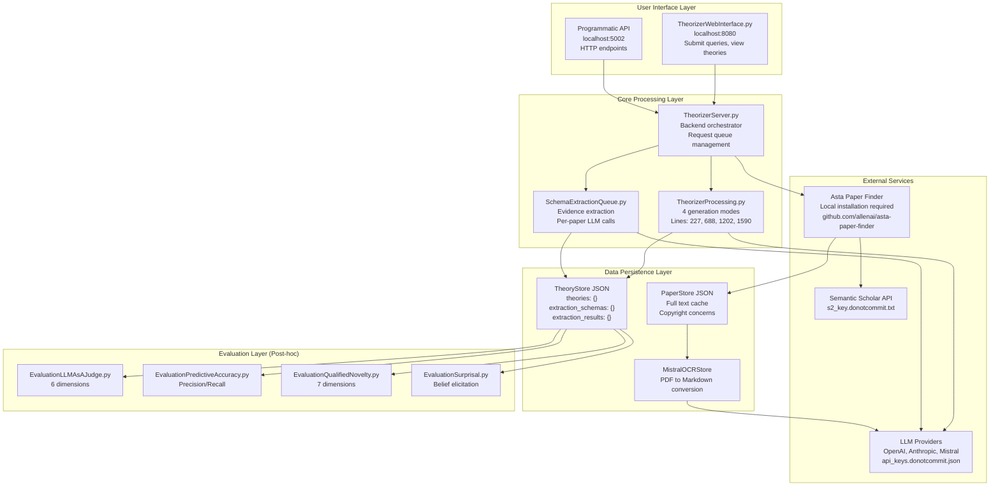
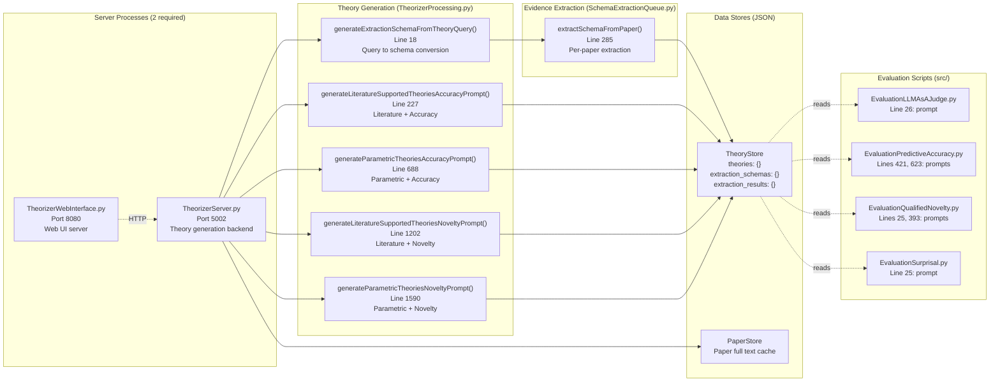
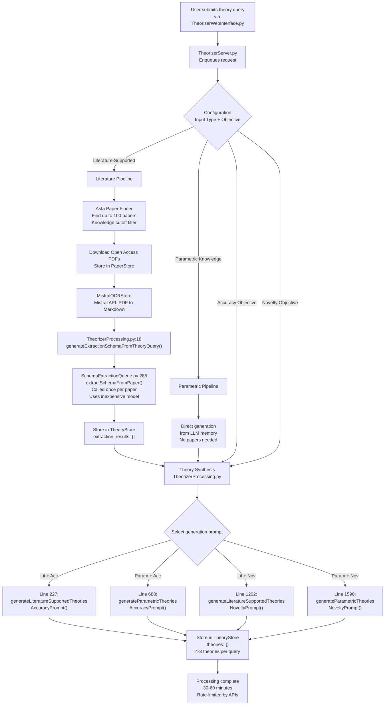
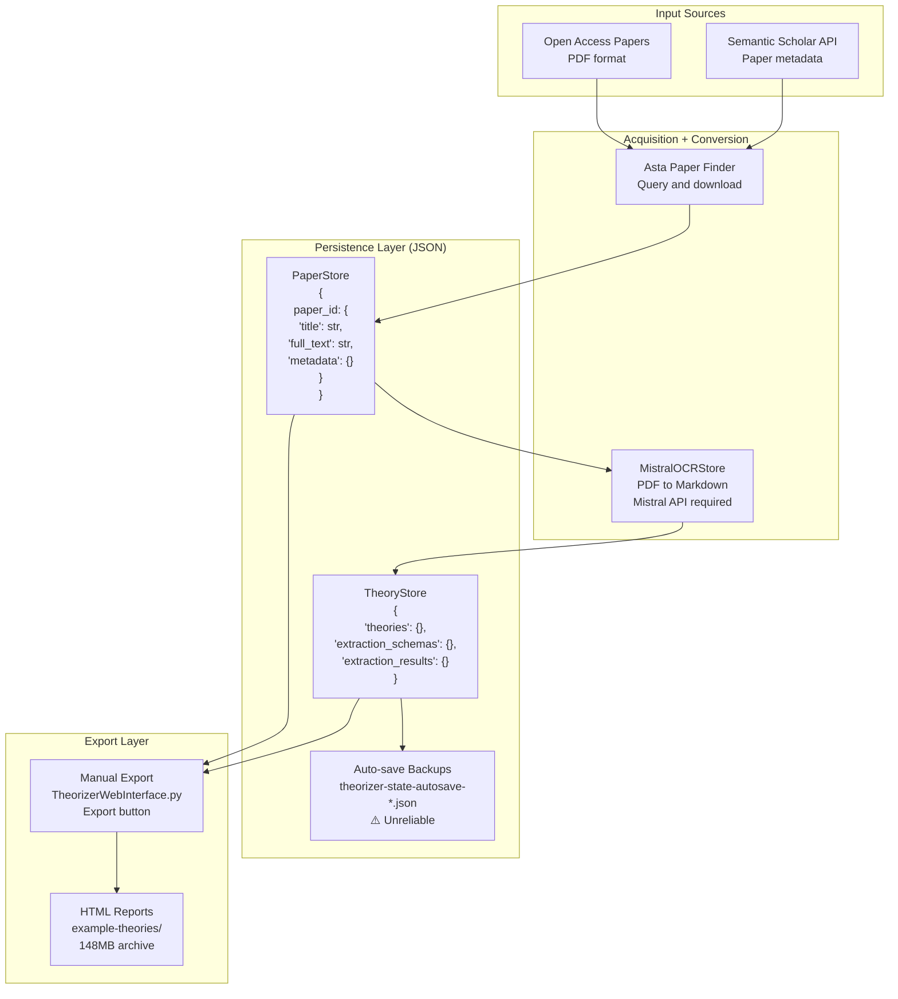
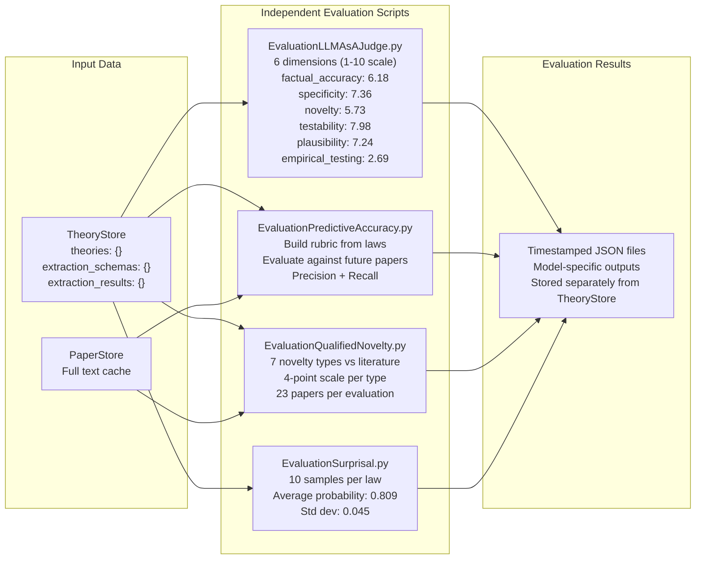
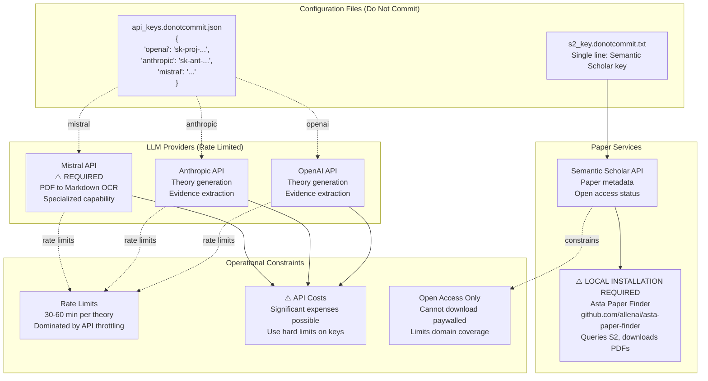

<!-- source: DeepWiki mcp.deepwiki.com · repo allenai/asta-theorizer · page 1 Overview · fetched 2026-10-26 -->

# Overview

Relevant source files

The following files were used as context for generating this wiki page:

- [README.md](README.md)

## Purpose and Scope

This document provides a high-level introduction to the Theorizer system architecture, its core components, and how they interact. Theorizer is a system for generating scientific theories at scale by synthesizing knowledge from large corpora of scientific literature using Large Language Models (LLMs).

This page covers the overall system architecture, major components, and data flow. For detailed information about specific subsystems:
- Installation and setup procedures: see [Getting Started](#2)
- Theory generation configuration and modes: see [Theory Generation](#3)
- Evaluation methodologies: see [Evaluation Systems](#4)
- Storage schemas and data formats: see [Data Storage and Management](#5)

**Sources:** [README.md:1-20]()

---

## System Purpose

Theorizer addresses the problem of automated scientific theory generation by synthesizing qualitative and quantitative laws from scientific literature. The system operates at scale, capable of processing thousands of papers to generate hundreds of theories across different domains indexed by Semantic Scholar.

**Key Capabilities:**
- Generates 4-8 theories per theory query from up to 100 papers
- Supports both literature-grounded and parametric knowledge generation
- Implements accuracy-focused and novelty-focused generation objectives
- Provides multi-dimensional theory evaluation (accuracy, novelty, predictive power, confidence)
- Processing time: 30-60 minutes per theory query (rate-limited by API calls)

**Primary Use Case:** Researchers submit a theory query (e.g., "build theories about X") and receive a set of synthesized theories with supporting evidence, extraction schemas, and evaluation metrics.

**Sources:** [README.md:5-16](), [README.md:220-233]()

---

## Layered Architecture

The Theorizer system follows a layered architecture with clear separation between user interface, core processing, external services, and data persistence:

**Architecture Characteristics:**

| Layer | Purpose | Key Components |
|-------|---------|----------------|
| User Interface | Submit queries, monitor progress, export data | `TheorizerWebInterface.py`, `TheorizerServer.py` (endpoints) |
| Core Processing | Orchestrate generation, extract evidence, synthesize theories | `TheorizerServer.py`, `TheorizerProcessing.py`, `SchemaExtractionQueue.py` |
| External Services | LLM inference, paper metadata, PDF conversion | OpenAI/Anthropic/Mistral APIs, Semantic Scholar, Asta |
| Data Persistence | Cache papers, store theories and extraction artifacts | `TheoryStore`, `PaperStore`, `MistralOCRStore` |
| Evaluation | Independent post-hoc assessment | Four evaluation scripts (separate from generation) |

**Sources:** [README.md:169-189](), [README.md:484-491]()

---

## Core Component Map

The following diagram maps high-level system concepts to their implementing code entities:

**Key Implementation Files:**

| File | Lines of Interest | Purpose |
|------|-------------------|---------|
| `TheorizerServer.py` | - | Backend orchestrator, HTTP endpoints at `localhost:5002` |
| `TheorizerWebInterface.py` | - | Web UI server at `localhost:8080` |
| `TheorizerProcessing.py` | 18, 227, 688, 1202, 1590 | Core generation logic with 4 mode-specific prompts |
| `SchemaExtractionQueue.py` | 285 | Evidence extraction from individual papers |
| `EvaluationLLMAsAJudge.py` | 26 | Six-dimension qualitative assessment |
| `EvaluationPredictiveAccuracy.py` | 26, 421, 623 | Rubric construction and future paper evaluation |
| `EvaluationQualifiedNovelty.py` | 25, 393 | Seven-dimension novelty assessment |
| `EvaluationSurprisal.py` | 25 | Probabilistic belief elicitation |

**Sources:** [README.md:513-541]()

---

## Theory Generation Workflow

The system implements a dual-pathway architecture for theory generation, determined by the **Input Type** configuration parameter:

**Configuration Space (2×2 Factorial Design):**

| Input Type | Objective | Code Location | Description |
|------------|-----------|---------------|-------------|
| Literature-Supported | Accuracy | [TheorizerProcessing.py:227]() | Extract evidence from papers, synthesize accurate theories |
| Literature-Supported | Novelty | [TheorizerProcessing.py:1202]() | Extract evidence from papers, synthesize novel theories |
| Parametric Knowledge | Accuracy | [TheorizerProcessing.py:688]() | Use LLM pre-training, focus on accuracy |
| Parametric Knowledge | Novelty | [TheorizerProcessing.py:1590]() | Use LLM pre-training, focus on novelty |

**Cost Optimization Strategy:** The literature pipeline uses an **inexpensive model** for evidence extraction (called up to 100 times) and a **powerful model** for theory synthesis (called once). This is configurable via the web interface parameters "Model for Literature Extraction" and "Model for Theory Generation."

**Sources:** [README.md:220-233](), [README.md:513-525]()

---

## Data Persistence Architecture

Theorizer uses a JSON-based storage architecture with three primary data structures:

**TheoryStore Schema:**

| Key | Type | Contents |
|-----|------|----------|
| `theories` | `dict` | Theory objects with descriptions, laws, generation parameters |
| `extraction_schemas` | `dict` | Schemas generated from theory queries for evidence extraction |
| `extraction_results` | `dict` | Evidence extracted from specific papers using specific schemas |

**PaperStore Schema:**

| Key | Type | Contents | Notes |
|-----|------|----------|-------|
| `paper_id` | `dict` | Full text, title, metadata | ⚠️ Copyright concerns for redistribution |

**Persistence Recommendations:**

1. **Manual Export (Recommended):** Use the Export button in `TheorizerWebInterface.py` at `localhost:8080`
2. **Auto-save (Unreliable):** System attempts to save `theorizer-state-autosave-*.json` after each theory generation, but this should not be relied upon
3. **PaperStore Export:** Only manual export includes PaperStore; auto-save does not

**Backup Strategy:** The system saves both TheoryStore and PaperStore. To reload saved theories, modify the filename at the bottom of `TheorizerServer.py`.

**Sources:** [README.md:245-258](), [README.md:484-491]()

---

## Evaluation Pipeline

The evaluation system operates **post-hoc** and independently of theory generation, reading from the `TheoryStore` and `PaperStore` to assess generated theories across four dimensions:

**Evaluation Methodologies:**

| Script | Methodology | Output Metrics | Prompt Location |
|--------|-------------|----------------|-----------------|
| `EvaluationLLMAsAJudge.py` | LLM rates theories on 6 dimensions (1-10 scale) | Average scores across theories | [Line 26]() |
| `EvaluationPredictiveAccuracy.py` | Constructs rubric from laws, evaluates against future papers | Precision (support/contradict), Recall (coverage) | [Lines 421, 623]() |
| `EvaluationQualifiedNovelty.py` | Compares theory against 23 papers on 7 novelty types | Histogram of novelty classifications (4-point scale) | [Lines 25, 393]() |
| `EvaluationSurprisal.py` | Elicits LLM's probabilistic belief in each law | Average probability, standard deviation | [Line 25]() |

**Key Design Choice:** Evaluation is decoupled from generation. Each evaluation script can be run independently, enabling:
- Repeated evaluation without regenerating theories
- Comparison across different evaluation models
- Addition of new evaluation dimensions without modifying generation code

**Example Output Locations:** Results are saved as timestamped JSON files in evaluation-specific directories (see [README.md:309-475]() for example outputs).

**Sources:** [README.md:302-475]()

---

## External Dependencies and API Requirements

Theorizer requires multiple external services, each with specific configuration requirements:

**Critical Dependencies:**

| Dependency | Type | Configuration | Purpose | Notes |
|------------|------|---------------|---------|-------|
| OpenAI API | Optional | `api_keys.donotcommit.json` | Theory generation, extraction | Recommended: `gpt-4.1-2025-04-14` |
| Anthropic API | Optional | `api_keys.donotcommit.json` | Theory generation, extraction | Recommended: `claude-sonnet-4-5-20250929` |
| Mistral API | **Required** | `api_keys.donotcommit.json` | PDF to Markdown OCR | Cannot be substituted |
| Semantic Scholar API | Required | `s2_key.donotcommit.txt` | Paper metadata, download links | Free tier available |
| Asta Paper Finder | **Required** | Local installation | Paper finding and downloading | https://github.com/allenai/asta-paper-finder |

**Installation Steps:**

1. Create `api_keys.donotcommit.json` with all three LLM keys (Mistral required)
2. Create `s2_key.donotcommit.txt` with Semantic Scholar key
3. Clone and install Asta Paper Finder locally
4. Verify conda environment: `python=3.12`, `pip install -r requirements.txt`
5. Start both servers: `TheorizerServer.py` (port 5002) and `TheorizerWebInterface.py` (port 8080)

**Cost Management:**
- Processing time: 30-60 minutes per theory (API rate limits, not computation)
- Recommendation: Start with small-scale tests (1-2 theories) to estimate costs
- Set hard limits on API keys to prevent cost overruns
- Literature-supported mode: Up to 100 paper extractions × inexpensive model + 1 synthesis × powerful model

**Open Access Constraint:** Theorizer can only process papers available as open access through Semantic Scholar. Domains with predominantly paywalled literature will have reduced paper coverage, affecting theory quality.

**Sources:** [README.md:137-165](), [README.md:196-198]()

---

## Processing Time and Scalability

The system's processing characteristics reflect its design for **batch research use** rather than real-time applications:

| Metric | Value | Constraint |
|--------|-------|------------|
| Processing time per theory | 30-60 minutes | API rate limits (not CPU) |
| Papers per theory (max) | 100 | Configurable, cost tradeoff |
| Theories per query | 4-8 | Generated by synthesis model |
| Extraction calls | Up to 100 | One per paper (literature mode) |
| Synthesis calls | 1 | Single call after aggregation |

**Bottleneck:** The dominant constraint is external API rate limiting from OpenAI, Anthropic, and Mistral, not local computation. The 30-60 minute processing window is explicitly attributed to API throttling.

**Scalability Strategy:** Use inexpensive models for high-volume operations (evidence extraction) and powerful models for low-volume operations (theory synthesis).

**Sources:** [README.md:102](), [README.md:243]()

---

