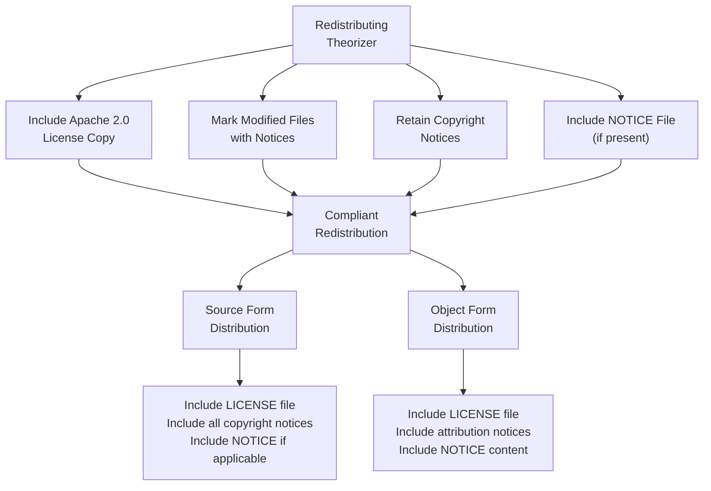
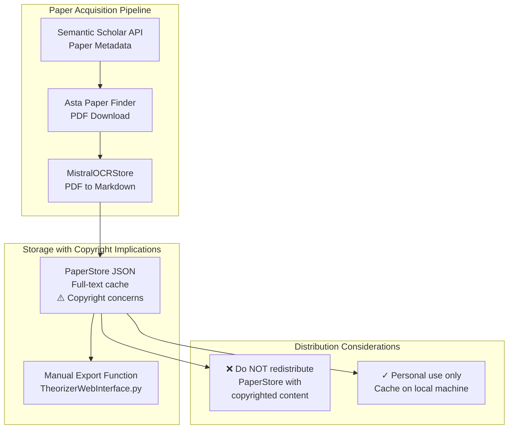
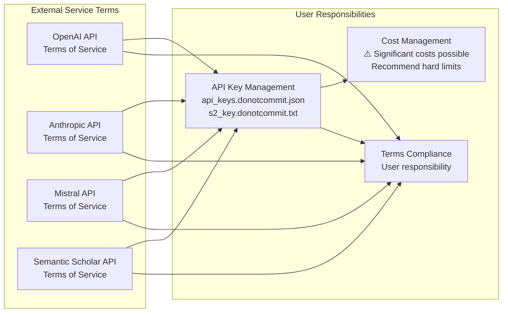
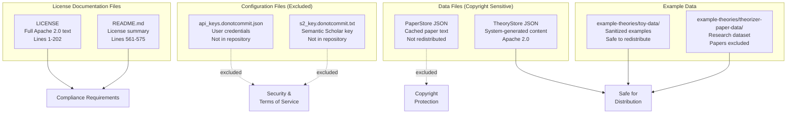

<!-- source: DeepWiki mcp.deepwiki.com · repo allenai/asta-theorizer · page 10 License and Legal · fetched 2026-10-26 -->

# License and Legal

<details>
<summary>Relevant source files</summary>

The following files were used as context for generating this wiki page:

- [LICENSE](LICENSE)
- [README.md](README.md)

</details>


This page documents the licensing terms, legal considerations, and copyright implications of using the Theorizer system. It covers the Apache 2.0 license governing the software code, copyright considerations for cached scientific papers, and redistribution requirements.

For information about citing the Theorizer system in academic publications, see the Citation section in [README.md:543-557](). For questions about appropriate use, see the Contact section in [README.md:577-582]().

---

## Software License

The Theorizer codebase is released under the Apache License, Version 2.0 (January 2004). The complete license text is provided in [LICENSE:1-202]().

### License Grant

The Apache 2.0 License grants users the following permissions:

| Permission | Description | License Section |
|------------|-------------|-----------------|
| **Reproduction** | Copy and distribute the software | Section 2 |
| **Derivative Works** | Create modified versions | Section 2 |
| **Distribution** | Share copies in Source or Object form | Section 4 |
| **Commercial Use** | Use for commercial purposes | Implicit in Section 2 |
| **Patent Grant** | Royalty-free patent license from contributors | Section 3 |

The license is perpetual, worldwide, non-exclusive, no-charge, and royalty-free, as stated in [LICENSE:66-71]().

**Sources:** [LICENSE:1-202](), [README.md:561-575]()

---

## Redistribution Requirements

When redistributing Theorizer or derivative works, you must comply with the following requirements:



### Specific Requirements

As specified in [LICENSE:89-121](), redistributions must:

1. **Include License Copy**: Provide a copy of the Apache 2.0 License to all recipients ([LICENSE:94-95]())
2. **Mark Modifications**: Modified files must carry prominent notices stating changes were made ([LICENSE:97-98]())
3. **Retain Notices**: Preserve all copyright, patent, trademark, and attribution notices from the original ([LICENSE:100-104]())
4. **NOTICE File**: If a NOTICE file exists, include its attribution notices in derivative works ([LICENSE:106-121]())

**Sources:** [LICENSE:89-121]()

---

## Warranty Disclaimer

The Theorizer system is provided "AS IS" without warranties of any kind. Users assume all risks associated with using the software.

### Explicit Disclaimer Text

From [README.md:566-574]() and [LICENSE:143-151]():

```
Unless required by applicable law or agreed to in writing, Licensor 
provides the Work (and each Contributor provides its Contributions) 
on an "AS IS" BASIS, WITHOUT WARRANTIES OR CONDITIONS OF ANY KIND, 
either express or implied, including, without limitation, any 
warranties or conditions of TITLE, NON-INFRINGEMENT, MERCHANTABILITY, 
or FITNESS FOR A PARTICULAR PURPOSE.
```

### Liability Limitations

Contributors are not liable for damages arising from use of the software, including but not limited to:

- Loss of goodwill
- Work stoppage
- Computer failure or malfunction
- Commercial damages or losses

This limitation is specified in [LICENSE:153-163]().

**Sources:** [LICENSE:143-163](), [README.md:566-574]()

---

## Copyright Considerations for Cached Papers

The Theorizer system caches full-text content of scientific papers in the `PaperStore` data structure. This raises important copyright considerations.



### Paper Storage and Copyright

The system stores paper full-text in `PaperStore` as noted in the architecture diagrams. This storage is subject to the following constraints:

| Storage Component | Copyright Status | Distribution Allowed |
|-------------------|------------------|---------------------|
| **PaperStore JSON** | Contains copyrighted full-text | ❌ No - not included in repository |
| **TheoryStore JSON** | System-generated theories | ✓ Yes - covered by Apache 2.0 |
| **Example Theories (HTML)** | Theories with sanitized text | ✓ Yes - paper text removed |

As stated in data flow diagram and confirmed by repository structure:
- The PaperStore is explicitly excluded from repository distribution
- Example theory datasets have paper full-text sanitized ([README.md:501]())
- Users must acquire papers themselves through open access channels

### Open Access Limitation

The system can only download papers marked as open access in Semantic Scholar, as noted in [README.md:81]():

```
The only limitation for a given field is whether the papers are 
likely to be downloadable by Theorizer as open-access.
```

This limitation serves as a partial safeguard against copyright violations, though open access status does not eliminate all copyright restrictions.

**Sources:** [README.md:81](), [README.md:254](), [README.md:501]()

---

## Responsibilities When Using External Services

Theorizer depends on external services with their own terms of service and usage policies:



### Cost Warning

The README provides an explicit warning at [README.md:198]():

```
⚠️ Costs ⚠️: Use of this code for theory generation, evaluation, 
or other purposes can incur significant costs. It is strongly 
encouraged to start small scale to gauge approximate costs, and 
to use API keys with hard limits to avoid accidental/unexpected 
cost overruns.
```

Users are solely responsible for:
- API costs incurred through their keys
- Compliance with external service terms
- Managing rate limits and usage quotas
- Securing API credentials

**Sources:** [README.md:198](), [README.md:140-147](), [README.md:152-156]()

---

## File-Level License Information

The following diagram maps where license and legal information appears in the codebase:



### Key Files and Their Status

| File Pattern | Content Type | Included in Repository | License/Legal Status |
|--------------|--------------|------------------------|----------------------|
| `LICENSE` | License text | ✓ Yes | Apache 2.0 terms |
| `README.md` | Documentation | ✓ Yes | Apache 2.0 |
| `src/*.py` | Source code | ✓ Yes | Apache 2.0 |
| `*.donotcommit.json` | API keys | ❌ No | User credentials - gitignored |
| `*.donotcommit.txt` | API keys | ❌ No | User credentials - gitignored |
| `PaperStore JSON` | Paper cache | ❌ No | Copyright concerns |
| `TheoryStore JSON` | Generated theories | ✓ Yes (examples) | Apache 2.0 |
| `example-theories/` | Example outputs | ✓ Yes | Sanitized for redistribution |

**Sources:** [LICENSE:1-202](), [README.md:140-156](), [README.md:254](), [README.md:501]()

---

## Compliance Checklist for Redistributors

If you plan to redistribute Theorizer or derivative works, use this checklist:

### Required Actions

- [ ] Include a copy of [LICENSE]() in your distribution
- [ ] Retain all copyright notices from source files
- [ ] If you modified files, add prominent notices describing changes ([LICENSE:97-98]())
- [ ] If a NOTICE file exists, include it or its content ([LICENSE:106-121]())
- [ ] Remove or sanitize any PaperStore data containing copyrighted papers
- [ ] Remove API key files (*.donotcommit.*) if accidentally included
- [ ] Ensure example theory data does not contain full paper text

### Recommended Actions

- [ ] Review terms of service for external APIs you'll use
- [ ] Set cost limits on API keys before distribution
- [ ] Document any additional license terms for your modifications
- [ ] Test that the system works without proprietary paper caches

**Sources:** [LICENSE:89-121](), [README.md:254](), [README.md:501]()

---

## Contact for Legal Questions

For questions about licensing or legal use of Theorizer:

- **Primary Contact**: Peter Jansen (`peterj@allenai.org`)
- **Issues/Bugs**: Submit a GitHub issue to the repository
- **License Text**: Review the full Apache 2.0 License in [LICENSE:1-202]()

Note that the contact information is for technical and usage questions. For formal legal advice about licensing, consult a qualified attorney.

**Sources:** [README.md:579-581]()