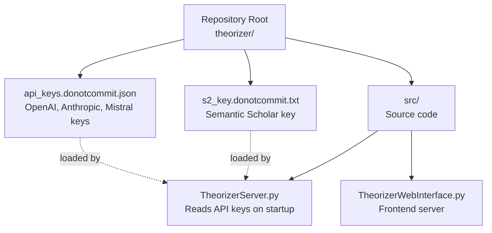
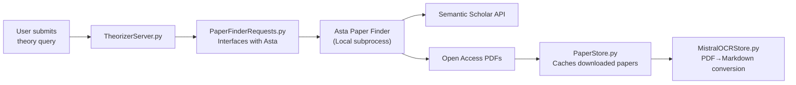
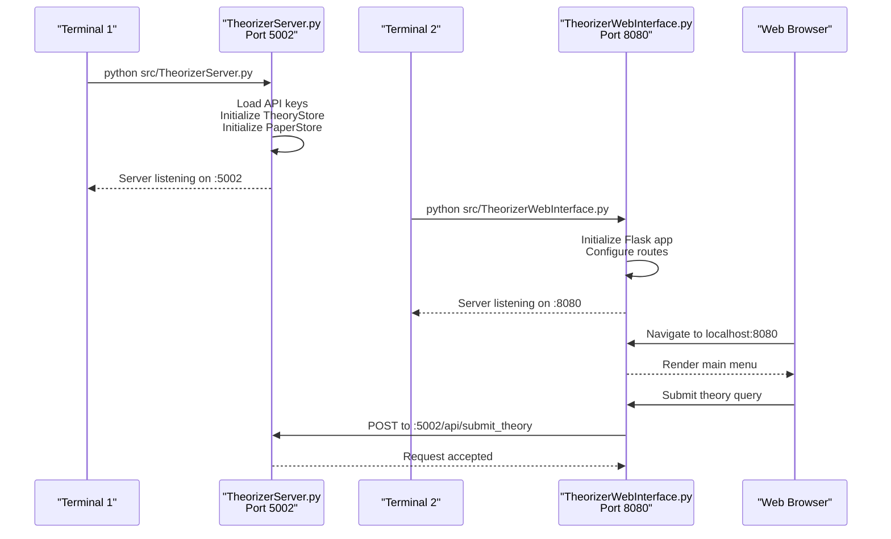
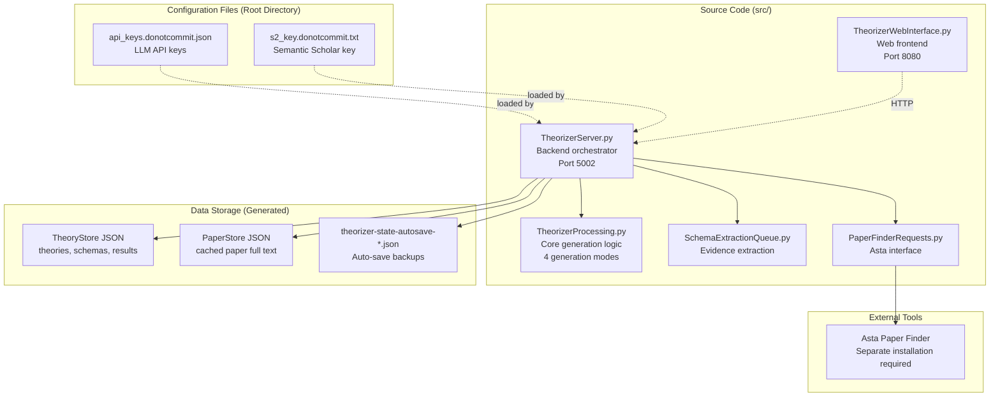

<!-- source: DeepWiki mcp.deepwiki.com · repo allenai/asta-theorizer · page 2 Getting Started · fetched 2026-10-26 -->

# Getting Started

<details>
<summary>Relevant source files</summary>

The following files were used as context for generating this wiki page:

- [README.md](README.md)
- [TODO.txt](TODO.txt)

</details>


This page provides step-by-step instructions for installing the Theorizer system, configuring required API keys and external dependencies, and running the system for the first time. By the end of this guide, you will have the web interface accessible at `localhost:8080` and be ready to submit theory generation requests.

For information about using the system to generate theories after installation, see [Theory Generation](#3). For details about the evaluation systems, see [Evaluation Systems](#4).

---

## System Requirements

The Theorizer system has been tested and confirmed working on **Ubuntu Linux**. It will likely work with minimal modification on **MacOS**, and may require some modification under **Windows**.

**Platform Compatibility:**
- Tested: Ubuntu Linux
- Expected to work: MacOS
- May require modification: Windows

**Python Version:**
- Python 3.12 (recommended via conda)

Sources: [README.md:113]()

---

## Installation Steps

### 1. Clone the Repository

```bash
git clone https://github.com/allenai/theorizer
cd theorizer
```

### 2. Create Conda Environment

```bash
conda create --name theorizer python=3.12
conda activate theorizer
```

### 3. Install Dependencies

```bash
pip install -r requirements.txt
```

Sources: [README.md:119-135]()

---

## API Key Configuration

Theorizer requires API keys for multiple external services. These keys must be configured before the system can run. The following table summarizes the required API keys and their purposes:

| API Provider | Purpose | Configuration File | Required |
|--------------|---------|-------------------|----------|
| OpenAI | Theory generation and extraction | `api_keys.donotcommit.json` | Yes |
| Anthropic | Theory generation and extraction | `api_keys.donotcommit.json` | Yes |
| Mistral | **PDF → Markdown conversion** | `api_keys.donotcommit.json` | **Yes (Critical)** |
| Semantic Scholar | Paper metadata and search | `s2_key.donotcommit.txt` | Yes |

### Critical Dependency: Mistral API

The Mistral API key is **required** for PDF-to-Markdown conversion using OCR. Without this key, the system cannot process downloaded papers, even if you have OpenAI and Anthropic keys configured.

### LLM API Keys Configuration

Create a file named `api_keys.donotcommit.json` in the repository root with the following structure:

```json
{
    "openai": "sk-proj-...",
    "anthropic": "sk-ant-...",
    "mistral": "..."
}
```

The `.donotcommit` suffix prevents accidental version control commits of sensitive credentials.

### Semantic Scholar API Key Configuration

Create a file named `s2_key.donotcommit.txt` in the repository root containing a single line with your Semantic Scholar API key:

```
<your key here>
```

### Configuration File Layout



Sources: [README.md:139-157]()

---

## External Dependencies: Asta Paper Finder

### Overview

Generating literature-supported theories requires a **local installation** of Asta Paper Finder. This is a separate tool that queries Semantic Scholar and downloads open-access papers. The Theorizer system invokes Asta as a local subprocess.

**Key Points:**
- Asta Paper Finder is a **separate GitHub repository**
- It must be **installed locally** on your machine
- It is **only required** for literature-supported theory generation
- Parametric theory generation (using only LLM knowledge) does not require Asta

### Installation Location

Asta Paper Finder repository:
```
https://github.com/allenai/asta-paper-finder
```

Follow the installation instructions in the Asta Paper Finder repository. The installation is quick and straightforward.

### Asta's Role in the System



Sources: [README.md:158-165]()

---

## Starting the System

The Theorizer system requires **two processes** to run simultaneously: the backend server and the web interface. These must be started in separate terminal windows.

### Backend Server

In the first terminal:

```bash
python src/TheorizerServer.py
```

The backend server (`TheorizerServer.py`) listens on **port 5002** and handles:
- Theory generation requests
- Paper processing orchestration
- Schema extraction queue management
- Data persistence to TheoryStore and PaperStore

### Web Interface

In a second terminal:

```bash
python src/TheorizerWebInterface.py
```

The web interface (`TheorizerWebInterface.py`) listens on **port 8080** and provides:
- Browser-based UI for submitting theory queries
- Theory viewing and exploration
- Export functionality
- Status monitoring

### System Startup Sequence



Sources: [README.md:169-189]()

---

## Verifying Installation

### 1. Check Backend Server Status

After starting `TheorizerServer.py`, you should see console output indicating:
- API keys loaded successfully
- Server listening on port 5002
- TheoryStore and PaperStore initialized

### 2. Access Web Interface

Open a web browser and navigate to:
```
http://localhost:8080
```

You should see the Theorizer main menu with the following sections:
- **Create New Theory** (single query)
- **Create Theories in Batch**
- **Server Status** (shows active requests)
- **Export** (save TheoryStore and PaperStore)
- **List of Theories** (displays generated theories)

### 3. Test with Parametric Theory Generation

To verify the system works without requiring Asta Paper Finder:

1. Click **"Create New Theory"**
2. Enter a theory query (e.g., "Build theories about attention mechanisms")
3. Select a model for theory generation (e.g., `gpt-4.1-2025-04-14`)
4. Choose objective: `accuracy-focused` or `novelty-focused`
5. **Important:** Select input type: **`parametric`**
6. Click **Submit**

The parametric mode uses only the LLM's pre-trained knowledge and does not require paper downloading or Asta Paper Finder.

### System Component Verification Checklist

| Component | Verification Method | Expected Result |
|-----------|-------------------|-----------------|
| Backend Server | Check terminal output from `TheorizerServer.py` | "Server listening on port 5002" |
| Web Interface | Navigate to `localhost:8080` | Main menu displays |
| API Keys | Submit parametric theory request | Request accepted, no API key errors |
| Asta Paper Finder | Submit literature-supported request | Papers found and downloaded |
| Mistral OCR | Submit literature-supported request | PDFs converted to markdown |

Sources: [README.md:200-243]()

---

## Cost Warnings

⚠️ **Important Cost Considerations** ⚠️

Theory generation and evaluation can incur **significant API costs** due to:
- Multiple LLM calls per paper (extraction phase)
- Up to 100 papers per theory query
- Expensive models for synthesis
- Rate limiting extends processing time to 30-60 minutes per query

**Recommended Cost Management:**
1. Start with **parametric generation** (no papers) to test the system
2. Use **small paper counts** (e.g., 5-10 papers) for initial literature-supported tests
3. Configure **hard spending limits** on all API keys
4. Monitor costs closely during initial usage

Sources: [README.md:198]()

---

## Common Installation Issues

### Issue: "Mistral API key required"

**Symptom:** Error when attempting literature-supported theory generation  
**Solution:** Ensure `api_keys.donotcommit.json` contains a valid Mistral API key. This is required for PDF-to-Markdown conversion.

### Issue: "Asta Paper Finder not found"

**Symptom:** Error when attempting literature-supported theory generation  
**Solution:** Install Asta Paper Finder from https://github.com/allenai/asta-paper-finder and ensure it is in your system PATH or the expected location.

### Issue: Port already in use

**Symptom:** Cannot start `TheorizerServer.py` or `TheorizerWebInterface.py`  
**Solution:** Check if ports 5002 (backend) or 8080 (frontend) are already in use. Kill existing processes or modify port configuration in the source files.

### Issue: Papers not downloading

**Symptom:** Literature-supported generation finds no papers  
**Solution:** 
1. Verify Semantic Scholar API key in `s2_key.donotcommit.txt`
2. Check Asta Paper Finder installation
3. Ensure the topic has open-access papers available

Sources: [README.md:113-189]()

---

## Next Steps

After successful installation and verification:

- **To generate theories:** See [Theory Generation](#3) for detailed instructions on submitting queries, configuring generation parameters, and monitoring progress
- **To understand generation modes:** See [Generation Modes: Literature-Supported vs Parametric](#3.1)
- **To evaluate theories:** See [Evaluation Systems](#4) for post-hoc assessment methodologies
- **To examine example data:** See [Example Theories and Data](#6) for pre-generated theories and evaluations

### Quick Reference: File Locations



Sources: [README.md:1-189]()

---

