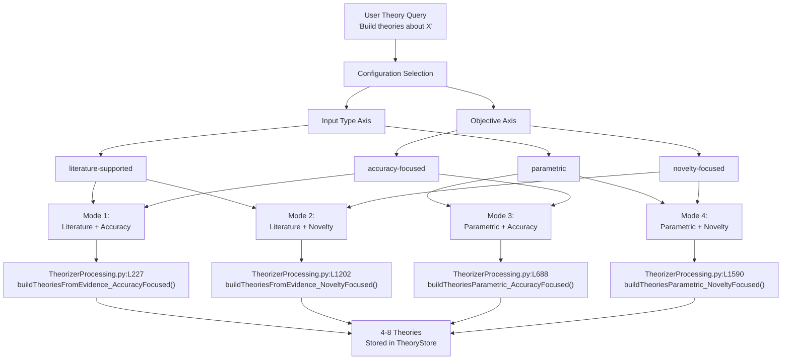
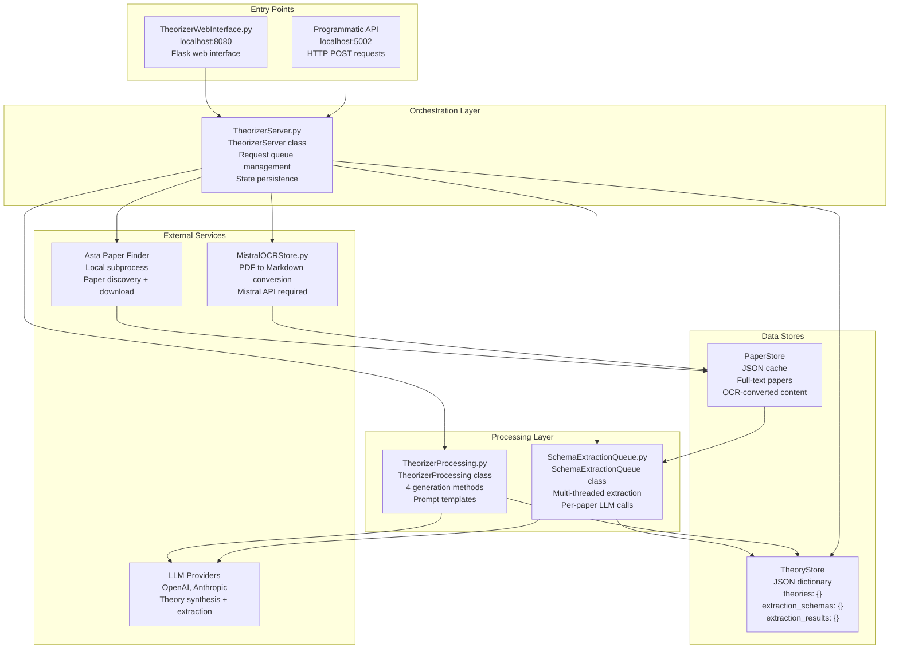
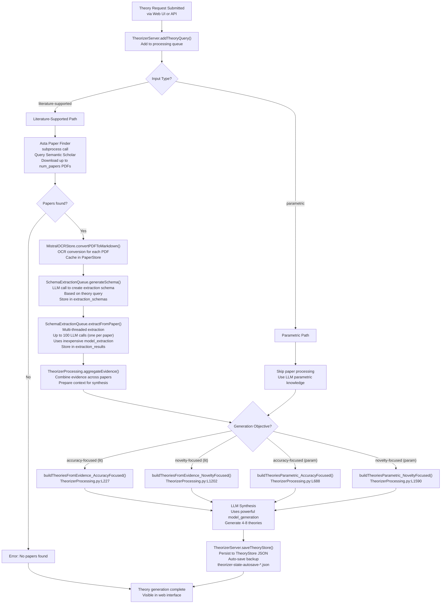
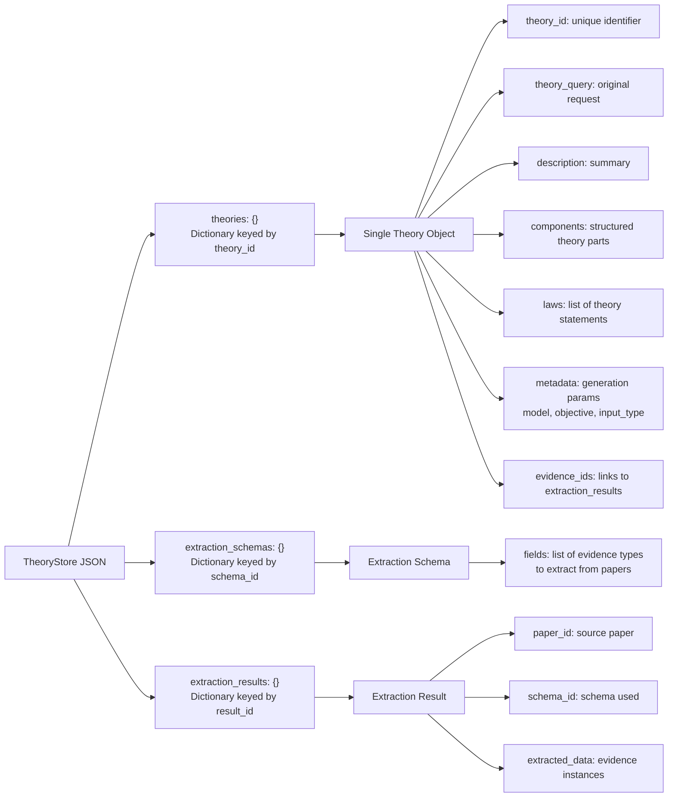

<!-- source: DeepWiki mcp.deepwiki.com · repo allenai/asta-theorizer · page 3 Theory Generation · fetched 2026-10-26 -->

# Theory Generation

Relevant source files

The following files were used as context for generating this wiki page:

- [README.md](README.md)

This page documents the core theory generation system in Theorizer, explaining how the system transforms a user query (e.g., "build theories about memory architectures for LLM agents") into synthesized scientific theories. It covers the configuration options, the dual-pathway architecture, and the orchestration of the generation process.

For information about the specific generation modes (literature-supported vs parametric), see [Generation Modes](#3.1). For details on the paper processing pipeline used in literature-supported mode, see [Paper Processing Pipeline](#3.3). For using the web interface or API to submit theory requests, see [Web Interface and API](#3.4). For evaluation of generated theories, see [Evaluation Systems](#4).

## Overview of Theory Generation

The Theorizer system generates scientific theories through a configurable pipeline that can operate in four distinct modes, determined by two orthogonal configuration axes:

| Axis | Options | Effect |
|------|---------|--------|
| **Input Type** | `literature-supported` or `parametric` | Whether to extract evidence from papers or use LLM parametric knowledge |
| **Generation Objective** | `accuracy-focused` or `novelty-focused` | Which prompt template to use during synthesis |

Each combination of these axes results in a different generation mode with its own prompt engineering in `TheorizerProcessing.py`. A typical theory generation request takes 30-60 minutes to process, primarily due to external API rate limits rather than computational constraints.

Sources: [README.md:1-587](), [src/TheorizerProcessing.py:227](), [src/TheorizerProcessing.py:688](), [src/TheorizerProcessing.py:1202](), [src/TheorizerProcessing.py:1590]()

## Theory Generation Configuration Space

The system implements a **2×2 factorial design** resulting in four distinct generation conditions:

**Configuration Parameters**

Additional parameters available for literature-supported modes:

| Parameter | Purpose | Default/Range |
|-----------|---------|---------------|
| `num_papers` | Maximum papers to retrieve and process | Up to 100 |
| `knowledge_cutoff_year` | Only use papers published before this year | Configurable for temporal testing |
| `knowledge_cutoff_month` | Month component of cutoff | 1-12 |
| `model_extraction` | LLM for per-paper evidence extraction | Inexpensive model recommended |
| `model_generation` | LLM for final theory synthesis | Powerful model recommended |

Sources: [README.md:220-232](), [src/TheorizerProcessing.py:227-1590]()

## System Architecture and Component Roles

The theory generation system consists of three primary components that orchestrate the end-to-end workflow:

**Component Responsibilities:**

- **TheorizerServer**: Maintains request queue, manages theory generation lifecycle, handles auto-save backups, exposes HTTP endpoints
- **TheorizerProcessing**: Contains four distinct theory generation methods, each with specialized prompts for the 2×2 configuration space
- **SchemaExtractionQueue**: Multi-threaded extraction manager, generates extraction schemas from theory queries, extracts evidence from papers
- **Asta Paper Finder**: External subprocess for paper discovery via Semantic Scholar API and PDF download
- **MistralOCRStore**: Converts downloaded PDFs to Markdown format using Mistral's specialized OCR API

Sources: [src/TheorizerServer.py:1-400](), [src/TheorizerProcessing.py:1-2000](), [src/SchemaExtractionQueue.py:1-500](), [src/MistralOCRStore.py:1-200](), [src/TheorizerWebInterface.py:1-300]()

## Theory Generation Workflow

The complete workflow differs significantly between literature-supported and parametric modes. Below is the unified workflow showing both paths:

Sources: [src/TheorizerServer.py:100-250](), [src/TheorizerProcessing.py:227-1590](), [src/SchemaExtractionQueue.py:1-500](), [README.md:196-298]()

## Theory Structure and Output Format

Generated theories are stored in the `TheoryStore` JSON structure with the following schema:

**Example Theory Law Structure:**

Each theory contains 4-8 laws/statements with the following fields:
- `law_id`: Unique identifier within the theory
- `statement`: Natural language formulation of the law
- `variables`: Identified variables and relationships
- `conditions`: Applicability constraints
- `evidence_support`: Links to extraction results that support this law

Sources: [README.md:483-491](), [src/TheoryStore.py:1-300]()

## Processing Timeline and Cost Considerations

Theory generation is a time-intensive and potentially expensive operation:

| Stage | Typical Duration | Cost Driver |
|-------|------------------|-------------|
| Paper Discovery (Asta) | 1-5 minutes | Semantic Scholar API rate limits |
| PDF Download | 2-10 minutes | Network bandwidth, paper availability |
| PDF→Markdown OCR | 5-15 minutes | Mistral API rate limits (up to 100 calls) |
| Schema Generation | 1-2 minutes | Single LLM call |
| Evidence Extraction | 10-30 minutes | Multiple LLM calls (one per paper, up to 100) |
| Theory Synthesis | 2-5 minutes | Single powerful LLM call with large context |
| **Total** | **30-60 minutes** | **Primarily API rate limits** |

**Cost Optimization Strategies:**

The system employs several cost-reduction techniques:

1. **Two-tier model selection**: Inexpensive models for high-volume extraction (`model_extraction`), expensive models only for final synthesis (`model_generation`)
2. **Caching**: `PaperStore` caches OCR-converted papers, `extraction_results` cached for reuse
3. **Configurable limits**: `num_papers` parameter caps maximum papers processed
4. **Rate limit awareness**: Processing time dominated by external API throttling, not local computation

⚠️ **Warning**: A single literature-supported theory query with 100 papers can make 101+ LLM API calls (1 schema generation + 100 extractions + 1 synthesis). Set hard limits on API keys to avoid unexpected costs.

Sources: [README.md:102](), [README.md:198](), [README.md:243]()

## Monitoring and State Management

The `TheorizerServer` provides real-time monitoring of theory generation status:

**Status Endpoint**: The web interface polls `TheorizerServer.getStatus()` to display:
- Current queue position
- Active processing stage
- Completed theories count
- Error states

**Auto-save Behavior**: After each theory completes, the server automatically saves a backup to `theorizer-state-autosave-<timestamp>.json`. However, this is **unreliable** and should not be the primary persistence method.

**Manual Export**: The recommended persistence method is manual export via the web interface "Export" button, which saves both:
- `TheoryStore`: Complete theory data including schemas and extraction results
- `PaperStore`: Cached full-text papers (note: copyright considerations apply)

Sources: [README.md:246-258](), [src/TheorizerServer.py:300-350]()

## Entry Point Summary

**Web Interface** (`TheorizerWebInterface.py`):
- Runs Flask server on `localhost:8080`
- Form-based theory submission
- Real-time status monitoring
- Theory browsing and export

**Programmatic API** (`TheorizerServer.py`):
- HTTP server on `localhost:5002`
- POST to `/submit_theory_query` with JSON payload
- GET `/status` for queue monitoring
- GET `/export` for data extraction

For detailed API usage, see [Web Interface and API](#3.4).

Sources: [README.md:169-192](), [src/TheorizerWebInterface.py:1-300](), [src/TheorizerServer.py:1-400]()

---

