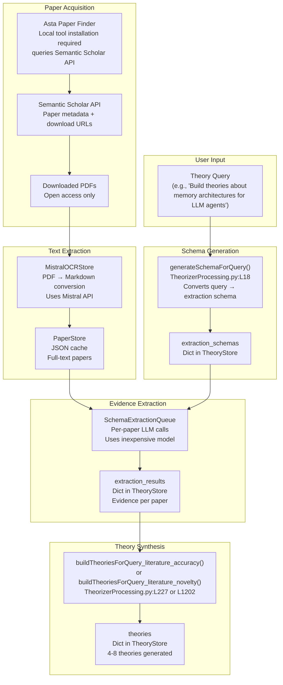
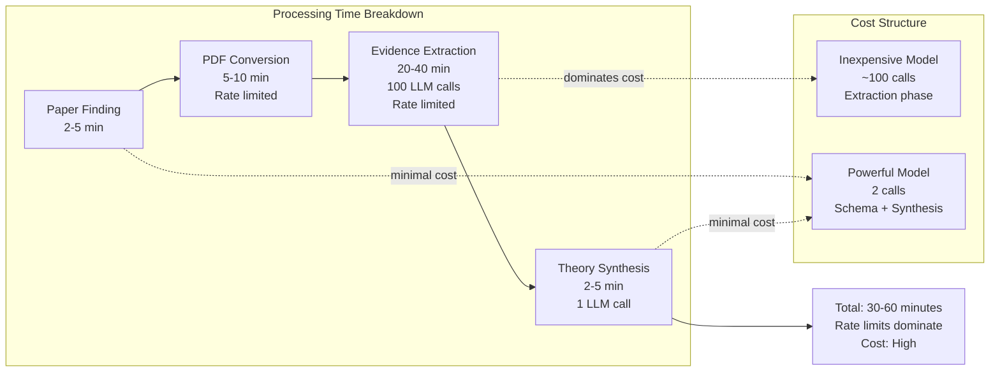
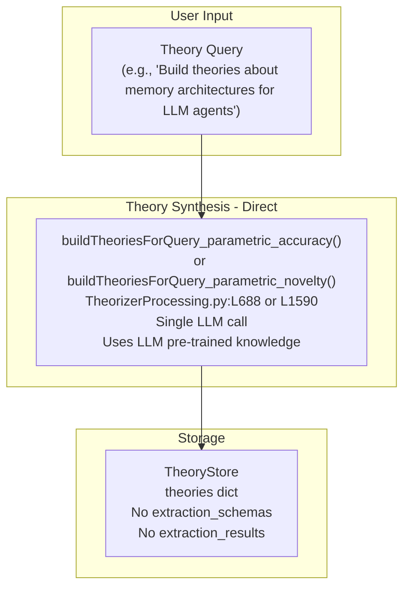
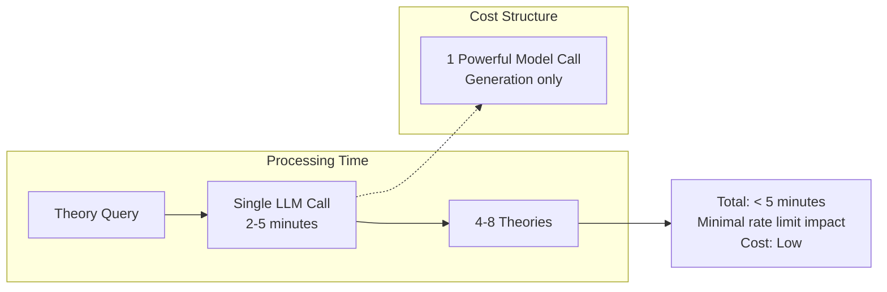
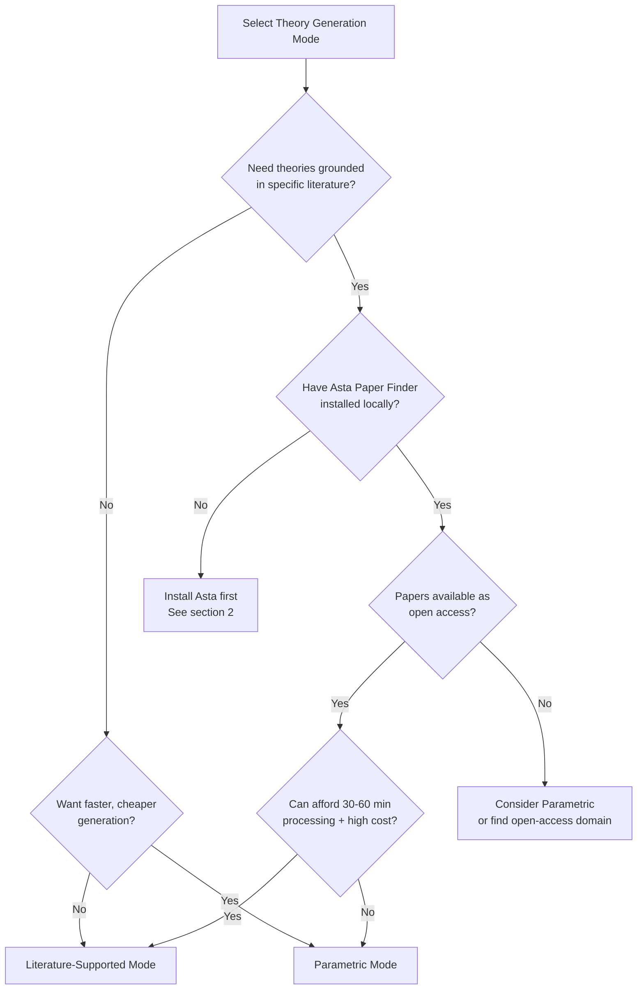
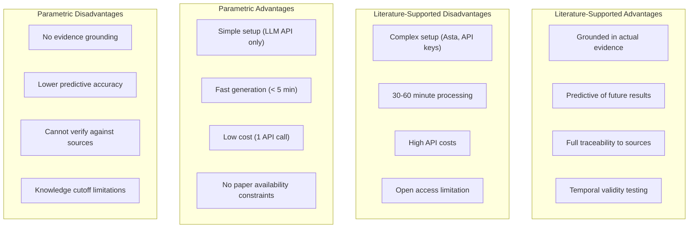

<!-- source: DeepWiki mcp.deepwiki.com · repo allenai/asta-theorizer · page 3.1 Generation Modes: Literature-Supported vs Parametric · fetched 2026-10-26 -->

# Generation Modes: Literature-Supported vs Parametric

<details>
<summary>Relevant source files</summary>

The following files were used as context for generating this wiki page:

- [README.md](README.md)

</details>


## Purpose and Scope

This document describes the two distinct input types available for theory generation in the Theorizer system: **Literature-Supported** mode and **Parametric** mode. These modes differ fundamentally in their source of evidence—external scientific papers versus pre-trained LLM knowledge—and result in different processing pipelines, computational costs, and theory characteristics.

For information about the generation objectives (accuracy-focused vs novelty-focused) that work orthogonally with these modes, see [Generation Objectives](#3.2). For details about the paper processing pipeline specific to Literature-Supported mode, see [Paper Processing Pipeline](#3.3).

---

## Mode Overview

The Theorizer system implements a 2×2 factorial design where input type (Literature-Supported vs Parametric) is one axis and generation objective (accuracy vs novelty) is the other. The input type determines the fundamental architecture of the theory generation process.

| Mode | Evidence Source | External Dependencies | Processing Time | API Calls | Code Location |
|------|----------------|----------------------|-----------------|-----------|---------------|
| **Literature-Supported** | Extracted from papers | Asta Paper Finder, Mistral OCR, Semantic Scholar API | 30-60 minutes | ~100+ per theory | [src/TheorizerProcessing.py:227]() (accuracy)<br/>[src/TheorizerProcessing.py:1202]() (novelty) |
| **Parametric** | LLM pre-trained knowledge | None (besides generation LLM) | <5 minutes | 1 per theory | [src/TheorizerProcessing.py:688]() (accuracy)<br/>[src/TheorizerProcessing.py:1590]() (novelty) |

The mode is selected via the `Input-type for Theory Generation` parameter in the web interface or the corresponding field in programmatic API requests.

**Sources:** [README.md:220-231](), High-Level System Architecture Diagram 2, Diagram 5

---

## Literature-Supported Mode

### Architecture and Pipeline



**Diagram: Literature-Supported Mode Architecture with Code Entities**

**Sources:** [src/TheorizerProcessing.py:18-226](), [src/SchemaExtractionQueue.py:285-450](), High-Level System Architecture Diagram 2

### Pipeline Stages

The Literature-Supported mode executes a multi-stage pipeline:

#### 1. Schema Generation

The theory query is converted into a structured extraction schema that defines what evidence to extract from each paper.

- **Code Location:** [src/TheorizerProcessing.py:18-90]()
- **Function:** `generateSchemaForQuery()`
- **Input:** Theory query string, model configuration
- **Output:** JSON schema stored in `TheoryStore.extraction_schemas[schema_id]`
- **Model Used:** Powerful model (same as generation model)

Example schema structure:
```json
{
  "theory_query": "Build theories about memory architectures...",
  "extraction_fields": [
    {"name": "memory_type", "description": "..."},
    {"name": "performance_impact", "description": "..."}
  ]
}
```

**Sources:** [src/TheorizerProcessing.py:18-90](), [README.md:516]()

#### 2. Paper Acquisition

Papers are found and downloaded using the Asta Paper Finder tool.

- **Dependencies:** Local Asta Paper Finder installation, Semantic Scholar API key
- **Configuration Parameters:**
  - `number_of_papers`: Maximum papers to retrieve (up to 100)
  - `knowledge_cutoff`: Year/Month filter for temporal validity testing
- **Constraint:** Only open-access papers can be downloaded
- **Storage:** Raw PDFs are temporarily stored, then discarded after conversion

**Sources:** [README.md:158-165](), [README.md:229-231]()

#### 3. PDF to Markdown Conversion

PDFs are converted to Markdown format using Mistral's OCR API.

- **Code Location:** `MistralOCRStore` class (referenced in server code)
- **API Used:** Mistral API (required dependency)
- **Storage:** Converted Markdown stored in `PaperStore` JSON cache
- **Purpose:** Enables text-based evidence extraction by LLMs

**Sources:** [README.md:141-147](), High-Level System Architecture Diagram 6

#### 4. Evidence Extraction

Each paper is processed individually to extract evidence according to the schema.

- **Code Location:** [src/SchemaExtractionQueue.py:285-450]()
- **Function:** Schema extraction prompt at line 285
- **Model Used:** Inexpensive model (cost optimization, since this runs ~100 times)
- **Processing:** Queue-based with rate limiting
- **Storage:** Results stored in `TheoryStore.extraction_results[extraction_id]`
- **Format:** Each extraction result contains:
  - Paper identifier
  - Schema identifier
  - Extracted evidence instances for each schema field
  - Timestamps and model information

**Sources:** [src/SchemaExtractionQueue.py:285-450](), [README.md:519](), High-Level System Architecture Diagram 2

#### 5. Evidence Aggregation and Theory Synthesis

All extraction results are aggregated and synthesized into theories.

- **Code Location:** 
  - Accuracy-focused: [src/TheorizerProcessing.py:227-687]()
  - Novelty-focused: [src/TheorizerProcessing.py:1202-1589]()
- **Functions:**
  - `buildTheoriesForQuery_literature_accuracy()`
  - `buildTheoriesForQuery_literature_novelty()`
- **Input:** All extraction results for the query
- **Model Used:** Powerful model (typically GPT-4 or Claude Sonnet)
- **Output:** 4-8 theories stored in `TheoryStore.theories[theory_id]`

Each theory contains:
- `description`: High-level theory description
- `laws`: List of specific theoretical statements
- `components`: Key elements of the theory
- `evidence_ids`: References to supporting extraction results
- Generation metadata (model, timestamp, parameters)

**Sources:** [src/TheorizerProcessing.py:227-687](), [src/TheorizerProcessing.py:1202-1589](), [README.md:522-525]()

### Cost and Performance Characteristics



**Diagram: Literature-Supported Mode Performance Profile**

| Resource | Usage | Optimization Strategy |
|----------|-------|----------------------|
| **Time** | 30-60 minutes | Dominated by external API rate limits |
| **LLM Calls** | ~100+ per theory | Use inexpensive model for extraction |
| **Cost** | High | Schema generation + extraction + synthesis |
| **Network** | Significant | Paper downloads, multiple API calls |
| **Storage** | Moderate | PaperStore cache, extraction results |

**Sources:** [README.md:102](), High-Level System Architecture Diagram 2, Diagram 4

---

## Parametric Mode

### Architecture and Direct Generation



**Diagram: Parametric Mode Architecture - Bypass Pipeline**

**Sources:** [src/TheorizerProcessing.py:688-1201](), [src/TheorizerProcessing.py:1590-1800]()

### Direct Generation Process

Parametric mode bypasses the entire paper acquisition and extraction pipeline, generating theories directly from the LLM's pre-trained knowledge.

#### Code Locations

- **Accuracy-focused:** [src/TheorizerProcessing.py:688-1201]()
  - Function: `buildTheoriesForQuery_parametric_accuracy()`
- **Novelty-focused:** [src/TheorizerProcessing.py:1590-1800]()
  - Function: `buildTheoriesForQuery_parametric_novelty()`

#### Process Flow

1. **User submits theory query** via web interface or API
2. **Query is passed directly to generation function** (no schema creation)
3. **Single LLM call** with:
   - Theory query
   - Objective-specific prompt (accuracy or novelty)
   - No external evidence or context
4. **Theories are generated** using only the model's parametric knowledge
5. **Results stored** in `TheoryStore.theories[theory_id]`

#### Storage Characteristics

Parametric theories in TheoryStore differ from literature-supported theories:

| Field | Literature-Supported | Parametric |
|-------|---------------------|------------|
| `theories` | Present | Present |
| `extraction_schemas` | Schema ID references | Empty/absent |
| `extraction_results` | Evidence ID references | Empty/absent |
| `evidence_ids` in theory | List of extraction result IDs | Empty list |
| Metadata | Includes paper count, cutoff date | Generation mode only |

**Sources:** [src/TheorizerProcessing.py:688-1800](), [README.md:485-491]()

### Cost and Performance Characteristics



**Diagram: Parametric Mode Performance Profile**

| Resource | Usage | Comparison to Literature Mode |
|----------|-------|-------------------------------|
| **Time** | <5 minutes | 6-12x faster |
| **LLM Calls** | 1 per theory | ~100x fewer calls |
| **Cost** | Low | Significantly cheaper |
| **Network** | Minimal | No paper downloads |
| **Storage** | Minimal | No PaperStore, no extraction results |
| **Dependencies** | LLM API only | No Asta, no Mistral OCR, no S2 API |

**Sources:** [README.md:102](), High-Level System Architecture Diagram 2, Diagram 5

---

## Mode Selection and Configuration

### Web Interface

In the theory submission form at `localhost:8080`:

1. **Field:** "Input-type for Theory Generation"
2. **Options:**
   - `literature-supported`: Triggers full paper processing pipeline
   - `parametric`: Bypasses pipeline, uses LLM knowledge
3. **Conditional Fields:** When `literature-supported` is selected:
   - "Model for Literature Extraction" becomes required
   - "Number of Papers" becomes required
   - "Knowledge Cutoff (Year/Month)" becomes required

**Sources:** [README.md:220-231](), [README.md:35-40]()

### Programmatic API

For API requests to `localhost:5002`:

```json
{
  "theory_query": "Build theories about...",
  "input_type": "literature-supported",
  "generation_objective": "accuracy-focused",
  "generation_model": "gpt-4.1-2025-04-14",
  "extraction_model": "gpt-5-mini",
  "num_papers": 50,
  "knowledge_cutoff": "2023-06"
}
```

For parametric mode:
```json
{
  "theory_query": "Build theories about...",
  "input_type": "parametric",
  "generation_objective": "accuracy-focused",
  "generation_model": "gpt-4.1-2025-04-14"
}
```

**Sources:** [README.md:186-191](), [src/TheorizerWebInterface.py]()

### Mode Selection Decision Tree



**Diagram: Mode Selection Decision Process**

**Sources:** [README.md:80-81](), [README.md:158-165](), High-Level System Architecture Diagrams

---

## Comparative Analysis

### Theoretical Implications

The choice between modes affects theory characteristics measurably:

| Dimension | Literature-Supported | Parametric | Evidence |
|-----------|---------------------|------------|----------|
| **Factual Accuracy** | Higher | Lower | Literature grounding improves accuracy |
| **Predictive Accuracy** | 90% precision | Lower | Theories predict future papers better |
| **Novelty** | Can be limited by literature | Potentially higher | Less constrained by existing work |
| **Specificity** | Higher | Variable | Evidence extraction provides details |
| **Testability** | Higher | Variable | Specific evidence enables testing |
| **Temporal Validity** | Measurable via cutoff | Unknown | Can evaluate against future papers |

**Sources:** [README.md:9-15](), High-Level System Architecture Diagram 5

### Practical Tradeoffs



**Diagram: Mode Tradeoff Matrix**

**Sources:** High-Level System Architecture Diagrams 2, 5, 6

### Use Case Recommendations

| Use Case | Recommended Mode | Rationale |
|----------|-----------------|-----------|
| Research paper submission | Literature-Supported | Need evidence-backed claims |
| Exploratory hypothesis generation | Parametric | Fast iteration, idea exploration |
| Domain with limited open access | Parametric | Literature unavailable |
| Temporal validity testing | Literature-Supported | Requires knowledge cutoff |
| Cost-constrained exploration | Parametric | Significantly cheaper |
| High-stakes applications | Literature-Supported | Traceable evidence critical |
| Rapid prototyping | Parametric | Speed prioritized |
| Theory evaluation study | Literature-Supported | Enables predictive accuracy evaluation |

**Sources:** [README.md:80-81](), [README.md:9-15]()

---

## Implementation Details

### Code Organization

Both modes are implemented in [src/TheorizerProcessing.py]() with clear separation:

```
TheorizerProcessing.py
├── Schema Generation (L18-90)
│   └── generateSchemaForQuery()
├── Literature-Supported Mode
│   ├── Accuracy: buildTheoriesForQuery_literature_accuracy() (L227-687)
│   └── Novelty: buildTheoriesForQuery_literature_novelty() (L1202-1589)
└── Parametric Mode
    ├── Accuracy: buildTheoriesForQuery_parametric_accuracy() (L688-1201)
    └── Novelty: buildTheoriesForQuery_parametric_novelty() (L1590-1800)
```

The server orchestrates mode selection in [src/TheorizerServer.py](), routing requests to the appropriate generation function based on the `input_type` parameter.

**Sources:** [src/TheorizerProcessing.py](), [README.md:512-525]()

### Data Flow Differences

Literature-Supported data flow:
```
Query → Schema → Papers → Extraction → Aggregation → Theories
    ↓                ↓         ↓            ↓
TheoryStore    PaperStore   extraction_  extraction_
               (cache)      schemas      results
```

Parametric data flow:
```
Query → Theories
    ↓
TheoryStore
(no schemas, no extraction_results)
```

**Sources:** [README.md:485-491](), High-Level System Architecture Diagram 4

---

## Related Topics

- **Generation Objectives:** See [Generation Objectives: Accuracy vs Novelty](#3.2) for how accuracy-focused and novelty-focused objectives interact with these modes
- **Paper Processing:** See [Paper Processing Pipeline](#3.3) for detailed documentation of the Literature-Supported pipeline stages
- **Cost Optimization:** See [Cost Optimization Strategies](#8.2) for design decisions around model selection and caching
- **Evaluation:** See [Predictive Accuracy Evaluation](#4.2) for how Literature-Supported theories can be evaluated against future papers using knowledge cutoffs

---

