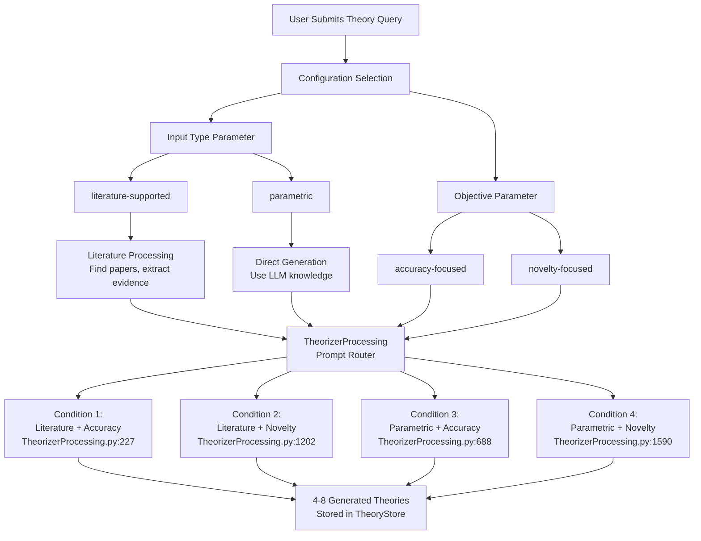
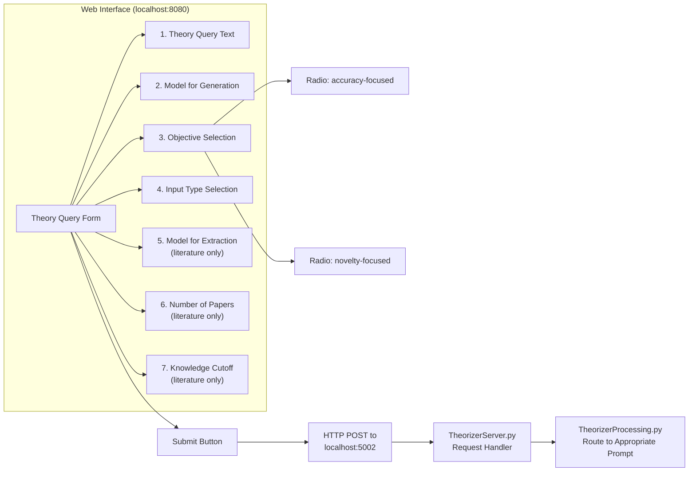
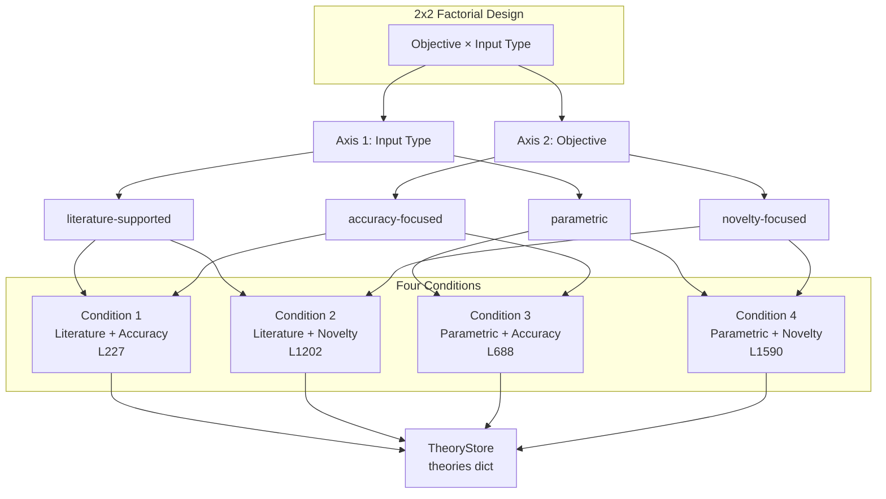
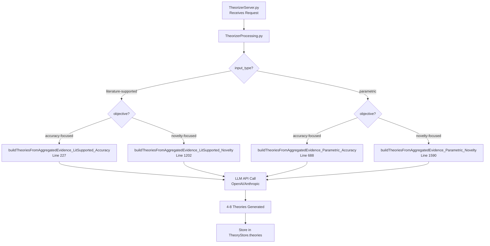

<!-- source: DeepWiki mcp.deepwiki.com · repo allenai/asta-theorizer · page 3.2 Generation Objectives: Accuracy vs Novelty · fetched 2026-10-26 -->

# Generation Objectives: Accuracy vs Novelty

<details>
<summary>Relevant source files</summary>

The following files were used as context for generating this wiki page:

- [README.md](README.md)

</details>


## Purpose and Scope

This document describes the two generation objectives available in Theorizer: **accuracy-focused** and **novelty-focused** theory generation. These objectives determine the prompting strategy used during theory synthesis and significantly affect the properties of generated theories. This configuration axis combines with the input type (see [Generation Modes: Literature-Supported vs Parametric](#3.1)) to create four distinct generation conditions.

For information about the paper processing pipeline used in literature-supported modes, see [Paper Processing Pipeline](#3.3). For details on how to configure these settings via the interface, see [Web Interface and API](#3.4).

## Overview of Generation Objectives

The Theorizer system implements two distinct objectives for theory generation, each with its own prompt engineering strategy:

| Objective | Primary Goal | Prompting Strategy | Code Location |
|-----------|--------------|-------------------|---------------|
| **Accuracy-Focused** | Maximize factual correctness and alignment with existing evidence | Emphasizes grounding in evidence, consistency with known facts, testability | [src/TheorizerProcessing.py:227]() (literature), [src/TheorizerProcessing.py:688]() (parametric) |
| **Novelty-Focused** | Prioritize originality and generation of new theoretical insights | Emphasizes novel connections, unexplored mechanisms, creative synthesis | [src/TheorizerProcessing.py:1202]() (literature), [src/TheorizerProcessing.py:1590]() (parametric) |

These objectives represent a fundamental tradeoff in scientific theory generation: theories that closely match existing knowledge may be more immediately verifiable but less likely to produce new insights, while theories that emphasize novelty may be more speculative but potentially more scientifically valuable.

**Sources:** [README.md:1-587](), Diagram 5 from high-level architecture

## System Architecture: Objective Selection Flow



**Objective Selection Flow in Theory Generation System**

The system routes theory generation requests to one of four distinct prompt implementations based on the combination of objective and input type. Each condition uses a different prompt located at a specific line in `TheorizerProcessing.py`.

**Sources:** [README.md:220-226](), [src/TheorizerProcessing.py:522-526](), Diagram 2 and Diagram 5 from high-level architecture

## Accuracy-Focused Objective

### Purpose and Design

The accuracy-focused objective prioritizes the generation of theories that:
- Maximize factual correctness relative to existing evidence
- Maintain strong consistency with established scientific knowledge
- Emphasize testability and empirical grounding
- Minimize speculative claims

This objective is suitable when the goal is to synthesize well-supported theories from existing literature or to consolidate known patterns into theoretical frameworks.

### Prompt Implementation Locations

The accuracy-focused prompts are implemented at two locations in `TheorizerProcessing.py`, depending on the input type:

1. **Literature-Supported + Accuracy:** [src/TheorizerProcessing.py:227]()
   - Receives aggregated evidence from multiple papers
   - Synthesizes theories grounded in extracted evidence
   - Uses the powerful generation model specified in configuration

2. **Parametric + Accuracy:** [src/TheorizerProcessing.py:688]()
   - Generates theories from LLM's pre-trained knowledge
   - Does not reference external papers
   - Emphasizes consistency with known scientific facts

### Expected Theory Properties

Theories generated with the accuracy-focused objective typically exhibit:
- Higher scores on the **Factual Accuracy** dimension in LLM-as-a-Judge evaluation (see [LLM-as-a-Judge Evaluation](#4.1))
- Better performance on **Predictive Accuracy** metrics when evaluated against future papers (see [Predictive Accuracy Evaluation](#4.2))
- Higher **Plausibility** ratings
- Lower scores on **Novelty** dimensions

**Sources:** [README.md:522-523](), [src/TheorizerProcessing.py:227](), [src/TheorizerProcessing.py:688](), Diagram 5 from high-level architecture

## Novelty-Focused Objective

### Purpose and Design

The novelty-focused objective prioritizes the generation of theories that:
- Emphasize original connections and mechanisms not explicitly stated in literature
- Explore unexplored theoretical territory
- Synthesize creative combinations of known elements
- Generate potentially groundbreaking but more speculative claims

This objective is suitable when the goal is to discover new theoretical insights, identify novel patterns, or generate hypotheses that extend beyond current knowledge.

### Prompt Implementation Locations

The novelty-focused prompts are implemented at two locations in `TheorizerProcessing.py`:

1. **Literature-Supported + Novelty:** [src/TheorizerProcessing.py:1202]()
   - Uses evidence from papers as inspiration for novel theories
   - Encourages synthesis beyond what is explicitly stated
   - Focuses on identifying gaps and new connections

2. **Parametric + Novelty:** [src/TheorizerProcessing.py:1590]()
   - Generates novel theories from LLM knowledge
   - Emphasizes creative theoretical contributions
   - May be more speculative without literature grounding

### Expected Theory Properties

Theories generated with the novelty-focused objective typically exhibit:
- Higher scores on the **Novelty** dimension in LLM-as-a-Judge evaluation
- Better performance on **Qualified Novelty** metrics across 7 dimensions (see [Qualified Novelty Evaluation](#4.3))
- Potentially lower **Factual Accuracy** scores
- More exploratory and speculative claims
- Lower **Empirical Testing** scores (more difficult to immediately validate)

**Sources:** [README.md:524-525](), [src/TheorizerProcessing.py:1202](), [src/TheorizerProcessing.py:1590](), Diagram 5 from high-level architecture

## Configuration and Selection



**Configuration Form and Objective Selection Flow**

### User Interface Selection

Users select the generation objective through the web interface when submitting a theory query. The form includes:

**Parameter:** `Objective for Theory Generation`

**Options:**
- `accuracy-focused`: Select this to maximize factual correctness
- `novelty-focused`: Select this to prioritize originality

This parameter is located at position 3 in the theory query submission form, after the theory query text and generation model selection.

**Sources:** [README.md:220-226](), Diagram 6 from high-level architecture

## Factorial Interaction with Input Types

The objective parameter forms one axis of a 2×2 factorial design when combined with the input type parameter. This creates four distinct experimental conditions:



**Factorial Design: Four Generation Conditions**

### Condition Characteristics

| Condition | Input Type | Objective | Line | Characteristics |
|-----------|-----------|-----------|------|-----------------|
| 1 | Literature-Supported | Accuracy | 227 | Evidence-grounded, factually accurate theories |
| 2 | Literature-Supported | Novelty | 1202 | Evidence-inspired, novel theoretical insights |
| 3 | Parametric | Accuracy | 688 | Knowledge-based, consistent theories |
| 4 | Parametric | Novelty | 1590 | Knowledge-based, creative theories |

This factorial design enables systematic comparison of generation strategies to answer questions such as:
- Does literature grounding improve accuracy?
- Does focusing on novelty sacrifice factual correctness?
- How do different combinations affect predictive accuracy?

**Sources:** [README.md:522-526](), Diagram 5 from high-level architecture

## Prompt Routing Implementation



**Prompt Routing Logic in TheorizerProcessing.py**

The routing logic in `TheorizerProcessing.py` selects the appropriate prompt based on the combination of `input_type` and `objective` configuration parameters. Each condition corresponds to a distinct function implementation with its own carefully engineered prompt.

**Sources:** [README.md:513-526](), [src/TheorizerProcessing.py:227](), [src/TheorizerProcessing.py:688](), [src/TheorizerProcessing.py:1202](), [src/TheorizerProcessing.py:1590]()

## Evaluation and Tradeoffs

### Measured Impact on Theory Properties

The choice of generation objective has measurable effects on theory properties across multiple evaluation dimensions:

```mermaid
graph TB
    subgraph "Accuracy-Focused Theories"
        AccProps["Expected Properties"]
        AccProps --> AccFA["Higher Factual Accuracy<br/>~6.18/10"]
        AccProps --> AccPred["Better Predictive Accuracy<br/>90% support rate"]
        AccProps --> AccPlaus["Higher Plausibility<br/>~7.24/10"]
        AccProps --> AccTest["High Testability<br/>~7.98/10"]
        AccProps --> AccNov["Lower Novelty<br/>~5.73/10"]
    end
    
    subgraph "Novelty-Focused Theories"
        NovProps["Expected Properties"]
        NovProps --> NovNov["Higher Novelty<br/>Across 7 dimensions"]
        NovProps --> NovMech["More Explanatory/Mechanistic"]
        NovProps --> NovUnif["More Unification"]
        NovProps --> NovFA["Potentially Lower Accuracy"]
        NovProps --> NovSpec["More Speculative"]
    end
    
    subgraph "Evaluation Systems"
        Judge["LLM-as-a-Judge<br/>EvaluationLLMAsAJudge.py<br/>6 dimensions"]
        Pred["Predictive Accuracy<br/>EvaluationPredictiveAccuracy.py<br/>Precision/Recall"]
        QNov["Qualified Novelty<br/>EvaluationQualifiedNovelty.py<br/>7 dimensions"]
        Belief["Self-assessed Belief<br/>EvaluationSurprisal.py<br/>Probability estimates"]
    end
    
    AccProps -.measured by.-> Judge
    AccProps -.measured by.-> Pred
    AccProps -.measured by.-> Belief
    
    NovProps -.measured by.-> Judge
    NovProps -.measured by.-> QNov
    NovProps -.measured by.-> Belief
```



**Impact of Generation Objectives on Evaluated Theory Properties**

### Key Findings from Empirical Results

Based on the system's evaluation metrics (see [Evaluation Systems](#4)):

**Accuracy-Focused Theories:**
- Excel at matching existing evidence and predicting future results
- Show strong performance on predictive accuracy (up to 90% support rate in literature-supported mode)
- Receive higher plausibility ratings from LLM judges
- May consolidate known patterns rather than introduce new insights

**Novelty-Focused Theories:**
- Generate more novel theoretical contributions across multiple dimensions
- Show particular strength in explanatory/mechanistic novelty (80% novel in literature-supported mode)
- May score lower on immediate factual accuracy
- Require more careful evaluation for speculative claims

### Choosing an Objective

**Select Accuracy-Focused when:**
- Goal is to synthesize well-supported theories from existing evidence
- Immediate empirical validation is important
- Consolidating known patterns into theoretical frameworks
- Building on established research areas

**Select Novelty-Focused when:**
- Goal is to discover new theoretical insights
- Exploring emerging or underdeveloped research areas
- Generating hypotheses for future investigation
- Tolerance for more speculative claims

**Sources:** [README.md:307-326](), [README.md:330-366](), [README.md:370-455](), [src/EvaluationLLMAsAJudge.py:26](), [src/EvaluationPredictiveAccuracy.py](), [src/EvaluationQualifiedNovelty.py]()

## Programmatic API Usage

For programmatic access via the API (localhost:5002), the objective is specified as a parameter in the theory generation request:

```json
{
    "query": "Build theories about X",
    "generation_model": "gpt-4.1-2025-04-14",
    "objective": "accuracy-focused",
    "input_type": "literature-supported",
    "extraction_model": "gpt-5-mini",
    "num_papers": 50,
    "cutoff_year": 2023,
    "cutoff_month": 12
}
```

The `objective` field accepts two values:
- `"accuracy-focused"`
- `"novelty-focused"`

**Sources:** [README.md:187-191](), Diagram 1 from high-level architecture

## Storage and Retrieval

Theories generated with different objectives are stored together in the `TheoryStore` JSON structure. The generation parameters, including the objective used, are stored as metadata with each theory:

```json
{
    "theories": {
        "theory_uuid_123": {
            "theory_query": "Build theories about X",
            "generation_config": {
                "objective": "accuracy-focused",
                "input_type": "literature-supported",
                "generation_model": "gpt-4.1-2025-04-14"
            },
            "theory_description": "...",
            "theory_laws": [...]
        }
    }
}
```

This enables post-hoc analysis comparing theories generated with different objectives for the same theory query.

**Sources:** [README.md:485-491](), [src/TheorizerServer.py](), Diagram 4 from high-level architecture

---

