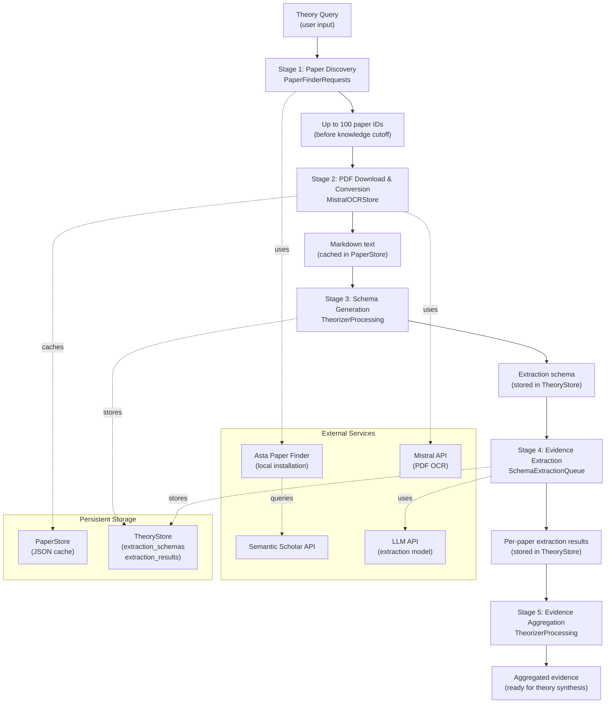
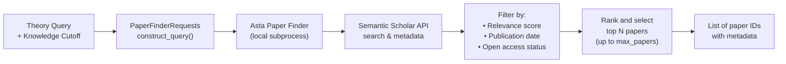
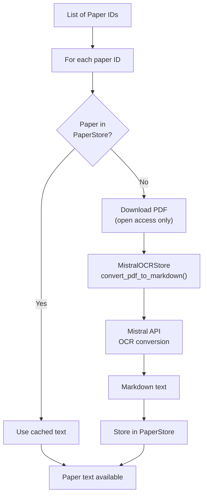
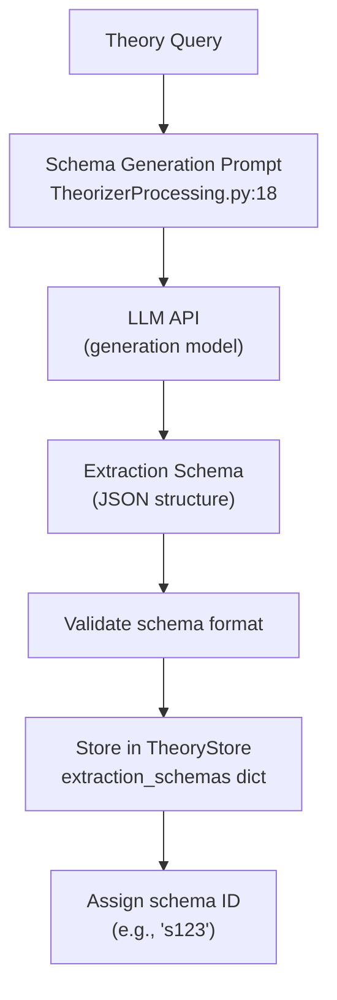
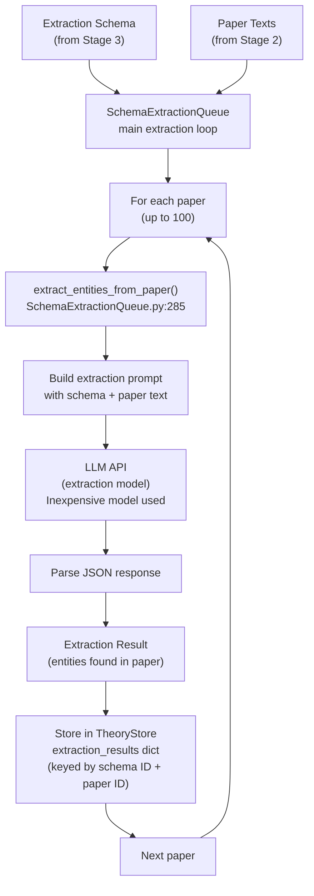
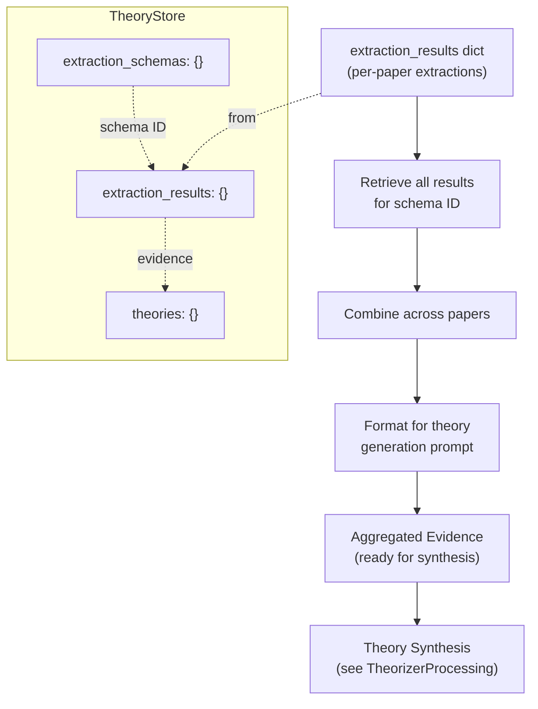
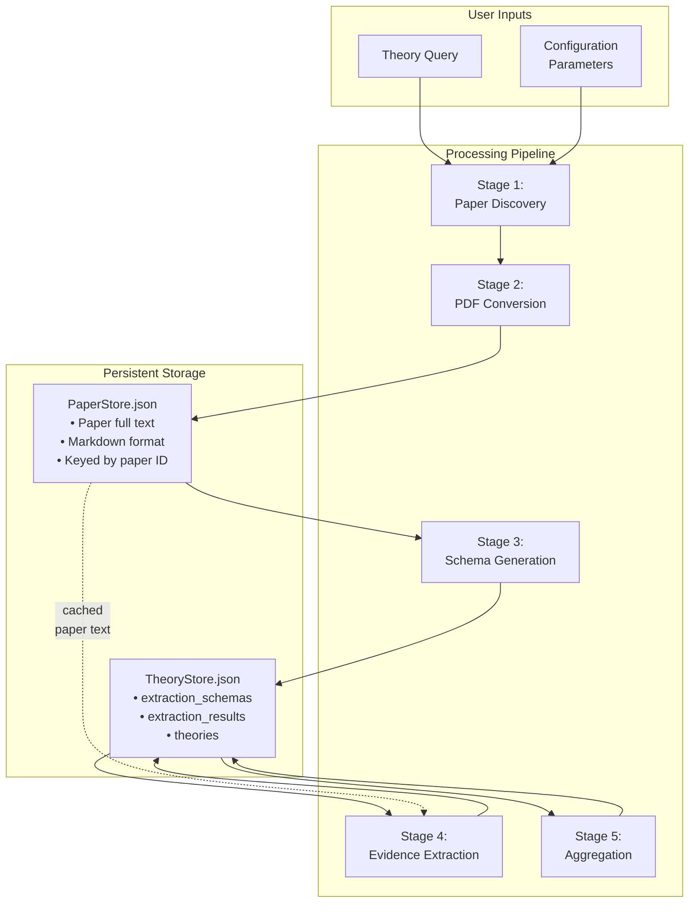

<!-- source: DeepWiki mcp.deepwiki.com · repo allenai/asta-theorizer · page 3.3 Paper Processing Pipeline · fetched 2026-10-26 -->

# Paper Processing Pipeline

<details>
<summary>Relevant source files</summary>

The following files were used as context for generating this wiki page:

- [README.md](README.md)
- [TODO.txt](TODO.txt)

</details>


## Purpose and Scope

This document describes the paper processing pipeline used in **literature-supported** theory generation mode. This pipeline transforms a theory query into structured evidence by discovering relevant papers, converting them to text, and extracting specific information according to generated schemas.

For information about the distinction between literature-supported and parametric generation modes, see [Generation Modes: Literature-Supported vs Parametric](#3.1). For details on how extracted evidence is synthesized into theories, see the theory generation prompts in [TheorizerProcessing.py:227-1590]().

---

## Pipeline Overview

The paper processing pipeline consists of five sequential stages that convert a theory query into aggregated evidence ready for theory synthesis.



**Sources:** [README.md:1-587](), High-Level System Architecture diagrams

---

## Configuration Parameters

The paper processing pipeline is configured through several parameters that control its behavior:

| Parameter | Type | Description | Default/Typical |
|-----------|------|-------------|-----------------|
| `theory_query` | string | The theory topic/question | User-provided |
| `max_papers` | integer | Maximum papers to process | Up to 100 |
| `knowledge_cutoff_year` | integer | Only include papers before this year | User-configured |
| `knowledge_cutoff_month` | integer | Only include papers before this month | User-configured |
| `extraction_model` | string | LLM model for evidence extraction | Inexpensive model (e.g., gpt-4o-mini) |

These parameters are set when submitting a theory query through the web interface or API.

**Sources:** [README.md:220-232]()

---

## Stage 1: Paper Discovery

### Overview

Paper discovery uses the **Asta Paper Finder** tool to identify relevant papers from Semantic Scholar. This stage filters papers by relevance to the theory query and by the knowledge cutoff date.

### Process Flow



### Implementation Details

The paper discovery process is managed by the `PaperFinderRequests` module, which interfaces with the locally-installed Asta Paper Finder tool. Asta itself queries Semantic Scholar to retrieve paper metadata.

**Key constraints:**
- Only open-access papers can be downloaded (paywall limitation)
- Papers must be published before the specified knowledge cutoff date
- Semantic Scholar API rate limits apply

**Sources:** [README.md:161-165](), [README.md:80-81](), High-Level System Architecture Diagram 6

---

## Stage 2: PDF Download and Conversion

### Overview

Once papers are identified, they must be downloaded and converted from PDF to machine-readable text. This stage uses the **Mistral API** for OCR and conversion to Markdown format.

### Process Flow



### MistralOCRStore

The `MistralOCRStore` class manages the PDF-to-Markdown conversion process. It maintains a cache to avoid redundant conversions.

**Key characteristics:**
- Mistral API is **required** for this functionality (no alternatives currently supported)
- PDF conversion can be slow and rate-limited
- Results are cached in `PaperStore` to avoid reprocessing
- Copyright considerations apply to cached paper text (see [PaperStore Structure](#5.2))

**Sources:** [README.md:141-147](), [README.md:250-255](), High-Level System Architecture Diagram 4

---

## Stage 3: Schema Generation

### Overview

Before extracting evidence from papers, the system generates a custom **extraction schema** tailored to the theory query. This schema defines what types of information should be extracted from each paper.

### Schema Generation Process



### Schema Structure

An extraction schema defines one or more entity types to extract from papers. Each entity type specifies:

- **Entity name**: The type of information to extract
- **Description**: What this entity represents
- **Fields**: Specific data points to capture for each instance

Example schema fields:
- Experimental setup details
- Performance metrics
- Observed phenomena
- Theoretical claims

The schema is stored in `TheoryStore` under the `extraction_schemas` dictionary with a unique identifier.

**Sources:** [README.md:516](), [README.md:486-490]()

---

## Stage 4: Evidence Extraction

### Overview

Evidence extraction applies the generated schema to each paper individually, using an LLM to identify and extract relevant information. This is the most computationally expensive stage due to the high volume of LLM calls.

### Extraction Process Architecture



### SchemaExtractionQueue Implementation

The `SchemaExtractionQueue` class manages parallel extraction across multiple papers:

**Key functions:**
- `extract_entities_from_paper()` at [SchemaExtractionQueue.py:285]() - Core extraction logic
- Applies schema to one paper's text
- Returns structured JSON with extracted entities
- Handles LLM API errors and retries

**Cost Optimization Strategy:**

Since extraction is called once per paper (up to 100 times per theory query), the system uses an **inexpensive extraction model** (e.g., GPT-4o-mini) rather than a powerful model. This significantly reduces costs while maintaining acceptable extraction quality.

| Aspect | Configuration |
|--------|---------------|
| Model selection | User-configurable, typically inexpensive |
| Call frequency | Once per paper (up to 100 calls) |
| Response format | Structured JSON |
| Error handling | Retries with exponential backoff |
| Rate limiting | Respects API provider limits |

**Sources:** [README.md:519](), [README.md:229](), [TODO.txt:27]()

---

## Stage 5: Evidence Aggregation

### Overview

After extracting evidence from individual papers, the system aggregates all extraction results into a single unified view. This aggregated evidence is then passed to the theory synthesis stage.

### Aggregation Process



### Aggregation Output Format

The aggregated evidence is structured to show:

1. **Evidence by entity type** - Grouped by schema entity names
2. **Evidence by paper** - Traceable to source papers
3. **Evidence counts** - Statistics on extraction coverage
4. **Evidence quality** - Confidence or relevance indicators

This aggregated view is embedded into theory generation prompts at:
- [TheorizerProcessing.py:227]() - Accuracy-focused with literature
- [TheorizerProcessing.py:1202]() - Novelty-focused with literature

**Sources:** [README.md:522-524](), [README.md:486-490]()

---

## Data Flow and Caching Strategy

### Storage Architecture

The pipeline employs a multi-tier caching strategy to avoid redundant processing and API calls:



### Cache Behavior

| Cache | Content | Purpose | Invalidation |
|-------|---------|---------|--------------|
| **PaperStore** | PDF-to-Markdown conversions | Avoid expensive OCR reprocessing | Manual only |
| **extraction_schemas** | Generated schemas | Reuse schemas across theory queries | Never (append-only) |
| **extraction_results** | Per-paper extractions | Avoid re-extracting from same papers | Never (append-only) |

### Performance Implications

**Time savings from caching:**
- Reusing a cached paper: ~seconds (no OCR call)
- Reusing extraction results: ~seconds (no extraction LLM call)
- Cold start (no cache): 30-60 minutes for full pipeline

**Storage considerations:**
- PaperStore can grow large (contains full paper text)
- Copyright concerns for redistributing PaperStore (see [README.md:250-255]())
- TheoryStore contains only structured data (smaller size)

**Sources:** [README.md:243](), [README.md:486-492](), High-Level System Architecture Diagram 4

---

## Error Handling and Limitations

### Common Failure Modes

| Issue | Cause | Impact | Mitigation |
|-------|-------|--------|------------|
| Paper not found | Paywalled or unavailable | Skip paper, continue with others | User notification |
| PDF conversion fails | Corrupt PDF or OCR error | Skip paper | Retry logic, fallback |
| Extraction timeout | Slow LLM API response | Partial results | Configurable timeout |
| Rate limit exceeded | Too many API calls | Processing delay | Automatic backoff |

### Known Limitations

1. **Open Access Only**: Papers behind paywalls cannot be downloaded
   - Limits coverage in domains with predominantly paywalled literature
   - See [README.md:80-81]()

2. **Processing Time**: Full pipeline takes 30-60 minutes
   - Dominated by API rate limits, not local computation
   - See [README.md:102](), [README.md:243]()

3. **Cost Considerations**: Each theory query incurs API costs
   - Mistral API: PDF conversion for up to 100 papers
   - Extraction LLM: Up to 100 extraction calls
   - Recommended: Use API keys with hard spending limits
   - See [README.md:198]()

4. **Schema Quality**: Extraction quality depends on schema design
   - Poor schemas yield poor evidence
   - No automatic schema validation/refinement

**Sources:** [README.md:80-81](), [README.md:198](), [README.md:243](), High-Level System Architecture Diagram 6

---

## Integration with Theory Synthesis

The paper processing pipeline produces aggregated evidence that feeds directly into theory synthesis. The handoff point occurs in `TheorizerProcessing`:

**Evidence → Theory Flow:**

1. Aggregated evidence is retrieved from `TheoryStore.extraction_results`
2. Evidence is formatted into generation prompt context
3. Generation model (powerful model) synthesizes theories
4. Generated theories reference evidence via extraction result IDs (e.g., `[e123.1]`)

**Traceability Chain:**

```
Theory Law → Evidence ID → Extraction Result → Schema → Paper → Original PDF
```

Users can navigate this chain through the web interface to verify theory grounding.

**Sources:** [README.md:280-298](), [README.md:522-525]()

---

