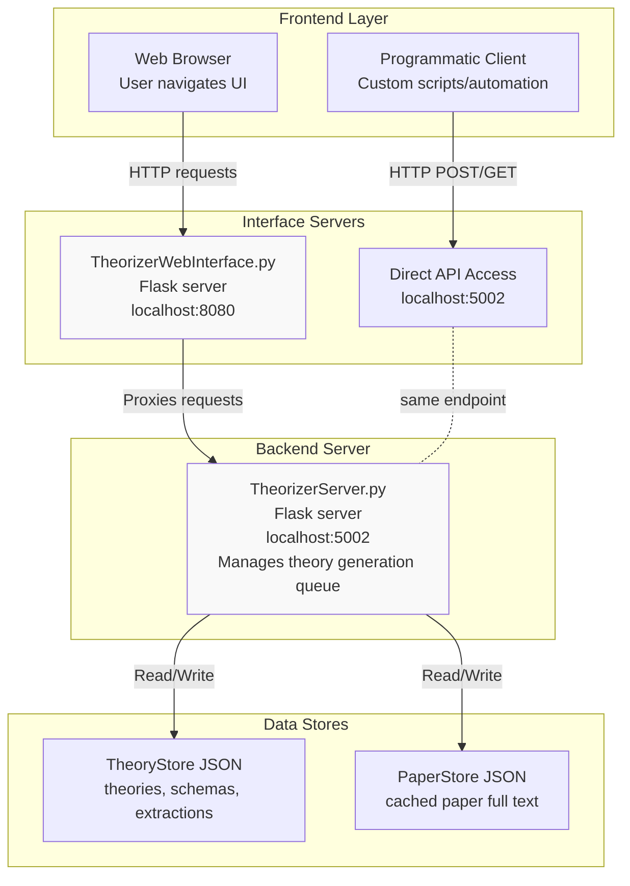
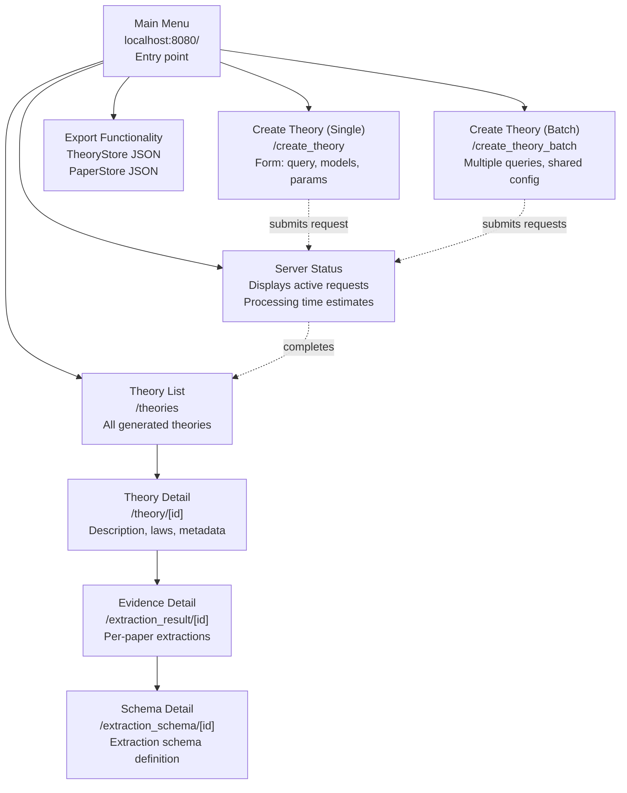
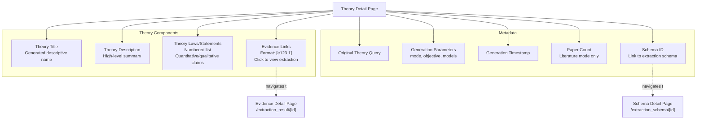
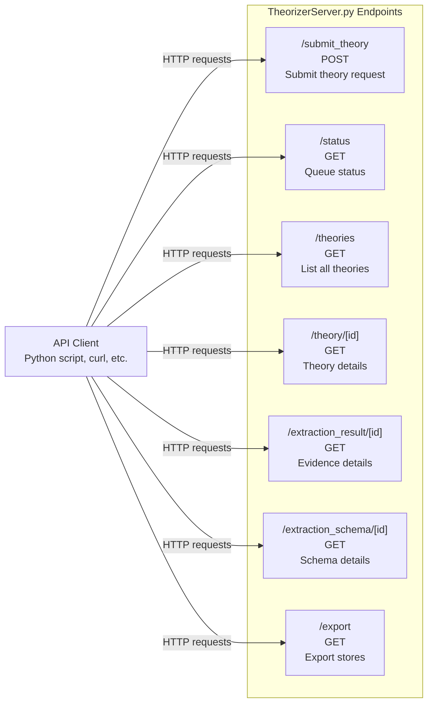

<!-- source: DeepWiki mcp.deepwiki.com · repo allenai/asta-theorizer · page 3.4 Web Interface and API · fetched 2026-10-26 -->

# Web Interface and API

<details>
<summary>Relevant source files</summary>

The following files were used as context for generating this wiki page:

- [README.md](README.md)

</details>


## Purpose and Scope

This document describes how to interact with the Theorizer system through its two user-facing interfaces: the web interface served at `localhost:8080` and the programmatic API served at `localhost:5002`. It covers starting both servers, navigating the web interface pages, submitting theory generation requests, monitoring progress, and exporting results. For details on the theory generation workflow itself, see [Theory Generation](#3). For information on configuring generation modes and objectives, see [Generation Modes](#3.1) and [Generation Objectives](#3.2).

---

## Architecture Overview

The Theorizer system implements a client-server architecture with two separate frontend options accessing a shared backend.



**Architecture Pattern**: The web interface (`TheorizerWebInterface.py`) acts as a presentation layer that proxies all requests to the backend server (`TheorizerServer.py`). Programmatic clients can bypass the web interface and communicate directly with the backend server on the same port. Both interfaces share access to the same `TheoryStore` and `PaperStore` data.

**Sources**: [README.md:169-189](), [README.md:204-298]()

---

## Starting the System

Both servers must run simultaneously for the system to function. They should be started in separate terminal sessions.

### Backend Server

Start the theory generation backend:

```bash
python src/TheorizerServer.py
```

This launches a Flask server on `localhost:5002` that:
- Accepts theory generation requests
- Manages the processing queue
- Performs schema generation and theory synthesis
- Reads/writes to `TheoryStore` and `PaperStore`

### Web Interface Server

Start the user-facing web interface:

```bash
python src/TheorizerWebInterface.py
```

This launches a Flask server on `localhost:8080` that:
- Renders HTML pages for user interaction
- Proxies requests to the backend server
- Displays theory lists, details, and extraction results

### Verification

Navigate to `http://localhost:8080/` in a web browser. The main menu should appear if both servers are running correctly.

**Sources**: [README.md:169-183]()

---

## Web Interface Pages and Workflows

The web interface provides multiple pages for different stages of the theory generation and inspection workflow.



**Sources**: [README.md:200-298]()

### Main Menu Page

**Route**: `/`

**Purpose**: Primary navigation hub displaying:
- Button to create single theory
- Button to create batch theories
- Server status section showing active theory generation requests
- Button to export `TheoryStore` and `PaperStore`
- Link to theory list

**Key Elements**:
- Server status updates automatically during processing
- Export button triggers JSON file downloads
- Navigation to all major functionality

**Sources**: [README.md:200-208]()

---

### Create Theory Page (Single)

**Route**: `/create_theory`

**Purpose**: Submit a single theory generation request with full configuration.

**Form Parameters**:

| Parameter | Description | Required For |
|-----------|-------------|--------------|
| `theory_query` | Natural language request for theories (e.g., "build theories about memory architectures for LLM agents") | All modes |
| `model_theory_generation` | LLM model for final theory synthesis (e.g., `gpt-4.1-2025-04-14`, `claude-sonnet-4-5-20250929`) | All modes |
| `objective_theory_generation` | Either `accuracy-focused` or `novelty-focused` | All modes |
| `input_type_theory_generation` | Either `literature-supported` or `parametric` | All modes |
| `model_literature_extraction` | Inexpensive LLM for per-paper extraction (e.g., `gpt-5-mini`) | Literature mode only |
| `num_papers` | Maximum papers to find/download (up to 100) | Literature mode only |
| `knowledge_cutoff_year` | Exclude papers authored after this year | Literature mode only |
| `knowledge_cutoff_month` | Exclude papers authored after this month | Literature mode only |

**Workflow**:
1. User fills form with desired configuration
2. Click `Submit` button
3. Web interface sends POST request to backend
4. Success message appears confirming server accepted request
5. Request enters processing queue (monitor via Server Status)

**Processing Time**: Approximately 30-60 minutes per literature-supported theory, dominated by API rate limits.

**Sources**: [README.md:210-233]()

---

### Create Theory Page (Batch)

**Route**: `/create_theory_batch`

**Purpose**: Submit multiple theory queries sharing the same configuration parameters (model selections, objective, input type, paper count, knowledge cutoff).

**Use Case**: Generating theories for multiple related queries with consistent settings, enabling systematic comparison across topics.

**Form Parameters**: Same as single theory creation, but accepts multiple theory queries (one per line or comma-separated).

**Sources**: [README.md:214]()

---

### Server Status Display

**Location**: Embedded in main menu page

**Purpose**: Real-time monitoring of active theory generation requests.

**Display Information**:
- Theory query text
- Current processing stage (paper finding, schema generation, evidence extraction, theory synthesis)
- Estimated time remaining
- Queue position (if multiple requests active)

**Update Mechanism**: Page periodically polls backend server for status updates.

**Completion Behavior**: When processing completes, theories automatically appear in the theory list without manual refresh required.

**Sources**: [README.md:235-243]()

---

### Theory List Page

**Route**: `/theories`

**Purpose**: Display all successfully generated theories with summary information.

**Displayed Information Per Theory**:
- Theory title/description summary
- Theory query that generated it
- Generation timestamp
- Generation mode (literature-supported or parametric)
- Generation objective (accuracy-focused or novelty-focused)
- Model used for generation
- Number of laws/statements in theory
- Link to detailed view

**Sorting/Filtering**: Theories typically displayed in reverse chronological order (newest first).

**Sources**: [README.md:260-268]()

---

### Theory Detail Page

**Route**: `/theory/[theory_id]`

**Purpose**: Display complete information for a single theory.



**Theory Laws Format**: Each law/statement includes:
- Law text (the actual claim)
- Confidence level (if generated)
- Evidence citations (format: `[e123.1]` where `123` is extraction result ID, `1` is evidence instance)

**Evidence Citation Linking**: Clicking evidence citations navigates to the specific extraction result page showing where that evidence came from.

**Sources**: [README.md:270-278]()

---

### Evidence Detail Page

**Route**: `/extraction_result/[extraction_result_id]`

**Purpose**: Display evidence extracted from a single paper according to a schema.

**Page Structure**:

**Header Section**:
- Paper title
- Paper authors
- Paper year
- Paper DOI/URL
- Semantic Scholar ID
- Link to extraction schema used

**Evidence Instances Section**:
- List of extracted evidence instances
- Each instance contains fields defined by the schema (e.g., "phenomenon observed", "experimental setup", "quantitative results")
- Evidence organized by schema fields

**Navigation**: 
- Link back to theories using this evidence
- Link to extraction schema definition

**Sources**: [README.md:280-288]()

---

### Schema Detail Page

**Route**: `/extraction_schema/[schema_id]`

**Purpose**: Display the extraction schema generated from the theory query.

**Schema Components**:

| Component | Description |
|-----------|-------------|
| **Schema Name** | Auto-generated from theory query |
| **Schema Description** | Purpose of this extraction schema |
| **Field Definitions** | List of fields to extract from each paper |
| **Field Types** | Data type for each field (text, number, boolean, list) |
| **Field Descriptions** | Guidance for what each field should contain |
| **Extraction Instructions** | Detailed instructions for LLM performing extraction |

**Use**: This schema is applied to each paper in the literature-supported mode to extract structured evidence. The schema is generated once per theory query, then reused across all papers.

**Sources**: [README.md:290-298]()

---

### Export Functionality

**Route**: `/export` (button triggers download)

**Purpose**: Save `TheoryStore` and `PaperStore` to local JSON files for persistence and backup.

**⚠️ Critical Importance**: Theories are stored in memory during runtime. Without manual export, all generated theories are lost when the server restarts.

**Export Contents**:

1. **TheoryStore JSON**: Contains:
   - `theories`: Dictionary mapping theory IDs to theory objects (title, description, laws, metadata)
   - `extraction_schemas`: Dictionary mapping schema IDs to schema definitions
   - `extraction_results`: Dictionary mapping extraction result IDs to per-paper evidence

2. **PaperStore JSON**: Contains:
   - Cached full-text content of downloaded papers
   - Paper metadata (title, authors, year, DOI)
   - Markdown conversions from PDFs
   - ⚠️ **Copyright Consideration**: Contains full paper text; redistribution may violate copyright

**Auto-save Behavior**: 
- System attempts to auto-save `TheoryStore` after each theory generation completes
- Auto-save files: `theorizer-state-autosave-*.json` in execution directory
- **Unreliable**: Auto-save should not be relied upon; use manual export
- Auto-save does NOT export `PaperStore`

**Reloading Exported Data**: To reload theories in a new session, manually specify the filename at the bottom of [src/TheorizerServer.py]() before starting the server.

**Sources**: [README.md:245-258]()

---

## Programmatic API

The backend server exposes HTTP endpoints that can be accessed programmatically, bypassing the web interface.

### API Base URL

```
http://localhost:5002
```

### API Endpoints

The web interface implementation demonstrates the available endpoints and request formats. Below are the primary endpoints:



### Submit Theory Request

**Endpoint**: `POST /submit_theory`

**Purpose**: Submit a theory generation request to the processing queue.

**Request Body** (JSON):

```json
{
  "theory_query": "build theories about X",
  "model_theory_generation": "gpt-4.1-2025-04-14",
  "objective_theory_generation": "accuracy-focused",
  "input_type_theory_generation": "literature-supported",
  "model_literature_extraction": "gpt-5-mini",
  "num_papers": 100,
  "knowledge_cutoff_year": 2023,
  "knowledge_cutoff_month": 12
}
```

**Parameters**:
- `theory_query` (string, required): Natural language theory request
- `model_theory_generation` (string, required): Model for synthesis
- `objective_theory_generation` (string, required): `"accuracy-focused"` or `"novelty-focused"`
- `input_type_theory_generation` (string, required): `"literature-supported"` or `"parametric"`
- `model_literature_extraction` (string, conditional): Required for literature-supported mode
- `num_papers` (integer, conditional): Required for literature-supported mode (1-100)
- `knowledge_cutoff_year` (integer, conditional): Required for literature-supported mode
- `knowledge_cutoff_month` (integer, conditional): Required for literature-supported mode (1-12)

**Response** (JSON):

```json
{
  "status": "success",
  "message": "Theory request accepted and queued",
  "request_id": "abc123"
}
```

**Error Response**:

```json
{
  "status": "error",
  "message": "Description of error"
}
```

### Get Server Status

**Endpoint**: `GET /status`

**Purpose**: Retrieve current processing queue status and active requests.

**Response** (JSON):

```json
{
  "active_requests": [
    {
      "request_id": "abc123",
      "theory_query": "build theories about X",
      "stage": "evidence_extraction",
      "progress": "Processing paper 45 of 100",
      "estimated_time_remaining_minutes": 25
    }
  ],
  "queue_length": 2
}
```

### Get Theory List

**Endpoint**: `GET /theories`

**Purpose**: Retrieve list of all generated theories.

**Response** (JSON): Array of theory objects with summary information.

### Get Theory Details

**Endpoint**: `GET /theory/[theory_id]`

**Purpose**: Retrieve complete theory information including all laws and metadata.

**Response** (JSON): Complete theory object from `TheoryStore`.

### Get Extraction Result

**Endpoint**: `GET /extraction_result/[extraction_result_id]`

**Purpose**: Retrieve evidence extracted from a specific paper.

**Response** (JSON): Extraction result object containing paper metadata and extracted evidence instances.

### Get Extraction Schema

**Endpoint**: `GET /extraction_schema/[schema_id]`

**Purpose**: Retrieve extraction schema definition.

**Response** (JSON): Schema object containing field definitions and extraction instructions.

### Export Data

**Endpoint**: `GET /export`

**Purpose**: Trigger export of `TheoryStore` and `PaperStore`.

**Response**: JSON file download or file path.

**Sources**: [README.md:185-189](), [src/TheorizerWebInterface.py]() (implied, endpoint examples mentioned)

---

## Implementation Details

### Server Communication Pattern

The web interface uses a synchronous request-response pattern for most operations, with periodic polling for status updates during long-running theory generation tasks.

### Session Management

The system maintains theory data in server memory rather than using per-session storage. All users accessing the same server instance share the same `TheoryStore` and `PaperStore`.

### Concurrency

Theory generation requests are processed sequentially through a queue. Multiple simultaneous theory generation jobs are not supported due to LLM API rate limits and cost management concerns.

### Port Configuration

Default ports:
- Backend server: `5002`
- Web interface: `8080`

Ports can be modified in [src/TheorizerServer.py]() and [src/TheorizerWebInterface.py]() respectively.

**Sources**: [README.md:169-189]()

---

## Usage Recommendations

### Cost Management

- Start with small-scale tests (1-2 theories, 10-20 papers) to estimate costs
- Use API keys with hard spending limits
- Monitor API costs during processing
- Export results frequently to avoid data loss requiring regeneration

### Workflow Best Practices

1. Start both servers
2. Verify main menu loads correctly
3. Submit theory request(s)
4. Monitor server status periodically
5. Export `TheoryStore` and `PaperStore` immediately after completion
6. Navigate theory list to inspect results
7. Use evidence and schema links to verify extraction quality

### Debugging Connection Issues

If the web interface cannot connect to the backend:
- Verify `TheorizerServer.py` is running
- Check that no other process is using port 5002
- Confirm firewall settings allow localhost connections
- Review server console logs for error messages

**Sources**: [README.md:196-198](), [README.md:245-258]()

---

