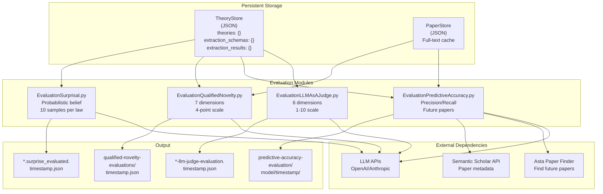
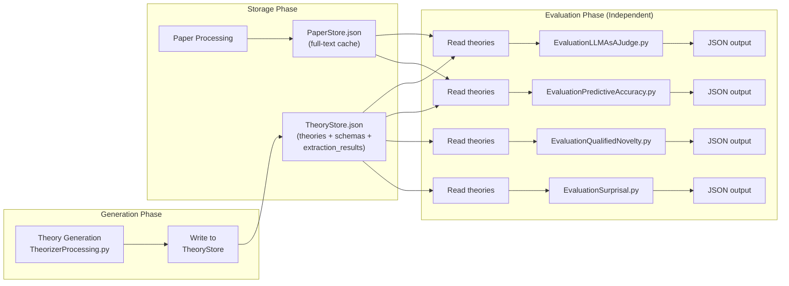
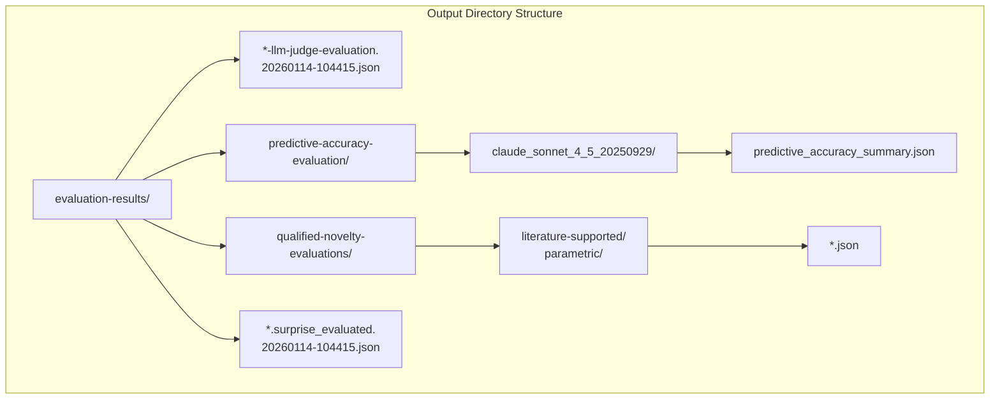

<!-- source: DeepWiki mcp.deepwiki.com · repo allenai/asta-theorizer · page 4 Evaluation Systems · fetched 2026-10-26 -->

# Evaluation Systems

<details>
<summary>Relevant source files</summary>

The following files were used as context for generating this wiki page:

- [README.md](README.md)

</details>


## Purpose and Scope

This document provides an overview of the Theorizer evaluation architecture, which consists of four independent methodologies for assessing generated theories post-hoc. These evaluation systems operate on theories stored in the `TheoryStore` and papers cached in the `PaperStore`, enabling repeated assessment without regenerating theories.

For detailed information about specific evaluation methodologies, see:
- [LLM-as-a-Judge Evaluation](#4.1) - Six-dimensional qualitative assessment
- [Predictive Accuracy Evaluation](#4.2) - Rubric-based testing against future papers
- [Qualified Novelty Evaluation](#4.3) - Seven-dimensional novelty categorization
- [Self-assessed Belief and Surprisal Evaluation](#4.4) - Probabilistic confidence elicitation

For information about theory generation (the process that creates theories to be evaluated), see [Theory Generation](#3).

---

## Architectural Overview

The evaluation system is designed as a modular, post-hoc pipeline that operates independently of theory generation. Each evaluation methodology is implemented as a standalone Python script that reads from persistent stores and produces timestamped JSON output files.

### Evaluation Module Architecture



**Sources:** [README.md:301-476](), Diagram 3 from high-level architecture

---

## Key Architectural Principles

### Independence and Modularity

Each evaluation module operates as an independent script with no dependencies on other evaluation modules. This design enables:

| Principle | Implementation | Benefit |
|-----------|---------------|---------|
| **Post-hoc Evaluation** | Modules read from `TheoryStore`/`PaperStore` | Evaluate theories after generation completes |
| **Repeated Assessment** | No modification of source data | Run multiple evaluations on same theories |
| **Model Comparison** | Timestamped outputs with model identifiers | Compare different LLM evaluators |
| **Flexible Execution** | Standalone Python scripts | Run evaluations independently or in batch |
| **Longitudinal Analysis** | Persistent timestamped results | Track evaluation metrics over time |

### Data Flow Pattern



**Sources:** [README.md:301-476](), Diagram 3 and Diagram 4 from high-level architecture

---

## Overview of Four Evaluation Methodologies

### Methodology Comparison

| Evaluation | Script | Input | Output | Purpose | External Deps |
|-----------|--------|-------|--------|---------|---------------|
| **LLM-as-a-Judge** | `EvaluationLLMAsAJudge.py` | Theories from `TheoryStore` | 6 dimensions (1-10 scale) | Holistic quality assessment | LLM API |
| **Predictive Accuracy** | `EvaluationPredictiveAccuracy.py` | Theories + future papers | Precision/Recall metrics | Test predictions against future evidence | LLM API, Asta, S2 |
| **Qualified Novelty** | `EvaluationQualifiedNovelty.py` | Theories + literature (23 papers) | 7 novelty dimensions (4-point scale) | Categorize type of scientific contribution | LLM API |
| **Surprisal** | `EvaluationSurprisal.py` | Theory laws | Average probability + std dev | Measure LLM's own confidence | LLM API |

### LLM-as-a-Judge Evaluation

Provides qualitative assessment across six dimensions using an LLM as an evaluator. Each dimension is scored on a 1-10 scale.

**Dimensions:**
- `factual_accuracy` - Correctness of claims (avg: 6.18)
- `specificity` - Concreteness and precision (avg: 7.36)
- `novelty` - Originality compared to literature (avg: 5.73)
- `testability` - Ability to design experiments (avg: 7.98)
- `plausibility` - Reasonableness given domain knowledge (avg: 7.24)
- `empirical_testing` - Direct experimental validation (avg: 2.69)

**Prompt Location:** [src/EvaluationLLMAsAJudge.py:26]()

**Sources:** [README.md:307-326](), [src/EvaluationLLMAsAJudge.py]()

### Predictive Accuracy Evaluation

Tests theories against papers published after the knowledge cutoff date. The evaluation constructs theory-specific rubrics and measures both precision (how often predictions are supported) and recall (coverage of theory elements).

**Process:**
1. Find papers published after knowledge cutoff using Asta Paper Finder
2. Build prediction rubric from theory laws
3. Score each paper (support/contradict/no_relevant_info)
4. Calculate precision and recall metrics

**Key Metrics:**
- `support` - Papers that support theory predictions
- `contradict` - Papers that contradict predictions
- `proportion_theories_with_data` - Recall at theory level
- `proportion_elems_with_data` - Recall at law/element level

**Prompt Locations:** [src/EvaluationPredictiveAccuracy.py:26]() (paper finding), [src/EvaluationPredictiveAccuracy.py:421]() (rubric building), [src/EvaluationPredictiveAccuracy.py:623]() (paper scoring)

**Sources:** [README.md:328-366](), [src/EvaluationPredictiveAccuracy.py]()

### Qualified Novelty Evaluation

Compares theories against approximately 23 papers to categorize the type of scientific novelty across seven dimensions. Each dimension uses a 4-point scale:
- `explicit_established` - Explicitly stated in literature
- `implicit_established` - Implicitly present in literature
- `speculative` - Speculated but not established
- `genuinely_new` - Novel contribution

**Seven Dimensions:**
1. `phenomenon_effect` - New observable phenomena
2. `explanatory_mechanistic` - New mechanisms or explanations
3. `unification` - Connecting previously separate concepts
4. `generalization_scope_expansion` - Broadening applicability
5. `constraint_limitation` - Identifying boundaries
6. `conceptual_reframing_abstraction` - New conceptual frameworks
7. `empirical_synthesis_meta_regulariry` - Meta-patterns from data

**Prompt Locations:** [src/EvaluationQualifiedNovelty.py:25]() (per-paper assessment), [src/EvaluationQualifiedNovelty.py:393]() (aggregation)

**Sources:** [README.md:368-455](), [src/EvaluationQualifiedNovelty.py]()

### Self-assessed Belief and Surprisal Evaluation

Elicits probabilistic confidence from the LLM that generated the theories. For each theory law, the system samples the LLM's belief 10 times and computes average probability and standard deviation.

**Output Metrics:**
- Average (of average) probability across all laws
- Standard deviation of average probabilities
- Number of samples per law (default: 10)

**Example Results:**
- Average probability: 0.809
- Standard deviation: 0.045

**Prompt Location:** [src/EvaluationSurprisal.py:25]()

**Sources:** [README.md:457-475](), [src/EvaluationSurprisal.py]()

---

## Execution and Output Format

### Running Evaluation Scripts

Each evaluation script is executed independently from the command line:

```bash
# LLM-as-a-Judge
python src/EvaluationLLMAsAJudge.py

# Predictive Accuracy
python src/EvaluationPredictiveAccuracy.py

# Qualified Novelty
python src/EvaluationQualifiedNovelty.py

# Surprisal
python src/EvaluationSurprisal.py
```

Scripts read from `TheoryStore` and `PaperStore` files specified in their configuration (typically at the top of the script or via command-line arguments).

### Output Structure

All evaluation scripts produce timestamped JSON output files with model identifiers embedded in filenames or directory structures:



### Output Format Characteristics

| Characteristic | Implementation | Purpose |
|---------------|----------------|---------|
| **Timestamps** | Format: `YYYYMMDD-HHMMSS` | Track when evaluation ran |
| **Model Identifiers** | Embedded in filename or path | Support model comparison |
| **JSON Structure** | Hierarchical with metrics | Enable programmatic analysis |
| **Cost Tracking** | Included in novelty evaluation | Monitor API expenses |
| **Paper Counts** | Included where applicable | Understand evaluation scope |

**Example filename:** `theorystore-example-single-laws.surprise_evaluated.20260114-104415.json`

**Sources:** [README.md:301-476]()

---

## Integration with TheoryStore and PaperStore

### TheoryStore Structure for Evaluation

The `TheoryStore` JSON file contains three primary dictionaries that evaluations read from:

```
TheoryStore:
├── theories: {}              # Theory objects with laws and descriptions
├── extraction_schemas: {}    # Schemas used to extract evidence
└── extraction_results: {}    # Evidence extracted from each paper
```

Each theory object contains:
- `theory_name` - Unique identifier
- `description` - High-level theory description
- `laws` - List of theory laws/statements
- `generation_parameters` - Model, objective, input type
- `evidence_links` - References to extraction results

**Used by:** All four evaluation modules read `theories` dictionary; Predictive Accuracy and Qualified Novelty also access `extraction_results` for evidence provenance.

### PaperStore Structure for Evaluation

The `PaperStore` JSON file caches full-text papers:

```
PaperStore:
└── papers: {}
    └── paper_id: {
        "paperId": "...",
        "title": "...",
        "full_text": "...",
        "metadata": {...}
    }
```

**Used by:** Predictive Accuracy (to compare against future papers) and Qualified Novelty (to assess novelty against literature).

**Note:** The `PaperStore` is not redistributed in example datasets due to copyright concerns. Evaluations that require full-text must have papers cached locally.

**Sources:** [README.md:479-492](), [README.md:251-258]()

---

## Design Rationale

### Why Post-hoc Evaluation?

The separation of generation and evaluation provides several advantages:

1. **Cost Optimization:** Expensive theory generation (30-60 minutes, multiple API calls) runs once; inexpensive evaluations can run multiple times
2. **Model Comparison:** Evaluate same theories with different LLM judges without regenerating
3. **Experimental Flexibility:** Test new evaluation metrics on existing theory corpus
4. **Reproducibility:** Same theories evaluated consistently across runs
5. **Batch Processing:** Generate theories in bulk, then evaluate offline

### Why Multiple Evaluation Dimensions?

Scientific theories have multiple desirable properties that cannot be captured by a single metric:

- **Accuracy** (LLM-as-a-Judge, Predictive Accuracy) - Are the claims correct?
- **Novelty** (Qualified Novelty, LLM-as-a-Judge) - Is this a new contribution?
- **Testability** (LLM-as-a-Judge) - Can we design experiments?
- **Predictive Power** (Predictive Accuracy) - Does it generalize to future work?
- **Confidence** (Surprisal) - How certain is the generating model?

Each evaluation methodology captures different aspects, enabling multi-faceted assessment.

**Sources:** Diagram 3 from high-level architecture, overall system design

---

## Cost and Performance Considerations

### API Costs by Evaluation Type

| Evaluation | API Calls | Cost Driver | Typical Cost |
|-----------|-----------|-------------|--------------|
| LLM-as-a-Judge | 1 per theory | Single comprehensive prompt | Low |
| Predictive Accuracy | 1 + N (papers) | Finding papers + scoring each | Medium |
| Qualified Novelty | ~23 per theory | Comparing against literature | High (~$1.17/theory) |
| Surprisal | 10 × M (laws) | Sampling probability per law | Medium |

**From example output:** Qualified Novelty evaluation averaged $1.17 per theory with 23 papers evaluated per theory (total: $5.84 for 5 theories).

### Execution Time

Evaluation runtime depends on:
- Number of theories to evaluate
- LLM API rate limits
- Number of papers to compare against (Predictive Accuracy, Qualified Novelty)
- Number of samples (Surprisal)

**Recommendation:** Use inexpensive models for high-volume evaluations where appropriate; reserve expensive models for critical assessments.

**Sources:** [README.md:441-446](), [README.md:198]()

---

