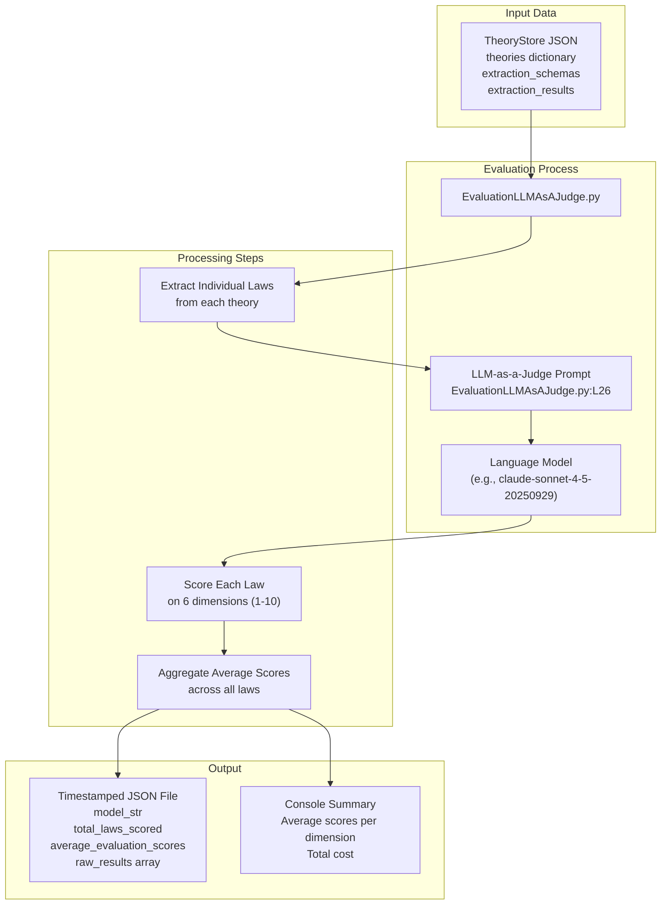
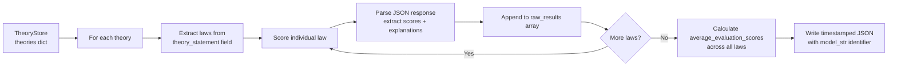
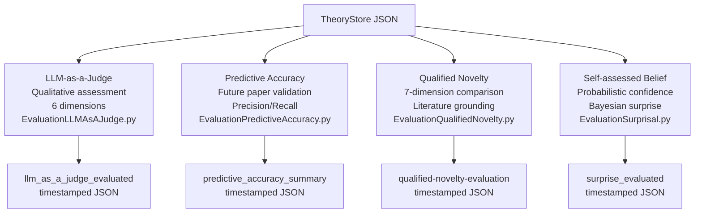

<!-- source: DeepWiki mcp.deepwiki.com · repo allenai/asta-theorizer · page 4.1 LLM-as-a-Judge Evaluation · fetched 2026-10-26 -->

# LLM-as-a-Judge Evaluation

<details>
<summary>Relevant source files</summary>

The following files were used as context for generating this wiki page:

- [README.md](README.md)
- [example-theories/toy-data/evaluations/theorystore-example-single-laws.llm_as_a_judge_evaluated.20260121-120053.json](example-theories/toy-data/evaluations/theorystore-example-single-laws.llm_as_a_judge_evaluated.20260121-120053.json)

</details>


## Purpose and Scope

This page documents the LLM-as-a-Judge evaluation system, which provides holistic quality assessment of generated scientific theories across six qualitative dimensions. This evaluation is one of four independent post-hoc evaluation methodologies in the Theorizer system. For information about other evaluation approaches, see [Predictive Accuracy Evaluation](#4.2), [Qualified Novelty Evaluation](#4.3), and [Self-assessed Belief and Surprisal Evaluation](#4.4). For the overall evaluation architecture, see [Evaluation Systems](#4).

The LLM-as-a-Judge approach uses a language model to evaluate individual theory laws on a 1-10 scale across multiple quality dimensions, providing both numeric scores and explanatory text for each assessment.

---

## Overview

The LLM-as-a-Judge evaluation operates as a standalone post-processing step that analyzes theories already stored in the TheoryStore. Unlike traditional automated metrics that measure surface-level features, this approach leverages the reasoning capabilities of large language models to assess complex qualitative properties such as plausibility, novelty, and testability.

### Key Characteristics

- **Post-hoc Evaluation**: Runs independently after theory generation is complete
- **Individual Law Scoring**: Evaluates each theory law separately rather than theories as wholes
- **Multi-dimensional Assessment**: Provides scores across six distinct quality dimensions
- **Explanatory Output**: Generates detailed explanations for each numeric score
- **Model-Agnostic Storage**: Results are saved with model identifiers to support cross-model comparisons

Sources: [README.md:305-327](), [example-theories/toy-data/evaluations/theorystore-example-single-laws.llm_as_a_judge_evaluated.20260121-120053.json:1-17]()

---

## Evaluation Dimensions

The system evaluates each theory law on six dimensions, each scored on a 1-10 scale. These dimensions were selected to capture different aspects of scientific theory quality:

| Dimension | Average Score (Example) | Description |
|-----------|------------------------|-------------|
| **Factual Accuracy** | 6.18 | Correctness of factual claims and alignment with established scientific knowledge |
| **Specificity** | 7.36 | Precision of parameters, concrete operationalization, and measurability of variables |
| **Novelty** | 5.73 | Originality relative to existing work; degree of new contribution vs. synthesis |
| **Testability** | 7.98 | Presence of falsifiable predictions and feasibility of experimental validation |
| **Plausibility** | 7.24 | Mechanistic soundness and alignment with known principles |
| **Empirical Testing** | 2.69 | Extent of existing empirical validation in published literature |

### Dimension Details

**Factual Accuracy** assesses whether the theory's claims align with established scientific knowledge. Lower scores indicate contradictions with known facts, while higher scores reflect accurate grounding in existing literature.

**Specificity** measures how precisely the theory defines its components. High-scoring theories provide concrete parameters, mathematical relationships, and operationalizable variables. Low scores indicate vague or underspecified mechanisms.

**Novelty** evaluates the theory's originality. Theories scoring high introduce genuinely new mechanisms, while mid-range scores represent novel syntheses of existing ideas, and low scores indicate well-established principles.

**Testability** focuses on falsifiability. High scores indicate clear experimental protocols and measurable predictions, while low scores suggest theories that are difficult to validate empirically.

**Plausibility** judges whether the proposed mechanism is consistent with known computational, cognitive, or physical principles. High scores reflect strong alignment with established frameworks.

**Empirical Testing** differs from testability by assessing whether the theory has *already been* empirically validated in published work, rather than whether it *could be* tested.

Sources: [example-theories/toy-data/evaluations/theorystore-example-single-laws.llm_as_a_judge_evaluated.20260121-120053.json:1-17](), [README.md:315-324]()

---

## Architecture and Workflow



**Diagram: LLM-as-a-Judge Evaluation Pipeline**

Sources: [src/EvaluationLLMAsAJudge.py:26](), [example-theories/toy-data/evaluations/theorystore-example-single-laws.llm_as_a_judge_evaluated.20260121-120053.json:1-17]()

### Evaluation Loop Structure

The evaluation process iterates over theories and their constituent laws:



**Diagram: Law-Level Scoring Loop**

Sources: [example-theories/toy-data/evaluations/theorystore-example-single-laws.llm_as_a_judge_evaluated.20260121-120053.json:17-90]()

---

## Implementation Details

### Core Evaluation Script

The implementation is located in `src/EvaluationLLMAsAJudge.py`. The script follows this structure:

1. **Load TheoryStore**: Reads the theory data from JSON
2. **Extract Laws**: Iterates through theories and extracts individual law statements
3. **Generate Prompts**: For each law, constructs a prompt containing the law's statement, domain scope, special cases, and supporting evidence
4. **Query LLM**: Sends the prompt to the configured language model
5. **Parse Response**: Extracts the six dimension scores and explanations from the JSON-formatted LLM response
6. **Aggregate Results**: Calculates average scores across all evaluated laws
7. **Save Output**: Writes results to a timestamped JSON file with model identifier

### Prompt Structure

The evaluation prompt is defined starting at line 26 of `EvaluationLLMAsAJudge.py`. The prompt instructs the LLM to:

- Evaluate the theory law against "general scientific knowledge"
- Score each dimension on a 1-10 scale
- Provide detailed explanations for each score
- Return results in a structured JSON format

The prompt includes the complete theory context:
- Theory name and description
- Law statement name and content
- Domain scope and applicability conditions
- Special cases and boundary conditions
- Supporting evidence with citations
- Novelty evaluation against existing work

Sources: [README.md:527-528](), [src/EvaluationLLMAsAJudge.py:26]()

### Response Format

The LLM returns a JSON object with the following structure:

```json
{
  "paper_title": "string (not used for general evaluation)",
  "contains_relevant_information": true,
  "evaluation": [
    {
      "factual_accuracy": 1-10,
      "explanation": "detailed explanation"
    },
    {
      "specificity": 1-10,
      "explanation": "detailed explanation"
    },
    // ... for all 6 dimensions
  ]
}
```

Each dimension entry contains both a numeric score and a free-text explanation justifying that score.

Sources: [example-theories/toy-data/evaluations/theorystore-example-single-laws.llm_as_a_judge_evaluated.20260121-120053.json:61-87]()

---

## Output Files and Results

### File Structure

Evaluation results are saved as timestamped JSON files with the following naming pattern:

```
theorystore-{description}.llm_as_a_judge_evaluated.{timestamp}.json
```

Example: `theorystore-example-single-laws.llm_as_a_judge_evaluated.20260121-120053.json`

### Top-Level Schema

```json
{
  "model_str": "claude-sonnet-4-5-20250929",
  "total_laws_scored": 45,
  "average_evaluation_scores": {
    "factual_accuracy": 6.156,
    "specificity": 7.333,
    "novelty": 5.756,
    "testability": 8.022,
    "plausibility": 7.089,
    "empirical_testing": 2.689
  },
  "counts": {
    "total_score": 121,
    "count": 45,
    "none": 0
  },
  "raw_results": [...]
}
```

### Individual Law Results

The `raw_results` array contains detailed evaluations for each law:

```json
{
  "model_str": "claude-sonnet-4-5-20250929",
  "law": {
    "theory_id": "theory-1",
    "theory_name": "Hierarchical Episodic-Prospective Memory Theory",
    "theory_description": "...",
    "law": {
      "statement_name": "Prospective Memory / Plan Retention Principle",
      "theory_statement": "...",
      "domain_scope": "...",
      "special_cases": [...],
      "supporting_evidence": [...]
    }
  },
  "evaluation": [
    {"factual_accuracy": 7, "explanation": "..."},
    {"specificity": 7, "explanation": "..."},
    {"novelty": 6, "explanation": "..."},
    {"testability": 8, "explanation": "..."},
    {"plausibility": 8, "explanation": "..."},
    {"empirical_testing": 4, "explanation": "..."}
  ],
  "response_text": "complete LLM response",
  "total_cost": 0.023145
}
```

Sources: [example-theories/toy-data/evaluations/theorystore-example-single-laws.llm_as_a_judge_evaluated.20260121-120053.json:1-89]()

---

## Console Output Example

When the evaluation completes, a summary is printed to the console:

```
LLM-as-a-judge evaluation complete.

Final average evaluation scores (formatted):
Dimension                      Average Score   Counts              
factual_accuracy               6.18            45                  
specificity                    7.36            45                  
novelty                        5.73            45                  
testability                    7.98            45                  
plausibility                   7.24            45                  
empirical_testing              2.69            45                  

Results saved to: ...
```

This provides an at-a-glance summary of how the generated theories perform across all dimensions.

Sources: [README.md:311-326]()

---

## Interpretation and Insights

### Expected Score Patterns

Based on the example results, typical patterns emerge:

- **High Testability (7.98)**: Generated theories tend to make concrete, falsifiable predictions with clear experimental protocols
- **High Specificity (7.36)**: Theories provide well-defined parameters and operationalizable variables
- **Moderate Plausibility (7.24)**: Mechanisms generally align with established principles, though some assumptions may be simplified
- **Moderate Factual Accuracy (6.18)**: Theories are generally consistent with known facts but may extrapolate beyond direct empirical support
- **Moderate Novelty (5.73)**: Most theories represent novel syntheses of existing ideas rather than entirely new mechanisms
- **Low Empirical Testing (2.69)**: The specific integrated mechanisms proposed often lack direct empirical validation in the stated domains

### Key Insight: Testability vs. Empirical Testing Gap

The large gap between testability (7.98) and empirical testing (2.69) is significant. It indicates that while generated theories make clear, falsifiable predictions that *could* be tested, they represent novel proposals that have not yet *been* tested in the literature. This is expected for an automated theory generation system that produces new hypotheses.

Sources: [example-theories/toy-data/evaluations/theorystore-example-single-laws.llm_as_a_judge_evaluated.20260121-120053.json:1-17]()

---

## Integration with Other Evaluations

The LLM-as-a-Judge evaluation complements the other three evaluation methodologies:



**Diagram: LLM-as-a-Judge in the Evaluation Ecosystem**

Each evaluation provides a different perspective:
- **LLM-as-a-Judge**: Internal quality and scientific rigor
- **Predictive Accuracy**: External validation against future papers
- **Qualified Novelty**: Comparison to existing literature
- **Surprisal**: Model confidence in its own theories

Together, these evaluations provide comprehensive assessment of theory quality.

Sources: [README.md:301-475]()

---

## Running the Evaluation

### Prerequisites

- Completed theory generation with populated TheoryStore
- LLM API access (configured in `api_keys.donotcommit.json`)
- Python environment with required dependencies

### Execution

The evaluation script is run directly:

```bash
python src/EvaluationLLMAsAJudge.py
```

Configuration parameters (e.g., which TheoryStore file to evaluate, which model to use) are typically set within the script itself.

### Cost Considerations

Each law evaluation requires an LLM API call. The `total_cost` field in the output tracks API expenses. For a typical theory set with 45 laws, total cost varies by model but is generally on the order of $1-3 USD for Claude Sonnet models.

Sources: [README.md:305-326]()

---

## Limitations and Considerations

### Model Bias
The evaluation reflects the biases and knowledge limitations of the judging LLM. Different models may produce systematically different scores.

### Dimension Interdependence
The six dimensions are not entirely independent. For example, high specificity often correlates with high testability.

### Absolute vs. Relative Scoring
The 1-10 scale is subjective. Scores are most meaningful when comparing theories evaluated with the same model under the same prompt.

### Single-Judge Limitation
Using a single LLM as judge lacks the diversity of perspectives that human expert panels provide. Cross-model evaluation can partially address this.

Sources: [example-theories/toy-data/evaluations/theorystore-example-single-laws.llm_as_a_judge_evaluated.20260121-120053.json:1-955]()

---

