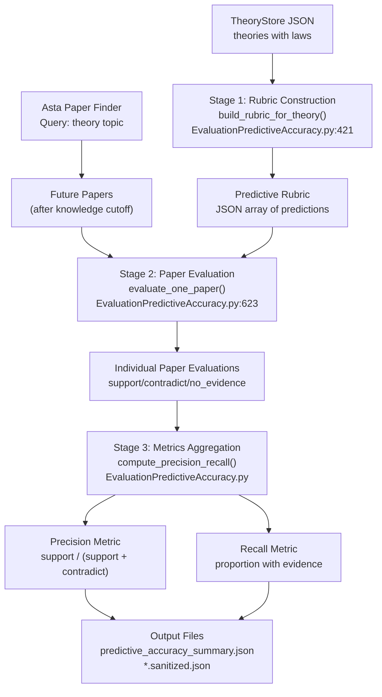
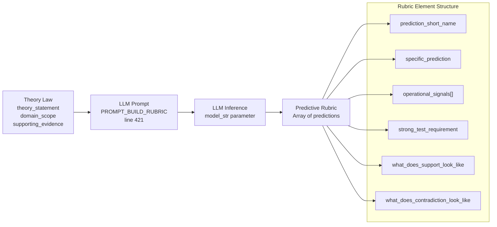
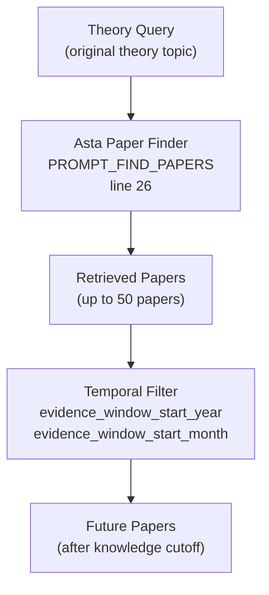
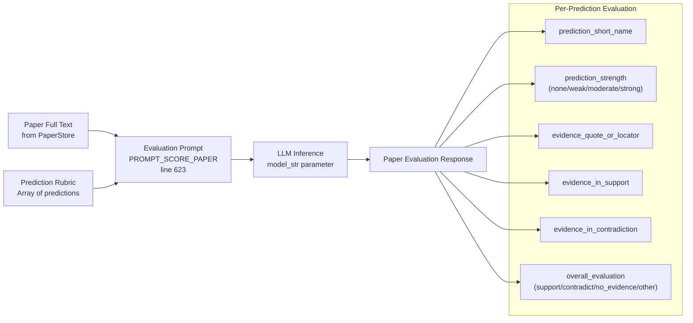
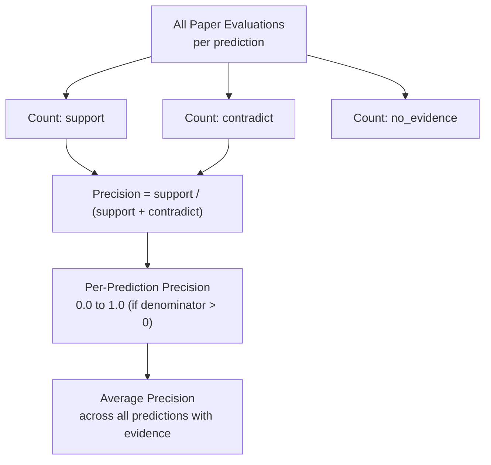
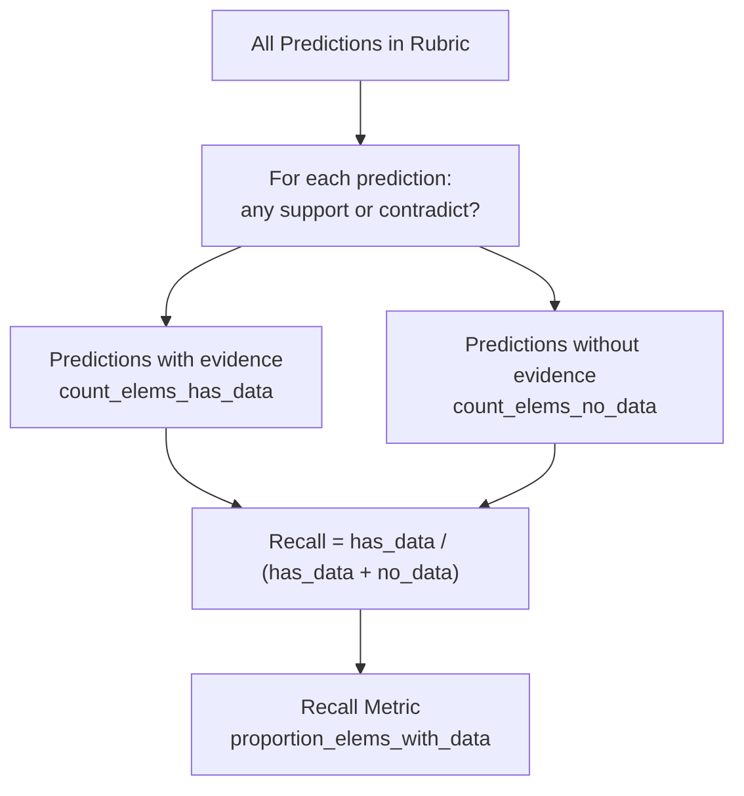
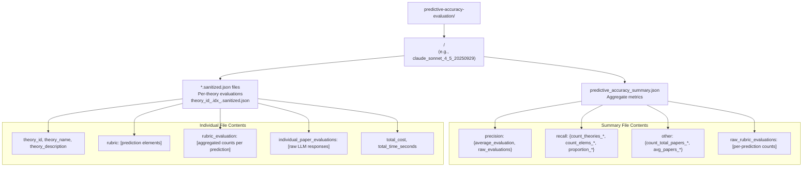
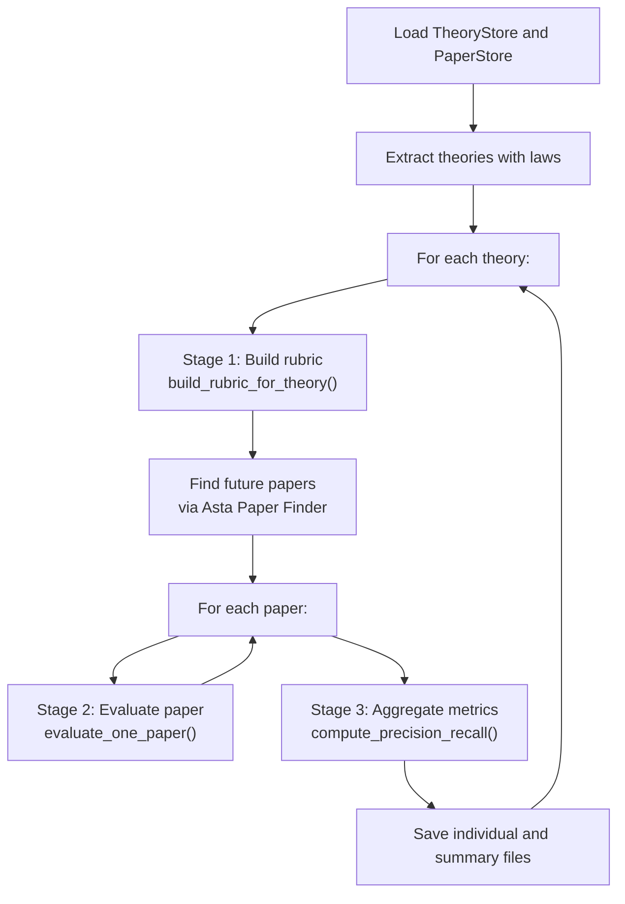

<!-- source: DeepWiki mcp.deepwiki.com · repo allenai/asta-theorizer · page 4.2 Predictive Accuracy Evaluation · fetched 2026-10-26 -->

# Predictive Accuracy Evaluation

<details>
<summary>Relevant source files</summary>

The following files were used as context for generating this wiki page:

- [README.md](README.md)
- [example-theories/toy-data/evaluations/theorystore-example2-predictive-evaluation/predictive-accuracy-evaluation/claude_sonnet_4_5_20250929/predictive_accuracy_summary.json](example-theories/toy-data/evaluations/theorystore-example2-predictive-evaluation/predictive-accuracy-evaluation/claude_sonnet_4_5_20250929/predictive_accuracy_summary.json)
- [example-theories/toy-data/evaluations/theorystore-example2-predictive-evaluation/predictive-accuracy-evaluation/claude_sonnet_4_5_20250929/theorystore-example2-single-laws-paperfinder-cache.20260114-135521.theory_id_theory-1.idx_0.sanitized.json](example-theories/toy-data/evaluations/theorystore-example2-predictive-evaluation/predictive-accuracy-evaluation/claude_sonnet_4_5_20250929/theorystore-example2-single-laws-paperfinder-cache.20260114-135521.theory_id_theory-1.idx_0.sanitized.json)

</details>


## Purpose and Scope

This document describes the Predictive Accuracy evaluation methodology, which assesses generated theories by measuring their ability to predict findings in papers published after the theory's knowledge cutoff date. This evaluation provides quantitative metrics for both **precision** (the ratio of supporting evidence to contradicting evidence) and **recall** (the proportion of theory elements with any empirical evidence).

For information about other evaluation methodologies, see [LLM-as-a-Judge Evaluation](#4.1), [Qualified Novelty Evaluation](#4.3), and [Self-assessed Belief Evaluation](#4.4). For the overall evaluation system architecture, see [Evaluation Systems](#4).

---

## Evaluation Pipeline Overview

The predictive accuracy evaluation implements a three-stage pipeline that transforms theory laws into testable predictions, evaluates them against future papers, and computes aggregate metrics.



**Workflow Description:**

1. **Stage 1 (Rubric Construction):** Transforms each theory law into 4-8 specific, testable predictions with operational signals and evaluation criteria
2. **Stage 2 (Paper Evaluation):** For each future paper, evaluates whether it provides support, contradiction, or no evidence for each prediction
3. **Stage 3 (Metrics Aggregation):** Computes precision (accuracy of predictions) and recall (coverage of theory elements)

**Sources:** [src/EvaluationPredictiveAccuracy.py](), [README.md:330-366]()

---

## Stage 1: Rubric Construction

The rubric construction stage transforms a theory law's qualitative statement into multiple concrete, testable predictions with explicit evaluation criteria.

### Rubric Construction Process



### Rubric Element Schema

Each prediction in the rubric contains the following fields:

| Field | Type | Description |
|-------|------|-------------|
| `prediction_short_name` | string | Unique identifier for the prediction (e.g., "hybrid_vs_single_modality_performance") |
| `specific_prediction` | string | Concrete, testable claim derived from the theory law |
| `operational_signals` | string[] | Observable indicators that would confirm/refute the prediction |
| `strong_test_requirement` | string | Minimum experimental design needed for a paper to test the prediction |
| `what_does_support_look_like` | string | Explicit description of supporting evidence |
| `what_does_contradiction_look_like` | string | Explicit description of contradicting evidence |

### Example Rubric Element

```json
{
  "prediction_short_name": "structured_vs_unstructured_memory",
  "specific_prediction": "LLM agents using structured memory representations (e.g., knowledge graphs, belief graphs, attribute-indexed retrieval) outperform agents using unstructured memory (e.g., naive concatenation of full history or raw episodic logs) on complex text games with non-trivial state spaces and partial observability.",
  "operational_signals": [
    "Direct comparison between structured memory architectures (graphs, schemas, attributes) and unstructured/concatenation baselines",
    "Performance metrics such as task completion rate, score, success rate, or goal achievement in text games",
    "Ablation studies removing or replacing structured memory with full-history or unstructured approaches"
  ],
  "strong_test_requirement": "A paper must directly compare a structured memory method against an unstructured or naive concatenation baseline on the same text game environment, reporting quantitative task performance metrics.",
  "what_does_support_look_like": "Structured memory agents achieve significantly higher task completion rates, scores, or success rates than unstructured/naive concatenation baselines in complex or long-horizon text games.",
  "what_does_contradiction_look_like": "Unstructured or naive concatenation methods match or exceed the performance of structured memory methods on complex text games with non-trivial state spaces."
}
```

**Sources:** [src/EvaluationPredictiveAccuracy.py:421-622](), [example-theories/toy-data/evaluations/theorystore-example2-predictive-evaluation/predictive-accuracy-evaluation/claude_sonnet_4_5_20250929/predictive_accuracy_summary.json:30-156]()

---

## Stage 2: Paper Evaluation

For each paper published after the theory's knowledge cutoff date, the system evaluates whether the paper provides evidence supporting or contradicting each prediction in the rubric.

### Paper Retrieval and Filtering



The system uses the same Asta Paper Finder that was used during theory generation, but filters to only papers published after the `evidence_window_start_year` and `evidence_window_start_month` specified in the theory's metadata.

### Individual Paper Evaluation

Each paper is evaluated against all predictions in the rubric using a structured LLM prompt:



### Evaluation Classification

For each prediction, the LLM assigns one of four classifications:

| Classification | Meaning | Counted For |
|----------------|---------|-------------|
| `support` | Paper provides evidence supporting the prediction | Precision numerator |
| `contradict` | Paper provides evidence contradicting the prediction | Precision denominator |
| `no_evidence` | Paper contains no relevant information | Neither (excluded from precision) |
| `other` | Paper discusses topic but doesn't clearly support or contradict | Neither (excluded from precision) |

**Sources:** [src/EvaluationPredictiveAccuracy.py:623-800](), [src/EvaluationPredictiveAccuracy.py:26-100]()

---

## Stage 3: Metrics Aggregation

After evaluating all papers, the system computes two primary metrics: **precision** and **recall**.

### Precision Metric

Precision measures the accuracy of the theory's predictions by computing the ratio of supporting evidence to all relevant evidence (support + contradict).



**Precision Formula:**

```
precision = support_count / (support_count + contradict_count)
```

**Note:** Predictions with no supporting or contradicting evidence (all `no_evidence` or `other`) are excluded from precision calculation.

### Recall Metric

Recall measures the coverage of the theory by computing the proportion of theory elements (predictions or laws) for which any empirical evidence was found.



**Recall Formula:**

```
recall = count_elems_has_data / (count_elems_has_data + count_elems_no_data)
```

### Additional Metrics

The system also computes theory-level recall metrics:

| Metric | Description |
|--------|-------------|
| `count_theories_has_data` | Number of theories with at least one prediction having evidence |
| `count_theories_no_data` | Number of theories with no predictions having evidence |
| `proportion_theories_with_data` | Ratio of theories with any evidence |
| `count_total_papers_evaluated` | Total number of papers processed |
| `count_total_papers_with_relevant_info` | Papers containing evidence for at least one prediction |
| `avg_papers_with_relevant_info` | Average papers with relevant info per theory |

**Sources:** [src/EvaluationPredictiveAccuracy.py:800-1000](), [example-theories/toy-data/evaluations/theorystore-example2-predictive-evaluation/predictive-accuracy-evaluation/claude_sonnet_4_5_20250929/predictive_accuracy_summary.json:2-23]()

---

## Output Format and Data Structures

The evaluation produces multiple JSON files with timestamped names and model identifiers.

### Output File Structure



### Summary File Schema

The `predictive_accuracy_summary.json` file contains:

```json
{
  "precision": {
    "average_evaluation": {
      "support": 0.96875,
      "contradict": 0.03125,
      "count": 1
    }
  },
  "recall": {
    "count_theories_has_data": 1,
    "count_theories_no_data": 1,
    "proportion_theories_with_data": 0.5,
    "count_elems_has_data": 4,
    "count_elems_no_data": 9,
    "proportion_elems_with_data": 0.3076923076923077
  },
  "other": {
    "count_total_papers_evaluated": 39,
    "count_total_papers_with_relevant_info": 21,
    "avg_papers_with_relevant_info": 21.0,
    "count_total_laws_with_relevant_info": 1
  },
  "raw_average_evaluations": [...],
  "raw_rubric_evaluations": [...]
}
```

### Individual Evaluation File Schema

Each `*.sanitized.json` file contains:

```json
{
  "from_cached_data": true,
  "model_str": "claude-sonnet-4-5-20250929",
  "theory_id": "theory-1",
  "num_papers_evaluated": 3,
  "rubric_elems_with_some_evidence": 0,
  "rubric_elems_total": 8,
  "rubric": [...],
  "rubric_evaluation": [
    {
      "prediction_short_name": "...",
      "rubric_elem": {...},
      "counts": {
        "support": 16,
        "contradict": 0,
        "no_evidence": 20,
        "other": 0
      },
      "proportions": {
        "support": 1.0,
        "contradict": 0.0
      }
    }
  ],
  "individual_paper_evaluations": [...],
  "total_cost": 0.219807,
  "total_time_seconds": 11.468
}
```

**Note:** The `.sanitized` suffix indicates that full paper text has been removed for copyright compliance, but all evaluation data is retained.

**Sources:** [example-theories/toy-data/evaluations/theorystore-example2-predictive-evaluation/predictive-accuracy-evaluation/claude_sonnet_4_5_20250929/predictive_accuracy_summary.json](), [example-theories/toy-data/evaluations/theorystore-example2-predictive-evaluation/predictive-accuracy-evaluation/claude_sonnet_4_5_20250929/theorystore-example2-single-laws-paperfinder-cache.20260114-135521.theory_id_theory-1.idx_0.sanitized.json]()

---

## Running the Evaluation

### Command-Line Execution

The evaluation script is executed directly from the command line:

```bash
python src/EvaluationPredictiveAccuracy.py
```

### Configuration

The script reads configuration from within [src/EvaluationPredictiveAccuracy.py]():

| Parameter | Location | Description |
|-----------|----------|-------------|
| `path_theory_store` | Script top | Path to `TheoryStore` JSON file containing theories |
| `path_paper_store` | Script top | Path to `PaperStore` JSON file containing cached papers |
| `model_str` | Script top | LLM model identifier (e.g., "claude-sonnet-4-5-20250929") |
| `max_papers_to_retrieve` | Script variable | Maximum papers to retrieve per theory (default: 50) |
| `evidence_window_start_year` | Theory metadata | Papers published after this year are used for evaluation |
| `evidence_window_start_month` | Theory metadata | Papers published after this month are used for evaluation |

### Execution Flow



### Example Console Output

```
...
Summary of predictive accuracy evaluations:
Precision:
{
    "average_evaluation": {
        "support": 1.0,
        "contradict": 0.0,
        "count": 2
    }
}

Recall:
{
    "count_theories_has_data": 2,
    "count_theories_no_data": 0,
    "proportion_theories_with_data": 1.0,
    "count_elems_has_data": 6,
    "count_elems_no_data": 5,
    "proportion_elems_with_data": 0.5454545454545454
}

Other:
{
    "count_total_papers_evaluated": 20,
    "count_total_papers_with_relevant_info": 9,
    "avg_papers_with_relevant_info": 4.5,
    "count_total_laws_with_relevant_info": 2
}
Wrote summary to: theorystore-example-predictive-evaluation/predictive-accuracy-evaluation/claude_sonnet_4_5_20250929/predictive_accuracy_summary.json
Predictive accuracy evaluation complete.
```

**Sources:** [README.md:330-366](), [src/EvaluationPredictiveAccuracy.py]()

---

## Key Prompts

The evaluation system uses three main prompts, each implementing a critical stage of the pipeline:

### Prompt Locations

| Prompt | Purpose | Location |
|--------|---------|----------|
| `PROMPT_FIND_PAPERS` | Construct query for Asta Paper Finder to retrieve relevant papers | [src/EvaluationPredictiveAccuracy.py:26]() |
| `PROMPT_BUILD_RUBRIC` | Transform theory law into testable predictions with operational signals | [src/EvaluationPredictiveAccuracy.py:421]() |
| `PROMPT_SCORE_PAPER` | Evaluate single paper against all predictions in rubric | [src/EvaluationPredictiveAccuracy.py:623]() |

### Rubric Construction Prompt Structure

The `PROMPT_BUILD_RUBRIC` instructs the LLM to:
- Generate 4-8 specific, falsifiable predictions from the theory law
- Define operational signals for each prediction
- Specify minimum experimental requirements for testing
- Describe what supporting and contradicting evidence looks like
- Use concrete language that enables binary classification

### Paper Evaluation Prompt Structure

The `PROMPT_SCORE_PAPER` instructs the LLM to:
- Read the full paper text
- Evaluate each prediction independently
- Classify evidence as support/contradict/no_evidence/other
- Provide quotes or locators for relevant evidence
- Assess prediction strength (none/weak/moderate/strong)

**Sources:** [README.md:530-533](), [src/EvaluationPredictiveAccuracy.py:26](), [src/EvaluationPredictiveAccuracy.py:421](), [src/EvaluationPredictiveAccuracy.py:623]()

---

## Interpretation Guidelines

### Precision Interpretation

| Precision Score | Interpretation |
|-----------------|----------------|
| 1.0 | All evaluated papers support the theory; no contradictions found |
| 0.9 - 0.99 | Very high accuracy; minimal contradicting evidence |
| 0.7 - 0.89 | High accuracy; some contradictions present |
| 0.5 - 0.69 | Moderate accuracy; substantial contradicting evidence |
| < 0.5 | Low accuracy; contradictions exceed support |

**Important:** Precision is only computed for predictions with at least one paper providing relevant evidence (support or contradict). Predictions with only `no_evidence` classifications are excluded.

### Recall Interpretation

| Recall Score | Interpretation |
|--------------|----------------|
| > 0.8 | Excellent coverage; most theory elements have empirical evidence |
| 0.6 - 0.8 | Good coverage; majority of elements have evidence |
| 0.4 - 0.6 | Moderate coverage; about half of elements have evidence |
| 0.2 - 0.4 | Low coverage; most elements lack evidence |
| < 0.2 | Very low coverage; theory is largely untested |

**Important:** Low recall may indicate either (1) the theory makes predictions about under-explored domains, or (2) the predictions are too specific to be tested by available papers.

### Combined Interpretation

The most robust theories exhibit both high precision (accurate predictions) and high recall (broad coverage). Example combinations:

- **High Precision + High Recall:** Theory makes accurate, testable predictions across its full scope
- **High Precision + Low Recall:** Theory is accurate but narrow or under-tested
- **Low Precision + High Recall:** Theory is well-tested but frequently contradicted
- **Low Precision + Low Recall:** Theory lacks both accuracy and testability

**Sources:** [README.md:330-366](), [example-theories/toy-data/evaluations/theorystore-example2-predictive-evaluation/predictive-accuracy-evaluation/claude_sonnet_4_5_20250929/predictive_accuracy_summary.json]()

---

