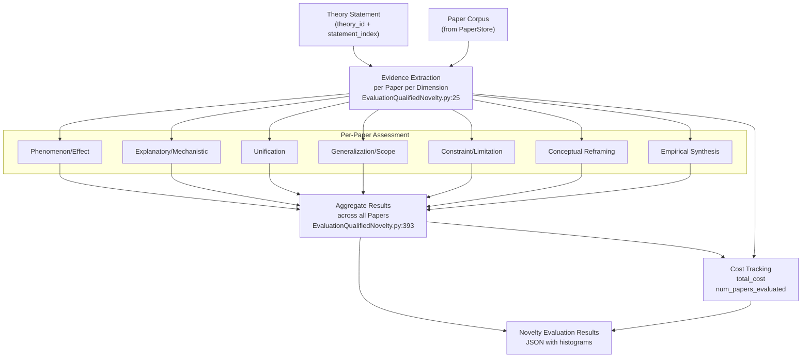
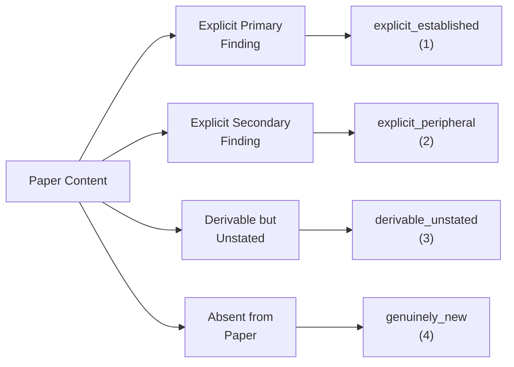
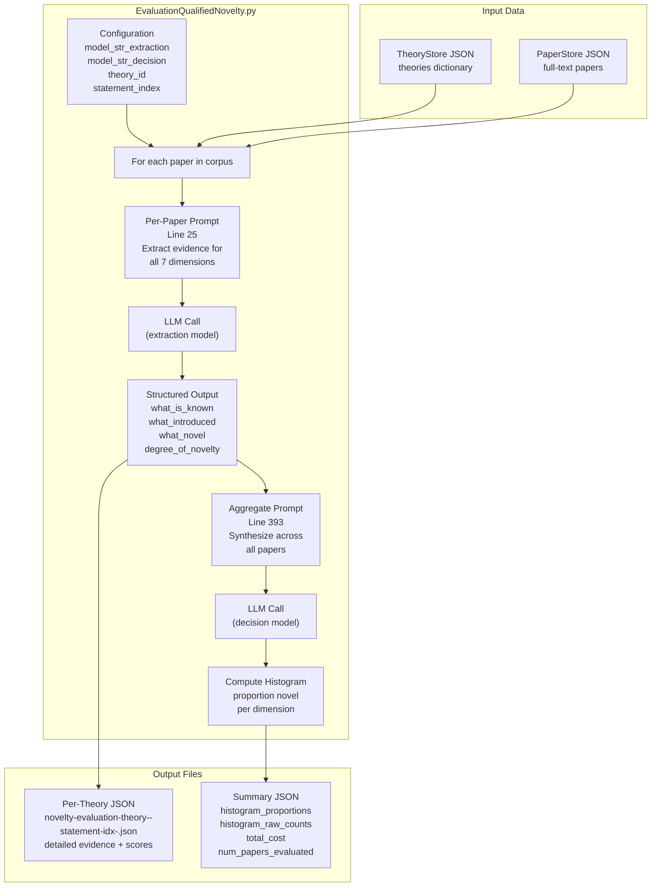

<!-- source: DeepWiki mcp.deepwiki.com · repo allenai/asta-theorizer · page 4.3 Qualified Novelty Evaluation · fetched 2026-10-26 -->

# Qualified Novelty Evaluation

<details>
<summary>Relevant source files</summary>

The following files were used as context for generating this wiki page:

- [README.md](README.md)
- [example-theories/toy-data/evaluations/qualified-novelty-evaluations/literature-supported/novelty-evaluation-theory-theory-1-statement-idx-1-20260114-190622.json](example-theories/toy-data/evaluations/qualified-novelty-evaluations/literature-supported/novelty-evaluation-theory-theory-1-statement-idx-1-20260114-190622.json)
- [example-theories/toy-data/evaluations/qualified-novelty-evaluations/literature-supported/novelty-evaluation-theory-theory-3-statement-idx-0-20260114-190622.json](example-theories/toy-data/evaluations/qualified-novelty-evaluations/literature-supported/novelty-evaluation-theory-theory-3-statement-idx-0-20260114-190622.json)
- [example-theories/toy-data/evaluations/qualified-novelty-evaluations/literature-supported/novelty-evaluation-theory-theory-5-statement-idx-0-20260114-190622.json](example-theories/toy-data/evaluations/qualified-novelty-evaluations/literature-supported/novelty-evaluation-theory-theory-5-statement-idx-0-20260114-190622.json)
- [example-theories/toy-data/evaluations/qualified-novelty-evaluations/literature-supported/novelty-evaluation-theory-theory-5-statement-idx-1-20260114-190622.json](example-theories/toy-data/evaluations/qualified-novelty-evaluations/literature-supported/novelty-evaluation-theory-theory-5-statement-idx-1-20260114-190622.json)
- [example-theories/toy-data/evaluations/qualified-novelty-evaluations/literature-supported/novelty-evaluation-theory-theory-7-statement-idx-0-20260114-190622.json](example-theories/toy-data/evaluations/qualified-novelty-evaluations/literature-supported/novelty-evaluation-theory-theory-7-statement-idx-0-20260114-190622.json)
- [example-theories/toy-data/evaluations/theorystore-example2-literaturesupported-qualified-novelty-evaluation.20260114-121058.json](example-theories/toy-data/evaluations/theorystore-example2-literaturesupported-qualified-novelty-evaluation.20260114-121058.json)

</details>


## Purpose and Scope

The Qualified Novelty Evaluation system assesses whether generated theories introduce genuinely novel scientific contributions relative to existing literature. Unlike the LLM-as-a-Judge evaluation ([4.1](#4.1)) which provides holistic quality scores, or Predictive Accuracy evaluation ([4.2](#4.2)) which measures future paper alignment, this system performs structured comparison against a corpus of related papers to categorize the type and degree of scientific novelty across seven distinct dimensions of theoretical contribution.

The evaluation produces both per-theory-statement assessments (comparing each theory law against all papers) and aggregate statistics quantifying what proportion of theories exhibit novel phenomena, explanations, unifications, generalizations, constraints, reframings, or empirical syntheses.

Sources: [README.md:368-456](), [example-theories/toy-data/evaluations/theorystore-example2-literaturesupported-qualified-novelty-evaluation.20260114-121058.json:1-76]()

---

## Evaluation Methodology Overview

The qualified novelty evaluation operates by comparing each theory statement against a corpus of related papers using a two-stage LLM-based assessment process. The system retrieves papers relevant to the theory domain, extracts evidence for each novelty dimension, and assigns a 4-point novelty rating ranging from "explicit_established" (already documented in literature) to "genuinely_new" (not previously reported).



Sources: [src/EvaluationQualifiedNovelty.py:25](), [src/EvaluationQualifiedNovelty.py:393](), [example-theories/toy-data/evaluations/qualified-novelty-evaluations/literature-supported/novelty-evaluation-theory-theory-1-statement-idx-1-20260114-190622.json:1-20]()

---

## Seven Dimensions of Scientific Novelty

The evaluation framework categorizes scientific contributions across seven orthogonal dimensions, each representing a distinct type of theoretical advance:

| Dimension | Description | Example Contribution |
|-----------|-------------|---------------------|
| `phenomenon_effect` | Discovery or documentation of new empirical regularities, behavioral patterns, or observable effects | Identifying that structured memory improves agent performance in text games |
| `explanatory_mechanistic` | Providing causal mechanisms or explanations for why phenomena occur | Explaining how graph structure enables multi-hop reasoning that improves action selection |
| `unification` | Integrating previously disparate phenomena, theories, or findings under a common framework | Showing that knowledge graphs, diff histories, and reflection all instantiate a common "structured memory" principle |
| `generalization_scope_expansion` | Extending existing findings to new domains, tasks, scales, or conditions | Demonstrating that memory benefits observed in TextWorld also apply to NetHack and real-world tasks |
| `constraint_limitation` | Identifying boundary conditions, failure modes, or limits of applicability | Documenting that memory structure matters less in trivial tasks or when observations fit in context |
| `conceptual_reframing_abstraction` | Introducing new conceptual frameworks, abstractions, or ways of thinking about problems | Reframing memory not as storage volume but as information-theoretic compression and retrieval quality |
| `empirical_synthesis_meta_regulariry` | Synthesizing patterns across multiple studies to identify meta-level regularities | Aggregating evidence that episodic+structured hybrid memory consistently outperforms single-modality memory |

Each dimension is assessed independently for every theory statement against every paper in the evaluation corpus.

Sources: [example-theories/toy-data/evaluations/qualified-novelty-evaluations/literature-supported/novelty-evaluation-theory-theory-1-statement-idx-1-20260114-190622.json:20-241]()

---

## Four-Point Novelty Scale

For each novelty dimension, the system assigns one of four degrees of novelty based on how the theory statement relates to the existing paper:

| Degree | Numeric Value | Definition | Interpretation |
|--------|--------------|------------|----------------|
| `explicit_established` | 1 | The phenomenon/explanation/finding is explicitly stated, demonstrated, and established as a primary contribution of the paper | Theory recapitulates known results |
| `explicit_peripheral` | 2 | The phenomenon/explanation is present and documented in the paper but as a secondary or supporting finding rather than the main contribution | Theory elevates a peripheral finding |
| `derivable_unstated` | 3 | The phenomenon is consistent with and derivable from the paper's results but not explicitly stated or tested as a distinct claim | Theory makes implicit patterns explicit |
| `genuinely_new` | 4 | The phenomenon/explanation is not present, measured, or demonstrated in the paper | Theory introduces new claims |



A theory statement is considered **novel** on a dimension if the majority of evaluated papers assign it scores of 3 or 4, indicating the contribution is not explicitly established in the existing literature.

Sources: [example-theories/toy-data/evaluations/qualified-novelty-evaluations/literature-supported/novelty-evaluation-theory-theory-1-statement-idx-1-20260114-190622.json:24-241]()

---

## Evaluation Workflow and Data Flow

The qualified novelty evaluation operates independently from theory generation, reading from persisted stores:



The evaluation performs approximately 23 × 7 = 161 LLM assessments per theory statement (one per paper per dimension), followed by one aggregation call per dimension.

Sources: [src/EvaluationQualifiedNovelty.py:25](), [src/EvaluationQualifiedNovelty.py:393](), [example-theories/toy-data/evaluations/theorystore-example2-literaturesupported-qualified-novelty-evaluation.20260114-121058.json:1-76]()

---

## Output Format: Per-Theory Evaluation Files

Each theory statement produces a detailed JSON evaluation file containing evidence from all papers:

```json
{
  "model_str_extraction": "gpt-5-mini",
  "model_str_decision": "claude-sonnet-4-5-20250929",
  "theory_id": "theory-1",
  "statement_index": 1,
  "total_cost": 1.1185466999999998,
  "num_papers_evaluated": 23,
  "theory_query": "Build a theory of...",
  "theory_statement_law": {
    "theory_name": "...",
    "theory_statement": "...",
    "domain_scope": "...",
    "special_cases": [...]
  },
  "evidence_for_dimension": {
    "phenomenon_effect": [
      {
        "paper_title": "Paper Title",
        "dimension_evaluation": {
          "what_is_known": "What the paper establishes...",
          "what_introduced": "What the theory claims...",
          "what_novel": "Assessment of novelty...",
          "degree_of_novelty": "explicit_established"
        },
        "numeric_degree_of_novelty": 1
      },
      // ... one entry per paper
    ],
    "explanatory_mechanistic": [...],
    "unification": [...],
    // ... one array per dimension
  }
}
```

The `evidence_for_dimension` object contains arrays for all seven dimensions, with one entry per paper containing detailed reasoning for why that novelty rating was assigned.

Sources: [example-theories/toy-data/evaluations/qualified-novelty-evaluations/literature-supported/novelty-evaluation-theory-theory-1-statement-idx-1-20260114-190622.json:1-50]()

---

## Output Format: Aggregate Evaluation Summary

After evaluating all theories, the system produces an aggregate summary with histogram statistics:

```json
{
  "filename_theorystore": "theorystore-example.json",
  "filename_paperstore": "paperstore-example.json",
  "model_str_extraction": "gpt-5-mini",
  "model_str_decision": "claude-sonnet-4-5-20250929",
  "path_out_literature_supported": "qualified-novelty-evaluations/literature-supported/",
  "histogram_literature_supported": {
    "path_in": "qualified-novelty-evaluations/literature-supported/",
    "histogram_proportions": {
      "phenomenon_effect": {
        "not_novel": 1.0,
        "novel": 0.0
      },
      "explanatory_mechanistic": {
        "not_novel": 0.2,
        "novel": 0.8
      },
      "unification": {
        "not_novel": 0.4,
        "novel": 0.6
      },
      // ... for all 7 dimensions
    },
    "histogram_raw_counts": {
      "phenomenon_effect": {
        "not_novel": 4,
        "novel": 0
      },
      // ... raw counts
    },
    "total_cost_all_evaluations": 5.84496665,
    "num_evaluations": 5,
    "average_cost_per_evaluation": 1.16899333,
    "average_papers_per_evaluation": 23.0,
    "stddev_papers_per_evaluation": 0.0,
    "total_papers_evaluated": 115.0
  }
}
```

The `histogram_proportions` shows what fraction of evaluated theories exhibited novelty on each dimension. In the example above, 80% of theories showed novel explanatory/mechanistic contributions, while 0% showed novel phenomenon/effect discoveries (all effects were already documented in literature).

Sources: [example-theories/toy-data/evaluations/theorystore-example2-literaturesupported-qualified-novelty-evaluation.20260114-121058.json:1-76](), [README.md:368-456]()

---

## Interpreting Novelty Results

The novelty evaluation reveals both the **type** and **degree** of theoretical contribution:

### Type of Contribution (Dimension Profile)

A theory's novelty profile across dimensions indicates what kind of scientific advance it represents:

- **Empirical Discovery**: High novelty on `phenomenon_effect` indicates reporting new behavioral patterns
- **Theoretical Explanation**: High novelty on `explanatory_mechanistic` indicates new causal accounts
- **Integration/Synthesis**: High novelty on `unification` or `empirical_synthesis_meta_regulariry` indicates cross-study synthesis
- **Boundary Definition**: High novelty on `constraint_limitation` indicates identifying when findings don't apply
- **Paradigm Shift**: High novelty on `conceptual_reframing_abstraction` indicates new ways of thinking

### Degree of Contribution (Aggregate Scores)

The distribution of novelty scores indicates originality:

| Score Pattern | Interpretation |
|--------------|----------------|
| Most papers score 1-2 | Theory largely recapitulates established findings; low novelty |
| Most papers score 2-3 | Theory makes explicit what was implicit; moderate novelty |
| Most papers score 3-4 | Theory introduces claims not tested in prior work; high novelty |
| Mixed scores across dimensions | Theory is novel in some ways (e.g., explanations) but not others (e.g., phenomena) |

Example from the toy data: theories scored `novel=0.0` on `phenomenon_effect` (all reported effects were already documented) but `novel=0.8` on `explanatory_mechanistic` (most causal explanations were new), indicating the theories provide **novel explanations for known phenomena** rather than discovering new phenomena.

Sources: [example-theories/toy-data/evaluations/theorystore-example2-literaturesupported-qualified-novelty-evaluation.20260114-121058.json:6-76](), [README.md:376-456]()

---

## Running the Evaluation

The qualified novelty evaluation is implemented in `src/EvaluationQualifiedNovelty.py` and operates independently of theory generation:

**Prerequisites:**
- A populated `TheoryStore` JSON file containing theories to evaluate
- A populated `PaperStore` JSON file containing full-text papers for comparison
- API keys configured for the extraction and decision models

**Configuration:**
```python
# Key configuration parameters in EvaluationQualifiedNovelty.py
model_str_extraction = "gpt-5-mini"  # Inexpensive model for per-paper evidence
model_str_decision = "claude-sonnet-4-5-20250929"  # Powerful model for aggregation
theory_id = "theory-1"  # Which theory to evaluate
statement_index = 0  # Which statement within that theory
num_papers = 23  # Number of papers to compare against
```

**Execution:**
```bash
python src/EvaluationQualifiedNovelty.py
```

**Cost Considerations:**
- Approximately 23 papers × 7 dimensions = 161 LLM calls per theory statement
- Example average cost: $1.17 per theory statement (using gpt-5-mini + claude-sonnet-4-5)
- Total cost scales linearly with number of theories and papers

**Output Location:**
- Per-theory files: `qualified-novelty-evaluations/literature-supported/novelty-evaluation-theory-<id>-statement-idx-<n>-<timestamp>.json`
- Aggregate summary: `theorystore-<name>-qualified-novelty-evaluation.<timestamp>.json`

Sources: [src/EvaluationQualifiedNovelty.py:25](), [src/EvaluationQualifiedNovelty.py:393](), [README.md:370-456]()

---

## Example Evaluation Output

From the toy dataset, here is an example of how the system evaluates a theory statement about memory augmentation for LLM agents:

**Theory Statement:**
> "Memory Structure, Selectivity, and Retrieval are as Critical as Memory Size or Modality"

**Sample Per-Paper Assessment for `phenomenon_effect` dimension:**

Paper: "AriGraph: Learning Knowledge Graph World Models with Episodic Memory for LLM Agents"
- **what_is_known**: Paper demonstrates that hybrid semantic+episodic graph memory (AriGraph) outperforms unstructured baselines
- **what_introduced**: Theory claims structure/selectivity matter more than volume/modality
- **what_novel**: Core phenomenon is explicitly established in paper
- **degree_of_novelty**: `explicit_established` (score: 1)

Paper: "Language Models are Few-Shot Butlers"
- **what_is_known**: Paper shows fine-tuning with demonstrations improves ALFWorld performance using sliding context window
- **what_introduced**: Theory claims structured/selective memory trumps naive concatenation
- **what_novel**: Paper doesn't test structured retrieval vs. concatenation
- **degree_of_novelty**: `genuinely_new` (score: 4)

**Aggregate Result Across 23 Papers:**
- `phenomenon_effect`: 100% not novel (all papers documented the core behavioral pattern)
- `explanatory_mechanistic`: 80% novel (most papers didn't explain *why* structure matters)
- `unification`: 60% novel (synthesis across memory types is new)

This indicates the theory provides a **novel unifying explanation and mechanistic account** for **already-documented empirical phenomena**.

Sources: [example-theories/toy-data/evaluations/qualified-novelty-evaluations/literature-supported/novelty-evaluation-theory-theory-1-statement-idx-1-20260114-190622.json:20-241](), [README.md:376-456]()

---

