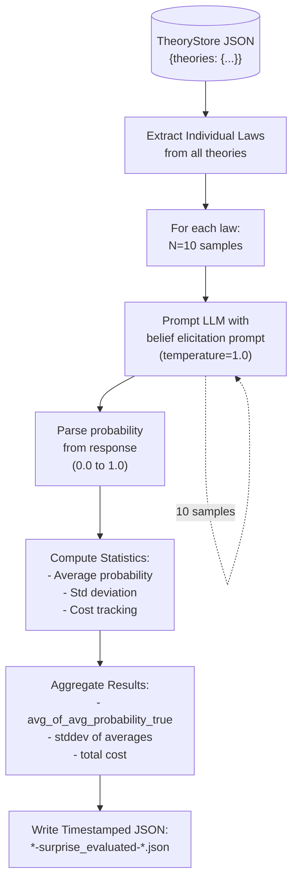
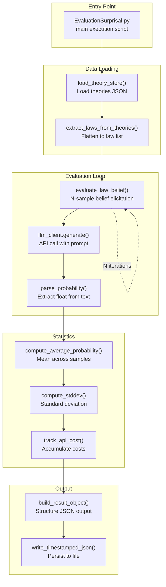
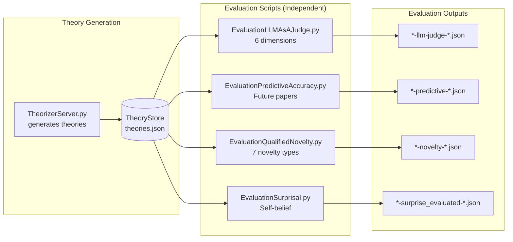

<!-- source: DeepWiki mcp.deepwiki.com · repo allenai/asta-theorizer · page 4.4 Self-assessed Belief and Surprisal Evaluation · fetched 2026-10-26 -->

# Self-assessed Belief and Surprisal Evaluation

<details>
<summary>Relevant source files</summary>

The following files were used as context for generating this wiki page:

- [README.md](README.md)
- [example-theories/toy-data/evaluations/theorystore-example-single-laws.surprise_evaluated.20260114-104415.json](example-theories/toy-data/evaluations/theorystore-example-single-laws.surprise_evaluated.20260114-104415.json)

</details>


## Purpose and Scope

This page documents the self-assessed belief and surprisal evaluation methodology, one of four independent evaluation systems in Theorizer. This evaluation measures the generating LLM's own probabilistic confidence in the truth of theory laws through repeated belief elicitation, computing average belief scores and Bayesian surprise metrics.

For the other evaluation methodologies, see [LLM-as-a-Judge Evaluation](#4.1), [Predictive Accuracy Evaluation](#4.2), and [Qualified Novelty Evaluation](#4.3). For information about the overall evaluation pipeline architecture, see [Evaluation Systems](#4).

---

## Conceptual Overview

Self-assessed belief evaluation elicits probabilistic confidence from the same LLM that generated the theories, asking "how likely is this law to be true?" This provides an introspective measure of theory quality based on the model's own uncertainty estimates.

**Key Concepts:**

| Concept | Definition |
|---------|-----------|
| **Belief Elicitation** | Prompting the LLM to provide probability estimates (0.0-1.0) for each theory law's truth |
| **Sampling Strategy** | Multiple samples per law (typically 10) with temperature=1.0 to capture uncertainty |
| **Bayesian Surprise** | Computed from the distribution of belief samples, measuring how unexpected the theory is |
| **Self-Assessment** | The LLM evaluates its own generated outputs, revealing internal confidence |

The evaluation produces two primary metrics:
1. **Average Belief**: Mean probability across samples that the LLM believes the law is true (typical range: 0.65-0.90)
2. **Belief Standard Deviation**: Variance across samples, indicating consistency of belief (typical: 0.04-0.06)

Sources: [README.md:457-476](), [example-theories/toy-data/evaluations/theorystore-example-single-laws.surprise_evaluated.20260114-104415.json:1-10]()

---

## Evaluation Workflow



**Workflow Steps:**

1. **Load TheoryStore**: Read theories from JSON file containing generated theories with their laws
2. **Extract Laws**: Flatten theory structure to individual law statements with associated theory context
3. **Sample Loop**: For each law, perform N samples (default: 10) with temperature=1.0
4. **Belief Elicitation**: Prompt LLM with law text and ask for probability estimate
5. **Response Parsing**: Extract numerical probability from LLM response text
6. **Per-Law Statistics**: Compute mean and variance across samples for each law
7. **Aggregate Statistics**: Compute overall metrics across all laws
8. **Persist Results**: Write timestamped JSON with full sample data and aggregated metrics

Sources: [README.md:457-476](), [src/EvaluationSurprisal.py:25]()

---

## Implementation Architecture



**Key Components:**

| Component | Function | Location Hint |
|-----------|----------|---------------|
| **Main Evaluation Loop** | Iterates through all laws and orchestrates sampling | `EvaluationSurprisal.py` main execution |
| **Belief Elicitation Prompt** | Template asking LLM to assess probability | `EvaluationSurprisal.py:25` |
| **LLM Client** | API wrapper for model inference calls | Shared with other evaluation modules |
| **Probability Parser** | Extracts numerical value from text response | Regex/parsing logic in evaluation script |
| **Cost Tracking** | Accumulates API costs across all samples | Uses LLM client cost reporting |
| **Result Builder** | Constructs output JSON with metadata | Includes model_str, timestamps, costs |

Sources: [src/EvaluationSurprisal.py:25](), [README.md:539-541]()

---

## Prompt Design and Belief Elicitation

The belief elicitation prompt is structured to obtain calibrated probability estimates from the LLM. The prompt presents:

1. **Theory Context**: Full theory name and description for grounding
2. **Law Statement**: The specific law being evaluated
3. **Domain Scope**: Applicability conditions and constraints
4. **Special Cases**: Edge cases and exceptions
5. **Probability Request**: Explicit instruction to provide a numerical probability

**Example Prompt Structure** (inferred from output data):

```
Given the following theory and law:

Theory: [theory_name]
Description: [theory_description]

Law: [law.statement_name]
Statement: [law.theory_statement]

Domain Scope: [law.domain_scope]

Special Cases:
[list of special cases]

Based on your knowledge and reasoning, what is the probability (between 0.0 and 1.0) 
that this law is true within its stated domain scope?

Provide only a numerical probability value.
```

**Sampling Parameters:**

| Parameter | Value | Rationale |
|-----------|-------|-----------|
| `temperature` | 1.0 | Enables sampling variation to capture uncertainty |
| `num_samples` | 10 | Balance between statistical power and API costs |
| `max_tokens` | 2048 | Sufficient for explanation + probability |
| `model` | Same as generation model | Self-assessment requires same model |

**Typical Belief Distributions:**

The example evaluation shows belief probabilities concentrated around 0.70-0.90:
- Mean of averages: **0.809**
- Standard deviation of averages: **0.045**
- Individual law averages range from **0.65 to 0.875**

This distribution suggests the generating model has moderate-to-high confidence in its generated theories, with some variation indicating differentiated self-assessment across laws.

Sources: [src/EvaluationSurprisal.py:25](), [example-theories/toy-data/evaluations/theorystore-example-single-laws.surprise_evaluated.20260114-104415.json:3-10]()

---

## Output Format and Data Structures

### JSON Output Structure

```json
{
  "model_str": "gpt-4.1-2025-04-14",
  "total_laws_scored": 45,
  "avg_of_avg_probability_true": 0.809,
  "average_results": [0.83, 0.815, 0.84, ...],
  "raw_results": [
    {
      "average_probability_true": 0.83,
      "probabilities": [0.9, 0.8, 0.85, 0.85, 0.8, 0.8, 0.85, 0.8, 0.85, 0.8],
      "num_samples_requested": 10,
      "model_str": "gpt-4.1-2025-04-14",
      "temperature": 1.0,
      "total_cost": 0.029572,
      "max_tokens": 2048,
      "law": {
        "theory_name": "...",
        "theory_description": "...",
        "law": {
          "statement_name": "...",
          "theory_statement": "...",
          "domain_scope": "...",
          "special_cases": [...]
        }
      }
    },
    ...
  ]
}
```

### Field Descriptions

| Field Path | Type | Description |
|------------|------|-------------|
| `model_str` | string | Model identifier used for evaluation |
| `total_laws_scored` | integer | Count of laws evaluated |
| `avg_of_avg_probability_true` | float | Grand mean across all law averages |
| `average_results[]` | float[] | Per-law average probabilities (length = total_laws_scored) |
| `raw_results[]` | object[] | Detailed per-law evaluation objects |
| `raw_results[].average_probability_true` | float | Mean probability for this law across N samples |
| `raw_results[].probabilities[]` | float[] | Individual sample probabilities (length = num_samples_requested) |
| `raw_results[].total_cost` | float | API cost for this law's evaluation (USD) |
| `raw_results[].law` | object | Full law object with theory context |
| `raw_results[].law.theory_name` | string | Name of parent theory |
| `raw_results[].law.theory_statement` | string | The actual law statement text |
| `raw_results[].law.domain_scope` | string | Applicability conditions |
| `raw_results[].law.special_cases[]` | string[] | Edge cases and exceptions |

### File Naming Convention

Output files follow this pattern:
```
[theorystore-basename]-surprise_evaluated-[timestamp].json
```

Example: `theorystore-example-single-laws.surprise_evaluated.20260114-104415.json`

This timestamped naming enables:
- Multiple evaluation runs on the same theory set
- Model comparison studies (different models on same theories)
- Longitudinal analysis of evaluation stability

Sources: [example-theories/toy-data/evaluations/theorystore-example-single-laws.surprise_evaluated.20260114-104415.json:1-1627]()

---

## Integration with Evaluation Pipeline



**Pipeline Characteristics:**

1. **Post-hoc Independence**: Surprisal evaluation runs after theory generation is complete, reading from TheoryStore JSON
2. **Standalone Execution**: Can be run independently without other evaluation scripts
3. **No External Data**: Unlike predictive accuracy (requires future papers) or qualified novelty (requires literature comparison), surprisal evaluation only needs the theories themselves
4. **Model Requirement**: Must use the same model that generated the theories for meaningful self-assessment
5. **Repeatable**: Can be re-run multiple times to assess evaluation stability across sampling

**Typical Usage Pattern:**

```bash
# After theories are generated and exported
python src/EvaluationSurprisal.py \
  --theory_store path/to/theorystore.json \
  --model gpt-4.1-2025-04-14 \
  --num_samples 10 \
  --output_dir evaluations/
```

Sources: [README.md:457-476]()

---

## Statistical Interpretation

### Belief Score Ranges

The evaluation produces belief probabilities that can be interpreted as:

| Average Probability Range | Interpretation |
|---------------------------|----------------|
| **0.85 - 1.0** | Very high confidence; model strongly believes law is true |
| **0.75 - 0.85** | High confidence; typical for well-supported theories |
| **0.65 - 0.75** | Moderate confidence; some uncertainty present |
| **0.50 - 0.65** | Low confidence; law may be speculative or uncertain |
| **< 0.50** | Very low confidence; law likely contradicts model's knowledge |

### Standard Deviation Analysis

The standard deviation across samples indicates sampling consistency:

| Std Dev Range | Interpretation |
|---------------|----------------|
| **< 0.03** | Very consistent beliefs across samples |
| **0.03 - 0.06** | Normal variation, typical range |
| **0.06 - 0.10** | Higher uncertainty, belief is less stable |
| **> 0.10** | High uncertainty, conflicting evidence or unclear law |

### Observed Patterns from Example Data

From the toy dataset evaluation (`theorystore-example-single-laws.surprise_evaluated.20260114-104415.json`):

- **Mean belief**: 0.809 (high overall confidence)
- **Belief range**: 0.65 to 0.875 (45 laws)
- **Most common range**: 0.80 to 0.85 (31 of 45 laws)
- **Low confidence laws**: 3 laws below 0.70 (arithmetic theories about transformers)
- **Highest confidence**: 0.875 (spatial memory and planning laws)

**Interpretation**: The generating model has generally high confidence in memory-architecture theories for text game agents (0.80-0.85 range) but lower confidence in mechanistic theories about transformer arithmetic (0.65-0.72 range), suggesting these domains differ in how well-established the theoretical understanding is.

Sources: [example-theories/toy-data/evaluations/theorystore-example-single-laws.surprise_evaluated.20260114-104415.json:1-1627]()

---

## Cost Considerations

Belief elicitation evaluation incurs API costs based on:

**Cost Factors:**

| Factor | Impact | Typical Values |
|--------|--------|----------------|
| Number of laws | Linear multiplier | 45 laws in example |
| Samples per law | Linear multiplier per law | 10 samples (default) |
| Model pricing | Cost per API call | Varies by provider/model |
| Input tokens | Law + theory context | ~500-1000 tokens per call |
| Output tokens | Probability + explanation | ~50-200 tokens per call |

**Example Costs (from toy dataset):**
- Total laws: 45
- Total samples: 450 (45 × 10)
- Per-law cost range: $0.023 - $0.036
- Total evaluation cost: ~$1.40 for 45 laws

**Cost Optimization Strategies:**

1. **Reduce samples**: Use 5 samples instead of 10 for preliminary runs (50% cost reduction)
2. **Batch processing**: Evaluate multiple laws in single prompt (if model supports)
3. **Selective evaluation**: Evaluate only key laws rather than all laws
4. **Cheaper models**: Use less expensive models for initial assessment (but note: requires same model for true self-assessment)

Sources: [example-theories/toy-data/evaluations/theorystore-example-single-laws.surprise_evaluated.20260114-104415.json:70-82]()

---

## Limitations and Considerations

### Methodological Limitations

1. **Self-Assessment Bias**: Model confidence may not correlate with actual accuracy; overconfident models produce high belief scores for incorrect theories
2. **Calibration Issues**: LLMs are known to be poorly calibrated in probability estimation, so absolute values should be interpreted cautiously
3. **Temperature Effects**: Using temperature=1.0 for sampling introduces variation, but this variation may not represent true epistemic uncertainty
4. **Context Length**: Laws with very long context (theory + law + scope + special cases) may affect model reasoning
5. **Prompt Sensitivity**: Belief scores can be sensitive to exact prompt wording and structure

### Comparative Considerations

Unlike other evaluation methods:

| Evaluation Type | Data Source | What it Measures |
|-----------------|-------------|------------------|
| **Surprisal** | Model's own beliefs | Internal confidence, consistency |
| **LLM-as-a-Judge** | External judge model | Perceived quality across 6 dimensions |
| **Predictive Accuracy** | Future papers | Empirical validation against reality |
| **Qualified Novelty** | Literature comparison | Novelty relative to existing work |

**Key Insight**: High self-assessed belief (0.85+) combined with low predictive accuracy (<0.50) indicates overconfident but empirically wrong theories. Conversely, moderate belief (0.70) with high predictive accuracy (0.90) indicates conservative but correct theories.

### Best Practices

1. **Cross-Validate**: Compare belief scores with other evaluation metrics to identify overconfidence
2. **Examine Outliers**: Laws with very high (>0.90) or low (<0.65) belief merit manual inspection
3. **Analyze Variance**: High standard deviation (>0.10) indicates unstable beliefs worth investigating
4. **Model Consistency**: Always use the same model that generated the theories; cross-model assessment requires different interpretation
5. **Multiple Runs**: Consider running evaluation 2-3 times to assess stability of belief estimates

Sources: [README.md:457-476](), [example-theories/toy-data/evaluations/theorystore-example-single-laws.surprise_evaluated.20260114-104415.json:1-1627]()

---

