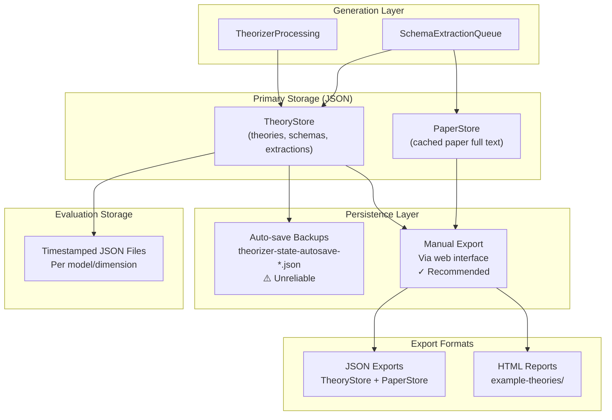
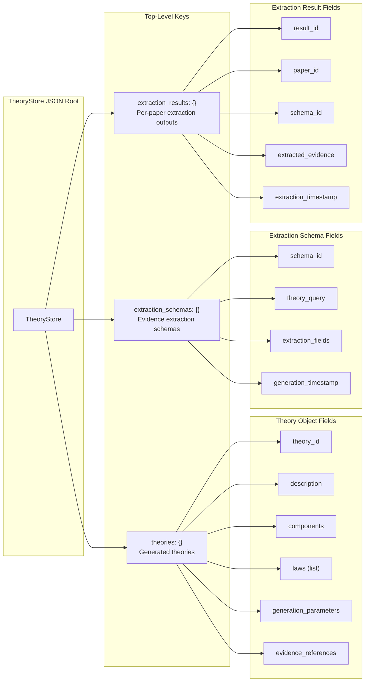
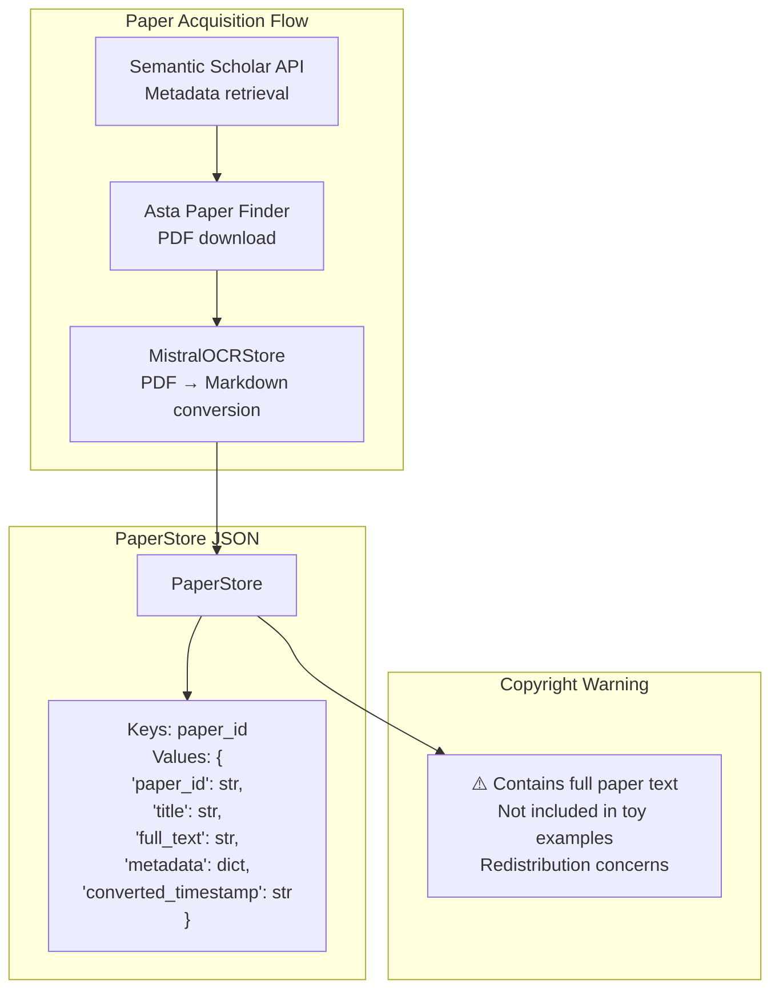
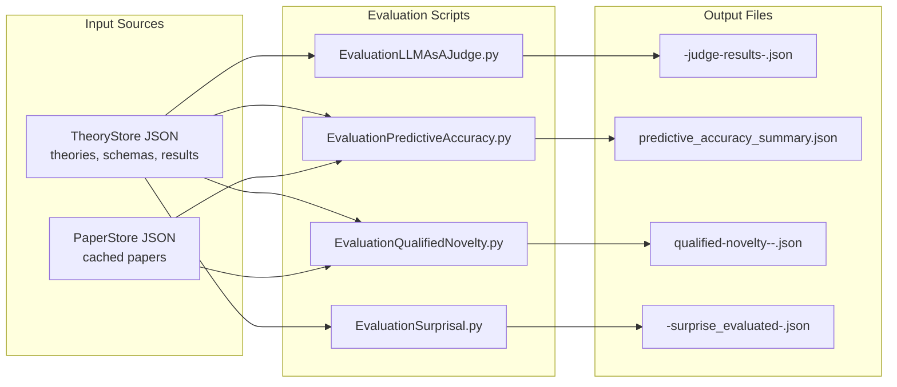
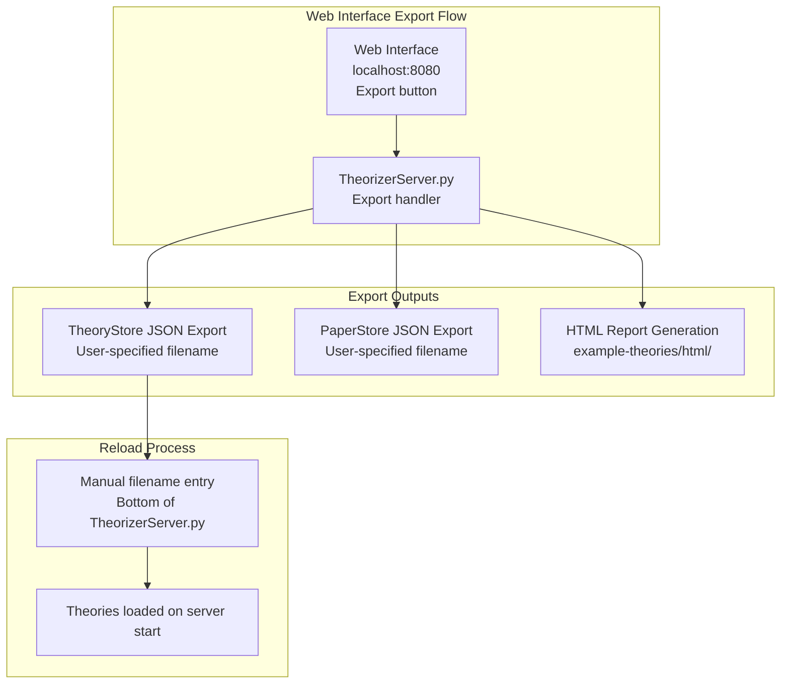
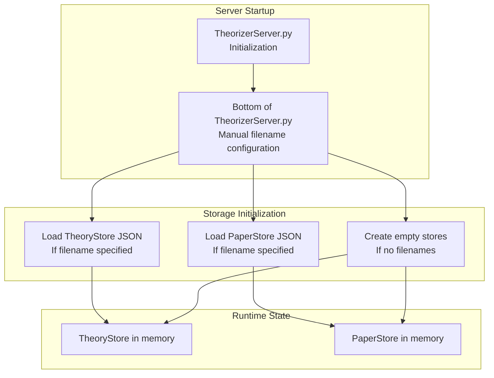
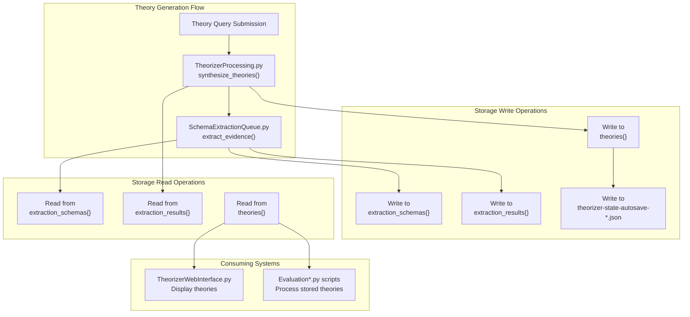

<!-- source: DeepWiki mcp.deepwiki.com · repo allenai/asta-theorizer · page 5 Data Storage and Management · fetched 2026-10-26 -->

# Data Storage and Management

<details>
<summary>Relevant source files</summary>

The following files were used as context for generating this wiki page:

- [README.md](README.md)

</details>


## Purpose and Scope

This document describes the data persistence architecture of the Theorizer system, including the JSON-based storage structures, export mechanisms, and backup strategies. It covers how theories, extraction schemas, extraction results, papers, and evaluation outputs are stored and managed throughout the system's lifecycle.

For information about how theories are generated and processed before storage, see [Theory Generation](#3). For details on evaluation workflows that consume stored data, see [Evaluation Systems](#4).

---

## Storage Architecture Overview

Theorizer implements a **dual JSON store pattern** that separates reasoning artifacts from source content. This design enables theory inspection independent of paper availability and supports incremental caching to reduce API costs.



**Sources:** [README.md:485-492](), [README.md:247-258]()

---

## TheoryStore Structure

The `TheoryStore` is the primary data structure for persisting all reasoning artifacts. It is stored as a JSON object with three top-level keys, each containing dictionaries keyed by unique identifiers.

### Schema Overview



**Sources:** [README.md:485-492]()

### Key-Value Organization

| Dictionary Key | Purpose | Referenced By |
|----------------|---------|---------------|
| `theories` | Stores generated theories with descriptions, laws, and components | Web interface theory list, evaluation scripts |
| `extraction_schemas` | Maps schema IDs to extraction templates built from theory queries | `SchemaExtractionQueue` during paper processing |
| `extraction_results` | Maps result IDs to evidence extracted from individual papers | Theory generation synthesis step, evidence viewer |

### Evidence Linking Pattern

The TheoryStore implements a **referential linking pattern** where theories reference extraction results by ID (e.g., `[e123.1]`), extraction results reference schemas by `schema_id`, and extraction results reference papers by `paper_id`. This enables full traceability from theory laws back to source papers.

**Sources:** [README.md:280-297]()

---

## PaperStore Structure

The `PaperStore` provides a persistent cache of paper full text to avoid redundant downloads and OCR conversion. It is stored as a separate JSON file from TheoryStore.

### Purpose and Copyright Considerations



### Storage Pattern

The PaperStore acts as a **write-through cache**: when a paper is requested and not present, it is downloaded, converted, and stored. Subsequent requests read from the cache without re-downloading. This pattern significantly reduces API costs for repeated experiments.

### Redistribution Limitations

The README explicitly notes that **PaperStore files are not included in toy theory datasets due to copyright concerns**. The full text of papers should not be redistributed without appropriate licensing. Evaluation result files are also sanitized to remove paper full text before distribution.

**Sources:** [README.md:491-492](), [README.md:500-501]()

---

## Evaluation Results Storage

Evaluation scripts operate independently on TheoryStore/PaperStore and persist results as timestamped JSON files. This architecture enables repeated evaluation without regenerating theories.

### File Naming Convention

```
<evaluation-type>-<model-identifier>-<timestamp>.json
```

Examples:
- `predictive-accuracy-evaluation/claude_sonnet_4_5_20250929/predictive_accuracy_summary.json`
- `theorystore-example-single-laws.surprise_evaluated.20260114-104415.json`
- `theorystore-example2-literaturesupported-qualified-novelty-evaluation.20260114-121058.json`

### Evaluation Output Locations

| Evaluation Type | Output Location | Key Files |
|-----------------|-----------------|-----------|
| LLM-as-a-Judge | Results directory with model name | Individual theory evaluations, summary statistics |
| Predictive Accuracy | `predictive-accuracy-evaluation/` subdirectory | Precision/recall metrics, per-paper scores |
| Qualified Novelty | `qualified-novelty-evaluations/` subdirectory | 7-dimension novelty assessments, histograms |
| Self-assessed Belief | Root evaluation directory | Probability samples per law, aggregate statistics |

### Data Flow for Evaluation Storage



**Sources:** [README.md:305-475]()

---

## Export and Backup Mechanisms

Theorizer provides two persistence mechanisms: **manual export (recommended)** and **auto-save (unreliable)**. The distinction is critical for data retention.

### Manual Export via Web Interface

The primary export mechanism is accessed through the **Export button** on the main menu at `localhost:8080`. This triggers export of both TheoryStore and PaperStore.



**Export includes:**
1. **TheoryStore**: All theories, extraction schemas, and extraction results
2. **PaperStore**: All cached paper full text (with copyright considerations)
3. **HTML Reports**: Human-readable HTML versions of theories

**Sources:** [README.md:247-258]()

### Auto-save Backup (Unreliable)

The system automatically saves a backup copy of **TheoryStore only** after processing each theory request. These files follow the pattern:

```
theorizer-state-autosave-*.json
```

**Critical Warnings:**
- 🚨 **Unreliable**: Manual export is strongly recommended
- **PaperStore not included**: Only TheoryStore is auto-saved
- **Overwrite behavior**: Auto-saves may overwrite previous backups
- **Restart behavior**: Theories disappear after restart unless manually exported

The README explicitly states: "you should not rely on this to save the theories, and should manually export the theories using the Export functionality when you wish to save them."

**Sources:** [README.md:247-258]()

### Export Data Persistence Pattern

| Export Method | TheoryStore | PaperStore | Reliability | Use Case |
|---------------|-------------|------------|-------------|----------|
| Manual Export | ✓ | ✓ | High | Long-term storage, data distribution |
| Auto-save | ✓ | ✗ | Low | Emergency recovery only |
| HTML Generation | ✓ (formatted) | ✗ | High | Human-readable inspection |

---

## Data Loading and Initialization

On server startup, TheoryStore and PaperStore must be explicitly loaded. The loading mechanism is configured in `TheorizerServer.py`.

### Loading Configuration



**To reload exported theories:**
1. Export theories using the web interface Export button
2. Manually edit `TheorizerServer.py` at the bottom to specify the exported filename
3. Restart `TheorizerServer.py`

**Sources:** [README.md:256-258]()

---

## Example Theory Dataset Structure

The system includes example theories demonstrating all four generation conditions (literature/parametric × accuracy/novelty).

### Dataset Organization

```
example-theories/
├── toy-data/                          # Small format examples
│   ├── html/
│   │   └── index.html                 # Human-readable theories
│   ├── theorystore-example.json       # TheoryStore (literature-supported)
│   └── theorystore-example2.json      # TheoryStore (parametric)
│
└── theorizer-paper-data/              # Full paper dataset (148MB)
    ├── theories-all-conditions/
    ├── evaluations/
    └── README.md
```

### HTML Export Format

The HTML export provides a navigable interface for inspecting:
- Theory descriptions and laws
- Extraction schemas linked from theories
- Evidence extracted from papers
- Generation parameters and timestamps

The toy dataset HTML is accessible at: `example-theories/toy-data/html/index.html`

**Sources:** [README.md:495-507]()

---

## Storage File Paths and Code Entities

### Key File Path References

| Storage Component | Primary Code Location | Description |
|-------------------|----------------------|-------------|
| TheoryStore structure | `TheorizerServer.py` (bottom) | Loading/saving configuration |
| PaperStore cache | `MistralOCRStore` module | PDF conversion caching |
| Auto-save mechanism | `TheorizerServer.py` (post-processing) | Automatic backup after theory generation |
| Manual export handler | `TheorizerWebInterface.py` (export endpoint) | Web interface export button |
| HTML generation | Export processing logic | Theories formatted as HTML |

### Storage Interaction Patterns



**Sources:** [README.md:175-189](), [README.md:247-258](), [README.md:513-541]()

---

## Summary: Storage Design Principles

The Theorizer storage architecture embodies several key design principles:

1. **Separation of Concerns**: TheoryStore (reasoning) and PaperStore (source content) are independent
2. **Incremental Caching**: Papers and extraction results are cached to reduce API costs
3. **Referential Integrity**: IDs link theories → extraction results → papers → schemas
4. **Evaluation Independence**: Post-hoc evaluation reads from stores without modification
5. **Export over Auto-save**: Manual export is the reliable persistence mechanism
6. **Copyright Awareness**: Paper full text is not redistributed in example datasets

This architecture prioritizes research flexibility (reusable cached data) and transparency (full traceability of reasoning chains) over operational simplicity.

**Sources:** [README.md:485-492](), [README.md:247-258]()

---

