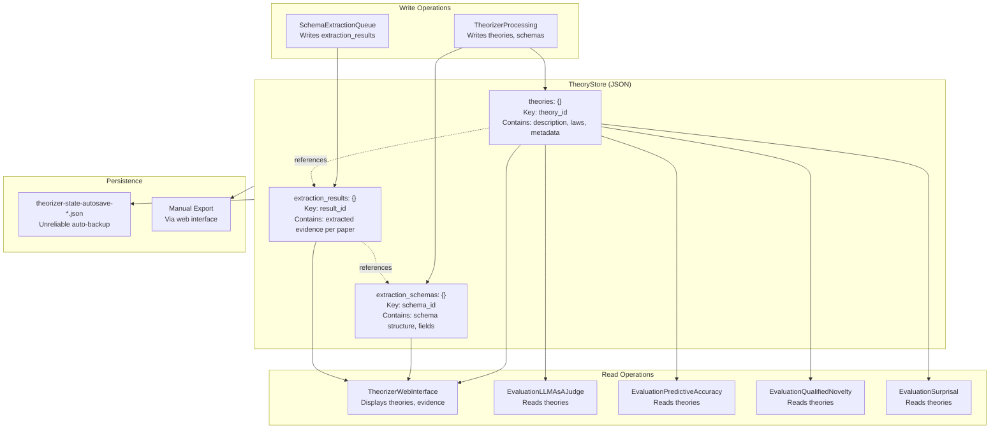
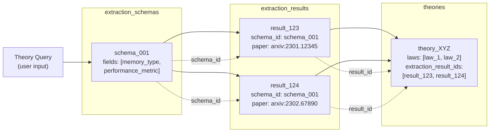
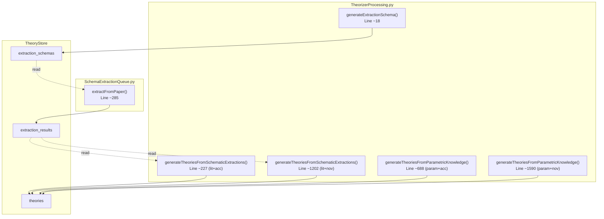
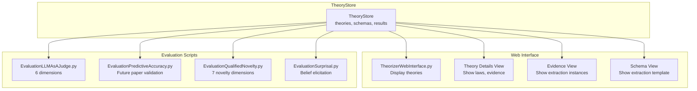
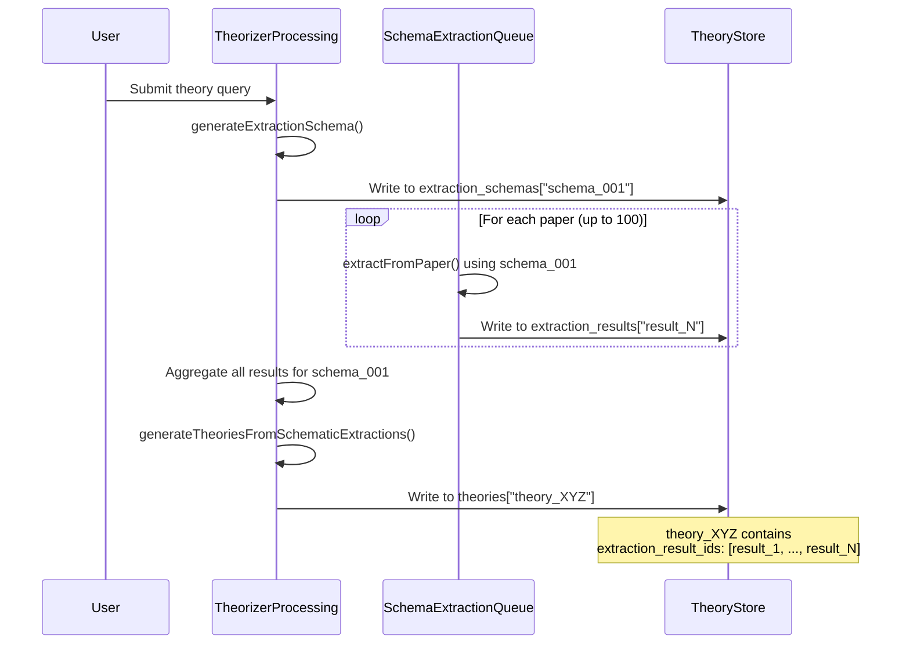

<!-- source: DeepWiki mcp.deepwiki.com · repo allenai/asta-theorizer · page 5.1 TheoryStore Structure · fetched 2026-10-26 -->

# TheoryStore Structure

<details>
<summary>Relevant source files</summary>

The following files were used as context for generating this wiki page:

- [README.md](README.md)

</details>


This document details the `TheoryStore` JSON data structure, which serves as the primary persistence layer for theories, extraction schemas, and extraction results in the Theorizer system. The TheoryStore is a top-level dictionary containing three sub-dictionaries: `theories`, `extraction_schemas`, and `extraction_results`.

For information about paper caching and full-text storage, see [PaperStore Structure](#5.2). For information about exporting and backing up TheoryStore data, see [Export and Backup](#5.3).

---

## Top-Level Structure

The TheoryStore is a JSON object with three mandatory keys at the root level:

```json
{
  "theories": {},
  "extraction_schemas": {},
  "extraction_results": {}
}
```

Each key maps to a dictionary that stores objects indexed by unique identifiers. These three dictionaries are interconnected through references, forming a complete trace from raw extraction schemas to populated extraction results to synthesized theories.

**Sources:** [README.md:485-491]()

---

## TheoryStore Architecture Overview



**Sources:** [README.md:485-491]()

---

## The `theories` Dictionary

### Structure

The `theories` dictionary maps theory IDs (string keys) to theory objects. Each theory object contains the synthesized scientific theory including its description, laws, and generation metadata.

### Theory Object Schema

| Field | Type | Description |
|-------|------|-------------|
| `theory_id` | string | Unique identifier for the theory |
| `name` | string | Human-readable theory name |
| `description` | string | High-level description of the theory |
| `components` | array | Structured components of the theory |
| `laws` | array | List of theory law objects |
| `generation_config` | object | Configuration used to generate this theory |
| `extraction_result_ids` | array | References to `extraction_results` keys (literature-supported only) |
| `timestamp` | string | Generation timestamp |

### Theory Law Schema

Each element in the `laws` array represents one theoretical statement or law:

| Field | Type | Description |
|-------|------|-------------|
| `law_id` | string | Unique identifier within the theory |
| `statement` | string | The law/claim as natural language |
| `evidence` | array | Supporting evidence references |
| `type` | string | Classification (e.g., "qualitative", "quantitative") |

### Example Theory Object

```json
{
  "theory_XYZ": {
    "theory_id": "theory_XYZ",
    "name": "Memory Architecture Scaling",
    "description": "Theory about memory augmentation in LLM agents",
    "components": ["working memory", "episodic memory", "semantic memory"],
    "laws": [
      {
        "law_id": "law_1",
        "statement": "Hierarchical memory structures improve agent performance",
        "evidence": ["e123.1", "e124.3"],
        "type": "qualitative"
      }
    ],
    "generation_config": {
      "input_type": "literature_supported",
      "objective": "accuracy_focused",
      "model": "gpt-4.1-2025-04-14"
    },
    "extraction_result_ids": ["result_123", "result_124"],
    "timestamp": "2025-01-14T10:30:00Z"
  }
}
```

**Sources:** [README.md:487](), [README.md:272-298]()

---

## The `extraction_schemas` Dictionary

### Structure

The `extraction_schemas` dictionary maps schema IDs (string keys) to schema objects. Each schema defines the structured template for extracting evidence from papers to answer a specific theory query.

### Schema Object Schema

| Field | Type | Description |
|-------|------|-------------|
| `schema_id` | string | Unique identifier for the schema |
| `theory_query` | string | Original theory query that generated this schema |
| `fields` | array | List of field definitions |
| `generation_model` | string | Model used to generate the schema |
| `timestamp` | string | Schema creation timestamp |

### Schema Field Definition

Each field in the schema specifies what type of evidence to extract:

| Field | Type | Description |
|-------|------|-------------|
| `field_name` | string | Name of the evidence field |
| `description` | string | What evidence this field should capture |
| `type` | string | Data type (e.g., "text", "numeric", "categorical") |
| `required` | boolean | Whether this field must be populated |

### Example Schema Object

```json
{
  "schema_001": {
    "schema_id": "schema_001",
    "theory_query": "build theories about memory architectures for LLM agents",
    "fields": [
      {
        "field_name": "memory_type",
        "description": "Type of memory structure used (working, episodic, semantic)",
        "type": "categorical",
        "required": true
      },
      {
        "field_name": "performance_metric",
        "description": "Quantitative performance improvement measurement",
        "type": "numeric",
        "required": false
      }
    ],
    "generation_model": "gpt-4.1-2025-04-14",
    "timestamp": "2025-01-14T10:25:00Z"
  }
}
```

**Sources:** [README.md:488](), [README.md:290-298](), [README.md:516]()

---

## The `extraction_results` Dictionary

### Structure

The `extraction_results` dictionary maps result IDs (string keys) to extraction result objects. Each result represents the evidence extracted from one paper using one schema.

### Extraction Result Object Schema

| Field | Type | Description |
|-------|------|-------------|
| `result_id` | string | Unique identifier for this extraction result |
| `schema_id` | string | Reference to the `extraction_schemas` key used |
| `paper_id` | string | Reference to paper in PaperStore |
| `paper_title` | string | Title of the source paper |
| `paper_authors` | array | List of author names |
| `paper_year` | integer | Publication year |
| `extracted_instances` | array | List of evidence instances found |
| `extraction_model` | string | Model used for extraction |
| `timestamp` | string | Extraction timestamp |

### Extracted Instance Schema

Each element in `extracted_instances` represents one piece of evidence matching the schema:

| Field | Type | Description |
|-------|------|-------------|
| `instance_id` | string | Unique identifier within this result |
| `field_values` | object | Map of field_name → extracted_value |
| `context` | string | Surrounding text context from paper |
| `confidence` | number | Extraction confidence (0-1) |

### Example Extraction Result Object

```json
{
  "result_123": {
    "result_id": "result_123",
    "schema_id": "schema_001",
    "paper_id": "arxiv:2301.12345",
    "paper_title": "Memory-Augmented LLM Agents for Text Games",
    "paper_authors": ["Smith, J.", "Doe, A."],
    "paper_year": 2023,
    "extracted_instances": [
      {
        "instance_id": "e123.1",
        "field_values": {
          "memory_type": "episodic",
          "performance_metric": 0.85
        },
        "context": "Our episodic memory module achieved 85% task completion...",
        "confidence": 0.92
      }
    ],
    "extraction_model": "gpt-5-mini",
    "timestamp": "2025-01-14T10:28:00Z"
  }
}
```

**Sources:** [README.md:489](), [README.md:282-288]()

---

## Relationships Between Dictionaries



**Key Reference Chains:**

1. **Schema → Results:** Each extraction result references its schema via `schema_id`
2. **Results → Theory:** Each theory references its evidence via `extraction_result_ids` array
3. **Evidence Citations:** Theory laws cite specific instances using notation like `[e123.1]`, where `123` is the result number and `1` is the instance within that result

**Sources:** [README.md:282-298]()

---

## Code Entities and Access Patterns

### Write Operations



**Sources:** [README.md:516-525]()

### Read Operations



**Sources:** [README.md:305-475]()

---

## Persistence and File Format

### Storage Format

The TheoryStore is serialized as a single JSON file with UTF-8 encoding. The JSON structure is human-readable with standard indentation.

### File Naming Conventions

| File Pattern | Purpose | Reliability |
|--------------|---------|-------------|
| `theorizer-state-autosave-*.json` | Automatic backup after each theory generation | Unreliable - DO NOT depend on this |
| `theorystore-<custom-name>.json` | Manual export via web interface | Recommended persistence method |
| `theorystore-example*.json` | Example datasets in repository | Reference examples only |

### Export Locations

Manual exports can be triggered via the web interface export button. The exported file contains:
- Complete `theories` dictionary
- Complete `extraction_schemas` dictionary  
- Complete `extraction_results` dictionary

**Note:** Auto-save files are unreliable. Always use manual export for persistent storage.

**Sources:** [README.md:246-258]()

---

## TheoryStore Initialization and Loading

### Default Initialization

When `TheorizerServer.py` starts, it initializes an empty TheoryStore:

```json
{
  "theories": {},
  "extraction_schemas": {},
  "extraction_results": {}
}
```

### Loading Existing TheoryStore

To reload a previously exported TheoryStore, the filename must be manually specified at the bottom of `TheorizerServer.py`. The server will then deserialize the JSON and populate all three dictionaries.

**Sources:** [README.md:256]()

---

## Key Design Decisions

### Separate Dictionaries vs. Nested Structure

The TheoryStore uses three separate top-level dictionaries rather than nesting results under schemas or theories. This design choice enables:

1. **Independent access:** Evaluation scripts can read theories without loading all extraction results
2. **Shared schemas:** Multiple theory queries can reuse the same extraction schema
3. **Incremental updates:** New extraction results can be added without modifying theory objects
4. **Traceability:** Full provenance chain from schema → results → theory

### Reference-Based Linking

Relationships between objects use string ID references rather than embedded objects. This avoids duplication and enables:

1. **Space efficiency:** Large extraction results are not duplicated across theories
2. **Update propagation:** Changes to a schema or result affect all referencing objects
3. **Flexible querying:** Can traverse relationships in any direction

### JSON vs. Database

TheoryStore uses JSON files rather than a database system. Trade-offs:

| Aspect | JSON | Database |
|--------|------|----------|
| Setup complexity | None | Requires DB installation |
| Portability | Perfect - single file | Requires export/import |
| Query performance | Load entire file | Selective queries |
| Concurrent access | File locking issues | Native support |
| Version control | Git-friendly | Requires special handling |

The JSON approach prioritizes simplicity and portability for research use cases over performance for high-throughput production scenarios.

**Sources:** [README.md:485-491]()

---

## Example: Complete Data Flow



**Sources:** [README.md:516-525]()

---

## Size and Scale Considerations

### Typical Sizes

Based on the example datasets:

| Dataset | Theories | Papers | TheoryStore Size |
|---------|----------|--------|------------------|
| Toy example | ~10 | ~50 | < 1 MB |
| Paper dataset | 2,900 | 13,700 | 148 MB (HTML export) |

### Scalability Limits

The JSON-based approach faces practical limits:

1. **Memory:** Entire TheoryStore loads into memory. 148 MB is manageable, but 1+ GB becomes problematic
2. **Parse time:** JSON deserialization scales linearly with file size
3. **Write performance:** Full TheoryStore rewrite on each auto-save

For datasets exceeding ~1 GB, consider database migration or sharded JSON files.

**Sources:** [README.md:491-507]()

---

