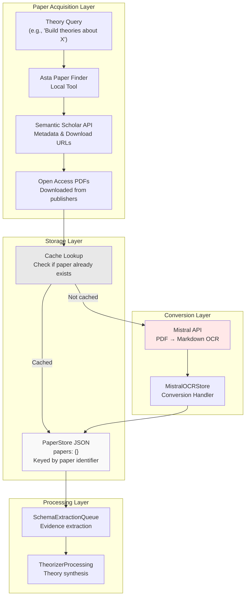
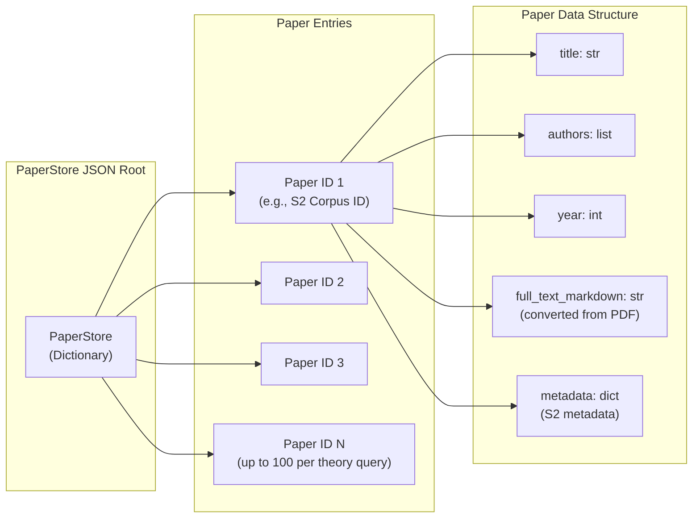
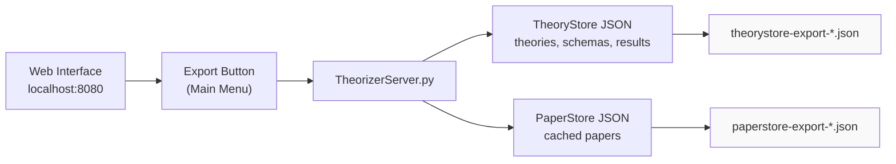
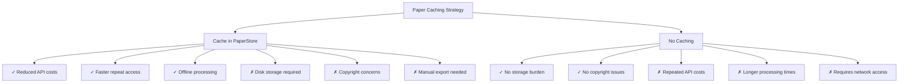

<!-- source: DeepWiki mcp.deepwiki.com · repo allenai/asta-theorizer · page 5.2 PaperStore Structure · fetched 2026-10-26 -->

# PaperStore Structure

<details>
<summary>Relevant source files</summary>

The following files were used as context for generating this wiki page:

- [README.md](README.md)

</details>


## Purpose and Scope

This document describes the **PaperStore** JSON structure used to cache full-text paper content in the Theorizer system. PaperStore serves as a persistent cache to avoid redundant downloads and OCR conversions of academic papers during theory generation.

For information about theory storage (theories, extraction schemas, and extraction results), see [TheoryStore Structure](#5.1). For information about exporting PaperStore data, see [Export and Backup](#5.3).

**Sources:** [README.md:254](), [README.md:491]()

---

## Overview

The PaperStore is a JSON-based cache that stores the complete full-text content of academic papers after they have been downloaded via Asta Paper Finder and converted from PDF to Markdown format using Mistral's OCR service. This caching strategy serves multiple purposes:

| Purpose | Description |
|---------|-------------|
| **Cost Optimization** | Avoids redundant API calls to expensive Mistral PDF→Markdown conversion service |
| **Performance** | Eliminates re-downloading papers when generating multiple theories from overlapping literature |
| **Offline Access** | Enables theory generation to proceed without re-acquiring papers once cached |
| **Reproducibility** | Preserves exact paper text used for theory generation |

**Important Copyright Consideration:** The PaperStore contains full-text copies of academic papers and raises copyright concerns. The example datasets explicitly exclude PaperStore files for this reason, and users must be mindful of redistribution restrictions.

**Sources:** [README.md:254](), [README.md:491](), [README.md:501]()

---

## Data Flow: Paper Acquisition to Caching



**Diagram: PaperStore population and cache lookup flow**

The PaperStore sits at a critical junction in the data pipeline. Papers flow through Asta and Semantic Scholar API to obtain PDFs, which then pass through a cache check. Only uncached papers incur the cost of Mistral OCR conversion. Once in PaperStore, papers are available for repeated use in evidence extraction and theory synthesis.

**Sources:** [README.md:161-165](), [README.md:254]()

---

## JSON Structure and Schema

While the exact schema is implementation-specific, the PaperStore follows a dictionary-based structure:



**Diagram: PaperStore JSON structure organization**

### Key Characteristics

| Property | Description |
|----------|-------------|
| **Top-level structure** | Dictionary with paper identifiers as keys |
| **Paper identifier** | Likely Semantic Scholar corpus ID or similar unique identifier |
| **Full-text storage** | Markdown-formatted text from Mistral OCR conversion |
| **Metadata inclusion** | Paper title, authors, publication year, and other S2 metadata |
| **Size considerations** | Can grow large with 100 papers per theory query × multiple queries |

**Sources:** [README.md:491]()

---

## Integration Points with System Components

```mermaid
graph TB
    subgraph "Write Operations"
        Asta["Asta Paper Finder"]
        MOCR["MistralOCRStore"]
    end
    
    subgraph "PaperStore JSON File"
        PS["papers: {<br/>  'paper_id_1': {...},<br/>  'paper_id_2': {...}<br/>}"]
    end
    
    subgraph "Read Operations"
        SEQ["SchemaExtractionQueue.py<br/>Reads full text for extraction"]
        Eval1["EvaluationPredictiveAccuracy.py<br/>Accesses papers for evaluation"]
        Eval2["EvaluationQualifiedNovelty.py<br/>Compares theories to literature"]
    end
    
    subgraph "Persistence"
        Manual["Manual Export<br/>Via web interface Export button"]
        AutoSave["Auto-save (TheoryStore only)<br/>Does NOT include PaperStore"]
    end
    
    Asta --> PS
    MOCR --> PS
    
    PS --> SEQ
    PS --> Eval1
    PS --> Eval2
    
    PS --> Manual
    PS -.x AutoSave
    
    style PS fill:#f9f9f9
    style AutoSave fill:#ffe8e8
```

**Diagram: PaperStore read/write operations and system integration**

### Component Interactions

**Writers:**
- **Asta Paper Finder** populates PaperStore with downloaded papers
- **MistralOCRStore** adds converted Markdown text to paper entries

**Readers:**
- **SchemaExtractionQueue** retrieves full-text for evidence extraction (up to 100 papers per theory query)
- **EvaluationPredictiveAccuracy** accesses papers published after knowledge cutoff for temporal validation
- **EvaluationQualifiedNovelty** compares generated theories against literature (23 papers per evaluation)

**Persistence:**
- **Manual Export** is the recommended method to save PaperStore
- **Auto-save** explicitly does NOT back up PaperStore, only TheoryStore

**Sources:** [README.md:254](), [README.md:258]()

---

## Copyright and Distribution Considerations

### Legal Status

The PaperStore contains copyrighted material that raises important legal considerations:

| Aspect | Details |
|--------|---------|
| **Content Type** | Full-text copies of academic papers |
| **Source Restriction** | Only open-access papers (paywalled papers cannot be downloaded) |
| **Redistribution Risk** | Full-text copies may violate copyright if redistributed |
| **Example Data Policy** | PaperStore files excluded from toy-data and theorizer-paper-data archives |
| **User Responsibility** | Users must comply with copyright law and publisher terms of service |

### Practical Implications

**In Example Datasets:**
```
example-theories/
├── toy-data/
│   ├── theorystore-example.json          ✓ Included
│   └── paperstore-example.json           ✗ NOT included (copyright)
└── theorizer-paper-data/
    ├── various-theory-files.json         ✓ Included
    └── paperstore-*.json                 ✗ NOT included (copyright)
```

**Sanitization in Evaluation Files:** Paper full-text is sanitized from evaluation output files to avoid copyright issues when sharing results.

**Open Access Limitation:** The system can only download open-access papers, which fundamentally constrains domain coverage. Fields with predominantly paywalled literature will have reduced paper availability, affecting theory quality.

**Sources:** [README.md:81](), [README.md:501]()

---

## Export and Loading Operations

### Export Process

The PaperStore is exported manually through the web interface using the Export button on the main menu:



**Diagram: Manual export workflow for PaperStore and TheoryStore**

### Loading Saved Data

To reload a previously exported PaperStore:

1. Manually edit `TheorizerServer.py` at the bottom of the file
2. Enter the filename of your exported PaperStore
3. Restart the server

**⚠️ Critical Note:** Auto-save does NOT include PaperStore. The auto-save functionality creates `theorizer-state-autosave-*.json` files that contain only TheoryStore data. Users must manually export to preserve PaperStore contents.

**Sources:** [README.md:247-258]()

---

## Storage Size and Performance Considerations

### Size Characteristics

| Factor | Impact |
|--------|--------|
| **Papers per theory query** | Up to 100 papers |
| **Average paper size** | Varies; typical academic paper may be 20-100 KB in Markdown |
| **Multiple theory queries** | PaperStore grows with each unique paper across all queries |
| **Deduplication** | Cache lookup prevents duplicate storage of same paper |
| **Cumulative size** | Can reach hundreds of MB for large-scale theory generation |

### Performance Benefits

**Avoiding redundant operations:**
- **Download time saved:** Papers downloaded once, reused across theory queries
- **OCR cost saved:** Mistral API calls avoided for cached papers (significant cost savings)
- **Processing time reduced:** Instant access to cached papers vs. 30-60 minute generation times

### Trade-offs



**Diagram: Trade-offs of PaperStore caching approach**

The system prioritizes cost optimization (avoiding repeated expensive API calls) over storage efficiency, making PaperStore essential for the research-oriented batch processing use case.

**Sources:** [README.md:102](), [README.md:254]()

---

## Relationship to TheoryStore

While both are JSON-based storage structures, PaperStore and TheoryStore serve distinct purposes:

| Aspect | PaperStore | TheoryStore |
|--------|-----------|-------------|
| **Content** | Raw paper full-text | Theories, schemas, extraction results |
| **Source** | External (academic papers) | Generated (LLM outputs) |
| **Copyright status** | Copyrighted material | System-generated content |
| **Redistribution** | Restricted | Shareable (as in example datasets) |
| **Auto-save** | ✗ Not included | ✓ Included |
| **Purpose** | Input cache | Output storage |
| **References** | Standalone | References PaperStore entries |

**Dependency Direction:** TheoryStore extraction results reference papers stored in PaperStore. Extraction evidence entries likely include paper identifiers that map to PaperStore keys, enabling traceability from theories back to source papers.

**Sources:** [README.md:254](), [README.md:485-491]()

---

## Summary

The PaperStore provides essential caching infrastructure for Theorizer's literature-supported theory generation mode. Its design reflects core system priorities:

- **Cost optimization** through caching to avoid redundant expensive OCR API calls
- **Separation of concerns** keeping raw inputs (papers) separate from generated outputs (theories)
- **Copyright awareness** with explicit warnings and exclusion from redistributable datasets
- **Manual control** requiring explicit export actions for persistence

Users must balance the benefits of caching (cost, performance) against storage requirements and copyright responsibilities when working with PaperStore.

**Sources:** [README.md:254](), [README.md:491](), [README.md:501]()

---

