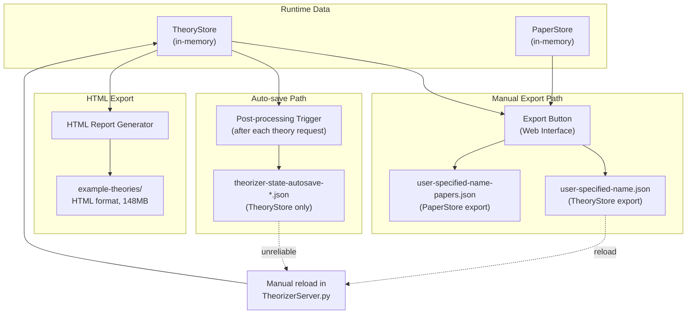
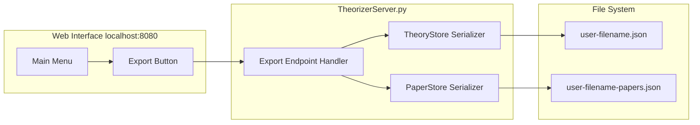
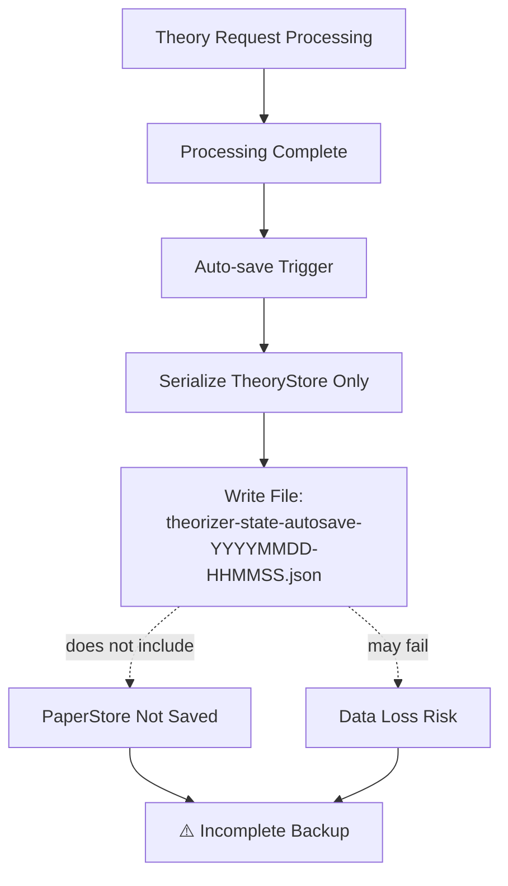
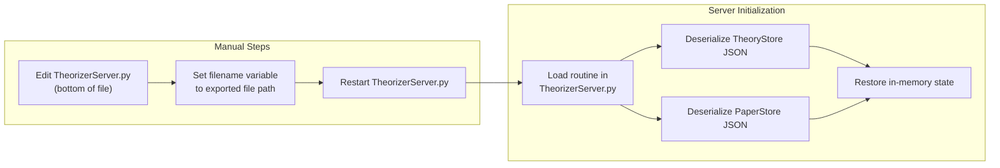
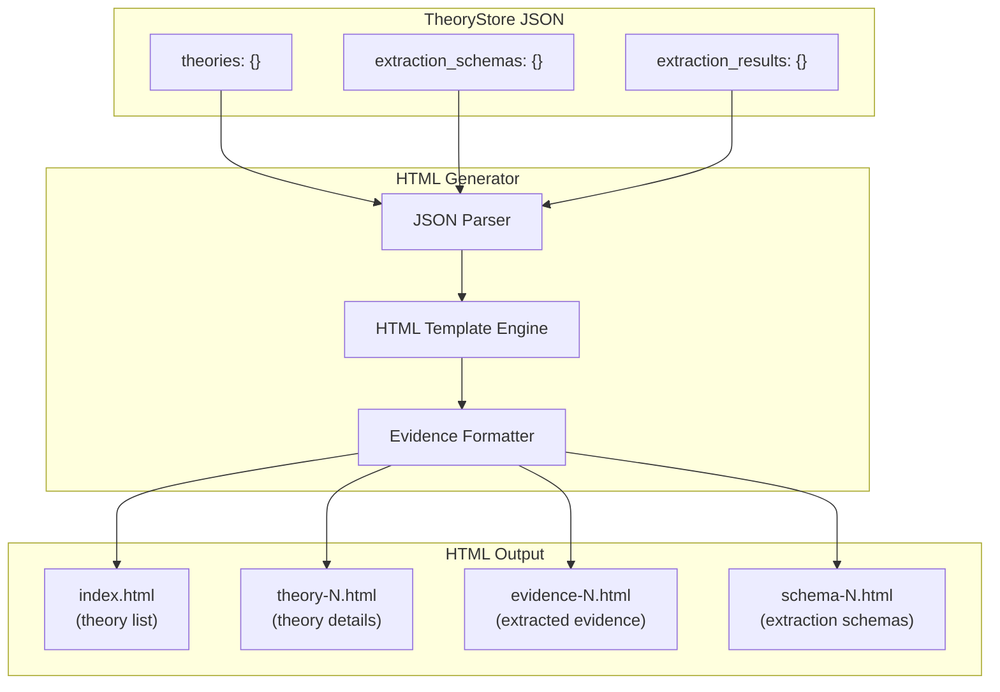
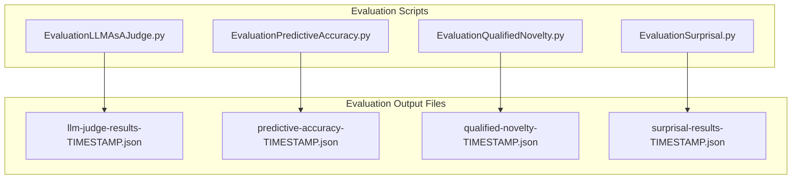
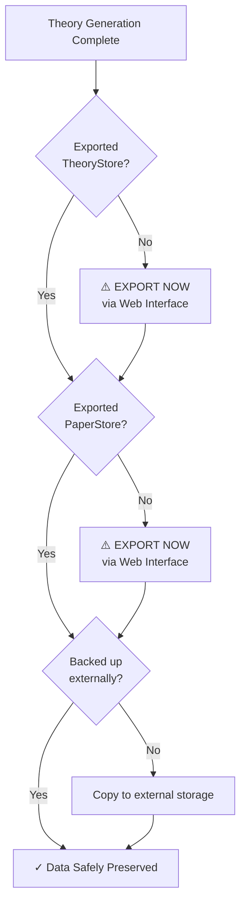
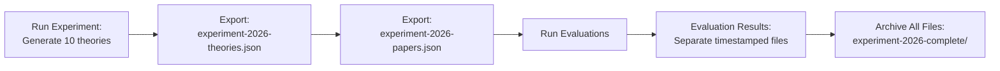
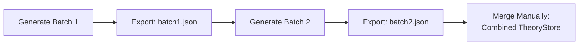

<!-- source: DeepWiki mcp.deepwiki.com · repo allenai/asta-theorizer · page 5.3 Export and Backup · fetched 2026-10-26 -->

# Export and Backup

<details>
<summary>Relevant source files</summary>

The following files were used as context for generating this wiki page:

- [README.md](README.md)
- [example-theories/theorizer-paper-data/README.md](example-theories/theorizer-paper-data/README.md)

</details>


**Purpose and Scope**: This document describes the mechanisms for exporting and backing up theories, papers, and evaluation results generated by Theorizer. It covers manual export functionality via the web interface, the auto-save backup mechanism, file formats, and procedures for reloading exported data. For details on the internal structure of exported data, see [TheoryStore Structure](#5.1) and [PaperStore Structure](#5.2).

⚠️ **Critical Warning**: Theories will be lost after system restart unless explicitly exported. Manual export is the only reliable preservation mechanism.

## Export Architecture

Theorizer provides two mechanisms for data persistence: manual export (recommended) and auto-save (unreliable). The export system separates theory data from paper cache data, producing distinct JSON files.



**Sources**: [README.md:246-258]()

## Manual Export via Web Interface

The web interface provides an `Export` button on the main menu that triggers manual export of both TheoryStore and PaperStore data structures.

### Export Button Functionality

| Component | Description | Output File |
|-----------|-------------|-------------|
| TheoryStore Export | All theories, extraction schemas, extraction results | User-specified filename (JSON) |
| PaperStore Export | Full-text cache of all downloaded papers | User-specified filename with `-papers` suffix (JSON) |

**Export Contents**:

- **TheoryStore JSON**: Contains three top-level dictionaries:
  - `theories`: Generated theories with descriptions, laws, and metadata
  - `extraction_schemas`: Schemas used for evidence extraction from papers
  - `extraction_results`: Per-paper extraction results keyed by schema and paper ID

- **PaperStore JSON**: Cache of full-text papers converted to Markdown format via Mistral OCR



**Sources**: [README.md:246-258]()

## Auto-save Backup Mechanism

Theorizer implements an automatic backup system that saves TheoryStore state after processing each theory request. However, this mechanism is explicitly documented as unreliable and should not be used as the primary backup strategy.

### Auto-save Characteristics

| Property | Value |
|----------|-------|
| Trigger | After each theory query processing completes |
| File naming | `theorizer-state-autosave-*.json` (timestamped) |
| Location | Main execution directory |
| Contents | TheoryStore only (excludes PaperStore) |
| Reliability | ⚠️ Unreliable - do not depend on this |

### Auto-save Workflow



**Limitations**:
1. **PaperStore Not Included**: Auto-save only persists TheoryStore, requiring papers to be re-downloaded if PaperStore is lost
2. **Reliability Issues**: The mechanism may fail silently
3. **No User Notification**: No confirmation of successful auto-save
4. **Timestamped Files Accumulate**: Multiple files created without automatic cleanup

**Sources**: [README.md:258]()

## Reloading Exported Data

Exported TheoryStore and PaperStore files must be manually reloaded by editing `TheorizerServer.py`. The system does not provide a web interface mechanism for loading previously exported data.

### Reload Procedure



**Manual Configuration Required**: Users must locate the reload configuration section at the bottom of `TheorizerServer.py` and specify the path to their exported files. This manual step is necessary each time the server is restarted with previously exported data.

**Sources**: [README.md:256-257]()

## HTML Report Generation

In addition to JSON exports, Theorizer can generate HTML reports for human-readable viewing of theories. The example theories archive demonstrates this format.

### HTML Export Structure

| Component | Size | Format | Purpose |
|-----------|------|--------|---------|
| Theory Archive | 148MB | ZIP containing HTML | Example theories from all four generation conditions |
| Index Page | - | HTML | Entry point for browsing theories |
| Theory Details | - | HTML per theory | Individual theory pages with laws and evidence |



**Example Data Location**: The complete example theory archive (148MB) containing theories generated under all four experimental conditions (literature-supported/parametric × accuracy-focused/novelty-focused) is hosted externally. See [example-theories/theorizer-paper-data/README.md:1-3]() for the Google Drive download link.

**Sources**: [README.md:499](), [example-theories/theorizer-paper-data/README.md:1-3]()

## File Format Specifications

### TheoryStore JSON Structure

```json
{
  "theories": {
    "theory_id_1": {
      "description": "...",
      "laws": [...],
      "metadata": {...}
    }
  },
  "extraction_schemas": {
    "schema_id_1": {
      "fields": [...],
      "instructions": "..."
    }
  },
  "extraction_results": {
    "result_id_1": {
      "schema_id": "...",
      "paper_id": "...",
      "extracted_data": {...}
    }
  }
}
```

### PaperStore JSON Structure

```json
{
  "paper_id_1": {
    "title": "...",
    "authors": [...],
    "full_text_markdown": "...",
    "metadata": {...}
  }
}
```

**Copyright Considerations**: The PaperStore contains full-text papers converted to Markdown. Redistribution may be subject to copyright restrictions. The toy example datasets exclude PaperStore files for this reason.

**Sources**: [README.md:485-491](), [README.md:501]()

## Export File Naming Conventions

### Auto-save Files

```
theorizer-state-autosave-20260114-120530.json
                         └─────┬─────┘ └──┬──┘
                           date (YYYYMMDD)  time (HHMMSS)
```

### Manual Export Files

User-specified naming, but typical convention:

```
my-theories.json              # TheoryStore
my-theories-papers.json       # PaperStore (automatically suffixed)
```

**Sources**: [README.md:258]()

## Evaluation Results Export

Evaluation scripts produce separate timestamped JSON files containing assessment results. These are stored independently of TheoryStore exports.



**Evaluation File Characteristics**:
- Timestamped with format `YYYYMMDD-HHMMSS`
- Include model identifier in filename or metadata
- Independent of TheoryStore/PaperStore exports
- Stored in script execution directory or specified output path

**Sources**: [README.md:305-475]()

## Best Practices and Recommendations

### Critical Backup Workflow

1. **After Generating Theories**: Immediately use the Export button to save both TheoryStore and PaperStore
2. **Before System Restart**: Verify exported files exist and contain expected data
3. **External Backup**: Copy exported JSON files to external storage or version control
4. **Ignore Auto-save**: Treat `theorizer-state-autosave-*.json` files as unreliable failsafes only

### Data Loss Prevention

| Risk | Mitigation |
|------|-----------|
| System restart without export | Always export before stopping servers |
| Auto-save failure | Never rely on auto-save as primary backup |
| PaperStore loss | Export PaperStore to avoid re-downloading papers |
| Accidental overwrite | Use descriptive, timestamped filenames for exports |



**Sources**: [README.md:246-258]()

## Common Export Scenarios

### Scenario 1: Preserving Experimental Results



### Scenario 2: Incremental Theory Building



⚠️ **Note**: Theorizer does not provide automatic merging of TheoryStore files. Users must manually combine exported files if incremental theory generation across multiple sessions is required.

**Sources**: [README.md:246-258]()

---

