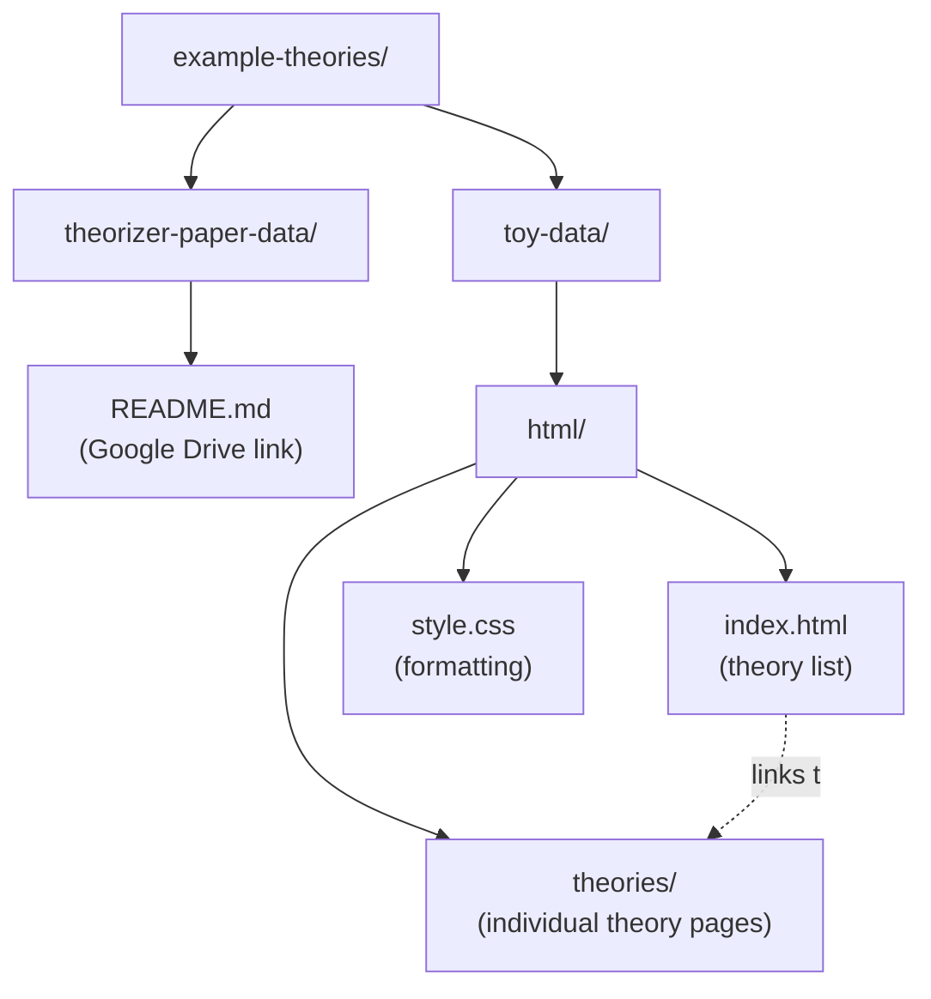
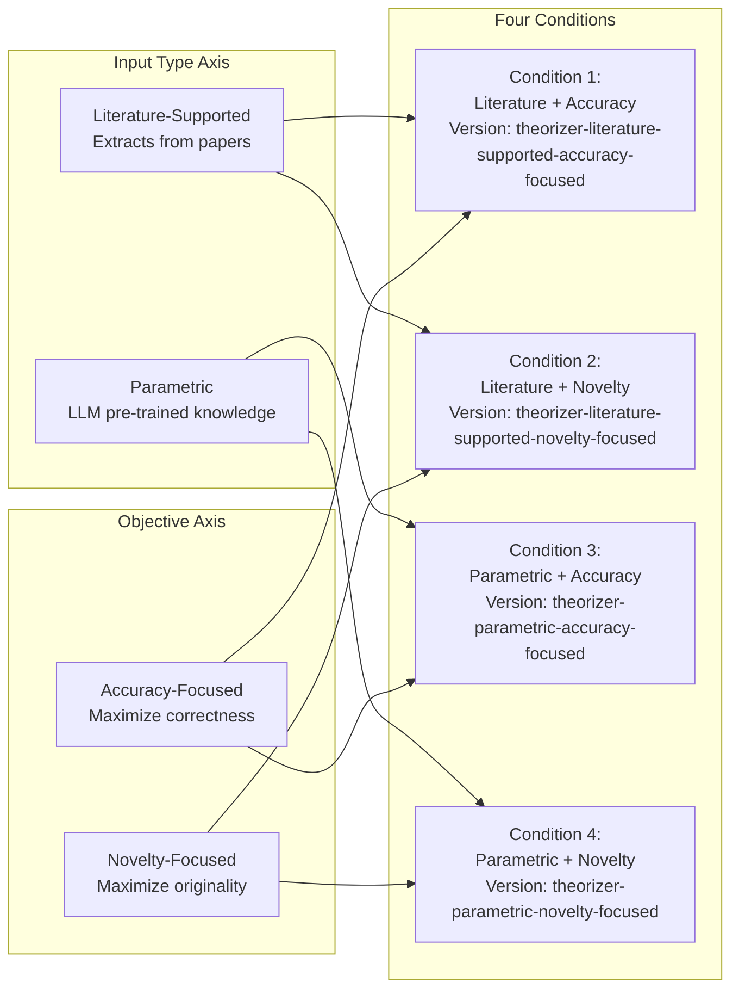
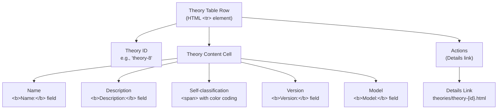
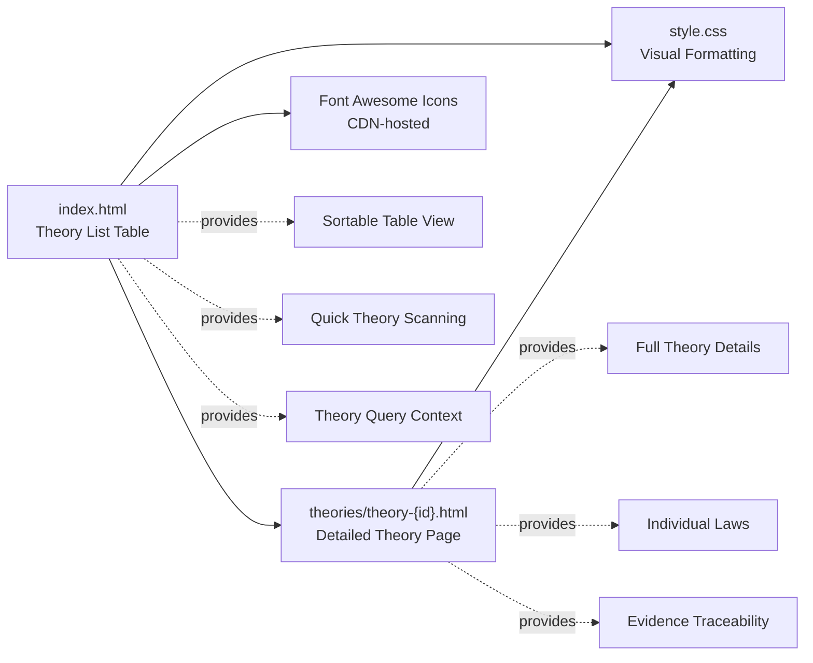
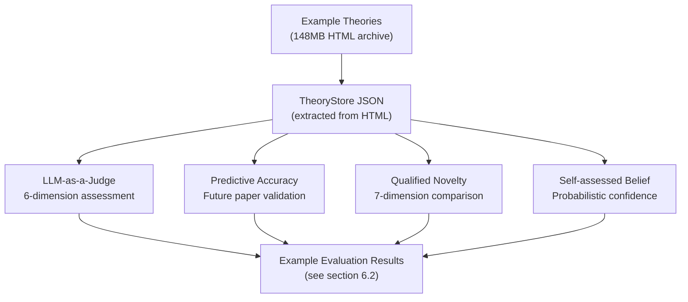

<!-- source: DeepWiki mcp.deepwiki.com · repo allenai/asta-theorizer · page 6 Example Theories and Data · fetched 2026-10-26 -->

# Example Theories and Data

<details>
<summary>Relevant source files</summary>

The following files were used as context for generating this wiki page:

- [example-theories/theorizer-paper-data/README.md](example-theories/theorizer-paper-data/README.md)
- [example-theories/toy-data/html/index.html](example-theories/toy-data/html/index.html)

</details>


## Purpose and Scope

This page documents the example theories dataset generated by the Theorizer system, including where to access the data, how it is organized, and what theories are included. The dataset demonstrates the system's output across all four generation conditions (literature-supported vs parametric, accuracy-focused vs novelty-focused) and provides a reference for understanding theory structure and quality.

For information about how these theories are generated, see [Theory Generation](#3). For details on how these theories are evaluated, see [Evaluation Systems](#4) and [Example Evaluation Results](#6.2).

---

## Dataset Location and Access

The complete example theories dataset is available as a downloadable archive containing theories in HTML format for easy viewing and analysis.

### Download Information

| Property | Value |
|----------|-------|
| **Location** | Google Drive (external hosting) |
| **Format** | ZIP archive containing HTML files |
| **Size** | 148 MB |
| **Access Link** | Specified in `example-theories/theorizer-paper-data/README.md` |
| **Conditions Covered** | All 4 generation conditions (2×2 factorial design) |

The dataset is hosted externally rather than in the repository due to its size. The archive contains theories generated under all combinations of input type (literature-supported, parametric) and generation objective (accuracy-focused, novelty-focused).

**Sources:** [example-theories/theorizer-paper-data/README.md:1-4]()

---

## Directory Structure and Organization

The example theories are organized into two primary datasets within the repository structure:



**Directory Breakdown:**

- **`theorizer-paper-data/`**: Reference to the full 148MB dataset hosted on Google Drive, containing theories from all four generation conditions
- **`toy-data/`**: Smaller example dataset included in the repository for demonstration purposes
- **`html/`**: HTML-formatted theories with styling for web browser viewing
- **`theories/`**: Individual theory detail pages (referenced from `index.html`)

**Sources:** [example-theories/theorizer-paper-data/README.md:1-4](), [example-theories/toy-data/html/index.html:1-74]()

---

## Theory Generation Conditions

The example dataset demonstrates all four theory generation conditions created by the 2×2 factorial experimental design:



Each condition produces distinct theories due to different prompting strategies and data sources. The version identifier embedded in each theory indicates which condition was used for generation.

**Sources:** [example-theories/toy-data/html/index.html:28-69]()

---

## Example Theory Topic: Memory Architectures for LLM Agents

The included toy-data example focuses on a specific research question in the domain of language model agents:

**Theory Query:** *"Build a theory of how language model agents can best be augmented with memory to perform well at text games, based on the following results."*

This query generated 8 theories (theory-1 through theory-8) exploring different architectural approaches to memory augmentation for text-game-playing agents.

### Theory Naming Patterns

The theories follow consistent naming conventions that reflect their core hypotheses:

| Theory ID | Theory Name Pattern | Focus Area |
|-----------|---------------------|------------|
| theory-1 | Hybrid Structured-Episodic Memory | Integration of memory modalities |
| theory-2 | Information Compression and History Representation | Compression as limiting factor |
| theory-3 | Experience-Driven Memory Compression and Selective Retention | Scalability through compression |
| theory-4 | Structured Semantic Memory (Knowledge Graphs) | Graph-based representations |
| theory-5 | Structured, Task-Specific and Polymodal Memory Architectures | Task-tailored memory design |
| theory-6 | Compression and Selection Mechanisms | Scaling limits and solutions |
| theory-7 | Hybrid Structured and Episodic Memory | Robustness and generalization |
| theory-8 | Reflective and Retrieval-Augmented Planning | Reflection and retrieval mechanisms |

**Sources:** [example-theories/toy-data/html/index.html:28-69]()

---

## HTML Theory Entry Structure

Each theory in the HTML dataset contains structured metadata and content fields:



### Theory Metadata Fields

Each theory entry contains the following structured information:

| Field | Description | Example |
|-------|-------------|---------|
| **Theory ID** | Unique identifier | `theory-8` |
| **Name** | Short descriptive title | "Reflective and Retrieval-Augmented Planning..." |
| **Description** | Detailed theory explanation | Multi-sentence explanation of hypotheses and mechanisms |
| **Self-classification** | Novelty assessment by the theory itself | `somewhat-related-to-existing` (orange), `genuinely_new`, etc. |
| **Version** | Generation condition identifier | `theorizer-literature-supported-accuracy-focused-12102025` |
| **Model** | LLM used for generation | `openai/gpt-4.1-2025-04-14` |

### Version Identifier Format

The version string encodes critical generation metadata:

```
theorizer-{input_type}-{objective}-{date}
```

**Components:**
- `{input_type}`: `literature-supported` or `parametric`
- `{objective}`: `accuracy-focused` or `novelty-focused`
- `{date}`: Generation timestamp in MMDDYYYY format

**Example:** `theorizer-literature-supported-accuracy-focused-12102025` indicates a theory generated on December 10, 2025, using literature-supported input with an accuracy-focused objective.

**Sources:** [example-theories/toy-data/html/index.html:31-68]()

---

## Example Theory Content

To illustrate the depth and structure of generated theories, here is an excerpt from theory-8:

**Theory Name:** Reflective and Retrieval-Augmented Planning Substantially Improves LLM Agent Adaptability and Sample Efficiency

**Theory Description:** 
> LLM-based game agents that are augmented with memory mechanisms supporting reflection (self-critique and synthesis of experience) and retrieval of relevant past trajectories (episodic or plan-based) show large and transferable improvements in solving diverse, complex, multi-step text games, especially ones with sparse rewards or creative bottlenecks. Integrating reflection/retrieval-based memory with action planning enables agents to avoid repeated failures, inject analogical knowledge from previous successful attempts, and bootstrap future behavior, in ways that pure model-based or direct RL-based agents cannot.

This theory demonstrates several characteristic features:
- **Specificity**: Names specific mechanisms (reflection, retrieval, episodic memory)
- **Comparative claims**: Contrasts with alternative approaches (pure model-based, RL-based)
- **Causal structure**: Explains how mechanisms produce outcomes
- **Domain grounding**: Focuses on text games with specific properties (sparse rewards, creative bottlenecks)

**Sources:** [example-theories/toy-data/html/index.html:31-34]()

---

## Theory Self-Classification

Theories include a self-assessment of their novelty relative to existing literature, displayed with color coding in the HTML interface:

| Classification | Meaning | Typical Color |
|----------------|---------|---------------|
| `explicit_established` | Well-known in literature | (not shown in examples) |
| `somewhat-related-to-existing` | Builds on known concepts with new combinations | Orange |
| `genuinely_new` | Novel hypothesis not found in literature | (varies) |

All eight theories in the toy-data example are classified as `somewhat-related-to-existing`, suggesting they synthesize and extend existing research rather than proposing entirely unprecedented ideas.

**Sources:** [example-theories/toy-data/html/index.html:31-68]()

---

## HTML Presentation Features

The HTML format provides several user-friendly features for browsing and analyzing theories:



**Key Features:**
- **Theory list table**: All theories in a single scrollable view
- **Theory query display**: Context for why theories were generated
- **Clickable details links**: Navigate to individual theory pages with full content
- **Color-coded classifications**: Visual novelty indicators
- **Metadata display**: Version, model, and generation conditions clearly labeled

**Sources:** [example-theories/toy-data/html/index.html:1-74]()

---

## Integration with Evaluation Systems

The example theories serve as inputs to the evaluation pipeline, enabling demonstration of all four evaluation methodologies:



The example theories provide concrete instances for understanding how each evaluation metric works in practice. Detailed evaluation results from these theories are documented in [Example Evaluation Results](#6.2).

**Sources:** [example-theories/toy-data/html/index.html:1-74]()

---

## Using the Example Data

Researchers and developers can use the example theories dataset for several purposes:

### Analysis and Research
- **Comparative analysis**: Study differences between generation conditions (literature vs parametric, accuracy vs novelty)
- **Quality assessment**: Examine theory coherence, specificity, and grounding
- **Prompt engineering**: Understand how different objectives affect output structure
- **Evaluation validation**: Test evaluation metrics on known theory sets

### System Development
- **Test data**: Use theories as test cases for evaluation scripts
- **UI development**: Reference HTML structure for interface design
- **Benchmark creation**: Establish baseline performance metrics
- **Documentation examples**: Demonstrate system capabilities

### Reproduction and Extension
- **Replication studies**: Generate new theories on the same topic for comparison
- **Domain transfer**: Apply similar generation patterns to new research questions
- **Methodology validation**: Verify that regenerated theories maintain quality standards

The HTML format enables both manual inspection (web browser viewing) and programmatic analysis (HTML parsing for automated evaluation).

**Sources:** [example-theories/theorizer-paper-data/README.md:1-4](), [example-theories/toy-data/html/index.html:1-74]()

---

