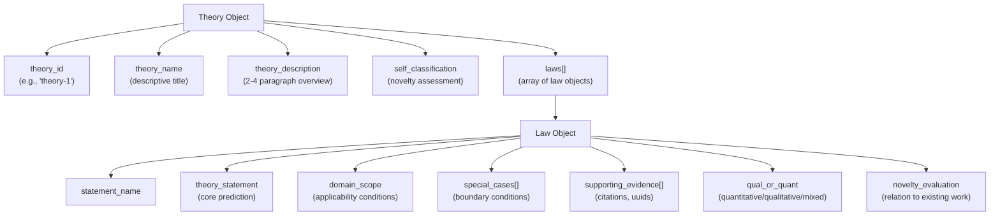
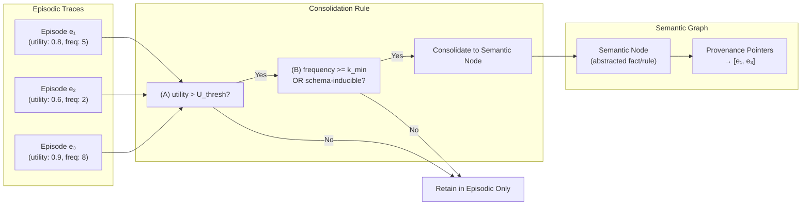
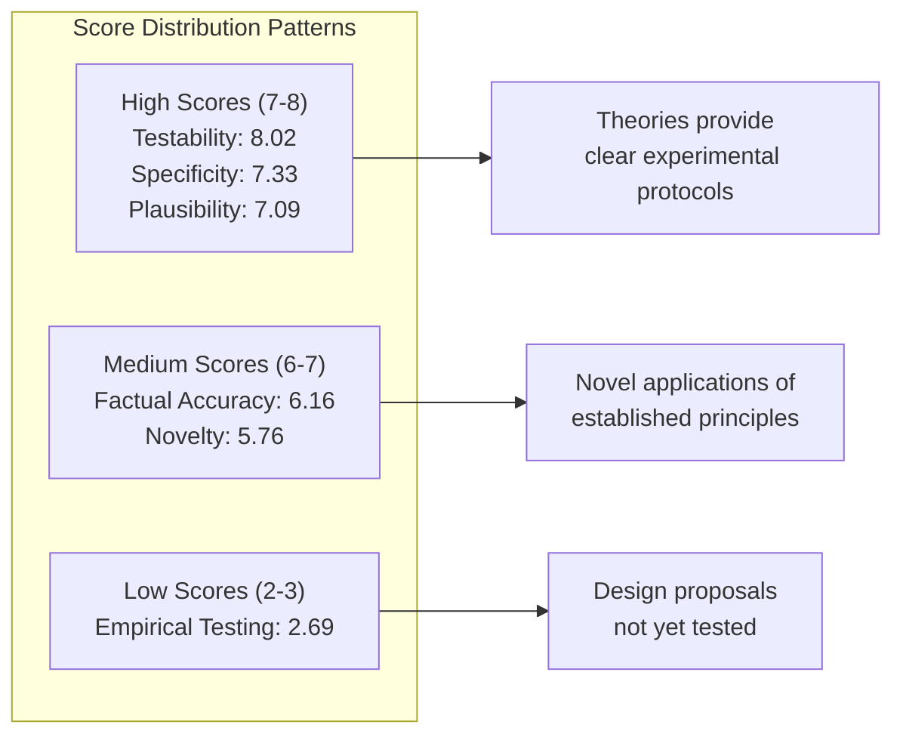
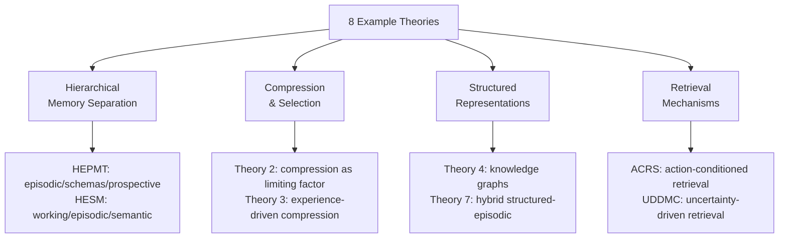
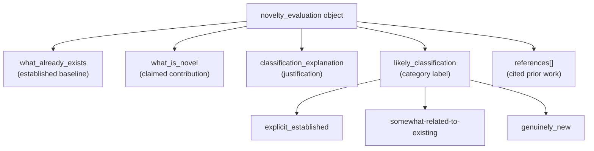
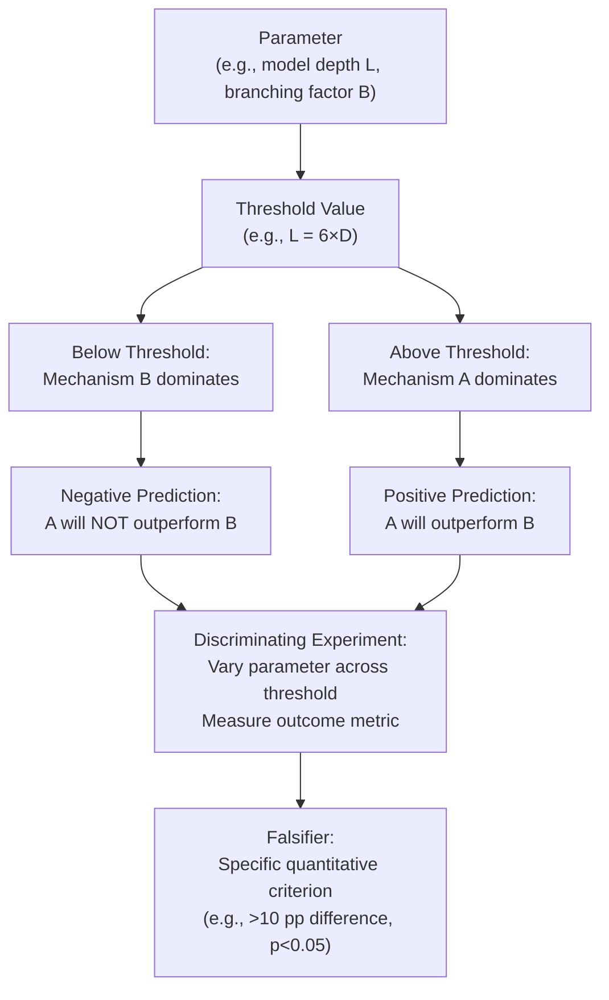

<!-- source: DeepWiki mcp.deepwiki.com · repo allenai/asta-theorizer · page 6.1 Theory Examples: Memory Architectures for LLM Agents · fetched 2026-10-26 -->

# Theory Examples: Memory Architectures for LLM Agents

<details>
<summary>Relevant source files</summary>

The following files were used as context for generating this wiki page:

- [example-theories/toy-data/evaluations/theorystore-example-single-laws.llm_as_a_judge_evaluated.20260121-120053.json](example-theories/toy-data/evaluations/theorystore-example-single-laws.llm_as_a_judge_evaluated.20260121-120053.json)
- [example-theories/toy-data/evaluations/theorystore-example-single-laws.surprise_evaluated.20260114-104415.json](example-theories/toy-data/evaluations/theorystore-example-single-laws.surprise_evaluated.20260114-104415.json)
- [example-theories/toy-data/html/index.html](example-theories/toy-data/html/index.html)

</details>


## Purpose and Scope

This page showcases concrete example theories generated by the Theorizer system, focusing on memory augmentation architectures for language model agents playing text games. These examples demonstrate the system's output format, content structure, and evaluation results. The theories presented here were generated from the query *"Build a theory of how language model agents can best be augmented with memory to perform well at text games"* and represent all four generation conditions (literature-supported vs parametric × accuracy-focused vs novelty-focused).

For documentation on the underlying theory storage format, see [TheoryStore Structure](#5.1). For details on how these theories are evaluated, see [Evaluation Systems](#4). For information on the generation process that produced these theories, see [Theory Generation](#3).

Sources: [example-theories/toy-data/html/index.html:1-74]()

---

## Overview of Example Theory Dataset

The example theory dataset contains theories about memory architectures for LLM agents in text-based games. This domain was chosen because it exemplifies the system's ability to synthesize knowledge from an active research area with concrete architectural proposals and testable predictions.

### Theory Query Context

```
Build a theory of how language model agents can best be augmented 
with memory to perform well at text games, based on the following results.
```

This query generated 8 distinct theories (theory-1 through theory-8), each proposing different memory architecture principles for LLM-based game agents. The theories range from hybrid structured-episodic approaches to compression-focused strategies to uncertainty-driven differentiable memory control.

Sources: [example-theories/toy-data/html/index.html:28-29]()

---

## Theory Structure and Components

Each generated theory follows a standardized structure stored in TheoryStore JSON format. The structure bridges conceptual descriptions with concrete, testable laws.

### High-Level Theory Anatomy



Sources: [example-theories/toy-data/evaluations/theorystore-example-single-laws.llm_as_a_judge_evaluated.20260121-120053.json:20-59]()

### Example: Complete Theory Law

Below is a complete law from the Hierarchical Episodic-Prospective Memory Theory (HEPMT), showing all structural components:

```json
{
  "statement_name": "Prospective Memory / Plan Retention Principle",
  "theory_statement": "Explicit storage of short prospective plans (conditional subgoal sequences of length L ≈ 2–8, with attached verification hooks) reduces expected re-planning cost CR roughly proportional to the fraction φ of repeated subgoals successfully retained and reused: CR ∝ (1 - φ). Storing prospective plans improves average-step efficiency and reduces repeated exploratory backtracking when plans are reliably verified upon retrieval.",
  "domain_scope": "Applies when agents encounter recurring multi-step subroutines (e.g., fetch-assemble-use workflows, door-unlock sequences) in text games, and when plan execution can be interrupted or requires recovery after exploration; assumes plans are stored with contextual triggers (state fingerprints) enabling targeted retrieval.",
  "special_cases": [
    "If plan outcomes are highly non-deterministic or environment dynamics change between attempts, retained plans may mislead and increase wasted actions.",
    "Adversarial paraphrasing or deliberate state obfuscation without robust state fingerprints reduces utility of stored plans.",
    "Very long prospective plans (L≫8) become brittle and costly to maintain; effectiveness concentrates on short chunks."
  ],
  "supporting_evidence": [
    {
      "text": "Hierarchical RL/options literature shows reusable subpolicies reduce planning overhead; episodic control caches successful trajectories for faster reuse.",
      "uuids": []
    },
    {
      "text": "Human prospective memory research demonstrates that storing intentions reduces planning load and improves task completion rates in interrupted tasks.",
      "uuids": []
    }
  ],
  "qual_or_quant": "mixed",
  "novelty_evaluation": {
    "what_already_exists": "Options and subpolicy reuse are standard in RL; simple action-sequence caching has been used in text-game agents.",
    "what_is_novel": "Formalizing prospective memory as a first-class memory partition for LM agents with a compact predictive relationship for re-planning cost (CR ∝ (1 - φ)) and prescribing verification hooks and conditional triggers tied to language fingerprints.",
    "classification_explanation": "This extends existing hierarchical/subgoal reuse ideas into a memory engineering principle for LM-controller agents interacting through text.",
    "likely_classification": "somewhat-related-to-existing"
  }
}
```

Sources: [example-theories/toy-data/evaluations/theorystore-example-single-laws.llm_as_a_judge_evaluated.20260121-120053.json:24-59]()

---

## Featured Theory Examples

### Theory 1: Hierarchical Episodic-Prospective Memory Theory (HEPMT)

**Core Claim**: Agents benefit from a three-tier memory hierarchy separating (1) detailed episodic traces, (2) compressed schemas/semantic summaries, and (3) prospective memory for conditional plans.

#### Theory Laws

HEPMT includes three specific laws, each with quantitative predictions:

| Law Name | Core Prediction | Type |
|----------|----------------|------|
| Hierarchical Memory Decomposition Law | Performance scales as M_eff = α\|S\| + β\|E\| where α > β > 0 | Quantitative |
| Diminishing-Returns Memory Scaling Law | ΔP/Δ\|E\| ∝ 1/\|E\| (logarithmic returns for episodic memory expansion) | Quantitative |
| Prospective Memory / Plan Retention Principle | CR ∝ (1 - φ) where φ is fraction of reused plans | Mixed |

#### Domain Scope Example

```
Applies to agents whose controller is an autoregressive language model 
(transformer-family or similar) that:
(a) generates actions as text tokens
(b) experiences partially observable, language-described states
(c) operates under bounded per-step context/token budgets
(d) faces tasks requiring multi-step strategies across tens-to-hundreds 
    of steps with recurring substructures
```

Sources: [example-theories/toy-data/evaluations/theorystore-example-single-laws.llm_as_a_judge_evaluated.20260121-120053.json:142-153]()

---

### Theory 3: Uncertainty-Driven Differentiable Memory Control (UDDMC)

**Core Claim**: A unified differentiable control policy for episodic key-value memory that gates writes based on probabilistic surprise × expected utility, controls retrieval via uncertainty-modulated temperature, and enables end-to-end gradient flow for credit assignment.

#### Key Mechanisms

```mermaid
graph TB
    subgraph "Write Control"
        Obs["observation o_t"]
        Surprise["Surprise(o_t)<br/>= -log p(o_t | context)"]
        Utility["EstimatedExpectedUtilityGain(o_t)<br/>(learned estimator)"]
        Lambda["λ * StorageCost"]
        WriteGate["Write Gate<br/>(differentiable [0,1])"]
        
        Obs --> Surprise
        Obs --> Utility
        Surprise --> WriteDecision["Surprise × Utility > λ × Cost"]
        Utility --> WriteDecision
        Lambda --> WriteDecision
        WriteDecision --> WriteGate
    end
    
    subgraph "Retrieval Control"
        EpistemicU["Epistemic Uncertainty u<br/>(ensemble variance, MC-dropout)"]
        TauFunc["tau(u)<br/>(learned temperature function)<br/>monotonically decreasing"]
        SoftmaxTemp["softmax(key·query / tau(u))"]
        
        EpistemicU --> TauFunc
        TauFunc --> SoftmaxTemp
        SoftmaxTemp --> RetrievalDist["Retrieval Distribution<br/>(sharper when uncertain)"]
    end
    
    subgraph "Credit Assignment"
        DelayedReward["Delayed Textual Rewards"]
        RetrievalAttn["Retrieval Attention Weights<br/>(differentiable)"]
        WriteGates["Write Gates<br/>(differentiable)"]
        StoredEncodings["Stored Encodings"]
        
        DelayedReward --> Gradients["Gradient Flow"]
        Gradients --> RetrievalAttn
        Gradients --> WriteGates
        Gradients --> StoredEncodings
    end
```



#### Evaluation Scores for UDDMC Laws

| Law | Factual Accuracy | Specificity | Novelty | Testability | Plausibility | Empirical Testing |
|-----|------------------|-------------|---------|-------------|--------------|-------------------|
| Write-on-Surprise-and-Utility | 8.0/10 | 7.0/10 | 6.0/10 | 8.0/10 | 7.0/10 | 2.0/10 |
| Uncertainty-to-Temperature Retrieval | 8.0/10 | 7.0/10 | 6.0/10 | 8.0/10 | 7.0/10 | 2.0/10 |
| Differentiable Credit Assignment | 7.0/10 | 6.0/10 | 5.0/10 | 7.0/10 | 8.0/10 | 4.0/10 |

Sources: [example-theories/toy-data/evaluations/theorystore-example-single-laws.llm_as_a_judge_evaluated.20260121-120053.json:90-238]()

---

### Theory 4: Hierarchical Episodic-Semantic Memory (HESM)

**Core Claim**: A structured memory architecture separating short-term working memory, episodic store (sparse, time-stamped experiences), and semantic graph (grounded facts and abstractions) with explicit consolidation rules.

#### Consolidation Mechanism



#### Cross-Tier Retrieval Arbitration

The theory specifies a utility-weighted retrieval scoring mechanism:

```
Score = alpha(context_relevance) × Beta_tier × Importance

where Beta_tier encodes preferred tier given task horizon:
  - WM (working memory): high for immediate next-token prediction
  - ES (episodic store): preferred for episodic recall
  - SG (semantic graph): favored for generalized planning
```

Sources: [example-theories/toy-data/evaluations/theorystore-example-single-laws.llm_as_a_judge_evaluated.20260121-120053.json:312-378]()

---

## Evaluation Results Across All Example Theories

### Aggregate LLM-as-a-Judge Scores

The example theories were evaluated using Claude Sonnet 4.5 as the judge model. Across 45 individual theory laws, the following average scores were obtained:

| Dimension | Average Score | Interpretation |
|-----------|---------------|----------------|
| **Factual Accuracy** | 6.16 / 10 | Theories build on established principles but make novel predictions |
| **Specificity** | 7.33 / 10 | Concrete parameters and operationalizable mechanisms |
| **Novelty** | 5.76 / 10 | Moderate novelty—syntheses and domain-specific applications |
| **Testability** | 8.02 / 10 | Clear, falsifiable predictions with experimental protocols |
| **Plausibility** | 7.09 / 10 | Mechanisms align with known principles |
| **Empirical Testing** | 2.69 / 10 | Proposed mechanisms lack extensive direct empirical validation |

Sources: [example-theories/toy-data/evaluations/theorystore-example-single-laws.llm_as_a_judge_evaluated.20260121-120053.json:4-11]()

### Distribution Analysis



### Self-Assessed Belief (Surprisal Evaluation)

The system evaluated its own confidence in each theory law by sampling 10 probability estimates. Results show high confidence with low variance:

| Metric | Value |
|--------|-------|
| **Average Probability True** | 0.809 (80.9%) |
| **Standard Deviation** | ~0.045 |
| **Range** | 0.65 - 0.875 |
| **Total Laws Scored** | 45 |

This indicates the generation model has substantial confidence in the theories it produces, though not complete certainty.

Sources: [example-theories/toy-data/evaluations/theorystore-example-single-laws.surprise_evaluated.20260114-104415.json:2-5]()

---

## Common Theory Patterns and Themes

### Architectural Themes

Analyzing the 8 theories reveals recurring architectural motifs:



### Common Special Cases

Most theories include boundary conditions where the proposed mechanisms break down. Common patterns:

| Special Case Type | Example Laws | Frequency |
|-------------------|-------------|-----------|
| **High stochasticity** | Environments where past patterns don't predict future | 12/45 |
| **Insufficient recurrence** | Games with unique, non-repeating patterns | 8/45 |
| **Computational constraints** | Very long horizons making mechanisms infeasible | 7/45 |
| **Poor uncertainty estimates** | When epistemic uncertainty signals are unreliable | 5/45 |
| **Extreme parameter regimes** | Very large/small values of key parameters | 11/45 |

Sources: [example-theories/toy-data/evaluations/theorystore-example-single-laws.llm_as_a_judge_evaluated.20260121-120053.json:29-32]()

---

## Theory Self-Classification and Novelty

### Novelty Evaluation Structure

Each theory law includes a self-assessment of its novelty relative to existing work:



### Distribution of Self-Classifications

Based on the HTML index showing all 8 theories:

| Classification | Count | Percentage |
|---------------|-------|------------|
| **somewhat-related-to-existing** | 8 | 100% |
| **explicit_established** | 0 | 0% |
| **genuinely_new** | 0 | 0% |

All theories classify themselves as moderate novelty—synthesizing or applying established principles to the specific domain of LLM agents in text games.

Sources: [example-theories/toy-data/html/index.html:32-68]()

### Example Self-Assessment: HEPMT Prospective Memory Law

```
what_already_exists: "Options and subpolicy reuse are standard in RL; 
simple action-sequence caching has been used in text-game agents."

what_is_novel: "Formalizing prospective memory as a first-class memory 
partition for LM agents with a compact predictive relationship for 
re-planning cost (CR ∝ (1 - φ)) and prescribing verification hooks and 
conditional triggers tied to language fingerprints."

classification_explanation: "This extends existing hierarchical/subgoal 
reuse ideas into a memory engineering principle for LM-controller agents 
interacting through text."

likely_classification: "somewhat-related-to-existing"
```

Sources: [example-theories/toy-data/evaluations/theorystore-example-single-laws.llm_as_a_judge_evaluated.20260121-120053.json:48-56]()

---

## Discriminating Experiments and Falsification

Many theory laws include explicit experimental protocols and falsification criteria, demonstrating high testability scores.

### Example: Compression-Dominance Fork

From the "Compressed Semantic Memory for Goal Conditioning" theory:

**Experimental Protocol**:
```
Generate 50 procedurally-generated text games with:
  - Branching factor B = 6
  - Average episode length L_avg = 400
  - Memory budget fixed at 1 MB

Compare three agents:
  A) Schema-based embedding memory (D=64, R≥16)
  B) Compressed embedding (D=128, R=8)  
  C) Raw-token replay

Measure: mean success rate, retrieval precision (human-annotated)
Run: 20 random seeds per game
```

**Falsification Criterion**:
```
If raw-token agent C achieves ≥5 percentage points higher mean success 
rate than compressed-embedding agent A (p < 0.05), the statement is falsified.
```

Sources: [example-theories/toy-data/evaluations/theorystore-example-single-laws.surprise_evaluated.20260114-104415.json:109-118]()

### Fork Pattern

Several theories use a "fork" structure predicting a threshold where mechanism dominance switches:



This pattern appears in theories about slot-count thresholds, layer-depth requirements, and sparsity regimes.

Sources: [example-theories/toy-data/evaluations/theorystore-example-single-laws.surprise_evaluated.20260114-104415.json:448-456]()

---

## Data Storage and Access

### File Structure

The example theories are stored in the repository under `example-theories/toy-data/`:

```
example-theories/toy-data/
├── html/
│   ├── index.html                    # Theory list web view
│   ├── theories/
│   │   ├── theory-1.html            # Individual theory pages
│   │   ├── theory-2.html
│   │   └── ...
│   └── style.css
├── evaluations/
│   ├── theorystore-example-single-laws.llm_as_a_judge_evaluated.*.json
│   ├── theorystore-example-single-laws.surprise_evaluated.*.json
│   └── ...
└── theorystore.json                  # Raw theory data
```

### TheoryStore JSON Structure

The underlying data follows the TheoryStore format documented in [TheoryStore Structure](#5.1):

```json
{
  "theories": {
    "theory-1": { /* full theory object */ },
    "theory-2": { /* full theory object */ },
    ...
  },
  "extraction_schemas": { /* empty for parametric generation */ },
  "extraction_results": { /* empty for parametric generation */ }
}
```

### Accessing Example Theories

Example theories can be accessed through:

1. **HTML Interface**: Browse `example-theories/toy-data/html/index.html` locally
2. **JSON Files**: Parse `theorystore.json` for programmatic access
3. **Evaluation Results**: Timestamped JSON files in `evaluations/` subdirectory

Sources: [example-theories/toy-data/html/index.html:1-10](), [example-theories/toy-data/evaluations/theorystore-example-single-laws.llm_as_a_judge_evaluated.20260121-120053.json:1-20]()

---

## Usage Notes

### Generation Metadata

These example theories include version and model metadata:

```json
{
  "version": "theorizer-literature-supported-accuracy-focused-12102025",
  "model": "openai/gpt-4.1-2025-04-14"
}
```

This indicates:
- **Generation mode**: literature-supported, accuracy-focused (not novelty-focused)
- **Model**: GPT-4.1 from April 2025 training cutoff
- **Timestamp**: December 10, 2025

For details on generation modes, see [Generation Modes](#3.1) and [Generation Objectives](#3.2).

### Evaluation Timestamps

Evaluation results are timestamped separately:

- LLM-as-a-Judge: `20260121-120053` (January 21, 2026)
- Surprisal evaluation: `20260114-104415` (January 14, 2026)

Different evaluation dimensions can be run independently at different times without regenerating theories.

Sources: [example-theories/toy-data/html/index.html:32-33](), [example-theories/toy-data/evaluations/theorystore-example-single-laws.llm_as_a_judge_evaluated.20260121-120053.json:2-3]()

### Limitations and Context

These example theories represent **parametric knowledge generation** (based on model pre-training) rather than literature extraction. For examples of literature-supported generation with extraction schemas and evidence, see theories generated with the literature-supported mode documented in [Generation Modes](#3.1).

The domain (memory architectures for LLM agents in text games) was selected to showcase:
- Multi-level architectural proposals
- Quantitative predictions with parameters
- Clear testability and falsification criteria
- Moderate novelty (synthesis of established techniques)

Different domains may produce theories with different characteristics, testability profiles, and novelty levels.

---

