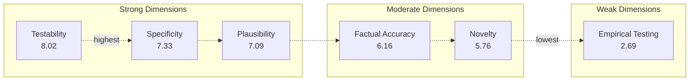
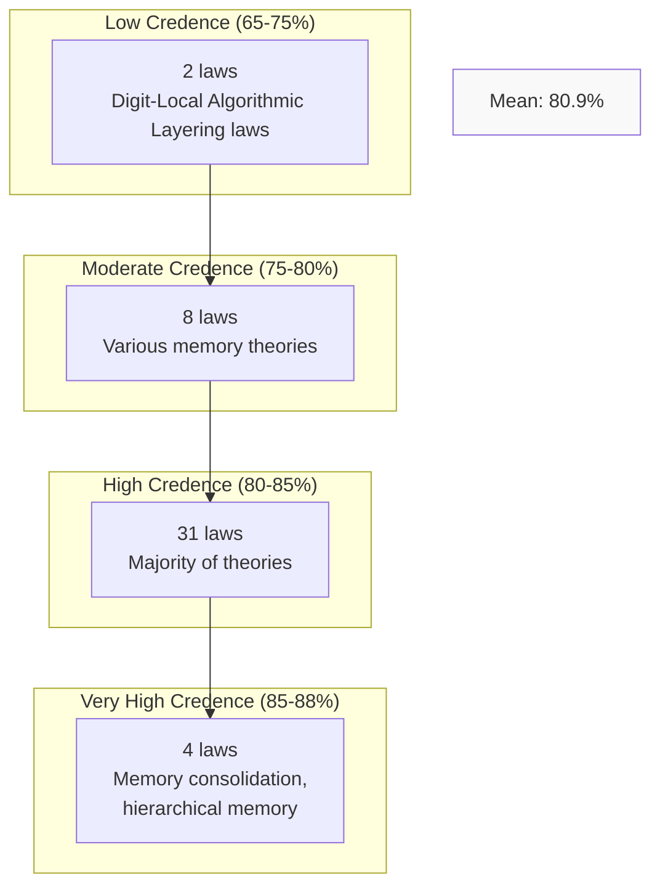
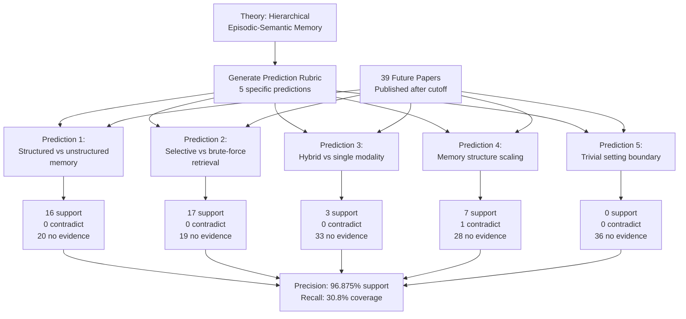
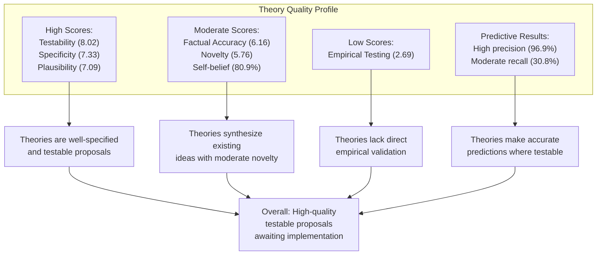
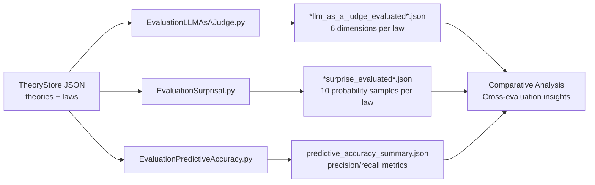

<!-- source: DeepWiki mcp.deepwiki.com · repo allenai/asta-theorizer · page 6.2 Example Evaluation Results · fetched 2026-10-26 -->

# Example Evaluation Results

<details>
<summary>Relevant source files</summary>

The following files were used as context for generating this wiki page:

- [example-theories/toy-data/evaluations/theorystore-example-single-laws.llm_as_a_judge_evaluated.20260121-120053.json](example-theories/toy-data/evaluations/theorystore-example-single-laws.llm_as_a_judge_evaluated.20260121-120053.json)
- [example-theories/toy-data/evaluations/theorystore-example-single-laws.surprise_evaluated.20260114-104415.json](example-theories/toy-data/evaluations/theorystore-example-single-laws.surprise_evaluated.20260114-104415.json)
- [example-theories/toy-data/evaluations/theorystore-example2-predictive-evaluation/predictive-accuracy-evaluation/claude_sonnet_4_5_20250929/predictive_accuracy_summary.json](example-theories/toy-data/evaluations/theorystore-example2-predictive-evaluation/predictive-accuracy-evaluation/claude_sonnet_4_5_20250929/predictive_accuracy_summary.json)

</details>


This page presents real evaluation results from the example theories dataset to demonstrate how the four evaluation methodologies work in practice. These results are derived from theories about memory architectures for LLM agents in text games, as described in [Theory Examples](#6.1). For detailed explanations of each evaluation methodology, see [LLM-as-a-Judge Evaluation](#4.1), [Predictive Accuracy Evaluation](#4.2), [Qualified Novelty Evaluation](#4.3), and [Self-assessed Belief and Surprisal Evaluation](#4.4).

The examples shown here use evaluation outputs from the `example-theories/toy-data/evaluations/` directory, demonstrating the JSON output formats and score distributions produced by each evaluation script.

---

## LLM-as-a-Judge Evaluation Results

The LLM-as-a-Judge evaluation assessed 45 theory laws using `claude-sonnet-4-5-20250929` as the judge model. Each law was scored on six dimensions using a 1-10 scale.

### Aggregate Scores

| Dimension | Average Score | Interpretation |
|-----------|--------------|----------------|
| **Factual Accuracy** | 6.16 | Moderate - theories are generally factually sound but contain some simplifications |
| **Specificity** | 7.33 | Good - theories provide concrete parameters and testable predictions |
| **Novelty** | 5.76 | Moderate - theories synthesize existing ideas rather than introducing fundamentally new mechanisms |
| **Testability** | 8.02 | Strong - theories make clear falsifiable predictions with straightforward experimental designs |
| **Plausibility** | 7.09 | Good - theories align with established principles from RL, memory systems, and cognitive science |
| **Empirical Testing** | 2.69 | Weak - theories are design proposals with limited direct empirical validation in their stated domains |

### Score Distribution Pattern



### Example Law Evaluation

The following example shows detailed scoring for the "Prospective Memory / Plan Retention Principle" from theory-1 (Hierarchical Episodic-Prospective Memory Theory):

| Dimension | Score | Key Reasoning |
|-----------|-------|---------------|
| Factual Accuracy | 7 | Core claim aligns with hierarchical RL (options framework), episodic control, and human prospective memory research. Proportional relationship CR ∝ (1 - φ) is reasonable. |
| Specificity | 7 | Provides concrete parameters (L ≈ 2–8, retention fraction φ, cost CR) and architectural requirements (verification hooks, state fingerprints). Implementation details remain underspecified. |
| Novelty | 6 | Reusable subgoal sequences are well-established in RL. Novel aspect is formalization for LM agents with verification hooks and language-based state fingerprints. |
| Testability | 8 | Clear predictions: reduced re-planning episodes, faster task completion, efficiency gains proportional to φ. Straightforward experimental comparisons. |
| Plausibility | 8 | Highly plausible, grounded in hierarchical RL, episodic control, and human prospective memory. Failure modes align with known limitations. |
| Empirical Testing | 4 | Underlying mechanisms have support, but specific formulation for LM-based text-game agents with this architecture has not been directly tested. |

**Sources:** [example-theories/toy-data/evaluations/theorystore-example-single-laws.llm_as_a_judge_evaluated.20260121-120053.json:1-310]()

---

## Self-assessed Belief and Surprisal Results

The surprisal evaluation elicited probabilistic beliefs from `gpt-4.1-2025-04-14` for all 45 theory laws, with 10 probability samples per law.

### Aggregate Statistics

| Metric | Value | Interpretation |
|--------|-------|----------------|
| **Average Probability True** | 0.809 | The model assigns ~81% credence to theory laws on average |
| **Standard Deviation** | 0.045 | Relatively low variance - model confidence is consistent across laws |
| **Range** | 0.65 - 0.875 | Lowest: 65% credence; Highest: 87.5% credence |
| **Samples per Law** | 10 | Multiple samples capture uncertainty in the model's beliefs |

### Probability Distribution

The 45 laws show a relatively tight clustering around the mean of 0.809, with most laws receiving credence between 0.75 and 0.85:



### Example Law Belief Samples

For "Hierarchical Memory Decomposition Law", the model provided 10 probability samples:

```
[0.8, 0.85, 0.85, 0.8, 0.85, 0.85, 0.85, 0.85, 0.85, 0.85]
Average: 0.84 (84% credence)
```

This represents high confidence that organizing memory into episodic traces and compressed schemas yields better performance than flat memory representations.

**Sources:** [example-theories/toy-data/evaluations/theorystore-example-single-laws.surprise_evaluated.20260114-104415.json:1-600]()

---

## Predictive Accuracy Results

The predictive accuracy evaluation tested theories against future papers published after a knowledge cutoff. This evaluation used `claude-sonnet-4-5-20250929` to construct rubrics and score papers.

### Recall Metrics

Recall measures what proportion of theory elements are covered by future literature:

| Metric | Count | Proportion |
|--------|-------|------------|
| **Theories with Data** | 1 out of 2 | 50% |
| **Theory Elements with Data** | 4 out of 13 | 30.8% |
| **Papers Evaluated** | 39 | - |
| **Papers with Relevant Info** | 21 | 53.8% |

### Precision Metrics

For theory elements with data, precision measures whether papers support or contradict predictions:

| Category | Proportion | Papers |
|----------|------------|--------|
| **Support** | 96.875% | 31 out of 32 |
| **Contradict** | 3.125% | 1 out of 32 |

### Evaluation Workflow



### Detailed Rubric Performance

| Prediction | Support | Contradict | No Evidence | Support % |
|------------|---------|------------|-------------|-----------|
| Structured vs unstructured memory | 16 | 0 | 20 | 100% |
| Selective vs brute-force retrieval | 17 | 0 | 19 | 100% |
| Hybrid vs single modality | 3 | 0 | 33 | 100% |
| Memory structure scaling | 7 | 1 | 28 | 87.5% |
| Trivial setting boundary | 0 | 0 | 36 | N/A |

**Interpretation:** The theory's predictions about structured/selective memory outperforming naive approaches received strong support from future literature. The single contradiction came from the "memory structure scaling" prediction, where one paper found that complexity scaling did not favor structured approaches as strongly as predicted.

**Sources:** [example-theories/toy-data/evaluations/theorystore-example2-predictive-evaluation/predictive-accuracy-evaluation/claude_sonnet_4_5_20250929/predictive_accuracy_summary.json:1-360]()

---

## Cross-Evaluation Insights

Comparing results across evaluation dimensions reveals patterns in theory quality:



### Key Findings

1. **Strong Theoretical Foundations:** High testability (8.02) and specificity (7.33) scores indicate theories provide clear, falsifiable predictions with operational details.

2. **Synthesis Rather Than Discovery:** Moderate novelty (5.76) and high plausibility (7.09) suggest theories integrate established principles from RL, cognitive science, and memory systems into new contexts.

3. **Validation Gap:** Low empirical testing (2.69) combined with high self-belief (80.9%) indicates confidence in theories that have not yet been directly validated in their proposed domains.

4. **Predictive Validity:** Where testable against future work, theories show 96.9% precision, suggesting accurate understanding of how memory architectures will evolve.

5. **Coverage Limitations:** Only 30.8% recall indicates many theory elements remain untested by future literature, either because they are too specific or because the research frontier has not yet reached them.

**Sources:** [example-theories/toy-data/evaluations/theorystore-example-single-laws.llm_as_a_judge_evaluated.20260121-120053.json:1-15](), [example-theories/toy-data/evaluations/theorystore-example-single-laws.surprise_evaluated.20260114-104415.json:1-10](), [example-theories/toy-data/evaluations/theorystore-example2-predictive-evaluation/predictive-accuracy-evaluation/claude_sonnet_4_5_20250929/predictive_accuracy_summary.json:1-22]()

---

## Evaluation Output Files

The evaluation scripts produce timestamped JSON files with model identifiers:

| Evaluation Type | File Pattern | Example File |
|----------------|--------------|--------------|
| LLM-as-a-Judge | `*.llm_as_a_judge_evaluated.YYYYMMDD-HHMMSS.json` | `theorystore-example-single-laws.llm_as_a_judge_evaluated.20260121-120053.json` |
| Surprisal | `*.surprise_evaluated.YYYYMMDD-HHMMSS.json` | `theorystore-example-single-laws.surprise_evaluated.20260114-104415.json` |
| Predictive Accuracy | `predictive_accuracy_summary.json` | Located in `*-predictive-evaluation/predictive-accuracy-evaluation/{model_str}/` |
| Qualified Novelty | `*.qualified_novelty_evaluated.YYYYMMDD-HHMMSS.json` | (not shown in examples but follows same pattern) |

### File Structure

All evaluation files contain:
- `model_str`: The LLM model used for evaluation
- Aggregate statistics (averages, counts, proportions)
- `raw_results`: Detailed per-law evaluations with explanations



**Sources:** [example-theories/toy-data/evaluations/theorystore-example-single-laws.llm_as_a_judge_evaluated.20260121-120053.json:1-3](), [example-theories/toy-data/evaluations/theorystore-example-single-laws.surprise_evaluated.20260114-104415.json:1-3](), [example-theories/toy-data/evaluations/theorystore-example2-predictive-evaluation/predictive-accuracy-evaluation/claude_sonnet_4_5_20250929/predictive_accuracy_summary.json:1-30]()

---

