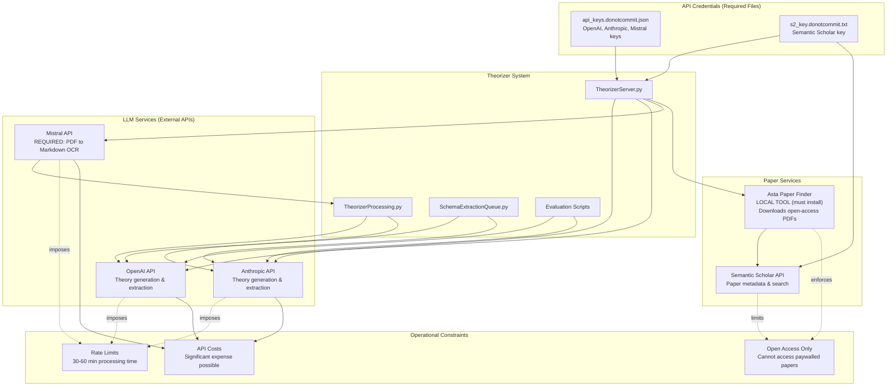
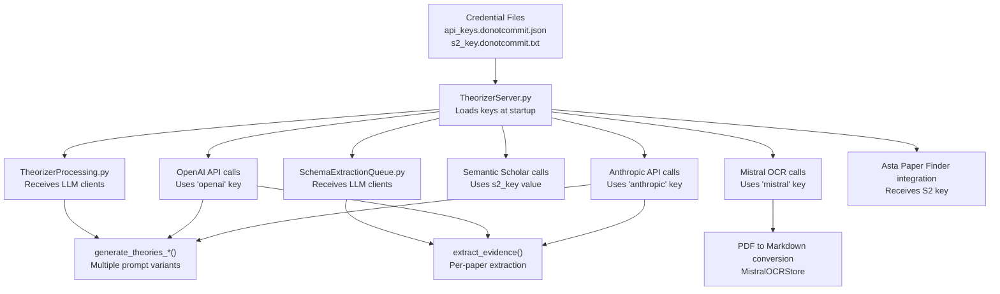
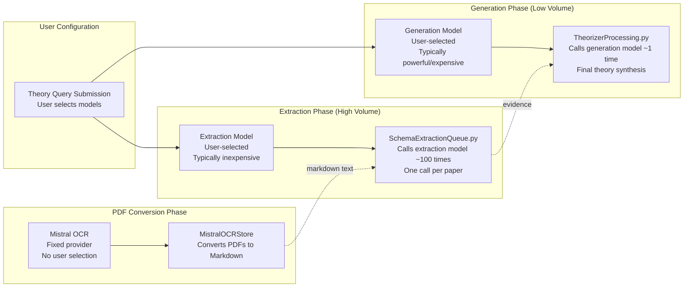
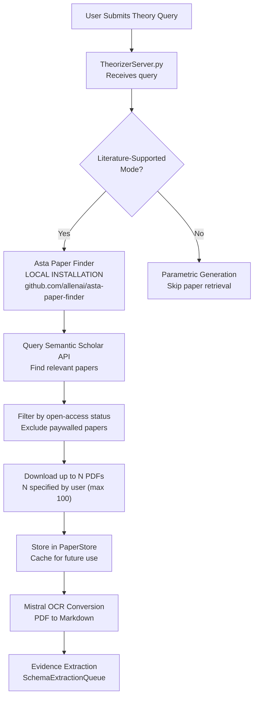
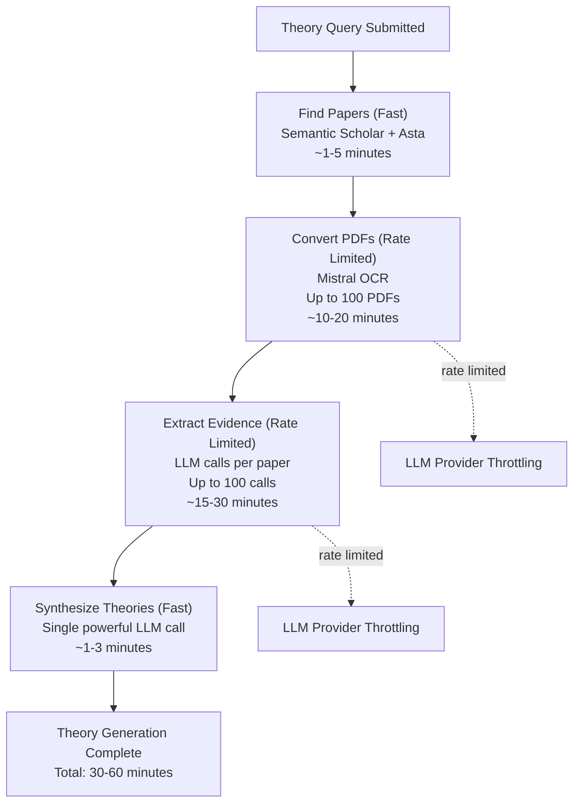
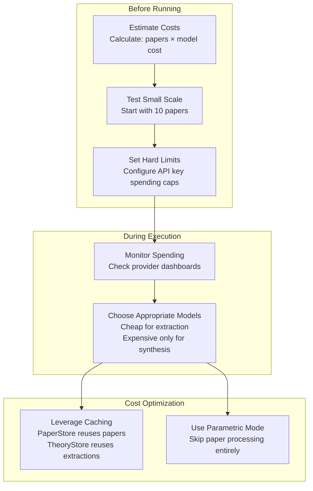

<!-- source: DeepWiki mcp.deepwiki.com · repo allenai/asta-theorizer · page 7 External Dependencies · fetched 2026-10-26 -->

# External Dependencies

<details>
<summary>Relevant source files</summary>

The following files were used as context for generating this wiki page:

- [README.md](README.md)

</details>


## Purpose and Scope

This document provides comprehensive documentation of all external services, API credentials, and third-party tools required to run the Theorizer system. It covers API key configuration, LLM provider setup, paper retrieval dependencies, rate limiting constraints, and cost management strategies. 

For information about:
- Setting up and running the system after dependencies are configured, see [Getting Started](#2)
- Configuring LLM models for specific generation tasks, see [LLM Provider Configuration](#7.1)
- Paper retrieval and the Asta Paper Finder integration, see [Semantic Scholar and Asta Paper Finder](#7.2)

---

## Overview of External Dependencies

The Theorizer system has four categories of external dependencies that must be configured before operation:



**Sources:** [README.md:139-165](), [README.md:198]()

---

## Required API Key Files

### API Key File Structure

The system requires two credential files that must be created manually in the repository root directory:

| File Name | Purpose | Format | Keys Required |
|-----------|---------|--------|---------------|
| `api_keys.donotcommit.json` | LLM provider credentials | JSON dictionary | `openai`, `anthropic`, `mistral` |
| `s2_key.donotcommit.txt` | Semantic Scholar API key | Plain text (single line) | Semantic Scholar API key |

**Example `api_keys.donotcommit.json` structure:**
```json
{
    "openai": "sk-proj-...",
    "anthropic": "sk-ant-...",
    "mistral": "..."
}
```

**Example `s2_key.donotcommit.txt` structure:**
```
your_semantic_scholar_key_here
```

The `.donotcommit` suffix ensures these files are excluded from version control to prevent credential exposure.

**Sources:** [README.md:139-156]()

---

### API Key Loading in Code

The following diagram shows how API keys are loaded and distributed throughout the codebase:



The system loads API keys once at server initialization and passes configured client objects to processing modules, avoiding repeated credential loading.

**Sources:** [README.md:139-165]()

---

## LLM Provider Dependencies

### Three-Provider Architecture

The Theorizer system integrates three LLM providers, each serving specific roles in the generation and evaluation pipeline:

| Provider | Primary Role | Model Examples | Usage Pattern |
|----------|-------------|----------------|---------------|
| **OpenAI** | Theory generation, evidence extraction | `gpt-4.1-2025-04-14`, `gpt-5-mini` | High-volume calls for both synthesis and extraction |
| **Anthropic** | Theory generation, evidence extraction | `claude-sonnet-4-5-20250929` | Alternative to OpenAI for generation/extraction |
| **Mistral** | PDF→Markdown conversion (OCR) | Mistral OCR models | REQUIRED for literature-supported theories |

**Critical constraint:** The Mistral API key is **mandatory** for literature-supported theory generation because Mistral provides specialized OCR capabilities for converting downloaded PDFs to machine-readable markdown. Without this key, only parametric (non-literature) theory generation is possible.

**Sources:** [README.md:139-148](), [README.md:141]()

---

### Model Selection and Usage Patterns

Different components of the system use different models based on cost-performance tradeoffs:



**Cost optimization strategy:** Users typically select an inexpensive model (e.g., `gpt-4o-mini`) for extraction since this operation is called up to 100 times per theory query, and a more powerful model (e.g., `claude-sonnet-4-5-20250929`) for synthesis since this is called only once.

**Sources:** [README.md:222-231]()

---

### Generation Mode and Model Usage

The following table shows which models are used for different theory generation modes:

| Generation Mode | Extraction Model Used? | Generation Model Used? | Mistral OCR Used? |
|-----------------|------------------------|------------------------|-------------------|
| **Literature-Supported + Accuracy** | Yes (up to 100 calls) | Yes (1 call) | Yes (up to 100 PDFs) |
| **Literature-Supported + Novelty** | Yes (up to 100 calls) | Yes (1 call) | Yes (up to 100 PDFs) |
| **Parametric + Accuracy** | No | Yes (1 call) | No |
| **Parametric + Novelty** | No | Yes (1 call) | No |

Parametric modes bypass all paper retrieval and extraction, relying solely on the generation model's pre-trained knowledge.

**Sources:** [README.md:222-231]()

---

## Paper Retrieval Dependencies

### Semantic Scholar API

**Purpose:** Provides paper metadata, search capabilities, and open-access status information.

**API Key Setup:** Create `s2_key.donotcommit.txt` in the repository root with your Semantic Scholar API key on a single line.

**Key Capabilities Used:**
- Paper search by query string
- Metadata retrieval (title, authors, publication date, abstract)
- Open-access status determination
- Paper ID resolution

**Rate Limits:** Semantic Scholar imposes rate limits on API calls, but these are generally less restrictive than LLM provider limits and are not the primary bottleneck.

**Sources:** [README.md:152-156]()

---

### Asta Paper Finder (Local Installation Required)

**Critical Requirement:** Asta Paper Finder is a **separate tool** that must be installed locally on your system. It is not a cloud service.



**Installation:**
```bash
# Asta Paper Finder must be installed separately
git clone https://github.com/allenai/asta-paper-finder
cd asta-paper-finder
# Follow installation instructions in that repository
```

**Integration Point:** Theorizer invokes Asta Paper Finder as a local command-line tool. The system assumes Asta is installed and accessible in the execution environment.

**Sources:** [README.md:160-165]()

---

### Open Access Constraint

**Critical Limitation:** The system can **only download open-access papers**. Paywalled papers are excluded even if they are highly relevant to the theory query.

**Impact on Domain Coverage:**
- Fields with high open-access availability (e.g., AI/ML, computer science via arXiv) work well
- Fields with predominantly paywalled literature (e.g., some biomedical journals, social sciences) may have limited paper coverage
- Theory quality depends on the availability of open-access papers in the target domain

**Workaround:** None available through the automated system. Users working in domains with limited open-access papers may need to manually supplement theory generation with domain knowledge.

**Sources:** [README.md:81]()

---

## Rate Limits and Processing Time

### Rate Limiting Impact on Workflow

**Primary Bottleneck:** External API rate limits from LLM providers (OpenAI, Anthropic, Mistral) dominate total processing time. The system's 30-60 minute processing time per theory is **primarily caused by rate limiting**, not local computation.



**Rate Limit Factors:**
- **Number of papers:** More papers = more OCR conversions and extraction calls = longer wait time
- **API tier:** Higher-tier API subscriptions have higher rate limits
- **Time of day:** API congestion varies by time
- **Concurrent requests:** Running multiple theory queries simultaneously may exceed rate limits

**Sources:** [README.md:102](), [README.md:243]()

---

### Rate Limit Mitigation Strategies

The system does not implement automatic rate limit handling beyond what is provided by the LLM provider client libraries. Users should:

1. **Start small:** Test with 10-20 papers before scaling to 100
2. **Use batch mode:** Submit multiple theory queries and let them process sequentially
3. **Monitor status:** Use the web interface status page to track progress
4. **Upgrade API tiers:** Consider higher-tier API subscriptions for production use

**Sources:** [README.md:243]()

---

## Cost Management

### API Cost Structure

**Warning:** Using Theorizer for theory generation can incur **significant API costs**. The system makes hundreds of API calls per theory query in literature-supported mode.

**Cost breakdown per theory query (literature-supported):**

| Component | Model Type | Number of Calls | Cost Factor |
|-----------|------------|-----------------|-------------|
| PDF→Markdown OCR | Mistral (fixed) | Up to 100 (one per paper) | Low per call, high volume |
| Evidence Extraction | User-selected (typically cheap) | Up to 100 (one per paper) | Low-medium total |
| Theory Synthesis | User-selected (typically expensive) | 1 | High per call, low volume |
| **Total** | - | **~201 calls** | **Varies widely** |

**Cost estimation example:**
- 100 papers × $0.01 OCR = $1.00
- 100 papers × $0.05 extraction = $5.00
- 1 synthesis × $0.50 = $0.50
- **Total: ~$6.50 per theory query** (rough estimate)

Actual costs depend heavily on:
- Selected models (cheap vs. expensive)
- Number of papers (10 vs. 100)
- Paper length (short vs. long)
- Model pricing tiers

**Sources:** [README.md:198]()

---

### Cost Management Recommendations



**Specific Recommendations:**

1. **Set hard limits on API keys:** Configure spending caps through your LLM provider's dashboard to prevent runaway costs
2. **Start with parametric mode:** Test theory generation using parametric knowledge (no paper processing) to gauge quality before committing to expensive literature-supported mode
3. **Use cheap models for extraction:** Select models like `gpt-4o-mini` or `claude-haiku` for the high-volume extraction phase
4. **Reduce paper count:** Start with 20-30 papers instead of 100 to reduce costs while testing
5. **Reuse data:** The PaperStore and TheoryStore cache results, so re-running evaluations or generating related theories is much cheaper

**Sources:** [README.md:198]()

---

## Installation and Verification

### Step-by-Step Setup

**1. Install Python dependencies:**
```bash
conda create --name theorizer python=3.12
conda activate theorizer
pip install -r requirements.txt
```

**2. Create API key files:**
```bash
# Create OpenAI, Anthropic, Mistral keys file
cat > api_keys.donotcommit.json << EOF
{
    "openai": "sk-proj-YOUR_KEY_HERE",
    "anthropic": "sk-ant-YOUR_KEY_HERE",
    "mistral": "YOUR_KEY_HERE"
}
EOF

# Create Semantic Scholar key file
echo "YOUR_S2_KEY_HERE" > s2_key.donotcommit.txt
```

**3. Install Asta Paper Finder:**
```bash
# In a separate directory
git clone https://github.com/allenai/asta-paper-finder
cd asta-paper-finder
# Follow installation instructions in that repository's README
```

**4. Verify API connectivity:**

Start the Theorizer server and attempt a small parametric theory generation to verify LLM connectivity:
```bash
python src/TheorizerServer.py
# In another terminal:
python src/TheorizerWebInterface.py
# Navigate to localhost:8080 and submit a parametric theory query with 0 papers
```

**5. Verify Asta integration:**

Submit a literature-supported theory query with 5-10 papers and monitor the server logs for successful paper downloading.

**Sources:** [README.md:117-189]()

---

### Dependency Verification Checklist

| Dependency | Verification Method | Expected Outcome |
|------------|---------------------|------------------|
| **OpenAI API** | Submit parametric theory query | Server logs show successful LLM calls |
| **Anthropic API** | Select Anthropic model for generation | Server logs show successful LLM calls |
| **Mistral API** | Submit literature-supported query | Server logs show PDF→Markdown conversions |
| **Semantic Scholar API** | Submit literature-supported query | Asta finds papers matching query |
| **Asta Paper Finder** | Submit literature-supported query | PDFs download to PaperStore |

**Troubleshooting common issues:**
- **"API key not found"**: Verify file names match exactly (`api_keys.donotcommit.json`, `s2_key.donotcommit.txt`)
- **"Asta command not found"**: Ensure Asta is installed and in system PATH
- **"Rate limit exceeded"**: Wait for rate limit reset or reduce number of papers
- **"No papers found"**: Check Semantic Scholar API key validity, adjust query to broader terms
- **"Open access papers not available"**: Domain may have limited open-access coverage

**Sources:** [README.md:117-189]()

---

