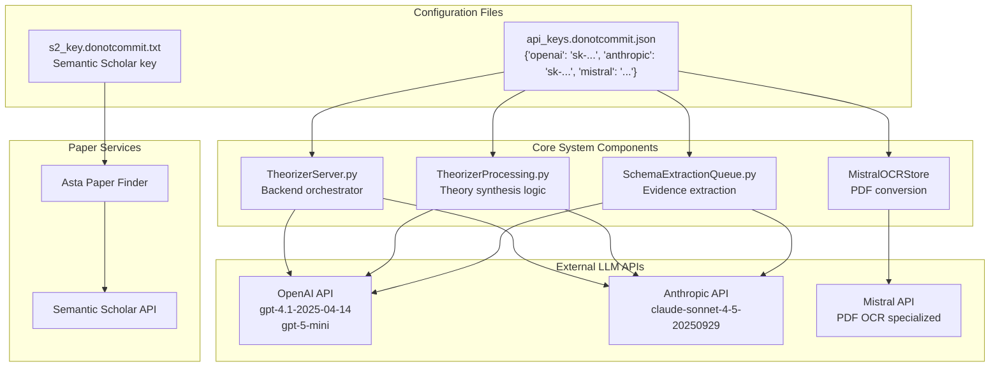
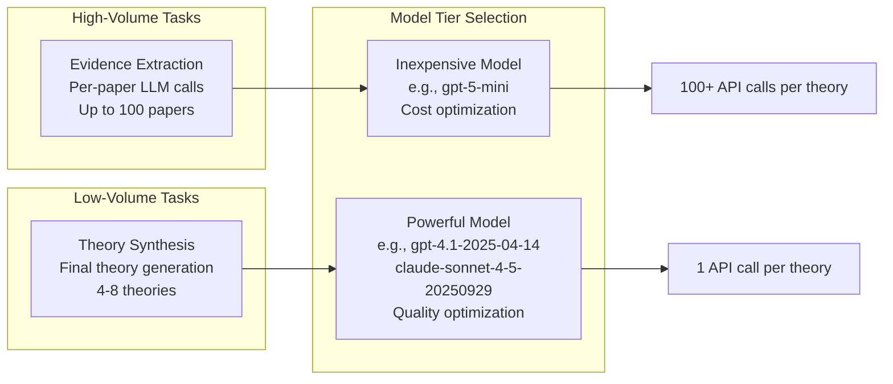
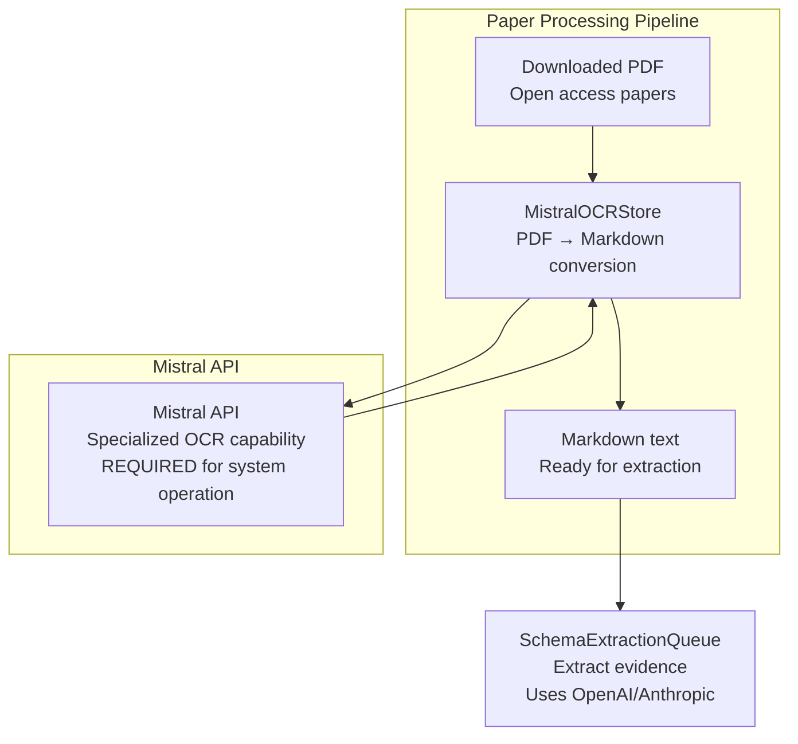
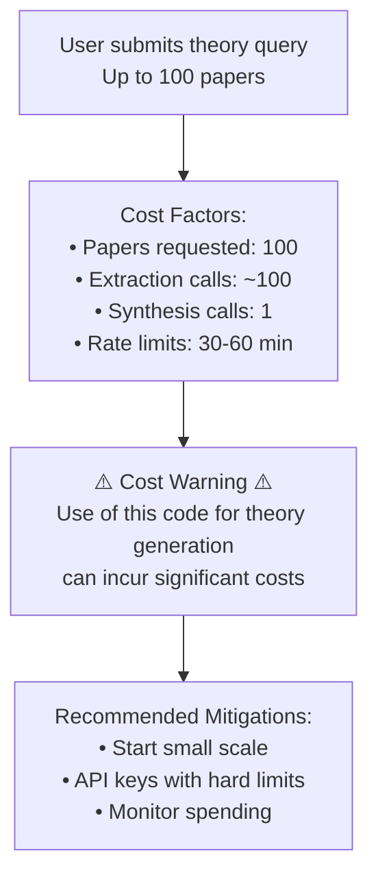
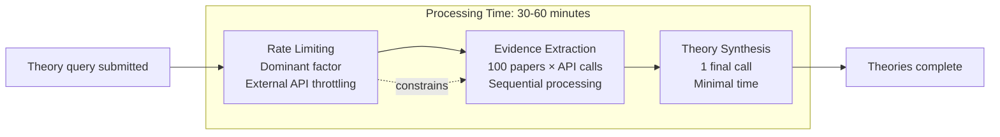

<!-- source: DeepWiki mcp.deepwiki.com · repo allenai/asta-theorizer · page 7.1 LLM Provider Configuration · fetched 2026-10-26 -->

# LLM Provider Configuration

<details>
<summary>Relevant source files</summary>

The following files were used as context for generating this wiki page:

- [README.md](README.md)

</details>


This page documents the configuration of Large Language Model (LLM) providers used throughout the Theorizer system, including API key setup, model selection for different tasks, and cost management strategies. For information about paper retrieval services (Semantic Scholar and Asta Paper Finder), see [Semantic Scholar and Asta Paper Finder](#7.2).

---

## Overview

The Theorizer system integrates three LLM provider APIs to support theory generation and paper processing workflows:

| Provider | Required | Primary Use Cases |
|----------|----------|-------------------|
| **OpenAI** | Optional (but one provider required) | Theory generation, evidence extraction |
| **Anthropic** | Optional (but one provider required) | Theory generation, evidence extraction |
| **Mistral** | **Mandatory** | PDF-to-Markdown OCR conversion |

The system implements a dual-model strategy: inexpensive models for high-volume evidence extraction (up to 100 papers per theory), and powerful models for final theory synthesis.

**Sources:** [README.md:139-148](), [README.md:224-232]()

---

## API Key Configuration

### File Structure

API keys must be configured in two separate files located in the repository root:

**File: `api_keys.donotcommit.json`**

This JSON file contains credentials for all three LLM providers:

```json
{
    "openai": "sk-proj-...",
    "anthropic": "sk-ant-...",
    "mistral": "..."
}
```

**File: `s2_key.donotcommit.txt`**

This text file contains the Semantic Scholar API key on a single line (not an LLM provider, but part of the external dependency configuration):

```
<your key here>
```

### Security Considerations

- Both files follow the `.donotcommit` naming convention to prevent accidental version control commits
- Files should be created manually and are excluded from the repository via `.gitignore`
- Keys should have hard spending limits configured at the provider level to prevent unexpected cost overruns

**Sources:** [README.md:139-157]()

---

## API Key Flow Architecture



**Diagram: API Key Distribution to System Components**

This diagram shows how API credentials flow from configuration files to various system components that make external API calls. The `MistralOCRStore` exclusively uses Mistral for PDF conversion, while `TheorizerProcessing` and `SchemaExtractionQueue` can use either OpenAI or Anthropic depending on user-selected models.

**Sources:** [README.md:139-166](), [README.md:224-232]()

---

## Model Selection Strategy

### Two-Tier Model Architecture

The system implements a cost-optimized dual-model strategy:



**Diagram: Dual-Model Strategy for Cost Optimization**

**Sources:** [README.md:224-232]()

### User Configuration Parameters

When submitting a theory query via the web interface or API, users configure:

| Parameter | Purpose | Typical Selection |
|-----------|---------|-------------------|
| **Model for Theory Generation** | Synthesizes final theories from aggregated evidence | Powerful model (e.g., `gpt-4.1-2025-04-14`, `claude-sonnet-4-5-20250929`) |
| **Model for Literature Extraction** | Extracts evidence from each paper individually | Inexpensive model (e.g., `gpt-5-mini`) |

The extraction model parameter only applies to literature-supported generation mode. Parametric generation mode only uses the theory generation model.

**Sources:** [README.md:224-232]()

---

## Provider-Specific Roles and Capabilities

### Mistral: Mandatory PDF Conversion



**Diagram: Mistral's Mandatory Role in PDF Processing**

Mistral provides specialized PDF-to-Markdown OCR capabilities that are unavailable from OpenAI or Anthropic. The system cannot process literature-supported theories without a valid Mistral API key, as paper PDFs must be converted to text before evidence extraction.

**Sources:** [README.md:141](), [README.md:227-232]()

### OpenAI and Anthropic: Interchangeable for Generation

OpenAI and Anthropic APIs serve interchangeable roles for theory generation and evidence extraction. Users select which provider's models to use via the web interface parameters. Common model selections:

**OpenAI Models:**
- `gpt-4.1-2025-04-14` - Powerful model for theory synthesis
- `gpt-5-mini` - Inexpensive model for evidence extraction

**Anthropic Models:**
- `claude-sonnet-4-5-20250929` - Powerful model for theory synthesis

The system maintains provider flexibility to accommodate user preferences, API availability, and cost considerations.

**Sources:** [README.md:224-229](), [README.md:469](), [README.md:364]()

---

## Cost Management Strategies

### System-Level Cost Optimization

The architecture implements several cost-conscious design patterns:

1. **Dual-Model Strategy**: Uses inexpensive models for high-volume extraction tasks (100+ API calls), expensive models only for synthesis (1 call)

2. **Caching**: 
   - `PaperStore` caches full-text papers to avoid re-downloading and re-converting PDFs
   - `TheoryStore` caches extraction results to avoid re-extracting from the same papers

3. **Configurable Paper Count**: Users specify maximum papers (up to 100), allowing cost-coverage tradeoffs

4. **Single Synthesis Call**: Final theory generation makes one API call to synthesize 4-8 theories from aggregated evidence

**Sources:** [README.md:224-232](), [README.md:252-258]()

### Cost Warning and Hard Limits



**Diagram: Cost Warning System**

The README prominently displays cost warnings advising users to:
- Start with small-scale experiments to gauge costs
- Configure hard spending limits on API keys at the provider level
- Monitor API usage to avoid unexpected overruns

A single literature-supported theory request with 100 papers can generate over 100 API calls, dominated by extraction tasks.

**Sources:** [README.md:198](), [README.md:102]()

---

## Rate Limiting and Performance Implications

### Processing Time Breakdown



**Diagram: Rate Limiting Impact on Processing Time**

The 30-60 minute processing time per theory query is explicitly attributed to external API rate limiting rather than local computation. This positions Theorizer for batch research workflows rather than real-time applications.

**Key Implications:**

| Aspect | Impact |
|--------|--------|
| **Processing Mode** | Batch-oriented, not real-time |
| **Bottleneck** | External API rate limits, not local CPU/memory |
| **Workflow Design** | Submit multiple queries, wait for batch completion |
| **Monitoring** | Status page shows active queue and processing state |

The web interface provides a status monitoring page for tracking active theory generation requests, as completion may take over an hour.

**Sources:** [README.md:102](), [README.md:236-243]()

---

## Configuration Validation

### Required vs Optional Keys

The system requires different API keys depending on the generation mode:

| Generation Mode | Required API Keys |
|-----------------|-------------------|
| **Literature-Supported** | Mistral (PDF conversion) + (OpenAI OR Anthropic) |
| **Parametric** | (OpenAI OR Anthropic) only |

At minimum, the system requires:
- One of: OpenAI or Anthropic key (for generation)
- Mistral key (if using literature-supported mode)

Missing required keys will cause runtime errors when attempting theory generation.

**Sources:** [README.md:139-166](), [README.md:226-232]()

---

## Model-Specific Examples from Evaluation Outputs

The following model identifiers appear in actual evaluation results from the example theories:

**Theory Generation Models:**
- `gpt-4.1-2025-04-14` - Used in surprisal evaluation example
- `claude_sonnet_4_5_20250929` - Used in predictive accuracy evaluation example

**File Naming Convention:**

Evaluation results are saved with model identifiers in the path:
```
predictive-accuracy-evaluation/claude_sonnet_4_5_20250929/predictive_accuracy_summary.json
```

This allows tracking which model generated specific theories and comparing performance across providers.

**Sources:** [README.md:364](), [README.md:469]()

---

## Summary

The LLM provider configuration implements a flexible, cost-conscious architecture:

- **Three providers** with distinct roles: Mistral (mandatory PDF conversion), OpenAI/Anthropic (interchangeable generation)
- **Dual-model strategy** optimizes costs by using cheap models for extraction, expensive models for synthesis
- **Manual API key setup** requires creating `api_keys.donotcommit.json` with all three provider credentials
- **Rate limiting dominates processing time** (30-60 minutes per theory), positioning system for batch research workflows
- **Cost management requires user diligence**: hard limits on API keys, small-scale testing, manual export of results

For paper retrieval configuration, see [Semantic Scholar and Asta Paper Finder](#7.2). For cost optimization strategies across the full system architecture, see [Cost Optimization Strategies](#8.2).

**Sources:** [README.md:139-166](), [README.md:198](), [README.md:224-243]()

---

