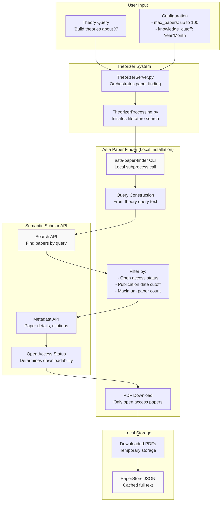
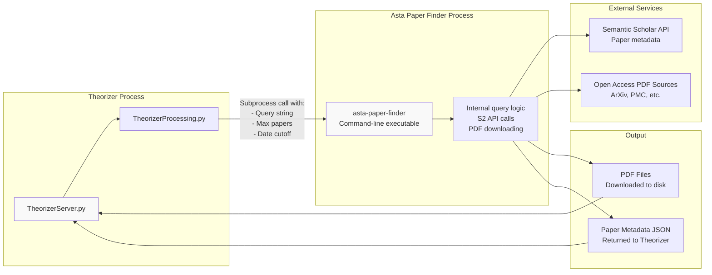
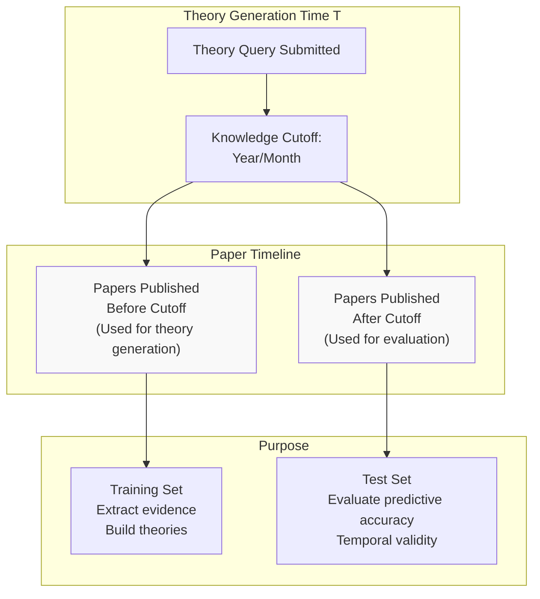
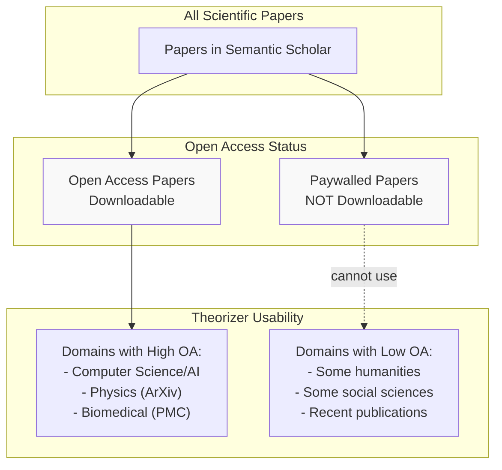
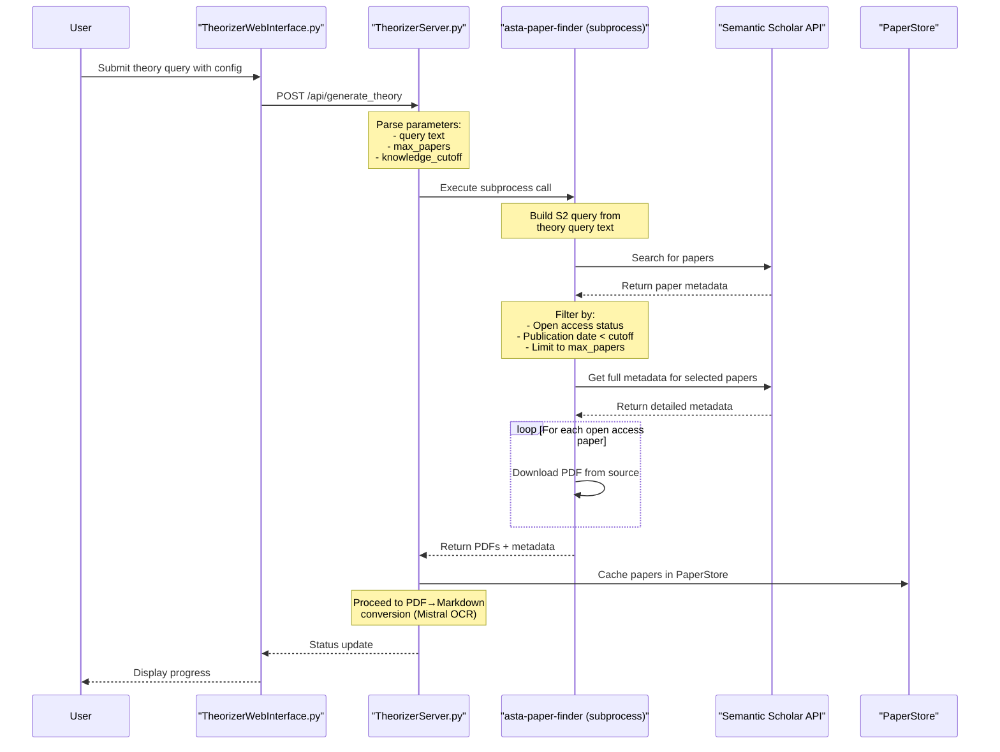

<!-- source: DeepWiki mcp.deepwiki.com · repo allenai/asta-theorizer · page 7.2 Semantic Scholar and Asta Paper Finder · fetched 2026-10-26 -->

# Semantic Scholar and Asta Paper Finder

<details>
<summary>Relevant source files</summary>

The following files were used as context for generating this wiki page:

- [README.md](README.md)

</details>


## Purpose and Scope

This page documents the paper retrieval pipeline used by Theorizer for literature-supported theory generation. It covers the integration of Semantic Scholar API for paper metadata and the local Asta Paper Finder tool for paper discovery and download. For information about converting downloaded PDFs to markdown, see [LLM Provider Configuration](#7.1). For information about how downloaded papers are cached and stored, see [PaperStore Structure](#5.2).

## Overview

Theorizer's literature-supported theory generation mode requires access to scientific papers from which evidence can be extracted. This is accomplished through a two-component architecture:

1. **Semantic Scholar API**: Provides paper metadata including titles, authors, publication dates, citation information, and open access status
2. **Asta Paper Finder**: A local tool that queries Semantic Scholar, identifies downloadable papers, and retrieves PDF files

Both components are required for literature-supported theory generation. Parametric theory generation bypasses this pipeline entirely.

**Sources**: [README.md:1-586]()

## Architecture: Paper Retrieval Pipeline



**Sources**: [README.md:158-165](), [README.md:220-232]()

## Semantic Scholar API Integration

### API Key Configuration

Theorizer requires a Semantic Scholar API key stored in `s2_key.donotcommit.txt` in the project root directory. This file must contain a single line with the API key:

```
<your-semantic-scholar-api-key>
```

The `.donotcommit` suffix ensures the file is excluded from version control to prevent accidental key exposure.

**Sources**: [README.md:152-156]()

### Role in the System

Semantic Scholar API serves two primary functions:

1. **Paper Discovery**: Accepts natural language queries and returns relevant papers from the academic corpus
2. **Metadata Provision**: Supplies critical information including:
   - Paper titles, authors, and venues
   - Publication dates (used for knowledge cutoff filtering)
   - Open access status (determines downloadability)
   - Citation relationships
   - Paper IDs for retrieval

The API is accessed indirectly through Asta Paper Finder rather than called directly by Theorizer code.

**Sources**: [README.md:220-232]()

### Rate Limits and Coverage

Semantic Scholar API queries are subject to rate limiting, though this is less of a bottleneck than LLM API calls. The system's coverage is limited to papers indexed by Semantic Scholar, which spans multiple disciplines but may have gaps in certain specialized domains.

**Sources**: [README.md:102]()

## Asta Paper Finder Integration

### Local Installation Requirement

Asta Paper Finder must be installed locally before running literature-supported theory generation. It is available at:

```
https://github.com/allenai/asta-paper-finder
```

This is a **required dependency** for literature-supported mode. The Theorizer system expects the `asta-paper-finder` command-line tool to be available in the system path.

**Sources**: [README.md:158-165]()

### Integration Pattern



**Sources**: [README.md:158-165](), [README.md:220-232]()

### Asta Paper Finder Functionality

Asta Paper Finder encapsulates the following operations:

| Function | Description |
|----------|-------------|
| **Query Execution** | Translates theory queries into Semantic Scholar search queries |
| **Result Filtering** | Applies knowledge cutoff dates and paper count limits |
| **Open Access Detection** | Identifies which papers are available for download |
| **PDF Download** | Retrieves PDF files from open access sources |
| **Metadata Aggregation** | Returns structured paper information to Theorizer |

The tool abstracts away the complexity of interacting with multiple PDF sources and handling various open access repository formats.

**Sources**: [README.md:158-165]()

## Configuration Parameters

### Maximum Paper Count

Literature-supported theory generation allows specification of the maximum number of papers to retrieve (up to 100 papers). This parameter balances:

- **Evidence Coverage**: More papers provide broader evidence base
- **API Costs**: More papers mean more extraction LLM calls
- **Processing Time**: Linear increase in extraction time

**Sources**: [README.md:220-232]()

### Knowledge Cutoff Date



The knowledge cutoff parameter (Year/Month format) enables temporal validity testing by:

1. Restricting theory generation to papers published before the cutoff date
2. Reserving papers published after the cutoff for evaluation
3. Testing whether theories can predict future research findings

This design supports the predictive accuracy evaluation methodology documented in [Predictive Accuracy Evaluation](#4.2).

**Sources**: [README.md:220-232]()

## Open Access Limitation

### Critical Constraint

The most significant limitation of the paper retrieval pipeline is the **open access requirement**. Asta Paper Finder can only download papers that are freely available. This creates domain-specific coverage gaps:



As stated in the README: "The only limitation for a given field is whether the papers are likely to be downloadable by Theorizer as open-access."

**Sources**: [README.md:78-81]()

### Domain-Specific Implications

| Domain | Open Access Availability | Theory Generation Viability |
|--------|--------------------------|----------------------------|
| Computer Science / AI | High (ArXiv, conference proceedings) | Excellent |
| Physics | High (ArXiv) | Excellent |
| Biomedical Research | Moderate-High (PubMed Central) | Good |
| Chemistry | Moderate (mixed sources) | Fair |
| Social Sciences | Low-Moderate (varies by field) | Limited |
| Humanities | Low (mostly paywalled) | Poor |

**Sources**: [README.md:78-81]()

## Data Flow: Theory Query to Downloaded Papers



**Sources**: [README.md:220-232](), [README.md:158-165]()

## Error Handling and Reliability

### Common Failure Modes

| Issue | Cause | Impact | Mitigation |
|-------|-------|--------|------------|
| **No papers found** | Query too specific or obscure topic | Cannot generate literature-supported theory | Broaden query or use parametric mode |
| **Insufficient open access papers** | Domain has low OA coverage | Weak evidence base | Increase max_papers or use parametric mode |
| **Asta not in PATH** | Missing local installation | Runtime error | Verify installation per README |
| **S2 API rate limit** | Excessive requests | Temporary failure | Retry with backoff |
| **PDF download failures** | Source unavailable | Partial paper set | System continues with available papers |

**Sources**: [README.md:158-165]()

### Fallback Behavior

When insufficient papers are retrieved:
- The system proceeds with available papers if count > 0
- Extraction quality degrades with fewer papers
- Users should monitor paper counts in status interface

**Sources**: [README.md:236-243]()

## Cost and Performance Characteristics

### Processing Time

The paper retrieval phase is typically **not** the dominant time bottleneck. The 30-60 minute processing time for literature-supported theories is primarily driven by:

1. LLM extraction calls (up to 100 papers × extraction model)
2. LLM rate limits
3. PDF→Markdown conversion via Mistral

Paper finding via Asta typically completes in 1-5 minutes.

**Sources**: [README.md:102]()

### API Costs

Semantic Scholar API access is free for academic use, so paper retrieval itself incurs **no direct cost**. Costs are dominated by:
- Mistral API calls for PDF conversion (required, moderate cost)
- Extraction model calls (high volume, use inexpensive model)
- Generation model calls (low volume, use powerful model)

**Sources**: [README.md:197-198]()

## Domain Applicability

As noted in the README: "You can use Theorizer to make theories in any discipline indexed by Semantic Scholar, and we have used it internally to generate theories in other domains (e.g. biomedical)."

The primary constraint is open access paper availability rather than subject matter restrictions. Fields with strong open access cultures (CS, physics, biomedical) are better suited than fields with primarily paywalled literature.

**Sources**: [README.md:78-81]()

---

