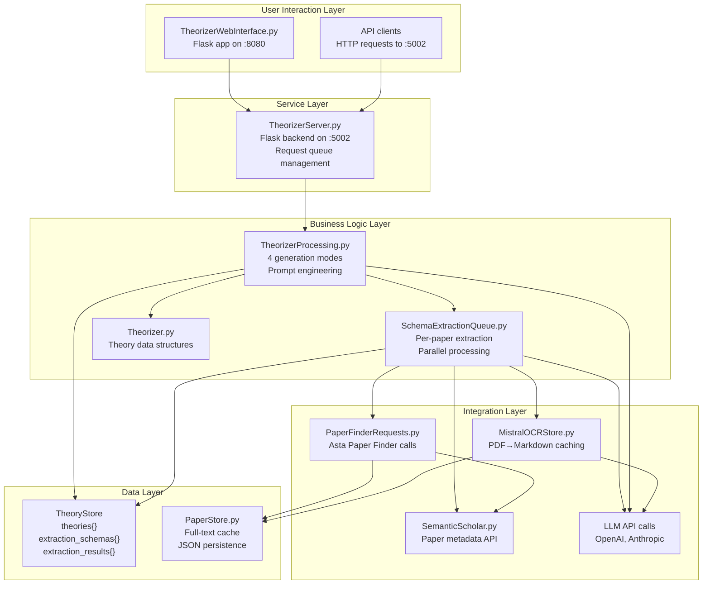
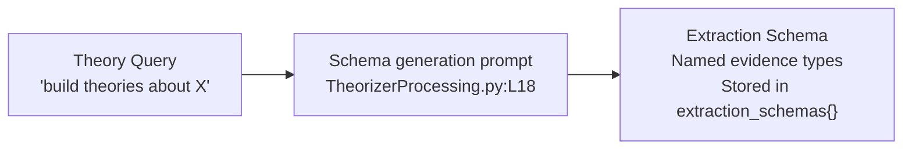
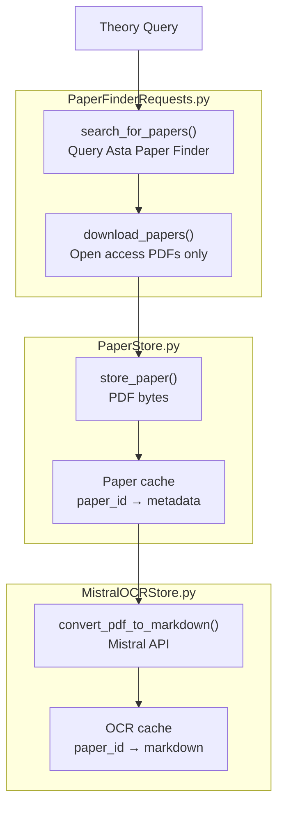
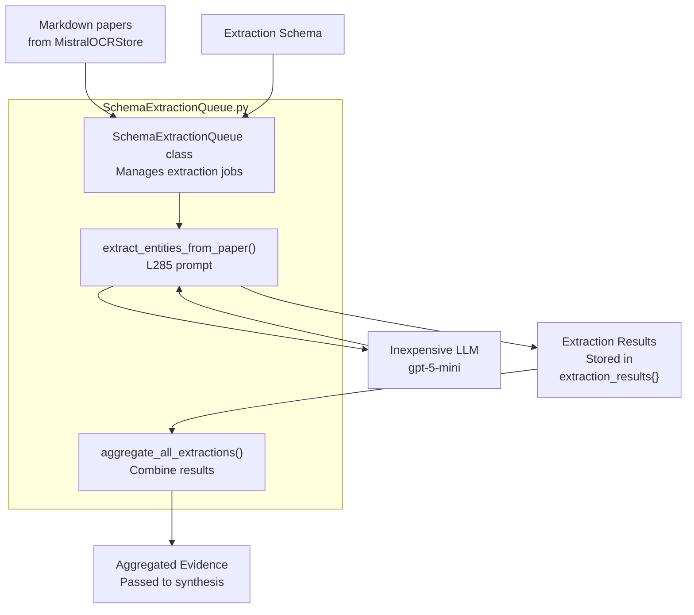
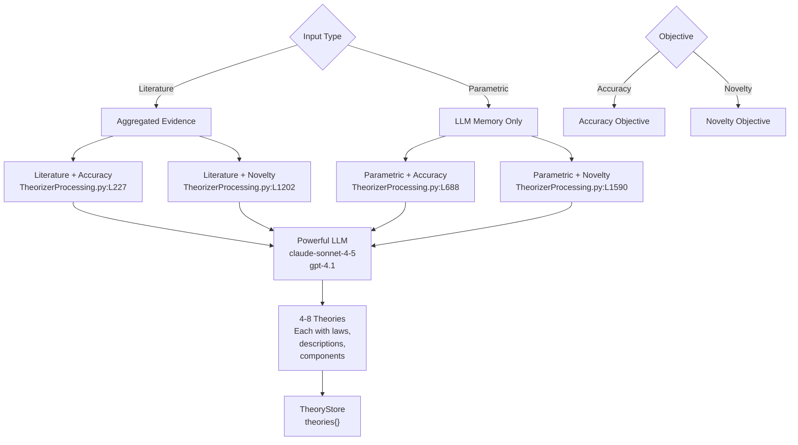
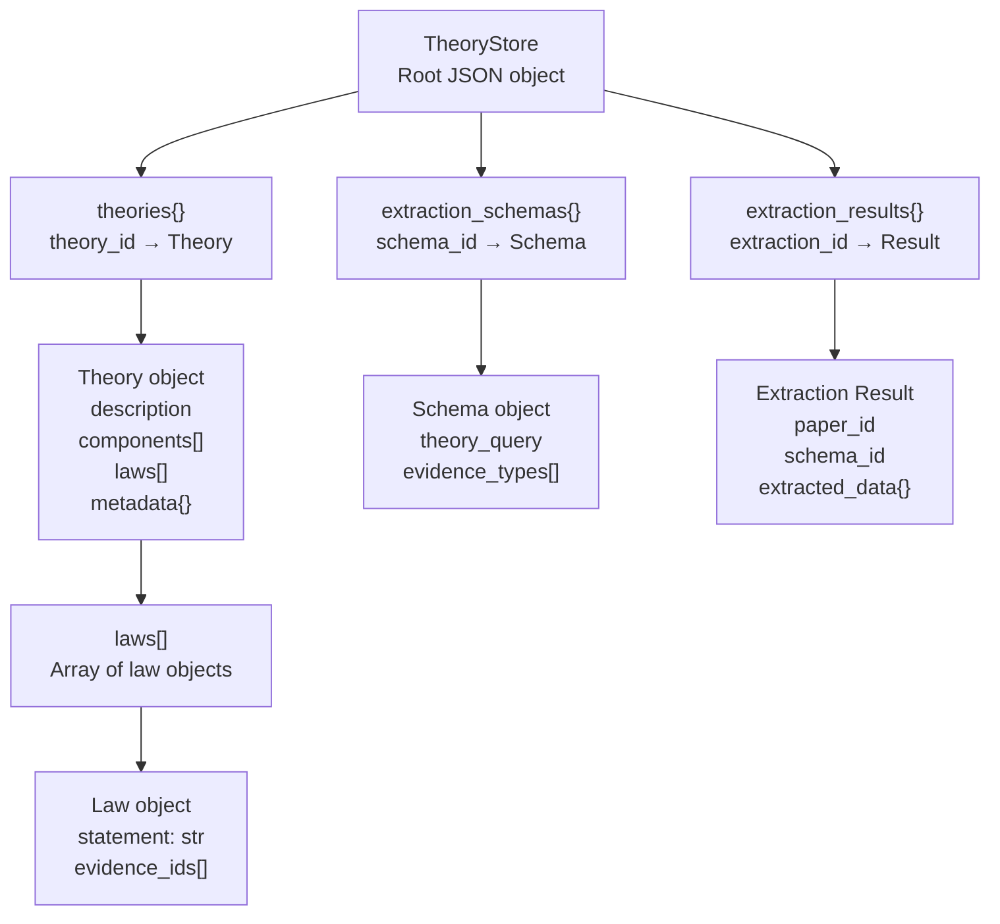
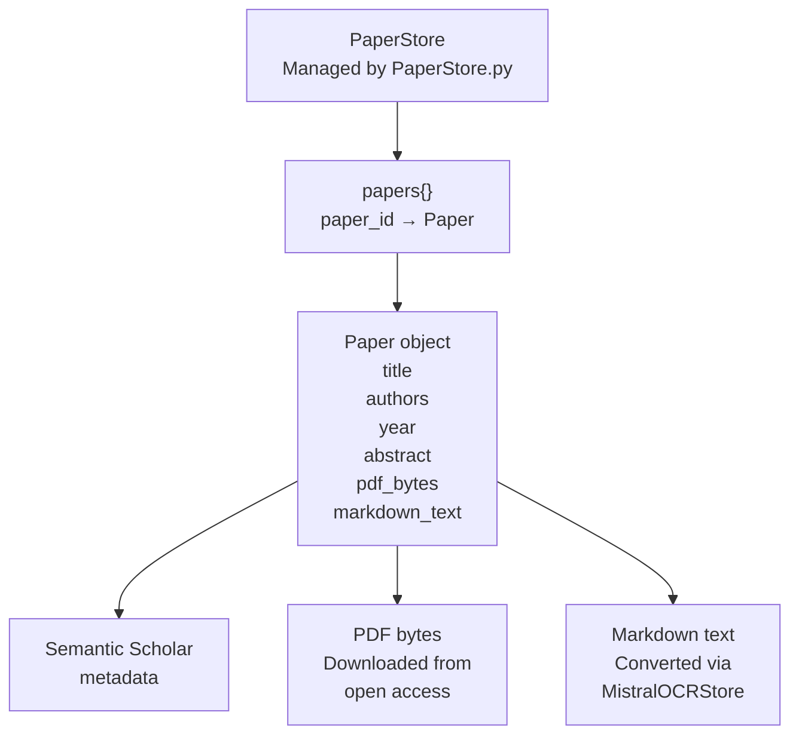
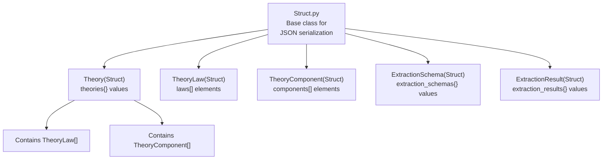
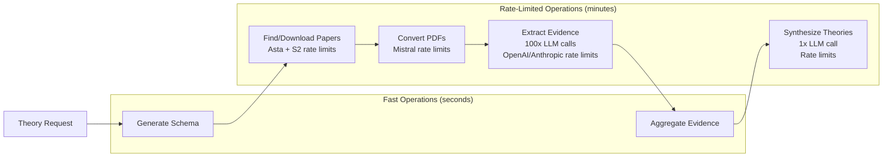

<!-- source: DeepWiki mcp.deepwiki.com · repo allenai/asta-theorizer · page 8 Architecture and Design · fetched 2026-10-26 -->

# Architecture and Design

<details>
<summary>Relevant source files</summary>

The following files were used as context for generating this wiki page:

- [README.md](README.md)
- [TODO.txt](TODO.txt)

</details>


This page provides a deep dive into Theorizer's internal architecture, examining the separation of concerns across components, the multi-stage processing pipeline, and key design decisions that enable scalable theory generation. For details on the 2×2 factorial experimental design implemented within this architecture, see [Configuration Space and Experimental Design](#8.1). For documentation of cost management strategies, see [Cost Optimization Strategies](#8.2).

## System Overview

Theorizer implements a **layered service-oriented architecture** with clear boundaries between user interaction, business logic, external service integration, and data persistence. The system is designed for batch research workflows where 30-60 minute processing times are acceptable, prioritizing thoroughness over real-time responsiveness.

### Core Components



**Sources:** [src/TheorizerServer.py](), [src/TheorizerWebInterface.py](), [src/TheorizerProcessing.py](), [src/SchemaExtractionQueue.py](), [src/Theorizer.py](), [src/PaperFinderRequests.py](), [src/MistralOCRStore.py](), [src/SemanticScholar.py](), [src/PaperStore.py]()

## Server-Client Architecture

The system employs a **dual-server architecture** where the backend and frontend run as separate processes, communicating via HTTP.

### TheorizerServer.py: Backend Orchestrator

`TheorizerServer.py` implements a Flask server on port 5002 that manages the theory generation request queue. It maintains in-memory state for:
- **Active theory requests**: Requests currently being processed
- **Completed theories**: Results available for retrieval
- **TheoryStore instance**: Persistent theory data
- **PaperStore instance**: Cached paper full-text

Key responsibilities:
- Accept theory generation requests via POST endpoints
- Queue management with sequential processing
- Background thread execution for long-running theory generation
- Serialization/deserialization of theory data structures
- Auto-save functionality after each theory completion

### TheorizerWebInterface.py: Web Frontend

`TheorizerWebInterface.py` implements a Flask server on port 8080 that provides the HTML/CSS/JavaScript interface. It acts as a thin client that:
- Renders HTML views from templates
- Forwards user requests to `TheorizerServer.py:5002`
- Displays theory lists, details, and extraction results
- Provides export functionality for JSON data

The separation allows programmatic access via direct API calls to port 5002, bypassing the web UI entirely.

**Request Flow Diagram:**

```mermaid
sequenceDiagram
    participant User
    participant WebUI["TheorizerWebInterface<br/>:8080"]
    participant Server["TheorizerServer<br/>:5002"]
    participant Processing["TheorizerProcessing"]
    participant External["External Services"]
    
    User->>WebUI: "Submit theory query<br/>via HTML form"
    WebUI->>Server: "POST /api/create_theory<br/>JSON request"
    Server->>Server: "Add to request queue"
    Server-->>WebUI: "202 Accepted<br/>request_id"
    WebUI-->>User: "Display confirmation"
    
    Server->>Server: "Background thread<br/>dequeue request"
    Server->>Processing: "generate_theories_workflow()"
    
    alt Literature-Supported Mode
        Processing->>External: "Find papers via Asta"
        Processing->>External: "Convert PDFs via Mistral"
        Processing->>Processing: "Generate schema"
        Processing->>Processing: "Extract per-paper<br/>SchemaExtractionQueue"
        Processing->>External: "100x LLM calls<br/>cheap model"
    end
    
    Processing->>External: "Synthesize theories<br/>1x LLM call<br/>powerful model"
    Processing->>Server: "Return theories"
    Server->>Server: "Store in TheoryStore<br/>Auto-save backup"
    
    User->>WebUI: "Poll status"
    WebUI->>Server: "GET /api/server_status"
    Server-->>WebUI: "Active requests JSON"
    WebUI-->>User: "Display progress"
    
    User->>WebUI: "View theories"
    WebUI->>Server: "GET /api/list_theories"
    Server-->>WebUI: "Theory list JSON"
    WebUI-->>User: "Render HTML table"
```

**Sources:** [src/TheorizerServer.py](), [src/TheorizerWebInterface.py](), [src/TheorizerProcessing.py]()

## Processing Pipeline Architecture

The core theory generation workflow is implemented as a **multi-stage pipeline** that transforms a theory query into synthesized theories through evidence gathering and aggregation.

### Stage 1: Schema Generation

When a literature-supported theory request is received, the first step is generating an extraction schema tailored to the theory query.



The schema defines:
- **Evidence categories**: Named types of information to extract (e.g., "methodology", "findings", "limitations")
- **Extraction instructions**: How to identify and structure each evidence type
- **Schema ID**: UUID for tracking which schema was used

**Sources:** [src/TheorizerProcessing.py:18]()

### Stage 2: Paper Acquisition and Conversion

For literature-supported theories, the system must acquire and convert papers into processable text.



Key components:
- **PaperFinderRequests.py**: Wraps Asta Paper Finder API, handles paper search and download
- **PaperStore.py**: JSON-based cache of paper metadata and PDF bytes, prevents re-downloading
- **MistralOCRStore.py**: Converts PDFs to Markdown using Mistral's specialized OCR model, caches results

This stage respects:
- **Knowledge cutoff**: Only papers before specified year/month
- **Open access constraint**: Cannot download paywalled papers
- **Paper count limit**: Up to 100 papers (configurable)

**Sources:** [src/PaperFinderRequests.py](), [src/PaperStore.py](), [src/MistralOCRStore.py]()

### Stage 3: Evidence Extraction

Once papers are converted to Markdown, evidence is extracted per-paper using the schema generated in Stage 1.



**Extraction Process:**
1. **Queue initialization**: Create `SchemaExtractionQueue` with schema, papers, and model config
2. **Per-paper extraction**: For each paper, call LLM with:
   - Schema definition
   - Paper full-text (markdown)
   - Extraction prompt [src/SchemaExtractionQueue.py:285]()
3. **Result storage**: Store each extraction result with unique ID in `extraction_results{}`
4. **Aggregation**: Combine all extraction results into structured evidence dictionary

The extraction prompt [src/SchemaExtractionQueue.py:285]() instructs the LLM to:
- Identify instances of each evidence type in the paper
- Quote relevant text spans
- Structure output as JSON matching the schema

**Sources:** [src/SchemaExtractionQueue.py:285](), [src/SchemaExtractionQueue.py]()

### Stage 4: Theory Synthesis

The final stage synthesizes theories from aggregated evidence (or parametric knowledge) using one of four generation prompts.



Each prompt instructs the LLM to:
- Generate multiple distinct theories (typically 4-8)
- Structure each theory with:
  - High-level description
  - Theory components (concepts, relationships)
  - Theory laws/statements (specific claims)
- For literature-supported modes: Cite evidence IDs to support claims
- For accuracy modes: Prioritize factual correctness
- For novelty modes: Prioritize originality and unexplored directions

**Sources:** [src/TheorizerProcessing.py:227](), [src/TheorizerProcessing.py:688](), [src/TheorizerProcessing.py:1202](), [src/TheorizerProcessing.py:1590]()

## Data Structure Architecture

The system uses two primary JSON-based data structures for persistence.

### TheoryStore Structure



**Key relationships:**
- Theories reference extraction results via `evidence_ids` in laws
- Extraction results reference schemas via `schema_id`
- Extraction results reference papers via `paper_id`

This structure enables:
- **Traceability**: Follow evidence chain from law → extraction result → paper
- **Reusability**: Same extraction schema can be used across multiple papers
- **Modularity**: Theories, schemas, and extractions stored independently

### PaperStore Structure



The `PaperStore` acts as a persistent cache, avoiding:
- Re-downloading papers from external sources
- Re-converting PDFs with Mistral OCR API
- Re-fetching metadata from Semantic Scholar

**Copyright considerations:** The README notes that redistributing `PaperStore` files raises copyright concerns, as they contain full-text of papers. This is why example datasets exclude paper full-text.

**Sources:** [src/PaperStore.py](), [src/Theorizer.py](), [README.md:254]()

## Design Decisions

### Decision 1: JSON-Based Persistence

**Rationale:** The system uses JSON files for both `TheoryStore` and `PaperStore` rather than a database.

**Trade-offs:**
- ✅ **Simplicity**: No database setup required
- ✅ **Portability**: JSON files easily shared and versioned
- ✅ **Transparency**: Human-readable for debugging
- ❌ **Scalability**: In-memory loading for large datasets
- ❌ **Concurrency**: No built-in transaction support

This choice reflects the system's research orientation—batch processing of hundreds to thousands of theories is the expected workload, not millions of concurrent requests.

### Decision 2: Server-Client Separation

**Rationale:** Run backend (`TheorizerServer.py`) and frontend (`TheorizerWebInterface.py`) as separate processes.

**Benefits:**
- **API access**: Programmatic clients can bypass web UI
- **Modularity**: Frontend can be replaced without changing backend
- **Debugging**: Backend logs separate from web server logs
- **Flexibility**: Different deployment configurations (e.g., remote backend)

The API endpoint structure in `TheorizerServer.py` closely mirrors the web UI routes in `TheorizerWebInterface.py`, maintaining consistency.

### Decision 3: Multi-Model Architecture

**Rationale:** Use different LLM models for extraction vs. synthesis.

The system allows specifying:
- **Extraction model**: Used for per-paper evidence extraction (called ~100 times)
- **Generation model**: Used for final theory synthesis (called once)

This enables cost optimization: use cheap models (e.g., `gpt-5-mini`) for high-volume extraction, expensive models (e.g., `claude-sonnet-4-5`) for critical synthesis. See [Cost Optimization Strategies](#8.2) for details.

### Decision 4: Schema-Based Extraction

**Rationale:** Generate a custom extraction schema for each theory query rather than using fixed templates.

**Benefits:**
- **Flexibility**: Schema tailored to specific theory domain
- **Expressiveness**: Can capture domain-specific evidence types
- **Reusability**: Same schema applied to all papers for consistency

**Implementation:** The schema generation prompt [src/TheorizerProcessing.py:18]() takes the theory query and produces a structured schema with named evidence types and extraction instructions.

### Decision 5: Caching at Multiple Levels

The system implements caching at three levels:

| Level | Component | Benefit |
|-------|-----------|---------|
| **Paper download** | `PaperStore.papers{}` | Avoid re-downloading PDFs |
| **PDF conversion** | `MistralOCRStore` | Avoid re-paying for Mistral OCR |
| **Extraction results** | `TheoryStore.extraction_results{}` | Reuse evidence for multiple theories |

This multi-level caching is critical for cost management, as external API calls are the dominant expense.

### Decision 6: Separation of Generation and Evaluation

**Rationale:** Evaluation scripts are independent of the generation system.

All evaluation scripts:
- Operate on saved `TheoryStore`/`PaperStore` JSON files
- Can be run multiple times without regenerating theories
- Can be run with different models
- Produce separate timestamped output files

This separation enables:
- **Reproducibility**: Same theories evaluated consistently
- **Cost efficiency**: Don't regenerate theories to test new evaluation metrics
- **Flexibility**: Add new evaluation dimensions without modifying generation code

Evaluation scripts referenced:
- [src/EvaluationLLMAsAJudge.py]()
- [src/EvaluationPredictiveAccuracy.py]()
- [src/EvaluationQualifiedNovelty.py]()
- [src/EvaluationSurprisal.py]()

**Sources:** [src/EvaluationLLMAsAJudge.py](), [src/EvaluationPredictiveAccuracy.py](), [src/EvaluationQualifiedNovelty.py](), [src/EvaluationSurprisal.py](), [README.md:303-475]()

## Component Interaction Patterns

### Pattern 1: Request Queue with Background Processing

`TheorizerServer.py` implements a request queue where theory generation happens in background threads:

```mermaid
sequenceDiagram
    participant Client
    participant Server["TheorizerServer<br/>Main Thread"]
    participant Queue["Request Queue<br/>In-memory list"]
    participant Worker["Background Thread"]
    participant Processing["TheorizerProcessing"]
    
    Client->>Server: "POST /api/create_theory"
    Server->>Queue: "Append request"
    Server->>Worker: "Start thread"
    Server-->>Client: "202 Accepted"
    
    Worker->>Queue: "Dequeue request"
    Worker->>Processing: "generate_theories_workflow()"
    Processing-->>Worker: "Return theories"
    Worker->>Server: "Update TheoryStore"
    Worker->>Server: "Auto-save backup"
    
    Client->>Server: "GET /api/server_status"
    Server-->>Client: "Active requests list"
```

This pattern allows:
- **Non-blocking**: Server remains responsive during long-running generation
- **Monitoring**: Clients can poll status via `/api/server_status`
- **Sequential processing**: Requests processed one at a time (prevents resource contention)

### Pattern 2: Lazy Loading with Caching

Both `PaperStore` and `MistralOCRStore` implement lazy loading:

```python
# Conceptual pattern (not actual code)
def get_paper_markdown(paper_id):
    # Check cache first
    if paper_id in cache:
        return cache[paper_id]
    
    # If not cached, fetch/convert
    pdf_bytes = download_paper(paper_id)
    markdown = convert_pdf_to_markdown(pdf_bytes)
    
    # Store in cache
    cache[paper_id] = markdown
    return markdown
```

This pattern:
- Minimizes external API calls
- Reduces processing time for repeated requests
- Centralizes caching logic in dedicated modules

### Pattern 3: Struct-Based Data Modeling

The `Theorizer.py` module uses the `Struct` class for data modeling:



The `Struct` base class provides:
- **JSON serialization**: `to_dict()` and `from_dict()` methods
- **Type safety**: Field definitions with types
- **Validation**: Automatic checks on field values

This pattern provides a lightweight alternative to full ORMs while maintaining type safety and serialization convenience.

**Sources:** [src/Struct.py](), [src/Theorizer.py]()

## Rate Limiting and Processing Time

The README explicitly states that processing time (30-60 minutes per theory) is **dominated by external API rate limits**, not local computation.



**Implications:**
- System is designed for **batch research workflows**, not real-time applications
- Parallelization offers limited benefit—external rate limits are the bottleneck
- Cost management via API key hard limits is essential
- Sequential request processing is acceptable given long per-request times

**Sources:** [README.md:102](), [README.md:198](), [README.md:243]()

## Export and Backup Strategy

The system implements both automatic and manual data persistence:

### Auto-Save Functionality

After each theory generation completes, `TheorizerServer.py` automatically saves the `TheoryStore`:

```
theorizer-state-autosave-<timestamp>.json
```

⚠️ **The README warns this auto-save is unreliable and should not be relied upon.**

### Manual Export

The web UI provides an explicit "Export" button that saves:
- **TheoryStore JSON**: All theories, schemas, extraction results
- **PaperStore JSON**: All cached papers and conversions

The README strongly recommends manual export as the primary backup mechanism.

### HTML Export

The system can generate HTML reports of theories for human-readable viewing. Example theories in `example-theories/toy-data/html/` demonstrate this format.

**Sources:** [README.md:247-258](), [README.md:499]()

## Extensibility Points

The architecture provides several extensibility points:

| Extension Point | Location | Purpose |
|----------------|----------|---------|
| **New generation prompts** | `TheorizerProcessing.py` | Add new generation modes beyond 2×2 factorial |
| **New evaluation metrics** | `src/Evaluation*.py` | Add new evaluation dimensions |
| **New LLM providers** | LLM wrapper modules | Support additional API providers |
| **New paper sources** | `PaperFinderRequests.py` | Integrate additional paper databases |
| **New export formats** | `TheorizerServer.py` | Generate alternative output formats |

The modular design with clear component boundaries makes these extensions feasible without extensive refactoring.

**Sources:** [src/TheorizerProcessing.py](), [src/TheorizerServer.py]()

---

