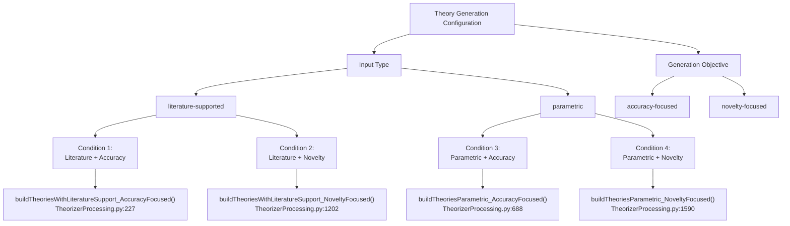
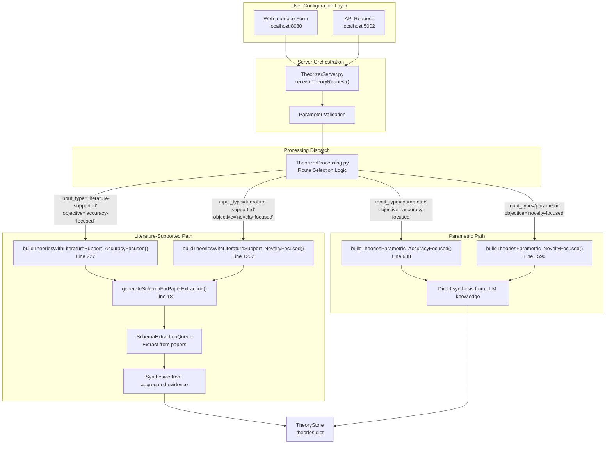
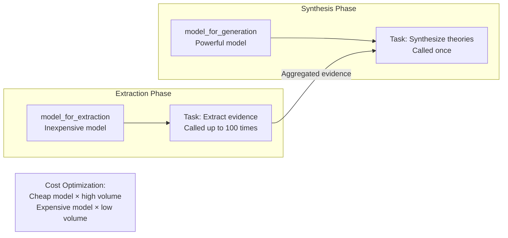
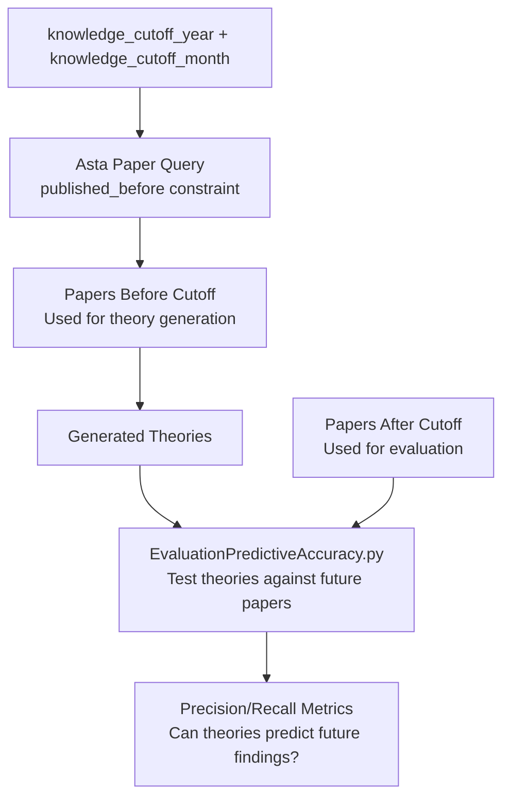
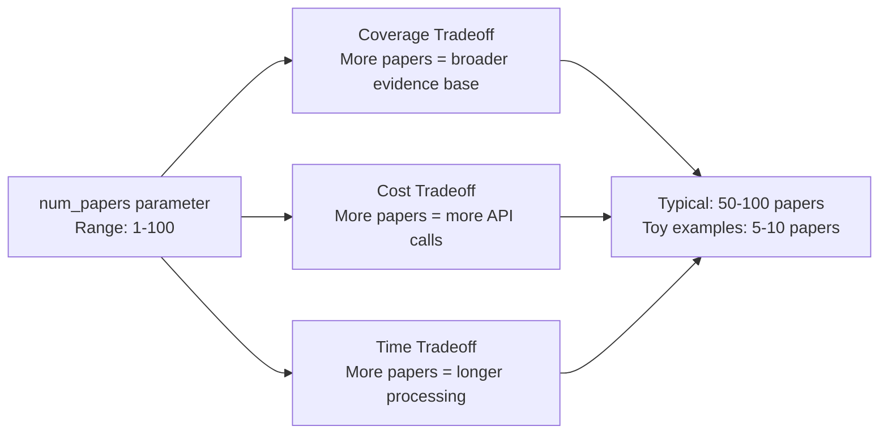
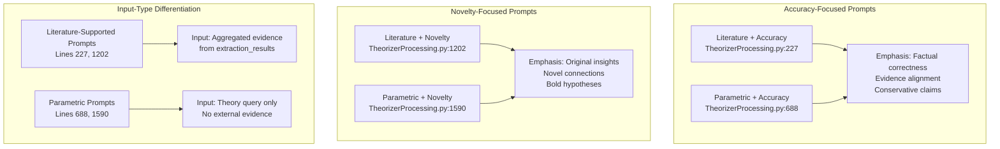
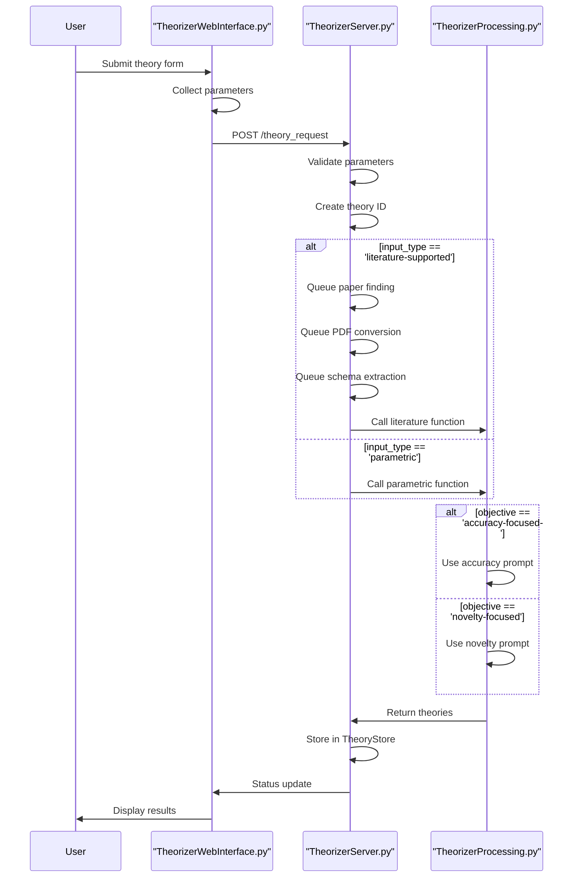
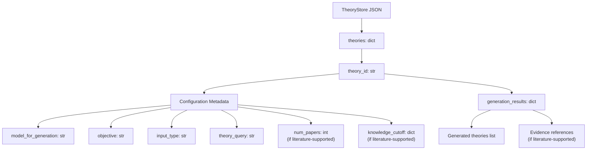
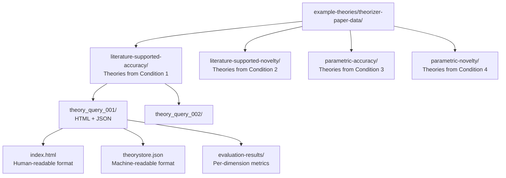
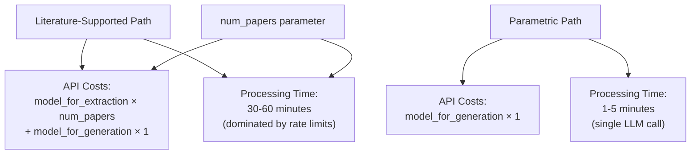

<!-- source: DeepWiki mcp.deepwiki.com · repo allenai/asta-theorizer · page 8.1 Configuration Space and Experimental Design · fetched 2026-10-26 -->

# Configuration Space and Experimental Design

<details>
<summary>Relevant source files</summary>

The following files were used as context for generating this wiki page:

- [README.md](README.md)

</details>


## Purpose and Scope

This page documents the configuration space and experimental design framework that enables Theorizer to generate theories under systematically varied conditions. It covers the 2×2 factorial design (Input Type × Generation Objective), additional configuration parameters, how these configurations map to distinct code execution paths, and the experimental rationale behind this design.

For information about the specific prompts used in each configuration, see [Prompts](#7). For details about the theory generation workflow, see [Theory Generation](#3).

---

## Factorial Design Overview

Theorizer implements a **2×2 factorial experimental design** that creates four distinct theory generation conditions. Each condition uses a different prompt and follows a different code execution path.

### Primary Configuration Axes



**Sources:** [README.md:220-226](), [README.md:522-525]()

---

## Configuration Parameters

### Complete Parameter Set

The following table documents all configuration parameters exposed through the web interface and API:

| Parameter | Type | Scope | Description | Code Reference |
|-----------|------|-------|-------------|----------------|
| `theory_query` | string | All | Natural language request for theories | Theory request payload |
| `model_for_generation` | string | All | LLM model for theory synthesis | Used in all generation functions |
| `objective` | enum | All | `accuracy-focused` or `novelty-focused` | Determines prompt selection |
| `input_type` | enum | All | `literature-supported` or `parametric` | Determines workflow path |
| `model_for_extraction` | string | Literature only | LLM model for per-paper evidence extraction | SchemaExtractionQueue |
| `num_papers` | integer | Literature only | Maximum papers to retrieve (≤100) | Paper finding limit |
| `knowledge_cutoff_year` | integer | Literature only | Temporal cutoff for paper retrieval | Asta query constraint |
| `knowledge_cutoff_month` | integer | Literature only | Month component of cutoff | Asta query constraint |

**Sources:** [README.md:220-232]()

---

## Configuration-to-Code Mapping

### Condition Execution Paths

The following diagram shows how user-facing configuration parameters map to specific code execution paths:



**Sources:** [README.md:169-189](), [README.md:522-525]()

---

## Secondary Configuration Axes

Beyond the primary 2×2 design, additional configuration parameters affect theory generation:

### Model Selection Strategy



**Typical Model Assignments:**

| Phase | Example Models | Rationale |
|-------|---------------|-----------|
| Extraction | `gpt-5-mini`, cheaper Claude variants | High call volume (up to 100 papers) |
| Generation | `gpt-4.1-2025-04-14`, `claude-sonnet-4-5-20250929` | Single call requires maximum capability |

**Sources:** [README.md:225](), [README.md:229]()

### Knowledge Cutoff Configuration

The knowledge cutoff parameters enable temporal validity experiments:



**Experimental Use Case:** Generate theories from papers published before January 2023, then evaluate whether those theories can predict findings from papers published after January 2023.

**Sources:** [README.md:231](), [README.md:530-533]()

### Paper Count Configuration



**Sources:** [README.md:230]()

---

## Experimental Rationale

### Research Questions Addressed by Design

The factorial design enables systematic investigation of four key research questions:

| Comparison | Research Question | Metrics |
|------------|------------------|---------|
| Literature vs Parametric | Does literature grounding improve theory quality? | Predictive accuracy, factual accuracy |
| Accuracy vs Novelty | Does novelty focus sacrifice correctness? | LLM-as-a-judge novelty vs factual accuracy |
| Literature × Accuracy | What is the ceiling for evidence-based accuracy? | Precision/recall on future papers |
| Parametric × Novelty | Can parametric knowledge generate genuinely novel theories? | Qualified novelty assessment |

### Prompt Differentiation Strategy

Each of the four conditions uses a distinct prompt optimized for its configuration:



**Sources:** [README.md:522-525]()

---

## Implementation Details

### Server-Side Configuration Processing

The configuration flow from user input to code execution:



**Sources:** [README.md:169-189](), [README.md:212-233]()

### Configuration State Persistence

Configuration parameters are stored with each theory for reproducibility:



**Storage Purpose:** Enables retrospective analysis of how configuration affects theory properties, supports evaluation comparisons, and ensures experimental reproducibility.

**Sources:** [README.md:485-491]()

---

## Example Theory Archive Structure

The example theory dataset demonstrates all four experimental conditions:



**Data Volume:** Each condition contains theories from multiple queries, totaling approximately 148MB of HTML output across all conditions.

**Sources:** [README.md:505-507]()

---

## Configuration Impact on Evaluation

Different configurations require different evaluation approaches:

| Configuration Aspect | Evaluation Implication | Relevant Evaluator |
|---------------------|----------------------|-------------------|
| `knowledge_cutoff` set | Enables temporal validation | `EvaluationPredictiveAccuracy.py` |
| `input_type='literature-supported'` | Can assess evidence alignment | All evaluators (access to evidence) |
| `objective='novelty-focused'` | Expect higher novelty, potentially lower accuracy | `EvaluationQualifiedNovelty.py` |
| `objective='accuracy-focused'` | Expect higher factual scores | `EvaluationLLMAsAJudge.py` (factual_accuracy) |

**Sources:** [README.md:305-475]()

---

## Cost and Performance Implications

### Configuration-Dependent Resource Usage



**Cost Warning:** Literature-supported mode with 100 papers can incur significant API costs. The README explicitly warns: "Use of this code for theory generation... can incur significant costs."

**Sources:** [README.md:102](), [README.md:198](), [README.md:243]()

---

## API Configuration Format

For programmatic access, configuration is submitted as JSON:

```json
{
  "theory_query": "Build theories about memory architectures for LLM agents",
  "model_for_generation": "gpt-4.1-2025-04-14",
  "objective": "accuracy-focused",
  "input_type": "literature-supported",
  "model_for_extraction": "gpt-5-mini",
  "num_papers": 50,
  "knowledge_cutoff_year": 2023,
  "knowledge_cutoff_month": 1
}
```

**Endpoint:** `POST http://localhost:5002/theory_request`

**Sources:** [README.md:187-191]()

---

## Summary

The configuration space implements a systematic experimental framework:

1. **Primary Design:** 2×2 factorial (Input Type × Objective) with four distinct code paths
2. **Secondary Parameters:** Model selection, knowledge cutoff, paper count
3. **Code Mapping:** Each condition routes to a specific function in `TheorizerProcessing.py`
4. **Experimental Purpose:** Enable comparative analysis of generation strategies
5. **Evaluation Integration:** Configuration parameters directly impact evaluation methodology
6. **Cost Management:** Configuration choices significantly affect API costs and processing time

This design positions Theorizer as both a practical tool (generate theories for a topic) and a research platform (systematically compare generation strategies).

**Sources:** [README.md:1-587](), Diagram 5 from provided architecture documentation

---

