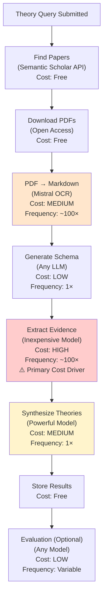
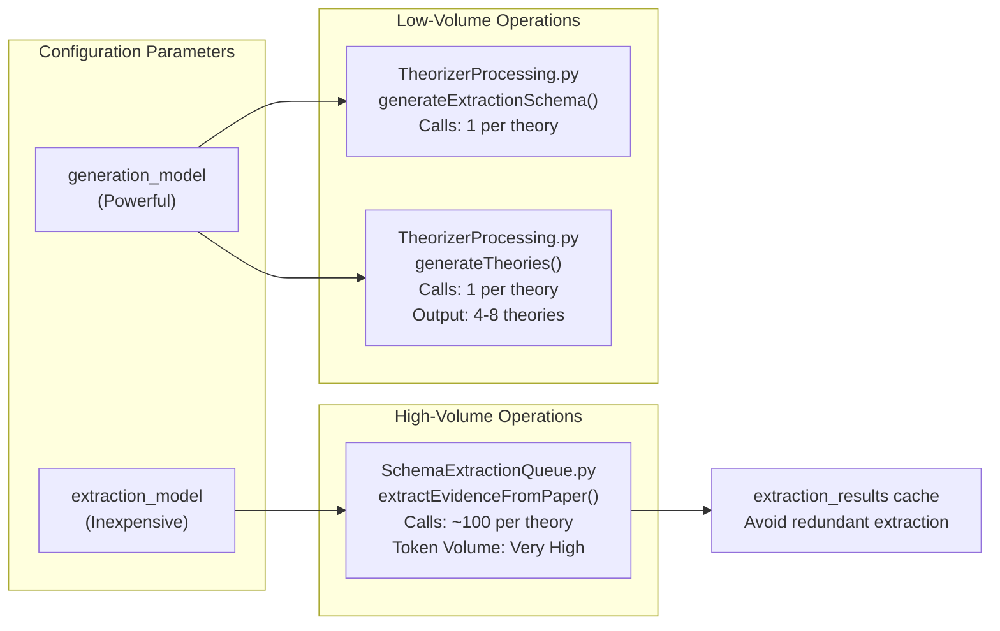
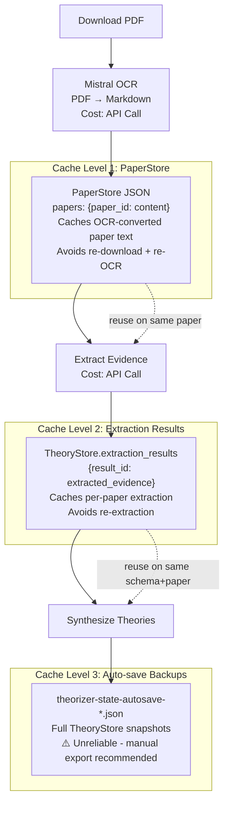
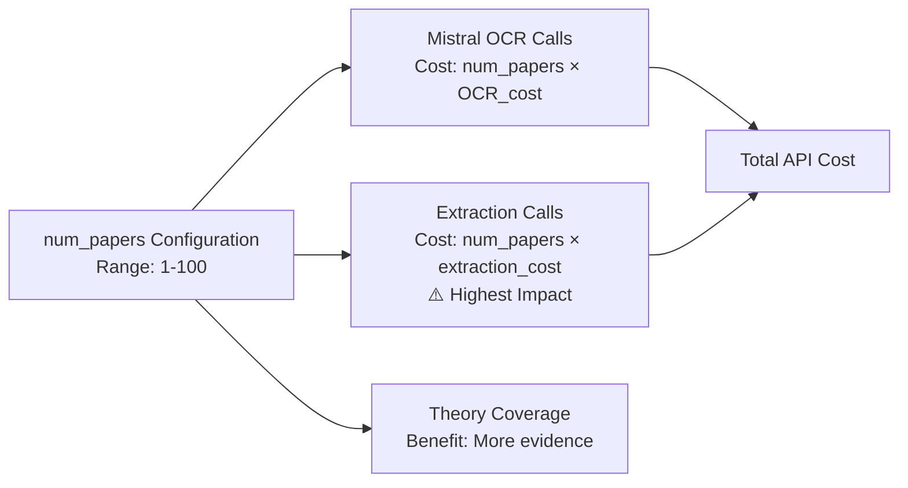
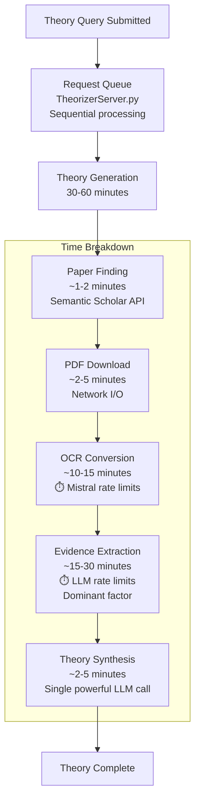
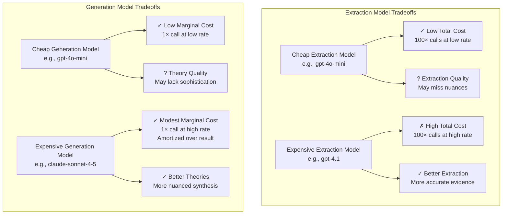

<!-- source: DeepWiki mcp.deepwiki.com · repo allenai/asta-theorizer · page 8.2 Cost Optimization Strategies · fetched 2026-10-26 -->

# Cost Optimization Strategies

<details>
<summary>Relevant source files</summary>

The following files were used as context for generating this wiki page:

- [README.md](README.md)

</details>


## Purpose and Scope

This page documents the cost optimization strategies implemented in the Theorizer system to manage API expenses when generating scientific theories at scale. The system makes extensive use of commercial LLM APIs, which can incur significant costs when processing up to 100 papers per theory query. The strategies covered here include dual-tier model selection, multi-level caching, configuration controls, and operational best practices.

For information about the overall theory generation workflow, see [Theory Generation](#3). For details about configuring specific LLM providers and their costs, see [LLM Provider Configuration](#7.1). For the experimental design that leverages these optimizations, see [Configuration Space and Experimental Design](#8.1).

---

## Cost Factors in Theory Generation

The Theorizer system incurs API costs at multiple stages of the theory generation pipeline. Understanding these cost drivers is essential for optimization.

### Primary Cost Centers

| Operation | Frequency | Model Type | Cost Impact |
|-----------|-----------|------------|-------------|
| **Schema Extraction** | Up to 100 times per theory | Configurable (typically inexpensive) | **HIGH** - Most API calls |
| **Evidence Extraction** | Up to 100 times per theory | Configurable (typically inexpensive) | **HIGH** - Most tokens processed |
| **Theory Synthesis** | 1 time per theory (generates 4-8 theories) | Configurable (typically powerful) | **MEDIUM** - Single expensive call |
| **PDF to Markdown Conversion** | Up to 100 times per theory | Mistral (required) | **MEDIUM** - Specialized capability |
| **Evaluation (LLM-as-a-Judge)** | 6 dimensions × number of theories | Configurable | **LOW** - Optional, post-hoc |
| **Predictive Accuracy Evaluation** | Variable (depends on future papers) | Configurable | **LOW** - Optional, post-hoc |
| **Qualified Novelty Evaluation** | ~23 papers × number of theories | Configurable | **LOW** - Optional, post-hoc |



**Key Insight**: Evidence extraction from papers is the primary cost driver, as it requires ~100 LLM API calls per theory query. This motivates the dual-tier model selection strategy.

**Sources**: [README.md:198-233](), high-level architecture diagrams

---

## Dual-Tier Model Selection Strategy

The system implements a **dual-tier model selection architecture** where different models are used for high-frequency versus low-frequency operations. This is the primary cost optimization mechanism.

### Architecture



### Model Selection Guidelines

| Model Tier | Typical Models | Use Cases | Cost Characteristics |
|------------|---------------|-----------|---------------------|
| **Inexpensive** | `gpt-4o-mini`, `claude-3-haiku` | Evidence extraction (100× calls) | Low per-call cost, high volume |
| **Powerful** | `gpt-4.1-2025-04-14`, `claude-sonnet-4-5-20250929` | Schema generation, theory synthesis | High per-call cost, low volume |

### Code Locations

The dual-tier configuration is specified when submitting a theory query:

**Web Interface Configuration**: The user selects both models through the web form at [src/TheorizerWebInterface.py]() where:
- `generation_model` parameter controls schema generation and theory synthesis
- `extraction_model` parameter controls per-paper evidence extraction (literature-supported mode only)

**Backend Processing**: Models are applied at:
- **Extraction Model**: [src/SchemaExtractionQueue.py:285]() - `extractEvidenceFromPaper()` function uses `extraction_model` for each paper
- **Generation Model**: [src/TheorizerProcessing.py:227](), [src/TheorizerProcessing.py:688](), [src/TheorizerProcessing.py:1202](), [src/TheorizerProcessing.py:1590]() - `generateTheories()` variants use `generation_model` for synthesis

**Sources**: [README.md:224-229](), [src/TheorizerProcessing.py](), [src/SchemaExtractionQueue.py]()

---

## Multi-Level Caching Architecture

The system implements **three levels of caching** to avoid redundant API calls and preserve expensive computation results.



### Cache Level 1: PaperStore

**Purpose**: Avoid re-downloading and re-OCR-converting papers across different theory queries.

**Storage Location**: Exported via web interface "Export" button as `paperstore-*.json`

**Key-Value Structure**: `{paper_id: full_text_content}`

**Cost Savings**: 
- Eliminates Mistral OCR API calls for previously processed papers
- Eliminates network bandwidth for previously downloaded PDFs
- Critical for iterative development and multiple theory queries on related topics

**Limitations**: 
- Not redistributable due to copyright concerns (noted in [README.md:491]())
- Must be manually managed - not included in auto-saves

**Code References**:
- Paper storage: [src/TheorizerServer.py]() manages the PaperStore object
- OCR caching: [src/MistralOCRStore.py]() checks PaperStore before calling Mistral API

**Sources**: [README.md:254-258](), high-level architecture Diagram 4

### Cache Level 2: Extraction Results

**Purpose**: Avoid re-extracting evidence when the same paper+schema combination is encountered.

**Storage Location**: `TheoryStore.extraction_results` dictionary

**Key-Value Structure**: `{result_id: {schema_id, paper_id, extracted_evidence}}`

**Cost Savings**:
- Eliminates redundant LLM extraction calls (the highest-volume operation)
- Particularly valuable when multiple theories use similar extraction schemas
- Enables incremental theory generation

**Code References**:
- Extraction caching: [src/SchemaExtractionQueue.py]() manages extraction result storage
- Result reuse: [src/TheorizerProcessing.py]() aggregates cached extraction results for theory synthesis

**Sources**: [README.md:485-490](), [src/SchemaExtractionQueue.py]()

### Cache Level 3: Auto-save Backups

**Purpose**: Provide failsafe against data loss when theory generation fails or is interrupted.

**Storage Location**: `theorizer-state-autosave-*.json` in execution directory

**Behavior**: Automatically triggered after each theory query completes

**⚠️ Important Limitations**:
- **Unreliable** - system explicitly warns against relying on auto-saves
- Does NOT include PaperStore (only TheoryStore)
- Manual export via web interface is the recommended persistence method

**Manual Export**: The "Export" button in the web interface at `localhost:8080` exports both TheoryStore and PaperStore, providing complete preservation of all work.

**Code References**:
- Auto-save trigger: [src/TheorizerServer.py]() after theory generation completes
- Manual export: [src/TheorizerWebInterface.py]() export endpoints

**Sources**: [README.md:247-258]()

---

## Configuration-Based Cost Controls

The system provides several configuration parameters that directly control API costs by limiting the scope of operations.

### Paper Volume Control

**Parameter**: `num_papers` (when submitting literature-supported theory queries)

**Range**: 1 to 100 papers

**Cost Impact**: Linear scaling of:
- Mistral OCR calls (PDF → Markdown)
- Evidence extraction calls (most expensive operation)

**Tradeoff**: More papers provide broader coverage but increase cost proportionally.



**Recommendation**: Start with 10-20 papers for initial experiments, scale up based on observed costs and quality requirements.

**Sources**: [README.md:230-231]()

### Knowledge Cutoff Configuration

**Parameter**: `knowledge_cutoff_year` and `knowledge_cutoff_month`

**Purpose**: Limit paper selection to those published before a specific date

**Cost Impact**: Indirect - reduces eligible paper pool, may reduce actual papers downloaded

**Primary Use Case**: Temporal validity testing (generate from papers before cutoff, evaluate against papers after cutoff)

**Code Reference**: [src/TheorizerServer.py]() passes cutoff parameters to Asta Paper Finder

**Sources**: [README.md:231](), high-level architecture Diagram 5

### Input Type Selection

**Parameter**: `input_type` - either `"literature-supported"` or `"parametric"`

**Cost Impact**: 

| Input Type | Operations Required | Relative Cost |
|------------|---------------------|---------------|
| **Parametric** | Schema generation + Theory synthesis | **LOW** (2 LLM calls) |
| **Literature-Supported** | Schema generation + PDF downloads + OCR conversion + Evidence extraction (×100) + Theory synthesis | **HIGH** (100+ LLM calls) |

**Code References**:
- Parametric theory generation: [src/TheorizerProcessing.py:688](), [src/TheorizerProcessing.py:1590]()
- Literature-supported generation: [src/TheorizerProcessing.py:227](), [src/TheorizerProcessing.py:1202]()

**Sources**: [README.md:225-226](), [src/TheorizerProcessing.py]()

---

## Rate Limiting and Processing Time

The system's architecture is explicitly designed around external API rate limits, which dominate processing time and indirectly control costs.

### Rate Limit Characteristics

**Processing Time**: 30-60 minutes per theory query (as stated in [README.md:102]())

**Bottleneck**: External LLM API rate limits, not local computation

**Implication**: The system is designed for **batch research use**, not real-time applications



### Cost-Time Relationship

**Key Insight**: Rate limits effectively cap maximum spending rate, providing a natural cost control mechanism.

**Practical Implications**:
- Budget for long-running batch jobs (overnight or weekend runs)
- Cannot accidentally generate hundreds of theories quickly
- API hard limits (recommended in [README.md:198]()) provide additional safety

**Sources**: [README.md:102](), [README.md:243](), high-level architecture Diagram 6

---

## Cost Monitoring and Safety Measures

### Recommended Safety Measures

The system documentation emphasizes proactive cost management:

**⚠️ Cost Warning** (from [README.md:198]()):
```
Use of this code for theory generation, evaluation, or other purposes 
can incur significant costs. It is strongly encouraged to:
1. Start small scale to gauge approximate costs
2. Use API keys with hard limits to avoid accidental/unexpected cost overruns
```

### Hard Limit Configuration

**API Provider Settings**: Set spending limits directly with LLM providers:

| Provider | Hard Limit Location |
|----------|-------------------|
| **OpenAI** | Platform dashboard → Usage limits |
| **Anthropic** | Console → Billing → Usage limits |
| **Mistral** | Platform → Billing settings |

**Local Configuration**: API keys stored in [api_keys.donotcommit.json]() should be provisioned with pre-set spending caps.

### Cost Estimation Guidelines

**Per-Theory Estimates** (approximate, varies by model selection):

| Configuration | Papers | Extraction Model | Generation Model | Estimated Cost |
|--------------|--------|------------------|------------------|----------------|
| **Minimal** | 10 | gpt-4o-mini | gpt-4o-mini | $0.50 - $2 |
| **Standard** | 50 | gpt-4o-mini | gpt-4.1 | $5 - $15 |
| **Comprehensive** | 100 | claude-3-haiku | claude-sonnet-4-5 | $20 - $50 |

**Evaluation Costs** (from qualified novelty example in [README.md:449]()):
- Average per evaluation: $1.17
- 23 papers evaluated per theory
- Total across 5 evaluations: $5.84

**Sources**: [README.md:198](), [README.md:441-454]()

---

## Best Practices for Cost Optimization

### 1. Start Small and Iterate

**Recommendation**: Begin with minimal configuration to establish baseline costs:
```
num_papers: 10
extraction_model: gpt-4o-mini
generation_model: gpt-4o-mini
input_type: parametric (for testing, then literature-supported)
```

**Rationale**: Allows cost estimation before scaling to full 100-paper queries.

### 2. Leverage Parametric Mode for Prototyping

**Strategy**: Use parametric (non-literature) mode during prompt development and experimentation.

**Cost Savings**: Eliminates all paper-related costs (download, OCR, extraction).

**Use Cases**:
- Testing theory query phrasing
- Evaluating different generation objectives (accuracy vs. novelty)
- Comparing model outputs

**Code Reference**: Parametric generation at [src/TheorizerProcessing.py:688](), [src/TheorizerProcessing.py:1590]()

### 3. Reuse PaperStore Across Projects

**Strategy**: Maintain a single PaperStore across multiple theory queries in related domains.

**Benefit**: Papers downloaded for one theory query are automatically reused for subsequent queries.

**Implementation**: Export PaperStore via web interface after each session, reload for next session by configuring path in [src/TheorizerServer.py]().

### 4. Batch Related Theory Queries

**Strategy**: Submit multiple related theory queries in sequence within the same domain.

**Benefit**: Maximizes PaperStore reuse, as papers on similar topics overlap significantly.

**Example**: If researching AI agents, submit all agent-related theory queries together rather than interspersed with unrelated topics.

### 5. Delay Evaluation Until Necessary

**Strategy**: Generate theories first, evaluate only promising candidates.

**Rationale**: Evaluation adds additional costs:
- LLM-as-a-Judge: Additional API calls per theory
- Predictive Accuracy: Requires finding and evaluating future papers
- Qualified Novelty: Requires evaluating against 23 comparison papers (~$1.17 per theory)

**Selective Evaluation**: Filter theories manually or programmatically before running expensive evaluations.

**Sources**: [README.md:441-454]()

### 6. Use Auto-save as Checkpoint, Not Primary Storage

**Strategy**: Rely on manual export for preservation, treat auto-save as emergency recovery only.

**Rationale**: Auto-save is explicitly documented as unreliable and doesn't include PaperStore.

**Practice**: Export TheoryStore and PaperStore via web interface after completing each batch of theory queries.

**Sources**: [README.md:247-258]()

---

## Cost-Performance Tradeoffs

### Model Selection Tradeoffs



**Recommended Configuration** (balances cost and quality):
- **Extraction Model**: Inexpensive (e.g., `gpt-4o-mini`) - high volume justifies cost priority
- **Generation Model**: Powerful (e.g., `claude-sonnet-4-5`) - low volume justifies quality priority

### Paper Volume Tradeoffs

| Paper Count | Cost | Coverage | Redundancy | Processing Time |
|-------------|------|----------|------------|-----------------|
| **10-20** | Low | Limited | Minimal | ~15-20 min |
| **50** | Medium | Good | Moderate | ~30-40 min |
| **100** | High | Comprehensive | Significant | ~50-60 min |

**Diminishing Returns**: Beyond ~50 papers, additional papers often provide redundant evidence rather than novel insights, while linearly increasing costs.

**Sources**: High-level architecture diagrams, [README.md:230-231]()

---

## Architecture Design Decisions Supporting Cost Optimization

### 1. Separation of Extraction and Synthesis

**Design**: Evidence extraction (high-volume) and theory synthesis (low-volume) are separate operations with independent model configurations.

**Benefit**: Enables optimal model selection for each operation's cost profile.

**Code Evidence**: 
- Extraction: [src/SchemaExtractionQueue.py]()
- Synthesis: [src/TheorizerProcessing.py]()

### 2. JSON-Based Storage Architecture

**Design**: TheoryStore and PaperStore use JSON serialization for persistence.

**Benefits**:
- Simple export/import for PaperStore reuse across sessions
- Enables inspection and selective re-use of extraction results
- No database dependencies or hosting costs

**Code Evidence**: [src/TheorizerServer.py]() manages both stores

### 3. Modular Evaluation Pipeline

**Design**: Evaluation systems operate independently on stored theories, not integrated into generation pipeline.

**Benefits**:
- Generate once, evaluate selectively
- Can evaluate subset of theories without regenerating
- Can experiment with evaluation parameters without incurring generation costs

**Code Evidence**: [src/EvaluationLLMAsAJudge.py](), [src/EvaluationPredictiveAccuracy.py](), [src/EvaluationQualifiedNovelty.py](), [src/EvaluationSurprisal.py]()

### 4. Sequential Request Processing

**Design**: TheorizerServer processes theory requests sequentially, not in parallel.

**Benefits**:
- Prevents API rate limit exhaustion from parallel requests
- Provides natural throttling mechanism
- Simplifies cost monitoring (one theory at a time)

**Tradeoff**: Cannot process multiple theories simultaneously, but rate limits would prevent this anyway.

**Code Evidence**: [src/TheorizerServer.py]()

**Sources**: [src/TheorizerServer.py](), [src/TheorizerProcessing.py](), [src/SchemaExtractionQueue.py](), evaluation scripts

---

## Summary of Cost Optimization Strategies

| Strategy | Mechanism | Cost Reduction | Complexity |
|----------|-----------|----------------|------------|
| **Dual-Tier Models** | Cheap extraction, expensive synthesis | **HIGH** (70-80% savings) | Low |
| **PaperStore Caching** | Reuse OCR-converted papers | **MEDIUM** (eliminates re-OCR) | Low |
| **Extraction Results Caching** | Reuse evidence extraction | **HIGH** (avoids 100× calls) | Low |
| **Paper Volume Limits** | Configure `num_papers` < 100 | **LINEAR** with reduction | None |
| **Parametric Mode** | Skip literature pipeline entirely | **EXTREME** (90%+ savings) | None |
| **API Hard Limits** | Provider-level spending caps | **SAFETY** (prevents overruns) | None |
| **Selective Evaluation** | Evaluate subset of theories | **MEDIUM** (evaluation costs) | Low |
| **Batch Related Queries** | Maximize cache hit rates | **MEDIUM** (cache reuse) | Medium |

**Primary Recommendation**: The dual-tier model strategy provides the best balance of cost savings and theory quality, and should be the default configuration for all production use.

**Sources**: All sections above, [README.md:198-233](), architecture diagrams

---

