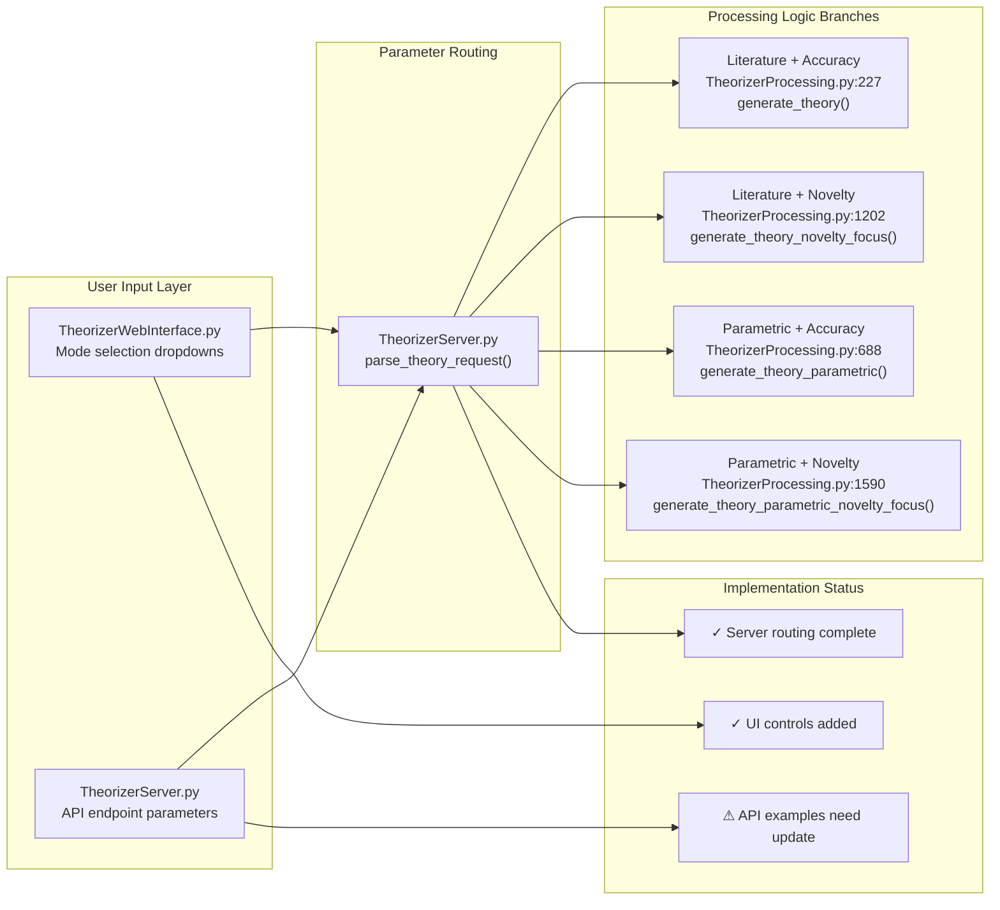
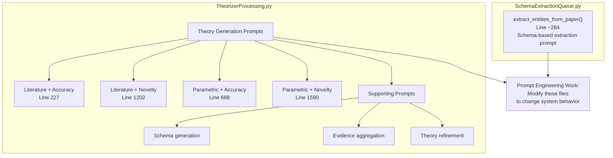
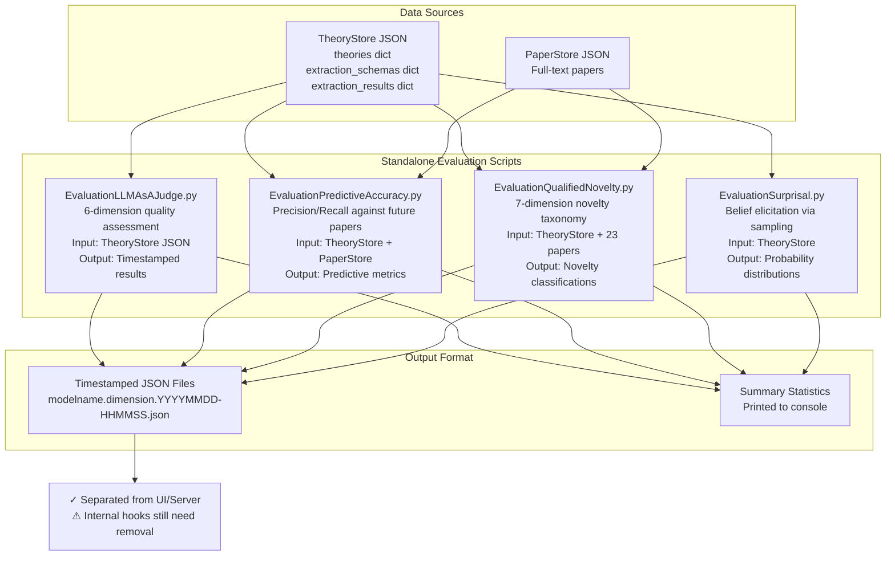
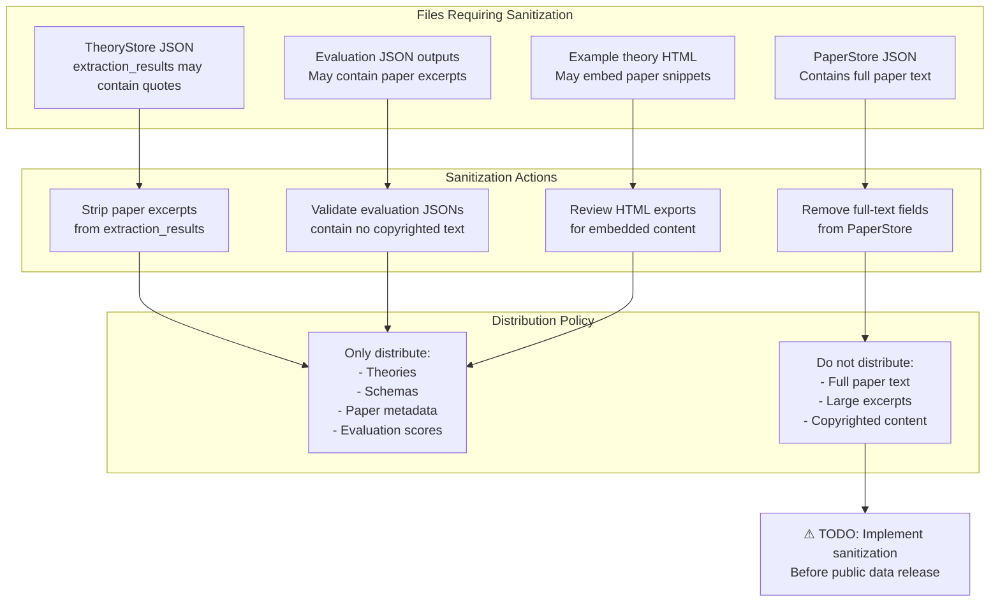
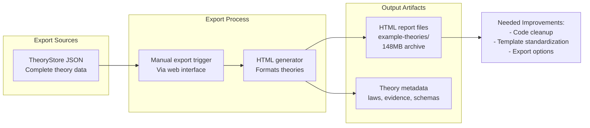

<!-- source: DeepWiki mcp.deepwiki.com · repo allenai/asta-theorizer · page 9 Development and TODO · fetched 2026-10-26 -->

# Development and TODO

<details>
<summary>Relevant source files</summary>

The following files were used as context for generating this wiki page:

- [TODO.txt](TODO.txt)

</details>


## Purpose and Scope

This document tracks the development status, planned improvements, known issues, and cleanup tasks for the Theorizer system. It provides guidance for contributors and documents the evolution from initial research prototype to a production-ready system. For architectural details of the current implementation, see [Architecture and Design](#8). For information about using the system in its current state, see [Getting Started](#2).

**Sources:** [TODO.txt:1-206]()

---

## Development Status Overview

The Theorizer system has transitioned from research prototype to a publicly releasable codebase. Core functionality is operational, with major features implemented and several cleanup tasks remaining. The following diagram shows the status of major development milestones:

### Development Milestone Status

```mermaid
graph TB
    subgraph "Completed Features"
        C1["Literature-Supported Mode<br/>SchemaExtractionQueue.py"]
        C2["Parametric Mode<br/>TheorizerProcessing.py"]
        C3["Accuracy-Focused Objective<br/>TheorizerProcessing.py:227, 688"]
        C4["Novelty-Focused Objective<br/>TheorizerProcessing.py:1202, 1590"]
        C5["UI Selection Controls<br/>TheorizerWebInterface.py"]
        C6["Theory Generation API<br/>TheorizerServer.py"]
        C7["Evaluation Scripts Separated<br/>EvaluationLLMAsAJudge.py<br/>EvaluationPredictiveAccuracy.py<br/>EvaluationQualifiedNovelty.py<br/>EvaluationSurprisal.py"]
    end
    
    subgraph "In Progress"
        P1["Code Cleanup<br/>9 core files marked"]
        P2["HTML Export Enhancement<br/>TODO.txt:20"]
        P3["API Example Updates<br/>TODO.txt:34"]
    end
    
    subgraph "Pending"
        T1["Paper Full-Text Sanitization<br/>TODO.txt:37"]
        T2["Requirements.txt Generation<br/>TODO.txt:39"]
        T3["Internal Evaluation Removal<br/>TODO.txt:18"]
    end
    
    C1 --> Done["Operational System"]
    C2 --> Done
    C3 --> Done
    C4 --> Done
    C5 --> Done
    C6 --> Done
    C7 --> Done
    
    P1 --> Release["Public Release Ready"]
    P2 --> Release
    P3 --> Release
    T1 --> Release
    T2 --> Release
    T3 --> Release
```



**Sources:** [TODO.txt:1-39]()

---

## Code Cleanup Tasks

Nine core files require cleanup before the codebase is release-ready. Eight files have been marked as completed (`*`), with one remaining:

### Core Files Cleanup Status

| File | Status | Purpose | Priority |
|------|--------|---------|----------|
| `ExtractionUtils.py` | ✓ Completed | Evidence extraction utilities | High |
| `MistralOCRStore.py` | ✓ Completed | PDF→Markdown conversion cache | High |
| `PaperFinderRequests.py` | ✓ Completed | Interface to Asta Paper Finder | High |
| `PaperStore.py` | ✓ Completed | Full-text paper caching | High |
| `SchemaExtractionQueue.py` | ✓ Completed | Per-paper evidence extraction | High |
| `SemanticScholar.py` | ✓ Completed | S2 API wrapper | High |
| `Struct.py` | ✓ Completed | Data structure definitions | Medium |
| `Theorizer.py` | ✓ Completed | Main entry point | High |
| `TheorizerProcessing.py` | ✓ Completed | Core prompts and logic | Critical |
| `TheorizerServer.py` | ✓ Completed | Backend orchestrator | High |
| `TheorizerWebInterface.py` | ✓ Completed | Web UI | High |
| `RatingsABTestPreprocessingMatchedControls2.py` | Pending | Ratings preprocessing | Low |

**Sources:** [TODO.txt:3-16]()

---

## Feature Development: Generation Modes and Objectives

The system implements a 2×2 factorial design with switchable generation modes. Implementation status:

### Mode Switching Architecture



**Implementation Details:**

- **Completed (✓):** Mode switching UI added to web interface ([TODO.txt:33]())
- **Completed (✓):** All four generation functions implemented with distinct prompts ([TODO.txt:22-23]())
- **Pending (⚠):** API usage examples need updating to demonstrate mode parameters ([TODO.txt:34]())

**Sources:** [TODO.txt:22-34](), [TheorizerProcessing.py:227](), [TheorizerProcessing.py:688](), [TheorizerProcessing.py:1202](), [TheorizerProcessing.py:1590]()

---

## Prompt Engineering Reference

The system's behavior is controlled through carefully engineered prompts distributed across two primary files:

### Prompt Location Map



**Key Locations:**
- **Information Extraction:** [SchemaExtractionQueue.py:284]() - `extract_entities_from_paper()`
- **Theory Generation:** [TheorizerProcessing.py]() - Four distinct generation functions with separate prompts

**Sources:** [TODO.txt:26-28](), [SchemaExtractionQueue.py:284](), [TheorizerProcessing.py]()

---

## Evaluation System Evolution

The evaluation system has been successfully decoupled from the core generation pipeline. Internal evaluation hooks have been removed, with evaluation now running as independent post-hoc scripts.

### Evaluation Scripts Architecture



**Status:**
- **Completed (✓):** Four evaluation scripts separated into standalone executables ([TODO.txt:19]())
- **Pending (⚠):** Remove internal evaluation remnants from `TheorizerServer.py` and `TheorizerWebInterface.py` ([TODO.txt:18]())

**Sources:** [TODO.txt:18-19](), [TODO.txt:48-204]()

---

## Example Evaluation Outputs

The TODO.txt file documents actual evaluation outputs from the four scripts, demonstrating their operational status and output formats:

### LLM-as-a-Judge Results

```
Final average evaluation scores:
Dimension                      Average Score   Counts              
factual_accuracy               6.18            45                  
specificity                    7.36            45                  
novelty                        5.73            45                  
testability                    7.98            45                  
plausibility                   7.24            45                  
empirical_testing              2.69            45                  

Results saved to: theorystore-example-single-laws.llm_as_a_judge_evaluated.20260113-130652.json
```

**Observations:**
- Theories score highest on testability (7.98/10)
- Empirical testing scores lowest (2.69/10), indicating theories are testable but not yet validated
- Output includes timestamped JSON file for reproducibility

**Sources:** [TODO.txt:48-63]()

### Predictive Accuracy Results

```
Precision:
{
    "average_evaluation": {
        "support": 1.0,
        "contradict": 0.0,
        "count": 2
    }
}

Recall:
{
    "count_theories_has_data": 2,
    "count_theories_no_data": 0,
    "proportion_theories_with_data": 1.0,
    "count_elems_has_data": 6,
    "count_elems_no_data": 5,
    "proportion_elems_with_data": 0.5454545454545454
}
```

**Observations:**
- Perfect precision (1.0) - all predictions with support have zero contradictions
- 54.5% recall - approximately half of theory elements find supporting evidence in future papers
- 9 of 20 evaluated papers contain relevant information

**Sources:** [TODO.txt:66-98]()

### Surprisal/Belief Elicitation Results

```
Total laws evaluated: 45
Model used: gpt-4.1-2025-04-14
Number of samples per law: 10
Average (of average) probability that the model believes the laws to be true: 0.809
Standard deviation of the average probabilities: 0.045
```

**Observations:**
- LLM assigns 80.9% average probability to generated laws
- Low standard deviation (0.045) indicates consistent confidence across laws
- 10 samples per law provide robust probability estimates

**Sources:** [TODO.txt:102-116]()

### Qualified Novelty Results

```
Novelty Evaluation Histogram:
phenomenon_effect:                      100% not_novel
explanatory_mechanistic:                 80% novel
unification:                             60% novel
generalization_scope_expansion:          60% novel
constraint_limitation:                  100% not_novel
conceptual_reframing_abstraction:        40% novel
empirical_synthesis_meta_regulariry:     40% novel

Total Cost: $5.84 (5 evaluations @ $1.17 each)
Average papers per evaluation: 23.00 ± 0.00
Total papers evaluated: 115
```

**Observations:**
- Theories excel at explanatory/mechanistic novelty (80%)
- No novel phenomena or constraints identified (expected for theory synthesis)
- Each evaluation compares against 23 papers from literature

**Sources:** [TODO.txt:118-204]()

---

## Data Sanitization Requirements

Before public distribution, paper full-text must be sanitized from evaluation and example files to avoid copyright issues:

### Data Sanitization Checklist



**Current Status:** ⚠ Pending ([TODO.txt:37]())

**Rationale:** The `PaperStore` caches full-text papers for local processing efficiency, but these cannot be redistributed due to copyright. Evaluation files may inadvertently include paper excerpts in their reasoning traces. See [PaperStore Structure](#5.2) for details on copyright considerations.

**Sources:** [TODO.txt:37]()

---

## Documentation and Dependencies

### Requirements.txt Generation

**Status:** ⚠ Pending ([TODO.txt:39]())

A comprehensive `requirements.txt` file needs generation to specify all Python package dependencies. Current dependencies include:

| Category | Dependencies |
|----------|-------------|
| **Web Framework** | Flask, Flask-CORS |
| **LLM APIs** | openai, anthropic, mistralai |
| **Utilities** | requests, json, typing |
| **Data Processing** | (to be documented) |

**Action Required:** Generate complete dependency list with version pins for reproducible installations.

**Sources:** [TODO.txt:39]()

---

## HTML Export Enhancement

**Status:** 🔄 In Progress ([TODO.txt:20]())

The HTML export functionality requires cleanup and enhancement:

### Current HTML Export Capabilities



**Planned Enhancements:**
- Clean up HTML generation code
- Standardize output templates
- Add export format options (JSON, Markdown)
- Improve error handling for incomplete theories

**Sources:** [TODO.txt:20]()

---

## Development Workflow

For contributors working on the Theorizer codebase:

### Key Development Files

| File | Role | Development Focus |
|------|------|------------------|
| `TheorizerProcessing.py` | Core prompts and logic | Prompt engineering, generation algorithms |
| `TheorizerServer.py` | Backend orchestrator | API endpoints, request routing |
| `TheorizerWebInterface.py` | Web UI | User interface, visualization |
| `SchemaExtractionQueue.py` | Evidence extraction | Extraction prompt, queue management |
| `Evaluation*.py` | Assessment scripts | Evaluation methodologies |

### Testing with Example Data

The system includes example outputs for validation:

```
example-theories/           # 148MB HTML archive
theorystore-example-*.json  # Example theory stores
*-evaluation-*.json         # Example evaluation results
```

**Usage:** Load example theory stores to test evaluation scripts without running expensive theory generation.

**Sources:** [TODO.txt:45-204]()

---

## Summary of Development Priorities

### High Priority
1. **Data Sanitization:** Remove copyrighted paper text before public release
2. **Requirements.txt:** Document all dependencies with version pins
3. **API Examples:** Update documentation to show mode switching parameters

### Medium Priority
4. **Internal Evaluation Removal:** Clean up UI/Server hooks to evaluation system
5. **HTML Export:** Cleanup and enhancement of export functionality
6. **Code Cleanup:** Complete remaining file (`RatingsABTestPreprocessingMatchedControls2.py`)

### Low Priority
7. **Documentation:** Expand inline code documentation
8. **Testing:** Add unit tests for core functions
9. **Error Handling:** Improve error messages and recovery

**Sources:** [TODO.txt:1-39]()

---

