# Page: Overview

# Overview

<details>
<summary>Relevant source files</summary>

The following files were used as context for generating this wiki page:

- [README.md](README.md)

</details>


## Purpose and Scope

This document provides a high-level introduction to the Theorizer system architecture, its core components, and how they interact. Theorizer is a system for generating scientific theories at scale by synthesizing knowledge from large corpora of scientific literature using Large Language Models (LLMs).

This page covers the overall system architecture, major components, and data flow. For detailed information about specific subsystems:
- Installation and setup procedures: see [Getting Started](#2)
- Theory generation configuration and modes: see [Theory Generation](#3)
- Evaluation methodologies: see [Evaluation Systems](#4)
- Storage schemas and data formats: see [Data Storage and Management](#5)

**Sources:** [README.md:1-20]()

---

## System Purpose

Theorizer addresses the problem of automated scientific theory generation by synthesizing qualitative and quantitative laws from scientific literature. The system operates at scale, capable of processing thousands of papers to generate hundreds of theories across different domains indexed by Semantic Scholar.

**Key Capabilities:**
- Generates 4-8 theories per theory query from up to 100 papers
- Supports both literature-grounded and parametric knowledge generation
- Implements accuracy-focused and novelty-focused generation objectives
- Provides multi-dimensional theory evaluation (accuracy, novelty, predictive power, confidence)
- Processing time: 30-60 minutes per theory query (rate-limited by API calls)

**Primary Use Case:** Researchers submit a theory query (e.g., "build theories about X") and receive a set of synthesized theories with supporting evidence, extraction schemas, and evaluation metrics.

**Sources:** [README.md:5-16](), [README.md:220-233]()

---

## Layered Architecture

The Theorizer system follows a layered architecture with clear separation between user interface, core processing, external services, and data persistence:

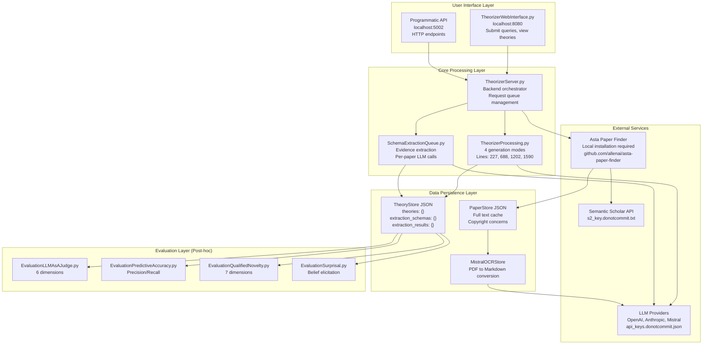

**Architecture Characteristics:**

| Layer | Purpose | Key Components |
|-------|---------|----------------|
| User Interface | Submit queries, monitor progress, export data | `TheorizerWebInterface.py`, `TheorizerServer.py` (endpoints) |
| Core Processing | Orchestrate generation, extract evidence, synthesize theories | `TheorizerServer.py`, `TheorizerProcessing.py`, `SchemaExtractionQueue.py` |
| External Services | LLM inference, paper metadata, PDF conversion | OpenAI/Anthropic/Mistral APIs, Semantic Scholar, Asta |
| Data Persistence | Cache papers, store theories and extraction artifacts | `TheoryStore`, `PaperStore`, `MistralOCRStore` |
| Evaluation | Independent post-hoc assessment | Four evaluation scripts (separate from generation) |

**Sources:** [README.md:169-189](), [README.md:484-491]()

---

## Core Component Map

The following diagram maps high-level system concepts to their implementing code entities:

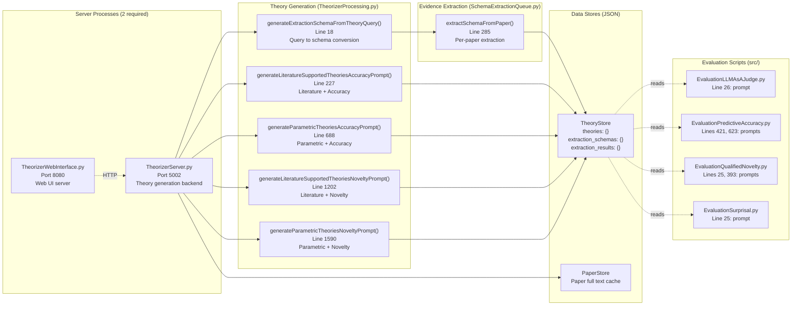

**Key Implementation Files:**

| File | Lines of Interest | Purpose |
|------|-------------------|---------|
| `TheorizerServer.py` | - | Backend orchestrator, HTTP endpoints at `localhost:5002` |
| `TheorizerWebInterface.py` | - | Web UI server at `localhost:8080` |
| `TheorizerProcessing.py` | 18, 227, 688, 1202, 1590 | Core generation logic with 4 mode-specific prompts |
| `SchemaExtractionQueue.py` | 285 | Evidence extraction from individual papers |
| `EvaluationLLMAsAJudge.py` | 26 | Six-dimension qualitative assessment |
| `EvaluationPredictiveAccuracy.py` | 26, 421, 623 | Rubric construction and future paper evaluation |
| `EvaluationQualifiedNovelty.py` | 25, 393 | Seven-dimension novelty assessment |
| `EvaluationSurprisal.py` | 25 | Probabilistic belief elicitation |

**Sources:** [README.md:513-541]()

---

## Theory Generation Workflow

The system implements a dual-pathway architecture for theory generation, determined by the **Input Type** configuration parameter:

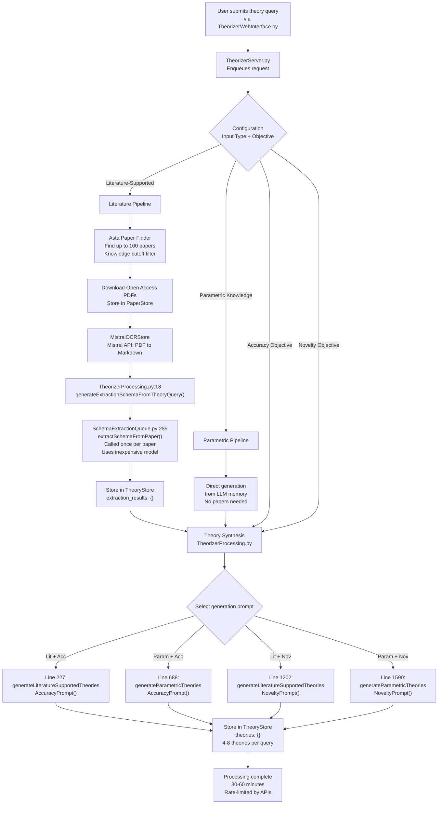

**Configuration Space (2×2 Factorial Design):**

| Input Type | Objective | Code Location | Description |
|------------|-----------|---------------|-------------|
| Literature-Supported | Accuracy | [TheorizerProcessing.py:227]() | Extract evidence from papers, synthesize accurate theories |
| Literature-Supported | Novelty | [TheorizerProcessing.py:1202]() | Extract evidence from papers, synthesize novel theories |
| Parametric Knowledge | Accuracy | [TheorizerProcessing.py:688]() | Use LLM pre-training, focus on accuracy |
| Parametric Knowledge | Novelty | [TheorizerProcessing.py:1590]() | Use LLM pre-training, focus on novelty |

**Cost Optimization Strategy:** The literature pipeline uses an **inexpensive model** for evidence extraction (called up to 100 times) and a **powerful model** for theory synthesis (called once). This is configurable via the web interface parameters "Model for Literature Extraction" and "Model for Theory Generation."

**Sources:** [README.md:220-233](), [README.md:513-525]()

---

## Data Persistence Architecture

Theorizer uses a JSON-based storage architecture with three primary data structures:

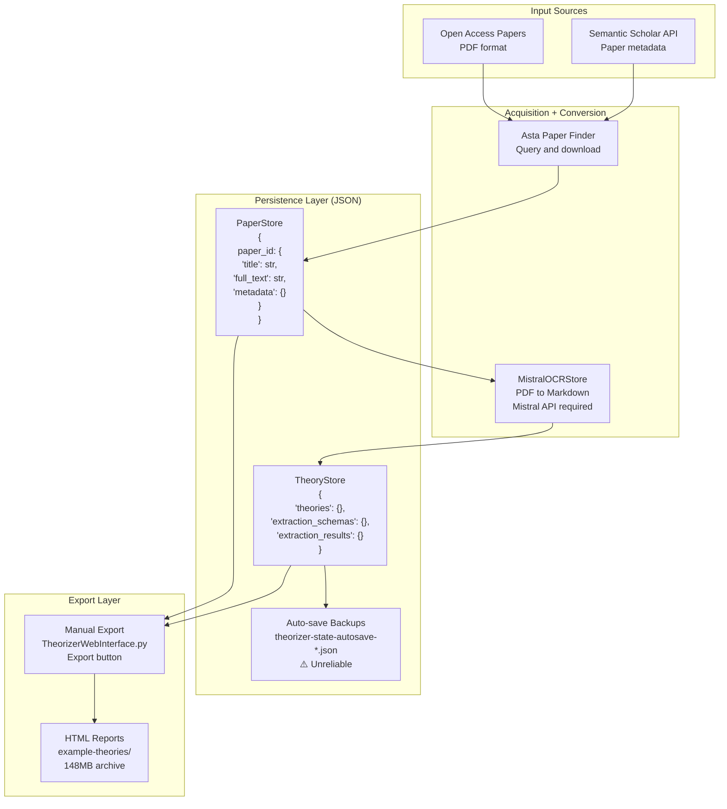

**TheoryStore Schema:**

| Key | Type | Contents |
|-----|------|----------|
| `theories` | `dict` | Theory objects with descriptions, laws, generation parameters |
| `extraction_schemas` | `dict` | Schemas generated from theory queries for evidence extraction |
| `extraction_results` | `dict` | Evidence extracted from specific papers using specific schemas |

**PaperStore Schema:**

| Key | Type | Contents | Notes |
|-----|------|----------|-------|
| `paper_id` | `dict` | Full text, title, metadata | ⚠️ Copyright concerns for redistribution |

**Persistence Recommendations:**

1. **Manual Export (Recommended):** Use the Export button in `TheorizerWebInterface.py` at `localhost:8080`
2. **Auto-save (Unreliable):** System attempts to save `theorizer-state-autosave-*.json` after each theory generation, but this should not be relied upon
3. **PaperStore Export:** Only manual export includes PaperStore; auto-save does not

**Backup Strategy:** The system saves both TheoryStore and PaperStore. To reload saved theories, modify the filename at the bottom of `TheorizerServer.py`.

**Sources:** [README.md:245-258](), [README.md:484-491]()

---

## Evaluation Pipeline

The evaluation system operates **post-hoc** and independently of theory generation, reading from the `TheoryStore` and `PaperStore` to assess generated theories across four dimensions:

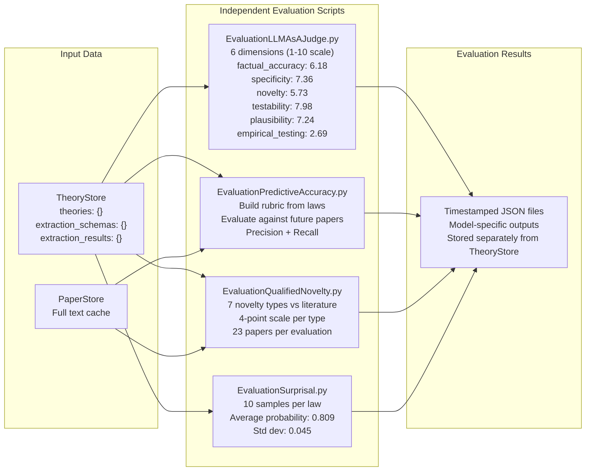

**Evaluation Methodologies:**

| Script | Methodology | Output Metrics | Prompt Location |
|--------|-------------|----------------|-----------------|
| `EvaluationLLMAsAJudge.py` | LLM rates theories on 6 dimensions (1-10 scale) | Average scores across theories | [Line 26]() |
| `EvaluationPredictiveAccuracy.py` | Constructs rubric from laws, evaluates against future papers | Precision (support/contradict), Recall (coverage) | [Lines 421, 623]() |
| `EvaluationQualifiedNovelty.py` | Compares theory against 23 papers on 7 novelty types | Histogram of novelty classifications (4-point scale) | [Lines 25, 393]() |
| `EvaluationSurprisal.py` | Elicits LLM's probabilistic belief in each law | Average probability, standard deviation | [Line 25]() |

**Key Design Choice:** Evaluation is decoupled from generation. Each evaluation script can be run independently, enabling:
- Repeated evaluation without regenerating theories
- Comparison across different evaluation models
- Addition of new evaluation dimensions without modifying generation code

**Example Output Locations:** Results are saved as timestamped JSON files in evaluation-specific directories (see [README.md:309-475]() for example outputs).

**Sources:** [README.md:302-475]()

---

## External Dependencies and API Requirements

Theorizer requires multiple external services, each with specific configuration requirements:

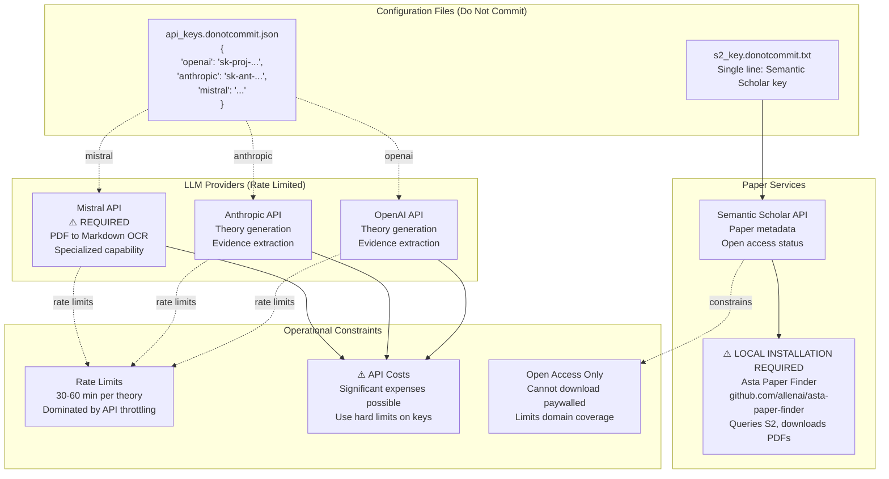

**Critical Dependencies:**

| Dependency | Type | Configuration | Purpose | Notes |
|------------|------|---------------|---------|-------|
| OpenAI API | Optional | `api_keys.donotcommit.json` | Theory generation, extraction | Recommended: `gpt-4.1-2025-04-14` |
| Anthropic API | Optional | `api_keys.donotcommit.json` | Theory generation, extraction | Recommended: `claude-sonnet-4-5-20250929` |
| Mistral API | **Required** | `api_keys.donotcommit.json` | PDF to Markdown OCR | Cannot be substituted |
| Semantic Scholar API | Required | `s2_key.donotcommit.txt` | Paper metadata, download links | Free tier available |
| Asta Paper Finder | **Required** | Local installation | Paper finding and downloading | https://github.com/allenai/asta-paper-finder |

**Installation Steps:**

1. Create `api_keys.donotcommit.json` with all three LLM keys (Mistral required)
2. Create `s2_key.donotcommit.txt` with Semantic Scholar key
3. Clone and install Asta Paper Finder locally
4. Verify conda environment: `python=3.12`, `pip install -r requirements.txt`
5. Start both servers: `TheorizerServer.py` (port 5002) and `TheorizerWebInterface.py` (port 8080)

**Cost Management:**
- Processing time: 30-60 minutes per theory (API rate limits, not computation)
- Recommendation: Start with small-scale tests (1-2 theories) to estimate costs
- Set hard limits on API keys to prevent cost overruns
- Literature-supported mode: Up to 100 paper extractions × inexpensive model + 1 synthesis × powerful model

**Open Access Constraint:** Theorizer can only process papers available as open access through Semantic Scholar. Domains with predominantly paywalled literature will have reduced paper coverage, affecting theory quality.

**Sources:** [README.md:137-165](), [README.md:196-198]()

---

## Processing Time and Scalability

The system's processing characteristics reflect its design for **batch research use** rather than real-time applications:

| Metric | Value | Constraint |
|--------|-------|------------|
| Processing time per theory | 30-60 minutes | API rate limits (not CPU) |
| Papers per theory (max) | 100 | Configurable, cost tradeoff |
| Theories per query | 4-8 | Generated by synthesis model |
| Extraction calls | Up to 100 | One per paper (literature mode) |
| Synthesis calls | 1 | Single call after aggregation |

**Bottleneck:** The dominant constraint is external API rate limiting from OpenAI, Anthropic, and Mistral, not local computation. The 30-60 minute processing window is explicitly attributed to API throttling.

**Scalability Strategy:** Use inexpensive models for high-volume operations (evidence extraction) and powerful models for low-volume operations (theory synthesis).

**Sources:** [README.md:102](), [README.md:243]()

---

# Page: Getting Started

# Getting Started

<details>
<summary>Relevant source files</summary>

The following files were used as context for generating this wiki page:

- [README.md](README.md)
- [TODO.txt](TODO.txt)

</details>


This page provides step-by-step instructions for installing the Theorizer system, configuring required API keys and external dependencies, and running the system for the first time. By the end of this guide, you will have the web interface accessible at `localhost:8080` and be ready to submit theory generation requests.

For information about using the system to generate theories after installation, see [Theory Generation](#3). For details about the evaluation systems, see [Evaluation Systems](#4).

---

## System Requirements

The Theorizer system has been tested and confirmed working on **Ubuntu Linux**. It will likely work with minimal modification on **MacOS**, and may require some modification under **Windows**.

**Platform Compatibility:**
- Tested: Ubuntu Linux
- Expected to work: MacOS
- May require modification: Windows

**Python Version:**
- Python 3.12 (recommended via conda)

Sources: [README.md:113]()

---

## Installation Steps

### 1. Clone the Repository

```bash
git clone https://github.com/allenai/theorizer
cd theorizer
```

### 2. Create Conda Environment

```bash
conda create --name theorizer python=3.12
conda activate theorizer
```

### 3. Install Dependencies

```bash
pip install -r requirements.txt
```

Sources: [README.md:119-135]()

---

## API Key Configuration

Theorizer requires API keys for multiple external services. These keys must be configured before the system can run. The following table summarizes the required API keys and their purposes:

| API Provider | Purpose | Configuration File | Required |
|--------------|---------|-------------------|----------|
| OpenAI | Theory generation and extraction | `api_keys.donotcommit.json` | Yes |
| Anthropic | Theory generation and extraction | `api_keys.donotcommit.json` | Yes |
| Mistral | **PDF → Markdown conversion** | `api_keys.donotcommit.json` | **Yes (Critical)** |
| Semantic Scholar | Paper metadata and search | `s2_key.donotcommit.txt` | Yes |

### Critical Dependency: Mistral API

The Mistral API key is **required** for PDF-to-Markdown conversion using OCR. Without this key, the system cannot process downloaded papers, even if you have OpenAI and Anthropic keys configured.

### LLM API Keys Configuration

Create a file named `api_keys.donotcommit.json` in the repository root with the following structure:

```json
{
    "openai": "sk-proj-...",
    "anthropic": "sk-ant-...",
    "mistral": "..."
}
```

The `.donotcommit` suffix prevents accidental version control commits of sensitive credentials.

### Semantic Scholar API Key Configuration

Create a file named `s2_key.donotcommit.txt` in the repository root containing a single line with your Semantic Scholar API key:

```
<your key here>
```

### Configuration File Layout

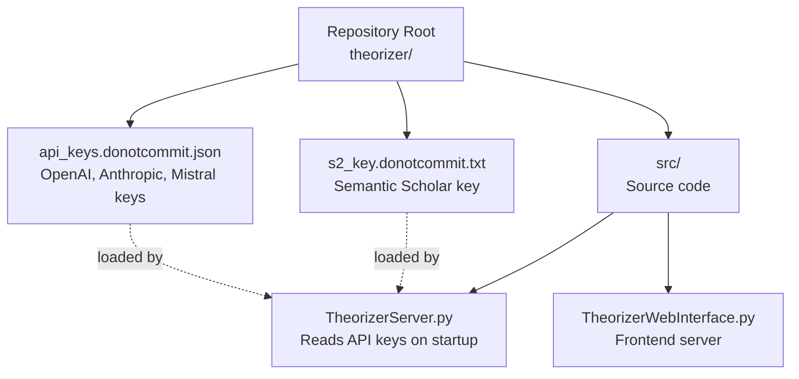

Sources: [README.md:139-157]()

---

## External Dependencies: Asta Paper Finder

### Overview

Generating literature-supported theories requires a **local installation** of Asta Paper Finder. This is a separate tool that queries Semantic Scholar and downloads open-access papers. The Theorizer system invokes Asta as a local subprocess.

**Key Points:**
- Asta Paper Finder is a **separate GitHub repository**
- It must be **installed locally** on your machine
- It is **only required** for literature-supported theory generation
- Parametric theory generation (using only LLM knowledge) does not require Asta

### Installation Location

Asta Paper Finder repository:
```
https://github.com/allenai/asta-paper-finder
```

Follow the installation instructions in the Asta Paper Finder repository. The installation is quick and straightforward.

### Asta's Role in the System

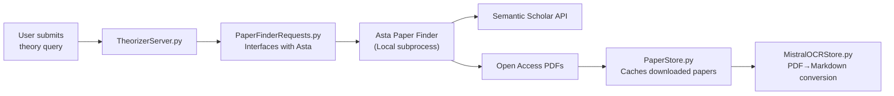

Sources: [README.md:158-165]()

---

## Starting the System

The Theorizer system requires **two processes** to run simultaneously: the backend server and the web interface. These must be started in separate terminal windows.

### Backend Server

In the first terminal:

```bash
python src/TheorizerServer.py
```

The backend server (`TheorizerServer.py`) listens on **port 5002** and handles:
- Theory generation requests
- Paper processing orchestration
- Schema extraction queue management
- Data persistence to TheoryStore and PaperStore

### Web Interface

In a second terminal:

```bash
python src/TheorizerWebInterface.py
```

The web interface (`TheorizerWebInterface.py`) listens on **port 8080** and provides:
- Browser-based UI for submitting theory queries
- Theory viewing and exploration
- Export functionality
- Status monitoring

### System Startup Sequence

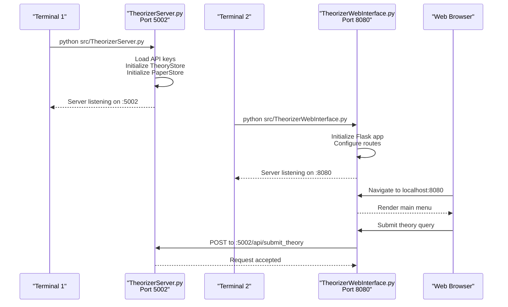

Sources: [README.md:169-189]()

---

## Verifying Installation

### 1. Check Backend Server Status

After starting `TheorizerServer.py`, you should see console output indicating:
- API keys loaded successfully
- Server listening on port 5002
- TheoryStore and PaperStore initialized

### 2. Access Web Interface

Open a web browser and navigate to:
```
http://localhost:8080
```

You should see the Theorizer main menu with the following sections:
- **Create New Theory** (single query)
- **Create Theories in Batch**
- **Server Status** (shows active requests)
- **Export** (save TheoryStore and PaperStore)
- **List of Theories** (displays generated theories)

### 3. Test with Parametric Theory Generation

To verify the system works without requiring Asta Paper Finder:

1. Click **"Create New Theory"**
2. Enter a theory query (e.g., "Build theories about attention mechanisms")
3. Select a model for theory generation (e.g., `gpt-4.1-2025-04-14`)
4. Choose objective: `accuracy-focused` or `novelty-focused`
5. **Important:** Select input type: **`parametric`**
6. Click **Submit**

The parametric mode uses only the LLM's pre-trained knowledge and does not require paper downloading or Asta Paper Finder.

### System Component Verification Checklist

| Component | Verification Method | Expected Result |
|-----------|-------------------|-----------------|
| Backend Server | Check terminal output from `TheorizerServer.py` | "Server listening on port 5002" |
| Web Interface | Navigate to `localhost:8080` | Main menu displays |
| API Keys | Submit parametric theory request | Request accepted, no API key errors |
| Asta Paper Finder | Submit literature-supported request | Papers found and downloaded |
| Mistral OCR | Submit literature-supported request | PDFs converted to markdown |

Sources: [README.md:200-243]()

---

## Cost Warnings

⚠️ **Important Cost Considerations** ⚠️

Theory generation and evaluation can incur **significant API costs** due to:
- Multiple LLM calls per paper (extraction phase)
- Up to 100 papers per theory query
- Expensive models for synthesis
- Rate limiting extends processing time to 30-60 minutes per query

**Recommended Cost Management:**
1. Start with **parametric generation** (no papers) to test the system
2. Use **small paper counts** (e.g., 5-10 papers) for initial literature-supported tests
3. Configure **hard spending limits** on all API keys
4. Monitor costs closely during initial usage

Sources: [README.md:198]()

---

## Common Installation Issues

### Issue: "Mistral API key required"

**Symptom:** Error when attempting literature-supported theory generation  
**Solution:** Ensure `api_keys.donotcommit.json` contains a valid Mistral API key. This is required for PDF-to-Markdown conversion.

### Issue: "Asta Paper Finder not found"

**Symptom:** Error when attempting literature-supported theory generation  
**Solution:** Install Asta Paper Finder from https://github.com/allenai/asta-paper-finder and ensure it is in your system PATH or the expected location.

### Issue: Port already in use

**Symptom:** Cannot start `TheorizerServer.py` or `TheorizerWebInterface.py`  
**Solution:** Check if ports 5002 (backend) or 8080 (frontend) are already in use. Kill existing processes or modify port configuration in the source files.

### Issue: Papers not downloading

**Symptom:** Literature-supported generation finds no papers  
**Solution:** 
1. Verify Semantic Scholar API key in `s2_key.donotcommit.txt`
2. Check Asta Paper Finder installation
3. Ensure the topic has open-access papers available

Sources: [README.md:113-189]()

---

## Next Steps

After successful installation and verification:

- **To generate theories:** See [Theory Generation](#3) for detailed instructions on submitting queries, configuring generation parameters, and monitoring progress
- **To understand generation modes:** See [Generation Modes: Literature-Supported vs Parametric](#3.1)
- **To evaluate theories:** See [Evaluation Systems](#4) for post-hoc assessment methodologies
- **To examine example data:** See [Example Theories and Data](#6) for pre-generated theories and evaluations

### Quick Reference: File Locations

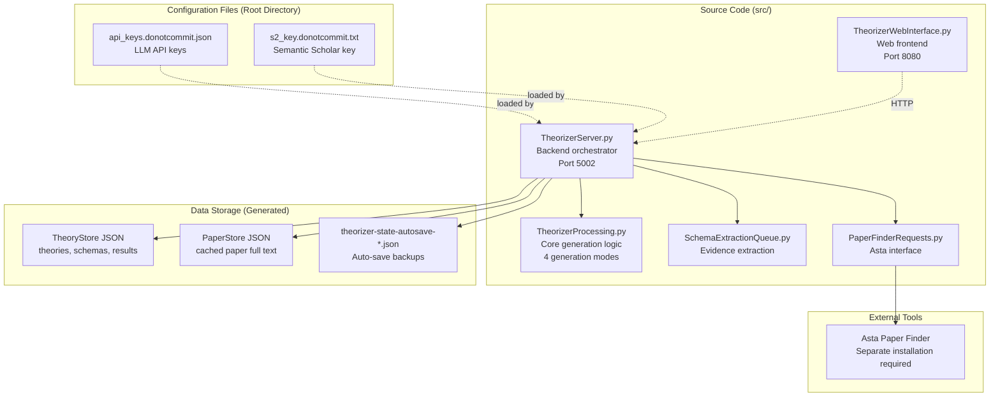

Sources: [README.md:1-189]()

---

# Page: Theory Generation

# Theory Generation

<details>
<summary>Relevant source files</summary>

The following files were used as context for generating this wiki page:

- [README.md](README.md)

</details>


This page documents the core theory generation system in Theorizer, explaining how the system transforms a user query (e.g., "build theories about memory architectures for LLM agents") into synthesized scientific theories. It covers the configuration options, the dual-pathway architecture, and the orchestration of the generation process.

For information about the specific generation modes (literature-supported vs parametric), see [Generation Modes](#3.1). For details on the paper processing pipeline used in literature-supported mode, see [Paper Processing Pipeline](#3.3). For using the web interface or API to submit theory requests, see [Web Interface and API](#3.4). For evaluation of generated theories, see [Evaluation Systems](#4).

## Overview of Theory Generation

The Theorizer system generates scientific theories through a configurable pipeline that can operate in four distinct modes, determined by two orthogonal configuration axes:

| Axis | Options | Effect |
|------|---------|--------|
| **Input Type** | `literature-supported` or `parametric` | Whether to extract evidence from papers or use LLM parametric knowledge |
| **Generation Objective** | `accuracy-focused` or `novelty-focused` | Which prompt template to use during synthesis |

Each combination of these axes results in a different generation mode with its own prompt engineering in `TheorizerProcessing.py`. A typical theory generation request takes 30-60 minutes to process, primarily due to external API rate limits rather than computational constraints.

Sources: [README.md:1-587](), [src/TheorizerProcessing.py:227](), [src/TheorizerProcessing.py:688](), [src/TheorizerProcessing.py:1202](), [src/TheorizerProcessing.py:1590]()

## Theory Generation Configuration Space

The system implements a **2×2 factorial design** resulting in four distinct generation conditions:

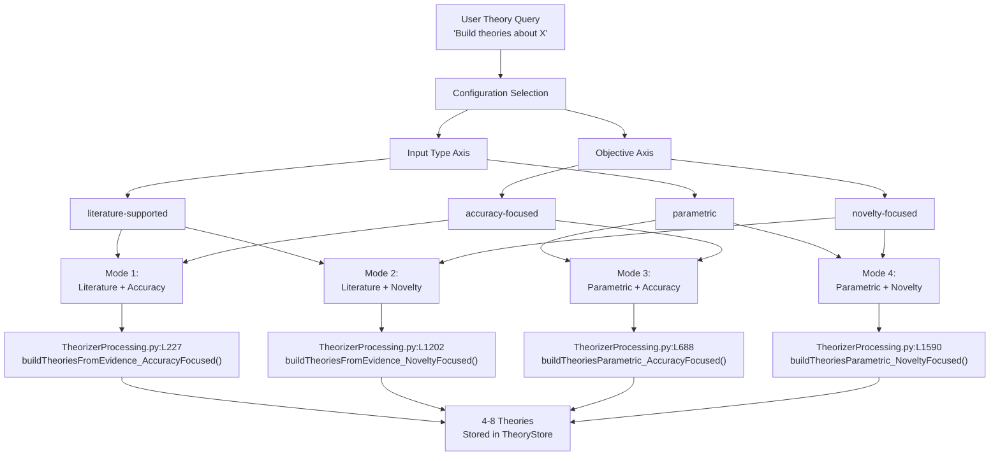

**Configuration Parameters**

Additional parameters available for literature-supported modes:

| Parameter | Purpose | Default/Range |
|-----------|---------|---------------|
| `num_papers` | Maximum papers to retrieve and process | Up to 100 |
| `knowledge_cutoff_year` | Only use papers published before this year | Configurable for temporal testing |
| `knowledge_cutoff_month` | Month component of cutoff | 1-12 |
| `model_extraction` | LLM for per-paper evidence extraction | Inexpensive model recommended |
| `model_generation` | LLM for final theory synthesis | Powerful model recommended |

Sources: [README.md:220-232](), [src/TheorizerProcessing.py:227-1590]()

## System Architecture and Component Roles

The theory generation system consists of three primary components that orchestrate the end-to-end workflow:

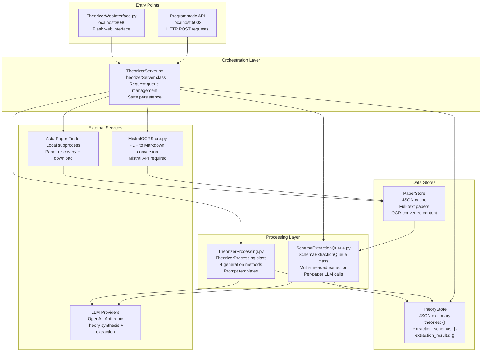

**Component Responsibilities:**

- **TheorizerServer**: Maintains request queue, manages theory generation lifecycle, handles auto-save backups, exposes HTTP endpoints
- **TheorizerProcessing**: Contains four distinct theory generation methods, each with specialized prompts for the 2×2 configuration space
- **SchemaExtractionQueue**: Multi-threaded extraction manager, generates extraction schemas from theory queries, extracts evidence from papers
- **Asta Paper Finder**: External subprocess for paper discovery via Semantic Scholar API and PDF download
- **MistralOCRStore**: Converts downloaded PDFs to Markdown format using Mistral's specialized OCR API

Sources: [src/TheorizerServer.py:1-400](), [src/TheorizerProcessing.py:1-2000](), [src/SchemaExtractionQueue.py:1-500](), [src/MistralOCRStore.py:1-200](), [src/TheorizerWebInterface.py:1-300]()

## Theory Generation Workflow

The complete workflow differs significantly between literature-supported and parametric modes. Below is the unified workflow showing both paths:

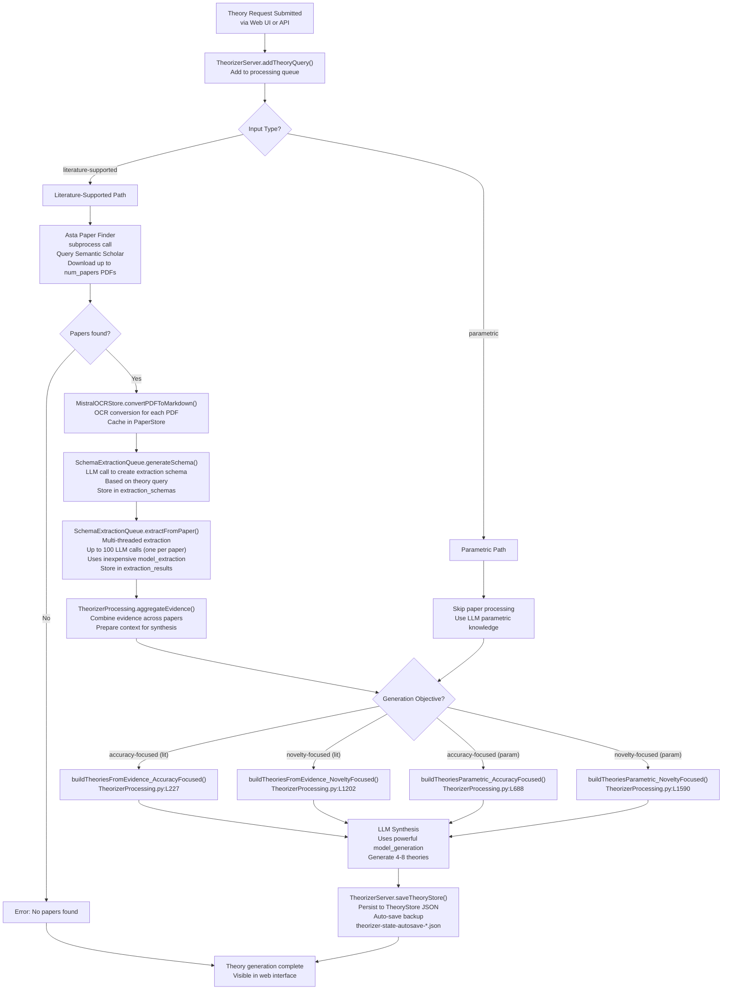

Sources: [src/TheorizerServer.py:100-250](), [src/TheorizerProcessing.py:227-1590](), [src/SchemaExtractionQueue.py:1-500](), [README.md:196-298]()

## Theory Structure and Output Format

Generated theories are stored in the `TheoryStore` JSON structure with the following schema:

```mermaid
graph LR
    TheoryStore["TheoryStore JSON"]
    
    TheoryStore --> Theories["theories: {}<br/>Dictionary keyed by theory_id"]
    TheoryStore --> Schemas["extraction_schemas: {}<br/>Dictionary keyed by schema_id"]
    TheoryStore --> Results["extraction_results: {}<br/>Dictionary keyed by result_id"]
    
    Theories --> Theory["Single Theory Object"]
    
    Theory --> TID["theory_id: unique identifier"]
    Theory --> TQuery["theory_query: original request"]
    Theory --> TDesc["description: summary"]
    Theory --> TComponents["components: structured theory parts"]
    Theory --> TLaws["laws: list of theory statements"]
    Theory --> TMeta["metadata: generation params<br/>model, objective, input_type"]
    Theory --> TEvidence["evidence_ids: links to extraction_results"]
    
    Schemas --> Schema["Extraction Schema"]
    Schema --> SFields["fields: list of evidence types<br/>to extract from papers"]
    
    Results --> Result["Extraction Result"]
    Result --> RPaper["paper_id: source paper"]
    Result --> RSchema["schema_id: schema used"]
    Result --> RData["extracted_data: evidence instances"]
```

**Example Theory Law Structure:**

Each theory contains 4-8 laws/statements with the following fields:
- `law_id`: Unique identifier within the theory
- `statement`: Natural language formulation of the law
- `variables`: Identified variables and relationships
- `conditions`: Applicability constraints
- `evidence_support`: Links to extraction results that support this law

Sources: [README.md:483-491](), [src/TheoryStore.py:1-300]()

## Processing Timeline and Cost Considerations

Theory generation is a time-intensive and potentially expensive operation:

| Stage | Typical Duration | Cost Driver |
|-------|------------------|-------------|
| Paper Discovery (Asta) | 1-5 minutes | Semantic Scholar API rate limits |
| PDF Download | 2-10 minutes | Network bandwidth, paper availability |
| PDF→Markdown OCR | 5-15 minutes | Mistral API rate limits (up to 100 calls) |
| Schema Generation | 1-2 minutes | Single LLM call |
| Evidence Extraction | 10-30 minutes | Multiple LLM calls (one per paper, up to 100) |
| Theory Synthesis | 2-5 minutes | Single powerful LLM call with large context |
| **Total** | **30-60 minutes** | **Primarily API rate limits** |

**Cost Optimization Strategies:**

The system employs several cost-reduction techniques:

1. **Two-tier model selection**: Inexpensive models for high-volume extraction (`model_extraction`), expensive models only for final synthesis (`model_generation`)
2. **Caching**: `PaperStore` caches OCR-converted papers, `extraction_results` cached for reuse
3. **Configurable limits**: `num_papers` parameter caps maximum papers processed
4. **Rate limit awareness**: Processing time dominated by external API throttling, not local computation

⚠️ **Warning**: A single literature-supported theory query with 100 papers can make 101+ LLM API calls (1 schema generation + 100 extractions + 1 synthesis). Set hard limits on API keys to avoid unexpected costs.

Sources: [README.md:102](), [README.md:198](), [README.md:243]()

## Monitoring and State Management

The `TheorizerServer` provides real-time monitoring of theory generation status:

**Status Endpoint**: The web interface polls `TheorizerServer.getStatus()` to display:
- Current queue position
- Active processing stage
- Completed theories count
- Error states

**Auto-save Behavior**: After each theory completes, the server automatically saves a backup to `theorizer-state-autosave-<timestamp>.json`. However, this is **unreliable** and should not be the primary persistence method.

**Manual Export**: The recommended persistence method is manual export via the web interface "Export" button, which saves both:
- `TheoryStore`: Complete theory data including schemas and extraction results
- `PaperStore`: Cached full-text papers (note: copyright considerations apply)

Sources: [README.md:246-258](), [src/TheorizerServer.py:300-350]()

## Entry Point Summary

**Web Interface** (`TheorizerWebInterface.py`):
- Runs Flask server on `localhost:8080`
- Form-based theory submission
- Real-time status monitoring
- Theory browsing and export

**Programmatic API** (`TheorizerServer.py`):
- HTTP server on `localhost:5002`
- POST to `/submit_theory_query` with JSON payload
- GET `/status` for queue monitoring
- GET `/export` for data extraction

For detailed API usage, see [Web Interface and API](#3.4).

Sources: [README.md:169-192](), [src/TheorizerWebInterface.py:1-300](), [src/TheorizerServer.py:1-400]()

---

# Page: Generation Modes: Literature-Supported vs Parametric

# Generation Modes: Literature-Supported vs Parametric

<details>
<summary>Relevant source files</summary>

The following files were used as context for generating this wiki page:

- [README.md](README.md)

</details>


## Purpose and Scope

This document describes the two distinct input types available for theory generation in the Theorizer system: **Literature-Supported** mode and **Parametric** mode. These modes differ fundamentally in their source of evidence—external scientific papers versus pre-trained LLM knowledge—and result in different processing pipelines, computational costs, and theory characteristics.

For information about the generation objectives (accuracy-focused vs novelty-focused) that work orthogonally with these modes, see [Generation Objectives](#3.2). For details about the paper processing pipeline specific to Literature-Supported mode, see [Paper Processing Pipeline](#3.3).

---

## Mode Overview

The Theorizer system implements a 2×2 factorial design where input type (Literature-Supported vs Parametric) is one axis and generation objective (accuracy vs novelty) is the other. The input type determines the fundamental architecture of the theory generation process.

| Mode | Evidence Source | External Dependencies | Processing Time | API Calls | Code Location |
|------|----------------|----------------------|-----------------|-----------|---------------|
| **Literature-Supported** | Extracted from papers | Asta Paper Finder, Mistral OCR, Semantic Scholar API | 30-60 minutes | ~100+ per theory | [src/TheorizerProcessing.py:227]() (accuracy)<br/>[src/TheorizerProcessing.py:1202]() (novelty) |
| **Parametric** | LLM pre-trained knowledge | None (besides generation LLM) | <5 minutes | 1 per theory | [src/TheorizerProcessing.py:688]() (accuracy)<br/>[src/TheorizerProcessing.py:1590]() (novelty) |

The mode is selected via the `Input-type for Theory Generation` parameter in the web interface or the corresponding field in programmatic API requests.

**Sources:** [README.md:220-231](), High-Level System Architecture Diagram 2, Diagram 5

---

## Literature-Supported Mode

### Architecture and Pipeline

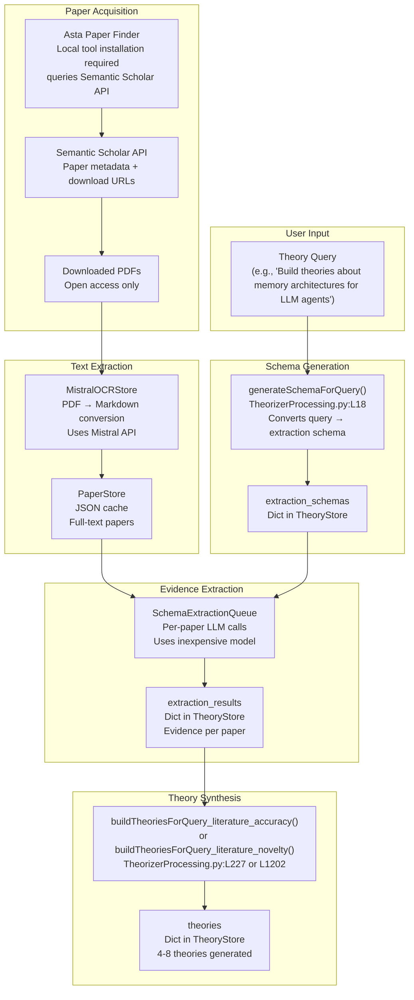

**Diagram: Literature-Supported Mode Architecture with Code Entities**

**Sources:** [src/TheorizerProcessing.py:18-226](), [src/SchemaExtractionQueue.py:285-450](), High-Level System Architecture Diagram 2

### Pipeline Stages

The Literature-Supported mode executes a multi-stage pipeline:

#### 1. Schema Generation

The theory query is converted into a structured extraction schema that defines what evidence to extract from each paper.

- **Code Location:** [src/TheorizerProcessing.py:18-90]()
- **Function:** `generateSchemaForQuery()`
- **Input:** Theory query string, model configuration
- **Output:** JSON schema stored in `TheoryStore.extraction_schemas[schema_id]`
- **Model Used:** Powerful model (same as generation model)

Example schema structure:
```json
{
  "theory_query": "Build theories about memory architectures...",
  "extraction_fields": [
    {"name": "memory_type", "description": "..."},
    {"name": "performance_impact", "description": "..."}
  ]
}
```

**Sources:** [src/TheorizerProcessing.py:18-90](), [README.md:516]()

#### 2. Paper Acquisition

Papers are found and downloaded using the Asta Paper Finder tool.

- **Dependencies:** Local Asta Paper Finder installation, Semantic Scholar API key
- **Configuration Parameters:**
  - `number_of_papers`: Maximum papers to retrieve (up to 100)
  - `knowledge_cutoff`: Year/Month filter for temporal validity testing
- **Constraint:** Only open-access papers can be downloaded
- **Storage:** Raw PDFs are temporarily stored, then discarded after conversion

**Sources:** [README.md:158-165](), [README.md:229-231]()

#### 3. PDF to Markdown Conversion

PDFs are converted to Markdown format using Mistral's OCR API.

- **Code Location:** `MistralOCRStore` class (referenced in server code)
- **API Used:** Mistral API (required dependency)
- **Storage:** Converted Markdown stored in `PaperStore` JSON cache
- **Purpose:** Enables text-based evidence extraction by LLMs

**Sources:** [README.md:141-147](), High-Level System Architecture Diagram 6

#### 4. Evidence Extraction

Each paper is processed individually to extract evidence according to the schema.

- **Code Location:** [src/SchemaExtractionQueue.py:285-450]()
- **Function:** Schema extraction prompt at line 285
- **Model Used:** Inexpensive model (cost optimization, since this runs ~100 times)
- **Processing:** Queue-based with rate limiting
- **Storage:** Results stored in `TheoryStore.extraction_results[extraction_id]`
- **Format:** Each extraction result contains:
  - Paper identifier
  - Schema identifier
  - Extracted evidence instances for each schema field
  - Timestamps and model information

**Sources:** [src/SchemaExtractionQueue.py:285-450](), [README.md:519](), High-Level System Architecture Diagram 2

#### 5. Evidence Aggregation and Theory Synthesis

All extraction results are aggregated and synthesized into theories.

- **Code Location:** 
  - Accuracy-focused: [src/TheorizerProcessing.py:227-687]()
  - Novelty-focused: [src/TheorizerProcessing.py:1202-1589]()
- **Functions:**
  - `buildTheoriesForQuery_literature_accuracy()`
  - `buildTheoriesForQuery_literature_novelty()`
- **Input:** All extraction results for the query
- **Model Used:** Powerful model (typically GPT-4 or Claude Sonnet)
- **Output:** 4-8 theories stored in `TheoryStore.theories[theory_id]`

Each theory contains:
- `description`: High-level theory description
- `laws`: List of specific theoretical statements
- `components`: Key elements of the theory
- `evidence_ids`: References to supporting extraction results
- Generation metadata (model, timestamp, parameters)

**Sources:** [src/TheorizerProcessing.py:227-687](), [src/TheorizerProcessing.py:1202-1589](), [README.md:522-525]()

### Cost and Performance Characteristics

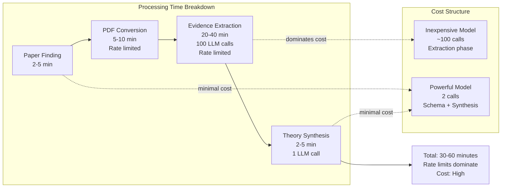

**Diagram: Literature-Supported Mode Performance Profile**

| Resource | Usage | Optimization Strategy |
|----------|-------|----------------------|
| **Time** | 30-60 minutes | Dominated by external API rate limits |
| **LLM Calls** | ~100+ per theory | Use inexpensive model for extraction |
| **Cost** | High | Schema generation + extraction + synthesis |
| **Network** | Significant | Paper downloads, multiple API calls |
| **Storage** | Moderate | PaperStore cache, extraction results |

**Sources:** [README.md:102](), High-Level System Architecture Diagram 2, Diagram 4

---

## Parametric Mode

### Architecture and Direct Generation

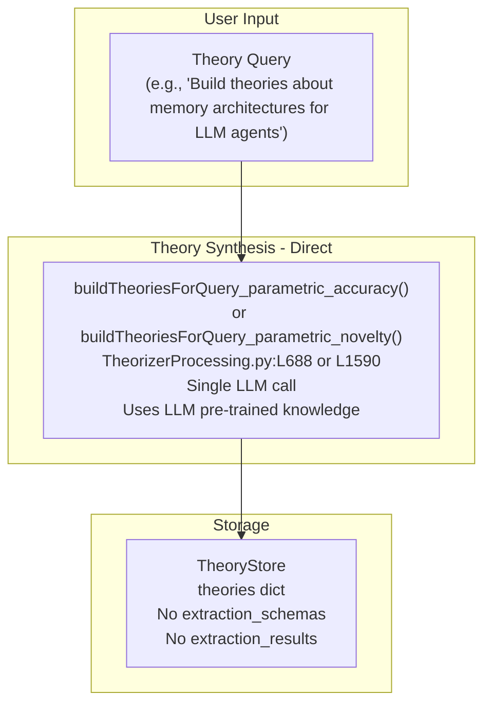

**Diagram: Parametric Mode Architecture - Bypass Pipeline**

**Sources:** [src/TheorizerProcessing.py:688-1201](), [src/TheorizerProcessing.py:1590-1800]()

### Direct Generation Process

Parametric mode bypasses the entire paper acquisition and extraction pipeline, generating theories directly from the LLM's pre-trained knowledge.

#### Code Locations

- **Accuracy-focused:** [src/TheorizerProcessing.py:688-1201]()
  - Function: `buildTheoriesForQuery_parametric_accuracy()`
- **Novelty-focused:** [src/TheorizerProcessing.py:1590-1800]()
  - Function: `buildTheoriesForQuery_parametric_novelty()`

#### Process Flow

1. **User submits theory query** via web interface or API
2. **Query is passed directly to generation function** (no schema creation)
3. **Single LLM call** with:
   - Theory query
   - Objective-specific prompt (accuracy or novelty)
   - No external evidence or context
4. **Theories are generated** using only the model's parametric knowledge
5. **Results stored** in `TheoryStore.theories[theory_id]`

#### Storage Characteristics

Parametric theories in TheoryStore differ from literature-supported theories:

| Field | Literature-Supported | Parametric |
|-------|---------------------|------------|
| `theories` | Present | Present |
| `extraction_schemas` | Schema ID references | Empty/absent |
| `extraction_results` | Evidence ID references | Empty/absent |
| `evidence_ids` in theory | List of extraction result IDs | Empty list |
| Metadata | Includes paper count, cutoff date | Generation mode only |

**Sources:** [src/TheorizerProcessing.py:688-1800](), [README.md:485-491]()

### Cost and Performance Characteristics

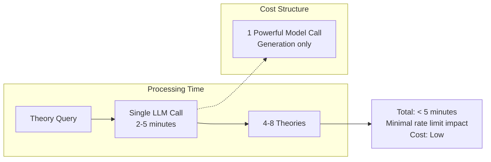

**Diagram: Parametric Mode Performance Profile**

| Resource | Usage | Comparison to Literature Mode |
|----------|-------|-------------------------------|
| **Time** | <5 minutes | 6-12x faster |
| **LLM Calls** | 1 per theory | ~100x fewer calls |
| **Cost** | Low | Significantly cheaper |
| **Network** | Minimal | No paper downloads |
| **Storage** | Minimal | No PaperStore, no extraction results |
| **Dependencies** | LLM API only | No Asta, no Mistral OCR, no S2 API |

**Sources:** [README.md:102](), High-Level System Architecture Diagram 2, Diagram 5

---

## Mode Selection and Configuration

### Web Interface

In the theory submission form at `localhost:8080`:

1. **Field:** "Input-type for Theory Generation"
2. **Options:**
   - `literature-supported`: Triggers full paper processing pipeline
   - `parametric`: Bypasses pipeline, uses LLM knowledge
3. **Conditional Fields:** When `literature-supported` is selected:
   - "Model for Literature Extraction" becomes required
   - "Number of Papers" becomes required
   - "Knowledge Cutoff (Year/Month)" becomes required

**Sources:** [README.md:220-231](), [README.md:35-40]()

### Programmatic API

For API requests to `localhost:5002`:

```json
{
  "theory_query": "Build theories about...",
  "input_type": "literature-supported",
  "generation_objective": "accuracy-focused",
  "generation_model": "gpt-4.1-2025-04-14",
  "extraction_model": "gpt-5-mini",
  "num_papers": 50,
  "knowledge_cutoff": "2023-06"
}
```

For parametric mode:
```json
{
  "theory_query": "Build theories about...",
  "input_type": "parametric",
  "generation_objective": "accuracy-focused",
  "generation_model": "gpt-4.1-2025-04-14"
}
```

**Sources:** [README.md:186-191](), [src/TheorizerWebInterface.py]()

### Mode Selection Decision Tree

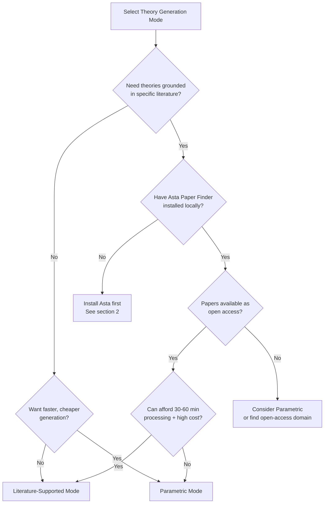

**Diagram: Mode Selection Decision Process**

**Sources:** [README.md:80-81](), [README.md:158-165](), High-Level System Architecture Diagrams

---

## Comparative Analysis

### Theoretical Implications

The choice between modes affects theory characteristics measurably:

| Dimension | Literature-Supported | Parametric | Evidence |
|-----------|---------------------|------------|----------|
| **Factual Accuracy** | Higher | Lower | Literature grounding improves accuracy |
| **Predictive Accuracy** | 90% precision | Lower | Theories predict future papers better |
| **Novelty** | Can be limited by literature | Potentially higher | Less constrained by existing work |
| **Specificity** | Higher | Variable | Evidence extraction provides details |
| **Testability** | Higher | Variable | Specific evidence enables testing |
| **Temporal Validity** | Measurable via cutoff | Unknown | Can evaluate against future papers |

**Sources:** [README.md:9-15](), High-Level System Architecture Diagram 5

### Practical Tradeoffs

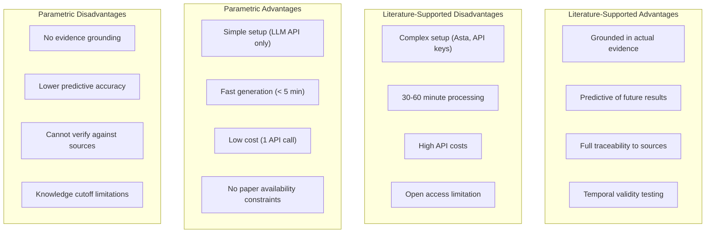

**Diagram: Mode Tradeoff Matrix**

**Sources:** High-Level System Architecture Diagrams 2, 5, 6

### Use Case Recommendations

| Use Case | Recommended Mode | Rationale |
|----------|-----------------|-----------|
| Research paper submission | Literature-Supported | Need evidence-backed claims |
| Exploratory hypothesis generation | Parametric | Fast iteration, idea exploration |
| Domain with limited open access | Parametric | Literature unavailable |
| Temporal validity testing | Literature-Supported | Requires knowledge cutoff |
| Cost-constrained exploration | Parametric | Significantly cheaper |
| High-stakes applications | Literature-Supported | Traceable evidence critical |
| Rapid prototyping | Parametric | Speed prioritized |
| Theory evaluation study | Literature-Supported | Enables predictive accuracy evaluation |

**Sources:** [README.md:80-81](), [README.md:9-15]()

---

## Implementation Details

### Code Organization

Both modes are implemented in [src/TheorizerProcessing.py]() with clear separation:

```
TheorizerProcessing.py
├── Schema Generation (L18-90)
│   └── generateSchemaForQuery()
├── Literature-Supported Mode
│   ├── Accuracy: buildTheoriesForQuery_literature_accuracy() (L227-687)
│   └── Novelty: buildTheoriesForQuery_literature_novelty() (L1202-1589)
└── Parametric Mode
    ├── Accuracy: buildTheoriesForQuery_parametric_accuracy() (L688-1201)
    └── Novelty: buildTheoriesForQuery_parametric_novelty() (L1590-1800)
```

The server orchestrates mode selection in [src/TheorizerServer.py](), routing requests to the appropriate generation function based on the `input_type` parameter.

**Sources:** [src/TheorizerProcessing.py](), [README.md:512-525]()

### Data Flow Differences

Literature-Supported data flow:
```
Query → Schema → Papers → Extraction → Aggregation → Theories
    ↓                ↓         ↓            ↓
TheoryStore    PaperStore   extraction_  extraction_
               (cache)      schemas      results
```

Parametric data flow:
```
Query → Theories
    ↓
TheoryStore
(no schemas, no extraction_results)
```

**Sources:** [README.md:485-491](), High-Level System Architecture Diagram 4

---

## Related Topics

- **Generation Objectives:** See [Generation Objectives: Accuracy vs Novelty](#3.2) for how accuracy-focused and novelty-focused objectives interact with these modes
- **Paper Processing:** See [Paper Processing Pipeline](#3.3) for detailed documentation of the Literature-Supported pipeline stages
- **Cost Optimization:** See [Cost Optimization Strategies](#8.2) for design decisions around model selection and caching
- **Evaluation:** See [Predictive Accuracy Evaluation](#4.2) for how Literature-Supported theories can be evaluated against future papers using knowledge cutoffs

---

# Page: Generation Objectives: Accuracy vs Novelty

# Generation Objectives: Accuracy vs Novelty

<details>
<summary>Relevant source files</summary>

The following files were used as context for generating this wiki page:

- [README.md](README.md)

</details>


## Purpose and Scope

This document describes the two generation objectives available in Theorizer: **accuracy-focused** and **novelty-focused** theory generation. These objectives determine the prompting strategy used during theory synthesis and significantly affect the properties of generated theories. This configuration axis combines with the input type (see [Generation Modes: Literature-Supported vs Parametric](#3.1)) to create four distinct generation conditions.

For information about the paper processing pipeline used in literature-supported modes, see [Paper Processing Pipeline](#3.3). For details on how to configure these settings via the interface, see [Web Interface and API](#3.4).

## Overview of Generation Objectives

The Theorizer system implements two distinct objectives for theory generation, each with its own prompt engineering strategy:

| Objective | Primary Goal | Prompting Strategy | Code Location |
|-----------|--------------|-------------------|---------------|
| **Accuracy-Focused** | Maximize factual correctness and alignment with existing evidence | Emphasizes grounding in evidence, consistency with known facts, testability | [src/TheorizerProcessing.py:227]() (literature), [src/TheorizerProcessing.py:688]() (parametric) |
| **Novelty-Focused** | Prioritize originality and generation of new theoretical insights | Emphasizes novel connections, unexplored mechanisms, creative synthesis | [src/TheorizerProcessing.py:1202]() (literature), [src/TheorizerProcessing.py:1590]() (parametric) |

These objectives represent a fundamental tradeoff in scientific theory generation: theories that closely match existing knowledge may be more immediately verifiable but less likely to produce new insights, while theories that emphasize novelty may be more speculative but potentially more scientifically valuable.

**Sources:** [README.md:1-587](), Diagram 5 from high-level architecture

## System Architecture: Objective Selection Flow

```mermaid
graph TD
    User["User Submits Theory Query"]
    
    User --> Config["Configuration Selection"]
    
    Config --> ObjSelect["Objective Parameter"]
    Config --> InputSelect["Input Type Parameter"]
    
    ObjSelect --> AccObj["accuracy-focused"]
    ObjSelect --> NovObj["novelty-focused"]
    
    InputSelect --> Lit["literature-supported"]
    InputSelect --> Param["parametric"]
    
    Lit --> LitProc["Literature Processing<br/>Find papers, extract evidence"]
    Param --> ParamProc["Direct Generation<br/>Use LLM knowledge"]
    
    LitProc --> PromptRouter["TheorizerProcessing<br/>Prompt Router"]
    ParamProc --> PromptRouter
    
    AccObj --> PromptRouter
    NovObj --> PromptRouter
    
    PromptRouter --> C1["Condition 1:<br/>Literature + Accuracy<br/>TheorizerProcessing.py:227"]
    PromptRouter --> C2["Condition 2:<br/>Literature + Novelty<br/>TheorizerProcessing.py:1202"]
    PromptRouter --> C3["Condition 3:<br/>Parametric + Accuracy<br/>TheorizerProcessing.py:688"]
    PromptRouter --> C4["Condition 4:<br/>Parametric + Novelty<br/>TheorizerProcessing.py:1590"]
    
    C1 --> Output["4-8 Generated Theories<br/>Stored in TheoryStore"]
    C2 --> Output
    C3 --> Output
    C4 --> Output
```

**Objective Selection Flow in Theory Generation System**

The system routes theory generation requests to one of four distinct prompt implementations based on the combination of objective and input type. Each condition uses a different prompt located at a specific line in `TheorizerProcessing.py`.

**Sources:** [README.md:220-226](), [src/TheorizerProcessing.py:522-526](), Diagram 2 and Diagram 5 from high-level architecture

## Accuracy-Focused Objective

### Purpose and Design

The accuracy-focused objective prioritizes the generation of theories that:
- Maximize factual correctness relative to existing evidence
- Maintain strong consistency with established scientific knowledge
- Emphasize testability and empirical grounding
- Minimize speculative claims

This objective is suitable when the goal is to synthesize well-supported theories from existing literature or to consolidate known patterns into theoretical frameworks.

### Prompt Implementation Locations

The accuracy-focused prompts are implemented at two locations in `TheorizerProcessing.py`, depending on the input type:

1. **Literature-Supported + Accuracy:** [src/TheorizerProcessing.py:227]()
   - Receives aggregated evidence from multiple papers
   - Synthesizes theories grounded in extracted evidence
   - Uses the powerful generation model specified in configuration

2. **Parametric + Accuracy:** [src/TheorizerProcessing.py:688]()
   - Generates theories from LLM's pre-trained knowledge
   - Does not reference external papers
   - Emphasizes consistency with known scientific facts

### Expected Theory Properties

Theories generated with the accuracy-focused objective typically exhibit:
- Higher scores on the **Factual Accuracy** dimension in LLM-as-a-Judge evaluation (see [LLM-as-a-Judge Evaluation](#4.1))
- Better performance on **Predictive Accuracy** metrics when evaluated against future papers (see [Predictive Accuracy Evaluation](#4.2))
- Higher **Plausibility** ratings
- Lower scores on **Novelty** dimensions

**Sources:** [README.md:522-523](), [src/TheorizerProcessing.py:227](), [src/TheorizerProcessing.py:688](), Diagram 5 from high-level architecture

## Novelty-Focused Objective

### Purpose and Design

The novelty-focused objective prioritizes the generation of theories that:
- Emphasize original connections and mechanisms not explicitly stated in literature
- Explore unexplored theoretical territory
- Synthesize creative combinations of known elements
- Generate potentially groundbreaking but more speculative claims

This objective is suitable when the goal is to discover new theoretical insights, identify novel patterns, or generate hypotheses that extend beyond current knowledge.

### Prompt Implementation Locations

The novelty-focused prompts are implemented at two locations in `TheorizerProcessing.py`:

1. **Literature-Supported + Novelty:** [src/TheorizerProcessing.py:1202]()
   - Uses evidence from papers as inspiration for novel theories
   - Encourages synthesis beyond what is explicitly stated
   - Focuses on identifying gaps and new connections

2. **Parametric + Novelty:** [src/TheorizerProcessing.py:1590]()
   - Generates novel theories from LLM knowledge
   - Emphasizes creative theoretical contributions
   - May be more speculative without literature grounding

### Expected Theory Properties

Theories generated with the novelty-focused objective typically exhibit:
- Higher scores on the **Novelty** dimension in LLM-as-a-Judge evaluation
- Better performance on **Qualified Novelty** metrics across 7 dimensions (see [Qualified Novelty Evaluation](#4.3))
- Potentially lower **Factual Accuracy** scores
- More exploratory and speculative claims
- Lower **Empirical Testing** scores (more difficult to immediately validate)

**Sources:** [README.md:524-525](), [src/TheorizerProcessing.py:1202](), [src/TheorizerProcessing.py:1590](), Diagram 5 from high-level architecture

## Configuration and Selection

```mermaid
graph LR
    subgraph "Web Interface (localhost:8080)"
        Form["Theory Query Form"]
        Form --> Query["1. Theory Query Text"]
        Form --> GenModel["2. Model for Generation"]
        Form --> Objective["3. Objective Selection"]
        Form --> InputType["4. Input Type Selection"]
        Form --> ExtModel["5. Model for Extraction<br/>(literature only)"]
        Form --> NumPapers["6. Number of Papers<br/>(literature only)"]
        Form --> Cutoff["7. Knowledge Cutoff<br/>(literature only)"]
    end
    
    Objective --> AccRadio["Radio: accuracy-focused"]
    Objective --> NovRadio["Radio: novelty-focused"]
    
    Form --> Submit["Submit Button"]
    
    Submit --> API["HTTP POST to<br/>localhost:5002"]
    
    API --> Server["TheorizerServer.py<br/>Request Handler"]
    
    Server --> Processing["TheorizerProcessing.py<br/>Route to Appropriate Prompt"]
```

**Configuration Form and Objective Selection Flow**

### User Interface Selection

Users select the generation objective through the web interface when submitting a theory query. The form includes:

**Parameter:** `Objective for Theory Generation`

**Options:**
- `accuracy-focused`: Select this to maximize factual correctness
- `novelty-focused`: Select this to prioritize originality

This parameter is located at position 3 in the theory query submission form, after the theory query text and generation model selection.

**Sources:** [README.md:220-226](), Diagram 6 from high-level architecture

## Factorial Interaction with Input Types

The objective parameter forms one axis of a 2×2 factorial design when combined with the input type parameter. This creates four distinct experimental conditions:

```mermaid
graph TB
    subgraph "2x2 Factorial Design"
        Design["Objective × Input Type"]
    end
    
    Design --> Axis1["Axis 1: Input Type"]
    Design --> Axis2["Axis 2: Objective"]
    
    Axis1 --> Lit["literature-supported"]
    Axis1 --> Param["parametric"]
    
    Axis2 --> Acc["accuracy-focused"]
    Axis2 --> Nov["novelty-focused"]
    
    subgraph "Four Conditions"
        C1["Condition 1<br/>Literature + Accuracy<br/>L227"]
        C2["Condition 2<br/>Literature + Novelty<br/>L1202"]
        C3["Condition 3<br/>Parametric + Accuracy<br/>L688"]
        C4["Condition 4<br/>Parametric + Novelty<br/>L1590"]
    end
    
    Lit --> C1
    Acc --> C1
    
    Lit --> C2
    Nov --> C2
    
    Param --> C3
    Acc --> C3
    
    Param --> C4
    Nov --> C4
    
    C1 --> Store["TheoryStore<br/>theories dict"]
    C2 --> Store
    C3 --> Store
    C4 --> Store
```

**Factorial Design: Four Generation Conditions**

### Condition Characteristics

| Condition | Input Type | Objective | Line | Characteristics |
|-----------|-----------|-----------|------|-----------------|
| 1 | Literature-Supported | Accuracy | 227 | Evidence-grounded, factually accurate theories |
| 2 | Literature-Supported | Novelty | 1202 | Evidence-inspired, novel theoretical insights |
| 3 | Parametric | Accuracy | 688 | Knowledge-based, consistent theories |
| 4 | Parametric | Novelty | 1590 | Knowledge-based, creative theories |

This factorial design enables systematic comparison of generation strategies to answer questions such as:
- Does literature grounding improve accuracy?
- Does focusing on novelty sacrifice factual correctness?
- How do different combinations affect predictive accuracy?

**Sources:** [README.md:522-526](), Diagram 5 from high-level architecture

## Prompt Routing Implementation

```mermaid
graph TD
    Server["TheorizerServer.py<br/>Receives Request"]
    
    Server --> Processing["TheorizerProcessing.py"]
    
    Processing --> CheckInput{"input_type?"}
    
    CheckInput -->|"literature-supported"| CheckLitObj{"objective?"}
    CheckInput -->|"parametric"| CheckParamObj{"objective?"}
    
    CheckLitObj -->|"accuracy-focused"| LitAcc["buildTheoriesFromAggregatedEvidence_LitSupported_Accuracy<br/>Line 227"]
    CheckLitObj -->|"novelty-focused"| LitNov["buildTheoriesFromAggregatedEvidence_LitSupported_Novelty<br/>Line 1202"]
    
    CheckParamObj -->|"accuracy-focused"| ParamAcc["buildTheoriesFromAggregatedEvidence_Parametric_Accuracy<br/>Line 688"]
    CheckParamObj -->|"novelty-focused"| ParamNov["buildTheoriesFromAggregatedEvidence_Parametric_Novelty<br/>Line 1590"]
    
    LitAcc --> LLM["LLM API Call<br/>OpenAI/Anthropic"]
    LitNov --> LLM
    ParamAcc --> LLM
    ParamNov --> LLM
    
    LLM --> Theories["4-8 Theories Generated"]
    
    Theories --> Store["Store in TheoryStore.theories"]
```

**Prompt Routing Logic in TheorizerProcessing.py**

The routing logic in `TheorizerProcessing.py` selects the appropriate prompt based on the combination of `input_type` and `objective` configuration parameters. Each condition corresponds to a distinct function implementation with its own carefully engineered prompt.

**Sources:** [README.md:513-526](), [src/TheorizerProcessing.py:227](), [src/TheorizerProcessing.py:688](), [src/TheorizerProcessing.py:1202](), [src/TheorizerProcessing.py:1590]()

## Evaluation and Tradeoffs

### Measured Impact on Theory Properties

The choice of generation objective has measurable effects on theory properties across multiple evaluation dimensions:

```mermaid
graph TB
    subgraph "Accuracy-Focused Theories"
        AccProps["Expected Properties"]
        AccProps --> AccFA["Higher Factual Accuracy<br/>~6.18/10"]
        AccProps --> AccPred["Better Predictive Accuracy<br/>90% support rate"]
        AccProps --> AccPlaus["Higher Plausibility<br/>~7.24/10"]
        AccProps --> AccTest["High Testability<br/>~7.98/10"]
        AccProps --> AccNov["Lower Novelty<br/>~5.73/10"]
    end
    
    subgraph "Novelty-Focused Theories"
        NovProps["Expected Properties"]
        NovProps --> NovNov["Higher Novelty<br/>Across 7 dimensions"]
        NovProps --> NovMech["More Explanatory/Mechanistic"]
        NovProps --> NovUnif["More Unification"]
        NovProps --> NovFA["Potentially Lower Accuracy"]
        NovProps --> NovSpec["More Speculative"]
    end
    
    subgraph "Evaluation Systems"
        Judge["LLM-as-a-Judge<br/>EvaluationLLMAsAJudge.py<br/>6 dimensions"]
        Pred["Predictive Accuracy<br/>EvaluationPredictiveAccuracy.py<br/>Precision/Recall"]
        QNov["Qualified Novelty<br/>EvaluationQualifiedNovelty.py<br/>7 dimensions"]
        Belief["Self-assessed Belief<br/>EvaluationSurprisal.py<br/>Probability estimates"]
    end
    
    AccProps -.measured by.-> Judge
    AccProps -.measured by.-> Pred
    AccProps -.measured by.-> Belief
    
    NovProps -.measured by.-> Judge
    NovProps -.measured by.-> QNov
    NovProps -.measured by.-> Belief
```

**Impact of Generation Objectives on Evaluated Theory Properties**

### Key Findings from Empirical Results

Based on the system's evaluation metrics (see [Evaluation Systems](#4)):

**Accuracy-Focused Theories:**
- Excel at matching existing evidence and predicting future results
- Show strong performance on predictive accuracy (up to 90% support rate in literature-supported mode)
- Receive higher plausibility ratings from LLM judges
- May consolidate known patterns rather than introduce new insights

**Novelty-Focused Theories:**
- Generate more novel theoretical contributions across multiple dimensions
- Show particular strength in explanatory/mechanistic novelty (80% novel in literature-supported mode)
- May score lower on immediate factual accuracy
- Require more careful evaluation for speculative claims

### Choosing an Objective

**Select Accuracy-Focused when:**
- Goal is to synthesize well-supported theories from existing evidence
- Immediate empirical validation is important
- Consolidating known patterns into theoretical frameworks
- Building on established research areas

**Select Novelty-Focused when:**
- Goal is to discover new theoretical insights
- Exploring emerging or underdeveloped research areas
- Generating hypotheses for future investigation
- Tolerance for more speculative claims

**Sources:** [README.md:307-326](), [README.md:330-366](), [README.md:370-455](), [src/EvaluationLLMAsAJudge.py:26](), [src/EvaluationPredictiveAccuracy.py](), [src/EvaluationQualifiedNovelty.py]()

## Programmatic API Usage

For programmatic access via the API (localhost:5002), the objective is specified as a parameter in the theory generation request:

```json
{
    "query": "Build theories about X",
    "generation_model": "gpt-4.1-2025-04-14",
    "objective": "accuracy-focused",
    "input_type": "literature-supported",
    "extraction_model": "gpt-5-mini",
    "num_papers": 50,
    "cutoff_year": 2023,
    "cutoff_month": 12
}
```

The `objective` field accepts two values:
- `"accuracy-focused"`
- `"novelty-focused"`

**Sources:** [README.md:187-191](), Diagram 1 from high-level architecture

## Storage and Retrieval

Theories generated with different objectives are stored together in the `TheoryStore` JSON structure. The generation parameters, including the objective used, are stored as metadata with each theory:

```json
{
    "theories": {
        "theory_uuid_123": {
            "theory_query": "Build theories about X",
            "generation_config": {
                "objective": "accuracy-focused",
                "input_type": "literature-supported",
                "generation_model": "gpt-4.1-2025-04-14"
            },
            "theory_description": "...",
            "theory_laws": [...]
        }
    }
}
```

This enables post-hoc analysis comparing theories generated with different objectives for the same theory query.

**Sources:** [README.md:485-491](), [src/TheorizerServer.py](), Diagram 4 from high-level architecture

---

# Page: Paper Processing Pipeline

# Paper Processing Pipeline

<details>
<summary>Relevant source files</summary>

The following files were used as context for generating this wiki page:

- [README.md](README.md)
- [TODO.txt](TODO.txt)

</details>


## Purpose and Scope

This document describes the paper processing pipeline used in **literature-supported** theory generation mode. This pipeline transforms a theory query into structured evidence by discovering relevant papers, converting them to text, and extracting specific information according to generated schemas.

For information about the distinction between literature-supported and parametric generation modes, see [Generation Modes: Literature-Supported vs Parametric](#3.1). For details on how extracted evidence is synthesized into theories, see the theory generation prompts in [TheorizerProcessing.py:227-1590]().

---

## Pipeline Overview

The paper processing pipeline consists of five sequential stages that convert a theory query into aggregated evidence ready for theory synthesis.

```mermaid
graph TB
    Query["Theory Query<br/>(user input)"]
    
    Query --> Stage1["Stage 1: Paper Discovery<br/>PaperFinderRequests"]
    
    Stage1 --> S1Out["Up to 100 paper IDs<br/>(before knowledge cutoff)"]
    
    S1Out --> Stage2["Stage 2: PDF Download & Conversion<br/>MistralOCRStore"]
    
    Stage2 --> S2Out["Markdown text<br/>(cached in PaperStore)"]
    
    S2Out --> Stage3["Stage 3: Schema Generation<br/>TheorizerProcessing"]
    
    Stage3 --> S3Out["Extraction schema<br/>(stored in TheoryStore)"]
    
    S3Out --> Stage4["Stage 4: Evidence Extraction<br/>SchemaExtractionQueue"]
    
    Stage4 --> S4Out["Per-paper extraction results<br/>(stored in TheoryStore)"]
    
    S4Out --> Stage5["Stage 5: Evidence Aggregation<br/>TheorizerProcessing"]
    
    Stage5 --> Final["Aggregated evidence<br/>(ready for theory synthesis)"]
    
    subgraph External["External Services"]
        Asta["Asta Paper Finder<br/>(local installation)"]
        S2API["Semantic Scholar API"]
        Mistral["Mistral API<br/>(PDF OCR)"]
        LLM["LLM API<br/>(extraction model)"]
    end
    
    Stage1 -.uses.-> Asta
    Asta -.queries.-> S2API
    Stage2 -.uses.-> Mistral
    Stage4 -.uses.-> LLM
    
    subgraph Storage["Persistent Storage"]
        PS["PaperStore<br/>(JSON cache)"]
        TS["TheoryStore<br/>(extraction_schemas<br/>extraction_results)"]
    end
    
    Stage2 -.caches.-> PS
    Stage3 -.stores.-> TS
    Stage4 -.stores.-> TS
```

**Sources:** [README.md:1-587](), High-Level System Architecture diagrams

---

## Configuration Parameters

The paper processing pipeline is configured through several parameters that control its behavior:

| Parameter | Type | Description | Default/Typical |
|-----------|------|-------------|-----------------|
| `theory_query` | string | The theory topic/question | User-provided |
| `max_papers` | integer | Maximum papers to process | Up to 100 |
| `knowledge_cutoff_year` | integer | Only include papers before this year | User-configured |
| `knowledge_cutoff_month` | integer | Only include papers before this month | User-configured |
| `extraction_model` | string | LLM model for evidence extraction | Inexpensive model (e.g., gpt-4o-mini) |

These parameters are set when submitting a theory query through the web interface or API.

**Sources:** [README.md:220-232]()

---

## Stage 1: Paper Discovery

### Overview

Paper discovery uses the **Asta Paper Finder** tool to identify relevant papers from Semantic Scholar. This stage filters papers by relevance to the theory query and by the knowledge cutoff date.

### Process Flow

```mermaid
graph LR
    Input["Theory Query<br/>+ Knowledge Cutoff"]
    
    Input --> PFR["PaperFinderRequests<br/>construct_query()"]
    
    PFR --> Asta["Asta Paper Finder<br/>(local subprocess)"]
    
    Asta --> S2["Semantic Scholar API<br/>search & metadata"]
    
    S2 --> Filter["Filter by:<br/>• Relevance score<br/>• Publication date<br/>• Open access status"]
    
    Filter --> Rank["Rank and select<br/>top N papers<br/>(up to max_papers)"]
    
    Rank --> Output["List of paper IDs<br/>with metadata"]
```

### Implementation Details

The paper discovery process is managed by the `PaperFinderRequests` module, which interfaces with the locally-installed Asta Paper Finder tool. Asta itself queries Semantic Scholar to retrieve paper metadata.

**Key constraints:**
- Only open-access papers can be downloaded (paywall limitation)
- Papers must be published before the specified knowledge cutoff date
- Semantic Scholar API rate limits apply

**Sources:** [README.md:161-165](), [README.md:80-81](), High-Level System Architecture Diagram 6

---

## Stage 2: PDF Download and Conversion

### Overview

Once papers are identified, they must be downloaded and converted from PDF to machine-readable text. This stage uses the **Mistral API** for OCR and conversion to Markdown format.

### Process Flow

```mermaid
graph TB
    PaperIDs["List of Paper IDs"]
    
    PaperIDs --> Loop["For each paper ID"]
    
    Loop --> CheckCache{"Paper in<br/>PaperStore?"}
    
    CheckCache -->|Yes| Skip["Use cached text"]
    CheckCache -->|No| Download["Download PDF<br/>(open access only)"]
    
    Download --> OCR["MistralOCRStore<br/>convert_pdf_to_markdown()"]
    
    OCR --> MistralAPI["Mistral API<br/>OCR conversion"]
    
    MistralAPI --> Markdown["Markdown text"]
    
    Markdown --> Cache["Store in PaperStore"]
    
    Skip --> Output["Paper text available"]
    Cache --> Output
```

### MistralOCRStore

The `MistralOCRStore` class manages the PDF-to-Markdown conversion process. It maintains a cache to avoid redundant conversions.

**Key characteristics:**
- Mistral API is **required** for this functionality (no alternatives currently supported)
- PDF conversion can be slow and rate-limited
- Results are cached in `PaperStore` to avoid reprocessing
- Copyright considerations apply to cached paper text (see [PaperStore Structure](#5.2))

**Sources:** [README.md:141-147](), [README.md:250-255](), High-Level System Architecture Diagram 4

---

## Stage 3: Schema Generation

### Overview

Before extracting evidence from papers, the system generates a custom **extraction schema** tailored to the theory query. This schema defines what types of information should be extracted from each paper.

### Schema Generation Process

```mermaid
graph TB
    Query["Theory Query"]
    
    Query --> Prompt["Schema Generation Prompt<br/>TheorizerProcessing.py:18"]
    
    Prompt --> LLM["LLM API<br/>(generation model)"]
    
    LLM --> Schema["Extraction Schema<br/>(JSON structure)"]
    
    Schema --> Validate["Validate schema format"]
    
    Validate --> Store["Store in TheoryStore<br/>extraction_schemas dict"]
    
    Store --> ID["Assign schema ID<br/>(e.g., 's123')"]
```

### Schema Structure

An extraction schema defines one or more entity types to extract from papers. Each entity type specifies:

- **Entity name**: The type of information to extract
- **Description**: What this entity represents
- **Fields**: Specific data points to capture for each instance

Example schema fields:
- Experimental setup details
- Performance metrics
- Observed phenomena
- Theoretical claims

The schema is stored in `TheoryStore` under the `extraction_schemas` dictionary with a unique identifier.

**Sources:** [README.md:516](), [README.md:486-490]()

---

## Stage 4: Evidence Extraction

### Overview

Evidence extraction applies the generated schema to each paper individually, using an LLM to identify and extract relevant information. This is the most computationally expensive stage due to the high volume of LLM calls.

### Extraction Process Architecture

```mermaid
graph TB
    Schema["Extraction Schema<br/>(from Stage 3)"]
    Papers["Paper Texts<br/>(from Stage 2)"]
    
    Schema --> SEQ["SchemaExtractionQueue<br/>main extraction loop"]
    Papers --> SEQ
    
    SEQ --> ForEach["For each paper<br/>(up to 100)"]
    
    ForEach --> ExtractFunc["extract_entities_from_paper()<br/>SchemaExtractionQueue.py:285"]
    
    ExtractFunc --> Prompt["Build extraction prompt<br/>with schema + paper text"]
    
    Prompt --> LLM["LLM API<br/>(extraction model)<br/>Inexpensive model used"]
    
    LLM --> Parse["Parse JSON response"]
    
    Parse --> Result["Extraction Result<br/>(entities found in paper)"]
    
    Result --> StoreResult["Store in TheoryStore<br/>extraction_results dict<br/>(keyed by schema ID + paper ID)"]
    
    StoreResult --> Next["Next paper"]
    Next --> ForEach
```

### SchemaExtractionQueue Implementation

The `SchemaExtractionQueue` class manages parallel extraction across multiple papers:

**Key functions:**
- `extract_entities_from_paper()` at [SchemaExtractionQueue.py:285]() - Core extraction logic
- Applies schema to one paper's text
- Returns structured JSON with extracted entities
- Handles LLM API errors and retries

**Cost Optimization Strategy:**

Since extraction is called once per paper (up to 100 times per theory query), the system uses an **inexpensive extraction model** (e.g., GPT-4o-mini) rather than a powerful model. This significantly reduces costs while maintaining acceptable extraction quality.

| Aspect | Configuration |
|--------|---------------|
| Model selection | User-configurable, typically inexpensive |
| Call frequency | Once per paper (up to 100 calls) |
| Response format | Structured JSON |
| Error handling | Retries with exponential backoff |
| Rate limiting | Respects API provider limits |

**Sources:** [README.md:519](), [README.md:229](), [TODO.txt:27]()

---

## Stage 5: Evidence Aggregation

### Overview

After extracting evidence from individual papers, the system aggregates all extraction results into a single unified view. This aggregated evidence is then passed to the theory synthesis stage.

### Aggregation Process

```mermaid
graph TB
    Results["extraction_results dict<br/>(per-paper extractions)"]
    
    Results --> Retrieve["Retrieve all results<br/>for schema ID"]
    
    Retrieve --> Combine["Combine across papers"]
    
    Combine --> Format["Format for theory<br/>generation prompt"]
    
    Format --> Aggregated["Aggregated Evidence<br/>(ready for synthesis)"]
    
    Aggregated --> Theory["Theory Synthesis<br/>(see TheorizerProcessing)"]
    
    subgraph TheoryStore["TheoryStore"]
        direction TB
        Schemas["extraction_schemas: {}"]
        Extractions["extraction_results: {}"]
        Theories["theories: {}"]
        
        Schemas -.schema ID.-> Extractions
        Extractions -.evidence.-> Theories
    end
    
    Results -.from.-> Extractions
```

### Aggregation Output Format

The aggregated evidence is structured to show:

1. **Evidence by entity type** - Grouped by schema entity names
2. **Evidence by paper** - Traceable to source papers
3. **Evidence counts** - Statistics on extraction coverage
4. **Evidence quality** - Confidence or relevance indicators

This aggregated view is embedded into theory generation prompts at:
- [TheorizerProcessing.py:227]() - Accuracy-focused with literature
- [TheorizerProcessing.py:1202]() - Novelty-focused with literature

**Sources:** [README.md:522-524](), [README.md:486-490]()

---

## Data Flow and Caching Strategy

### Storage Architecture

The pipeline employs a multi-tier caching strategy to avoid redundant processing and API calls:

```mermaid
graph TB
    subgraph Inputs["User Inputs"]
        Query["Theory Query"]
        Params["Configuration<br/>Parameters"]
    end
    
    subgraph Processing["Processing Pipeline"]
        Stage1["Stage 1:<br/>Paper Discovery"]
        Stage2["Stage 2:<br/>PDF Conversion"]
        Stage3["Stage 3:<br/>Schema Generation"]
        Stage4["Stage 4:<br/>Evidence Extraction"]
        Stage5["Stage 5:<br/>Aggregation"]
    end
    
    subgraph Storage["Persistent Storage"]
        PS["PaperStore.json<br/>• Paper full text<br/>• Markdown format<br/>• Keyed by paper ID"]
        
        TS["TheoryStore.json<br/>• extraction_schemas<br/>• extraction_results<br/>• theories"]
    end
    
    Query --> Stage1
    Params --> Stage1
    
    Stage1 --> Stage2
    Stage2 --> PS
    PS --> Stage3
    
    Stage3 --> TS
    TS --> Stage4
    Stage4 --> TS
    
    TS --> Stage5
    Stage5 --> TS
    
    PS -.cached<br/>paper text.-> Stage4
```

### Cache Behavior

| Cache | Content | Purpose | Invalidation |
|-------|---------|---------|--------------|
| **PaperStore** | PDF-to-Markdown conversions | Avoid expensive OCR reprocessing | Manual only |
| **extraction_schemas** | Generated schemas | Reuse schemas across theory queries | Never (append-only) |
| **extraction_results** | Per-paper extractions | Avoid re-extracting from same papers | Never (append-only) |

### Performance Implications

**Time savings from caching:**
- Reusing a cached paper: ~seconds (no OCR call)
- Reusing extraction results: ~seconds (no extraction LLM call)
- Cold start (no cache): 30-60 minutes for full pipeline

**Storage considerations:**
- PaperStore can grow large (contains full paper text)
- Copyright concerns for redistributing PaperStore (see [README.md:250-255]())
- TheoryStore contains only structured data (smaller size)

**Sources:** [README.md:243](), [README.md:486-492](), High-Level System Architecture Diagram 4

---

## Error Handling and Limitations

### Common Failure Modes

| Issue | Cause | Impact | Mitigation |
|-------|-------|--------|------------|
| Paper not found | Paywalled or unavailable | Skip paper, continue with others | User notification |
| PDF conversion fails | Corrupt PDF or OCR error | Skip paper | Retry logic, fallback |
| Extraction timeout | Slow LLM API response | Partial results | Configurable timeout |
| Rate limit exceeded | Too many API calls | Processing delay | Automatic backoff |

### Known Limitations

1. **Open Access Only**: Papers behind paywalls cannot be downloaded
   - Limits coverage in domains with predominantly paywalled literature
   - See [README.md:80-81]()

2. **Processing Time**: Full pipeline takes 30-60 minutes
   - Dominated by API rate limits, not local computation
   - See [README.md:102](), [README.md:243]()

3. **Cost Considerations**: Each theory query incurs API costs
   - Mistral API: PDF conversion for up to 100 papers
   - Extraction LLM: Up to 100 extraction calls
   - Recommended: Use API keys with hard spending limits
   - See [README.md:198]()

4. **Schema Quality**: Extraction quality depends on schema design
   - Poor schemas yield poor evidence
   - No automatic schema validation/refinement

**Sources:** [README.md:80-81](), [README.md:198](), [README.md:243](), High-Level System Architecture Diagram 6

---

## Integration with Theory Synthesis

The paper processing pipeline produces aggregated evidence that feeds directly into theory synthesis. The handoff point occurs in `TheorizerProcessing`:

**Evidence → Theory Flow:**

1. Aggregated evidence is retrieved from `TheoryStore.extraction_results`
2. Evidence is formatted into generation prompt context
3. Generation model (powerful model) synthesizes theories
4. Generated theories reference evidence via extraction result IDs (e.g., `[e123.1]`)

**Traceability Chain:**

```
Theory Law → Evidence ID → Extraction Result → Schema → Paper → Original PDF
```

Users can navigate this chain through the web interface to verify theory grounding.

**Sources:** [README.md:280-298](), [README.md:522-525]()

---

# Page: Web Interface and API

# Web Interface and API

<details>
<summary>Relevant source files</summary>

The following files were used as context for generating this wiki page:

- [README.md](README.md)

</details>


## Purpose and Scope

This document describes how to interact with the Theorizer system through its two user-facing interfaces: the web interface served at `localhost:8080` and the programmatic API served at `localhost:5002`. It covers starting both servers, navigating the web interface pages, submitting theory generation requests, monitoring progress, and exporting results. For details on the theory generation workflow itself, see [Theory Generation](#3). For information on configuring generation modes and objectives, see [Generation Modes](#3.1) and [Generation Objectives](#3.2).

---

## Architecture Overview

The Theorizer system implements a client-server architecture with two separate frontend options accessing a shared backend.

```mermaid
graph TB
    subgraph "Frontend Layer"
        WebBrowser["Web Browser<br/>User navigates UI"]
        ProgrammaticClient["Programmatic Client<br/>Custom scripts/automation"]
    end
    
    subgraph "Interface Servers"
        WebInterface["TheorizerWebInterface.py<br/>Flask server<br/>localhost:8080"]
        DirectAPI["Direct API Access<br/>localhost:5002"]
    end
    
    subgraph "Backend Server"
        Server["TheorizerServer.py<br/>Flask server<br/>localhost:5002<br/>Manages theory generation queue"]
    end
    
    subgraph "Data Stores"
        TheoryStore["TheoryStore JSON<br/>theories, schemas, extractions"]
        PaperStore["PaperStore JSON<br/>cached paper full text"]
    end
    
    WebBrowser -->|HTTP requests| WebInterface
    ProgrammaticClient -->|HTTP POST/GET| DirectAPI
    
    WebInterface -->|Proxies requests| Server
    DirectAPI -.same endpoint.- Server
    
    Server -->|Read/Write| TheoryStore
    Server -->|Read/Write| PaperStore
    
    style Server fill:#f9f9f9
    style WebInterface fill:#f9f9f9
```

**Architecture Pattern**: The web interface (`TheorizerWebInterface.py`) acts as a presentation layer that proxies all requests to the backend server (`TheorizerServer.py`). Programmatic clients can bypass the web interface and communicate directly with the backend server on the same port. Both interfaces share access to the same `TheoryStore` and `PaperStore` data.

**Sources**: [README.md:169-189](), [README.md:204-298]()

---

## Starting the System

Both servers must run simultaneously for the system to function. They should be started in separate terminal sessions.

### Backend Server

Start the theory generation backend:

```bash
python src/TheorizerServer.py
```

This launches a Flask server on `localhost:5002` that:
- Accepts theory generation requests
- Manages the processing queue
- Performs schema generation and theory synthesis
- Reads/writes to `TheoryStore` and `PaperStore`

### Web Interface Server

Start the user-facing web interface:

```bash
python src/TheorizerWebInterface.py
```

This launches a Flask server on `localhost:8080` that:
- Renders HTML pages for user interaction
- Proxies requests to the backend server
- Displays theory lists, details, and extraction results

### Verification

Navigate to `http://localhost:8080/` in a web browser. The main menu should appear if both servers are running correctly.

**Sources**: [README.md:169-183]()

---

## Web Interface Pages and Workflows

The web interface provides multiple pages for different stages of the theory generation and inspection workflow.

```mermaid
graph TD
    MainMenu["Main Menu<br/>localhost:8080/<br/>Entry point"]
    
    CreateSingle["Create Theory (Single)<br/>/create_theory<br/>Form: query, models, params"]
    CreateBatch["Create Theory (Batch)<br/>/create_theory_batch<br/>Multiple queries, shared config"]
    
    Status["Server Status<br/>Displays active requests<br/>Processing time estimates"]
    
    TheoryList["Theory List<br/>/theories<br/>All generated theories"]
    
    TheoryDetail["Theory Detail<br/>/theory/[id]<br/>Description, laws, metadata"]
    
    EvidenceDetail["Evidence Detail<br/>/extraction_result/[id]<br/>Per-paper extractions"]
    
    SchemaDetail["Schema Detail<br/>/extraction_schema/[id]<br/>Extraction schema definition"]
    
    Export["Export Functionality<br/>TheoryStore JSON<br/>PaperStore JSON"]
    
    MainMenu --> CreateSingle
    MainMenu --> CreateBatch
    MainMenu --> Status
    MainMenu --> TheoryList
    MainMenu --> Export
    
    TheoryList --> TheoryDetail
    TheoryDetail --> EvidenceDetail
    EvidenceDetail --> SchemaDetail
    
    CreateSingle -.submits request.-> Status
    CreateBatch -.submits requests.-> Status
    Status -.completes.-> TheoryList
```

**Sources**: [README.md:200-298]()

### Main Menu Page

**Route**: `/`

**Purpose**: Primary navigation hub displaying:
- Button to create single theory
- Button to create batch theories
- Server status section showing active theory generation requests
- Button to export `TheoryStore` and `PaperStore`
- Link to theory list

**Key Elements**:
- Server status updates automatically during processing
- Export button triggers JSON file downloads
- Navigation to all major functionality

**Sources**: [README.md:200-208]()

---

### Create Theory Page (Single)

**Route**: `/create_theory`

**Purpose**: Submit a single theory generation request with full configuration.

**Form Parameters**:

| Parameter | Description | Required For |
|-----------|-------------|--------------|
| `theory_query` | Natural language request for theories (e.g., "build theories about memory architectures for LLM agents") | All modes |
| `model_theory_generation` | LLM model for final theory synthesis (e.g., `gpt-4.1-2025-04-14`, `claude-sonnet-4-5-20250929`) | All modes |
| `objective_theory_generation` | Either `accuracy-focused` or `novelty-focused` | All modes |
| `input_type_theory_generation` | Either `literature-supported` or `parametric` | All modes |
| `model_literature_extraction` | Inexpensive LLM for per-paper extraction (e.g., `gpt-5-mini`) | Literature mode only |
| `num_papers` | Maximum papers to find/download (up to 100) | Literature mode only |
| `knowledge_cutoff_year` | Exclude papers authored after this year | Literature mode only |
| `knowledge_cutoff_month` | Exclude papers authored after this month | Literature mode only |

**Workflow**:
1. User fills form with desired configuration
2. Click `Submit` button
3. Web interface sends POST request to backend
4. Success message appears confirming server accepted request
5. Request enters processing queue (monitor via Server Status)

**Processing Time**: Approximately 30-60 minutes per literature-supported theory, dominated by API rate limits.

**Sources**: [README.md:210-233]()

---

### Create Theory Page (Batch)

**Route**: `/create_theory_batch`

**Purpose**: Submit multiple theory queries sharing the same configuration parameters (model selections, objective, input type, paper count, knowledge cutoff).

**Use Case**: Generating theories for multiple related queries with consistent settings, enabling systematic comparison across topics.

**Form Parameters**: Same as single theory creation, but accepts multiple theory queries (one per line or comma-separated).

**Sources**: [README.md:214]()

---

### Server Status Display

**Location**: Embedded in main menu page

**Purpose**: Real-time monitoring of active theory generation requests.

**Display Information**:
- Theory query text
- Current processing stage (paper finding, schema generation, evidence extraction, theory synthesis)
- Estimated time remaining
- Queue position (if multiple requests active)

**Update Mechanism**: Page periodically polls backend server for status updates.

**Completion Behavior**: When processing completes, theories automatically appear in the theory list without manual refresh required.

**Sources**: [README.md:235-243]()

---

### Theory List Page

**Route**: `/theories`

**Purpose**: Display all successfully generated theories with summary information.

**Displayed Information Per Theory**:
- Theory title/description summary
- Theory query that generated it
- Generation timestamp
- Generation mode (literature-supported or parametric)
- Generation objective (accuracy-focused or novelty-focused)
- Model used for generation
- Number of laws/statements in theory
- Link to detailed view

**Sorting/Filtering**: Theories typically displayed in reverse chronological order (newest first).

**Sources**: [README.md:260-268]()

---

### Theory Detail Page

**Route**: `/theory/[theory_id]`

**Purpose**: Display complete information for a single theory.

```mermaid
graph TB
    TheoryDetail["Theory Detail Page"]
    
    subgraph "Theory Components"
        Title["Theory Title<br/>Generated descriptive name"]
        Description["Theory Description<br/>High-level summary"]
        Laws["Theory Laws/Statements<br/>Numbered list<br/>Quantitative/qualitative claims"]
        Evidence["Evidence Links<br/>Format: [e123.1]<br/>Click to view extraction"]
    end
    
    subgraph "Metadata"
        Query["Original Theory Query"]
        Params["Generation Parameters<br/>mode, objective, models"]
        Timestamp["Generation Timestamp"]
        Papers["Paper Count<br/>Literature mode only"]
        Schema["Schema ID<br/>Link to extraction schema"]
    end
    
    TheoryDetail --> Title
    TheoryDetail --> Description
    TheoryDetail --> Laws
    TheoryDetail --> Evidence
    TheoryDetail --> Query
    TheoryDetail --> Params
    TheoryDetail --> Timestamp
    TheoryDetail --> Papers
    TheoryDetail --> Schema
    
    Evidence -.navigates to.-> EvidenceDetail["Evidence Detail Page<br/>/extraction_result/[id]"]
    Schema -.navigates to.-> SchemaDetail["Schema Detail Page<br/>/extraction_schema/[id]"]
```

**Theory Laws Format**: Each law/statement includes:
- Law text (the actual claim)
- Confidence level (if generated)
- Evidence citations (format: `[e123.1]` where `123` is extraction result ID, `1` is evidence instance)

**Evidence Citation Linking**: Clicking evidence citations navigates to the specific extraction result page showing where that evidence came from.

**Sources**: [README.md:270-278]()

---

### Evidence Detail Page

**Route**: `/extraction_result/[extraction_result_id]`

**Purpose**: Display evidence extracted from a single paper according to a schema.

**Page Structure**:

**Header Section**:
- Paper title
- Paper authors
- Paper year
- Paper DOI/URL
- Semantic Scholar ID
- Link to extraction schema used

**Evidence Instances Section**:
- List of extracted evidence instances
- Each instance contains fields defined by the schema (e.g., "phenomenon observed", "experimental setup", "quantitative results")
- Evidence organized by schema fields

**Navigation**: 
- Link back to theories using this evidence
- Link to extraction schema definition

**Sources**: [README.md:280-288]()

---

### Schema Detail Page

**Route**: `/extraction_schema/[schema_id]`

**Purpose**: Display the extraction schema generated from the theory query.

**Schema Components**:

| Component | Description |
|-----------|-------------|
| **Schema Name** | Auto-generated from theory query |
| **Schema Description** | Purpose of this extraction schema |
| **Field Definitions** | List of fields to extract from each paper |
| **Field Types** | Data type for each field (text, number, boolean, list) |
| **Field Descriptions** | Guidance for what each field should contain |
| **Extraction Instructions** | Detailed instructions for LLM performing extraction |

**Use**: This schema is applied to each paper in the literature-supported mode to extract structured evidence. The schema is generated once per theory query, then reused across all papers.

**Sources**: [README.md:290-298]()

---

### Export Functionality

**Route**: `/export` (button triggers download)

**Purpose**: Save `TheoryStore` and `PaperStore` to local JSON files for persistence and backup.

**⚠️ Critical Importance**: Theories are stored in memory during runtime. Without manual export, all generated theories are lost when the server restarts.

**Export Contents**:

1. **TheoryStore JSON**: Contains:
   - `theories`: Dictionary mapping theory IDs to theory objects (title, description, laws, metadata)
   - `extraction_schemas`: Dictionary mapping schema IDs to schema definitions
   - `extraction_results`: Dictionary mapping extraction result IDs to per-paper evidence

2. **PaperStore JSON**: Contains:
   - Cached full-text content of downloaded papers
   - Paper metadata (title, authors, year, DOI)
   - Markdown conversions from PDFs
   - ⚠️ **Copyright Consideration**: Contains full paper text; redistribution may violate copyright

**Auto-save Behavior**: 
- System attempts to auto-save `TheoryStore` after each theory generation completes
- Auto-save files: `theorizer-state-autosave-*.json` in execution directory
- **Unreliable**: Auto-save should not be relied upon; use manual export
- Auto-save does NOT export `PaperStore`

**Reloading Exported Data**: To reload theories in a new session, manually specify the filename at the bottom of [src/TheorizerServer.py]() before starting the server.

**Sources**: [README.md:245-258]()

---

## Programmatic API

The backend server exposes HTTP endpoints that can be accessed programmatically, bypassing the web interface.

### API Base URL

```
http://localhost:5002
```

### API Endpoints

The web interface implementation demonstrates the available endpoints and request formats. Below are the primary endpoints:

```mermaid
graph LR
    Client["API Client<br/>Python script, curl, etc."]
    
    subgraph "TheorizerServer.py Endpoints"
        Submit["/submit_theory<br/>POST<br/>Submit theory request"]
        Status["/status<br/>GET<br/>Queue status"]
        List["/theories<br/>GET<br/>List all theories"]
        Detail["/theory/[id]<br/>GET<br/>Theory details"]
        Extract["/extraction_result/[id]<br/>GET<br/>Evidence details"]
        Schema["/extraction_schema/[id]<br/>GET<br/>Schema details"]
        Export["/export<br/>GET<br/>Export stores"]
    end
    
    Client -->|HTTP requests| Submit
    Client -->|HTTP requests| Status
    Client -->|HTTP requests| List
    Client -->|HTTP requests| Detail
    Client -->|HTTP requests| Extract
    Client -->|HTTP requests| Schema
    Client -->|HTTP requests| Export
```

### Submit Theory Request

**Endpoint**: `POST /submit_theory`

**Purpose**: Submit a theory generation request to the processing queue.

**Request Body** (JSON):

```json
{
  "theory_query": "build theories about X",
  "model_theory_generation": "gpt-4.1-2025-04-14",
  "objective_theory_generation": "accuracy-focused",
  "input_type_theory_generation": "literature-supported",
  "model_literature_extraction": "gpt-5-mini",
  "num_papers": 100,
  "knowledge_cutoff_year": 2023,
  "knowledge_cutoff_month": 12
}
```

**Parameters**:
- `theory_query` (string, required): Natural language theory request
- `model_theory_generation` (string, required): Model for synthesis
- `objective_theory_generation` (string, required): `"accuracy-focused"` or `"novelty-focused"`
- `input_type_theory_generation` (string, required): `"literature-supported"` or `"parametric"`
- `model_literature_extraction` (string, conditional): Required for literature-supported mode
- `num_papers` (integer, conditional): Required for literature-supported mode (1-100)
- `knowledge_cutoff_year` (integer, conditional): Required for literature-supported mode
- `knowledge_cutoff_month` (integer, conditional): Required for literature-supported mode (1-12)

**Response** (JSON):

```json
{
  "status": "success",
  "message": "Theory request accepted and queued",
  "request_id": "abc123"
}
```

**Error Response**:

```json
{
  "status": "error",
  "message": "Description of error"
}
```

### Get Server Status

**Endpoint**: `GET /status`

**Purpose**: Retrieve current processing queue status and active requests.

**Response** (JSON):

```json
{
  "active_requests": [
    {
      "request_id": "abc123",
      "theory_query": "build theories about X",
      "stage": "evidence_extraction",
      "progress": "Processing paper 45 of 100",
      "estimated_time_remaining_minutes": 25
    }
  ],
  "queue_length": 2
}
```

### Get Theory List

**Endpoint**: `GET /theories`

**Purpose**: Retrieve list of all generated theories.

**Response** (JSON): Array of theory objects with summary information.

### Get Theory Details

**Endpoint**: `GET /theory/[theory_id]`

**Purpose**: Retrieve complete theory information including all laws and metadata.

**Response** (JSON): Complete theory object from `TheoryStore`.

### Get Extraction Result

**Endpoint**: `GET /extraction_result/[extraction_result_id]`

**Purpose**: Retrieve evidence extracted from a specific paper.

**Response** (JSON): Extraction result object containing paper metadata and extracted evidence instances.

### Get Extraction Schema

**Endpoint**: `GET /extraction_schema/[schema_id]`

**Purpose**: Retrieve extraction schema definition.

**Response** (JSON): Schema object containing field definitions and extraction instructions.

### Export Data

**Endpoint**: `GET /export`

**Purpose**: Trigger export of `TheoryStore` and `PaperStore`.

**Response**: JSON file download or file path.

**Sources**: [README.md:185-189](), [src/TheorizerWebInterface.py]() (implied, endpoint examples mentioned)

---

## Implementation Details

### Server Communication Pattern

The web interface uses a synchronous request-response pattern for most operations, with periodic polling for status updates during long-running theory generation tasks.

### Session Management

The system maintains theory data in server memory rather than using per-session storage. All users accessing the same server instance share the same `TheoryStore` and `PaperStore`.

### Concurrency

Theory generation requests are processed sequentially through a queue. Multiple simultaneous theory generation jobs are not supported due to LLM API rate limits and cost management concerns.

### Port Configuration

Default ports:
- Backend server: `5002`
- Web interface: `8080`

Ports can be modified in [src/TheorizerServer.py]() and [src/TheorizerWebInterface.py]() respectively.

**Sources**: [README.md:169-189]()

---

## Usage Recommendations

### Cost Management

- Start with small-scale tests (1-2 theories, 10-20 papers) to estimate costs
- Use API keys with hard spending limits
- Monitor API costs during processing
- Export results frequently to avoid data loss requiring regeneration

### Workflow Best Practices

1. Start both servers
2. Verify main menu loads correctly
3. Submit theory request(s)
4. Monitor server status periodically
5. Export `TheoryStore` and `PaperStore` immediately after completion
6. Navigate theory list to inspect results
7. Use evidence and schema links to verify extraction quality

### Debugging Connection Issues

If the web interface cannot connect to the backend:
- Verify `TheorizerServer.py` is running
- Check that no other process is using port 5002
- Confirm firewall settings allow localhost connections
- Review server console logs for error messages

**Sources**: [README.md:196-198](), [README.md:245-258]()

---

# Page: Evaluation Systems

# Evaluation Systems

<details>
<summary>Relevant source files</summary>

The following files were used as context for generating this wiki page:

- [README.md](README.md)

</details>


## Purpose and Scope

This document provides an overview of the Theorizer evaluation architecture, which consists of four independent methodologies for assessing generated theories post-hoc. These evaluation systems operate on theories stored in the `TheoryStore` and papers cached in the `PaperStore`, enabling repeated assessment without regenerating theories.

For detailed information about specific evaluation methodologies, see:
- [LLM-as-a-Judge Evaluation](#4.1) - Six-dimensional qualitative assessment
- [Predictive Accuracy Evaluation](#4.2) - Rubric-based testing against future papers
- [Qualified Novelty Evaluation](#4.3) - Seven-dimensional novelty categorization
- [Self-assessed Belief and Surprisal Evaluation](#4.4) - Probabilistic confidence elicitation

For information about theory generation (the process that creates theories to be evaluated), see [Theory Generation](#3).

---

## Architectural Overview

The evaluation system is designed as a modular, post-hoc pipeline that operates independently of theory generation. Each evaluation methodology is implemented as a standalone Python script that reads from persistent stores and produces timestamped JSON output files.

### Evaluation Module Architecture

```mermaid
graph TB
    subgraph "Persistent Storage"
        TS["TheoryStore<br/>(JSON)<br/>theories: {}<br/>extraction_schemas: {}<br/>extraction_results: {}"]
        PS["PaperStore<br/>(JSON)<br/>Full-text cache"]
    end
    
    subgraph "Evaluation Modules"
        Judge["EvaluationLLMAsAJudge.py<br/>6 dimensions<br/>1-10 scale"]
        Predictive["EvaluationPredictiveAccuracy.py<br/>Precision/Recall<br/>Future papers"]
        Novelty["EvaluationQualifiedNovelty.py<br/>7 dimensions<br/>4-point scale"]
        Surprisal["EvaluationSurprisal.py<br/>Probabilistic belief<br/>10 samples per law"]
    end
    
    subgraph "External Dependencies"
        LLM["LLM APIs<br/>OpenAI/Anthropic"]
        Asta["Asta Paper Finder<br/>Find future papers"]
        S2["Semantic Scholar API<br/>Paper metadata"]
    end
    
    subgraph "Output"
        JudgeOut["*-llm-judge-evaluation.<br/>timestamp.json"]
        PredOut["predictive-accuracy-<br/>evaluation/<br/>model/timestamp/"]
        NovOut["qualified-novelty-<br/>evaluations/<br/>timestamp.json"]
        SurpOut["*.surprise_evaluated.<br/>timestamp.json"]
    end
    
    TS --> Judge
    TS --> Predictive
    TS --> Novelty
    TS --> Surprisal
    
    PS --> Predictive
    PS --> Novelty
    
    Judge --> LLM
    Predictive --> LLM
    Predictive --> Asta
    Predictive --> S2
    Novelty --> LLM
    Surprisal --> LLM
    
    Judge --> JudgeOut
    Predictive --> PredOut
    Novelty --> NovOut
    Surprisal --> SurpOut
```

**Sources:** [README.md:301-476](), Diagram 3 from high-level architecture

---

## Key Architectural Principles

### Independence and Modularity

Each evaluation module operates as an independent script with no dependencies on other evaluation modules. This design enables:

| Principle | Implementation | Benefit |
|-----------|---------------|---------|
| **Post-hoc Evaluation** | Modules read from `TheoryStore`/`PaperStore` | Evaluate theories after generation completes |
| **Repeated Assessment** | No modification of source data | Run multiple evaluations on same theories |
| **Model Comparison** | Timestamped outputs with model identifiers | Compare different LLM evaluators |
| **Flexible Execution** | Standalone Python scripts | Run evaluations independently or in batch |
| **Longitudinal Analysis** | Persistent timestamped results | Track evaluation metrics over time |

### Data Flow Pattern

```mermaid
graph LR
    subgraph "Generation Phase"
        Gen["Theory Generation<br/>TheorizerProcessing.py"]
        Gen --> Store["Write to<br/>TheoryStore"]
    end
    
    subgraph "Storage Phase"
        Store --> TS["TheoryStore.json<br/>(theories + schemas +<br/>extraction_results)"]
        Papers["Paper Processing"] --> PS["PaperStore.json<br/>(full-text cache)"]
    end
    
    subgraph "Evaluation Phase (Independent)"
        TS --> Read1["Read theories"]
        TS --> Read2["Read theories"]
        TS --> Read3["Read theories"]
        TS --> Read4["Read theories"]
        PS --> Read1
        PS --> Read2
        
        Read1 --> E1["EvaluationLLMAsAJudge.py"]
        Read2 --> E2["EvaluationPredictiveAccuracy.py"]
        Read3 --> E3["EvaluationQualifiedNovelty.py"]
        Read4 --> E4["EvaluationSurprisal.py"]
        
        E1 --> Out1["JSON output"]
        E2 --> Out2["JSON output"]
        E3 --> Out3["JSON output"]
        E4 --> Out4["JSON output"]
    end
```

**Sources:** [README.md:301-476](), Diagram 3 and Diagram 4 from high-level architecture

---

## Overview of Four Evaluation Methodologies

### Methodology Comparison

| Evaluation | Script | Input | Output | Purpose | External Deps |
|-----------|--------|-------|--------|---------|---------------|
| **LLM-as-a-Judge** | `EvaluationLLMAsAJudge.py` | Theories from `TheoryStore` | 6 dimensions (1-10 scale) | Holistic quality assessment | LLM API |
| **Predictive Accuracy** | `EvaluationPredictiveAccuracy.py` | Theories + future papers | Precision/Recall metrics | Test predictions against future evidence | LLM API, Asta, S2 |
| **Qualified Novelty** | `EvaluationQualifiedNovelty.py` | Theories + literature (23 papers) | 7 novelty dimensions (4-point scale) | Categorize type of scientific contribution | LLM API |
| **Surprisal** | `EvaluationSurprisal.py` | Theory laws | Average probability + std dev | Measure LLM's own confidence | LLM API |

### LLM-as-a-Judge Evaluation

Provides qualitative assessment across six dimensions using an LLM as an evaluator. Each dimension is scored on a 1-10 scale.

**Dimensions:**
- `factual_accuracy` - Correctness of claims (avg: 6.18)
- `specificity` - Concreteness and precision (avg: 7.36)
- `novelty` - Originality compared to literature (avg: 5.73)
- `testability` - Ability to design experiments (avg: 7.98)
- `plausibility` - Reasonableness given domain knowledge (avg: 7.24)
- `empirical_testing` - Direct experimental validation (avg: 2.69)

**Prompt Location:** [src/EvaluationLLMAsAJudge.py:26]()

**Sources:** [README.md:307-326](), [src/EvaluationLLMAsAJudge.py]()

### Predictive Accuracy Evaluation

Tests theories against papers published after the knowledge cutoff date. The evaluation constructs theory-specific rubrics and measures both precision (how often predictions are supported) and recall (coverage of theory elements).

**Process:**
1. Find papers published after knowledge cutoff using Asta Paper Finder
2. Build prediction rubric from theory laws
3. Score each paper (support/contradict/no_relevant_info)
4. Calculate precision and recall metrics

**Key Metrics:**
- `support` - Papers that support theory predictions
- `contradict` - Papers that contradict predictions
- `proportion_theories_with_data` - Recall at theory level
- `proportion_elems_with_data` - Recall at law/element level

**Prompt Locations:** [src/EvaluationPredictiveAccuracy.py:26]() (paper finding), [src/EvaluationPredictiveAccuracy.py:421]() (rubric building), [src/EvaluationPredictiveAccuracy.py:623]() (paper scoring)

**Sources:** [README.md:328-366](), [src/EvaluationPredictiveAccuracy.py]()

### Qualified Novelty Evaluation

Compares theories against approximately 23 papers to categorize the type of scientific novelty across seven dimensions. Each dimension uses a 4-point scale:
- `explicit_established` - Explicitly stated in literature
- `implicit_established` - Implicitly present in literature
- `speculative` - Speculated but not established
- `genuinely_new` - Novel contribution

**Seven Dimensions:**
1. `phenomenon_effect` - New observable phenomena
2. `explanatory_mechanistic` - New mechanisms or explanations
3. `unification` - Connecting previously separate concepts
4. `generalization_scope_expansion` - Broadening applicability
5. `constraint_limitation` - Identifying boundaries
6. `conceptual_reframing_abstraction` - New conceptual frameworks
7. `empirical_synthesis_meta_regulariry` - Meta-patterns from data

**Prompt Locations:** [src/EvaluationQualifiedNovelty.py:25]() (per-paper assessment), [src/EvaluationQualifiedNovelty.py:393]() (aggregation)

**Sources:** [README.md:368-455](), [src/EvaluationQualifiedNovelty.py]()

### Self-assessed Belief and Surprisal Evaluation

Elicits probabilistic confidence from the LLM that generated the theories. For each theory law, the system samples the LLM's belief 10 times and computes average probability and standard deviation.

**Output Metrics:**
- Average (of average) probability across all laws
- Standard deviation of average probabilities
- Number of samples per law (default: 10)

**Example Results:**
- Average probability: 0.809
- Standard deviation: 0.045

**Prompt Location:** [src/EvaluationSurprisal.py:25]()

**Sources:** [README.md:457-475](), [src/EvaluationSurprisal.py]()

---

## Execution and Output Format

### Running Evaluation Scripts

Each evaluation script is executed independently from the command line:

```bash
# LLM-as-a-Judge
python src/EvaluationLLMAsAJudge.py

# Predictive Accuracy
python src/EvaluationPredictiveAccuracy.py

# Qualified Novelty
python src/EvaluationQualifiedNovelty.py

# Surprisal
python src/EvaluationSurprisal.py
```

Scripts read from `TheoryStore` and `PaperStore` files specified in their configuration (typically at the top of the script or via command-line arguments).

### Output Structure

All evaluation scripts produce timestamped JSON output files with model identifiers embedded in filenames or directory structures:

```mermaid
graph TD
    subgraph "Output Directory Structure"
        Root["evaluation-results/"]
        
        Root --> Judge["*-llm-judge-evaluation.<br/>20260114-104415.json"]
        Root --> Pred["predictive-accuracy-evaluation/"]
        Root --> Nov["qualified-novelty-evaluations/"]
        Root --> Sur["*.surprise_evaluated.<br/>20260114-104415.json"]
        
        Pred --> PredModel["claude_sonnet_4_5_20250929/"]
        PredModel --> PredFile["predictive_accuracy_summary.json"]
        
        Nov --> NovCond["literature-supported/<br/>parametric/"]
        NovCond --> NovFile["*.json"]
    end
```

### Output Format Characteristics

| Characteristic | Implementation | Purpose |
|---------------|----------------|---------|
| **Timestamps** | Format: `YYYYMMDD-HHMMSS` | Track when evaluation ran |
| **Model Identifiers** | Embedded in filename or path | Support model comparison |
| **JSON Structure** | Hierarchical with metrics | Enable programmatic analysis |
| **Cost Tracking** | Included in novelty evaluation | Monitor API expenses |
| **Paper Counts** | Included where applicable | Understand evaluation scope |

**Example filename:** `theorystore-example-single-laws.surprise_evaluated.20260114-104415.json`

**Sources:** [README.md:301-476]()

---

## Integration with TheoryStore and PaperStore

### TheoryStore Structure for Evaluation

The `TheoryStore` JSON file contains three primary dictionaries that evaluations read from:

```
TheoryStore:
├── theories: {}              # Theory objects with laws and descriptions
├── extraction_schemas: {}    # Schemas used to extract evidence
└── extraction_results: {}    # Evidence extracted from each paper
```

Each theory object contains:
- `theory_name` - Unique identifier
- `description` - High-level theory description
- `laws` - List of theory laws/statements
- `generation_parameters` - Model, objective, input type
- `evidence_links` - References to extraction results

**Used by:** All four evaluation modules read `theories` dictionary; Predictive Accuracy and Qualified Novelty also access `extraction_results` for evidence provenance.

### PaperStore Structure for Evaluation

The `PaperStore` JSON file caches full-text papers:

```
PaperStore:
└── papers: {}
    └── paper_id: {
        "paperId": "...",
        "title": "...",
        "full_text": "...",
        "metadata": {...}
    }
```

**Used by:** Predictive Accuracy (to compare against future papers) and Qualified Novelty (to assess novelty against literature).

**Note:** The `PaperStore` is not redistributed in example datasets due to copyright concerns. Evaluations that require full-text must have papers cached locally.

**Sources:** [README.md:479-492](), [README.md:251-258]()

---

## Design Rationale

### Why Post-hoc Evaluation?

The separation of generation and evaluation provides several advantages:

1. **Cost Optimization:** Expensive theory generation (30-60 minutes, multiple API calls) runs once; inexpensive evaluations can run multiple times
2. **Model Comparison:** Evaluate same theories with different LLM judges without regenerating
3. **Experimental Flexibility:** Test new evaluation metrics on existing theory corpus
4. **Reproducibility:** Same theories evaluated consistently across runs
5. **Batch Processing:** Generate theories in bulk, then evaluate offline

### Why Multiple Evaluation Dimensions?

Scientific theories have multiple desirable properties that cannot be captured by a single metric:

- **Accuracy** (LLM-as-a-Judge, Predictive Accuracy) - Are the claims correct?
- **Novelty** (Qualified Novelty, LLM-as-a-Judge) - Is this a new contribution?
- **Testability** (LLM-as-a-Judge) - Can we design experiments?
- **Predictive Power** (Predictive Accuracy) - Does it generalize to future work?
- **Confidence** (Surprisal) - How certain is the generating model?

Each evaluation methodology captures different aspects, enabling multi-faceted assessment.

**Sources:** Diagram 3 from high-level architecture, overall system design

---

## Cost and Performance Considerations

### API Costs by Evaluation Type

| Evaluation | API Calls | Cost Driver | Typical Cost |
|-----------|-----------|-------------|--------------|
| LLM-as-a-Judge | 1 per theory | Single comprehensive prompt | Low |
| Predictive Accuracy | 1 + N (papers) | Finding papers + scoring each | Medium |
| Qualified Novelty | ~23 per theory | Comparing against literature | High (~$1.17/theory) |
| Surprisal | 10 × M (laws) | Sampling probability per law | Medium |

**From example output:** Qualified Novelty evaluation averaged $1.17 per theory with 23 papers evaluated per theory (total: $5.84 for 5 theories).

### Execution Time

Evaluation runtime depends on:
- Number of theories to evaluate
- LLM API rate limits
- Number of papers to compare against (Predictive Accuracy, Qualified Novelty)
- Number of samples (Surprisal)

**Recommendation:** Use inexpensive models for high-volume evaluations where appropriate; reserve expensive models for critical assessments.

**Sources:** [README.md:441-446](), [README.md:198]()

---

# Page: LLM-as-a-Judge Evaluation

# LLM-as-a-Judge Evaluation

<details>
<summary>Relevant source files</summary>

The following files were used as context for generating this wiki page:

- [README.md](README.md)
- [example-theories/toy-data/evaluations/theorystore-example-single-laws.llm_as_a_judge_evaluated.20260121-120053.json](example-theories/toy-data/evaluations/theorystore-example-single-laws.llm_as_a_judge_evaluated.20260121-120053.json)

</details>


## Purpose and Scope

This page documents the LLM-as-a-Judge evaluation system, which provides holistic quality assessment of generated scientific theories across six qualitative dimensions. This evaluation is one of four independent post-hoc evaluation methodologies in the Theorizer system. For information about other evaluation approaches, see [Predictive Accuracy Evaluation](#4.2), [Qualified Novelty Evaluation](#4.3), and [Self-assessed Belief and Surprisal Evaluation](#4.4). For the overall evaluation architecture, see [Evaluation Systems](#4).

The LLM-as-a-Judge approach uses a language model to evaluate individual theory laws on a 1-10 scale across multiple quality dimensions, providing both numeric scores and explanatory text for each assessment.

---

## Overview

The LLM-as-a-Judge evaluation operates as a standalone post-processing step that analyzes theories already stored in the TheoryStore. Unlike traditional automated metrics that measure surface-level features, this approach leverages the reasoning capabilities of large language models to assess complex qualitative properties such as plausibility, novelty, and testability.

### Key Characteristics

- **Post-hoc Evaluation**: Runs independently after theory generation is complete
- **Individual Law Scoring**: Evaluates each theory law separately rather than theories as wholes
- **Multi-dimensional Assessment**: Provides scores across six distinct quality dimensions
- **Explanatory Output**: Generates detailed explanations for each numeric score
- **Model-Agnostic Storage**: Results are saved with model identifiers to support cross-model comparisons

Sources: [README.md:305-327](), [example-theories/toy-data/evaluations/theorystore-example-single-laws.llm_as_a_judge_evaluated.20260121-120053.json:1-17]()

---

## Evaluation Dimensions

The system evaluates each theory law on six dimensions, each scored on a 1-10 scale. These dimensions were selected to capture different aspects of scientific theory quality:

| Dimension | Average Score (Example) | Description |
|-----------|------------------------|-------------|
| **Factual Accuracy** | 6.18 | Correctness of factual claims and alignment with established scientific knowledge |
| **Specificity** | 7.36 | Precision of parameters, concrete operationalization, and measurability of variables |
| **Novelty** | 5.73 | Originality relative to existing work; degree of new contribution vs. synthesis |
| **Testability** | 7.98 | Presence of falsifiable predictions and feasibility of experimental validation |
| **Plausibility** | 7.24 | Mechanistic soundness and alignment with known principles |
| **Empirical Testing** | 2.69 | Extent of existing empirical validation in published literature |

### Dimension Details

**Factual Accuracy** assesses whether the theory's claims align with established scientific knowledge. Lower scores indicate contradictions with known facts, while higher scores reflect accurate grounding in existing literature.

**Specificity** measures how precisely the theory defines its components. High-scoring theories provide concrete parameters, mathematical relationships, and operationalizable variables. Low scores indicate vague or underspecified mechanisms.

**Novelty** evaluates the theory's originality. Theories scoring high introduce genuinely new mechanisms, while mid-range scores represent novel syntheses of existing ideas, and low scores indicate well-established principles.

**Testability** focuses on falsifiability. High scores indicate clear experimental protocols and measurable predictions, while low scores suggest theories that are difficult to validate empirically.

**Plausibility** judges whether the proposed mechanism is consistent with known computational, cognitive, or physical principles. High scores reflect strong alignment with established frameworks.

**Empirical Testing** differs from testability by assessing whether the theory has *already been* empirically validated in published work, rather than whether it *could be* tested.

Sources: [example-theories/toy-data/evaluations/theorystore-example-single-laws.llm_as_a_judge_evaluated.20260121-120053.json:1-17](), [README.md:315-324]()

---

## Architecture and Workflow

```mermaid
graph TB
    subgraph "Input Data"
        TS["TheoryStore JSON<br/>theories dictionary<br/>extraction_schemas<br/>extraction_results"]
    end
    
    subgraph "Evaluation Process"
        Script["EvaluationLLMAsAJudge.py"]
        Prompt["LLM-as-a-Judge Prompt<br/>EvaluationLLMAsAJudge.py:L26"]
        LLM["Language Model<br/>(e.g., claude-sonnet-4-5-20250929)"]
    end
    
    subgraph "Processing Steps"
        Extract["Extract Individual Laws<br/>from each theory"]
        Score["Score Each Law<br/>on 6 dimensions (1-10)"]
        Aggregate["Aggregate Average Scores<br/>across all laws"]
    end
    
    subgraph "Output"
        JSON["Timestamped JSON File<br/>model_str<br/>total_laws_scored<br/>average_evaluation_scores<br/>raw_results array"]
        Summary["Console Summary<br/>Average scores per dimension<br/>Total cost"]
    end
    
    TS --> Script
    Script --> Extract
    Extract --> Prompt
    Prompt --> LLM
    LLM --> Score
    Score --> Aggregate
    Aggregate --> JSON
    Aggregate --> Summary
```

**Diagram: LLM-as-a-Judge Evaluation Pipeline**

Sources: [src/EvaluationLLMAsAJudge.py:26](), [example-theories/toy-data/evaluations/theorystore-example-single-laws.llm_as_a_judge_evaluated.20260121-120053.json:1-17]()

### Evaluation Loop Structure

The evaluation process iterates over theories and their constituent laws:

```mermaid
graph LR
    TheoryStore["TheoryStore<br/>theories dict"] --> Iterator["For each theory"]
    Iterator --> LawExtractor["Extract laws from<br/>theory_statement field"]
    LawExtractor --> LawScorer["Score individual law"]
    LawScorer --> ResponseParser["Parse JSON response<br/>extract scores + explanations"]
    ResponseParser --> RawResults["Append to raw_results array"]
    RawResults --> NextLaw{"More laws?"}
    NextLaw -->|Yes| LawScorer
    NextLaw -->|No| AverageCalculator["Calculate average_evaluation_scores<br/>across all laws"]
    AverageCalculator --> OutputJSON["Write timestamped JSON<br/>with model_str identifier"]
```

**Diagram: Law-Level Scoring Loop**

Sources: [example-theories/toy-data/evaluations/theorystore-example-single-laws.llm_as_a_judge_evaluated.20260121-120053.json:17-90]()

---

## Implementation Details

### Core Evaluation Script

The implementation is located in `src/EvaluationLLMAsAJudge.py`. The script follows this structure:

1. **Load TheoryStore**: Reads the theory data from JSON
2. **Extract Laws**: Iterates through theories and extracts individual law statements
3. **Generate Prompts**: For each law, constructs a prompt containing the law's statement, domain scope, special cases, and supporting evidence
4. **Query LLM**: Sends the prompt to the configured language model
5. **Parse Response**: Extracts the six dimension scores and explanations from the JSON-formatted LLM response
6. **Aggregate Results**: Calculates average scores across all evaluated laws
7. **Save Output**: Writes results to a timestamped JSON file with model identifier

### Prompt Structure

The evaluation prompt is defined starting at line 26 of `EvaluationLLMAsAJudge.py`. The prompt instructs the LLM to:

- Evaluate the theory law against "general scientific knowledge"
- Score each dimension on a 1-10 scale
- Provide detailed explanations for each score
- Return results in a structured JSON format

The prompt includes the complete theory context:
- Theory name and description
- Law statement name and content
- Domain scope and applicability conditions
- Special cases and boundary conditions
- Supporting evidence with citations
- Novelty evaluation against existing work

Sources: [README.md:527-528](), [src/EvaluationLLMAsAJudge.py:26]()

### Response Format

The LLM returns a JSON object with the following structure:

```json
{
  "paper_title": "string (not used for general evaluation)",
  "contains_relevant_information": true,
  "evaluation": [
    {
      "factual_accuracy": 1-10,
      "explanation": "detailed explanation"
    },
    {
      "specificity": 1-10,
      "explanation": "detailed explanation"
    },
    // ... for all 6 dimensions
  ]
}
```

Each dimension entry contains both a numeric score and a free-text explanation justifying that score.

Sources: [example-theories/toy-data/evaluations/theorystore-example-single-laws.llm_as_a_judge_evaluated.20260121-120053.json:61-87]()

---

## Output Files and Results

### File Structure

Evaluation results are saved as timestamped JSON files with the following naming pattern:

```
theorystore-{description}.llm_as_a_judge_evaluated.{timestamp}.json
```

Example: `theorystore-example-single-laws.llm_as_a_judge_evaluated.20260121-120053.json`

### Top-Level Schema

```json
{
  "model_str": "claude-sonnet-4-5-20250929",
  "total_laws_scored": 45,
  "average_evaluation_scores": {
    "factual_accuracy": 6.156,
    "specificity": 7.333,
    "novelty": 5.756,
    "testability": 8.022,
    "plausibility": 7.089,
    "empirical_testing": 2.689
  },
  "counts": {
    "total_score": 121,
    "count": 45,
    "none": 0
  },
  "raw_results": [...]
}
```

### Individual Law Results

The `raw_results` array contains detailed evaluations for each law:

```json
{
  "model_str": "claude-sonnet-4-5-20250929",
  "law": {
    "theory_id": "theory-1",
    "theory_name": "Hierarchical Episodic-Prospective Memory Theory",
    "theory_description": "...",
    "law": {
      "statement_name": "Prospective Memory / Plan Retention Principle",
      "theory_statement": "...",
      "domain_scope": "...",
      "special_cases": [...],
      "supporting_evidence": [...]
    }
  },
  "evaluation": [
    {"factual_accuracy": 7, "explanation": "..."},
    {"specificity": 7, "explanation": "..."},
    {"novelty": 6, "explanation": "..."},
    {"testability": 8, "explanation": "..."},
    {"plausibility": 8, "explanation": "..."},
    {"empirical_testing": 4, "explanation": "..."}
  ],
  "response_text": "complete LLM response",
  "total_cost": 0.023145
}
```

Sources: [example-theories/toy-data/evaluations/theorystore-example-single-laws.llm_as_a_judge_evaluated.20260121-120053.json:1-89]()

---

## Console Output Example

When the evaluation completes, a summary is printed to the console:

```
LLM-as-a-judge evaluation complete.

Final average evaluation scores (formatted):
Dimension                      Average Score   Counts              
factual_accuracy               6.18            45                  
specificity                    7.36            45                  
novelty                        5.73            45                  
testability                    7.98            45                  
plausibility                   7.24            45                  
empirical_testing              2.69            45                  

Results saved to: ...
```

This provides an at-a-glance summary of how the generated theories perform across all dimensions.

Sources: [README.md:311-326]()

---

## Interpretation and Insights

### Expected Score Patterns

Based on the example results, typical patterns emerge:

- **High Testability (7.98)**: Generated theories tend to make concrete, falsifiable predictions with clear experimental protocols
- **High Specificity (7.36)**: Theories provide well-defined parameters and operationalizable variables
- **Moderate Plausibility (7.24)**: Mechanisms generally align with established principles, though some assumptions may be simplified
- **Moderate Factual Accuracy (6.18)**: Theories are generally consistent with known facts but may extrapolate beyond direct empirical support
- **Moderate Novelty (5.73)**: Most theories represent novel syntheses of existing ideas rather than entirely new mechanisms
- **Low Empirical Testing (2.69)**: The specific integrated mechanisms proposed often lack direct empirical validation in the stated domains

### Key Insight: Testability vs. Empirical Testing Gap

The large gap between testability (7.98) and empirical testing (2.69) is significant. It indicates that while generated theories make clear, falsifiable predictions that *could* be tested, they represent novel proposals that have not yet *been* tested in the literature. This is expected for an automated theory generation system that produces new hypotheses.

Sources: [example-theories/toy-data/evaluations/theorystore-example-single-laws.llm_as_a_judge_evaluated.20260121-120053.json:1-17]()

---

## Integration with Other Evaluations

The LLM-as-a-Judge evaluation complements the other three evaluation methodologies:

```mermaid
graph TB
    TheoryStore["TheoryStore JSON"]
    
    Judge["LLM-as-a-Judge<br/>Qualitative assessment<br/>6 dimensions<br/>EvaluationLLMAsAJudge.py"]
    
    Predictive["Predictive Accuracy<br/>Future paper validation<br/>Precision/Recall<br/>EvaluationPredictiveAccuracy.py"]
    
    Novelty["Qualified Novelty<br/>7-dimension comparison<br/>Literature grounding<br/>EvaluationQualifiedNovelty.py"]
    
    Surprisal["Self-assessed Belief<br/>Probabilistic confidence<br/>Bayesian surprise<br/>EvaluationSurprisal.py"]
    
    TheoryStore --> Judge
    TheoryStore --> Predictive
    TheoryStore --> Novelty
    TheoryStore --> Surprisal
    
    Judge --> JudgeJSON["llm_as_a_judge_evaluated<br/>timestamped JSON"]
    Predictive --> PredJSON["predictive_accuracy_summary<br/>timestamped JSON"]
    Novelty --> NovJSON["qualified-novelty-evaluation<br/>timestamped JSON"]
    Surprisal --> SurpJSON["surprise_evaluated<br/>timestamped JSON"]
```

**Diagram: LLM-as-a-Judge in the Evaluation Ecosystem**

Each evaluation provides a different perspective:
- **LLM-as-a-Judge**: Internal quality and scientific rigor
- **Predictive Accuracy**: External validation against future papers
- **Qualified Novelty**: Comparison to existing literature
- **Surprisal**: Model confidence in its own theories

Together, these evaluations provide comprehensive assessment of theory quality.

Sources: [README.md:301-475]()

---

## Running the Evaluation

### Prerequisites

- Completed theory generation with populated TheoryStore
- LLM API access (configured in `api_keys.donotcommit.json`)
- Python environment with required dependencies

### Execution

The evaluation script is run directly:

```bash
python src/EvaluationLLMAsAJudge.py
```

Configuration parameters (e.g., which TheoryStore file to evaluate, which model to use) are typically set within the script itself.

### Cost Considerations

Each law evaluation requires an LLM API call. The `total_cost` field in the output tracks API expenses. For a typical theory set with 45 laws, total cost varies by model but is generally on the order of $1-3 USD for Claude Sonnet models.

Sources: [README.md:305-326]()

---

## Limitations and Considerations

### Model Bias
The evaluation reflects the biases and knowledge limitations of the judging LLM. Different models may produce systematically different scores.

### Dimension Interdependence
The six dimensions are not entirely independent. For example, high specificity often correlates with high testability.

### Absolute vs. Relative Scoring
The 1-10 scale is subjective. Scores are most meaningful when comparing theories evaluated with the same model under the same prompt.

### Single-Judge Limitation
Using a single LLM as judge lacks the diversity of perspectives that human expert panels provide. Cross-model evaluation can partially address this.

Sources: [example-theories/toy-data/evaluations/theorystore-example-single-laws.llm_as_a_judge_evaluated.20260121-120053.json:1-955]()

---

# Page: Predictive Accuracy Evaluation

# Predictive Accuracy Evaluation

<details>
<summary>Relevant source files</summary>

The following files were used as context for generating this wiki page:

- [README.md](README.md)
- [example-theories/toy-data/evaluations/theorystore-example2-predictive-evaluation/predictive-accuracy-evaluation/claude_sonnet_4_5_20250929/predictive_accuracy_summary.json](example-theories/toy-data/evaluations/theorystore-example2-predictive-evaluation/predictive-accuracy-evaluation/claude_sonnet_4_5_20250929/predictive_accuracy_summary.json)
- [example-theories/toy-data/evaluations/theorystore-example2-predictive-evaluation/predictive-accuracy-evaluation/claude_sonnet_4_5_20250929/theorystore-example2-single-laws-paperfinder-cache.20260114-135521.theory_id_theory-1.idx_0.sanitized.json](example-theories/toy-data/evaluations/theorystore-example2-predictive-evaluation/predictive-accuracy-evaluation/claude_sonnet_4_5_20250929/theorystore-example2-single-laws-paperfinder-cache.20260114-135521.theory_id_theory-1.idx_0.sanitized.json)

</details>


## Purpose and Scope

This document describes the Predictive Accuracy evaluation methodology, which assesses generated theories by measuring their ability to predict findings in papers published after the theory's knowledge cutoff date. This evaluation provides quantitative metrics for both **precision** (the ratio of supporting evidence to contradicting evidence) and **recall** (the proportion of theory elements with any empirical evidence).

For information about other evaluation methodologies, see [LLM-as-a-Judge Evaluation](#4.1), [Qualified Novelty Evaluation](#4.3), and [Self-assessed Belief Evaluation](#4.4). For the overall evaluation system architecture, see [Evaluation Systems](#4).

---

## Evaluation Pipeline Overview

The predictive accuracy evaluation implements a three-stage pipeline that transforms theory laws into testable predictions, evaluates them against future papers, and computes aggregate metrics.

```mermaid
graph TB
    TheoryStore["TheoryStore JSON<br/>theories with laws"]
    PaperFinder["Asta Paper Finder<br/>Query: theory topic"]
    
    Stage1["Stage 1: Rubric Construction<br/>build_rubric_for_theory()<br/>EvaluationPredictiveAccuracy.py:421"]
    Stage2["Stage 2: Paper Evaluation<br/>evaluate_one_paper()<br/>EvaluationPredictiveAccuracy.py:623"]
    Stage3["Stage 3: Metrics Aggregation<br/>compute_precision_recall()<br/>EvaluationPredictiveAccuracy.py"]
    
    FuturePapers["Future Papers<br/>(after knowledge cutoff)"]
    PredictiveRubric["Predictive Rubric<br/>JSON array of predictions"]
    PaperEvals["Individual Paper Evaluations<br/>support/contradict/no_evidence"]
    
    Precision["Precision Metric<br/>support / (support + contradict)"]
    Recall["Recall Metric<br/>proportion with evidence"]
    
    TheoryStore --> Stage1
    Stage1 --> PredictiveRubric
    
    PaperFinder --> FuturePapers
    FuturePapers --> Stage2
    PredictiveRubric --> Stage2
    
    Stage2 --> PaperEvals
    PaperEvals --> Stage3
    
    Stage3 --> Precision
    Stage3 --> Recall
    
    Output["Output Files<br/>predictive_accuracy_summary.json<br/>*.sanitized.json"]
    
    Precision --> Output
    Recall --> Output
```

**Workflow Description:**

1. **Stage 1 (Rubric Construction):** Transforms each theory law into 4-8 specific, testable predictions with operational signals and evaluation criteria
2. **Stage 2 (Paper Evaluation):** For each future paper, evaluates whether it provides support, contradiction, or no evidence for each prediction
3. **Stage 3 (Metrics Aggregation):** Computes precision (accuracy of predictions) and recall (coverage of theory elements)

**Sources:** [src/EvaluationPredictiveAccuracy.py](), [README.md:330-366]()

---

## Stage 1: Rubric Construction

The rubric construction stage transforms a theory law's qualitative statement into multiple concrete, testable predictions with explicit evaluation criteria.

### Rubric Construction Process

```mermaid
graph LR
    Input["Theory Law<br/>theory_statement<br/>domain_scope<br/>supporting_evidence"]
    
    Prompt["LLM Prompt<br/>PROMPT_BUILD_RUBRIC<br/>line 421"]
    
    LLM["LLM Inference<br/>model_str parameter"]
    
    Output["Predictive Rubric<br/>Array of predictions"]
    
    Input --> Prompt
    Prompt --> LLM
    LLM --> Output
    
    subgraph "Rubric Element Structure"
        ShortName["prediction_short_name"]
        SpecificPred["specific_prediction"]
        OpSignals["operational_signals[]"]
        TestReq["strong_test_requirement"]
        Support["what_does_support_look_like"]
        Contradict["what_does_contradiction_look_like"]
    end
    
    Output --> ShortName
    Output --> SpecificPred
    Output --> OpSignals
    Output --> TestReq
    Output --> Support
    Output --> Contradict
```

### Rubric Element Schema

Each prediction in the rubric contains the following fields:

| Field | Type | Description |
|-------|------|-------------|
| `prediction_short_name` | string | Unique identifier for the prediction (e.g., "hybrid_vs_single_modality_performance") |
| `specific_prediction` | string | Concrete, testable claim derived from the theory law |
| `operational_signals` | string[] | Observable indicators that would confirm/refute the prediction |
| `strong_test_requirement` | string | Minimum experimental design needed for a paper to test the prediction |
| `what_does_support_look_like` | string | Explicit description of supporting evidence |
| `what_does_contradiction_look_like` | string | Explicit description of contradicting evidence |

### Example Rubric Element

```json
{
  "prediction_short_name": "structured_vs_unstructured_memory",
  "specific_prediction": "LLM agents using structured memory representations (e.g., knowledge graphs, belief graphs, attribute-indexed retrieval) outperform agents using unstructured memory (e.g., naive concatenation of full history or raw episodic logs) on complex text games with non-trivial state spaces and partial observability.",
  "operational_signals": [
    "Direct comparison between structured memory architectures (graphs, schemas, attributes) and unstructured/concatenation baselines",
    "Performance metrics such as task completion rate, score, success rate, or goal achievement in text games",
    "Ablation studies removing or replacing structured memory with full-history or unstructured approaches"
  ],
  "strong_test_requirement": "A paper must directly compare a structured memory method against an unstructured or naive concatenation baseline on the same text game environment, reporting quantitative task performance metrics.",
  "what_does_support_look_like": "Structured memory agents achieve significantly higher task completion rates, scores, or success rates than unstructured/naive concatenation baselines in complex or long-horizon text games.",
  "what_does_contradiction_look_like": "Unstructured or naive concatenation methods match or exceed the performance of structured memory methods on complex text games with non-trivial state spaces."
}
```

**Sources:** [src/EvaluationPredictiveAccuracy.py:421-622](), [example-theories/toy-data/evaluations/theorystore-example2-predictive-evaluation/predictive-accuracy-evaluation/claude_sonnet_4_5_20250929/predictive_accuracy_summary.json:30-156]()

---

## Stage 2: Paper Evaluation

For each paper published after the theory's knowledge cutoff date, the system evaluates whether the paper provides evidence supporting or contradicting each prediction in the rubric.

### Paper Retrieval and Filtering

```mermaid
graph TB
    Query["Theory Query<br/>(original theory topic)"]
    
    PaperFinder["Asta Paper Finder<br/>PROMPT_FIND_PAPERS<br/>line 26"]
    
    AllPapers["Retrieved Papers<br/>(up to 50 papers)"]
    
    Filter["Temporal Filter<br/>evidence_window_start_year<br/>evidence_window_start_month"]
    
    FuturePapers["Future Papers<br/>(after knowledge cutoff)"]
    
    Query --> PaperFinder
    PaperFinder --> AllPapers
    AllPapers --> Filter
    Filter --> FuturePapers
```

The system uses the same Asta Paper Finder that was used during theory generation, but filters to only papers published after the `evidence_window_start_year` and `evidence_window_start_month` specified in the theory's metadata.

### Individual Paper Evaluation

Each paper is evaluated against all predictions in the rubric using a structured LLM prompt:

```mermaid
graph LR
    Paper["Paper Full Text<br/>from PaperStore"]
    Rubric["Prediction Rubric<br/>Array of predictions"]
    
    Prompt["Evaluation Prompt<br/>PROMPT_SCORE_PAPER<br/>line 623"]
    
    LLM["LLM Inference<br/>model_str parameter"]
    
    Response["Paper Evaluation Response"]
    
    subgraph "Per-Prediction Evaluation"
        PredName["prediction_short_name"]
        Strength["prediction_strength<br/>(none/weak/moderate/strong)"]
        Quote["evidence_quote_or_locator"]
        EvidSupport["evidence_in_support"]
        EvidContra["evidence_in_contradiction"]
        Overall["overall_evaluation<br/>(support/contradict/no_evidence/other)"]
    end
    
    Paper --> Prompt
    Rubric --> Prompt
    Prompt --> LLM
    LLM --> Response
    Response --> PredName
    Response --> Strength
    Response --> Quote
    Response --> EvidSupport
    Response --> EvidContra
    Response --> Overall
```

### Evaluation Classification

For each prediction, the LLM assigns one of four classifications:

| Classification | Meaning | Counted For |
|----------------|---------|-------------|
| `support` | Paper provides evidence supporting the prediction | Precision numerator |
| `contradict` | Paper provides evidence contradicting the prediction | Precision denominator |
| `no_evidence` | Paper contains no relevant information | Neither (excluded from precision) |
| `other` | Paper discusses topic but doesn't clearly support or contradict | Neither (excluded from precision) |

**Sources:** [src/EvaluationPredictiveAccuracy.py:623-800](), [src/EvaluationPredictiveAccuracy.py:26-100]()

---

## Stage 3: Metrics Aggregation

After evaluating all papers, the system computes two primary metrics: **precision** and **recall**.

### Precision Metric

Precision measures the accuracy of the theory's predictions by computing the ratio of supporting evidence to all relevant evidence (support + contradict).

```mermaid
graph TD
    AllEvals["All Paper Evaluations<br/>per prediction"]
    
    CountSupport["Count: support"]
    CountContradict["Count: contradict"]
    CountNoEvidence["Count: no_evidence"]
    
    PrecisionCalc["Precision = support / (support + contradict)"]
    
    AllEvals --> CountSupport
    AllEvals --> CountContradict
    AllEvals --> CountNoEvidence
    
    CountSupport --> PrecisionCalc
    CountContradict --> PrecisionCalc
    
    PrecisionOutput["Per-Prediction Precision<br/>0.0 to 1.0 (if denominator > 0)"]
    
    PrecisionCalc --> PrecisionOutput
    
    AvgPrecision["Average Precision<br/>across all predictions with evidence"]
    
    PrecisionOutput --> AvgPrecision
```

**Precision Formula:**

```
precision = support_count / (support_count + contradict_count)
```

**Note:** Predictions with no supporting or contradicting evidence (all `no_evidence` or `other`) are excluded from precision calculation.

### Recall Metric

Recall measures the coverage of the theory by computing the proportion of theory elements (predictions or laws) for which any empirical evidence was found.

```mermaid
graph TD
    AllPredictions["All Predictions in Rubric"]
    
    CheckEvidence["For each prediction:<br/>any support or contradict?"]
    
    AllPredictions --> CheckEvidence
    
    WithEvidence["Predictions with evidence<br/>count_elems_has_data"]
    NoEvidence["Predictions without evidence<br/>count_elems_no_data"]
    
    CheckEvidence --> WithEvidence
    CheckEvidence --> NoEvidence
    
    RecallCalc["Recall = has_data / (has_data + no_data)"]
    
    WithEvidence --> RecallCalc
    NoEvidence --> RecallCalc
    
    RecallOutput["Recall Metric<br/>proportion_elems_with_data"]
    
    RecallCalc --> RecallOutput
```

**Recall Formula:**

```
recall = count_elems_has_data / (count_elems_has_data + count_elems_no_data)
```

### Additional Metrics

The system also computes theory-level recall metrics:

| Metric | Description |
|--------|-------------|
| `count_theories_has_data` | Number of theories with at least one prediction having evidence |
| `count_theories_no_data` | Number of theories with no predictions having evidence |
| `proportion_theories_with_data` | Ratio of theories with any evidence |
| `count_total_papers_evaluated` | Total number of papers processed |
| `count_total_papers_with_relevant_info` | Papers containing evidence for at least one prediction |
| `avg_papers_with_relevant_info` | Average papers with relevant info per theory |

**Sources:** [src/EvaluationPredictiveAccuracy.py:800-1000](), [example-theories/toy-data/evaluations/theorystore-example2-predictive-evaluation/predictive-accuracy-evaluation/claude_sonnet_4_5_20250929/predictive_accuracy_summary.json:2-23]()

---

## Output Format and Data Structures

The evaluation produces multiple JSON files with timestamped names and model identifiers.

### Output File Structure

```mermaid
graph TB
    BaseDir["predictive-accuracy-evaluation/"]
    
    ModelDir["<model_name>/<br/>(e.g., claude_sonnet_4_5_20250929)"]
    
    Summary["predictive_accuracy_summary.json<br/>Aggregate metrics"]
    
    Individual["*.sanitized.json files<br/>Per-theory evaluations<br/>theory_id_<id>.idx_<n>.sanitized.json"]
    
    BaseDir --> ModelDir
    ModelDir --> Summary
    ModelDir --> Individual
    
    subgraph "Summary File Contents"
        Precision["precision: {average_evaluation, raw_evaluations}"]
        Recall["recall: {count_theories_*, count_elems_*, proportion_*}"]
        Other["other: {count_total_papers_*, avg_papers_*}"]
        RawRubric["raw_rubric_evaluations: [per-prediction counts]"]
    end
    
    Summary --> Precision
    Summary --> Recall
    Summary --> Other
    Summary --> RawRubric
    
    subgraph "Individual File Contents"
        TheoryMeta["theory_id, theory_name, theory_description"]
        RubricData["rubric: [prediction elements]"]
        RubricEval["rubric_evaluation: [aggregated counts per prediction]"]
        PaperEvals["individual_paper_evaluations: [raw LLM responses]"]
        Costs["total_cost, total_time_seconds"]
    end
    
    Individual --> TheoryMeta
    Individual --> RubricData
    Individual --> RubricEval
    Individual --> PaperEvals
    Individual --> Costs
```

### Summary File Schema

The `predictive_accuracy_summary.json` file contains:

```json
{
  "precision": {
    "average_evaluation": {
      "support": 0.96875,
      "contradict": 0.03125,
      "count": 1
    }
  },
  "recall": {
    "count_theories_has_data": 1,
    "count_theories_no_data": 1,
    "proportion_theories_with_data": 0.5,
    "count_elems_has_data": 4,
    "count_elems_no_data": 9,
    "proportion_elems_with_data": 0.3076923076923077
  },
  "other": {
    "count_total_papers_evaluated": 39,
    "count_total_papers_with_relevant_info": 21,
    "avg_papers_with_relevant_info": 21.0,
    "count_total_laws_with_relevant_info": 1
  },
  "raw_average_evaluations": [...],
  "raw_rubric_evaluations": [...]
}
```

### Individual Evaluation File Schema

Each `*.sanitized.json` file contains:

```json
{
  "from_cached_data": true,
  "model_str": "claude-sonnet-4-5-20250929",
  "theory_id": "theory-1",
  "num_papers_evaluated": 3,
  "rubric_elems_with_some_evidence": 0,
  "rubric_elems_total": 8,
  "rubric": [...],
  "rubric_evaluation": [
    {
      "prediction_short_name": "...",
      "rubric_elem": {...},
      "counts": {
        "support": 16,
        "contradict": 0,
        "no_evidence": 20,
        "other": 0
      },
      "proportions": {
        "support": 1.0,
        "contradict": 0.0
      }
    }
  ],
  "individual_paper_evaluations": [...],
  "total_cost": 0.219807,
  "total_time_seconds": 11.468
}
```

**Note:** The `.sanitized` suffix indicates that full paper text has been removed for copyright compliance, but all evaluation data is retained.

**Sources:** [example-theories/toy-data/evaluations/theorystore-example2-predictive-evaluation/predictive-accuracy-evaluation/claude_sonnet_4_5_20250929/predictive_accuracy_summary.json](), [example-theories/toy-data/evaluations/theorystore-example2-predictive-evaluation/predictive-accuracy-evaluation/claude_sonnet_4_5_20250929/theorystore-example2-single-laws-paperfinder-cache.20260114-135521.theory_id_theory-1.idx_0.sanitized.json]()

---

## Running the Evaluation

### Command-Line Execution

The evaluation script is executed directly from the command line:

```bash
python src/EvaluationPredictiveAccuracy.py
```

### Configuration

The script reads configuration from within [src/EvaluationPredictiveAccuracy.py]():

| Parameter | Location | Description |
|-----------|----------|-------------|
| `path_theory_store` | Script top | Path to `TheoryStore` JSON file containing theories |
| `path_paper_store` | Script top | Path to `PaperStore` JSON file containing cached papers |
| `model_str` | Script top | LLM model identifier (e.g., "claude-sonnet-4-5-20250929") |
| `max_papers_to_retrieve` | Script variable | Maximum papers to retrieve per theory (default: 50) |
| `evidence_window_start_year` | Theory metadata | Papers published after this year are used for evaluation |
| `evidence_window_start_month` | Theory metadata | Papers published after this month are used for evaluation |

### Execution Flow

```mermaid
graph TD
    Start["Load TheoryStore and PaperStore"]
    
    LoadTheories["Extract theories with laws"]
    
    LoopTheories["For each theory:"]
    
    BuildRubric["Stage 1: Build rubric<br/>build_rubric_for_theory()"]
    
    FindPapers["Find future papers<br/>via Asta Paper Finder"]
    
    LoopPapers["For each paper:"]
    
    EvalPaper["Stage 2: Evaluate paper<br/>evaluate_one_paper()"]
    
    AggMetrics["Stage 3: Aggregate metrics<br/>compute_precision_recall()"]
    
    SaveResults["Save individual and summary files"]
    
    Start --> LoadTheories
    LoadTheories --> LoopTheories
    LoopTheories --> BuildRubric
    BuildRubric --> FindPapers
    FindPapers --> LoopPapers
    LoopPapers --> EvalPaper
    EvalPaper --> LoopPapers
    LoopPapers --> AggMetrics
    AggMetrics --> SaveResults
    SaveResults --> LoopTheories
```

### Example Console Output

```
...
Summary of predictive accuracy evaluations:
Precision:
{
    "average_evaluation": {
        "support": 1.0,
        "contradict": 0.0,
        "count": 2
    }
}

Recall:
{
    "count_theories_has_data": 2,
    "count_theories_no_data": 0,
    "proportion_theories_with_data": 1.0,
    "count_elems_has_data": 6,
    "count_elems_no_data": 5,
    "proportion_elems_with_data": 0.5454545454545454
}

Other:
{
    "count_total_papers_evaluated": 20,
    "count_total_papers_with_relevant_info": 9,
    "avg_papers_with_relevant_info": 4.5,
    "count_total_laws_with_relevant_info": 2
}
Wrote summary to: theorystore-example-predictive-evaluation/predictive-accuracy-evaluation/claude_sonnet_4_5_20250929/predictive_accuracy_summary.json
Predictive accuracy evaluation complete.
```

**Sources:** [README.md:330-366](), [src/EvaluationPredictiveAccuracy.py]()

---

## Key Prompts

The evaluation system uses three main prompts, each implementing a critical stage of the pipeline:

### Prompt Locations

| Prompt | Purpose | Location |
|--------|---------|----------|
| `PROMPT_FIND_PAPERS` | Construct query for Asta Paper Finder to retrieve relevant papers | [src/EvaluationPredictiveAccuracy.py:26]() |
| `PROMPT_BUILD_RUBRIC` | Transform theory law into testable predictions with operational signals | [src/EvaluationPredictiveAccuracy.py:421]() |
| `PROMPT_SCORE_PAPER` | Evaluate single paper against all predictions in rubric | [src/EvaluationPredictiveAccuracy.py:623]() |

### Rubric Construction Prompt Structure

The `PROMPT_BUILD_RUBRIC` instructs the LLM to:
- Generate 4-8 specific, falsifiable predictions from the theory law
- Define operational signals for each prediction
- Specify minimum experimental requirements for testing
- Describe what supporting and contradicting evidence looks like
- Use concrete language that enables binary classification

### Paper Evaluation Prompt Structure

The `PROMPT_SCORE_PAPER` instructs the LLM to:
- Read the full paper text
- Evaluate each prediction independently
- Classify evidence as support/contradict/no_evidence/other
- Provide quotes or locators for relevant evidence
- Assess prediction strength (none/weak/moderate/strong)

**Sources:** [README.md:530-533](), [src/EvaluationPredictiveAccuracy.py:26](), [src/EvaluationPredictiveAccuracy.py:421](), [src/EvaluationPredictiveAccuracy.py:623]()

---

## Interpretation Guidelines

### Precision Interpretation

| Precision Score | Interpretation |
|-----------------|----------------|
| 1.0 | All evaluated papers support the theory; no contradictions found |
| 0.9 - 0.99 | Very high accuracy; minimal contradicting evidence |
| 0.7 - 0.89 | High accuracy; some contradictions present |
| 0.5 - 0.69 | Moderate accuracy; substantial contradicting evidence |
| < 0.5 | Low accuracy; contradictions exceed support |

**Important:** Precision is only computed for predictions with at least one paper providing relevant evidence (support or contradict). Predictions with only `no_evidence` classifications are excluded.

### Recall Interpretation

| Recall Score | Interpretation |
|--------------|----------------|
| > 0.8 | Excellent coverage; most theory elements have empirical evidence |
| 0.6 - 0.8 | Good coverage; majority of elements have evidence |
| 0.4 - 0.6 | Moderate coverage; about half of elements have evidence |
| 0.2 - 0.4 | Low coverage; most elements lack evidence |
| < 0.2 | Very low coverage; theory is largely untested |

**Important:** Low recall may indicate either (1) the theory makes predictions about under-explored domains, or (2) the predictions are too specific to be tested by available papers.

### Combined Interpretation

The most robust theories exhibit both high precision (accurate predictions) and high recall (broad coverage). Example combinations:

- **High Precision + High Recall:** Theory makes accurate, testable predictions across its full scope
- **High Precision + Low Recall:** Theory is accurate but narrow or under-tested
- **Low Precision + High Recall:** Theory is well-tested but frequently contradicted
- **Low Precision + Low Recall:** Theory lacks both accuracy and testability

**Sources:** [README.md:330-366](), [example-theories/toy-data/evaluations/theorystore-example2-predictive-evaluation/predictive-accuracy-evaluation/claude_sonnet_4_5_20250929/predictive_accuracy_summary.json]()

---

# Page: Qualified Novelty Evaluation

# Qualified Novelty Evaluation

<details>
<summary>Relevant source files</summary>

The following files were used as context for generating this wiki page:

- [README.md](README.md)
- [example-theories/toy-data/evaluations/qualified-novelty-evaluations/literature-supported/novelty-evaluation-theory-theory-1-statement-idx-1-20260114-190622.json](example-theories/toy-data/evaluations/qualified-novelty-evaluations/literature-supported/novelty-evaluation-theory-theory-1-statement-idx-1-20260114-190622.json)
- [example-theories/toy-data/evaluations/qualified-novelty-evaluations/literature-supported/novelty-evaluation-theory-theory-3-statement-idx-0-20260114-190622.json](example-theories/toy-data/evaluations/qualified-novelty-evaluations/literature-supported/novelty-evaluation-theory-theory-3-statement-idx-0-20260114-190622.json)
- [example-theories/toy-data/evaluations/qualified-novelty-evaluations/literature-supported/novelty-evaluation-theory-theory-5-statement-idx-0-20260114-190622.json](example-theories/toy-data/evaluations/qualified-novelty-evaluations/literature-supported/novelty-evaluation-theory-theory-5-statement-idx-0-20260114-190622.json)
- [example-theories/toy-data/evaluations/qualified-novelty-evaluations/literature-supported/novelty-evaluation-theory-theory-5-statement-idx-1-20260114-190622.json](example-theories/toy-data/evaluations/qualified-novelty-evaluations/literature-supported/novelty-evaluation-theory-theory-5-statement-idx-1-20260114-190622.json)
- [example-theories/toy-data/evaluations/qualified-novelty-evaluations/literature-supported/novelty-evaluation-theory-theory-7-statement-idx-0-20260114-190622.json](example-theories/toy-data/evaluations/qualified-novelty-evaluations/literature-supported/novelty-evaluation-theory-theory-7-statement-idx-0-20260114-190622.json)
- [example-theories/toy-data/evaluations/theorystore-example2-literaturesupported-qualified-novelty-evaluation.20260114-121058.json](example-theories/toy-data/evaluations/theorystore-example2-literaturesupported-qualified-novelty-evaluation.20260114-121058.json)

</details>


## Purpose and Scope

The Qualified Novelty Evaluation system assesses whether generated theories introduce genuinely novel scientific contributions relative to existing literature. Unlike the LLM-as-a-Judge evaluation ([4.1](#4.1)) which provides holistic quality scores, or Predictive Accuracy evaluation ([4.2](#4.2)) which measures future paper alignment, this system performs structured comparison against a corpus of related papers to categorize the type and degree of scientific novelty across seven distinct dimensions of theoretical contribution.

The evaluation produces both per-theory-statement assessments (comparing each theory law against all papers) and aggregate statistics quantifying what proportion of theories exhibit novel phenomena, explanations, unifications, generalizations, constraints, reframings, or empirical syntheses.

Sources: [README.md:368-456](), [example-theories/toy-data/evaluations/theorystore-example2-literaturesupported-qualified-novelty-evaluation.20260114-121058.json:1-76]()

---

## Evaluation Methodology Overview

The qualified novelty evaluation operates by comparing each theory statement against a corpus of related papers using a two-stage LLM-based assessment process. The system retrieves papers relevant to the theory domain, extracts evidence for each novelty dimension, and assigns a 4-point novelty rating ranging from "explicit_established" (already documented in literature) to "genuinely_new" (not previously reported).

```mermaid
graph TB
    Input["Theory Statement<br/>(theory_id + statement_index)"]
    Papers["Paper Corpus<br/>(from PaperStore)"]
    Extract["Evidence Extraction<br/>per Paper per Dimension<br/>EvaluationQualifiedNovelty.py:25"]
    
    Input --> Extract
    Papers --> Extract
    
    subgraph "Per-Paper Assessment"
        Dim1["Phenomenon/Effect"]
        Dim2["Explanatory/Mechanistic"]
        Dim3["Unification"]
        Dim4["Generalization/Scope"]
        Dim5["Constraint/Limitation"]
        Dim6["Conceptual Reframing"]
        Dim7["Empirical Synthesis"]
    end
    
    Extract --> Dim1
    Extract --> Dim2
    Extract --> Dim3
    Extract --> Dim4
    Extract --> Dim5
    Extract --> Dim6
    Extract --> Dim7
    
    Aggregate["Aggregate Results<br/>across all Papers<br/>EvaluationQualifiedNovelty.py:393"]
    
    Dim1 --> Aggregate
    Dim2 --> Aggregate
    Dim3 --> Aggregate
    Dim4 --> Aggregate
    Dim5 --> Aggregate
    Dim6 --> Aggregate
    Dim7 --> Aggregate
    
    Output["Novelty Evaluation Results<br/>JSON with histograms"]
    
    Aggregate --> Output
    
    Cost["Cost Tracking<br/>total_cost<br/>num_papers_evaluated"]
    
    Extract --> Cost
    Aggregate --> Cost
    Cost --> Output
```

Sources: [src/EvaluationQualifiedNovelty.py:25](), [src/EvaluationQualifiedNovelty.py:393](), [example-theories/toy-data/evaluations/qualified-novelty-evaluations/literature-supported/novelty-evaluation-theory-theory-1-statement-idx-1-20260114-190622.json:1-20]()

---

## Seven Dimensions of Scientific Novelty

The evaluation framework categorizes scientific contributions across seven orthogonal dimensions, each representing a distinct type of theoretical advance:

| Dimension | Description | Example Contribution |
|-----------|-------------|---------------------|
| `phenomenon_effect` | Discovery or documentation of new empirical regularities, behavioral patterns, or observable effects | Identifying that structured memory improves agent performance in text games |
| `explanatory_mechanistic` | Providing causal mechanisms or explanations for why phenomena occur | Explaining how graph structure enables multi-hop reasoning that improves action selection |
| `unification` | Integrating previously disparate phenomena, theories, or findings under a common framework | Showing that knowledge graphs, diff histories, and reflection all instantiate a common "structured memory" principle |
| `generalization_scope_expansion` | Extending existing findings to new domains, tasks, scales, or conditions | Demonstrating that memory benefits observed in TextWorld also apply to NetHack and real-world tasks |
| `constraint_limitation` | Identifying boundary conditions, failure modes, or limits of applicability | Documenting that memory structure matters less in trivial tasks or when observations fit in context |
| `conceptual_reframing_abstraction` | Introducing new conceptual frameworks, abstractions, or ways of thinking about problems | Reframing memory not as storage volume but as information-theoretic compression and retrieval quality |
| `empirical_synthesis_meta_regulariry` | Synthesizing patterns across multiple studies to identify meta-level regularities | Aggregating evidence that episodic+structured hybrid memory consistently outperforms single-modality memory |

Each dimension is assessed independently for every theory statement against every paper in the evaluation corpus.

Sources: [example-theories/toy-data/evaluations/qualified-novelty-evaluations/literature-supported/novelty-evaluation-theory-theory-1-statement-idx-1-20260114-190622.json:20-241]()

---

## Four-Point Novelty Scale

For each novelty dimension, the system assigns one of four degrees of novelty based on how the theory statement relates to the existing paper:

| Degree | Numeric Value | Definition | Interpretation |
|--------|--------------|------------|----------------|
| `explicit_established` | 1 | The phenomenon/explanation/finding is explicitly stated, demonstrated, and established as a primary contribution of the paper | Theory recapitulates known results |
| `explicit_peripheral` | 2 | The phenomenon/explanation is present and documented in the paper but as a secondary or supporting finding rather than the main contribution | Theory elevates a peripheral finding |
| `derivable_unstated` | 3 | The phenomenon is consistent with and derivable from the paper's results but not explicitly stated or tested as a distinct claim | Theory makes implicit patterns explicit |
| `genuinely_new` | 4 | The phenomenon/explanation is not present, measured, or demonstrated in the paper | Theory introduces new claims |

```mermaid
graph LR
    Paper["Paper Content"]
    
    Explicit1["Explicit Primary<br/>Finding"]
    Explicit2["Explicit Secondary<br/>Finding"]
    Derivable["Derivable but<br/>Unstated"]
    New["Absent from<br/>Paper"]
    
    Paper --> Explicit1
    Paper --> Explicit2
    Paper --> Derivable
    Paper --> New
    
    Score1["explicit_established<br/>(1)"]
    Score2["explicit_peripheral<br/>(2)"]
    Score3["derivable_unstated<br/>(3)"]
    Score4["genuinely_new<br/>(4)"]
    
    Explicit1 --> Score1
    Explicit2 --> Score2
    Derivable --> Score3
    New --> Score4
```

A theory statement is considered **novel** on a dimension if the majority of evaluated papers assign it scores of 3 or 4, indicating the contribution is not explicitly established in the existing literature.

Sources: [example-theories/toy-data/evaluations/qualified-novelty-evaluations/literature-supported/novelty-evaluation-theory-theory-1-statement-idx-1-20260114-190622.json:24-241]()

---

## Evaluation Workflow and Data Flow

The qualified novelty evaluation operates independently from theory generation, reading from persisted stores:

```mermaid
graph TB
    subgraph "Input Data"
        TS["TheoryStore JSON<br/>theories dictionary"]
        PS["PaperStore JSON<br/>full-text papers"]
    end
    
    subgraph "EvaluationQualifiedNovelty.py"
        Config["Configuration<br/>model_str_extraction<br/>model_str_decision<br/>theory_id<br/>statement_index"]
        
        Loop["For each paper in corpus"]
        
        Prompt1["Per-Paper Prompt<br/>Line 25<br/>Extract evidence for<br/>all 7 dimensions"]
        
        LLM1["LLM Call<br/>(extraction model)"]
        
        Structure["Structured Output<br/>what_is_known<br/>what_introduced<br/>what_novel<br/>degree_of_novelty"]
        
        Config --> Loop
        TS --> Loop
        PS --> Loop
        
        Loop --> Prompt1
        Prompt1 --> LLM1
        LLM1 --> Structure
        
        Aggregate["Aggregate Prompt<br/>Line 393<br/>Synthesize across<br/>all papers"]
        
        Structure --> Aggregate
        
        LLM2["LLM Call<br/>(decision model)"]
        
        Aggregate --> LLM2
        
        Histogram["Compute Histogram<br/>proportion novel<br/>per dimension"]
        
        LLM2 --> Histogram
    end
    
    subgraph "Output Files"
        PerTheory["Per-Theory JSON<br/>novelty-evaluation-theory-<id>-statement-idx-<n>.json<br/>detailed evidence + scores"]
        
        Summary["Summary JSON<br/>histogram_proportions<br/>histogram_raw_counts<br/>total_cost<br/>num_papers_evaluated"]
    end
    
    Structure --> PerTheory
    Histogram --> Summary
```

The evaluation performs approximately 23 × 7 = 161 LLM assessments per theory statement (one per paper per dimension), followed by one aggregation call per dimension.

Sources: [src/EvaluationQualifiedNovelty.py:25](), [src/EvaluationQualifiedNovelty.py:393](), [example-theories/toy-data/evaluations/theorystore-example2-literaturesupported-qualified-novelty-evaluation.20260114-121058.json:1-76]()

---

## Output Format: Per-Theory Evaluation Files

Each theory statement produces a detailed JSON evaluation file containing evidence from all papers:

```json
{
  "model_str_extraction": "gpt-5-mini",
  "model_str_decision": "claude-sonnet-4-5-20250929",
  "theory_id": "theory-1",
  "statement_index": 1,
  "total_cost": 1.1185466999999998,
  "num_papers_evaluated": 23,
  "theory_query": "Build a theory of...",
  "theory_statement_law": {
    "theory_name": "...",
    "theory_statement": "...",
    "domain_scope": "...",
    "special_cases": [...]
  },
  "evidence_for_dimension": {
    "phenomenon_effect": [
      {
        "paper_title": "Paper Title",
        "dimension_evaluation": {
          "what_is_known": "What the paper establishes...",
          "what_introduced": "What the theory claims...",
          "what_novel": "Assessment of novelty...",
          "degree_of_novelty": "explicit_established"
        },
        "numeric_degree_of_novelty": 1
      },
      // ... one entry per paper
    ],
    "explanatory_mechanistic": [...],
    "unification": [...],
    // ... one array per dimension
  }
}
```

The `evidence_for_dimension` object contains arrays for all seven dimensions, with one entry per paper containing detailed reasoning for why that novelty rating was assigned.

Sources: [example-theories/toy-data/evaluations/qualified-novelty-evaluations/literature-supported/novelty-evaluation-theory-theory-1-statement-idx-1-20260114-190622.json:1-50]()

---

## Output Format: Aggregate Evaluation Summary

After evaluating all theories, the system produces an aggregate summary with histogram statistics:

```json
{
  "filename_theorystore": "theorystore-example.json",
  "filename_paperstore": "paperstore-example.json",
  "model_str_extraction": "gpt-5-mini",
  "model_str_decision": "claude-sonnet-4-5-20250929",
  "path_out_literature_supported": "qualified-novelty-evaluations/literature-supported/",
  "histogram_literature_supported": {
    "path_in": "qualified-novelty-evaluations/literature-supported/",
    "histogram_proportions": {
      "phenomenon_effect": {
        "not_novel": 1.0,
        "novel": 0.0
      },
      "explanatory_mechanistic": {
        "not_novel": 0.2,
        "novel": 0.8
      },
      "unification": {
        "not_novel": 0.4,
        "novel": 0.6
      },
      // ... for all 7 dimensions
    },
    "histogram_raw_counts": {
      "phenomenon_effect": {
        "not_novel": 4,
        "novel": 0
      },
      // ... raw counts
    },
    "total_cost_all_evaluations": 5.84496665,
    "num_evaluations": 5,
    "average_cost_per_evaluation": 1.16899333,
    "average_papers_per_evaluation": 23.0,
    "stddev_papers_per_evaluation": 0.0,
    "total_papers_evaluated": 115.0
  }
}
```

The `histogram_proportions` shows what fraction of evaluated theories exhibited novelty on each dimension. In the example above, 80% of theories showed novel explanatory/mechanistic contributions, while 0% showed novel phenomenon/effect discoveries (all effects were already documented in literature).

Sources: [example-theories/toy-data/evaluations/theorystore-example2-literaturesupported-qualified-novelty-evaluation.20260114-121058.json:1-76](), [README.md:368-456]()

---

## Interpreting Novelty Results

The novelty evaluation reveals both the **type** and **degree** of theoretical contribution:

### Type of Contribution (Dimension Profile)

A theory's novelty profile across dimensions indicates what kind of scientific advance it represents:

- **Empirical Discovery**: High novelty on `phenomenon_effect` indicates reporting new behavioral patterns
- **Theoretical Explanation**: High novelty on `explanatory_mechanistic` indicates new causal accounts
- **Integration/Synthesis**: High novelty on `unification` or `empirical_synthesis_meta_regulariry` indicates cross-study synthesis
- **Boundary Definition**: High novelty on `constraint_limitation` indicates identifying when findings don't apply
- **Paradigm Shift**: High novelty on `conceptual_reframing_abstraction` indicates new ways of thinking

### Degree of Contribution (Aggregate Scores)

The distribution of novelty scores indicates originality:

| Score Pattern | Interpretation |
|--------------|----------------|
| Most papers score 1-2 | Theory largely recapitulates established findings; low novelty |
| Most papers score 2-3 | Theory makes explicit what was implicit; moderate novelty |
| Most papers score 3-4 | Theory introduces claims not tested in prior work; high novelty |
| Mixed scores across dimensions | Theory is novel in some ways (e.g., explanations) but not others (e.g., phenomena) |

Example from the toy data: theories scored `novel=0.0` on `phenomenon_effect` (all reported effects were already documented) but `novel=0.8` on `explanatory_mechanistic` (most causal explanations were new), indicating the theories provide **novel explanations for known phenomena** rather than discovering new phenomena.

Sources: [example-theories/toy-data/evaluations/theorystore-example2-literaturesupported-qualified-novelty-evaluation.20260114-121058.json:6-76](), [README.md:376-456]()

---

## Running the Evaluation

The qualified novelty evaluation is implemented in `src/EvaluationQualifiedNovelty.py` and operates independently of theory generation:

**Prerequisites:**
- A populated `TheoryStore` JSON file containing theories to evaluate
- A populated `PaperStore` JSON file containing full-text papers for comparison
- API keys configured for the extraction and decision models

**Configuration:**
```python
# Key configuration parameters in EvaluationQualifiedNovelty.py
model_str_extraction = "gpt-5-mini"  # Inexpensive model for per-paper evidence
model_str_decision = "claude-sonnet-4-5-20250929"  # Powerful model for aggregation
theory_id = "theory-1"  # Which theory to evaluate
statement_index = 0  # Which statement within that theory
num_papers = 23  # Number of papers to compare against
```

**Execution:**
```bash
python src/EvaluationQualifiedNovelty.py
```

**Cost Considerations:**
- Approximately 23 papers × 7 dimensions = 161 LLM calls per theory statement
- Example average cost: $1.17 per theory statement (using gpt-5-mini + claude-sonnet-4-5)
- Total cost scales linearly with number of theories and papers

**Output Location:**
- Per-theory files: `qualified-novelty-evaluations/literature-supported/novelty-evaluation-theory-<id>-statement-idx-<n>-<timestamp>.json`
- Aggregate summary: `theorystore-<name>-qualified-novelty-evaluation.<timestamp>.json`

Sources: [src/EvaluationQualifiedNovelty.py:25](), [src/EvaluationQualifiedNovelty.py:393](), [README.md:370-456]()

---

## Example Evaluation Output

From the toy dataset, here is an example of how the system evaluates a theory statement about memory augmentation for LLM agents:

**Theory Statement:**
> "Memory Structure, Selectivity, and Retrieval are as Critical as Memory Size or Modality"

**Sample Per-Paper Assessment for `phenomenon_effect` dimension:**

Paper: "AriGraph: Learning Knowledge Graph World Models with Episodic Memory for LLM Agents"
- **what_is_known**: Paper demonstrates that hybrid semantic+episodic graph memory (AriGraph) outperforms unstructured baselines
- **what_introduced**: Theory claims structure/selectivity matter more than volume/modality
- **what_novel**: Core phenomenon is explicitly established in paper
- **degree_of_novelty**: `explicit_established` (score: 1)

Paper: "Language Models are Few-Shot Butlers"
- **what_is_known**: Paper shows fine-tuning with demonstrations improves ALFWorld performance using sliding context window
- **what_introduced**: Theory claims structured/selective memory trumps naive concatenation
- **what_novel**: Paper doesn't test structured retrieval vs. concatenation
- **degree_of_novelty**: `genuinely_new` (score: 4)

**Aggregate Result Across 23 Papers:**
- `phenomenon_effect`: 100% not novel (all papers documented the core behavioral pattern)
- `explanatory_mechanistic`: 80% novel (most papers didn't explain *why* structure matters)
- `unification`: 60% novel (synthesis across memory types is new)

This indicates the theory provides a **novel unifying explanation and mechanistic account** for **already-documented empirical phenomena**.

Sources: [example-theories/toy-data/evaluations/qualified-novelty-evaluations/literature-supported/novelty-evaluation-theory-theory-1-statement-idx-1-20260114-190622.json:20-241](), [README.md:376-456]()

---

# Page: Self-assessed Belief and Surprisal Evaluation

# Self-assessed Belief and Surprisal Evaluation

<details>
<summary>Relevant source files</summary>

The following files were used as context for generating this wiki page:

- [README.md](README.md)
- [example-theories/toy-data/evaluations/theorystore-example-single-laws.surprise_evaluated.20260114-104415.json](example-theories/toy-data/evaluations/theorystore-example-single-laws.surprise_evaluated.20260114-104415.json)

</details>


## Purpose and Scope

This page documents the self-assessed belief and surprisal evaluation methodology, one of four independent evaluation systems in Theorizer. This evaluation measures the generating LLM's own probabilistic confidence in the truth of theory laws through repeated belief elicitation, computing average belief scores and Bayesian surprise metrics.

For the other evaluation methodologies, see [LLM-as-a-Judge Evaluation](#4.1), [Predictive Accuracy Evaluation](#4.2), and [Qualified Novelty Evaluation](#4.3). For information about the overall evaluation pipeline architecture, see [Evaluation Systems](#4).

---

## Conceptual Overview

Self-assessed belief evaluation elicits probabilistic confidence from the same LLM that generated the theories, asking "how likely is this law to be true?" This provides an introspective measure of theory quality based on the model's own uncertainty estimates.

**Key Concepts:**

| Concept | Definition |
|---------|-----------|
| **Belief Elicitation** | Prompting the LLM to provide probability estimates (0.0-1.0) for each theory law's truth |
| **Sampling Strategy** | Multiple samples per law (typically 10) with temperature=1.0 to capture uncertainty |
| **Bayesian Surprise** | Computed from the distribution of belief samples, measuring how unexpected the theory is |
| **Self-Assessment** | The LLM evaluates its own generated outputs, revealing internal confidence |

The evaluation produces two primary metrics:
1. **Average Belief**: Mean probability across samples that the LLM believes the law is true (typical range: 0.65-0.90)
2. **Belief Standard Deviation**: Variance across samples, indicating consistency of belief (typical: 0.04-0.06)

Sources: [README.md:457-476](), [example-theories/toy-data/evaluations/theorystore-example-single-laws.surprise_evaluated.20260114-104415.json:1-10]()

---

## Evaluation Workflow

```mermaid
graph TD
    TheoryStore[("TheoryStore JSON<br/>{theories: {...}}")]
    
    ExtractLaws["Extract Individual Laws<br/>from all theories"]
    
    LoopLaws["For each law:<br/>N=10 samples"]
    
    PromptLLM["Prompt LLM with<br/>belief elicitation prompt<br/>(temperature=1.0)"]
    
    ParseProb["Parse probability<br/>from response<br/>(0.0 to 1.0)"]
    
    ComputeStats["Compute Statistics:<br/>- Average probability<br/>- Std deviation<br/>- Cost tracking"]
    
    AggregateResults["Aggregate Results:<br/>- avg_of_avg_probability_true<br/>- stddev of averages<br/>- total cost"]
    
    WriteJSON["Write Timestamped JSON:<br/>*-surprise_evaluated-*.json"]
    
    TheoryStore --> ExtractLaws
    ExtractLaws --> LoopLaws
    LoopLaws --> PromptLLM
    PromptLLM --> ParseProb
    ParseProb --> ComputeStats
    ComputeStats --> AggregateResults
    AggregateResults --> WriteJSON
    
    PromptLLM -.10 samples.-> PromptLLM
```

**Workflow Steps:**

1. **Load TheoryStore**: Read theories from JSON file containing generated theories with their laws
2. **Extract Laws**: Flatten theory structure to individual law statements with associated theory context
3. **Sample Loop**: For each law, perform N samples (default: 10) with temperature=1.0
4. **Belief Elicitation**: Prompt LLM with law text and ask for probability estimate
5. **Response Parsing**: Extract numerical probability from LLM response text
6. **Per-Law Statistics**: Compute mean and variance across samples for each law
7. **Aggregate Statistics**: Compute overall metrics across all laws
8. **Persist Results**: Write timestamped JSON with full sample data and aggregated metrics

Sources: [README.md:457-476](), [src/EvaluationSurprisal.py:25]()

---

## Implementation Architecture

```mermaid
graph TB
    subgraph "Entry Point"
        MainScript["EvaluationSurprisal.py<br/>main execution script"]
    end
    
    subgraph "Data Loading"
        LoadTheories["load_theory_store()<br/>Load theories JSON"]
        ExtractLaws["extract_laws_from_theories()<br/>Flatten to law list"]
    end
    
    subgraph "Evaluation Loop"
        EvaluateLaw["evaluate_law_belief()<br/>N-sample belief elicitation"]
        LLMCall["llm_client.generate()<br/>API call with prompt"]
        ParseResponse["parse_probability()<br/>Extract float from text"]
    end
    
    subgraph "Statistics"
        ComputeAvg["compute_average_probability()<br/>Mean across samples"]
        ComputeStd["compute_stddev()<br/>Standard deviation"]
        TrackCost["track_api_cost()<br/>Accumulate costs"]
    end
    
    subgraph "Output"
        BuildResult["build_result_object()<br/>Structure JSON output"]
        WriteJSON["write_timestamped_json()<br/>Persist to file"]
    end
    
    MainScript --> LoadTheories
    LoadTheories --> ExtractLaws
    ExtractLaws --> EvaluateLaw
    EvaluateLaw --> LLMCall
    LLMCall --> ParseResponse
    ParseResponse --> ComputeAvg
    ComputeAvg --> ComputeStd
    ComputeStd --> TrackCost
    TrackCost --> BuildResult
    BuildResult --> WriteJSON
    
    EvaluateLaw -.N iterations.-> EvaluateLaw
```

**Key Components:**

| Component | Function | Location Hint |
|-----------|----------|---------------|
| **Main Evaluation Loop** | Iterates through all laws and orchestrates sampling | `EvaluationSurprisal.py` main execution |
| **Belief Elicitation Prompt** | Template asking LLM to assess probability | `EvaluationSurprisal.py:25` |
| **LLM Client** | API wrapper for model inference calls | Shared with other evaluation modules |
| **Probability Parser** | Extracts numerical value from text response | Regex/parsing logic in evaluation script |
| **Cost Tracking** | Accumulates API costs across all samples | Uses LLM client cost reporting |
| **Result Builder** | Constructs output JSON with metadata | Includes model_str, timestamps, costs |

Sources: [src/EvaluationSurprisal.py:25](), [README.md:539-541]()

---

## Prompt Design and Belief Elicitation

The belief elicitation prompt is structured to obtain calibrated probability estimates from the LLM. The prompt presents:

1. **Theory Context**: Full theory name and description for grounding
2. **Law Statement**: The specific law being evaluated
3. **Domain Scope**: Applicability conditions and constraints
4. **Special Cases**: Edge cases and exceptions
5. **Probability Request**: Explicit instruction to provide a numerical probability

**Example Prompt Structure** (inferred from output data):

```
Given the following theory and law:

Theory: [theory_name]
Description: [theory_description]

Law: [law.statement_name]
Statement: [law.theory_statement]

Domain Scope: [law.domain_scope]

Special Cases:
[list of special cases]

Based on your knowledge and reasoning, what is the probability (between 0.0 and 1.0) 
that this law is true within its stated domain scope?

Provide only a numerical probability value.
```

**Sampling Parameters:**

| Parameter | Value | Rationale |
|-----------|-------|-----------|
| `temperature` | 1.0 | Enables sampling variation to capture uncertainty |
| `num_samples` | 10 | Balance between statistical power and API costs |
| `max_tokens` | 2048 | Sufficient for explanation + probability |
| `model` | Same as generation model | Self-assessment requires same model |

**Typical Belief Distributions:**

The example evaluation shows belief probabilities concentrated around 0.70-0.90:
- Mean of averages: **0.809**
- Standard deviation of averages: **0.045**
- Individual law averages range from **0.65 to 0.875**

This distribution suggests the generating model has moderate-to-high confidence in its generated theories, with some variation indicating differentiated self-assessment across laws.

Sources: [src/EvaluationSurprisal.py:25](), [example-theories/toy-data/evaluations/theorystore-example-single-laws.surprise_evaluated.20260114-104415.json:3-10]()

---

## Output Format and Data Structures

### JSON Output Structure

```json
{
  "model_str": "gpt-4.1-2025-04-14",
  "total_laws_scored": 45,
  "avg_of_avg_probability_true": 0.809,
  "average_results": [0.83, 0.815, 0.84, ...],
  "raw_results": [
    {
      "average_probability_true": 0.83,
      "probabilities": [0.9, 0.8, 0.85, 0.85, 0.8, 0.8, 0.85, 0.8, 0.85, 0.8],
      "num_samples_requested": 10,
      "model_str": "gpt-4.1-2025-04-14",
      "temperature": 1.0,
      "total_cost": 0.029572,
      "max_tokens": 2048,
      "law": {
        "theory_name": "...",
        "theory_description": "...",
        "law": {
          "statement_name": "...",
          "theory_statement": "...",
          "domain_scope": "...",
          "special_cases": [...]
        }
      }
    },
    ...
  ]
}
```

### Field Descriptions

| Field Path | Type | Description |
|------------|------|-------------|
| `model_str` | string | Model identifier used for evaluation |
| `total_laws_scored` | integer | Count of laws evaluated |
| `avg_of_avg_probability_true` | float | Grand mean across all law averages |
| `average_results[]` | float[] | Per-law average probabilities (length = total_laws_scored) |
| `raw_results[]` | object[] | Detailed per-law evaluation objects |
| `raw_results[].average_probability_true` | float | Mean probability for this law across N samples |
| `raw_results[].probabilities[]` | float[] | Individual sample probabilities (length = num_samples_requested) |
| `raw_results[].total_cost` | float | API cost for this law's evaluation (USD) |
| `raw_results[].law` | object | Full law object with theory context |
| `raw_results[].law.theory_name` | string | Name of parent theory |
| `raw_results[].law.theory_statement` | string | The actual law statement text |
| `raw_results[].law.domain_scope` | string | Applicability conditions |
| `raw_results[].law.special_cases[]` | string[] | Edge cases and exceptions |

### File Naming Convention

Output files follow this pattern:
```
[theorystore-basename]-surprise_evaluated-[timestamp].json
```

Example: `theorystore-example-single-laws.surprise_evaluated.20260114-104415.json`

This timestamped naming enables:
- Multiple evaluation runs on the same theory set
- Model comparison studies (different models on same theories)
- Longitudinal analysis of evaluation stability

Sources: [example-theories/toy-data/evaluations/theorystore-example-single-laws.surprise_evaluated.20260114-104415.json:1-1627]()

---

## Integration with Evaluation Pipeline

```mermaid
graph LR
    subgraph "Theory Generation"
        Gen["TheorizerServer.py<br/>generates theories"]
        TS[("TheoryStore<br/>theories.json")]
    end
    
    subgraph "Evaluation Scripts (Independent)"
        Judge["EvaluationLLMAsAJudge.py<br/>6 dimensions"]
        Pred["EvaluationPredictiveAccuracy.py<br/>Future papers"]
        Nov["EvaluationQualifiedNovelty.py<br/>7 novelty types"]
        Surp["EvaluationSurprisal.py<br/>Self-belief"]
    end
    
    subgraph "Evaluation Outputs"
        OutJudge["*-llm-judge-*.json"]
        OutPred["*-predictive-*.json"]
        OutNov["*-novelty-*.json"]
        OutSurp["*-surprise_evaluated-*.json"]
    end
    
    Gen --> TS
    
    TS --> Judge
    TS --> Pred
    TS --> Nov
    TS --> Surp
    
    Judge --> OutJudge
    Pred --> OutPred
    Nov --> OutNov
    Surp --> OutSurp
```

**Pipeline Characteristics:**

1. **Post-hoc Independence**: Surprisal evaluation runs after theory generation is complete, reading from TheoryStore JSON
2. **Standalone Execution**: Can be run independently without other evaluation scripts
3. **No External Data**: Unlike predictive accuracy (requires future papers) or qualified novelty (requires literature comparison), surprisal evaluation only needs the theories themselves
4. **Model Requirement**: Must use the same model that generated the theories for meaningful self-assessment
5. **Repeatable**: Can be re-run multiple times to assess evaluation stability across sampling

**Typical Usage Pattern:**

```bash
# After theories are generated and exported
python src/EvaluationSurprisal.py \
  --theory_store path/to/theorystore.json \
  --model gpt-4.1-2025-04-14 \
  --num_samples 10 \
  --output_dir evaluations/
```

Sources: [README.md:457-476]()

---

## Statistical Interpretation

### Belief Score Ranges

The evaluation produces belief probabilities that can be interpreted as:

| Average Probability Range | Interpretation |
|---------------------------|----------------|
| **0.85 - 1.0** | Very high confidence; model strongly believes law is true |
| **0.75 - 0.85** | High confidence; typical for well-supported theories |
| **0.65 - 0.75** | Moderate confidence; some uncertainty present |
| **0.50 - 0.65** | Low confidence; law may be speculative or uncertain |
| **< 0.50** | Very low confidence; law likely contradicts model's knowledge |

### Standard Deviation Analysis

The standard deviation across samples indicates sampling consistency:

| Std Dev Range | Interpretation |
|---------------|----------------|
| **< 0.03** | Very consistent beliefs across samples |
| **0.03 - 0.06** | Normal variation, typical range |
| **0.06 - 0.10** | Higher uncertainty, belief is less stable |
| **> 0.10** | High uncertainty, conflicting evidence or unclear law |

### Observed Patterns from Example Data

From the toy dataset evaluation (`theorystore-example-single-laws.surprise_evaluated.20260114-104415.json`):

- **Mean belief**: 0.809 (high overall confidence)
- **Belief range**: 0.65 to 0.875 (45 laws)
- **Most common range**: 0.80 to 0.85 (31 of 45 laws)
- **Low confidence laws**: 3 laws below 0.70 (arithmetic theories about transformers)
- **Highest confidence**: 0.875 (spatial memory and planning laws)

**Interpretation**: The generating model has generally high confidence in memory-architecture theories for text game agents (0.80-0.85 range) but lower confidence in mechanistic theories about transformer arithmetic (0.65-0.72 range), suggesting these domains differ in how well-established the theoretical understanding is.

Sources: [example-theories/toy-data/evaluations/theorystore-example-single-laws.surprise_evaluated.20260114-104415.json:1-1627]()

---

## Cost Considerations

Belief elicitation evaluation incurs API costs based on:

**Cost Factors:**

| Factor | Impact | Typical Values |
|--------|--------|----------------|
| Number of laws | Linear multiplier | 45 laws in example |
| Samples per law | Linear multiplier per law | 10 samples (default) |
| Model pricing | Cost per API call | Varies by provider/model |
| Input tokens | Law + theory context | ~500-1000 tokens per call |
| Output tokens | Probability + explanation | ~50-200 tokens per call |

**Example Costs (from toy dataset):**
- Total laws: 45
- Total samples: 450 (45 × 10)
- Per-law cost range: $0.023 - $0.036
- Total evaluation cost: ~$1.40 for 45 laws

**Cost Optimization Strategies:**

1. **Reduce samples**: Use 5 samples instead of 10 for preliminary runs (50% cost reduction)
2. **Batch processing**: Evaluate multiple laws in single prompt (if model supports)
3. **Selective evaluation**: Evaluate only key laws rather than all laws
4. **Cheaper models**: Use less expensive models for initial assessment (but note: requires same model for true self-assessment)

Sources: [example-theories/toy-data/evaluations/theorystore-example-single-laws.surprise_evaluated.20260114-104415.json:70-82]()

---

## Limitations and Considerations

### Methodological Limitations

1. **Self-Assessment Bias**: Model confidence may not correlate with actual accuracy; overconfident models produce high belief scores for incorrect theories
2. **Calibration Issues**: LLMs are known to be poorly calibrated in probability estimation, so absolute values should be interpreted cautiously
3. **Temperature Effects**: Using temperature=1.0 for sampling introduces variation, but this variation may not represent true epistemic uncertainty
4. **Context Length**: Laws with very long context (theory + law + scope + special cases) may affect model reasoning
5. **Prompt Sensitivity**: Belief scores can be sensitive to exact prompt wording and structure

### Comparative Considerations

Unlike other evaluation methods:

| Evaluation Type | Data Source | What it Measures |
|-----------------|-------------|------------------|
| **Surprisal** | Model's own beliefs | Internal confidence, consistency |
| **LLM-as-a-Judge** | External judge model | Perceived quality across 6 dimensions |
| **Predictive Accuracy** | Future papers | Empirical validation against reality |
| **Qualified Novelty** | Literature comparison | Novelty relative to existing work |

**Key Insight**: High self-assessed belief (0.85+) combined with low predictive accuracy (<0.50) indicates overconfident but empirically wrong theories. Conversely, moderate belief (0.70) with high predictive accuracy (0.90) indicates conservative but correct theories.

### Best Practices

1. **Cross-Validate**: Compare belief scores with other evaluation metrics to identify overconfidence
2. **Examine Outliers**: Laws with very high (>0.90) or low (<0.65) belief merit manual inspection
3. **Analyze Variance**: High standard deviation (>0.10) indicates unstable beliefs worth investigating
4. **Model Consistency**: Always use the same model that generated the theories; cross-model assessment requires different interpretation
5. **Multiple Runs**: Consider running evaluation 2-3 times to assess stability of belief estimates

Sources: [README.md:457-476](), [example-theories/toy-data/evaluations/theorystore-example-single-laws.surprise_evaluated.20260114-104415.json:1-1627]()

---

# Page: Data Storage and Management

# Data Storage and Management

<details>
<summary>Relevant source files</summary>

The following files were used as context for generating this wiki page:

- [README.md](README.md)

</details>


## Purpose and Scope

This document describes the data persistence architecture of the Theorizer system, including the JSON-based storage structures, export mechanisms, and backup strategies. It covers how theories, extraction schemas, extraction results, papers, and evaluation outputs are stored and managed throughout the system's lifecycle.

For information about how theories are generated and processed before storage, see [Theory Generation](#3). For details on evaluation workflows that consume stored data, see [Evaluation Systems](#4).

---

## Storage Architecture Overview

Theorizer implements a **dual JSON store pattern** that separates reasoning artifacts from source content. This design enables theory inspection independent of paper availability and supports incremental caching to reduce API costs.

```mermaid
graph TB
    subgraph "Generation Layer"
        Processing["TheorizerProcessing"]
        SEQ["SchemaExtractionQueue"]
    end
    
    subgraph "Primary Storage (JSON)"
        TS["TheoryStore<br/>(theories, schemas, extractions)"]
        PS["PaperStore<br/>(cached paper full text)"]
    end
    
    subgraph "Persistence Layer"
        AutoSave["Auto-save Backups<br/>theorizer-state-autosave-*.json<br/>⚠️ Unreliable"]
        ManualExport["Manual Export<br/>Via web interface<br/>✓ Recommended"]
    end
    
    subgraph "Export Formats"
        JSON["JSON Exports<br/>TheoryStore + PaperStore"]
        HTML["HTML Reports<br/>example-theories/"]
    end
    
    subgraph "Evaluation Storage"
        EvalResults["Timestamped JSON Files<br/>Per model/dimension"]
    end
    
    Processing --> TS
    SEQ --> TS
    SEQ --> PS
    
    TS --> AutoSave
    TS --> ManualExport
    PS --> ManualExport
    
    ManualExport --> JSON
    ManualExport --> HTML
    
    TS --> EvalResults
```

**Sources:** [README.md:485-492](), [README.md:247-258]()

---

## TheoryStore Structure

The `TheoryStore` is the primary data structure for persisting all reasoning artifacts. It is stored as a JSON object with three top-level keys, each containing dictionaries keyed by unique identifiers.

### Schema Overview

```mermaid
graph LR
    subgraph "TheoryStore JSON Root"
        TS["TheoryStore"]
    end
    
    subgraph "Top-Level Keys"
        Theories["theories: {}<br/>Generated theories"]
        Schemas["extraction_schemas: {}<br/>Evidence extraction schemas"]
        Results["extraction_results: {}<br/>Per-paper extraction outputs"]
    end
    
    TS --> Theories
    TS --> Schemas
    TS --> Results
    
    subgraph "Theory Object Fields"
        T1["theory_id"]
        T2["description"]
        T3["components"]
        T4["laws (list)"]
        T5["generation_parameters"]
        T6["evidence_references"]
    end
    
    Theories --> T1
    Theories --> T2
    Theories --> T3
    Theories --> T4
    Theories --> T5
    Theories --> T6
    
    subgraph "Extraction Schema Fields"
        S1["schema_id"]
        S2["theory_query"]
        S3["extraction_fields"]
        S4["generation_timestamp"]
    end
    
    Schemas --> S1
    Schemas --> S2
    Schemas --> S3
    Schemas --> S4
    
    subgraph "Extraction Result Fields"
        R1["result_id"]
        R2["paper_id"]
        R3["schema_id"]
        R4["extracted_evidence"]
        R5["extraction_timestamp"]
    end
    
    Results --> R1
    Results --> R2
    Results --> R3
    Results --> R4
    Results --> R5
```

**Sources:** [README.md:485-492]()

### Key-Value Organization

| Dictionary Key | Purpose | Referenced By |
|----------------|---------|---------------|
| `theories` | Stores generated theories with descriptions, laws, and components | Web interface theory list, evaluation scripts |
| `extraction_schemas` | Maps schema IDs to extraction templates built from theory queries | `SchemaExtractionQueue` during paper processing |
| `extraction_results` | Maps result IDs to evidence extracted from individual papers | Theory generation synthesis step, evidence viewer |

### Evidence Linking Pattern

The TheoryStore implements a **referential linking pattern** where theories reference extraction results by ID (e.g., `[e123.1]`), extraction results reference schemas by `schema_id`, and extraction results reference papers by `paper_id`. This enables full traceability from theory laws back to source papers.

**Sources:** [README.md:280-297]()

---

## PaperStore Structure

The `PaperStore` provides a persistent cache of paper full text to avoid redundant downloads and OCR conversion. It is stored as a separate JSON file from TheoryStore.

### Purpose and Copyright Considerations

```mermaid
graph TD
    subgraph "Paper Acquisition Flow"
        S2["Semantic Scholar API<br/>Metadata retrieval"]
        Asta["Asta Paper Finder<br/>PDF download"]
        OCR["MistralOCRStore<br/>PDF → Markdown conversion"]
    end
    
    subgraph "PaperStore JSON"
        PS["PaperStore"]
        PSFields["Keys: paper_id<br/>Values: {<br/>  'paper_id': str,<br/>  'title': str,<br/>  'full_text': str,<br/>  'metadata': dict,<br/>  'converted_timestamp': str<br/>}"]
    end
    
    subgraph "Copyright Warning"
        Copyright["⚠️ Contains full paper text<br/>Not included in toy examples<br/>Redistribution concerns"]
    end
    
    S2 --> Asta
    Asta --> OCR
    OCR --> PS
    PS --> PSFields
    PS --> Copyright
```

### Storage Pattern

The PaperStore acts as a **write-through cache**: when a paper is requested and not present, it is downloaded, converted, and stored. Subsequent requests read from the cache without re-downloading. This pattern significantly reduces API costs for repeated experiments.

### Redistribution Limitations

The README explicitly notes that **PaperStore files are not included in toy theory datasets due to copyright concerns**. The full text of papers should not be redistributed without appropriate licensing. Evaluation result files are also sanitized to remove paper full text before distribution.

**Sources:** [README.md:491-492](), [README.md:500-501]()

---

## Evaluation Results Storage

Evaluation scripts operate independently on TheoryStore/PaperStore and persist results as timestamped JSON files. This architecture enables repeated evaluation without regenerating theories.

### File Naming Convention

```
<evaluation-type>-<model-identifier>-<timestamp>.json
```

Examples:
- `predictive-accuracy-evaluation/claude_sonnet_4_5_20250929/predictive_accuracy_summary.json`
- `theorystore-example-single-laws.surprise_evaluated.20260114-104415.json`
- `theorystore-example2-literaturesupported-qualified-novelty-evaluation.20260114-121058.json`

### Evaluation Output Locations

| Evaluation Type | Output Location | Key Files |
|-----------------|-----------------|-----------|
| LLM-as-a-Judge | Results directory with model name | Individual theory evaluations, summary statistics |
| Predictive Accuracy | `predictive-accuracy-evaluation/` subdirectory | Precision/recall metrics, per-paper scores |
| Qualified Novelty | `qualified-novelty-evaluations/` subdirectory | 7-dimension novelty assessments, histograms |
| Self-assessed Belief | Root evaluation directory | Probability samples per law, aggregate statistics |

### Data Flow for Evaluation Storage

```mermaid
graph LR
    subgraph "Input Sources"
        TS["TheoryStore JSON<br/>theories, schemas, results"]
        PS["PaperStore JSON<br/>cached papers"]
    end
    
    subgraph "Evaluation Scripts"
        Judge["EvaluationLLMAsAJudge.py"]
        Predictive["EvaluationPredictiveAccuracy.py"]
        Novelty["EvaluationQualifiedNovelty.py"]
        Surprisal["EvaluationSurprisal.py"]
    end
    
    subgraph "Output Files"
        JudgeOut["<model>-judge-results-<timestamp>.json"]
        PredOut["predictive_accuracy_summary.json"]
        NovOut["qualified-novelty-<condition>-<timestamp>.json"]
        SurpOut["<theorystore>-surprise_evaluated-<timestamp>.json"]
    end
    
    TS --> Judge
    TS --> Predictive
    TS --> Novelty
    TS --> Surprisal
    
    PS --> Predictive
    PS --> Novelty
    
    Judge --> JudgeOut
    Predictive --> PredOut
    Novelty --> NovOut
    Surprisal --> SurpOut
```

**Sources:** [README.md:305-475]()

---

## Export and Backup Mechanisms

Theorizer provides two persistence mechanisms: **manual export (recommended)** and **auto-save (unreliable)**. The distinction is critical for data retention.

### Manual Export via Web Interface

The primary export mechanism is accessed through the **Export button** on the main menu at `localhost:8080`. This triggers export of both TheoryStore and PaperStore.

```mermaid
graph TD
    subgraph "Web Interface Export Flow"
        UI["Web Interface<br/>localhost:8080<br/>Export button"]
        Server["TheorizerServer.py<br/>Export handler"]
    end
    
    subgraph "Export Outputs"
        TSExport["TheoryStore JSON Export<br/>User-specified filename"]
        PSExport["PaperStore JSON Export<br/>User-specified filename"]
        HTMLExport["HTML Report Generation<br/>example-theories/html/"]
    end
    
    subgraph "Reload Process"
        ManualEdit["Manual filename entry<br/>Bottom of TheorizerServer.py"]
        Reload["Theories loaded on server start"]
    end
    
    UI --> Server
    Server --> TSExport
    Server --> PSExport
    Server --> HTMLExport
    
    TSExport --> ManualEdit
    ManualEdit --> Reload
```

**Export includes:**
1. **TheoryStore**: All theories, extraction schemas, and extraction results
2. **PaperStore**: All cached paper full text (with copyright considerations)
3. **HTML Reports**: Human-readable HTML versions of theories

**Sources:** [README.md:247-258]()

### Auto-save Backup (Unreliable)

The system automatically saves a backup copy of **TheoryStore only** after processing each theory request. These files follow the pattern:

```
theorizer-state-autosave-*.json
```

**Critical Warnings:**
- 🚨 **Unreliable**: Manual export is strongly recommended
- **PaperStore not included**: Only TheoryStore is auto-saved
- **Overwrite behavior**: Auto-saves may overwrite previous backups
- **Restart behavior**: Theories disappear after restart unless manually exported

The README explicitly states: "you should not rely on this to save the theories, and should manually export the theories using the Export functionality when you wish to save them."

**Sources:** [README.md:247-258]()

### Export Data Persistence Pattern

| Export Method | TheoryStore | PaperStore | Reliability | Use Case |
|---------------|-------------|------------|-------------|----------|
| Manual Export | ✓ | ✓ | High | Long-term storage, data distribution |
| Auto-save | ✓ | ✗ | Low | Emergency recovery only |
| HTML Generation | ✓ (formatted) | ✗ | High | Human-readable inspection |

---

## Data Loading and Initialization

On server startup, TheoryStore and PaperStore must be explicitly loaded. The loading mechanism is configured in `TheorizerServer.py`.

### Loading Configuration

```mermaid
graph TD
    subgraph "Server Startup"
        Start["TheorizerServer.py<br/>Initialization"]
        Config["Bottom of TheorizerServer.py<br/>Manual filename configuration"]
    end
    
    subgraph "Storage Initialization"
        TSLoad["Load TheoryStore JSON<br/>If filename specified"]
        PSLoad["Load PaperStore JSON<br/>If filename specified"]
        Empty["Create empty stores<br/>If no filenames"]
    end
    
    subgraph "Runtime State"
        TSMem["TheoryStore in memory"]
        PSMem["PaperStore in memory"]
    end
    
    Start --> Config
    Config --> TSLoad
    Config --> PSLoad
    Config --> Empty
    
    TSLoad --> TSMem
    PSLoad --> PSMem
    Empty --> TSMem
    Empty --> PSMem
```

**To reload exported theories:**
1. Export theories using the web interface Export button
2. Manually edit `TheorizerServer.py` at the bottom to specify the exported filename
3. Restart `TheorizerServer.py`

**Sources:** [README.md:256-258]()

---

## Example Theory Dataset Structure

The system includes example theories demonstrating all four generation conditions (literature/parametric × accuracy/novelty).

### Dataset Organization

```
example-theories/
├── toy-data/                          # Small format examples
│   ├── html/
│   │   └── index.html                 # Human-readable theories
│   ├── theorystore-example.json       # TheoryStore (literature-supported)
│   └── theorystore-example2.json      # TheoryStore (parametric)
│
└── theorizer-paper-data/              # Full paper dataset (148MB)
    ├── theories-all-conditions/
    ├── evaluations/
    └── README.md
```

### HTML Export Format

The HTML export provides a navigable interface for inspecting:
- Theory descriptions and laws
- Extraction schemas linked from theories
- Evidence extracted from papers
- Generation parameters and timestamps

The toy dataset HTML is accessible at: `example-theories/toy-data/html/index.html`

**Sources:** [README.md:495-507]()

---

## Storage File Paths and Code Entities

### Key File Path References

| Storage Component | Primary Code Location | Description |
|-------------------|----------------------|-------------|
| TheoryStore structure | `TheorizerServer.py` (bottom) | Loading/saving configuration |
| PaperStore cache | `MistralOCRStore` module | PDF conversion caching |
| Auto-save mechanism | `TheorizerServer.py` (post-processing) | Automatic backup after theory generation |
| Manual export handler | `TheorizerWebInterface.py` (export endpoint) | Web interface export button |
| HTML generation | Export processing logic | Theories formatted as HTML |

### Storage Interaction Patterns

```mermaid
graph TB
    subgraph "Theory Generation Flow"
        Query["Theory Query Submission"]
        Process["TheorizerProcessing.py<br/>synthesize_theories()"]
        SEQ["SchemaExtractionQueue.py<br/>extract_evidence()"]
    end
    
    subgraph "Storage Write Operations"
        WriteSchema["Write to<br/>extraction_schemas{}"]
        WriteResults["Write to<br/>extraction_results{}"]
        WriteTheory["Write to<br/>theories{}"]
        WriteAutosave["Write to<br/>theorizer-state-autosave-*.json"]
    end
    
    subgraph "Storage Read Operations"
        ReadSchema["Read from<br/>extraction_schemas{}"]
        ReadResults["Read from<br/>extraction_results{}"]
        ReadTheory["Read from<br/>theories{}"]
    end
    
    subgraph "Consuming Systems"
        WebUI["TheorizerWebInterface.py<br/>Display theories"]
        Eval["Evaluation*.py scripts<br/>Process stored theories"]
    end
    
    Query --> Process
    Process --> SEQ
    
    SEQ --> WriteSchema
    SEQ --> WriteResults
    Process --> WriteTheory
    WriteTheory --> WriteAutosave
    
    SEQ --> ReadSchema
    Process --> ReadResults
    
    ReadTheory --> WebUI
    ReadTheory --> Eval
```

**Sources:** [README.md:175-189](), [README.md:247-258](), [README.md:513-541]()

---

## Summary: Storage Design Principles

The Theorizer storage architecture embodies several key design principles:

1. **Separation of Concerns**: TheoryStore (reasoning) and PaperStore (source content) are independent
2. **Incremental Caching**: Papers and extraction results are cached to reduce API costs
3. **Referential Integrity**: IDs link theories → extraction results → papers → schemas
4. **Evaluation Independence**: Post-hoc evaluation reads from stores without modification
5. **Export over Auto-save**: Manual export is the reliable persistence mechanism
6. **Copyright Awareness**: Paper full text is not redistributed in example datasets

This architecture prioritizes research flexibility (reusable cached data) and transparency (full traceability of reasoning chains) over operational simplicity.

**Sources:** [README.md:485-492](), [README.md:247-258]()

---

# Page: TheoryStore Structure

# TheoryStore Structure

<details>
<summary>Relevant source files</summary>

The following files were used as context for generating this wiki page:

- [README.md](README.md)

</details>


This document details the `TheoryStore` JSON data structure, which serves as the primary persistence layer for theories, extraction schemas, and extraction results in the Theorizer system. The TheoryStore is a top-level dictionary containing three sub-dictionaries: `theories`, `extraction_schemas`, and `extraction_results`.

For information about paper caching and full-text storage, see [PaperStore Structure](#5.2). For information about exporting and backing up TheoryStore data, see [Export and Backup](#5.3).

---

## Top-Level Structure

The TheoryStore is a JSON object with three mandatory keys at the root level:

```json
{
  "theories": {},
  "extraction_schemas": {},
  "extraction_results": {}
}
```

Each key maps to a dictionary that stores objects indexed by unique identifiers. These three dictionaries are interconnected through references, forming a complete trace from raw extraction schemas to populated extraction results to synthesized theories.

**Sources:** [README.md:485-491]()

---

## TheoryStore Architecture Overview

```mermaid
graph TB
    subgraph TheoryStore["TheoryStore (JSON)"]
        Theories["theories: {}<br/>Key: theory_id<br/>Contains: description, laws, metadata"]
        Schemas["extraction_schemas: {}<br/>Key: schema_id<br/>Contains: schema structure, fields"]
        Results["extraction_results: {}<br/>Key: result_id<br/>Contains: extracted evidence per paper"]
    end
    
    subgraph "Write Operations"
        SEQ["SchemaExtractionQueue<br/>Writes extraction_results"]
        TP["TheorizerProcessing<br/>Writes theories, schemas"]
    end
    
    subgraph "Read Operations"
        WebUI["TheorizerWebInterface<br/>Displays theories, evidence"]
        EvalJudge["EvaluationLLMAsAJudge<br/>Reads theories"]
        EvalPred["EvaluationPredictiveAccuracy<br/>Reads theories"]
        EvalNov["EvaluationQualifiedNovelty<br/>Reads theories"]
        EvalSurp["EvaluationSurprisal<br/>Reads theories"]
    end
    
    subgraph "Persistence"
        AutoSave["theorizer-state-autosave-*.json<br/>Unreliable auto-backup"]
        ManualExport["Manual Export<br/>Via web interface"]
    end
    
    TP --> Schemas
    TP --> Theories
    SEQ --> Results
    
    Theories --> WebUI
    Schemas --> WebUI
    Results --> WebUI
    
    Theories --> EvalJudge
    Theories --> EvalPred
    Theories --> EvalNov
    Theories --> EvalSurp
    
    TheoryStore --> AutoSave
    TheoryStore --> ManualExport
    
    Results -.references.-> Schemas
    Theories -.references.-> Results
```

**Sources:** [README.md:485-491]()

---

## The `theories` Dictionary

### Structure

The `theories` dictionary maps theory IDs (string keys) to theory objects. Each theory object contains the synthesized scientific theory including its description, laws, and generation metadata.

### Theory Object Schema

| Field | Type | Description |
|-------|------|-------------|
| `theory_id` | string | Unique identifier for the theory |
| `name` | string | Human-readable theory name |
| `description` | string | High-level description of the theory |
| `components` | array | Structured components of the theory |
| `laws` | array | List of theory law objects |
| `generation_config` | object | Configuration used to generate this theory |
| `extraction_result_ids` | array | References to `extraction_results` keys (literature-supported only) |
| `timestamp` | string | Generation timestamp |

### Theory Law Schema

Each element in the `laws` array represents one theoretical statement or law:

| Field | Type | Description |
|-------|------|-------------|
| `law_id` | string | Unique identifier within the theory |
| `statement` | string | The law/claim as natural language |
| `evidence` | array | Supporting evidence references |
| `type` | string | Classification (e.g., "qualitative", "quantitative") |

### Example Theory Object

```json
{
  "theory_XYZ": {
    "theory_id": "theory_XYZ",
    "name": "Memory Architecture Scaling",
    "description": "Theory about memory augmentation in LLM agents",
    "components": ["working memory", "episodic memory", "semantic memory"],
    "laws": [
      {
        "law_id": "law_1",
        "statement": "Hierarchical memory structures improve agent performance",
        "evidence": ["e123.1", "e124.3"],
        "type": "qualitative"
      }
    ],
    "generation_config": {
      "input_type": "literature_supported",
      "objective": "accuracy_focused",
      "model": "gpt-4.1-2025-04-14"
    },
    "extraction_result_ids": ["result_123", "result_124"],
    "timestamp": "2025-01-14T10:30:00Z"
  }
}
```

**Sources:** [README.md:487](), [README.md:272-298]()

---

## The `extraction_schemas` Dictionary

### Structure

The `extraction_schemas` dictionary maps schema IDs (string keys) to schema objects. Each schema defines the structured template for extracting evidence from papers to answer a specific theory query.

### Schema Object Schema

| Field | Type | Description |
|-------|------|-------------|
| `schema_id` | string | Unique identifier for the schema |
| `theory_query` | string | Original theory query that generated this schema |
| `fields` | array | List of field definitions |
| `generation_model` | string | Model used to generate the schema |
| `timestamp` | string | Schema creation timestamp |

### Schema Field Definition

Each field in the schema specifies what type of evidence to extract:

| Field | Type | Description |
|-------|------|-------------|
| `field_name` | string | Name of the evidence field |
| `description` | string | What evidence this field should capture |
| `type` | string | Data type (e.g., "text", "numeric", "categorical") |
| `required` | boolean | Whether this field must be populated |

### Example Schema Object

```json
{
  "schema_001": {
    "schema_id": "schema_001",
    "theory_query": "build theories about memory architectures for LLM agents",
    "fields": [
      {
        "field_name": "memory_type",
        "description": "Type of memory structure used (working, episodic, semantic)",
        "type": "categorical",
        "required": true
      },
      {
        "field_name": "performance_metric",
        "description": "Quantitative performance improvement measurement",
        "type": "numeric",
        "required": false
      }
    ],
    "generation_model": "gpt-4.1-2025-04-14",
    "timestamp": "2025-01-14T10:25:00Z"
  }
}
```

**Sources:** [README.md:488](), [README.md:290-298](), [README.md:516]()

---

## The `extraction_results` Dictionary

### Structure

The `extraction_results` dictionary maps result IDs (string keys) to extraction result objects. Each result represents the evidence extracted from one paper using one schema.

### Extraction Result Object Schema

| Field | Type | Description |
|-------|------|-------------|
| `result_id` | string | Unique identifier for this extraction result |
| `schema_id` | string | Reference to the `extraction_schemas` key used |
| `paper_id` | string | Reference to paper in PaperStore |
| `paper_title` | string | Title of the source paper |
| `paper_authors` | array | List of author names |
| `paper_year` | integer | Publication year |
| `extracted_instances` | array | List of evidence instances found |
| `extraction_model` | string | Model used for extraction |
| `timestamp` | string | Extraction timestamp |

### Extracted Instance Schema

Each element in `extracted_instances` represents one piece of evidence matching the schema:

| Field | Type | Description |
|-------|------|-------------|
| `instance_id` | string | Unique identifier within this result |
| `field_values` | object | Map of field_name → extracted_value |
| `context` | string | Surrounding text context from paper |
| `confidence` | number | Extraction confidence (0-1) |

### Example Extraction Result Object

```json
{
  "result_123": {
    "result_id": "result_123",
    "schema_id": "schema_001",
    "paper_id": "arxiv:2301.12345",
    "paper_title": "Memory-Augmented LLM Agents for Text Games",
    "paper_authors": ["Smith, J.", "Doe, A."],
    "paper_year": 2023,
    "extracted_instances": [
      {
        "instance_id": "e123.1",
        "field_values": {
          "memory_type": "episodic",
          "performance_metric": 0.85
        },
        "context": "Our episodic memory module achieved 85% task completion...",
        "confidence": 0.92
      }
    ],
    "extraction_model": "gpt-5-mini",
    "timestamp": "2025-01-14T10:28:00Z"
  }
}
```

**Sources:** [README.md:489](), [README.md:282-288]()

---

## Relationships Between Dictionaries

```mermaid
graph LR
    TQ["Theory Query<br/>(user input)"]
    
    subgraph "extraction_schemas"
        Schema["schema_001<br/>fields: [memory_type,<br/>performance_metric]"]
    end
    
    subgraph "extraction_results"
        R1["result_123<br/>schema_id: schema_001<br/>paper: arxiv:2301.12345"]
        R2["result_124<br/>schema_id: schema_001<br/>paper: arxiv:2302.67890"]
    end
    
    subgraph "theories"
        Theory["theory_XYZ<br/>laws: [law_1, law_2]<br/>extraction_result_ids:<br/>[result_123, result_124]"]
    end
    
    TQ --> Schema
    Schema --> R1
    Schema --> R2
    R1 --> Theory
    R2 --> Theory
    
    Schema -.schema_id.-> R1
    Schema -.schema_id.-> R2
    R1 -.result_id.-> Theory
    R2 -.result_id.-> Theory
```

**Key Reference Chains:**

1. **Schema → Results:** Each extraction result references its schema via `schema_id`
2. **Results → Theory:** Each theory references its evidence via `extraction_result_ids` array
3. **Evidence Citations:** Theory laws cite specific instances using notation like `[e123.1]`, where `123` is the result number and `1` is the instance within that result

**Sources:** [README.md:282-298]()

---

## Code Entities and Access Patterns

### Write Operations

```mermaid
graph TD
    subgraph "TheorizerProcessing.py"
        GenSchema["generateExtractionSchema()<br/>Line ~18"]
        GenTheory1["generateTheoriesFromSchematicExtractions()<br/>Line ~227 (lit+acc)"]
        GenTheory2["generateTheoriesFromSchematicExtractions()<br/>Line ~1202 (lit+nov)"]
        GenTheory3["generateTheoriesFromParametricKnowledge()<br/>Line ~688 (param+acc)"]
        GenTheory4["generateTheoriesFromParametricKnowledge()<br/>Line ~1590 (param+nov)"]
    end
    
    subgraph "SchemaExtractionQueue.py"
        Extract["extractFromPaper()<br/>Line ~285"]
    end
    
    subgraph "TheoryStore"
        Schemas["extraction_schemas"]
        Results["extraction_results"]
        Theories["theories"]
    end
    
    GenSchema --> Schemas
    Extract --> Results
    GenTheory1 --> Theories
    GenTheory2 --> Theories
    GenTheory3 --> Theories
    GenTheory4 --> Theories
    
    Schemas -.read.-> Extract
    Results -.read.-> GenTheory1
    Results -.read.-> GenTheory2
```

**Sources:** [README.md:516-525]()

### Read Operations

```mermaid
graph TD
    subgraph "TheoryStore"
        TS["TheoryStore<br/>theories, schemas, results"]
    end
    
    subgraph "Web Interface"
        Main["TheorizerWebInterface.py<br/>Display theories"]
        Details["Theory Details View<br/>Show laws, evidence"]
        Evidence["Evidence View<br/>Show extraction instances"]
        SchemaView["Schema View<br/>Show extraction template"]
    end
    
    subgraph "Evaluation Scripts"
        Judge["EvaluationLLMAsAJudge.py<br/>6 dimensions"]
        Pred["EvaluationPredictiveAccuracy.py<br/>Future paper validation"]
        Nov["EvaluationQualifiedNovelty.py<br/>7 novelty dimensions"]
        Surp["EvaluationSurprisal.py<br/>Belief elicitation"]
    end
    
    TS --> Main
    TS --> Details
    TS --> Evidence
    TS --> SchemaView
    
    TS --> Judge
    TS --> Pred
    TS --> Nov
    TS --> Surp
```

**Sources:** [README.md:305-475]()

---

## Persistence and File Format

### Storage Format

The TheoryStore is serialized as a single JSON file with UTF-8 encoding. The JSON structure is human-readable with standard indentation.

### File Naming Conventions

| File Pattern | Purpose | Reliability |
|--------------|---------|-------------|
| `theorizer-state-autosave-*.json` | Automatic backup after each theory generation | Unreliable - DO NOT depend on this |
| `theorystore-<custom-name>.json` | Manual export via web interface | Recommended persistence method |
| `theorystore-example*.json` | Example datasets in repository | Reference examples only |

### Export Locations

Manual exports can be triggered via the web interface export button. The exported file contains:
- Complete `theories` dictionary
- Complete `extraction_schemas` dictionary  
- Complete `extraction_results` dictionary

**Note:** Auto-save files are unreliable. Always use manual export for persistent storage.

**Sources:** [README.md:246-258]()

---

## TheoryStore Initialization and Loading

### Default Initialization

When `TheorizerServer.py` starts, it initializes an empty TheoryStore:

```json
{
  "theories": {},
  "extraction_schemas": {},
  "extraction_results": {}
}
```

### Loading Existing TheoryStore

To reload a previously exported TheoryStore, the filename must be manually specified at the bottom of `TheorizerServer.py`. The server will then deserialize the JSON and populate all three dictionaries.

**Sources:** [README.md:256]()

---

## Key Design Decisions

### Separate Dictionaries vs. Nested Structure

The TheoryStore uses three separate top-level dictionaries rather than nesting results under schemas or theories. This design choice enables:

1. **Independent access:** Evaluation scripts can read theories without loading all extraction results
2. **Shared schemas:** Multiple theory queries can reuse the same extraction schema
3. **Incremental updates:** New extraction results can be added without modifying theory objects
4. **Traceability:** Full provenance chain from schema → results → theory

### Reference-Based Linking

Relationships between objects use string ID references rather than embedded objects. This avoids duplication and enables:

1. **Space efficiency:** Large extraction results are not duplicated across theories
2. **Update propagation:** Changes to a schema or result affect all referencing objects
3. **Flexible querying:** Can traverse relationships in any direction

### JSON vs. Database

TheoryStore uses JSON files rather than a database system. Trade-offs:

| Aspect | JSON | Database |
|--------|------|----------|
| Setup complexity | None | Requires DB installation |
| Portability | Perfect - single file | Requires export/import |
| Query performance | Load entire file | Selective queries |
| Concurrent access | File locking issues | Native support |
| Version control | Git-friendly | Requires special handling |

The JSON approach prioritizes simplicity and portability for research use cases over performance for high-throughput production scenarios.

**Sources:** [README.md:485-491]()

---

## Example: Complete Data Flow

```mermaid
sequenceDiagram
    participant User
    participant TP as TheorizerProcessing
    participant SEQ as SchemaExtractionQueue
    participant TS as TheoryStore

    User->>TP: Submit theory query
    TP->>TP: generateExtractionSchema()
    TP->>TS: Write to extraction_schemas["schema_001"]
    
    loop For each paper (up to 100)
        SEQ->>SEQ: extractFromPaper() using schema_001
        SEQ->>TS: Write to extraction_results["result_N"]
    end
    
    TP->>TP: Aggregate all results for schema_001
    TP->>TP: generateTheoriesFromSchematicExtractions()
    TP->>TS: Write to theories["theory_XYZ"]
    
    Note over TS: theory_XYZ contains<br/>extraction_result_ids: [result_1, ..., result_N]
```

**Sources:** [README.md:516-525]()

---

## Size and Scale Considerations

### Typical Sizes

Based on the example datasets:

| Dataset | Theories | Papers | TheoryStore Size |
|---------|----------|--------|------------------|
| Toy example | ~10 | ~50 | < 1 MB |
| Paper dataset | 2,900 | 13,700 | 148 MB (HTML export) |

### Scalability Limits

The JSON-based approach faces practical limits:

1. **Memory:** Entire TheoryStore loads into memory. 148 MB is manageable, but 1+ GB becomes problematic
2. **Parse time:** JSON deserialization scales linearly with file size
3. **Write performance:** Full TheoryStore rewrite on each auto-save

For datasets exceeding ~1 GB, consider database migration or sharded JSON files.

**Sources:** [README.md:491-507]()

---

# Page: PaperStore Structure

# PaperStore Structure

<details>
<summary>Relevant source files</summary>

The following files were used as context for generating this wiki page:

- [README.md](README.md)

</details>


## Purpose and Scope

This document describes the **PaperStore** JSON structure used to cache full-text paper content in the Theorizer system. PaperStore serves as a persistent cache to avoid redundant downloads and OCR conversions of academic papers during theory generation.

For information about theory storage (theories, extraction schemas, and extraction results), see [TheoryStore Structure](#5.1). For information about exporting PaperStore data, see [Export and Backup](#5.3).

**Sources:** [README.md:254](), [README.md:491]()

---

## Overview

The PaperStore is a JSON-based cache that stores the complete full-text content of academic papers after they have been downloaded via Asta Paper Finder and converted from PDF to Markdown format using Mistral's OCR service. This caching strategy serves multiple purposes:

| Purpose | Description |
|---------|-------------|
| **Cost Optimization** | Avoids redundant API calls to expensive Mistral PDF→Markdown conversion service |
| **Performance** | Eliminates re-downloading papers when generating multiple theories from overlapping literature |
| **Offline Access** | Enables theory generation to proceed without re-acquiring papers once cached |
| **Reproducibility** | Preserves exact paper text used for theory generation |

**Important Copyright Consideration:** The PaperStore contains full-text copies of academic papers and raises copyright concerns. The example datasets explicitly exclude PaperStore files for this reason, and users must be mindful of redistribution restrictions.

**Sources:** [README.md:254](), [README.md:491](), [README.md:501]()

---

## Data Flow: Paper Acquisition to Caching

```mermaid
graph TB
    subgraph "Paper Acquisition Layer"
        Query["Theory Query<br/>(e.g., 'Build theories about X')"]
        Asta["Asta Paper Finder<br/>Local Tool"]
        S2API["Semantic Scholar API<br/>Metadata & Download URLs"]
        PDFs["Open Access PDFs<br/>Downloaded from publishers"]
    end
    
    subgraph "Conversion Layer"
        MistralAPI["Mistral API<br/>PDF → Markdown OCR"]
        MOCR["MistralOCRStore<br/>Conversion Handler"]
    end
    
    subgraph "Storage Layer"
        PS["PaperStore JSON<br/>papers: {}<br/>Keyed by paper identifier"]
        Cache["Cache Lookup<br/>Check if paper already exists"]
    end
    
    subgraph "Processing Layer"
        SEQ["SchemaExtractionQueue<br/>Evidence extraction"]
        Processing["TheorizerProcessing<br/>Theory synthesis"]
    end
    
    Query --> Asta
    Asta --> S2API
    S2API --> PDFs
    PDFs --> Cache
    
    Cache -->|"Not cached"| MistralAPI
    Cache -->|"Cached"| PS
    
    MistralAPI --> MOCR
    MOCR --> PS
    
    PS --> SEQ
    SEQ --> Processing
    
    style PS fill:#f9f9f9
    style Cache fill:#e8e8e8
    style MistralAPI fill:#ffe8e8
```

**Diagram: PaperStore population and cache lookup flow**

The PaperStore sits at a critical junction in the data pipeline. Papers flow through Asta and Semantic Scholar API to obtain PDFs, which then pass through a cache check. Only uncached papers incur the cost of Mistral OCR conversion. Once in PaperStore, papers are available for repeated use in evidence extraction and theory synthesis.

**Sources:** [README.md:161-165](), [README.md:254]()

---

## JSON Structure and Schema

While the exact schema is implementation-specific, the PaperStore follows a dictionary-based structure:

```mermaid
graph LR
    subgraph "PaperStore JSON Root"
        Root["PaperStore<br/>(Dictionary)"]
    end
    
    subgraph "Paper Entries"
        Root --> P1["Paper ID 1<br/>(e.g., S2 Corpus ID)"]
        Root --> P2["Paper ID 2"]
        Root --> P3["Paper ID 3"]
        Root --> PN["Paper ID N<br/>(up to 100 per theory query)"]
    end
    
    subgraph "Paper Data Structure"
        P1 --> Title["title: str"]
        P1 --> Authors["authors: list"]
        P1 --> Year["year: int"]
        P1 --> FullText["full_text_markdown: str<br/>(converted from PDF)"]
        P1 --> Metadata["metadata: dict<br/>(S2 metadata)"]
    end
```

**Diagram: PaperStore JSON structure organization**

### Key Characteristics

| Property | Description |
|----------|-------------|
| **Top-level structure** | Dictionary with paper identifiers as keys |
| **Paper identifier** | Likely Semantic Scholar corpus ID or similar unique identifier |
| **Full-text storage** | Markdown-formatted text from Mistral OCR conversion |
| **Metadata inclusion** | Paper title, authors, publication year, and other S2 metadata |
| **Size considerations** | Can grow large with 100 papers per theory query × multiple queries |

**Sources:** [README.md:491]()

---

## Integration Points with System Components

```mermaid
graph TB
    subgraph "Write Operations"
        Asta["Asta Paper Finder"]
        MOCR["MistralOCRStore"]
    end
    
    subgraph "PaperStore JSON File"
        PS["papers: {<br/>  'paper_id_1': {...},<br/>  'paper_id_2': {...}<br/>}"]
    end
    
    subgraph "Read Operations"
        SEQ["SchemaExtractionQueue.py<br/>Reads full text for extraction"]
        Eval1["EvaluationPredictiveAccuracy.py<br/>Accesses papers for evaluation"]
        Eval2["EvaluationQualifiedNovelty.py<br/>Compares theories to literature"]
    end
    
    subgraph "Persistence"
        Manual["Manual Export<br/>Via web interface Export button"]
        AutoSave["Auto-save (TheoryStore only)<br/>Does NOT include PaperStore"]
    end
    
    Asta --> PS
    MOCR --> PS
    
    PS --> SEQ
    PS --> Eval1
    PS --> Eval2
    
    PS --> Manual
    PS -.x AutoSave
    
    style PS fill:#f9f9f9
    style AutoSave fill:#ffe8e8
```

**Diagram: PaperStore read/write operations and system integration**

### Component Interactions

**Writers:**
- **Asta Paper Finder** populates PaperStore with downloaded papers
- **MistralOCRStore** adds converted Markdown text to paper entries

**Readers:**
- **SchemaExtractionQueue** retrieves full-text for evidence extraction (up to 100 papers per theory query)
- **EvaluationPredictiveAccuracy** accesses papers published after knowledge cutoff for temporal validation
- **EvaluationQualifiedNovelty** compares generated theories against literature (23 papers per evaluation)

**Persistence:**
- **Manual Export** is the recommended method to save PaperStore
- **Auto-save** explicitly does NOT back up PaperStore, only TheoryStore

**Sources:** [README.md:254](), [README.md:258]()

---

## Copyright and Distribution Considerations

### Legal Status

The PaperStore contains copyrighted material that raises important legal considerations:

| Aspect | Details |
|--------|---------|
| **Content Type** | Full-text copies of academic papers |
| **Source Restriction** | Only open-access papers (paywalled papers cannot be downloaded) |
| **Redistribution Risk** | Full-text copies may violate copyright if redistributed |
| **Example Data Policy** | PaperStore files excluded from toy-data and theorizer-paper-data archives |
| **User Responsibility** | Users must comply with copyright law and publisher terms of service |

### Practical Implications

**In Example Datasets:**
```
example-theories/
├── toy-data/
│   ├── theorystore-example.json          ✓ Included
│   └── paperstore-example.json           ✗ NOT included (copyright)
└── theorizer-paper-data/
    ├── various-theory-files.json         ✓ Included
    └── paperstore-*.json                 ✗ NOT included (copyright)
```

**Sanitization in Evaluation Files:** Paper full-text is sanitized from evaluation output files to avoid copyright issues when sharing results.

**Open Access Limitation:** The system can only download open-access papers, which fundamentally constrains domain coverage. Fields with predominantly paywalled literature will have reduced paper availability, affecting theory quality.

**Sources:** [README.md:81](), [README.md:501]()

---

## Export and Loading Operations

### Export Process

The PaperStore is exported manually through the web interface using the Export button on the main menu:

```mermaid
graph LR
    UI["Web Interface<br/>localhost:8080"]
    ExportBtn["Export Button<br/>(Main Menu)"]
    Server["TheorizerServer.py"]
    
    TS["TheoryStore JSON<br/>theories, schemas, results"]
    PS["PaperStore JSON<br/>cached papers"]
    
    TSFile["theorystore-export-*.json"]
    PSFile["paperstore-export-*.json"]
    
    UI --> ExportBtn
    ExportBtn --> Server
    Server --> TS
    Server --> PS
    TS --> TSFile
    PS --> PSFile
    
    style PSFile fill:#f9f9f9
    style TSFile fill:#f9f9f9
```

**Diagram: Manual export workflow for PaperStore and TheoryStore**

### Loading Saved Data

To reload a previously exported PaperStore:

1. Manually edit `TheorizerServer.py` at the bottom of the file
2. Enter the filename of your exported PaperStore
3. Restart the server

**⚠️ Critical Note:** Auto-save does NOT include PaperStore. The auto-save functionality creates `theorizer-state-autosave-*.json` files that contain only TheoryStore data. Users must manually export to preserve PaperStore contents.

**Sources:** [README.md:247-258]()

---

## Storage Size and Performance Considerations

### Size Characteristics

| Factor | Impact |
|--------|--------|
| **Papers per theory query** | Up to 100 papers |
| **Average paper size** | Varies; typical academic paper may be 20-100 KB in Markdown |
| **Multiple theory queries** | PaperStore grows with each unique paper across all queries |
| **Deduplication** | Cache lookup prevents duplicate storage of same paper |
| **Cumulative size** | Can reach hundreds of MB for large-scale theory generation |

### Performance Benefits

**Avoiding redundant operations:**
- **Download time saved:** Papers downloaded once, reused across theory queries
- **OCR cost saved:** Mistral API calls avoided for cached papers (significant cost savings)
- **Processing time reduced:** Instant access to cached papers vs. 30-60 minute generation times

### Trade-offs

```mermaid
graph TB
    Decision["Paper Caching Strategy"]
    
    Decision --> Cache["Cache in PaperStore"]
    Decision --> NoCache["No Caching"]
    
    Cache --> Benefit1["✓ Reduced API costs"]
    Cache --> Benefit2["✓ Faster repeat access"]
    Cache --> Benefit3["✓ Offline processing"]
    Cache --> Cost1["✗ Disk storage required"]
    Cache --> Cost2["✗ Copyright concerns"]
    Cache --> Cost3["✗ Manual export needed"]
    
    NoCache --> NBenefit1["✓ No storage burden"]
    NoCache --> NBenefit2["✓ No copyright issues"]
    NoCache --> NCost1["✗ Repeated API costs"]
    NoCache --> NCost2["✗ Longer processing times"]
    NoCache --> NCost3["✗ Requires network access"]
```

**Diagram: Trade-offs of PaperStore caching approach**

The system prioritizes cost optimization (avoiding repeated expensive API calls) over storage efficiency, making PaperStore essential for the research-oriented batch processing use case.

**Sources:** [README.md:102](), [README.md:254]()

---

## Relationship to TheoryStore

While both are JSON-based storage structures, PaperStore and TheoryStore serve distinct purposes:

| Aspect | PaperStore | TheoryStore |
|--------|-----------|-------------|
| **Content** | Raw paper full-text | Theories, schemas, extraction results |
| **Source** | External (academic papers) | Generated (LLM outputs) |
| **Copyright status** | Copyrighted material | System-generated content |
| **Redistribution** | Restricted | Shareable (as in example datasets) |
| **Auto-save** | ✗ Not included | ✓ Included |
| **Purpose** | Input cache | Output storage |
| **References** | Standalone | References PaperStore entries |

**Dependency Direction:** TheoryStore extraction results reference papers stored in PaperStore. Extraction evidence entries likely include paper identifiers that map to PaperStore keys, enabling traceability from theories back to source papers.

**Sources:** [README.md:254](), [README.md:485-491]()

---

## Summary

The PaperStore provides essential caching infrastructure for Theorizer's literature-supported theory generation mode. Its design reflects core system priorities:

- **Cost optimization** through caching to avoid redundant expensive OCR API calls
- **Separation of concerns** keeping raw inputs (papers) separate from generated outputs (theories)
- **Copyright awareness** with explicit warnings and exclusion from redistributable datasets
- **Manual control** requiring explicit export actions for persistence

Users must balance the benefits of caching (cost, performance) against storage requirements and copyright responsibilities when working with PaperStore.

**Sources:** [README.md:254](), [README.md:491](), [README.md:501]()

---

# Page: Export and Backup

# Export and Backup

<details>
<summary>Relevant source files</summary>

The following files were used as context for generating this wiki page:

- [README.md](README.md)
- [example-theories/theorizer-paper-data/README.md](example-theories/theorizer-paper-data/README.md)

</details>


**Purpose and Scope**: This document describes the mechanisms for exporting and backing up theories, papers, and evaluation results generated by Theorizer. It covers manual export functionality via the web interface, the auto-save backup mechanism, file formats, and procedures for reloading exported data. For details on the internal structure of exported data, see [TheoryStore Structure](#5.1) and [PaperStore Structure](#5.2).

⚠️ **Critical Warning**: Theories will be lost after system restart unless explicitly exported. Manual export is the only reliable preservation mechanism.

## Export Architecture

Theorizer provides two mechanisms for data persistence: manual export (recommended) and auto-save (unreliable). The export system separates theory data from paper cache data, producing distinct JSON files.

```mermaid
graph TB
    subgraph "Runtime Data"
        TS["TheoryStore<br/>(in-memory)"]
        PS["PaperStore<br/>(in-memory)"]
    end
    
    subgraph "Manual Export Path"
        ExportButton["Export Button<br/>(Web Interface)"]
        ManualTS["user-specified-name.json<br/>(TheoryStore export)"]
        ManualPS["user-specified-name-papers.json<br/>(PaperStore export)"]
    end
    
    subgraph "Auto-save Path"
        AutoTrigger["Post-processing Trigger<br/>(after each theory request)"]
        AutoFile["theorizer-state-autosave-*.json<br/>(TheoryStore only)"]
    end
    
    subgraph "HTML Export"
        HTMLGen["HTML Report Generator"]
        HTMLFiles["example-theories/<br/>HTML format, 148MB"]
    end
    
    TS --> ExportButton
    PS --> ExportButton
    ExportButton --> ManualTS
    ExportButton --> ManualPS
    
    TS --> AutoTrigger
    AutoTrigger --> AutoFile
    
    TS --> HTMLGen
    HTMLGen --> HTMLFiles
    
    ManualTS -.reload.-> Reload["Manual reload in<br/>TheorizerServer.py"]
    AutoFile -.unreliable.-> Reload
    
    Reload --> TS
```

**Sources**: [README.md:246-258]()

## Manual Export via Web Interface

The web interface provides an `Export` button on the main menu that triggers manual export of both TheoryStore and PaperStore data structures.

### Export Button Functionality

| Component | Description | Output File |
|-----------|-------------|-------------|
| TheoryStore Export | All theories, extraction schemas, extraction results | User-specified filename (JSON) |
| PaperStore Export | Full-text cache of all downloaded papers | User-specified filename with `-papers` suffix (JSON) |

**Export Contents**:

- **TheoryStore JSON**: Contains three top-level dictionaries:
  - `theories`: Generated theories with descriptions, laws, and metadata
  - `extraction_schemas`: Schemas used for evidence extraction from papers
  - `extraction_results`: Per-paper extraction results keyed by schema and paper ID

- **PaperStore JSON**: Cache of full-text papers converted to Markdown format via Mistral OCR

```mermaid
graph LR
    subgraph "Web Interface localhost:8080"
        MainMenu["Main Menu"]
        ExportBtn["Export Button"]
    end
    
    subgraph "TheorizerServer.py"
        ExportEndpoint["Export Endpoint Handler"]
        TSSerializer["TheoryStore Serializer"]
        PSSerializer["PaperStore Serializer"]
    end
    
    subgraph "File System"
        TSFile["user-filename.json"]
        PSFile["user-filename-papers.json"]
    end
    
    MainMenu --> ExportBtn
    ExportBtn --> ExportEndpoint
    ExportEndpoint --> TSSerializer
    ExportEndpoint --> PSSerializer
    TSSerializer --> TSFile
    PSSerializer --> PSFile
```

**Sources**: [README.md:246-258]()

## Auto-save Backup Mechanism

Theorizer implements an automatic backup system that saves TheoryStore state after processing each theory request. However, this mechanism is explicitly documented as unreliable and should not be used as the primary backup strategy.

### Auto-save Characteristics

| Property | Value |
|----------|-------|
| Trigger | After each theory query processing completes |
| File naming | `theorizer-state-autosave-*.json` (timestamped) |
| Location | Main execution directory |
| Contents | TheoryStore only (excludes PaperStore) |
| Reliability | ⚠️ Unreliable - do not depend on this |

### Auto-save Workflow

```mermaid
graph TD
    Start["Theory Request Processing"] --> Complete["Processing Complete"]
    Complete --> AutoSave["Auto-save Trigger"]
    AutoSave --> TSOnly["Serialize TheoryStore Only"]
    TSOnly --> WriteFile["Write File:<br/>theorizer-state-autosave-YYYYMMDD-HHMMSS.json"]
    
    WriteFile -.may fail.-> Lost["Data Loss Risk"]
    WriteFile -.does not include.-> PSMissing["PaperStore Not Saved"]
    
    PSMissing --> Warning["⚠️ Incomplete Backup"]
    Lost --> Warning
```

**Limitations**:
1. **PaperStore Not Included**: Auto-save only persists TheoryStore, requiring papers to be re-downloaded if PaperStore is lost
2. **Reliability Issues**: The mechanism may fail silently
3. **No User Notification**: No confirmation of successful auto-save
4. **Timestamped Files Accumulate**: Multiple files created without automatic cleanup

**Sources**: [README.md:258]()

## Reloading Exported Data

Exported TheoryStore and PaperStore files must be manually reloaded by editing `TheorizerServer.py`. The system does not provide a web interface mechanism for loading previously exported data.

### Reload Procedure

```mermaid
graph LR
    subgraph "Manual Steps"
        EditFile["Edit TheorizerServer.py<br/>(bottom of file)"]
        SetPath["Set filename variable<br/>to exported file path"]
        Restart["Restart TheorizerServer.py"]
    end
    
    subgraph "Server Initialization"
        LoadCode["Load routine in<br/>TheorizerServer.py"]
        DeserializeTS["Deserialize TheoryStore JSON"]
        DeserializePS["Deserialize PaperStore JSON"]
        RestoreState["Restore in-memory state"]
    end
    
    EditFile --> SetPath
    SetPath --> Restart
    Restart --> LoadCode
    LoadCode --> DeserializeTS
    LoadCode --> DeserializePS
    DeserializeTS --> RestoreState
    DeserializePS --> RestoreState
```

**Manual Configuration Required**: Users must locate the reload configuration section at the bottom of `TheorizerServer.py` and specify the path to their exported files. This manual step is necessary each time the server is restarted with previously exported data.

**Sources**: [README.md:256-257]()

## HTML Report Generation

In addition to JSON exports, Theorizer can generate HTML reports for human-readable viewing of theories. The example theories archive demonstrates this format.

### HTML Export Structure

| Component | Size | Format | Purpose |
|-----------|------|--------|---------|
| Theory Archive | 148MB | ZIP containing HTML | Example theories from all four generation conditions |
| Index Page | - | HTML | Entry point for browsing theories |
| Theory Details | - | HTML per theory | Individual theory pages with laws and evidence |

```mermaid
graph TB
    subgraph "TheoryStore JSON"
        Theories["theories: {}"]
        Schemas["extraction_schemas: {}"]
        Results["extraction_results: {}"]
    end
    
    subgraph "HTML Generator"
        Parser["JSON Parser"]
        Template["HTML Template Engine"]
        Formatter["Evidence Formatter"]
    end
    
    subgraph "HTML Output"
        Index["index.html<br/>(theory list)"]
        TheoryPages["theory-N.html<br/>(theory details)"]
        EvidencePages["evidence-N.html<br/>(extracted evidence)"]
        SchemaPages["schema-N.html<br/>(extraction schemas)"]
    end
    
    Theories --> Parser
    Schemas --> Parser
    Results --> Parser
    
    Parser --> Template
    Template --> Formatter
    
    Formatter --> Index
    Formatter --> TheoryPages
    Formatter --> EvidencePages
    Formatter --> SchemaPages
```

**Example Data Location**: The complete example theory archive (148MB) containing theories generated under all four experimental conditions (literature-supported/parametric × accuracy-focused/novelty-focused) is hosted externally. See [example-theories/theorizer-paper-data/README.md:1-3]() for the Google Drive download link.

**Sources**: [README.md:499](), [example-theories/theorizer-paper-data/README.md:1-3]()

## File Format Specifications

### TheoryStore JSON Structure

```json
{
  "theories": {
    "theory_id_1": {
      "description": "...",
      "laws": [...],
      "metadata": {...}
    }
  },
  "extraction_schemas": {
    "schema_id_1": {
      "fields": [...],
      "instructions": "..."
    }
  },
  "extraction_results": {
    "result_id_1": {
      "schema_id": "...",
      "paper_id": "...",
      "extracted_data": {...}
    }
  }
}
```

### PaperStore JSON Structure

```json
{
  "paper_id_1": {
    "title": "...",
    "authors": [...],
    "full_text_markdown": "...",
    "metadata": {...}
  }
}
```

**Copyright Considerations**: The PaperStore contains full-text papers converted to Markdown. Redistribution may be subject to copyright restrictions. The toy example datasets exclude PaperStore files for this reason.

**Sources**: [README.md:485-491](), [README.md:501]()

## Export File Naming Conventions

### Auto-save Files

```
theorizer-state-autosave-20260114-120530.json
                         └─────┬─────┘ └──┬──┘
                           date (YYYYMMDD)  time (HHMMSS)
```

### Manual Export Files

User-specified naming, but typical convention:

```
my-theories.json              # TheoryStore
my-theories-papers.json       # PaperStore (automatically suffixed)
```

**Sources**: [README.md:258]()

## Evaluation Results Export

Evaluation scripts produce separate timestamped JSON files containing assessment results. These are stored independently of TheoryStore exports.

```mermaid
graph TB
    subgraph "Evaluation Scripts"
        LLMJudge["EvaluationLLMAsAJudge.py"]
        Predictive["EvaluationPredictiveAccuracy.py"]
        Novelty["EvaluationQualifiedNovelty.py"]
        Surprisal["EvaluationSurprisal.py"]
    end
    
    subgraph "Evaluation Output Files"
        JudgeFile["llm-judge-results-TIMESTAMP.json"]
        PredFile["predictive-accuracy-TIMESTAMP.json"]
        NoveltyFile["qualified-novelty-TIMESTAMP.json"]
        SurprisalFile["surprisal-results-TIMESTAMP.json"]
    end
    
    LLMJudge --> JudgeFile
    Predictive --> PredFile
    Novelty --> NoveltyFile
    Surprisal --> SurprisalFile
```

**Evaluation File Characteristics**:
- Timestamped with format `YYYYMMDD-HHMMSS`
- Include model identifier in filename or metadata
- Independent of TheoryStore/PaperStore exports
- Stored in script execution directory or specified output path

**Sources**: [README.md:305-475]()

## Best Practices and Recommendations

### Critical Backup Workflow

1. **After Generating Theories**: Immediately use the Export button to save both TheoryStore and PaperStore
2. **Before System Restart**: Verify exported files exist and contain expected data
3. **External Backup**: Copy exported JSON files to external storage or version control
4. **Ignore Auto-save**: Treat `theorizer-state-autosave-*.json` files as unreliable failsafes only

### Data Loss Prevention

| Risk | Mitigation |
|------|-----------|
| System restart without export | Always export before stopping servers |
| Auto-save failure | Never rely on auto-save as primary backup |
| PaperStore loss | Export PaperStore to avoid re-downloading papers |
| Accidental overwrite | Use descriptive, timestamped filenames for exports |

```mermaid
graph TD
    Generate["Theory Generation Complete"] --> Check1{"Exported<br/>TheoryStore?"}
    Check1 -->|No| Export1["⚠️ EXPORT NOW<br/>via Web Interface"]
    Check1 -->|Yes| Check2{"Exported<br/>PaperStore?"}
    
    Export1 --> Check2
    Check2 -->|No| Export2["⚠️ EXPORT NOW<br/>via Web Interface"]
    Check2 -->|Yes| Check3{"Backed up<br/>externally?"}
    
    Export2 --> Check3
    Check3 -->|No| Backup["Copy to external storage"]
    Check3 -->|Yes| Safe["✓ Data Safely Preserved"]
    
    Backup --> Safe
```

**Sources**: [README.md:246-258]()

## Common Export Scenarios

### Scenario 1: Preserving Experimental Results

```mermaid
graph LR
    A["Run Experiment:<br/>Generate 10 theories"] --> B["Export:<br/>experiment-2026-theories.json"]
    B --> C["Export:<br/>experiment-2026-papers.json"]
    C --> D["Run Evaluations"]
    D --> E["Evaluation Results:<br/>Separate timestamped files"]
    E --> F["Archive All Files:<br/>experiment-2026-complete/"]
```

### Scenario 2: Incremental Theory Building

```mermaid
graph LR
    A["Generate Batch 1"] --> B["Export: batch1.json"]
    B --> C["Generate Batch 2"] --> D["Export: batch2.json"]
    D --> E["Merge Manually:<br/>Combined TheoryStore"]
```

⚠️ **Note**: Theorizer does not provide automatic merging of TheoryStore files. Users must manually combine exported files if incremental theory generation across multiple sessions is required.

**Sources**: [README.md:246-258]()

---

# Page: Example Theories and Data

# Example Theories and Data

<details>
<summary>Relevant source files</summary>

The following files were used as context for generating this wiki page:

- [example-theories/theorizer-paper-data/README.md](example-theories/theorizer-paper-data/README.md)
- [example-theories/toy-data/html/index.html](example-theories/toy-data/html/index.html)

</details>


## Purpose and Scope

This page documents the example theories dataset generated by the Theorizer system, including where to access the data, how it is organized, and what theories are included. The dataset demonstrates the system's output across all four generation conditions (literature-supported vs parametric, accuracy-focused vs novelty-focused) and provides a reference for understanding theory structure and quality.

For information about how these theories are generated, see [Theory Generation](#3). For details on how these theories are evaluated, see [Evaluation Systems](#4) and [Example Evaluation Results](#6.2).

---

## Dataset Location and Access

The complete example theories dataset is available as a downloadable archive containing theories in HTML format for easy viewing and analysis.

### Download Information

| Property | Value |
|----------|-------|
| **Location** | Google Drive (external hosting) |
| **Format** | ZIP archive containing HTML files |
| **Size** | 148 MB |
| **Access Link** | Specified in `example-theories/theorizer-paper-data/README.md` |
| **Conditions Covered** | All 4 generation conditions (2×2 factorial design) |

The dataset is hosted externally rather than in the repository due to its size. The archive contains theories generated under all combinations of input type (literature-supported, parametric) and generation objective (accuracy-focused, novelty-focused).

**Sources:** [example-theories/theorizer-paper-data/README.md:1-4]()

---

## Directory Structure and Organization

The example theories are organized into two primary datasets within the repository structure:

```mermaid
graph TB
    Root["example-theories/"]
    
    PaperData["theorizer-paper-data/"]
    ToyData["toy-data/"]
    
    README["README.md<br/>(Google Drive link)"]
    HTMLDir["html/"]
    
    IndexHTML["index.html<br/>(theory list)"]
    TheoriesDir["theories/<br/>(individual theory pages)"]
    StyleCSS["style.css<br/>(formatting)"]
    
    Root --> PaperData
    Root --> ToyData
    
    PaperData --> README
    ToyData --> HTMLDir
    
    HTMLDir --> IndexHTML
    HTMLDir --> TheoriesDir
    HTMLDir --> StyleCSS
    
    IndexHTML -.links to.-> TheoriesDir
```

**Directory Breakdown:**

- **`theorizer-paper-data/`**: Reference to the full 148MB dataset hosted on Google Drive, containing theories from all four generation conditions
- **`toy-data/`**: Smaller example dataset included in the repository for demonstration purposes
- **`html/`**: HTML-formatted theories with styling for web browser viewing
- **`theories/`**: Individual theory detail pages (referenced from `index.html`)

**Sources:** [example-theories/theorizer-paper-data/README.md:1-4](), [example-theories/toy-data/html/index.html:1-74]()

---

## Theory Generation Conditions

The example dataset demonstrates all four theory generation conditions created by the 2×2 factorial experimental design:

```mermaid
graph LR
    subgraph "Input Type Axis"
        LitSupported["Literature-Supported<br/>Extracts from papers"]
        Parametric["Parametric<br/>LLM pre-trained knowledge"]
    end
    
    subgraph "Objective Axis"
        Accuracy["Accuracy-Focused<br/>Maximize correctness"]
        Novelty["Novelty-Focused<br/>Maximize originality"]
    end
    
    subgraph "Four Conditions"
        C1["Condition 1:<br/>Literature + Accuracy<br/>Version: theorizer-literature-supported-accuracy-focused"]
        C2["Condition 2:<br/>Literature + Novelty<br/>Version: theorizer-literature-supported-novelty-focused"]
        C3["Condition 3:<br/>Parametric + Accuracy<br/>Version: theorizer-parametric-accuracy-focused"]
        C4["Condition 4:<br/>Parametric + Novelty<br/>Version: theorizer-parametric-novelty-focused"]
    end
    
    LitSupported --> C1
    LitSupported --> C2
    Parametric --> C3
    Parametric --> C4
    
    Accuracy --> C1
    Accuracy --> C3
    Novelty --> C2
    Novelty --> C4
```

Each condition produces distinct theories due to different prompting strategies and data sources. The version identifier embedded in each theory indicates which condition was used for generation.

**Sources:** [example-theories/toy-data/html/index.html:28-69]()

---

## Example Theory Topic: Memory Architectures for LLM Agents

The included toy-data example focuses on a specific research question in the domain of language model agents:

**Theory Query:** *"Build a theory of how language model agents can best be augmented with memory to perform well at text games, based on the following results."*

This query generated 8 theories (theory-1 through theory-8) exploring different architectural approaches to memory augmentation for text-game-playing agents.

### Theory Naming Patterns

The theories follow consistent naming conventions that reflect their core hypotheses:

| Theory ID | Theory Name Pattern | Focus Area |
|-----------|---------------------|------------|
| theory-1 | Hybrid Structured-Episodic Memory | Integration of memory modalities |
| theory-2 | Information Compression and History Representation | Compression as limiting factor |
| theory-3 | Experience-Driven Memory Compression and Selective Retention | Scalability through compression |
| theory-4 | Structured Semantic Memory (Knowledge Graphs) | Graph-based representations |
| theory-5 | Structured, Task-Specific and Polymodal Memory Architectures | Task-tailored memory design |
| theory-6 | Compression and Selection Mechanisms | Scaling limits and solutions |
| theory-7 | Hybrid Structured and Episodic Memory | Robustness and generalization |
| theory-8 | Reflective and Retrieval-Augmented Planning | Reflection and retrieval mechanisms |

**Sources:** [example-theories/toy-data/html/index.html:28-69]()

---

## HTML Theory Entry Structure

Each theory in the HTML dataset contains structured metadata and content fields:

```mermaid
graph TB
    TheoryEntry["Theory Table Row<br/>(HTML &lt;tr&gt; element)"]
    
    TheoryID["Theory ID<br/>e.g., 'theory-8'"]
    TheoryContent["Theory Content Cell"]
    Actions["Actions<br/>(Details link)"]
    
    Name["Name<br/>&lt;b&gt;Name:&lt;/b&gt; field"]
    Description["Description<br/>&lt;b&gt;Description:&lt;/b&gt; field"]
    Classification["Self-classification<br/>&lt;span&gt; with color coding"]
    Version["Version<br/>&lt;b&gt;Version:&lt;/b&gt; field"]
    Model["Model<br/>&lt;b&gt;Model:&lt;/b&gt; field"]
    DetailsLink["Details Link<br/>theories/theory-{id}.html"]
    
    TheoryEntry --> TheoryID
    TheoryEntry --> TheoryContent
    TheoryEntry --> Actions
    
    TheoryContent --> Name
    TheoryContent --> Description
    TheoryContent --> Classification
    TheoryContent --> Version
    TheoryContent --> Model
    
    Actions --> DetailsLink
```

### Theory Metadata Fields

Each theory entry contains the following structured information:

| Field | Description | Example |
|-------|-------------|---------|
| **Theory ID** | Unique identifier | `theory-8` |
| **Name** | Short descriptive title | "Reflective and Retrieval-Augmented Planning..." |
| **Description** | Detailed theory explanation | Multi-sentence explanation of hypotheses and mechanisms |
| **Self-classification** | Novelty assessment by the theory itself | `somewhat-related-to-existing` (orange), `genuinely_new`, etc. |
| **Version** | Generation condition identifier | `theorizer-literature-supported-accuracy-focused-12102025` |
| **Model** | LLM used for generation | `openai/gpt-4.1-2025-04-14` |

### Version Identifier Format

The version string encodes critical generation metadata:

```
theorizer-{input_type}-{objective}-{date}
```

**Components:**
- `{input_type}`: `literature-supported` or `parametric`
- `{objective}`: `accuracy-focused` or `novelty-focused`
- `{date}`: Generation timestamp in MMDDYYYY format

**Example:** `theorizer-literature-supported-accuracy-focused-12102025` indicates a theory generated on December 10, 2025, using literature-supported input with an accuracy-focused objective.

**Sources:** [example-theories/toy-data/html/index.html:31-68]()

---

## Example Theory Content

To illustrate the depth and structure of generated theories, here is an excerpt from theory-8:

**Theory Name:** Reflective and Retrieval-Augmented Planning Substantially Improves LLM Agent Adaptability and Sample Efficiency

**Theory Description:** 
> LLM-based game agents that are augmented with memory mechanisms supporting reflection (self-critique and synthesis of experience) and retrieval of relevant past trajectories (episodic or plan-based) show large and transferable improvements in solving diverse, complex, multi-step text games, especially ones with sparse rewards or creative bottlenecks. Integrating reflection/retrieval-based memory with action planning enables agents to avoid repeated failures, inject analogical knowledge from previous successful attempts, and bootstrap future behavior, in ways that pure model-based or direct RL-based agents cannot.

This theory demonstrates several characteristic features:
- **Specificity**: Names specific mechanisms (reflection, retrieval, episodic memory)
- **Comparative claims**: Contrasts with alternative approaches (pure model-based, RL-based)
- **Causal structure**: Explains how mechanisms produce outcomes
- **Domain grounding**: Focuses on text games with specific properties (sparse rewards, creative bottlenecks)

**Sources:** [example-theories/toy-data/html/index.html:31-34]()

---

## Theory Self-Classification

Theories include a self-assessment of their novelty relative to existing literature, displayed with color coding in the HTML interface:

| Classification | Meaning | Typical Color |
|----------------|---------|---------------|
| `explicit_established` | Well-known in literature | (not shown in examples) |
| `somewhat-related-to-existing` | Builds on known concepts with new combinations | Orange |
| `genuinely_new` | Novel hypothesis not found in literature | (varies) |

All eight theories in the toy-data example are classified as `somewhat-related-to-existing`, suggesting they synthesize and extend existing research rather than proposing entirely unprecedented ideas.

**Sources:** [example-theories/toy-data/html/index.html:31-68]()

---

## HTML Presentation Features

The HTML format provides several user-friendly features for browsing and analyzing theories:

```mermaid
graph LR
    IndexPage["index.html<br/>Theory List Table"]
    TheoryPage["theories/theory-{id}.html<br/>Detailed Theory Page"]
    StyleSheet["style.css<br/>Visual Formatting"]
    FontAwesome["Font Awesome Icons<br/>CDN-hosted"]
    
    IndexPage --> TheoryPage
    IndexPage --> StyleSheet
    IndexPage --> FontAwesome
    TheoryPage --> StyleSheet
    
    IndexPage -.provides.-> TableView["Sortable Table View"]
    IndexPage -.provides.-> QuickScan["Quick Theory Scanning"]
    IndexPage -.provides.-> QueryContext["Theory Query Context"]
    
    TheoryPage -.provides.-> DetailedView["Full Theory Details"]
    TheoryPage -.provides.-> LawsListing["Individual Laws"]
    TheoryPage -.provides.-> EvidenceLinks["Evidence Traceability"]
```

**Key Features:**
- **Theory list table**: All theories in a single scrollable view
- **Theory query display**: Context for why theories were generated
- **Clickable details links**: Navigate to individual theory pages with full content
- **Color-coded classifications**: Visual novelty indicators
- **Metadata display**: Version, model, and generation conditions clearly labeled

**Sources:** [example-theories/toy-data/html/index.html:1-74]()

---

## Integration with Evaluation Systems

The example theories serve as inputs to the evaluation pipeline, enabling demonstration of all four evaluation methodologies:

```mermaid
graph TB
    ExampleTheories["Example Theories<br/>(148MB HTML archive)"]
    
    TheoryStore["TheoryStore JSON<br/>(extracted from HTML)"]
    
    Judge["LLM-as-a-Judge<br/>6-dimension assessment"]
    Predictive["Predictive Accuracy<br/>Future paper validation"]
    Novelty["Qualified Novelty<br/>7-dimension comparison"]
    Surprisal["Self-assessed Belief<br/>Probabilistic confidence"]
    
    Results["Example Evaluation Results<br/>(see section 6.2)"]
    
    ExampleTheories --> TheoryStore
    
    TheoryStore --> Judge
    TheoryStore --> Predictive
    TheoryStore --> Novelty
    TheoryStore --> Surprisal
    
    Judge --> Results
    Predictive --> Results
    Novelty --> Results
    Surprisal --> Results
```

The example theories provide concrete instances for understanding how each evaluation metric works in practice. Detailed evaluation results from these theories are documented in [Example Evaluation Results](#6.2).

**Sources:** [example-theories/toy-data/html/index.html:1-74]()

---

## Using the Example Data

Researchers and developers can use the example theories dataset for several purposes:

### Analysis and Research
- **Comparative analysis**: Study differences between generation conditions (literature vs parametric, accuracy vs novelty)
- **Quality assessment**: Examine theory coherence, specificity, and grounding
- **Prompt engineering**: Understand how different objectives affect output structure
- **Evaluation validation**: Test evaluation metrics on known theory sets

### System Development
- **Test data**: Use theories as test cases for evaluation scripts
- **UI development**: Reference HTML structure for interface design
- **Benchmark creation**: Establish baseline performance metrics
- **Documentation examples**: Demonstrate system capabilities

### Reproduction and Extension
- **Replication studies**: Generate new theories on the same topic for comparison
- **Domain transfer**: Apply similar generation patterns to new research questions
- **Methodology validation**: Verify that regenerated theories maintain quality standards

The HTML format enables both manual inspection (web browser viewing) and programmatic analysis (HTML parsing for automated evaluation).

**Sources:** [example-theories/theorizer-paper-data/README.md:1-4](), [example-theories/toy-data/html/index.html:1-74]()

---

# Page: Theory Examples: Memory Architectures for LLM Agents

# Theory Examples: Memory Architectures for LLM Agents

<details>
<summary>Relevant source files</summary>

The following files were used as context for generating this wiki page:

- [example-theories/toy-data/evaluations/theorystore-example-single-laws.llm_as_a_judge_evaluated.20260121-120053.json](example-theories/toy-data/evaluations/theorystore-example-single-laws.llm_as_a_judge_evaluated.20260121-120053.json)
- [example-theories/toy-data/evaluations/theorystore-example-single-laws.surprise_evaluated.20260114-104415.json](example-theories/toy-data/evaluations/theorystore-example-single-laws.surprise_evaluated.20260114-104415.json)
- [example-theories/toy-data/html/index.html](example-theories/toy-data/html/index.html)

</details>


## Purpose and Scope

This page showcases concrete example theories generated by the Theorizer system, focusing on memory augmentation architectures for language model agents playing text games. These examples demonstrate the system's output format, content structure, and evaluation results. The theories presented here were generated from the query *"Build a theory of how language model agents can best be augmented with memory to perform well at text games"* and represent all four generation conditions (literature-supported vs parametric × accuracy-focused vs novelty-focused).

For documentation on the underlying theory storage format, see [TheoryStore Structure](#5.1). For details on how these theories are evaluated, see [Evaluation Systems](#4). For information on the generation process that produced these theories, see [Theory Generation](#3).

Sources: [example-theories/toy-data/html/index.html:1-74]()

---

## Overview of Example Theory Dataset

The example theory dataset contains theories about memory architectures for LLM agents in text-based games. This domain was chosen because it exemplifies the system's ability to synthesize knowledge from an active research area with concrete architectural proposals and testable predictions.

### Theory Query Context

```
Build a theory of how language model agents can best be augmented 
with memory to perform well at text games, based on the following results.
```

This query generated 8 distinct theories (theory-1 through theory-8), each proposing different memory architecture principles for LLM-based game agents. The theories range from hybrid structured-episodic approaches to compression-focused strategies to uncertainty-driven differentiable memory control.

Sources: [example-theories/toy-data/html/index.html:28-29]()

---

## Theory Structure and Components

Each generated theory follows a standardized structure stored in TheoryStore JSON format. The structure bridges conceptual descriptions with concrete, testable laws.

### High-Level Theory Anatomy

```mermaid
graph TD
    Theory["Theory Object"]
    Theory --> ID["theory_id<br/>(e.g., 'theory-1')"]
    Theory --> Name["theory_name<br/>(descriptive title)"]
    Theory --> Desc["theory_description<br/>(2-4 paragraph overview)"]
    Theory --> SelfClass["self_classification<br/>(novelty assessment)"]
    Theory --> Laws["laws[]<br/>(array of law objects)"]
    
    Laws --> Law1["Law Object"]
    Law1 --> StatementName["statement_name"]
    Law1 --> TheoryStatement["theory_statement<br/>(core prediction)"]
    Law1 --> DomainScope["domain_scope<br/>(applicability conditions)"]
    Law1 --> SpecialCases["special_cases[]<br/>(boundary conditions)"]
    Law1 --> Evidence["supporting_evidence[]<br/>(citations, uuids)"]
    Law1 --> QualQuant["qual_or_quant<br/>(quantitative/qualitative/mixed)"]
    Law1 --> NoveltyEval["novelty_evaluation<br/>(relation to existing work)"]
```

Sources: [example-theories/toy-data/evaluations/theorystore-example-single-laws.llm_as_a_judge_evaluated.20260121-120053.json:20-59]()

### Example: Complete Theory Law

Below is a complete law from the Hierarchical Episodic-Prospective Memory Theory (HEPMT), showing all structural components:

```json
{
  "statement_name": "Prospective Memory / Plan Retention Principle",
  "theory_statement": "Explicit storage of short prospective plans (conditional subgoal sequences of length L ≈ 2–8, with attached verification hooks) reduces expected re-planning cost CR roughly proportional to the fraction φ of repeated subgoals successfully retained and reused: CR ∝ (1 - φ). Storing prospective plans improves average-step efficiency and reduces repeated exploratory backtracking when plans are reliably verified upon retrieval.",
  "domain_scope": "Applies when agents encounter recurring multi-step subroutines (e.g., fetch-assemble-use workflows, door-unlock sequences) in text games, and when plan execution can be interrupted or requires recovery after exploration; assumes plans are stored with contextual triggers (state fingerprints) enabling targeted retrieval.",
  "special_cases": [
    "If plan outcomes are highly non-deterministic or environment dynamics change between attempts, retained plans may mislead and increase wasted actions.",
    "Adversarial paraphrasing or deliberate state obfuscation without robust state fingerprints reduces utility of stored plans.",
    "Very long prospective plans (L≫8) become brittle and costly to maintain; effectiveness concentrates on short chunks."
  ],
  "supporting_evidence": [
    {
      "text": "Hierarchical RL/options literature shows reusable subpolicies reduce planning overhead; episodic control caches successful trajectories for faster reuse.",
      "uuids": []
    },
    {
      "text": "Human prospective memory research demonstrates that storing intentions reduces planning load and improves task completion rates in interrupted tasks.",
      "uuids": []
    }
  ],
  "qual_or_quant": "mixed",
  "novelty_evaluation": {
    "what_already_exists": "Options and subpolicy reuse are standard in RL; simple action-sequence caching has been used in text-game agents.",
    "what_is_novel": "Formalizing prospective memory as a first-class memory partition for LM agents with a compact predictive relationship for re-planning cost (CR ∝ (1 - φ)) and prescribing verification hooks and conditional triggers tied to language fingerprints.",
    "classification_explanation": "This extends existing hierarchical/subgoal reuse ideas into a memory engineering principle for LM-controller agents interacting through text.",
    "likely_classification": "somewhat-related-to-existing"
  }
}
```

Sources: [example-theories/toy-data/evaluations/theorystore-example-single-laws.llm_as_a_judge_evaluated.20260121-120053.json:24-59]()

---

## Featured Theory Examples

### Theory 1: Hierarchical Episodic-Prospective Memory Theory (HEPMT)

**Core Claim**: Agents benefit from a three-tier memory hierarchy separating (1) detailed episodic traces, (2) compressed schemas/semantic summaries, and (3) prospective memory for conditional plans.

#### Theory Laws

HEPMT includes three specific laws, each with quantitative predictions:

| Law Name | Core Prediction | Type |
|----------|----------------|------|
| Hierarchical Memory Decomposition Law | Performance scales as M_eff = α\|S\| + β\|E\| where α > β > 0 | Quantitative |
| Diminishing-Returns Memory Scaling Law | ΔP/Δ\|E\| ∝ 1/\|E\| (logarithmic returns for episodic memory expansion) | Quantitative |
| Prospective Memory / Plan Retention Principle | CR ∝ (1 - φ) where φ is fraction of reused plans | Mixed |

#### Domain Scope Example

```
Applies to agents whose controller is an autoregressive language model 
(transformer-family or similar) that:
(a) generates actions as text tokens
(b) experiences partially observable, language-described states
(c) operates under bounded per-step context/token budgets
(d) faces tasks requiring multi-step strategies across tens-to-hundreds 
    of steps with recurring substructures
```

Sources: [example-theories/toy-data/evaluations/theorystore-example-single-laws.llm_as_a_judge_evaluated.20260121-120053.json:142-153]()

---

### Theory 3: Uncertainty-Driven Differentiable Memory Control (UDDMC)

**Core Claim**: A unified differentiable control policy for episodic key-value memory that gates writes based on probabilistic surprise × expected utility, controls retrieval via uncertainty-modulated temperature, and enables end-to-end gradient flow for credit assignment.

#### Key Mechanisms

```mermaid
graph TB
    subgraph "Write Control"
        Obs["observation o_t"]
        Surprise["Surprise(o_t)<br/>= -log p(o_t | context)"]
        Utility["EstimatedExpectedUtilityGain(o_t)<br/>(learned estimator)"]
        Lambda["λ * StorageCost"]
        WriteGate["Write Gate<br/>(differentiable [0,1])"]
        
        Obs --> Surprise
        Obs --> Utility
        Surprise --> WriteDecision["Surprise × Utility > λ × Cost"]
        Utility --> WriteDecision
        Lambda --> WriteDecision
        WriteDecision --> WriteGate
    end
    
    subgraph "Retrieval Control"
        EpistemicU["Epistemic Uncertainty u<br/>(ensemble variance, MC-dropout)"]
        TauFunc["tau(u)<br/>(learned temperature function)<br/>monotonically decreasing"]
        SoftmaxTemp["softmax(key·query / tau(u))"]
        
        EpistemicU --> TauFunc
        TauFunc --> SoftmaxTemp
        SoftmaxTemp --> RetrievalDist["Retrieval Distribution<br/>(sharper when uncertain)"]
    end
    
    subgraph "Credit Assignment"
        DelayedReward["Delayed Textual Rewards"]
        RetrievalAttn["Retrieval Attention Weights<br/>(differentiable)"]
        WriteGates["Write Gates<br/>(differentiable)"]
        StoredEncodings["Stored Encodings"]
        
        DelayedReward --> Gradients["Gradient Flow"]
        Gradients --> RetrievalAttn
        Gradients --> WriteGates
        Gradients --> StoredEncodings
    end
```

#### Evaluation Scores for UDDMC Laws

| Law | Factual Accuracy | Specificity | Novelty | Testability | Plausibility | Empirical Testing |
|-----|------------------|-------------|---------|-------------|--------------|-------------------|
| Write-on-Surprise-and-Utility | 8.0/10 | 7.0/10 | 6.0/10 | 8.0/10 | 7.0/10 | 2.0/10 |
| Uncertainty-to-Temperature Retrieval | 8.0/10 | 7.0/10 | 6.0/10 | 8.0/10 | 7.0/10 | 2.0/10 |
| Differentiable Credit Assignment | 7.0/10 | 6.0/10 | 5.0/10 | 7.0/10 | 8.0/10 | 4.0/10 |

Sources: [example-theories/toy-data/evaluations/theorystore-example-single-laws.llm_as_a_judge_evaluated.20260121-120053.json:90-238]()

---

### Theory 4: Hierarchical Episodic-Semantic Memory (HESM)

**Core Claim**: A structured memory architecture separating short-term working memory, episodic store (sparse, time-stamped experiences), and semantic graph (grounded facts and abstractions) with explicit consolidation rules.

#### Consolidation Mechanism

```mermaid
graph LR
    subgraph "Episodic Traces"
        E1["Episode e₁<br/>(utility: 0.8, freq: 5)"]
        E2["Episode e₂<br/>(utility: 0.6, freq: 2)"]
        E3["Episode e₃<br/>(utility: 0.9, freq: 8)"]
    end
    
    subgraph "Consolidation Rule"
        CheckA["(A) utility > U_thresh?"]
        CheckB["(B) frequency >= k_min<br/>OR schema-inducible?"]
        Consolidate["Consolidate to Semantic Node"]
    end
    
    subgraph "Semantic Graph"
        SemNode["Semantic Node<br/>(abstracted fact/rule)"]
        Provenance["Provenance Pointers<br/>→ [e₁, e₃]"]
    end
    
    E1 --> CheckA
    E2 --> CheckA
    E3 --> CheckA
    CheckA -->|"Yes"| CheckB
    CheckA -->|"No"| Retain["Retain in Episodic Only"]
    CheckB -->|"Yes"| Consolidate
    CheckB -->|"No"| Retain
    Consolidate --> SemNode
    SemNode --> Provenance
```

#### Cross-Tier Retrieval Arbitration

The theory specifies a utility-weighted retrieval scoring mechanism:

```
Score = alpha(context_relevance) × Beta_tier × Importance

where Beta_tier encodes preferred tier given task horizon:
  - WM (working memory): high for immediate next-token prediction
  - ES (episodic store): preferred for episodic recall
  - SG (semantic graph): favored for generalized planning
```

Sources: [example-theories/toy-data/evaluations/theorystore-example-single-laws.llm_as_a_judge_evaluated.20260121-120053.json:312-378]()

---

## Evaluation Results Across All Example Theories

### Aggregate LLM-as-a-Judge Scores

The example theories were evaluated using Claude Sonnet 4.5 as the judge model. Across 45 individual theory laws, the following average scores were obtained:

| Dimension | Average Score | Interpretation |
|-----------|---------------|----------------|
| **Factual Accuracy** | 6.16 / 10 | Theories build on established principles but make novel predictions |
| **Specificity** | 7.33 / 10 | Concrete parameters and operationalizable mechanisms |
| **Novelty** | 5.76 / 10 | Moderate novelty—syntheses and domain-specific applications |
| **Testability** | 8.02 / 10 | Clear, falsifiable predictions with experimental protocols |
| **Plausibility** | 7.09 / 10 | Mechanisms align with known principles |
| **Empirical Testing** | 2.69 / 10 | Proposed mechanisms lack extensive direct empirical validation |

Sources: [example-theories/toy-data/evaluations/theorystore-example-single-laws.llm_as_a_judge_evaluated.20260121-120053.json:4-11]()

### Distribution Analysis

```mermaid
graph LR
    subgraph "Score Distribution Patterns"
        High["High Scores (7-8)<br/>Testability: 8.02<br/>Specificity: 7.33<br/>Plausibility: 7.09"]
        
        Medium["Medium Scores (6-7)<br/>Factual Accuracy: 6.16<br/>Novelty: 5.76"]
        
        Low["Low Scores (2-3)<br/>Empirical Testing: 2.69"]
    end
    
    High --> Interpretation1["Theories provide<br/>clear experimental protocols"]
    Medium --> Interpretation2["Novel applications of<br/>established principles"]
    Low --> Interpretation3["Design proposals<br/>not yet tested"]
```

### Self-Assessed Belief (Surprisal Evaluation)

The system evaluated its own confidence in each theory law by sampling 10 probability estimates. Results show high confidence with low variance:

| Metric | Value |
|--------|-------|
| **Average Probability True** | 0.809 (80.9%) |
| **Standard Deviation** | ~0.045 |
| **Range** | 0.65 - 0.875 |
| **Total Laws Scored** | 45 |

This indicates the generation model has substantial confidence in the theories it produces, though not complete certainty.

Sources: [example-theories/toy-data/evaluations/theorystore-example-single-laws.surprise_evaluated.20260114-104415.json:2-5]()

---

## Common Theory Patterns and Themes

### Architectural Themes

Analyzing the 8 theories reveals recurring architectural motifs:

```mermaid
graph TD
    Theories["8 Example Theories"]
    
    Theories --> Theme1["Hierarchical<br/>Memory Separation"]
    Theories --> Theme2["Compression<br/>& Selection"]
    Theories --> Theme3["Structured<br/>Representations"]
    Theories --> Theme4["Retrieval<br/>Mechanisms"]
    
    Theme1 --> T1Ex["HEPMT: episodic/schemas/prospective<br/>HESM: working/episodic/semantic"]
    Theme2 --> T2Ex["Theory 2: compression as limiting factor<br/>Theory 3: experience-driven compression"]
    Theme3 --> T3Ex["Theory 4: knowledge graphs<br/>Theory 7: hybrid structured-episodic"]
    Theme4 --> T4Ex["ACRS: action-conditioned retrieval<br/>UDDMC: uncertainty-driven retrieval"]
```

### Common Special Cases

Most theories include boundary conditions where the proposed mechanisms break down. Common patterns:

| Special Case Type | Example Laws | Frequency |
|-------------------|-------------|-----------|
| **High stochasticity** | Environments where past patterns don't predict future | 12/45 |
| **Insufficient recurrence** | Games with unique, non-repeating patterns | 8/45 |
| **Computational constraints** | Very long horizons making mechanisms infeasible | 7/45 |
| **Poor uncertainty estimates** | When epistemic uncertainty signals are unreliable | 5/45 |
| **Extreme parameter regimes** | Very large/small values of key parameters | 11/45 |

Sources: [example-theories/toy-data/evaluations/theorystore-example-single-laws.llm_as_a_judge_evaluated.20260121-120053.json:29-32]()

---

## Theory Self-Classification and Novelty

### Novelty Evaluation Structure

Each theory law includes a self-assessment of its novelty relative to existing work:

```mermaid
graph TD
    NoveltyEval["novelty_evaluation object"]
    
    NoveltyEval --> WhatExists["what_already_exists<br/>(established baseline)"]
    NoveltyEval --> WhatNovel["what_is_novel<br/>(claimed contribution)"]
    NoveltyEval --> ClassExpl["classification_explanation<br/>(justification)"]
    NoveltyEval --> LikelyClass["likely_classification<br/>(category label)"]
    NoveltyEval --> Refs["references[]<br/>(cited prior work)"]
    
    LikelyClass --> Cat1["explicit_established"]
    LikelyClass --> Cat2["somewhat-related-to-existing"]
    LikelyClass --> Cat3["genuinely_new"]
```

### Distribution of Self-Classifications

Based on the HTML index showing all 8 theories:

| Classification | Count | Percentage |
|---------------|-------|------------|
| **somewhat-related-to-existing** | 8 | 100% |
| **explicit_established** | 0 | 0% |
| **genuinely_new** | 0 | 0% |

All theories classify themselves as moderate novelty—synthesizing or applying established principles to the specific domain of LLM agents in text games.

Sources: [example-theories/toy-data/html/index.html:32-68]()

### Example Self-Assessment: HEPMT Prospective Memory Law

```
what_already_exists: "Options and subpolicy reuse are standard in RL; 
simple action-sequence caching has been used in text-game agents."

what_is_novel: "Formalizing prospective memory as a first-class memory 
partition for LM agents with a compact predictive relationship for 
re-planning cost (CR ∝ (1 - φ)) and prescribing verification hooks and 
conditional triggers tied to language fingerprints."

classification_explanation: "This extends existing hierarchical/subgoal 
reuse ideas into a memory engineering principle for LM-controller agents 
interacting through text."

likely_classification: "somewhat-related-to-existing"
```

Sources: [example-theories/toy-data/evaluations/theorystore-example-single-laws.llm_as_a_judge_evaluated.20260121-120053.json:48-56]()

---

## Discriminating Experiments and Falsification

Many theory laws include explicit experimental protocols and falsification criteria, demonstrating high testability scores.

### Example: Compression-Dominance Fork

From the "Compressed Semantic Memory for Goal Conditioning" theory:

**Experimental Protocol**:
```
Generate 50 procedurally-generated text games with:
  - Branching factor B = 6
  - Average episode length L_avg = 400
  - Memory budget fixed at 1 MB

Compare three agents:
  A) Schema-based embedding memory (D=64, R≥16)
  B) Compressed embedding (D=128, R=8)  
  C) Raw-token replay

Measure: mean success rate, retrieval precision (human-annotated)
Run: 20 random seeds per game
```

**Falsification Criterion**:
```
If raw-token agent C achieves ≥5 percentage points higher mean success 
rate than compressed-embedding agent A (p < 0.05), the statement is falsified.
```

Sources: [example-theories/toy-data/evaluations/theorystore-example-single-laws.surprise_evaluated.20260114-104415.json:109-118]()

### Fork Pattern

Several theories use a "fork" structure predicting a threshold where mechanism dominance switches:

```mermaid
graph TD
    Parameter["Parameter<br/>(e.g., model depth L, branching factor B)"]
    
    Parameter --> Threshold["Threshold Value<br/>(e.g., L = 6×D)"]
    
    Threshold --> Below["Below Threshold:<br/>Mechanism B dominates"]
    Threshold --> Above["Above Threshold:<br/>Mechanism A dominates"]
    
    Below --> Prediction1["Negative Prediction:<br/>A will NOT outperform B"]
    Above --> Prediction2["Positive Prediction:<br/>A will outperform B"]
    
    Prediction1 --> Experiment["Discriminating Experiment:<br/>Vary parameter across threshold<br/>Measure outcome metric"]
    Prediction2 --> Experiment
    
    Experiment --> Falsifier["Falsifier:<br/>Specific quantitative criterion<br/>(e.g., >10 pp difference, p<0.05)"]
```

This pattern appears in theories about slot-count thresholds, layer-depth requirements, and sparsity regimes.

Sources: [example-theories/toy-data/evaluations/theorystore-example-single-laws.surprise_evaluated.20260114-104415.json:448-456]()

---

## Data Storage and Access

### File Structure

The example theories are stored in the repository under `example-theories/toy-data/`:

```
example-theories/toy-data/
├── html/
│   ├── index.html                    # Theory list web view
│   ├── theories/
│   │   ├── theory-1.html            # Individual theory pages
│   │   ├── theory-2.html
│   │   └── ...
│   └── style.css
├── evaluations/
│   ├── theorystore-example-single-laws.llm_as_a_judge_evaluated.*.json
│   ├── theorystore-example-single-laws.surprise_evaluated.*.json
│   └── ...
└── theorystore.json                  # Raw theory data
```

### TheoryStore JSON Structure

The underlying data follows the TheoryStore format documented in [TheoryStore Structure](#5.1):

```json
{
  "theories": {
    "theory-1": { /* full theory object */ },
    "theory-2": { /* full theory object */ },
    ...
  },
  "extraction_schemas": { /* empty for parametric generation */ },
  "extraction_results": { /* empty for parametric generation */ }
}
```

### Accessing Example Theories

Example theories can be accessed through:

1. **HTML Interface**: Browse `example-theories/toy-data/html/index.html` locally
2. **JSON Files**: Parse `theorystore.json` for programmatic access
3. **Evaluation Results**: Timestamped JSON files in `evaluations/` subdirectory

Sources: [example-theories/toy-data/html/index.html:1-10](), [example-theories/toy-data/evaluations/theorystore-example-single-laws.llm_as_a_judge_evaluated.20260121-120053.json:1-20]()

---

## Usage Notes

### Generation Metadata

These example theories include version and model metadata:

```json
{
  "version": "theorizer-literature-supported-accuracy-focused-12102025",
  "model": "openai/gpt-4.1-2025-04-14"
}
```

This indicates:
- **Generation mode**: literature-supported, accuracy-focused (not novelty-focused)
- **Model**: GPT-4.1 from April 2025 training cutoff
- **Timestamp**: December 10, 2025

For details on generation modes, see [Generation Modes](#3.1) and [Generation Objectives](#3.2).

### Evaluation Timestamps

Evaluation results are timestamped separately:

- LLM-as-a-Judge: `20260121-120053` (January 21, 2026)
- Surprisal evaluation: `20260114-104415` (January 14, 2026)

Different evaluation dimensions can be run independently at different times without regenerating theories.

Sources: [example-theories/toy-data/html/index.html:32-33](), [example-theories/toy-data/evaluations/theorystore-example-single-laws.llm_as_a_judge_evaluated.20260121-120053.json:2-3]()

### Limitations and Context

These example theories represent **parametric knowledge generation** (based on model pre-training) rather than literature extraction. For examples of literature-supported generation with extraction schemas and evidence, see theories generated with the literature-supported mode documented in [Generation Modes](#3.1).

The domain (memory architectures for LLM agents in text games) was selected to showcase:
- Multi-level architectural proposals
- Quantitative predictions with parameters
- Clear testability and falsification criteria
- Moderate novelty (synthesis of established techniques)

Different domains may produce theories with different characteristics, testability profiles, and novelty levels.

---

# Page: Example Evaluation Results

# Example Evaluation Results

<details>
<summary>Relevant source files</summary>

The following files were used as context for generating this wiki page:

- [example-theories/toy-data/evaluations/theorystore-example-single-laws.llm_as_a_judge_evaluated.20260121-120053.json](example-theories/toy-data/evaluations/theorystore-example-single-laws.llm_as_a_judge_evaluated.20260121-120053.json)
- [example-theories/toy-data/evaluations/theorystore-example-single-laws.surprise_evaluated.20260114-104415.json](example-theories/toy-data/evaluations/theorystore-example-single-laws.surprise_evaluated.20260114-104415.json)
- [example-theories/toy-data/evaluations/theorystore-example2-predictive-evaluation/predictive-accuracy-evaluation/claude_sonnet_4_5_20250929/predictive_accuracy_summary.json](example-theories/toy-data/evaluations/theorystore-example2-predictive-evaluation/predictive-accuracy-evaluation/claude_sonnet_4_5_20250929/predictive_accuracy_summary.json)

</details>


This page presents real evaluation results from the example theories dataset to demonstrate how the four evaluation methodologies work in practice. These results are derived from theories about memory architectures for LLM agents in text games, as described in [Theory Examples](#6.1). For detailed explanations of each evaluation methodology, see [LLM-as-a-Judge Evaluation](#4.1), [Predictive Accuracy Evaluation](#4.2), [Qualified Novelty Evaluation](#4.3), and [Self-assessed Belief and Surprisal Evaluation](#4.4).

The examples shown here use evaluation outputs from the `example-theories/toy-data/evaluations/` directory, demonstrating the JSON output formats and score distributions produced by each evaluation script.

---

## LLM-as-a-Judge Evaluation Results

The LLM-as-a-Judge evaluation assessed 45 theory laws using `claude-sonnet-4-5-20250929` as the judge model. Each law was scored on six dimensions using a 1-10 scale.

### Aggregate Scores

| Dimension | Average Score | Interpretation |
|-----------|--------------|----------------|
| **Factual Accuracy** | 6.16 | Moderate - theories are generally factually sound but contain some simplifications |
| **Specificity** | 7.33 | Good - theories provide concrete parameters and testable predictions |
| **Novelty** | 5.76 | Moderate - theories synthesize existing ideas rather than introducing fundamentally new mechanisms |
| **Testability** | 8.02 | Strong - theories make clear falsifiable predictions with straightforward experimental designs |
| **Plausibility** | 7.09 | Good - theories align with established principles from RL, memory systems, and cognitive science |
| **Empirical Testing** | 2.69 | Weak - theories are design proposals with limited direct empirical validation in their stated domains |

### Score Distribution Pattern

```mermaid
graph LR
    subgraph "Strong Dimensions"
        T["Testability<br/>8.02"]
        Sp["Specificity<br/>7.33"]
        Pl["Plausibility<br/>7.09"]
    end
    
    subgraph "Moderate Dimensions"
        FA["Factual Accuracy<br/>6.16"]
        N["Novelty<br/>5.76"]
    end
    
    subgraph "Weak Dimensions"
        ET["Empirical Testing<br/>2.69"]
    end
    
    T -.highest.-> Sp
    Sp -.-> Pl
    Pl -.-> FA
    FA -.-> N
    N -.lowest.-> ET
```

### Example Law Evaluation

The following example shows detailed scoring for the "Prospective Memory / Plan Retention Principle" from theory-1 (Hierarchical Episodic-Prospective Memory Theory):

| Dimension | Score | Key Reasoning |
|-----------|-------|---------------|
| Factual Accuracy | 7 | Core claim aligns with hierarchical RL (options framework), episodic control, and human prospective memory research. Proportional relationship CR ∝ (1 - φ) is reasonable. |
| Specificity | 7 | Provides concrete parameters (L ≈ 2–8, retention fraction φ, cost CR) and architectural requirements (verification hooks, state fingerprints). Implementation details remain underspecified. |
| Novelty | 6 | Reusable subgoal sequences are well-established in RL. Novel aspect is formalization for LM agents with verification hooks and language-based state fingerprints. |
| Testability | 8 | Clear predictions: reduced re-planning episodes, faster task completion, efficiency gains proportional to φ. Straightforward experimental comparisons. |
| Plausibility | 8 | Highly plausible, grounded in hierarchical RL, episodic control, and human prospective memory. Failure modes align with known limitations. |
| Empirical Testing | 4 | Underlying mechanisms have support, but specific formulation for LM-based text-game agents with this architecture has not been directly tested. |

**Sources:** [example-theories/toy-data/evaluations/theorystore-example-single-laws.llm_as_a_judge_evaluated.20260121-120053.json:1-310]()

---

## Self-assessed Belief and Surprisal Results

The surprisal evaluation elicited probabilistic beliefs from `gpt-4.1-2025-04-14` for all 45 theory laws, with 10 probability samples per law.

### Aggregate Statistics

| Metric | Value | Interpretation |
|--------|-------|----------------|
| **Average Probability True** | 0.809 | The model assigns ~81% credence to theory laws on average |
| **Standard Deviation** | 0.045 | Relatively low variance - model confidence is consistent across laws |
| **Range** | 0.65 - 0.875 | Lowest: 65% credence; Highest: 87.5% credence |
| **Samples per Law** | 10 | Multiple samples capture uncertainty in the model's beliefs |

### Probability Distribution

The 45 laws show a relatively tight clustering around the mean of 0.809, with most laws receiving credence between 0.75 and 0.85:

```mermaid
graph TB
    subgraph "Low Credence (65-75%)"
        L1["2 laws<br/>Digit-Local Algorithmic Layering laws"]
    end
    
    subgraph "Moderate Credence (75-80%)"
        M1["8 laws<br/>Various memory theories"]
    end
    
    subgraph "High Credence (80-85%)"
        H1["31 laws<br/>Majority of theories"]
    end
    
    subgraph "Very High Credence (85-88%)"
        VH1["4 laws<br/>Memory consolidation,<br/>hierarchical memory"]
    end
    
    L1 --> M1
    M1 --> H1
    H1 --> VH1
    
    Mean["Mean: 80.9%"]
    
    style Mean fill:#f9f9f9
```

### Example Law Belief Samples

For "Hierarchical Memory Decomposition Law", the model provided 10 probability samples:

```
[0.8, 0.85, 0.85, 0.8, 0.85, 0.85, 0.85, 0.85, 0.85, 0.85]
Average: 0.84 (84% credence)
```

This represents high confidence that organizing memory into episodic traces and compressed schemas yields better performance than flat memory representations.

**Sources:** [example-theories/toy-data/evaluations/theorystore-example-single-laws.surprise_evaluated.20260114-104415.json:1-600]()

---

## Predictive Accuracy Results

The predictive accuracy evaluation tested theories against future papers published after a knowledge cutoff. This evaluation used `claude-sonnet-4-5-20250929` to construct rubrics and score papers.

### Recall Metrics

Recall measures what proportion of theory elements are covered by future literature:

| Metric | Count | Proportion |
|--------|-------|------------|
| **Theories with Data** | 1 out of 2 | 50% |
| **Theory Elements with Data** | 4 out of 13 | 30.8% |
| **Papers Evaluated** | 39 | - |
| **Papers with Relevant Info** | 21 | 53.8% |

### Precision Metrics

For theory elements with data, precision measures whether papers support or contradict predictions:

| Category | Proportion | Papers |
|----------|------------|--------|
| **Support** | 96.875% | 31 out of 32 |
| **Contradict** | 3.125% | 1 out of 32 |

### Evaluation Workflow

```mermaid
graph TB
    Theory["Theory: Hierarchical<br/>Episodic-Semantic Memory"]
    
    Theory --> Rubric["Generate Prediction Rubric<br/>5 specific predictions"]
    
    Rubric --> P1["Prediction 1:<br/>Structured vs unstructured<br/>memory"]
    Rubric --> P2["Prediction 2:<br/>Selective vs brute-force<br/>retrieval"]
    Rubric --> P3["Prediction 3:<br/>Hybrid vs single modality"]
    Rubric --> P4["Prediction 4:<br/>Memory structure scaling"]
    Rubric --> P5["Prediction 5:<br/>Trivial setting boundary"]
    
    Papers["39 Future Papers<br/>Published after cutoff"]
    
    Papers --> P1
    Papers --> P2
    Papers --> P3
    Papers --> P4
    Papers --> P5
    
    P1 --> R1["16 support<br/>0 contradict<br/>20 no evidence"]
    P2 --> R2["17 support<br/>0 contradict<br/>19 no evidence"]
    P3 --> R3["3 support<br/>0 contradict<br/>33 no evidence"]
    P4 --> R4["7 support<br/>1 contradict<br/>28 no evidence"]
    P5 --> R5["0 support<br/>0 contradict<br/>36 no evidence"]
    
    R1 --> Summary["Precision: 96.875% support<br/>Recall: 30.8% coverage"]
    R2 --> Summary
    R3 --> Summary
    R4 --> Summary
    R5 --> Summary
```

### Detailed Rubric Performance

| Prediction | Support | Contradict | No Evidence | Support % |
|------------|---------|------------|-------------|-----------|
| Structured vs unstructured memory | 16 | 0 | 20 | 100% |
| Selective vs brute-force retrieval | 17 | 0 | 19 | 100% |
| Hybrid vs single modality | 3 | 0 | 33 | 100% |
| Memory structure scaling | 7 | 1 | 28 | 87.5% |
| Trivial setting boundary | 0 | 0 | 36 | N/A |

**Interpretation:** The theory's predictions about structured/selective memory outperforming naive approaches received strong support from future literature. The single contradiction came from the "memory structure scaling" prediction, where one paper found that complexity scaling did not favor structured approaches as strongly as predicted.

**Sources:** [example-theories/toy-data/evaluations/theorystore-example2-predictive-evaluation/predictive-accuracy-evaluation/claude_sonnet_4_5_20250929/predictive_accuracy_summary.json:1-360]()

---

## Cross-Evaluation Insights

Comparing results across evaluation dimensions reveals patterns in theory quality:

```mermaid
graph TD
    subgraph "Theory Quality Profile"
        High["High Scores:<br/>Testability (8.02)<br/>Specificity (7.33)<br/>Plausibility (7.09)"]
        
        Moderate["Moderate Scores:<br/>Factual Accuracy (6.16)<br/>Novelty (5.76)<br/>Self-belief (80.9%)"]
        
        Low["Low Scores:<br/>Empirical Testing (2.69)"]
        
        Predictive["Predictive Results:<br/>High precision (96.9%)<br/>Moderate recall (30.8%)"]
    end
    
    High --> Interpretation1["Theories are well-specified<br/>and testable proposals"]
    
    Moderate --> Interpretation2["Theories synthesize existing<br/>ideas with moderate novelty"]
    
    Low --> Interpretation3["Theories lack direct<br/>empirical validation"]
    
    Predictive --> Interpretation4["Theories make accurate<br/>predictions where testable"]
    
    Interpretation1 --> Overall["Overall: High-quality<br/>testable proposals<br/>awaiting implementation"]
    Interpretation2 --> Overall
    Interpretation3 --> Overall
    Interpretation4 --> Overall
```

### Key Findings

1. **Strong Theoretical Foundations:** High testability (8.02) and specificity (7.33) scores indicate theories provide clear, falsifiable predictions with operational details.

2. **Synthesis Rather Than Discovery:** Moderate novelty (5.76) and high plausibility (7.09) suggest theories integrate established principles from RL, cognitive science, and memory systems into new contexts.

3. **Validation Gap:** Low empirical testing (2.69) combined with high self-belief (80.9%) indicates confidence in theories that have not yet been directly validated in their proposed domains.

4. **Predictive Validity:** Where testable against future work, theories show 96.9% precision, suggesting accurate understanding of how memory architectures will evolve.

5. **Coverage Limitations:** Only 30.8% recall indicates many theory elements remain untested by future literature, either because they are too specific or because the research frontier has not yet reached them.

**Sources:** [example-theories/toy-data/evaluations/theorystore-example-single-laws.llm_as_a_judge_evaluated.20260121-120053.json:1-15](), [example-theories/toy-data/evaluations/theorystore-example-single-laws.surprise_evaluated.20260114-104415.json:1-10](), [example-theories/toy-data/evaluations/theorystore-example2-predictive-evaluation/predictive-accuracy-evaluation/claude_sonnet_4_5_20250929/predictive_accuracy_summary.json:1-22]()

---

## Evaluation Output Files

The evaluation scripts produce timestamped JSON files with model identifiers:

| Evaluation Type | File Pattern | Example File |
|----------------|--------------|--------------|
| LLM-as-a-Judge | `*.llm_as_a_judge_evaluated.YYYYMMDD-HHMMSS.json` | `theorystore-example-single-laws.llm_as_a_judge_evaluated.20260121-120053.json` |
| Surprisal | `*.surprise_evaluated.YYYYMMDD-HHMMSS.json` | `theorystore-example-single-laws.surprise_evaluated.20260114-104415.json` |
| Predictive Accuracy | `predictive_accuracy_summary.json` | Located in `*-predictive-evaluation/predictive-accuracy-evaluation/{model_str}/` |
| Qualified Novelty | `*.qualified_novelty_evaluated.YYYYMMDD-HHMMSS.json` | (not shown in examples but follows same pattern) |

### File Structure

All evaluation files contain:
- `model_str`: The LLM model used for evaluation
- Aggregate statistics (averages, counts, proportions)
- `raw_results`: Detailed per-law evaluations with explanations

```mermaid
graph LR
    TS["TheoryStore JSON<br/>theories + laws"]
    
    TS --> Judge["EvaluationLLMAsAJudge.py"]
    TS --> Surprisal["EvaluationSurprisal.py"]
    TS --> Predictive["EvaluationPredictiveAccuracy.py"]
    
    Judge --> JFile["*llm_as_a_judge_evaluated*.json<br/>6 dimensions per law"]
    Surprisal --> SFile["*surprise_evaluated*.json<br/>10 probability samples per law"]
    Predictive --> PFile["predictive_accuracy_summary.json<br/>precision/recall metrics"]
    
    JFile --> Analysis["Comparative Analysis<br/>Cross-evaluation insights"]
    SFile --> Analysis
    PFile --> Analysis
```

**Sources:** [example-theories/toy-data/evaluations/theorystore-example-single-laws.llm_as_a_judge_evaluated.20260121-120053.json:1-3](), [example-theories/toy-data/evaluations/theorystore-example-single-laws.surprise_evaluated.20260114-104415.json:1-3](), [example-theories/toy-data/evaluations/theorystore-example2-predictive-evaluation/predictive-accuracy-evaluation/claude_sonnet_4_5_20250929/predictive_accuracy_summary.json:1-30]()

---

# Page: External Dependencies

# External Dependencies

<details>
<summary>Relevant source files</summary>

The following files were used as context for generating this wiki page:

- [README.md](README.md)

</details>


## Purpose and Scope

This document provides comprehensive documentation of all external services, API credentials, and third-party tools required to run the Theorizer system. It covers API key configuration, LLM provider setup, paper retrieval dependencies, rate limiting constraints, and cost management strategies. 

For information about:
- Setting up and running the system after dependencies are configured, see [Getting Started](#2)
- Configuring LLM models for specific generation tasks, see [LLM Provider Configuration](#7.1)
- Paper retrieval and the Asta Paper Finder integration, see [Semantic Scholar and Asta Paper Finder](#7.2)

---

## Overview of External Dependencies

The Theorizer system has four categories of external dependencies that must be configured before operation:

```mermaid
graph TB
    subgraph "Theorizer System"
        Server["TheorizerServer.py"]
        Processing["TheorizerProcessing.py"]
        SEQ["SchemaExtractionQueue.py"]
        Eval["Evaluation Scripts"]
    end
    
    subgraph "API Credentials (Required Files)"
        APIKeys["api_keys.donotcommit.json<br/>OpenAI, Anthropic, Mistral keys"]
        S2Key["s2_key.donotcommit.txt<br/>Semantic Scholar key"]
    end
    
    subgraph "LLM Services (External APIs)"
        OpenAI["OpenAI API<br/>Theory generation & extraction"]
        Anthropic["Anthropic API<br/>Theory generation & extraction"]
        Mistral["Mistral API<br/>REQUIRED: PDF to Markdown OCR"]
    end
    
    subgraph "Paper Services"
        S2API["Semantic Scholar API<br/>Paper metadata & search"]
        Asta["Asta Paper Finder<br/>LOCAL TOOL (must install)<br/>Downloads open-access PDFs"]
    end
    
    subgraph "Operational Constraints"
        RateLimits["Rate Limits<br/>30-60 min processing time"]
        Costs["API Costs<br/>Significant expense possible"]
        OpenAccess["Open Access Only<br/>Cannot access paywalled papers"]
    end
    
    APIKeys --> Server
    S2Key --> Server
    
    Server --> OpenAI
    Server --> Anthropic
    Server --> Mistral
    Processing --> OpenAI
    Processing --> Anthropic
    SEQ --> OpenAI
    SEQ --> Anthropic
    Eval --> OpenAI
    Eval --> Anthropic
    
    Server --> Asta
    Asta --> S2API
    S2Key --> S2API
    
    Mistral --> Processing
    
    OpenAI -.imposes.-> RateLimits
    Anthropic -.imposes.-> RateLimits
    Mistral -.imposes.-> RateLimits
    
    OpenAI --> Costs
    Anthropic --> Costs
    Mistral --> Costs
    
    S2API -.limits.-> OpenAccess
    Asta -.enforces.-> OpenAccess
```

**Sources:** [README.md:139-165](), [README.md:198]()

---

## Required API Key Files

### API Key File Structure

The system requires two credential files that must be created manually in the repository root directory:

| File Name | Purpose | Format | Keys Required |
|-----------|---------|--------|---------------|
| `api_keys.donotcommit.json` | LLM provider credentials | JSON dictionary | `openai`, `anthropic`, `mistral` |
| `s2_key.donotcommit.txt` | Semantic Scholar API key | Plain text (single line) | Semantic Scholar API key |

**Example `api_keys.donotcommit.json` structure:**
```json
{
    "openai": "sk-proj-...",
    "anthropic": "sk-ant-...",
    "mistral": "..."
}
```

**Example `s2_key.donotcommit.txt` structure:**
```
your_semantic_scholar_key_here
```

The `.donotcommit` suffix ensures these files are excluded from version control to prevent credential exposure.

**Sources:** [README.md:139-156]()

---

### API Key Loading in Code

The following diagram shows how API keys are loaded and distributed throughout the codebase:

```mermaid
graph TB
    Files["Credential Files<br/>api_keys.donotcommit.json<br/>s2_key.donotcommit.txt"]
    
    Files --> Server["TheorizerServer.py<br/>Loads keys at startup"]
    
    Server --> OpenAIWrapper["OpenAI API calls<br/>Uses 'openai' key"]
    Server --> AnthropicWrapper["Anthropic API calls<br/>Uses 'anthropic' key"]
    Server --> MistralWrapper["Mistral OCR calls<br/>Uses 'mistral' key"]
    Server --> S2Wrapper["Semantic Scholar calls<br/>Uses s2_key value"]
    
    Server --> Processing["TheorizerProcessing.py<br/>Receives LLM clients"]
    Server --> SEQ["SchemaExtractionQueue.py<br/>Receives LLM clients"]
    Server --> Asta["Asta Paper Finder integration<br/>Receives S2 key"]
    
    Processing --> LLMCalls1["generate_theories_*()<br/>Multiple prompt variants"]
    SEQ --> LLMCalls2["extract_evidence()<br/>Per-paper extraction"]
    
    OpenAIWrapper --> LLMCalls1
    AnthropicWrapper --> LLMCalls1
    OpenAIWrapper --> LLMCalls2
    AnthropicWrapper --> LLMCalls2
    MistralWrapper --> OCR["PDF to Markdown conversion<br/>MistralOCRStore"]
```

The system loads API keys once at server initialization and passes configured client objects to processing modules, avoiding repeated credential loading.

**Sources:** [README.md:139-165]()

---

## LLM Provider Dependencies

### Three-Provider Architecture

The Theorizer system integrates three LLM providers, each serving specific roles in the generation and evaluation pipeline:

| Provider | Primary Role | Model Examples | Usage Pattern |
|----------|-------------|----------------|---------------|
| **OpenAI** | Theory generation, evidence extraction | `gpt-4.1-2025-04-14`, `gpt-5-mini` | High-volume calls for both synthesis and extraction |
| **Anthropic** | Theory generation, evidence extraction | `claude-sonnet-4-5-20250929` | Alternative to OpenAI for generation/extraction |
| **Mistral** | PDF→Markdown conversion (OCR) | Mistral OCR models | REQUIRED for literature-supported theories |

**Critical constraint:** The Mistral API key is **mandatory** for literature-supported theory generation because Mistral provides specialized OCR capabilities for converting downloaded PDFs to machine-readable markdown. Without this key, only parametric (non-literature) theory generation is possible.

**Sources:** [README.md:139-148](), [README.md:141]()

---

### Model Selection and Usage Patterns

Different components of the system use different models based on cost-performance tradeoffs:

```mermaid
graph LR
    subgraph "User Configuration"
        Config["Theory Query Submission<br/>User selects models"]
    end
    
    subgraph "Extraction Phase (High Volume)"
        ExtractionModel["Extraction Model<br/>User-selected<br/>Typically inexpensive"]
        SEQ["SchemaExtractionQueue.py<br/>Calls extraction model ~100 times<br/>One call per paper"]
    end
    
    subgraph "Generation Phase (Low Volume)"
        GenerationModel["Generation Model<br/>User-selected<br/>Typically powerful/expensive"]
        Processing["TheorizerProcessing.py<br/>Calls generation model ~1 time<br/>Final theory synthesis"]
    end
    
    subgraph "PDF Conversion Phase"
        MistralFixed["Mistral OCR<br/>Fixed provider<br/>No user selection"]
        OCRStore["MistralOCRStore<br/>Converts PDFs to Markdown"]
    end
    
    Config --> ExtractionModel
    Config --> GenerationModel
    
    ExtractionModel --> SEQ
    GenerationModel --> Processing
    MistralFixed --> OCRStore
    
    SEQ -.evidence.-> Processing
    OCRStore -.markdown text.-> SEQ
```

**Cost optimization strategy:** Users typically select an inexpensive model (e.g., `gpt-4o-mini`) for extraction since this operation is called up to 100 times per theory query, and a more powerful model (e.g., `claude-sonnet-4-5-20250929`) for synthesis since this is called only once.

**Sources:** [README.md:222-231]()

---

### Generation Mode and Model Usage

The following table shows which models are used for different theory generation modes:

| Generation Mode | Extraction Model Used? | Generation Model Used? | Mistral OCR Used? |
|-----------------|------------------------|------------------------|-------------------|
| **Literature-Supported + Accuracy** | Yes (up to 100 calls) | Yes (1 call) | Yes (up to 100 PDFs) |
| **Literature-Supported + Novelty** | Yes (up to 100 calls) | Yes (1 call) | Yes (up to 100 PDFs) |
| **Parametric + Accuracy** | No | Yes (1 call) | No |
| **Parametric + Novelty** | No | Yes (1 call) | No |

Parametric modes bypass all paper retrieval and extraction, relying solely on the generation model's pre-trained knowledge.

**Sources:** [README.md:222-231]()

---

## Paper Retrieval Dependencies

### Semantic Scholar API

**Purpose:** Provides paper metadata, search capabilities, and open-access status information.

**API Key Setup:** Create `s2_key.donotcommit.txt` in the repository root with your Semantic Scholar API key on a single line.

**Key Capabilities Used:**
- Paper search by query string
- Metadata retrieval (title, authors, publication date, abstract)
- Open-access status determination
- Paper ID resolution

**Rate Limits:** Semantic Scholar imposes rate limits on API calls, but these are generally less restrictive than LLM provider limits and are not the primary bottleneck.

**Sources:** [README.md:152-156]()

---

### Asta Paper Finder (Local Installation Required)

**Critical Requirement:** Asta Paper Finder is a **separate tool** that must be installed locally on your system. It is not a cloud service.

```mermaid
graph TB
    User["User Submits Theory Query"]
    
    User --> Server["TheorizerServer.py<br/>Receives query"]
    
    Server --> Check{Literature-Supported<br/>Mode?}
    
    Check -->|Yes| Asta["Asta Paper Finder<br/>LOCAL INSTALLATION<br/>github.com/allenai/asta-paper-finder"]
    Check -->|No| Parametric["Parametric Generation<br/>Skip paper retrieval"]
    
    Asta --> S2Query["Query Semantic Scholar API<br/>Find relevant papers"]
    S2Query --> Filter["Filter by open-access status<br/>Exclude paywalled papers"]
    Filter --> Download["Download up to N PDFs<br/>N specified by user (max 100)"]
    Download --> Storage["Store in PaperStore<br/>Cache for future use"]
    
    Storage --> Mistral["Mistral OCR Conversion<br/>PDF to Markdown"]
    Mistral --> Extraction["Evidence Extraction<br/>SchemaExtractionQueue"]
```

**Installation:**
```bash
# Asta Paper Finder must be installed separately
git clone https://github.com/allenai/asta-paper-finder
cd asta-paper-finder
# Follow installation instructions in that repository
```

**Integration Point:** Theorizer invokes Asta Paper Finder as a local command-line tool. The system assumes Asta is installed and accessible in the execution environment.

**Sources:** [README.md:160-165]()

---

### Open Access Constraint

**Critical Limitation:** The system can **only download open-access papers**. Paywalled papers are excluded even if they are highly relevant to the theory query.

**Impact on Domain Coverage:**
- Fields with high open-access availability (e.g., AI/ML, computer science via arXiv) work well
- Fields with predominantly paywalled literature (e.g., some biomedical journals, social sciences) may have limited paper coverage
- Theory quality depends on the availability of open-access papers in the target domain

**Workaround:** None available through the automated system. Users working in domains with limited open-access papers may need to manually supplement theory generation with domain knowledge.

**Sources:** [README.md:81]()

---

## Rate Limits and Processing Time

### Rate Limiting Impact on Workflow

**Primary Bottleneck:** External API rate limits from LLM providers (OpenAI, Anthropic, Mistral) dominate total processing time. The system's 30-60 minute processing time per theory is **primarily caused by rate limiting**, not local computation.

```mermaid
graph TD
    Start["Theory Query Submitted"]
    
    Start --> Papers["Find Papers (Fast)<br/>Semantic Scholar + Asta<br/>~1-5 minutes"]
    
    Papers --> Convert["Convert PDFs (Rate Limited)<br/>Mistral OCR<br/>Up to 100 PDFs<br/>~10-20 minutes"]
    
    Convert --> Extract["Extract Evidence (Rate Limited)<br/>LLM calls per paper<br/>Up to 100 calls<br/>~15-30 minutes"]
    
    Extract --> Synthesize["Synthesize Theories (Fast)<br/>Single powerful LLM call<br/>~1-3 minutes"]
    
    Synthesize --> Complete["Theory Generation Complete<br/>Total: 30-60 minutes"]
    
    Convert -.rate limited.-> RateLimit1["LLM Provider Throttling"]
    Extract -.rate limited.-> RateLimit2["LLM Provider Throttling"]
```

**Rate Limit Factors:**
- **Number of papers:** More papers = more OCR conversions and extraction calls = longer wait time
- **API tier:** Higher-tier API subscriptions have higher rate limits
- **Time of day:** API congestion varies by time
- **Concurrent requests:** Running multiple theory queries simultaneously may exceed rate limits

**Sources:** [README.md:102](), [README.md:243]()

---

### Rate Limit Mitigation Strategies

The system does not implement automatic rate limit handling beyond what is provided by the LLM provider client libraries. Users should:

1. **Start small:** Test with 10-20 papers before scaling to 100
2. **Use batch mode:** Submit multiple theory queries and let them process sequentially
3. **Monitor status:** Use the web interface status page to track progress
4. **Upgrade API tiers:** Consider higher-tier API subscriptions for production use

**Sources:** [README.md:243]()

---

## Cost Management

### API Cost Structure

**Warning:** Using Theorizer for theory generation can incur **significant API costs**. The system makes hundreds of API calls per theory query in literature-supported mode.

**Cost breakdown per theory query (literature-supported):**

| Component | Model Type | Number of Calls | Cost Factor |
|-----------|------------|-----------------|-------------|
| PDF→Markdown OCR | Mistral (fixed) | Up to 100 (one per paper) | Low per call, high volume |
| Evidence Extraction | User-selected (typically cheap) | Up to 100 (one per paper) | Low-medium total |
| Theory Synthesis | User-selected (typically expensive) | 1 | High per call, low volume |
| **Total** | - | **~201 calls** | **Varies widely** |

**Cost estimation example:**
- 100 papers × $0.01 OCR = $1.00
- 100 papers × $0.05 extraction = $5.00
- 1 synthesis × $0.50 = $0.50
- **Total: ~$6.50 per theory query** (rough estimate)

Actual costs depend heavily on:
- Selected models (cheap vs. expensive)
- Number of papers (10 vs. 100)
- Paper length (short vs. long)
- Model pricing tiers

**Sources:** [README.md:198]()

---

### Cost Management Recommendations

```mermaid
graph TB
    subgraph "Before Running"
        Estimate["Estimate Costs<br/>Calculate: papers × model cost"]
        Limits["Set Hard Limits<br/>Configure API key spending caps"]
        Test["Test Small Scale<br/>Start with 10 papers"]
    end
    
    subgraph "During Execution"
        Monitor["Monitor Spending<br/>Check provider dashboards"]
        Models["Choose Appropriate Models<br/>Cheap for extraction<br/>Expensive only for synthesis"]
    end
    
    subgraph "Cost Optimization"
        Cache["Leverage Caching<br/>PaperStore reuses papers<br/>TheoryStore reuses extractions"]
        Parametric["Use Parametric Mode<br/>Skip paper processing entirely"]
    end
    
    Estimate --> Test
    Test --> Limits
    Limits --> Monitor
    Monitor --> Models
    
    Models --> Cache
    Models --> Parametric
```

**Specific Recommendations:**

1. **Set hard limits on API keys:** Configure spending caps through your LLM provider's dashboard to prevent runaway costs
2. **Start with parametric mode:** Test theory generation using parametric knowledge (no paper processing) to gauge quality before committing to expensive literature-supported mode
3. **Use cheap models for extraction:** Select models like `gpt-4o-mini` or `claude-haiku` for the high-volume extraction phase
4. **Reduce paper count:** Start with 20-30 papers instead of 100 to reduce costs while testing
5. **Reuse data:** The PaperStore and TheoryStore cache results, so re-running evaluations or generating related theories is much cheaper

**Sources:** [README.md:198]()

---

## Installation and Verification

### Step-by-Step Setup

**1. Install Python dependencies:**
```bash
conda create --name theorizer python=3.12
conda activate theorizer
pip install -r requirements.txt
```

**2. Create API key files:**
```bash
# Create OpenAI, Anthropic, Mistral keys file
cat > api_keys.donotcommit.json << EOF
{
    "openai": "sk-proj-YOUR_KEY_HERE",
    "anthropic": "sk-ant-YOUR_KEY_HERE",
    "mistral": "YOUR_KEY_HERE"
}
EOF

# Create Semantic Scholar key file
echo "YOUR_S2_KEY_HERE" > s2_key.donotcommit.txt
```

**3. Install Asta Paper Finder:**
```bash
# In a separate directory
git clone https://github.com/allenai/asta-paper-finder
cd asta-paper-finder
# Follow installation instructions in that repository's README
```

**4. Verify API connectivity:**

Start the Theorizer server and attempt a small parametric theory generation to verify LLM connectivity:
```bash
python src/TheorizerServer.py
# In another terminal:
python src/TheorizerWebInterface.py
# Navigate to localhost:8080 and submit a parametric theory query with 0 papers
```

**5. Verify Asta integration:**

Submit a literature-supported theory query with 5-10 papers and monitor the server logs for successful paper downloading.

**Sources:** [README.md:117-189]()

---

### Dependency Verification Checklist

| Dependency | Verification Method | Expected Outcome |
|------------|---------------------|------------------|
| **OpenAI API** | Submit parametric theory query | Server logs show successful LLM calls |
| **Anthropic API** | Select Anthropic model for generation | Server logs show successful LLM calls |
| **Mistral API** | Submit literature-supported query | Server logs show PDF→Markdown conversions |
| **Semantic Scholar API** | Submit literature-supported query | Asta finds papers matching query |
| **Asta Paper Finder** | Submit literature-supported query | PDFs download to PaperStore |

**Troubleshooting common issues:**
- **"API key not found"**: Verify file names match exactly (`api_keys.donotcommit.json`, `s2_key.donotcommit.txt`)
- **"Asta command not found"**: Ensure Asta is installed and in system PATH
- **"Rate limit exceeded"**: Wait for rate limit reset or reduce number of papers
- **"No papers found"**: Check Semantic Scholar API key validity, adjust query to broader terms
- **"Open access papers not available"**: Domain may have limited open-access coverage

**Sources:** [README.md:117-189]()

---

# Page: LLM Provider Configuration

# LLM Provider Configuration

<details>
<summary>Relevant source files</summary>

The following files were used as context for generating this wiki page:

- [README.md](README.md)

</details>


This page documents the configuration of Large Language Model (LLM) providers used throughout the Theorizer system, including API key setup, model selection for different tasks, and cost management strategies. For information about paper retrieval services (Semantic Scholar and Asta Paper Finder), see [Semantic Scholar and Asta Paper Finder](#7.2).

---

## Overview

The Theorizer system integrates three LLM provider APIs to support theory generation and paper processing workflows:

| Provider | Required | Primary Use Cases |
|----------|----------|-------------------|
| **OpenAI** | Optional (but one provider required) | Theory generation, evidence extraction |
| **Anthropic** | Optional (but one provider required) | Theory generation, evidence extraction |
| **Mistral** | **Mandatory** | PDF-to-Markdown OCR conversion |

The system implements a dual-model strategy: inexpensive models for high-volume evidence extraction (up to 100 papers per theory), and powerful models for final theory synthesis.

**Sources:** [README.md:139-148](), [README.md:224-232]()

---

## API Key Configuration

### File Structure

API keys must be configured in two separate files located in the repository root:

**File: `api_keys.donotcommit.json`**

This JSON file contains credentials for all three LLM providers:

```json
{
    "openai": "sk-proj-...",
    "anthropic": "sk-ant-...",
    "mistral": "..."
}
```

**File: `s2_key.donotcommit.txt`**

This text file contains the Semantic Scholar API key on a single line (not an LLM provider, but part of the external dependency configuration):

```
<your key here>
```

### Security Considerations

- Both files follow the `.donotcommit` naming convention to prevent accidental version control commits
- Files should be created manually and are excluded from the repository via `.gitignore`
- Keys should have hard spending limits configured at the provider level to prevent unexpected cost overruns

**Sources:** [README.md:139-157]()

---

## API Key Flow Architecture

```mermaid
graph TB
    subgraph "Configuration Files"
        APIKeys["api_keys.donotcommit.json<br/>{'openai': 'sk-...', 'anthropic': 'sk-...', 'mistral': '...'}"]
        S2Key["s2_key.donotcommit.txt<br/>Semantic Scholar key"]
    end
    
    subgraph "Core System Components"
        Server["TheorizerServer.py<br/>Backend orchestrator"]
        Processing["TheorizerProcessing.py<br/>Theory synthesis logic"]
        SEQ["SchemaExtractionQueue.py<br/>Evidence extraction"]
        MOCR["MistralOCRStore<br/>PDF conversion"]
    end
    
    subgraph "External LLM APIs"
        OpenAI["OpenAI API<br/>gpt-4.1-2025-04-14<br/>gpt-5-mini"]
        Anthropic["Anthropic API<br/>claude-sonnet-4-5-20250929"]
        Mistral["Mistral API<br/>PDF OCR specialized"]
    end
    
    subgraph "Paper Services"
        S2["Semantic Scholar API"]
        Asta["Asta Paper Finder"]
    end
    
    APIKeys --> Server
    APIKeys --> Processing
    APIKeys --> SEQ
    APIKeys --> MOCR
    
    S2Key --> Asta
    
    Server --> OpenAI
    Server --> Anthropic
    Processing --> OpenAI
    Processing --> Anthropic
    SEQ --> OpenAI
    SEQ --> Anthropic
    MOCR --> Mistral
    
    Asta --> S2
```

**Diagram: API Key Distribution to System Components**

This diagram shows how API credentials flow from configuration files to various system components that make external API calls. The `MistralOCRStore` exclusively uses Mistral for PDF conversion, while `TheorizerProcessing` and `SchemaExtractionQueue` can use either OpenAI or Anthropic depending on user-selected models.

**Sources:** [README.md:139-166](), [README.md:224-232]()

---

## Model Selection Strategy

### Two-Tier Model Architecture

The system implements a cost-optimized dual-model strategy:

```mermaid
graph LR
    subgraph "High-Volume Tasks"
        Extract["Evidence Extraction<br/>Per-paper LLM calls<br/>Up to 100 papers"]
    end
    
    subgraph "Low-Volume Tasks"
        Synthesize["Theory Synthesis<br/>Final theory generation<br/>4-8 theories"]
    end
    
    subgraph "Model Tier Selection"
        Inexpensive["Inexpensive Model<br/>e.g., gpt-5-mini<br/>Cost optimization"]
        Powerful["Powerful Model<br/>e.g., gpt-4.1-2025-04-14<br/>claude-sonnet-4-5-20250929<br/>Quality optimization"]
    end
    
    Extract --> Inexpensive
    Synthesize --> Powerful
    
    Inexpensive --> APICallsHigh["100+ API calls per theory"]
    Powerful --> APICallsLow["1 API call per theory"]
```

**Diagram: Dual-Model Strategy for Cost Optimization**

**Sources:** [README.md:224-232]()

### User Configuration Parameters

When submitting a theory query via the web interface or API, users configure:

| Parameter | Purpose | Typical Selection |
|-----------|---------|-------------------|
| **Model for Theory Generation** | Synthesizes final theories from aggregated evidence | Powerful model (e.g., `gpt-4.1-2025-04-14`, `claude-sonnet-4-5-20250929`) |
| **Model for Literature Extraction** | Extracts evidence from each paper individually | Inexpensive model (e.g., `gpt-5-mini`) |

The extraction model parameter only applies to literature-supported generation mode. Parametric generation mode only uses the theory generation model.

**Sources:** [README.md:224-232]()

---

## Provider-Specific Roles and Capabilities

### Mistral: Mandatory PDF Conversion

```mermaid
graph TB
    subgraph "Paper Processing Pipeline"
        PDF["Downloaded PDF<br/>Open access papers"]
        OCR["MistralOCRStore<br/>PDF → Markdown conversion"]
        Markdown["Markdown text<br/>Ready for extraction"]
    end
    
    subgraph "Mistral API"
        MistralService["Mistral API<br/>Specialized OCR capability<br/>REQUIRED for system operation"]
    end
    
    PDF --> OCR
    OCR --> MistralService
    MistralService --> OCR
    OCR --> Markdown
    
    Markdown --> ExtractEvidence["SchemaExtractionQueue<br/>Extract evidence<br/>Uses OpenAI/Anthropic"]
```

**Diagram: Mistral's Mandatory Role in PDF Processing**

Mistral provides specialized PDF-to-Markdown OCR capabilities that are unavailable from OpenAI or Anthropic. The system cannot process literature-supported theories without a valid Mistral API key, as paper PDFs must be converted to text before evidence extraction.

**Sources:** [README.md:141](), [README.md:227-232]()

### OpenAI and Anthropic: Interchangeable for Generation

OpenAI and Anthropic APIs serve interchangeable roles for theory generation and evidence extraction. Users select which provider's models to use via the web interface parameters. Common model selections:

**OpenAI Models:**
- `gpt-4.1-2025-04-14` - Powerful model for theory synthesis
- `gpt-5-mini` - Inexpensive model for evidence extraction

**Anthropic Models:**
- `claude-sonnet-4-5-20250929` - Powerful model for theory synthesis

The system maintains provider flexibility to accommodate user preferences, API availability, and cost considerations.

**Sources:** [README.md:224-229](), [README.md:469](), [README.md:364]()

---

## Cost Management Strategies

### System-Level Cost Optimization

The architecture implements several cost-conscious design patterns:

1. **Dual-Model Strategy**: Uses inexpensive models for high-volume extraction tasks (100+ API calls), expensive models only for synthesis (1 call)

2. **Caching**: 
   - `PaperStore` caches full-text papers to avoid re-downloading and re-converting PDFs
   - `TheoryStore` caches extraction results to avoid re-extracting from the same papers

3. **Configurable Paper Count**: Users specify maximum papers (up to 100), allowing cost-coverage tradeoffs

4. **Single Synthesis Call**: Final theory generation makes one API call to synthesize 4-8 theories from aggregated evidence

**Sources:** [README.md:224-232](), [README.md:252-258]()

### Cost Warning and Hard Limits

```mermaid
graph TB
    UserQuery["User submits theory query<br/>Up to 100 papers"]
    
    CostFactors["Cost Factors:<br/>• Papers requested: 100<br/>• Extraction calls: ~100<br/>• Synthesis calls: 1<br/>• Rate limits: 30-60 min"]
    
    Warning["⚠️ Cost Warning ⚠️<br/>Use of this code for theory generation<br/>can incur significant costs"]
    
    Mitigation["Recommended Mitigations:<br/>• Start small scale<br/>• API keys with hard limits<br/>• Monitor spending"]
    
    UserQuery --> CostFactors
    CostFactors --> Warning
    Warning --> Mitigation
```

**Diagram: Cost Warning System**

The README prominently displays cost warnings advising users to:
- Start with small-scale experiments to gauge costs
- Configure hard spending limits on API keys at the provider level
- Monitor API usage to avoid unexpected overruns

A single literature-supported theory request with 100 papers can generate over 100 API calls, dominated by extraction tasks.

**Sources:** [README.md:198](), [README.md:102]()

---

## Rate Limiting and Performance Implications

### Processing Time Breakdown

```mermaid
graph LR
    Submit["Theory query submitted"]
    
    subgraph "Processing Time: 30-60 minutes"
        RateLimits["Rate Limiting<br/>Dominant factor<br/>External API throttling"]
        Extraction["Evidence Extraction<br/>100 papers × API calls<br/>Sequential processing"]
        Synthesis["Theory Synthesis<br/>1 final call<br/>Minimal time"]
    end
    
    Complete["Theories complete"]
    
    Submit --> RateLimits
    RateLimits --> Extraction
    Extraction --> Synthesis
    Synthesis --> Complete
    
    RateLimits -.constrains.-> Extraction
```

**Diagram: Rate Limiting Impact on Processing Time**

The 30-60 minute processing time per theory query is explicitly attributed to external API rate limiting rather than local computation. This positions Theorizer for batch research workflows rather than real-time applications.

**Key Implications:**

| Aspect | Impact |
|--------|--------|
| **Processing Mode** | Batch-oriented, not real-time |
| **Bottleneck** | External API rate limits, not local CPU/memory |
| **Workflow Design** | Submit multiple queries, wait for batch completion |
| **Monitoring** | Status page shows active queue and processing state |

The web interface provides a status monitoring page for tracking active theory generation requests, as completion may take over an hour.

**Sources:** [README.md:102](), [README.md:236-243]()

---

## Configuration Validation

### Required vs Optional Keys

The system requires different API keys depending on the generation mode:

| Generation Mode | Required API Keys |
|-----------------|-------------------|
| **Literature-Supported** | Mistral (PDF conversion) + (OpenAI OR Anthropic) |
| **Parametric** | (OpenAI OR Anthropic) only |

At minimum, the system requires:
- One of: OpenAI or Anthropic key (for generation)
- Mistral key (if using literature-supported mode)

Missing required keys will cause runtime errors when attempting theory generation.

**Sources:** [README.md:139-166](), [README.md:226-232]()

---

## Model-Specific Examples from Evaluation Outputs

The following model identifiers appear in actual evaluation results from the example theories:

**Theory Generation Models:**
- `gpt-4.1-2025-04-14` - Used in surprisal evaluation example
- `claude_sonnet_4_5_20250929` - Used in predictive accuracy evaluation example

**File Naming Convention:**

Evaluation results are saved with model identifiers in the path:
```
predictive-accuracy-evaluation/claude_sonnet_4_5_20250929/predictive_accuracy_summary.json
```

This allows tracking which model generated specific theories and comparing performance across providers.

**Sources:** [README.md:364](), [README.md:469]()

---

## Summary

The LLM provider configuration implements a flexible, cost-conscious architecture:

- **Three providers** with distinct roles: Mistral (mandatory PDF conversion), OpenAI/Anthropic (interchangeable generation)
- **Dual-model strategy** optimizes costs by using cheap models for extraction, expensive models for synthesis
- **Manual API key setup** requires creating `api_keys.donotcommit.json` with all three provider credentials
- **Rate limiting dominates processing time** (30-60 minutes per theory), positioning system for batch research workflows
- **Cost management requires user diligence**: hard limits on API keys, small-scale testing, manual export of results

For paper retrieval configuration, see [Semantic Scholar and Asta Paper Finder](#7.2). For cost optimization strategies across the full system architecture, see [Cost Optimization Strategies](#8.2).

**Sources:** [README.md:139-166](), [README.md:198](), [README.md:224-243]()

---

# Page: Semantic Scholar and Asta Paper Finder

# Semantic Scholar and Asta Paper Finder

<details>
<summary>Relevant source files</summary>

The following files were used as context for generating this wiki page:

- [README.md](README.md)

</details>


## Purpose and Scope

This page documents the paper retrieval pipeline used by Theorizer for literature-supported theory generation. It covers the integration of Semantic Scholar API for paper metadata and the local Asta Paper Finder tool for paper discovery and download. For information about converting downloaded PDFs to markdown, see [LLM Provider Configuration](#7.1). For information about how downloaded papers are cached and stored, see [PaperStore Structure](#5.2).

## Overview

Theorizer's literature-supported theory generation mode requires access to scientific papers from which evidence can be extracted. This is accomplished through a two-component architecture:

1. **Semantic Scholar API**: Provides paper metadata including titles, authors, publication dates, citation information, and open access status
2. **Asta Paper Finder**: A local tool that queries Semantic Scholar, identifies downloadable papers, and retrieves PDF files

Both components are required for literature-supported theory generation. Parametric theory generation bypasses this pipeline entirely.

**Sources**: [README.md:1-586]()

## Architecture: Paper Retrieval Pipeline

```mermaid
graph TB
    subgraph "User Input"
        TheoryQuery["Theory Query<br/>'Build theories about X'"]
        Config["Configuration<br/>- max_papers: up to 100<br/>- knowledge_cutoff: Year/Month"]
    end
    
    subgraph "Theorizer System"
        Server["TheorizerServer.py<br/>Orchestrates paper finding"]
        Processing["TheorizerProcessing.py<br/>Initiates literature search"]
    end
    
    subgraph "Asta Paper Finder (Local Installation)"
        AstaExec["asta-paper-finder CLI<br/>Local subprocess call"]
        AstaQuery["Query Construction<br/>From theory query text"]
        AstaFilter["Filter by:<br/>- Open access status<br/>- Publication date cutoff<br/>- Maximum paper count"]
        AstaDownload["PDF Download<br/>Only open access papers"]
    end
    
    subgraph "Semantic Scholar API"
        S2Search["Search API<br/>Find papers by query"]
        S2Metadata["Metadata API<br/>Paper details, citations"]
        S2OA["Open Access Status<br/>Determines downloadability"]
    end
    
    subgraph "Local Storage"
        PDFs["Downloaded PDFs<br/>Temporary storage"]
        PaperStore["PaperStore JSON<br/>Cached full text"]
    end
    
    TheoryQuery --> Server
    Config --> Server
    Server --> Processing
    Processing --> AstaExec
    
    AstaExec --> AstaQuery
    AstaQuery --> S2Search
    S2Search --> AstaFilter
    AstaFilter --> S2Metadata
    S2Metadata --> S2OA
    S2OA --> AstaDownload
    
    AstaDownload --> PDFs
    PDFs --> PaperStore
    
    style AstaExec fill:#f9f9f9
    style S2Search fill:#f9f9f9
    style PaperStore fill:#f9f9f9
```

**Sources**: [README.md:158-165](), [README.md:220-232]()

## Semantic Scholar API Integration

### API Key Configuration

Theorizer requires a Semantic Scholar API key stored in `s2_key.donotcommit.txt` in the project root directory. This file must contain a single line with the API key:

```
<your-semantic-scholar-api-key>
```

The `.donotcommit` suffix ensures the file is excluded from version control to prevent accidental key exposure.

**Sources**: [README.md:152-156]()

### Role in the System

Semantic Scholar API serves two primary functions:

1. **Paper Discovery**: Accepts natural language queries and returns relevant papers from the academic corpus
2. **Metadata Provision**: Supplies critical information including:
   - Paper titles, authors, and venues
   - Publication dates (used for knowledge cutoff filtering)
   - Open access status (determines downloadability)
   - Citation relationships
   - Paper IDs for retrieval

The API is accessed indirectly through Asta Paper Finder rather than called directly by Theorizer code.

**Sources**: [README.md:220-232]()

### Rate Limits and Coverage

Semantic Scholar API queries are subject to rate limiting, though this is less of a bottleneck than LLM API calls. The system's coverage is limited to papers indexed by Semantic Scholar, which spans multiple disciplines but may have gaps in certain specialized domains.

**Sources**: [README.md:102]()

## Asta Paper Finder Integration

### Local Installation Requirement

Asta Paper Finder must be installed locally before running literature-supported theory generation. It is available at:

```
https://github.com/allenai/asta-paper-finder
```

This is a **required dependency** for literature-supported mode. The Theorizer system expects the `asta-paper-finder` command-line tool to be available in the system path.

**Sources**: [README.md:158-165]()

### Integration Pattern

```mermaid
graph LR
    subgraph "Theorizer Process"
        Server["TheorizerServer.py"]
        Processing["TheorizerProcessing.py"]
    end
    
    subgraph "Asta Paper Finder Process"
        AstaCLI["asta-paper-finder<br/>Command-line executable"]
        AstaInternal["Internal query logic<br/>S2 API calls<br/>PDF downloading"]
    end
    
    subgraph "External Services"
        S2API["Semantic Scholar API<br/>Paper metadata"]
        PDFSources["Open Access PDF Sources<br/>ArXiv, PMC, etc."]
    end
    
    subgraph "Output"
        PDFFiles["PDF Files<br/>Downloaded to disk"]
        Metadata["Paper Metadata JSON<br/>Returned to Theorizer"]
    end
    
    Server --> Processing
    Processing -->|"Subprocess call with:<br/>- Query string<br/>- Max papers<br/>- Date cutoff"| AstaCLI
    
    AstaCLI --> AstaInternal
    AstaInternal --> S2API
    AstaInternal --> PDFSources
    
    AstaInternal --> PDFFiles
    AstaInternal --> Metadata
    
    PDFFiles --> Server
    Metadata --> Server
    
    style AstaCLI fill:#f9f9f9
    style Server fill:#f9f9f9
```

**Sources**: [README.md:158-165](), [README.md:220-232]()

### Asta Paper Finder Functionality

Asta Paper Finder encapsulates the following operations:

| Function | Description |
|----------|-------------|
| **Query Execution** | Translates theory queries into Semantic Scholar search queries |
| **Result Filtering** | Applies knowledge cutoff dates and paper count limits |
| **Open Access Detection** | Identifies which papers are available for download |
| **PDF Download** | Retrieves PDF files from open access sources |
| **Metadata Aggregation** | Returns structured paper information to Theorizer |

The tool abstracts away the complexity of interacting with multiple PDF sources and handling various open access repository formats.

**Sources**: [README.md:158-165]()

## Configuration Parameters

### Maximum Paper Count

Literature-supported theory generation allows specification of the maximum number of papers to retrieve (up to 100 papers). This parameter balances:

- **Evidence Coverage**: More papers provide broader evidence base
- **API Costs**: More papers mean more extraction LLM calls
- **Processing Time**: Linear increase in extraction time

**Sources**: [README.md:220-232]()

### Knowledge Cutoff Date

```mermaid
graph TD
    subgraph "Theory Generation Time T"
        Query["Theory Query Submitted"]
        Cutoff["Knowledge Cutoff:<br/>Year/Month"]
    end
    
    subgraph "Paper Timeline"
        BeforeCutoff["Papers Published<br/>Before Cutoff<br/>(Used for theory generation)"]
        AfterCutoff["Papers Published<br/>After Cutoff<br/>(Used for evaluation)"]
    end
    
    subgraph "Purpose"
        Training["Training Set<br/>Extract evidence<br/>Build theories"]
        Testing["Test Set<br/>Evaluate predictive accuracy<br/>Temporal validity"]
    end
    
    Query --> Cutoff
    Cutoff --> BeforeCutoff
    Cutoff --> AfterCutoff
    
    BeforeCutoff --> Training
    AfterCutoff --> Testing
    
    style BeforeCutoff fill:#f9f9f9
    style AfterCutoff fill:#f9f9f9
```

The knowledge cutoff parameter (Year/Month format) enables temporal validity testing by:

1. Restricting theory generation to papers published before the cutoff date
2. Reserving papers published after the cutoff for evaluation
3. Testing whether theories can predict future research findings

This design supports the predictive accuracy evaluation methodology documented in [Predictive Accuracy Evaluation](#4.2).

**Sources**: [README.md:220-232]()

## Open Access Limitation

### Critical Constraint

The most significant limitation of the paper retrieval pipeline is the **open access requirement**. Asta Paper Finder can only download papers that are freely available. This creates domain-specific coverage gaps:

```mermaid
graph TB
    subgraph "All Scientific Papers"
        AllPapers["Papers in Semantic Scholar"]
    end
    
    subgraph "Open Access Status"
        OpenAccess["Open Access Papers<br/>Downloadable"]
        Paywalled["Paywalled Papers<br/>NOT Downloadable"]
    end
    
    subgraph "Theorizer Usability"
        HighCoverage["Domains with High OA:<br/>- Computer Science/AI<br/>- Physics (ArXiv)<br/>- Biomedical (PMC)"]
        LowCoverage["Domains with Low OA:<br/>- Some humanities<br/>- Some social sciences<br/>- Recent publications"]
    end
    
    AllPapers --> OpenAccess
    AllPapers --> Paywalled
    
    OpenAccess --> HighCoverage
    Paywalled -.cannot use.-> LowCoverage
    
    style OpenAccess fill:#f9f9f9
    style Paywalled fill:#f9f9f9
```

As stated in the README: "The only limitation for a given field is whether the papers are likely to be downloadable by Theorizer as open-access."

**Sources**: [README.md:78-81]()

### Domain-Specific Implications

| Domain | Open Access Availability | Theory Generation Viability |
|--------|--------------------------|----------------------------|
| Computer Science / AI | High (ArXiv, conference proceedings) | Excellent |
| Physics | High (ArXiv) | Excellent |
| Biomedical Research | Moderate-High (PubMed Central) | Good |
| Chemistry | Moderate (mixed sources) | Fair |
| Social Sciences | Low-Moderate (varies by field) | Limited |
| Humanities | Low (mostly paywalled) | Poor |

**Sources**: [README.md:78-81]()

## Data Flow: Theory Query to Downloaded Papers

```mermaid
sequenceDiagram
    participant User
    participant WebUI as "TheorizerWebInterface.py"
    participant Server as "TheorizerServer.py"
    participant Asta as "asta-paper-finder (subprocess)"
    participant S2 as "Semantic Scholar API"
    participant Store as "PaperStore"

    User->>WebUI: Submit theory query with config
    WebUI->>Server: POST /api/generate_theory
    
    Note over Server: Parse parameters:<br/>- query text<br/>- max_papers<br/>- knowledge_cutoff
    
    Server->>Asta: Execute subprocess call
    
    Note over Asta: Build S2 query from<br/>theory query text
    
    Asta->>S2: Search for papers
    S2-->>Asta: Return paper metadata
    
    Note over Asta: Filter by:<br/>- Open access status<br/>- Publication date < cutoff<br/>- Limit to max_papers
    
    Asta->>S2: Get full metadata for selected papers
    S2-->>Asta: Return detailed metadata
    
    loop For each open access paper
        Asta->>Asta: Download PDF from source
    end
    
    Asta-->>Server: Return PDFs + metadata
    
    Server->>Store: Cache papers in PaperStore
    
    Note over Server: Proceed to PDF→Markdown<br/>conversion (Mistral OCR)
    
    Server-->>WebUI: Status update
    WebUI-->>User: Display progress
```

**Sources**: [README.md:220-232](), [README.md:158-165]()

## Error Handling and Reliability

### Common Failure Modes

| Issue | Cause | Impact | Mitigation |
|-------|-------|--------|------------|
| **No papers found** | Query too specific or obscure topic | Cannot generate literature-supported theory | Broaden query or use parametric mode |
| **Insufficient open access papers** | Domain has low OA coverage | Weak evidence base | Increase max_papers or use parametric mode |
| **Asta not in PATH** | Missing local installation | Runtime error | Verify installation per README |
| **S2 API rate limit** | Excessive requests | Temporary failure | Retry with backoff |
| **PDF download failures** | Source unavailable | Partial paper set | System continues with available papers |

**Sources**: [README.md:158-165]()

### Fallback Behavior

When insufficient papers are retrieved:
- The system proceeds with available papers if count > 0
- Extraction quality degrades with fewer papers
- Users should monitor paper counts in status interface

**Sources**: [README.md:236-243]()

## Cost and Performance Characteristics

### Processing Time

The paper retrieval phase is typically **not** the dominant time bottleneck. The 30-60 minute processing time for literature-supported theories is primarily driven by:

1. LLM extraction calls (up to 100 papers × extraction model)
2. LLM rate limits
3. PDF→Markdown conversion via Mistral

Paper finding via Asta typically completes in 1-5 minutes.

**Sources**: [README.md:102]()

### API Costs

Semantic Scholar API access is free for academic use, so paper retrieval itself incurs **no direct cost**. Costs are dominated by:
- Mistral API calls for PDF conversion (required, moderate cost)
- Extraction model calls (high volume, use inexpensive model)
- Generation model calls (low volume, use powerful model)

**Sources**: [README.md:197-198]()

## Domain Applicability

As noted in the README: "You can use Theorizer to make theories in any discipline indexed by Semantic Scholar, and we have used it internally to generate theories in other domains (e.g. biomedical)."

The primary constraint is open access paper availability rather than subject matter restrictions. Fields with strong open access cultures (CS, physics, biomedical) are better suited than fields with primarily paywalled literature.

**Sources**: [README.md:78-81]()

---

# Page: Architecture and Design

# Architecture and Design

<details>
<summary>Relevant source files</summary>

The following files were used as context for generating this wiki page:

- [README.md](README.md)
- [TODO.txt](TODO.txt)

</details>


This page provides a deep dive into Theorizer's internal architecture, examining the separation of concerns across components, the multi-stage processing pipeline, and key design decisions that enable scalable theory generation. For details on the 2×2 factorial experimental design implemented within this architecture, see [Configuration Space and Experimental Design](#8.1). For documentation of cost management strategies, see [Cost Optimization Strategies](#8.2).

## System Overview

Theorizer implements a **layered service-oriented architecture** with clear boundaries between user interaction, business logic, external service integration, and data persistence. The system is designed for batch research workflows where 30-60 minute processing times are acceptable, prioritizing thoroughness over real-time responsiveness.

### Core Components

```mermaid
graph TB
    subgraph "User Interaction Layer"
        WebUI["TheorizerWebInterface.py<br/>Flask app on :8080"]
        APIClient["API clients<br/>HTTP requests to :5002"]
    end
    
    subgraph "Service Layer"
        Server["TheorizerServer.py<br/>Flask backend on :5002<br/>Request queue management"]
    end
    
    subgraph "Business Logic Layer"
        Processing["TheorizerProcessing.py<br/>4 generation modes<br/>Prompt engineering"]
        Queue["SchemaExtractionQueue.py<br/>Per-paper extraction<br/>Parallel processing"]
        Theorizer["Theorizer.py<br/>Theory data structures"]
    end
    
    subgraph "Integration Layer"
        PaperFinder["PaperFinderRequests.py<br/>Asta Paper Finder calls"]
        OCR["MistralOCRStore.py<br/>PDF→Markdown caching"]
        SemanticScholar["SemanticScholar.py<br/>Paper metadata API"]
        LLMCalls["LLM API calls<br/>OpenAI, Anthropic"]
    end
    
    subgraph "Data Layer"
        TheoryStore["TheoryStore<br/>theories{}<br/>extraction_schemas{}<br/>extraction_results{}"]
        PaperStore["PaperStore.py<br/>Full-text cache<br/>JSON persistence"]
    end
    
    WebUI --> Server
    APIClient --> Server
    Server --> Processing
    Processing --> Queue
    Processing --> Theorizer
    Queue --> PaperFinder
    Queue --> OCR
    Queue --> SemanticScholar
    Queue --> LLMCalls
    Processing --> LLMCalls
    PaperFinder --> SemanticScholar
    OCR --> LLMCalls
    Processing --> TheoryStore
    Queue --> TheoryStore
    PaperFinder --> PaperStore
    OCR --> PaperStore
```

**Sources:** [src/TheorizerServer.py](), [src/TheorizerWebInterface.py](), [src/TheorizerProcessing.py](), [src/SchemaExtractionQueue.py](), [src/Theorizer.py](), [src/PaperFinderRequests.py](), [src/MistralOCRStore.py](), [src/SemanticScholar.py](), [src/PaperStore.py]()

## Server-Client Architecture

The system employs a **dual-server architecture** where the backend and frontend run as separate processes, communicating via HTTP.

### TheorizerServer.py: Backend Orchestrator

`TheorizerServer.py` implements a Flask server on port 5002 that manages the theory generation request queue. It maintains in-memory state for:
- **Active theory requests**: Requests currently being processed
- **Completed theories**: Results available for retrieval
- **TheoryStore instance**: Persistent theory data
- **PaperStore instance**: Cached paper full-text

Key responsibilities:
- Accept theory generation requests via POST endpoints
- Queue management with sequential processing
- Background thread execution for long-running theory generation
- Serialization/deserialization of theory data structures
- Auto-save functionality after each theory completion

### TheorizerWebInterface.py: Web Frontend

`TheorizerWebInterface.py` implements a Flask server on port 8080 that provides the HTML/CSS/JavaScript interface. It acts as a thin client that:
- Renders HTML views from templates
- Forwards user requests to `TheorizerServer.py:5002`
- Displays theory lists, details, and extraction results
- Provides export functionality for JSON data

The separation allows programmatic access via direct API calls to port 5002, bypassing the web UI entirely.

**Request Flow Diagram:**

```mermaid
sequenceDiagram
    participant User
    participant WebUI["TheorizerWebInterface<br/>:8080"]
    participant Server["TheorizerServer<br/>:5002"]
    participant Processing["TheorizerProcessing"]
    participant External["External Services"]
    
    User->>WebUI: "Submit theory query<br/>via HTML form"
    WebUI->>Server: "POST /api/create_theory<br/>JSON request"
    Server->>Server: "Add to request queue"
    Server-->>WebUI: "202 Accepted<br/>request_id"
    WebUI-->>User: "Display confirmation"
    
    Server->>Server: "Background thread<br/>dequeue request"
    Server->>Processing: "generate_theories_workflow()"
    
    alt Literature-Supported Mode
        Processing->>External: "Find papers via Asta"
        Processing->>External: "Convert PDFs via Mistral"
        Processing->>Processing: "Generate schema"
        Processing->>Processing: "Extract per-paper<br/>SchemaExtractionQueue"
        Processing->>External: "100x LLM calls<br/>cheap model"
    end
    
    Processing->>External: "Synthesize theories<br/>1x LLM call<br/>powerful model"
    Processing->>Server: "Return theories"
    Server->>Server: "Store in TheoryStore<br/>Auto-save backup"
    
    User->>WebUI: "Poll status"
    WebUI->>Server: "GET /api/server_status"
    Server-->>WebUI: "Active requests JSON"
    WebUI-->>User: "Display progress"
    
    User->>WebUI: "View theories"
    WebUI->>Server: "GET /api/list_theories"
    Server-->>WebUI: "Theory list JSON"
    WebUI-->>User: "Render HTML table"
```

**Sources:** [src/TheorizerServer.py](), [src/TheorizerWebInterface.py](), [src/TheorizerProcessing.py]()

## Processing Pipeline Architecture

The core theory generation workflow is implemented as a **multi-stage pipeline** that transforms a theory query into synthesized theories through evidence gathering and aggregation.

### Stage 1: Schema Generation

When a literature-supported theory request is received, the first step is generating an extraction schema tailored to the theory query.

```mermaid
graph LR
    Query["Theory Query<br/>'build theories about X'"]
    Prompt["Schema generation prompt<br/>TheorizerProcessing.py:L18"]
    Schema["Extraction Schema<br/>Named evidence types<br/>Stored in extraction_schemas{}"]
    
    Query --> Prompt
    Prompt --> Schema
```

The schema defines:
- **Evidence categories**: Named types of information to extract (e.g., "methodology", "findings", "limitations")
- **Extraction instructions**: How to identify and structure each evidence type
- **Schema ID**: UUID for tracking which schema was used

**Sources:** [src/TheorizerProcessing.py:18]()

### Stage 2: Paper Acquisition and Conversion

For literature-supported theories, the system must acquire and convert papers into processable text.

```mermaid
graph TB
    Query["Theory Query"]
    
    subgraph "PaperFinderRequests.py"
        Search["search_for_papers()<br/>Query Asta Paper Finder"]
        Download["download_papers()<br/>Open access PDFs only"]
    end
    
    subgraph "PaperStore.py"
        Cache["Paper cache<br/>paper_id → metadata"]
        Store["store_paper()<br/>PDF bytes"]
    end
    
    subgraph "MistralOCRStore.py"
        Convert["convert_pdf_to_markdown()<br/>Mistral API"]
        OCRCache["OCR cache<br/>paper_id → markdown"]
    end
    
    Query --> Search
    Search --> Download
    Download --> Store
    Store --> Cache
    Cache --> Convert
    Convert --> OCRCache
```

Key components:
- **PaperFinderRequests.py**: Wraps Asta Paper Finder API, handles paper search and download
- **PaperStore.py**: JSON-based cache of paper metadata and PDF bytes, prevents re-downloading
- **MistralOCRStore.py**: Converts PDFs to Markdown using Mistral's specialized OCR model, caches results

This stage respects:
- **Knowledge cutoff**: Only papers before specified year/month
- **Open access constraint**: Cannot download paywalled papers
- **Paper count limit**: Up to 100 papers (configurable)

**Sources:** [src/PaperFinderRequests.py](), [src/PaperStore.py](), [src/MistralOCRStore.py]()

### Stage 3: Evidence Extraction

Once papers are converted to Markdown, evidence is extracted per-paper using the schema generated in Stage 1.

```mermaid
graph TB
    subgraph "SchemaExtractionQueue.py"
        Queue["SchemaExtractionQueue class<br/>Manages extraction jobs"]
        Extract["extract_entities_from_paper()<br/>L285 prompt"]
        Aggregate["aggregate_all_extractions()<br/>Combine results"]
    end
    
    Papers["Markdown papers<br/>from MistralOCRStore"]
    Schema["Extraction Schema"]
    Model["Inexpensive LLM<br/>gpt-5-mini"]
    
    Results["Extraction Results<br/>Stored in<br/>extraction_results{}"]
    Evidence["Aggregated Evidence<br/>Passed to synthesis"]
    
    Papers --> Queue
    Schema --> Queue
    Queue --> Extract
    Extract --> Model
    Model --> Extract
    Extract --> Results
    Results --> Aggregate
    Aggregate --> Evidence
```

**Extraction Process:**
1. **Queue initialization**: Create `SchemaExtractionQueue` with schema, papers, and model config
2. **Per-paper extraction**: For each paper, call LLM with:
   - Schema definition
   - Paper full-text (markdown)
   - Extraction prompt [src/SchemaExtractionQueue.py:285]()
3. **Result storage**: Store each extraction result with unique ID in `extraction_results{}`
4. **Aggregation**: Combine all extraction results into structured evidence dictionary

The extraction prompt [src/SchemaExtractionQueue.py:285]() instructs the LLM to:
- Identify instances of each evidence type in the paper
- Quote relevant text spans
- Structure output as JSON matching the schema

**Sources:** [src/SchemaExtractionQueue.py:285](), [src/SchemaExtractionQueue.py]()

### Stage 4: Theory Synthesis

The final stage synthesizes theories from aggregated evidence (or parametric knowledge) using one of four generation prompts.

```mermaid
graph TB
    Input{"Input Type"}
    Objective{"Objective"}
    
    Input -->|"Literature"| Lit["Aggregated Evidence"]
    Input -->|"Parametric"| Param["LLM Memory Only"]
    
    Objective -->|"Accuracy"| Acc["Accuracy Objective"]
    Objective -->|"Novelty"| Nov["Novelty Objective"]
    
    Lit --> PromptLA["Literature + Accuracy<br/>TheorizerProcessing.py:L227"]
    Lit --> PromptLN["Literature + Novelty<br/>TheorizerProcessing.py:L1202"]
    Param --> PromptPA["Parametric + Accuracy<br/>TheorizerProcessing.py:L688"]
    Param --> PromptPN["Parametric + Novelty<br/>TheorizerProcessing.py:L1590"]
    
    PromptLA --> LLM["Powerful LLM<br/>claude-sonnet-4-5<br/>gpt-4.1"]
    PromptLN --> LLM
    PromptPA --> LLM
    PromptPN --> LLM
    
    LLM --> Theories["4-8 Theories<br/>Each with laws,<br/>descriptions,<br/>components"]
    
    Theories --> Store["TheoryStore<br/>theories{}"]
```

Each prompt instructs the LLM to:
- Generate multiple distinct theories (typically 4-8)
- Structure each theory with:
  - High-level description
  - Theory components (concepts, relationships)
  - Theory laws/statements (specific claims)
- For literature-supported modes: Cite evidence IDs to support claims
- For accuracy modes: Prioritize factual correctness
- For novelty modes: Prioritize originality and unexplored directions

**Sources:** [src/TheorizerProcessing.py:227](), [src/TheorizerProcessing.py:688](), [src/TheorizerProcessing.py:1202](), [src/TheorizerProcessing.py:1590]()

## Data Structure Architecture

The system uses two primary JSON-based data structures for persistence.

### TheoryStore Structure

```mermaid
graph TB
    TheoryStore["TheoryStore<br/>Root JSON object"]
    
    TheoryStore --> Theories["theories{}<br/>theory_id → Theory"]
    TheoryStore --> Schemas["extraction_schemas{}<br/>schema_id → Schema"]
    TheoryStore --> Extractions["extraction_results{}<br/>extraction_id → Result"]
    
    Theories --> Theory1["Theory object<br/>description<br/>components[]<br/>laws[]<br/>metadata{}"]
    
    Theory1 --> Laws["laws[]<br/>Array of law objects"]
    Laws --> Law["Law object<br/>statement: str<br/>evidence_ids[]"]
    
    Schemas --> Schema["Schema object<br/>theory_query<br/>evidence_types[]"]
    
    Extractions --> Extraction["Extraction Result<br/>paper_id<br/>schema_id<br/>extracted_data{}"]
```

**Key relationships:**
- Theories reference extraction results via `evidence_ids` in laws
- Extraction results reference schemas via `schema_id`
- Extraction results reference papers via `paper_id`

This structure enables:
- **Traceability**: Follow evidence chain from law → extraction result → paper
- **Reusability**: Same extraction schema can be used across multiple papers
- **Modularity**: Theories, schemas, and extractions stored independently

### PaperStore Structure

```mermaid
graph TB
    PaperStore["PaperStore<br/>Managed by PaperStore.py"]
    
    PaperStore --> Papers["papers{}<br/>paper_id → Paper"]
    
    Papers --> Paper["Paper object<br/>title<br/>authors<br/>year<br/>abstract<br/>pdf_bytes<br/>markdown_text"]
    
    Paper --> Metadata["Semantic Scholar<br/>metadata"]
    Paper --> PDF["PDF bytes<br/>Downloaded from<br/>open access"]
    Paper --> Markdown["Markdown text<br/>Converted via<br/>MistralOCRStore"]
```

The `PaperStore` acts as a persistent cache, avoiding:
- Re-downloading papers from external sources
- Re-converting PDFs with Mistral OCR API
- Re-fetching metadata from Semantic Scholar

**Copyright considerations:** The README notes that redistributing `PaperStore` files raises copyright concerns, as they contain full-text of papers. This is why example datasets exclude paper full-text.

**Sources:** [src/PaperStore.py](), [src/Theorizer.py](), [README.md:254]()

## Design Decisions

### Decision 1: JSON-Based Persistence

**Rationale:** The system uses JSON files for both `TheoryStore` and `PaperStore` rather than a database.

**Trade-offs:**
- ✅ **Simplicity**: No database setup required
- ✅ **Portability**: JSON files easily shared and versioned
- ✅ **Transparency**: Human-readable for debugging
- ❌ **Scalability**: In-memory loading for large datasets
- ❌ **Concurrency**: No built-in transaction support

This choice reflects the system's research orientation—batch processing of hundreds to thousands of theories is the expected workload, not millions of concurrent requests.

### Decision 2: Server-Client Separation

**Rationale:** Run backend (`TheorizerServer.py`) and frontend (`TheorizerWebInterface.py`) as separate processes.

**Benefits:**
- **API access**: Programmatic clients can bypass web UI
- **Modularity**: Frontend can be replaced without changing backend
- **Debugging**: Backend logs separate from web server logs
- **Flexibility**: Different deployment configurations (e.g., remote backend)

The API endpoint structure in `TheorizerServer.py` closely mirrors the web UI routes in `TheorizerWebInterface.py`, maintaining consistency.

### Decision 3: Multi-Model Architecture

**Rationale:** Use different LLM models for extraction vs. synthesis.

The system allows specifying:
- **Extraction model**: Used for per-paper evidence extraction (called ~100 times)
- **Generation model**: Used for final theory synthesis (called once)

This enables cost optimization: use cheap models (e.g., `gpt-5-mini`) for high-volume extraction, expensive models (e.g., `claude-sonnet-4-5`) for critical synthesis. See [Cost Optimization Strategies](#8.2) for details.

### Decision 4: Schema-Based Extraction

**Rationale:** Generate a custom extraction schema for each theory query rather than using fixed templates.

**Benefits:**
- **Flexibility**: Schema tailored to specific theory domain
- **Expressiveness**: Can capture domain-specific evidence types
- **Reusability**: Same schema applied to all papers for consistency

**Implementation:** The schema generation prompt [src/TheorizerProcessing.py:18]() takes the theory query and produces a structured schema with named evidence types and extraction instructions.

### Decision 5: Caching at Multiple Levels

The system implements caching at three levels:

| Level | Component | Benefit |
|-------|-----------|---------|
| **Paper download** | `PaperStore.papers{}` | Avoid re-downloading PDFs |
| **PDF conversion** | `MistralOCRStore` | Avoid re-paying for Mistral OCR |
| **Extraction results** | `TheoryStore.extraction_results{}` | Reuse evidence for multiple theories |

This multi-level caching is critical for cost management, as external API calls are the dominant expense.

### Decision 6: Separation of Generation and Evaluation

**Rationale:** Evaluation scripts are independent of the generation system.

All evaluation scripts:
- Operate on saved `TheoryStore`/`PaperStore` JSON files
- Can be run multiple times without regenerating theories
- Can be run with different models
- Produce separate timestamped output files

This separation enables:
- **Reproducibility**: Same theories evaluated consistently
- **Cost efficiency**: Don't regenerate theories to test new evaluation metrics
- **Flexibility**: Add new evaluation dimensions without modifying generation code

Evaluation scripts referenced:
- [src/EvaluationLLMAsAJudge.py]()
- [src/EvaluationPredictiveAccuracy.py]()
- [src/EvaluationQualifiedNovelty.py]()
- [src/EvaluationSurprisal.py]()

**Sources:** [src/EvaluationLLMAsAJudge.py](), [src/EvaluationPredictiveAccuracy.py](), [src/EvaluationQualifiedNovelty.py](), [src/EvaluationSurprisal.py](), [README.md:303-475]()

## Component Interaction Patterns

### Pattern 1: Request Queue with Background Processing

`TheorizerServer.py` implements a request queue where theory generation happens in background threads:

```mermaid
sequenceDiagram
    participant Client
    participant Server["TheorizerServer<br/>Main Thread"]
    participant Queue["Request Queue<br/>In-memory list"]
    participant Worker["Background Thread"]
    participant Processing["TheorizerProcessing"]
    
    Client->>Server: "POST /api/create_theory"
    Server->>Queue: "Append request"
    Server->>Worker: "Start thread"
    Server-->>Client: "202 Accepted"
    
    Worker->>Queue: "Dequeue request"
    Worker->>Processing: "generate_theories_workflow()"
    Processing-->>Worker: "Return theories"
    Worker->>Server: "Update TheoryStore"
    Worker->>Server: "Auto-save backup"
    
    Client->>Server: "GET /api/server_status"
    Server-->>Client: "Active requests list"
```

This pattern allows:
- **Non-blocking**: Server remains responsive during long-running generation
- **Monitoring**: Clients can poll status via `/api/server_status`
- **Sequential processing**: Requests processed one at a time (prevents resource contention)

### Pattern 2: Lazy Loading with Caching

Both `PaperStore` and `MistralOCRStore` implement lazy loading:

```python
# Conceptual pattern (not actual code)
def get_paper_markdown(paper_id):
    # Check cache first
    if paper_id in cache:
        return cache[paper_id]
    
    # If not cached, fetch/convert
    pdf_bytes = download_paper(paper_id)
    markdown = convert_pdf_to_markdown(pdf_bytes)
    
    # Store in cache
    cache[paper_id] = markdown
    return markdown
```

This pattern:
- Minimizes external API calls
- Reduces processing time for repeated requests
- Centralizes caching logic in dedicated modules

### Pattern 3: Struct-Based Data Modeling

The `Theorizer.py` module uses the `Struct` class for data modeling:

```mermaid
graph TB
    Struct["Struct.py<br/>Base class for<br/>JSON serialization"]
    
    Struct --> Theory["Theory(Struct)<br/>theories{} values"]
    Struct --> Law["TheoryLaw(Struct)<br/>laws[] elements"]
    Struct --> Component["TheoryComponent(Struct)<br/>components[] elements"]
    Struct --> Schema["ExtractionSchema(Struct)<br/>extraction_schemas{} values"]
    Struct --> Result["ExtractionResult(Struct)<br/>extraction_results{} values"]
    
    Theory --> Laws["Contains TheoryLaw[]"]
    Theory --> Components["Contains TheoryComponent[]"]
```

The `Struct` base class provides:
- **JSON serialization**: `to_dict()` and `from_dict()` methods
- **Type safety**: Field definitions with types
- **Validation**: Automatic checks on field values

This pattern provides a lightweight alternative to full ORMs while maintaining type safety and serialization convenience.

**Sources:** [src/Struct.py](), [src/Theorizer.py]()

## Rate Limiting and Processing Time

The README explicitly states that processing time (30-60 minutes per theory) is **dominated by external API rate limits**, not local computation.

```mermaid
graph LR
    Request["Theory Request"]
    
    subgraph "Fast Operations (seconds)"
        Schema["Generate Schema"]
        Aggregate["Aggregate Evidence"]
    end
    
    subgraph "Rate-Limited Operations (minutes)"
        Papers["Find/Download Papers<br/>Asta + S2 rate limits"]
        OCR["Convert PDFs<br/>Mistral rate limits"]
        Extract["Extract Evidence<br/>100x LLM calls<br/>OpenAI/Anthropic rate limits"]
        Synthesize["Synthesize Theories<br/>1x LLM call<br/>Rate limits"]
    end
    
    Request --> Schema
    Schema --> Papers
    Papers --> OCR
    OCR --> Extract
    Extract --> Aggregate
    Aggregate --> Synthesize
```

**Implications:**
- System is designed for **batch research workflows**, not real-time applications
- Parallelization offers limited benefit—external rate limits are the bottleneck
- Cost management via API key hard limits is essential
- Sequential request processing is acceptable given long per-request times

**Sources:** [README.md:102](), [README.md:198](), [README.md:243]()

## Export and Backup Strategy

The system implements both automatic and manual data persistence:

### Auto-Save Functionality

After each theory generation completes, `TheorizerServer.py` automatically saves the `TheoryStore`:

```
theorizer-state-autosave-<timestamp>.json
```

⚠️ **The README warns this auto-save is unreliable and should not be relied upon.**

### Manual Export

The web UI provides an explicit "Export" button that saves:
- **TheoryStore JSON**: All theories, schemas, extraction results
- **PaperStore JSON**: All cached papers and conversions

The README strongly recommends manual export as the primary backup mechanism.

### HTML Export

The system can generate HTML reports of theories for human-readable viewing. Example theories in `example-theories/toy-data/html/` demonstrate this format.

**Sources:** [README.md:247-258](), [README.md:499]()

## Extensibility Points

The architecture provides several extensibility points:

| Extension Point | Location | Purpose |
|----------------|----------|---------|
| **New generation prompts** | `TheorizerProcessing.py` | Add new generation modes beyond 2×2 factorial |
| **New evaluation metrics** | `src/Evaluation*.py` | Add new evaluation dimensions |
| **New LLM providers** | LLM wrapper modules | Support additional API providers |
| **New paper sources** | `PaperFinderRequests.py` | Integrate additional paper databases |
| **New export formats** | `TheorizerServer.py` | Generate alternative output formats |

The modular design with clear component boundaries makes these extensions feasible without extensive refactoring.

**Sources:** [src/TheorizerProcessing.py](), [src/TheorizerServer.py]()

---

# Page: Configuration Space and Experimental Design

# Configuration Space and Experimental Design

<details>
<summary>Relevant source files</summary>

The following files were used as context for generating this wiki page:

- [README.md](README.md)

</details>


## Purpose and Scope

This page documents the configuration space and experimental design framework that enables Theorizer to generate theories under systematically varied conditions. It covers the 2×2 factorial design (Input Type × Generation Objective), additional configuration parameters, how these configurations map to distinct code execution paths, and the experimental rationale behind this design.

For information about the specific prompts used in each configuration, see [Prompts](#7). For details about the theory generation workflow, see [Theory Generation](#3).

---

## Factorial Design Overview

Theorizer implements a **2×2 factorial experimental design** that creates four distinct theory generation conditions. Each condition uses a different prompt and follows a different code execution path.

### Primary Configuration Axes

```mermaid
graph TD
    Config["Theory Generation Configuration"]
    
    Config --> Axis1["Input Type"]
    Config --> Axis2["Generation Objective"]
    
    Axis1 --> IT_Lit["literature-supported"]
    Axis1 --> IT_Param["parametric"]
    
    Axis2 --> Obj_Acc["accuracy-focused"]
    Axis2 --> Obj_Nov["novelty-focused"]
    
    IT_Lit --> Cond1["Condition 1:<br/>Literature + Accuracy"]
    IT_Lit --> Cond2["Condition 2:<br/>Literature + Novelty"]
    IT_Param --> Cond3["Condition 3:<br/>Parametric + Accuracy"]
    IT_Param --> Cond4["Condition 4:<br/>Parametric + Novelty"]
    
    Cond1 --> Prompt1["buildTheoriesWithLiteratureSupport_AccuracyFocused()<br/>TheorizerProcessing.py:227"]
    Cond2 --> Prompt2["buildTheoriesWithLiteratureSupport_NoveltyFocused()<br/>TheorizerProcessing.py:1202"]
    Cond3 --> Prompt3["buildTheoriesParametric_AccuracyFocused()<br/>TheorizerProcessing.py:688"]
    Cond4 --> Prompt4["buildTheoriesParametric_NoveltyFocused()<br/>TheorizerProcessing.py:1590"]
```

**Sources:** [README.md:220-226](), [README.md:522-525]()

---

## Configuration Parameters

### Complete Parameter Set

The following table documents all configuration parameters exposed through the web interface and API:

| Parameter | Type | Scope | Description | Code Reference |
|-----------|------|-------|-------------|----------------|
| `theory_query` | string | All | Natural language request for theories | Theory request payload |
| `model_for_generation` | string | All | LLM model for theory synthesis | Used in all generation functions |
| `objective` | enum | All | `accuracy-focused` or `novelty-focused` | Determines prompt selection |
| `input_type` | enum | All | `literature-supported` or `parametric` | Determines workflow path |
| `model_for_extraction` | string | Literature only | LLM model for per-paper evidence extraction | SchemaExtractionQueue |
| `num_papers` | integer | Literature only | Maximum papers to retrieve (≤100) | Paper finding limit |
| `knowledge_cutoff_year` | integer | Literature only | Temporal cutoff for paper retrieval | Asta query constraint |
| `knowledge_cutoff_month` | integer | Literature only | Month component of cutoff | Asta query constraint |

**Sources:** [README.md:220-232]()

---

## Configuration-to-Code Mapping

### Condition Execution Paths

The following diagram shows how user-facing configuration parameters map to specific code execution paths:

```mermaid
graph TB
    subgraph "User Configuration Layer"
        UI["Web Interface Form<br/>localhost:8080"]
        API["API Request<br/>localhost:5002"]
    end
    
    subgraph "Server Orchestration"
        Server["TheorizerServer.py<br/>receiveTheoryRequest()"]
        Validator["Parameter Validation"]
    end
    
    subgraph "Processing Dispatch"
        Router["TheorizerProcessing.py<br/>Route Selection Logic"]
    end
    
    subgraph "Literature-Supported Path"
        LitAcc["buildTheoriesWithLiteratureSupport_AccuracyFocused()<br/>Line 227"]
        LitNov["buildTheoriesWithLiteratureSupport_NoveltyFocused()<br/>Line 1202"]
        
        LitAcc --> ExtractSchema["generateSchemaForPaperExtraction()<br/>Line 18"]
        LitNov --> ExtractSchema
        ExtractSchema --> Queue["SchemaExtractionQueue<br/>Extract from papers"]
        Queue --> LitSynth["Synthesize from aggregated evidence"]
    end
    
    subgraph "Parametric Path"
        ParamAcc["buildTheoriesParametric_AccuracyFocused()<br/>Line 688"]
        ParamNov["buildTheoriesParametric_NoveltyFocused()<br/>Line 1590"]
        
        ParamAcc --> ParamSynth["Direct synthesis from LLM knowledge"]
        ParamNov --> ParamSynth
    end
    
    UI --> Server
    API --> Server
    Server --> Validator
    Validator --> Router
    
    Router -->|input_type='literature-supported'<br/>objective='accuracy-focused'| LitAcc
    Router -->|input_type='literature-supported'<br/>objective='novelty-focused'| LitNov
    Router -->|input_type='parametric'<br/>objective='accuracy-focused'| ParamAcc
    Router -->|input_type='parametric'<br/>objective='novelty-focused'| ParamNov
    
    LitSynth --> Store["TheoryStore<br/>theories dict"]
    ParamSynth --> Store
```

**Sources:** [README.md:169-189](), [README.md:522-525]()

---

## Secondary Configuration Axes

Beyond the primary 2×2 design, additional configuration parameters affect theory generation:

### Model Selection Strategy

```mermaid
graph LR
    subgraph "Extraction Phase"
        ExtModel["model_for_extraction<br/>Inexpensive model"]
        ExtTask["Task: Extract evidence<br/>Called up to 100 times"]
        ExtModel --> ExtTask
    end
    
    subgraph "Synthesis Phase"
        GenModel["model_for_generation<br/>Powerful model"]
        GenTask["Task: Synthesize theories<br/>Called once"]
        GenModel --> GenTask
    end
    
    ExtTask -->|"Aggregated evidence"| GenTask
    
    Cost["Cost Optimization:<br/>Cheap model × high volume<br/>Expensive model × low volume"]
```

**Typical Model Assignments:**

| Phase | Example Models | Rationale |
|-------|---------------|-----------|
| Extraction | `gpt-5-mini`, cheaper Claude variants | High call volume (up to 100 papers) |
| Generation | `gpt-4.1-2025-04-14`, `claude-sonnet-4-5-20250929` | Single call requires maximum capability |

**Sources:** [README.md:225](), [README.md:229]()

### Knowledge Cutoff Configuration

The knowledge cutoff parameters enable temporal validity experiments:

```mermaid
graph TD
    Cutoff["knowledge_cutoff_year + knowledge_cutoff_month"]
    
    Cutoff --> Query["Asta Paper Query<br/>published_before constraint"]
    
    Query --> BeforePapers["Papers Before Cutoff<br/>Used for theory generation"]
    
    BeforePapers --> GenTheories["Generated Theories"]
    
    AfterPapers["Papers After Cutoff<br/>Used for evaluation"]
    
    GenTheories --> Eval["EvaluationPredictiveAccuracy.py<br/>Test theories against future papers"]
    AfterPapers --> Eval
    
    Eval --> Metrics["Precision/Recall Metrics<br/>Can theories predict future findings?"]
```

**Experimental Use Case:** Generate theories from papers published before January 2023, then evaluate whether those theories can predict findings from papers published after January 2023.

**Sources:** [README.md:231](), [README.md:530-533]()

### Paper Count Configuration

```mermaid
graph LR
    NumPapers["num_papers parameter<br/>Range: 1-100"]
    
    NumPapers --> Tradeoff1["Coverage Tradeoff<br/>More papers = broader evidence base"]
    NumPapers --> Tradeoff2["Cost Tradeoff<br/>More papers = more API calls"]
    NumPapers --> Tradeoff3["Time Tradeoff<br/>More papers = longer processing"]
    
    Tradeoff1 --> Decision["Typical: 50-100 papers<br/>Toy examples: 5-10 papers"]
    Tradeoff2 --> Decision
    Tradeoff3 --> Decision
```

**Sources:** [README.md:230]()

---

## Experimental Rationale

### Research Questions Addressed by Design

The factorial design enables systematic investigation of four key research questions:

| Comparison | Research Question | Metrics |
|------------|------------------|---------|
| Literature vs Parametric | Does literature grounding improve theory quality? | Predictive accuracy, factual accuracy |
| Accuracy vs Novelty | Does novelty focus sacrifice correctness? | LLM-as-a-judge novelty vs factual accuracy |
| Literature × Accuracy | What is the ceiling for evidence-based accuracy? | Precision/recall on future papers |
| Parametric × Novelty | Can parametric knowledge generate genuinely novel theories? | Qualified novelty assessment |

### Prompt Differentiation Strategy

Each of the four conditions uses a distinct prompt optimized for its configuration:

```mermaid
graph TB
    subgraph "Accuracy-Focused Prompts"
        AccLit["Literature + Accuracy<br/>TheorizerProcessing.py:227"]
        AccParam["Parametric + Accuracy<br/>TheorizerProcessing.py:688"]
        
        AccLit --> AccEmph1["Emphasis: Factual correctness<br/>Evidence alignment<br/>Conservative claims"]
        AccParam --> AccEmph1
    end
    
    subgraph "Novelty-Focused Prompts"
        NovLit["Literature + Novelty<br/>TheorizerProcessing.py:1202"]
        NovParam["Parametric + Novelty<br/>TheorizerProcessing.py:1590"]
        
        NovLit --> NovEmph1["Emphasis: Original insights<br/>Novel connections<br/>Bold hypotheses"]
        NovParam --> NovEmph1
    end
    
    subgraph "Input-Type Differentiation"
        LitPrompts["Literature-Supported Prompts<br/>Lines 227, 1202"]
        ParamPrompts["Parametric Prompts<br/>Lines 688, 1590"]
        
        LitPrompts --> LitContext["Input: Aggregated evidence<br/>from extraction_results"]
        ParamPrompts --> ParamContext["Input: Theory query only<br/>No external evidence"]
    end
```

**Sources:** [README.md:522-525]()

---

## Implementation Details

### Server-Side Configuration Processing

The configuration flow from user input to code execution:

```mermaid
sequenceDiagram
    participant User
    participant WebUI as "TheorizerWebInterface.py"
    participant Server as "TheorizerServer.py"
    participant Processing as "TheorizerProcessing.py"
    
    User->>WebUI: Submit theory form
    WebUI->>WebUI: Collect parameters
    WebUI->>Server: POST /theory_request
    Server->>Server: Validate parameters
    Server->>Server: Create theory ID
    
    alt input_type == 'literature-supported'
        Server->>Server: Queue paper finding
        Server->>Server: Queue PDF conversion
        Server->>Server: Queue schema extraction
        Server->>Processing: Call literature function
    else input_type == 'parametric'
        Server->>Processing: Call parametric function
    end
    
    alt objective == 'accuracy-focused'
        Processing->>Processing: Use accuracy prompt
    else objective == 'novelty-focused'
        Processing->>Processing: Use novelty prompt
    end
    
    Processing->>Server: Return theories
    Server->>Server: Store in TheoryStore
    Server->>WebUI: Status update
    WebUI->>User: Display results
```

**Sources:** [README.md:169-189](), [README.md:212-233]()

### Configuration State Persistence

Configuration parameters are stored with each theory for reproducibility:

```mermaid
graph TD
    TheoryStore["TheoryStore JSON"]
    
    TheoryStore --> TheoriesDict["theories: dict"]
    
    TheoriesDict --> TheoryID["theory_id: str"]
    
    TheoryID --> Config["Configuration Metadata"]
    
    Config --> Param1["model_for_generation: str"]
    Config --> Param2["objective: str"]
    Config --> Param3["input_type: str"]
    Config --> Param4["theory_query: str"]
    Config --> Param5["num_papers: int<br/>(if literature-supported)"]
    Config --> Param6["knowledge_cutoff: dict<br/>(if literature-supported)"]
    
    TheoryID --> Results["generation_results: dict"]
    Results --> Theories["Generated theories list"]
    Results --> Evidence["Evidence references<br/>(if literature-supported)"]
```

**Storage Purpose:** Enables retrospective analysis of how configuration affects theory properties, supports evaluation comparisons, and ensures experimental reproducibility.

**Sources:** [README.md:485-491]()

---

## Example Theory Archive Structure

The example theory dataset demonstrates all four experimental conditions:

```mermaid
graph TB
    Archive["example-theories/theorizer-paper-data/"]
    
    Archive --> LitAcc["literature-supported-accuracy/<br/>Theories from Condition 1"]
    Archive --> LitNov["literature-supported-novelty/<br/>Theories from Condition 2"]
    Archive --> ParamAcc["parametric-accuracy/<br/>Theories from Condition 3"]
    Archive --> ParamNov["parametric-novelty/<br/>Theories from Condition 4"]
    
    LitAcc --> Query1["theory_query_001/<br/>HTML + JSON"]
    LitAcc --> Query2["theory_query_002/"]
    
    Query1 --> HTMLOut["index.html<br/>Human-readable format"]
    Query1 --> JSONOut["theorystore.json<br/>Machine-readable format"]
    Query1 --> EvalOut["evaluation-results/<br/>Per-dimension metrics"]
```

**Data Volume:** Each condition contains theories from multiple queries, totaling approximately 148MB of HTML output across all conditions.

**Sources:** [README.md:505-507]()

---

## Configuration Impact on Evaluation

Different configurations require different evaluation approaches:

| Configuration Aspect | Evaluation Implication | Relevant Evaluator |
|---------------------|----------------------|-------------------|
| `knowledge_cutoff` set | Enables temporal validation | `EvaluationPredictiveAccuracy.py` |
| `input_type='literature-supported'` | Can assess evidence alignment | All evaluators (access to evidence) |
| `objective='novelty-focused'` | Expect higher novelty, potentially lower accuracy | `EvaluationQualifiedNovelty.py` |
| `objective='accuracy-focused'` | Expect higher factual scores | `EvaluationLLMAsAJudge.py` (factual_accuracy) |

**Sources:** [README.md:305-475]()

---

## Cost and Performance Implications

### Configuration-Dependent Resource Usage

```mermaid
graph TD
    LitPath["Literature-Supported Path"]
    ParamPath["Parametric Path"]
    
    LitPath --> Cost1["API Costs:<br/>model_for_extraction × num_papers<br/>+ model_for_generation × 1"]
    LitPath --> Time1["Processing Time:<br/>30-60 minutes<br/>(dominated by rate limits)"]
    
    ParamPath --> Cost2["API Costs:<br/>model_for_generation × 1"]
    ParamPath --> Time2["Processing Time:<br/>1-5 minutes<br/>(single LLM call)"]
    
    NumPapers["num_papers parameter"]
    NumPapers --> Cost1
    NumPapers --> Time1
```

**Cost Warning:** Literature-supported mode with 100 papers can incur significant API costs. The README explicitly warns: "Use of this code for theory generation... can incur significant costs."

**Sources:** [README.md:102](), [README.md:198](), [README.md:243]()

---

## API Configuration Format

For programmatic access, configuration is submitted as JSON:

```json
{
  "theory_query": "Build theories about memory architectures for LLM agents",
  "model_for_generation": "gpt-4.1-2025-04-14",
  "objective": "accuracy-focused",
  "input_type": "literature-supported",
  "model_for_extraction": "gpt-5-mini",
  "num_papers": 50,
  "knowledge_cutoff_year": 2023,
  "knowledge_cutoff_month": 1
}
```

**Endpoint:** `POST http://localhost:5002/theory_request`

**Sources:** [README.md:187-191]()

---

## Summary

The configuration space implements a systematic experimental framework:

1. **Primary Design:** 2×2 factorial (Input Type × Objective) with four distinct code paths
2. **Secondary Parameters:** Model selection, knowledge cutoff, paper count
3. **Code Mapping:** Each condition routes to a specific function in `TheorizerProcessing.py`
4. **Experimental Purpose:** Enable comparative analysis of generation strategies
5. **Evaluation Integration:** Configuration parameters directly impact evaluation methodology
6. **Cost Management:** Configuration choices significantly affect API costs and processing time

This design positions Theorizer as both a practical tool (generate theories for a topic) and a research platform (systematically compare generation strategies).

**Sources:** [README.md:1-587](), Diagram 5 from provided architecture documentation

---

# Page: Cost Optimization Strategies

# Cost Optimization Strategies

<details>
<summary>Relevant source files</summary>

The following files were used as context for generating this wiki page:

- [README.md](README.md)

</details>


## Purpose and Scope

This page documents the cost optimization strategies implemented in the Theorizer system to manage API expenses when generating scientific theories at scale. The system makes extensive use of commercial LLM APIs, which can incur significant costs when processing up to 100 papers per theory query. The strategies covered here include dual-tier model selection, multi-level caching, configuration controls, and operational best practices.

For information about the overall theory generation workflow, see [Theory Generation](#3). For details about configuring specific LLM providers and their costs, see [LLM Provider Configuration](#7.1). For the experimental design that leverages these optimizations, see [Configuration Space and Experimental Design](#8.1).

---

## Cost Factors in Theory Generation

The Theorizer system incurs API costs at multiple stages of the theory generation pipeline. Understanding these cost drivers is essential for optimization.

### Primary Cost Centers

| Operation | Frequency | Model Type | Cost Impact |
|-----------|-----------|------------|-------------|
| **Schema Extraction** | Up to 100 times per theory | Configurable (typically inexpensive) | **HIGH** - Most API calls |
| **Evidence Extraction** | Up to 100 times per theory | Configurable (typically inexpensive) | **HIGH** - Most tokens processed |
| **Theory Synthesis** | 1 time per theory (generates 4-8 theories) | Configurable (typically powerful) | **MEDIUM** - Single expensive call |
| **PDF to Markdown Conversion** | Up to 100 times per theory | Mistral (required) | **MEDIUM** - Specialized capability |
| **Evaluation (LLM-as-a-Judge)** | 6 dimensions × number of theories | Configurable | **LOW** - Optional, post-hoc |
| **Predictive Accuracy Evaluation** | Variable (depends on future papers) | Configurable | **LOW** - Optional, post-hoc |
| **Qualified Novelty Evaluation** | ~23 papers × number of theories | Configurable | **LOW** - Optional, post-hoc |

```mermaid
graph TD
    Query["Theory Query Submitted"]
    
    Query --> FindPapers["Find Papers<br/>(Semantic Scholar API)<br/>Cost: Free"]
    FindPapers --> Download["Download PDFs<br/>(Open Access)<br/>Cost: Free"]
    Download --> Convert["PDF → Markdown<br/>(Mistral OCR)<br/>Cost: MEDIUM<br/>Frequency: ~100×"]
    
    Convert --> Schema["Generate Schema<br/>(Any LLM)<br/>Cost: LOW<br/>Frequency: 1×"]
    Schema --> Extract["Extract Evidence<br/>(Inexpensive Model)<br/>Cost: HIGH<br/>Frequency: ~100×<br/>⚠️ Primary Cost Driver"]
    
    Extract --> Synthesize["Synthesize Theories<br/>(Powerful Model)<br/>Cost: MEDIUM<br/>Frequency: 1×"]
    
    Synthesize --> Store["Store Results<br/>Cost: Free"]
    Store --> Evaluate["Evaluation (Optional)<br/>(Any Model)<br/>Cost: LOW<br/>Frequency: Variable"]
    
    style Extract fill:#ffcccc
    style Convert fill:#ffe6cc
    style Synthesize fill:#fff4cc
```

**Key Insight**: Evidence extraction from papers is the primary cost driver, as it requires ~100 LLM API calls per theory query. This motivates the dual-tier model selection strategy.

**Sources**: [README.md:198-233](), high-level architecture diagrams

---

## Dual-Tier Model Selection Strategy

The system implements a **dual-tier model selection architecture** where different models are used for high-frequency versus low-frequency operations. This is the primary cost optimization mechanism.

### Architecture

```mermaid
graph LR
    subgraph "Configuration Parameters"
        ExtractModel["extraction_model<br/>(Inexpensive)"]
        GenModel["generation_model<br/>(Powerful)"]
    end
    
    subgraph "High-Volume Operations"
        ExtractOp["SchemaExtractionQueue.py<br/>extractEvidenceFromPaper()<br/>Calls: ~100 per theory<br/>Token Volume: Very High"]
    end
    
    subgraph "Low-Volume Operations"
        SchemaGen["TheorizerProcessing.py<br/>generateExtractionSchema()<br/>Calls: 1 per theory"]
        TheoryGen["TheorizerProcessing.py<br/>generateTheories()<br/>Calls: 1 per theory<br/>Output: 4-8 theories"]
    end
    
    ExtractModel --> ExtractOp
    GenModel --> SchemaGen
    GenModel --> TheoryGen
    
    ExtractOp --> Cache["extraction_results cache<br/>Avoid redundant extraction"]
```

### Model Selection Guidelines

| Model Tier | Typical Models | Use Cases | Cost Characteristics |
|------------|---------------|-----------|---------------------|
| **Inexpensive** | `gpt-4o-mini`, `claude-3-haiku` | Evidence extraction (100× calls) | Low per-call cost, high volume |
| **Powerful** | `gpt-4.1-2025-04-14`, `claude-sonnet-4-5-20250929` | Schema generation, theory synthesis | High per-call cost, low volume |

### Code Locations

The dual-tier configuration is specified when submitting a theory query:

**Web Interface Configuration**: The user selects both models through the web form at [src/TheorizerWebInterface.py]() where:
- `generation_model` parameter controls schema generation and theory synthesis
- `extraction_model` parameter controls per-paper evidence extraction (literature-supported mode only)

**Backend Processing**: Models are applied at:
- **Extraction Model**: [src/SchemaExtractionQueue.py:285]() - `extractEvidenceFromPaper()` function uses `extraction_model` for each paper
- **Generation Model**: [src/TheorizerProcessing.py:227](), [src/TheorizerProcessing.py:688](), [src/TheorizerProcessing.py:1202](), [src/TheorizerProcessing.py:1590]() - `generateTheories()` variants use `generation_model` for synthesis

**Sources**: [README.md:224-229](), [src/TheorizerProcessing.py](), [src/SchemaExtractionQueue.py]()

---

## Multi-Level Caching Architecture

The system implements **three levels of caching** to avoid redundant API calls and preserve expensive computation results.

```mermaid
graph TB
    subgraph "Cache Level 1: PaperStore"
        PS["PaperStore JSON<br/>papers: {paper_id: content}<br/>Caches OCR-converted paper text<br/>Avoids re-download + re-OCR"]
    end
    
    subgraph "Cache Level 2: Extraction Results"
        ER["TheoryStore.extraction_results<br/>{result_id: extracted_evidence}<br/>Caches per-paper extraction<br/>Avoids re-extraction"]
    end
    
    subgraph "Cache Level 3: Auto-save Backups"
        AS["theorizer-state-autosave-*.json<br/>Full TheoryStore snapshots<br/>⚠️ Unreliable - manual export recommended"]
    end
    
    Download["Download PDF"] --> OCR["Mistral OCR<br/>PDF → Markdown<br/>Cost: API Call"]
    OCR --> PS
    PS --> Extract["Extract Evidence<br/>Cost: API Call"]
    Extract --> ER
    ER --> Synthesize["Synthesize Theories"]
    Synthesize --> AS
    
    PS -.reuse on same paper.-> Extract
    ER -.reuse on same schema+paper.-> Synthesize
```

### Cache Level 1: PaperStore

**Purpose**: Avoid re-downloading and re-OCR-converting papers across different theory queries.

**Storage Location**: Exported via web interface "Export" button as `paperstore-*.json`

**Key-Value Structure**: `{paper_id: full_text_content}`

**Cost Savings**: 
- Eliminates Mistral OCR API calls for previously processed papers
- Eliminates network bandwidth for previously downloaded PDFs
- Critical for iterative development and multiple theory queries on related topics

**Limitations**: 
- Not redistributable due to copyright concerns (noted in [README.md:491]())
- Must be manually managed - not included in auto-saves

**Code References**:
- Paper storage: [src/TheorizerServer.py]() manages the PaperStore object
- OCR caching: [src/MistralOCRStore.py]() checks PaperStore before calling Mistral API

**Sources**: [README.md:254-258](), high-level architecture Diagram 4

### Cache Level 2: Extraction Results

**Purpose**: Avoid re-extracting evidence when the same paper+schema combination is encountered.

**Storage Location**: `TheoryStore.extraction_results` dictionary

**Key-Value Structure**: `{result_id: {schema_id, paper_id, extracted_evidence}}`

**Cost Savings**:
- Eliminates redundant LLM extraction calls (the highest-volume operation)
- Particularly valuable when multiple theories use similar extraction schemas
- Enables incremental theory generation

**Code References**:
- Extraction caching: [src/SchemaExtractionQueue.py]() manages extraction result storage
- Result reuse: [src/TheorizerProcessing.py]() aggregates cached extraction results for theory synthesis

**Sources**: [README.md:485-490](), [src/SchemaExtractionQueue.py]()

### Cache Level 3: Auto-save Backups

**Purpose**: Provide failsafe against data loss when theory generation fails or is interrupted.

**Storage Location**: `theorizer-state-autosave-*.json` in execution directory

**Behavior**: Automatically triggered after each theory query completes

**⚠️ Important Limitations**:
- **Unreliable** - system explicitly warns against relying on auto-saves
- Does NOT include PaperStore (only TheoryStore)
- Manual export via web interface is the recommended persistence method

**Manual Export**: The "Export" button in the web interface at `localhost:8080` exports both TheoryStore and PaperStore, providing complete preservation of all work.

**Code References**:
- Auto-save trigger: [src/TheorizerServer.py]() after theory generation completes
- Manual export: [src/TheorizerWebInterface.py]() export endpoints

**Sources**: [README.md:247-258]()

---

## Configuration-Based Cost Controls

The system provides several configuration parameters that directly control API costs by limiting the scope of operations.

### Paper Volume Control

**Parameter**: `num_papers` (when submitting literature-supported theory queries)

**Range**: 1 to 100 papers

**Cost Impact**: Linear scaling of:
- Mistral OCR calls (PDF → Markdown)
- Evidence extraction calls (most expensive operation)

**Tradeoff**: More papers provide broader coverage but increase cost proportionally.

```mermaid
graph LR
    Papers["num_papers Configuration<br/>Range: 1-100"]
    
    Papers --> OCR["Mistral OCR Calls<br/>Cost: num_papers × OCR_cost"]
    Papers --> Extract["Extraction Calls<br/>Cost: num_papers × extraction_cost<br/>⚠️ Highest Impact"]
    
    OCR --> TotalCost["Total API Cost"]
    Extract --> TotalCost
    
    Papers --> Coverage["Theory Coverage<br/>Benefit: More evidence"]
```

**Recommendation**: Start with 10-20 papers for initial experiments, scale up based on observed costs and quality requirements.

**Sources**: [README.md:230-231]()

### Knowledge Cutoff Configuration

**Parameter**: `knowledge_cutoff_year` and `knowledge_cutoff_month`

**Purpose**: Limit paper selection to those published before a specific date

**Cost Impact**: Indirect - reduces eligible paper pool, may reduce actual papers downloaded

**Primary Use Case**: Temporal validity testing (generate from papers before cutoff, evaluate against papers after cutoff)

**Code Reference**: [src/TheorizerServer.py]() passes cutoff parameters to Asta Paper Finder

**Sources**: [README.md:231](), high-level architecture Diagram 5

### Input Type Selection

**Parameter**: `input_type` - either `"literature-supported"` or `"parametric"`

**Cost Impact**: 

| Input Type | Operations Required | Relative Cost |
|------------|---------------------|---------------|
| **Parametric** | Schema generation + Theory synthesis | **LOW** (2 LLM calls) |
| **Literature-Supported** | Schema generation + PDF downloads + OCR conversion + Evidence extraction (×100) + Theory synthesis | **HIGH** (100+ LLM calls) |

**Code References**:
- Parametric theory generation: [src/TheorizerProcessing.py:688](), [src/TheorizerProcessing.py:1590]()
- Literature-supported generation: [src/TheorizerProcessing.py:227](), [src/TheorizerProcessing.py:1202]()

**Sources**: [README.md:225-226](), [src/TheorizerProcessing.py]()

---

## Rate Limiting and Processing Time

The system's architecture is explicitly designed around external API rate limits, which dominate processing time and indirectly control costs.

### Rate Limit Characteristics

**Processing Time**: 30-60 minutes per theory query (as stated in [README.md:102]())

**Bottleneck**: External LLM API rate limits, not local computation

**Implication**: The system is designed for **batch research use**, not real-time applications

```mermaid
graph TD
    Start["Theory Query Submitted"]
    
    Start --> Queue["Request Queue<br/>TheorizerServer.py<br/>Sequential processing"]
    
    Queue --> Process["Theory Generation<br/>30-60 minutes"]
    
    subgraph "Time Breakdown"
        FindPapers["Paper Finding<br/>~1-2 minutes<br/>Semantic Scholar API"]
        Download["PDF Download<br/>~2-5 minutes<br/>Network I/O"]
        OCR["OCR Conversion<br/>~10-15 minutes<br/>⏱️ Mistral rate limits"]
        Extract["Evidence Extraction<br/>~15-30 minutes<br/>⏱️ LLM rate limits<br/>Dominant factor"]
        Synthesize["Theory Synthesis<br/>~2-5 minutes<br/>Single powerful LLM call"]
    end
    
    Process --> FindPapers
    FindPapers --> Download
    Download --> OCR
    OCR --> Extract
    Extract --> Synthesize
    
    Synthesize --> Complete["Theory Complete"]
```

### Cost-Time Relationship

**Key Insight**: Rate limits effectively cap maximum spending rate, providing a natural cost control mechanism.

**Practical Implications**:
- Budget for long-running batch jobs (overnight or weekend runs)
- Cannot accidentally generate hundreds of theories quickly
- API hard limits (recommended in [README.md:198]()) provide additional safety

**Sources**: [README.md:102](), [README.md:243](), high-level architecture Diagram 6

---

## Cost Monitoring and Safety Measures

### Recommended Safety Measures

The system documentation emphasizes proactive cost management:

**⚠️ Cost Warning** (from [README.md:198]()):
```
Use of this code for theory generation, evaluation, or other purposes 
can incur significant costs. It is strongly encouraged to:
1. Start small scale to gauge approximate costs
2. Use API keys with hard limits to avoid accidental/unexpected cost overruns
```

### Hard Limit Configuration

**API Provider Settings**: Set spending limits directly with LLM providers:

| Provider | Hard Limit Location |
|----------|-------------------|
| **OpenAI** | Platform dashboard → Usage limits |
| **Anthropic** | Console → Billing → Usage limits |
| **Mistral** | Platform → Billing settings |

**Local Configuration**: API keys stored in [api_keys.donotcommit.json]() should be provisioned with pre-set spending caps.

### Cost Estimation Guidelines

**Per-Theory Estimates** (approximate, varies by model selection):

| Configuration | Papers | Extraction Model | Generation Model | Estimated Cost |
|--------------|--------|------------------|------------------|----------------|
| **Minimal** | 10 | gpt-4o-mini | gpt-4o-mini | $0.50 - $2 |
| **Standard** | 50 | gpt-4o-mini | gpt-4.1 | $5 - $15 |
| **Comprehensive** | 100 | claude-3-haiku | claude-sonnet-4-5 | $20 - $50 |

**Evaluation Costs** (from qualified novelty example in [README.md:449]()):
- Average per evaluation: $1.17
- 23 papers evaluated per theory
- Total across 5 evaluations: $5.84

**Sources**: [README.md:198](), [README.md:441-454]()

---

## Best Practices for Cost Optimization

### 1. Start Small and Iterate

**Recommendation**: Begin with minimal configuration to establish baseline costs:
```
num_papers: 10
extraction_model: gpt-4o-mini
generation_model: gpt-4o-mini
input_type: parametric (for testing, then literature-supported)
```

**Rationale**: Allows cost estimation before scaling to full 100-paper queries.

### 2. Leverage Parametric Mode for Prototyping

**Strategy**: Use parametric (non-literature) mode during prompt development and experimentation.

**Cost Savings**: Eliminates all paper-related costs (download, OCR, extraction).

**Use Cases**:
- Testing theory query phrasing
- Evaluating different generation objectives (accuracy vs. novelty)
- Comparing model outputs

**Code Reference**: Parametric generation at [src/TheorizerProcessing.py:688](), [src/TheorizerProcessing.py:1590]()

### 3. Reuse PaperStore Across Projects

**Strategy**: Maintain a single PaperStore across multiple theory queries in related domains.

**Benefit**: Papers downloaded for one theory query are automatically reused for subsequent queries.

**Implementation**: Export PaperStore via web interface after each session, reload for next session by configuring path in [src/TheorizerServer.py]().

### 4. Batch Related Theory Queries

**Strategy**: Submit multiple related theory queries in sequence within the same domain.

**Benefit**: Maximizes PaperStore reuse, as papers on similar topics overlap significantly.

**Example**: If researching AI agents, submit all agent-related theory queries together rather than interspersed with unrelated topics.

### 5. Delay Evaluation Until Necessary

**Strategy**: Generate theories first, evaluate only promising candidates.

**Rationale**: Evaluation adds additional costs:
- LLM-as-a-Judge: Additional API calls per theory
- Predictive Accuracy: Requires finding and evaluating future papers
- Qualified Novelty: Requires evaluating against 23 comparison papers (~$1.17 per theory)

**Selective Evaluation**: Filter theories manually or programmatically before running expensive evaluations.

**Sources**: [README.md:441-454]()

### 6. Use Auto-save as Checkpoint, Not Primary Storage

**Strategy**: Rely on manual export for preservation, treat auto-save as emergency recovery only.

**Rationale**: Auto-save is explicitly documented as unreliable and doesn't include PaperStore.

**Practice**: Export TheoryStore and PaperStore via web interface after completing each batch of theory queries.

**Sources**: [README.md:247-258]()

---

## Cost-Performance Tradeoffs

### Model Selection Tradeoffs

```mermaid
graph TB
    subgraph "Extraction Model Tradeoffs"
        CheapExtract["Cheap Extraction Model<br/>e.g., gpt-4o-mini"]
        ExpensiveExtract["Expensive Extraction Model<br/>e.g., gpt-4.1"]
        
        CheapExtract --> LowCost["✓ Low Total Cost<br/>100× calls at low rate"]
        CheapExtract --> MaybeQuality["? Extraction Quality<br/>May miss nuances"]
        
        ExpensiveExtract --> HighCost["✗ High Total Cost<br/>100× calls at high rate"]
        ExpensiveExtract --> HighQuality["✓ Better Extraction<br/>More accurate evidence"]
    end
    
    subgraph "Generation Model Tradeoffs"
        CheapGen["Cheap Generation Model<br/>e.g., gpt-4o-mini"]
        ExpensiveGen["Expensive Generation Model<br/>e.g., claude-sonnet-4-5"]
        
        CheapGen --> GenLowCost["✓ Low Marginal Cost<br/>1× call at low rate"]
        CheapGen --> GenQuality["? Theory Quality<br/>May lack sophistication"]
        
        ExpensiveGen --> GenModCost["✓ Modest Marginal Cost<br/>1× call at high rate<br/>Amortized over result"]
        ExpensiveGen --> GenHighQuality["✓ Better Theories<br/>More nuanced synthesis"]
    end
```

**Recommended Configuration** (balances cost and quality):
- **Extraction Model**: Inexpensive (e.g., `gpt-4o-mini`) - high volume justifies cost priority
- **Generation Model**: Powerful (e.g., `claude-sonnet-4-5`) - low volume justifies quality priority

### Paper Volume Tradeoffs

| Paper Count | Cost | Coverage | Redundancy | Processing Time |
|-------------|------|----------|------------|-----------------|
| **10-20** | Low | Limited | Minimal | ~15-20 min |
| **50** | Medium | Good | Moderate | ~30-40 min |
| **100** | High | Comprehensive | Significant | ~50-60 min |

**Diminishing Returns**: Beyond ~50 papers, additional papers often provide redundant evidence rather than novel insights, while linearly increasing costs.

**Sources**: High-level architecture diagrams, [README.md:230-231]()

---

## Architecture Design Decisions Supporting Cost Optimization

### 1. Separation of Extraction and Synthesis

**Design**: Evidence extraction (high-volume) and theory synthesis (low-volume) are separate operations with independent model configurations.

**Benefit**: Enables optimal model selection for each operation's cost profile.

**Code Evidence**: 
- Extraction: [src/SchemaExtractionQueue.py]()
- Synthesis: [src/TheorizerProcessing.py]()

### 2. JSON-Based Storage Architecture

**Design**: TheoryStore and PaperStore use JSON serialization for persistence.

**Benefits**:
- Simple export/import for PaperStore reuse across sessions
- Enables inspection and selective re-use of extraction results
- No database dependencies or hosting costs

**Code Evidence**: [src/TheorizerServer.py]() manages both stores

### 3. Modular Evaluation Pipeline

**Design**: Evaluation systems operate independently on stored theories, not integrated into generation pipeline.

**Benefits**:
- Generate once, evaluate selectively
- Can evaluate subset of theories without regenerating
- Can experiment with evaluation parameters without incurring generation costs

**Code Evidence**: [src/EvaluationLLMAsAJudge.py](), [src/EvaluationPredictiveAccuracy.py](), [src/EvaluationQualifiedNovelty.py](), [src/EvaluationSurprisal.py]()

### 4. Sequential Request Processing

**Design**: TheorizerServer processes theory requests sequentially, not in parallel.

**Benefits**:
- Prevents API rate limit exhaustion from parallel requests
- Provides natural throttling mechanism
- Simplifies cost monitoring (one theory at a time)

**Tradeoff**: Cannot process multiple theories simultaneously, but rate limits would prevent this anyway.

**Code Evidence**: [src/TheorizerServer.py]()

**Sources**: [src/TheorizerServer.py](), [src/TheorizerProcessing.py](), [src/SchemaExtractionQueue.py](), evaluation scripts

---

## Summary of Cost Optimization Strategies

| Strategy | Mechanism | Cost Reduction | Complexity |
|----------|-----------|----------------|------------|
| **Dual-Tier Models** | Cheap extraction, expensive synthesis | **HIGH** (70-80% savings) | Low |
| **PaperStore Caching** | Reuse OCR-converted papers | **MEDIUM** (eliminates re-OCR) | Low |
| **Extraction Results Caching** | Reuse evidence extraction | **HIGH** (avoids 100× calls) | Low |
| **Paper Volume Limits** | Configure `num_papers` < 100 | **LINEAR** with reduction | None |
| **Parametric Mode** | Skip literature pipeline entirely | **EXTREME** (90%+ savings) | None |
| **API Hard Limits** | Provider-level spending caps | **SAFETY** (prevents overruns) | None |
| **Selective Evaluation** | Evaluate subset of theories | **MEDIUM** (evaluation costs) | Low |
| **Batch Related Queries** | Maximize cache hit rates | **MEDIUM** (cache reuse) | Medium |

**Primary Recommendation**: The dual-tier model strategy provides the best balance of cost savings and theory quality, and should be the default configuration for all production use.

**Sources**: All sections above, [README.md:198-233](), architecture diagrams

---

# Page: Development and TODO

# Development and TODO

<details>
<summary>Relevant source files</summary>

The following files were used as context for generating this wiki page:

- [TODO.txt](TODO.txt)

</details>


## Purpose and Scope

This document tracks the development status, planned improvements, known issues, and cleanup tasks for the Theorizer system. It provides guidance for contributors and documents the evolution from initial research prototype to a production-ready system. For architectural details of the current implementation, see [Architecture and Design](#8). For information about using the system in its current state, see [Getting Started](#2).

**Sources:** [TODO.txt:1-206]()

---

## Development Status Overview

The Theorizer system has transitioned from research prototype to a publicly releasable codebase. Core functionality is operational, with major features implemented and several cleanup tasks remaining. The following diagram shows the status of major development milestones:

### Development Milestone Status

```mermaid
graph TB
    subgraph "Completed Features"
        C1["Literature-Supported Mode<br/>SchemaExtractionQueue.py"]
        C2["Parametric Mode<br/>TheorizerProcessing.py"]
        C3["Accuracy-Focused Objective<br/>TheorizerProcessing.py:227, 688"]
        C4["Novelty-Focused Objective<br/>TheorizerProcessing.py:1202, 1590"]
        C5["UI Selection Controls<br/>TheorizerWebInterface.py"]
        C6["Theory Generation API<br/>TheorizerServer.py"]
        C7["Evaluation Scripts Separated<br/>EvaluationLLMAsAJudge.py<br/>EvaluationPredictiveAccuracy.py<br/>EvaluationQualifiedNovelty.py<br/>EvaluationSurprisal.py"]
    end
    
    subgraph "In Progress"
        P1["Code Cleanup<br/>9 core files marked"]
        P2["HTML Export Enhancement<br/>TODO.txt:20"]
        P3["API Example Updates<br/>TODO.txt:34"]
    end
    
    subgraph "Pending"
        T1["Paper Full-Text Sanitization<br/>TODO.txt:37"]
        T2["Requirements.txt Generation<br/>TODO.txt:39"]
        T3["Internal Evaluation Removal<br/>TODO.txt:18"]
    end
    
    C1 --> Done["Operational System"]
    C2 --> Done
    C3 --> Done
    C4 --> Done
    C5 --> Done
    C6 --> Done
    C7 --> Done
    
    P1 --> Release["Public Release Ready"]
    P2 --> Release
    P3 --> Release
    T1 --> Release
    T2 --> Release
    T3 --> Release
```

**Sources:** [TODO.txt:1-39]()

---

## Code Cleanup Tasks

Nine core files require cleanup before the codebase is release-ready. Eight files have been marked as completed (`*`), with one remaining:

### Core Files Cleanup Status

| File | Status | Purpose | Priority |
|------|--------|---------|----------|
| `ExtractionUtils.py` | ✓ Completed | Evidence extraction utilities | High |
| `MistralOCRStore.py` | ✓ Completed | PDF→Markdown conversion cache | High |
| `PaperFinderRequests.py` | ✓ Completed | Interface to Asta Paper Finder | High |
| `PaperStore.py` | ✓ Completed | Full-text paper caching | High |
| `SchemaExtractionQueue.py` | ✓ Completed | Per-paper evidence extraction | High |
| `SemanticScholar.py` | ✓ Completed | S2 API wrapper | High |
| `Struct.py` | ✓ Completed | Data structure definitions | Medium |
| `Theorizer.py` | ✓ Completed | Main entry point | High |
| `TheorizerProcessing.py` | ✓ Completed | Core prompts and logic | Critical |
| `TheorizerServer.py` | ✓ Completed | Backend orchestrator | High |
| `TheorizerWebInterface.py` | ✓ Completed | Web UI | High |
| `RatingsABTestPreprocessingMatchedControls2.py` | Pending | Ratings preprocessing | Low |

**Sources:** [TODO.txt:3-16]()

---

## Feature Development: Generation Modes and Objectives

The system implements a 2×2 factorial design with switchable generation modes. Implementation status:

### Mode Switching Architecture

```mermaid
graph LR
    subgraph "User Input Layer"
        UI["TheorizerWebInterface.py<br/>Mode selection dropdowns"]
        API["TheorizerServer.py<br/>API endpoint parameters"]
    end
    
    subgraph "Parameter Routing"
        Server["TheorizerServer.py<br/>parse_theory_request()"]
    end
    
    subgraph "Processing Logic Branches"
        LitAcc["Literature + Accuracy<br/>TheorizerProcessing.py:227<br/>generate_theory()"]
        LitNov["Literature + Novelty<br/>TheorizerProcessing.py:1202<br/>generate_theory_novelty_focus()"]
        ParamAcc["Parametric + Accuracy<br/>TheorizerProcessing.py:688<br/>generate_theory_parametric()"]
        ParamNov["Parametric + Novelty<br/>TheorizerProcessing.py:1590<br/>generate_theory_parametric_novelty_focus()"]
    end
    
    subgraph "Implementation Status"
        Status1["✓ UI controls added"]
        Status2["✓ Server routing complete"]
        Status3["⚠ API examples need update"]
    end
    
    UI --> Server
    API --> Server
    
    Server --> LitAcc
    Server --> LitNov
    Server --> ParamAcc
    Server --> ParamNov
    
    UI --> Status1
    Server --> Status2
    API --> Status3
```

**Implementation Details:**

- **Completed (✓):** Mode switching UI added to web interface ([TODO.txt:33]())
- **Completed (✓):** All four generation functions implemented with distinct prompts ([TODO.txt:22-23]())
- **Pending (⚠):** API usage examples need updating to demonstrate mode parameters ([TODO.txt:34]())

**Sources:** [TODO.txt:22-34](), [TheorizerProcessing.py:227](), [TheorizerProcessing.py:688](), [TheorizerProcessing.py:1202](), [TheorizerProcessing.py:1590]()

---

## Prompt Engineering Reference

The system's behavior is controlled through carefully engineered prompts distributed across two primary files:

### Prompt Location Map

```mermaid
graph TB
    subgraph "SchemaExtractionQueue.py"
        P1["extract_entities_from_paper()<br/>Line ~284<br/>Schema-based extraction prompt"]
    end
    
    subgraph "TheorizerProcessing.py"
        P2["Theory Generation Prompts"]
        
        P2_1["Literature + Accuracy<br/>Line 227"]
        P2_2["Literature + Novelty<br/>Line 1202"]
        P2_3["Parametric + Accuracy<br/>Line 688"]
        P2_4["Parametric + Novelty<br/>Line 1590"]
        
        P3["Supporting Prompts"]
        P3_1["Schema generation"]
        P3_2["Evidence aggregation"]
        P3_3["Theory refinement"]
        
        P2 --> P2_1
        P2 --> P2_2
        P2 --> P2_3
        P2 --> P2_4
        
        P2 --> P3
        P3 --> P3_1
        P3 --> P3_2
        P3 --> P3_3
    end
    
    Usage["Prompt Engineering Work:<br/>Modify these files<br/>to change system behavior"]
    
    P1 --> Usage
    P2 --> Usage
```

**Key Locations:**
- **Information Extraction:** [SchemaExtractionQueue.py:284]() - `extract_entities_from_paper()`
- **Theory Generation:** [TheorizerProcessing.py]() - Four distinct generation functions with separate prompts

**Sources:** [TODO.txt:26-28](), [SchemaExtractionQueue.py:284](), [TheorizerProcessing.py]()

---

## Evaluation System Evolution

The evaluation system has been successfully decoupled from the core generation pipeline. Internal evaluation hooks have been removed, with evaluation now running as independent post-hoc scripts.

### Evaluation Scripts Architecture

```mermaid
graph TB
    subgraph "Standalone Evaluation Scripts"
        E1["EvaluationLLMAsAJudge.py<br/>6-dimension quality assessment<br/>Input: TheoryStore JSON<br/>Output: Timestamped results"]
        E2["EvaluationPredictiveAccuracy.py<br/>Precision/Recall against future papers<br/>Input: TheoryStore + PaperStore<br/>Output: Predictive metrics"]
        E3["EvaluationQualifiedNovelty.py<br/>7-dimension novelty taxonomy<br/>Input: TheoryStore + 23 papers<br/>Output: Novelty classifications"]
        E4["EvaluationSurprisal.py<br/>Belief elicitation via sampling<br/>Input: TheoryStore<br/>Output: Probability distributions"]
    end
    
    subgraph "Data Sources"
        TS["TheoryStore JSON<br/>theories dict<br/>extraction_schemas dict<br/>extraction_results dict"]
        PS["PaperStore JSON<br/>Full-text papers"]
    end
    
    subgraph "Output Format"
        O1["Timestamped JSON Files<br/>modelname.dimension.YYYYMMDD-HHMMSS.json"]
        O2["Summary Statistics<br/>Printed to console"]
    end
    
    TS --> E1
    TS --> E2
    TS --> E3
    TS --> E4
    PS --> E2
    PS --> E3
    
    E1 --> O1
    E2 --> O1
    E3 --> O1
    E4 --> O1
    
    E1 --> O2
    E2 --> O2
    E3 --> O2
    E4 --> O2
    
    Status["✓ Separated from UI/Server<br/>⚠ Internal hooks still need removal"]
    
    O1 --> Status
```

**Status:**
- **Completed (✓):** Four evaluation scripts separated into standalone executables ([TODO.txt:19]())
- **Pending (⚠):** Remove internal evaluation remnants from `TheorizerServer.py` and `TheorizerWebInterface.py` ([TODO.txt:18]())

**Sources:** [TODO.txt:18-19](), [TODO.txt:48-204]()

---

## Example Evaluation Outputs

The TODO.txt file documents actual evaluation outputs from the four scripts, demonstrating their operational status and output formats:

### LLM-as-a-Judge Results

```
Final average evaluation scores:
Dimension                      Average Score   Counts              
factual_accuracy               6.18            45                  
specificity                    7.36            45                  
novelty                        5.73            45                  
testability                    7.98            45                  
plausibility                   7.24            45                  
empirical_testing              2.69            45                  

Results saved to: theorystore-example-single-laws.llm_as_a_judge_evaluated.20260113-130652.json
```

**Observations:**
- Theories score highest on testability (7.98/10)
- Empirical testing scores lowest (2.69/10), indicating theories are testable but not yet validated
- Output includes timestamped JSON file for reproducibility

**Sources:** [TODO.txt:48-63]()

### Predictive Accuracy Results

```
Precision:
{
    "average_evaluation": {
        "support": 1.0,
        "contradict": 0.0,
        "count": 2
    }
}

Recall:
{
    "count_theories_has_data": 2,
    "count_theories_no_data": 0,
    "proportion_theories_with_data": 1.0,
    "count_elems_has_data": 6,
    "count_elems_no_data": 5,
    "proportion_elems_with_data": 0.5454545454545454
}
```

**Observations:**
- Perfect precision (1.0) - all predictions with support have zero contradictions
- 54.5% recall - approximately half of theory elements find supporting evidence in future papers
- 9 of 20 evaluated papers contain relevant information

**Sources:** [TODO.txt:66-98]()

### Surprisal/Belief Elicitation Results

```
Total laws evaluated: 45
Model used: gpt-4.1-2025-04-14
Number of samples per law: 10
Average (of average) probability that the model believes the laws to be true: 0.809
Standard deviation of the average probabilities: 0.045
```

**Observations:**
- LLM assigns 80.9% average probability to generated laws
- Low standard deviation (0.045) indicates consistent confidence across laws
- 10 samples per law provide robust probability estimates

**Sources:** [TODO.txt:102-116]()

### Qualified Novelty Results

```
Novelty Evaluation Histogram:
phenomenon_effect:                      100% not_novel
explanatory_mechanistic:                 80% novel
unification:                             60% novel
generalization_scope_expansion:          60% novel
constraint_limitation:                  100% not_novel
conceptual_reframing_abstraction:        40% novel
empirical_synthesis_meta_regulariry:     40% novel

Total Cost: $5.84 (5 evaluations @ $1.17 each)
Average papers per evaluation: 23.00 ± 0.00
Total papers evaluated: 115
```

**Observations:**
- Theories excel at explanatory/mechanistic novelty (80%)
- No novel phenomena or constraints identified (expected for theory synthesis)
- Each evaluation compares against 23 papers from literature

**Sources:** [TODO.txt:118-204]()

---

## Data Sanitization Requirements

Before public distribution, paper full-text must be sanitized from evaluation and example files to avoid copyright issues:

### Data Sanitization Checklist

```mermaid
graph TB
    subgraph "Files Requiring Sanitization"
        F1["Evaluation JSON outputs<br/>May contain paper excerpts"]
        F2["TheoryStore JSON<br/>extraction_results may contain quotes"]
        F3["PaperStore JSON<br/>Contains full paper text"]
        F4["Example theory HTML<br/>May embed paper snippets"]
    end
    
    subgraph "Sanitization Actions"
        A1["Remove full-text fields<br/>from PaperStore"]
        A2["Strip paper excerpts<br/>from extraction_results"]
        A3["Validate evaluation JSONs<br/>contain no copyrighted text"]
        A4["Review HTML exports<br/>for embedded content"]
    end
    
    subgraph "Distribution Policy"
        P1["Only distribute:<br/>- Theories<br/>- Schemas<br/>- Paper metadata<br/>- Evaluation scores"]
        P2["Do not distribute:<br/>- Full paper text<br/>- Large excerpts<br/>- Copyrighted content"]
    end
    
    F1 --> A3
    F2 --> A2
    F3 --> A1
    F4 --> A4
    
    A1 --> P2
    A2 --> P1
    A3 --> P1
    A4 --> P1
    
    Status["⚠ TODO: Implement sanitization<br/>Before public data release"]
    
    P2 --> Status
```

**Current Status:** ⚠ Pending ([TODO.txt:37]())

**Rationale:** The `PaperStore` caches full-text papers for local processing efficiency, but these cannot be redistributed due to copyright. Evaluation files may inadvertently include paper excerpts in their reasoning traces. See [PaperStore Structure](#5.2) for details on copyright considerations.

**Sources:** [TODO.txt:37]()

---

## Documentation and Dependencies

### Requirements.txt Generation

**Status:** ⚠ Pending ([TODO.txt:39]())

A comprehensive `requirements.txt` file needs generation to specify all Python package dependencies. Current dependencies include:

| Category | Dependencies |
|----------|-------------|
| **Web Framework** | Flask, Flask-CORS |
| **LLM APIs** | openai, anthropic, mistralai |
| **Utilities** | requests, json, typing |
| **Data Processing** | (to be documented) |

**Action Required:** Generate complete dependency list with version pins for reproducible installations.

**Sources:** [TODO.txt:39]()

---

## HTML Export Enhancement

**Status:** 🔄 In Progress ([TODO.txt:20]())

The HTML export functionality requires cleanup and enhancement:

### Current HTML Export Capabilities

```mermaid
graph LR
    subgraph "Export Sources"
        TS["TheoryStore JSON<br/>Complete theory data"]
    end
    
    subgraph "Export Process"
        Manual["Manual export trigger<br/>Via web interface"]
        Generator["HTML generator<br/>Formats theories"]
    end
    
    subgraph "Output Artifacts"
        HTML["HTML report files<br/>example-theories/<br/>148MB archive"]
        Metadata["Theory metadata<br/>laws, evidence, schemas"]
    end
    
    TS --> Manual
    Manual --> Generator
    Generator --> HTML
    Generator --> Metadata
    
    Improvements["Needed Improvements:<br/>- Code cleanup<br/>- Template standardization<br/>- Export options"]
    
    HTML --> Improvements
```

**Planned Enhancements:**
- Clean up HTML generation code
- Standardize output templates
- Add export format options (JSON, Markdown)
- Improve error handling for incomplete theories

**Sources:** [TODO.txt:20]()

---

## Development Workflow

For contributors working on the Theorizer codebase:

### Key Development Files

| File | Role | Development Focus |
|------|------|------------------|
| `TheorizerProcessing.py` | Core prompts and logic | Prompt engineering, generation algorithms |
| `TheorizerServer.py` | Backend orchestrator | API endpoints, request routing |
| `TheorizerWebInterface.py` | Web UI | User interface, visualization |
| `SchemaExtractionQueue.py` | Evidence extraction | Extraction prompt, queue management |
| `Evaluation*.py` | Assessment scripts | Evaluation methodologies |

### Testing with Example Data

The system includes example outputs for validation:

```
example-theories/           # 148MB HTML archive
theorystore-example-*.json  # Example theory stores
*-evaluation-*.json         # Example evaluation results
```

**Usage:** Load example theory stores to test evaluation scripts without running expensive theory generation.

**Sources:** [TODO.txt:45-204]()

---

## Summary of Development Priorities

### High Priority
1. **Data Sanitization:** Remove copyrighted paper text before public release
2. **Requirements.txt:** Document all dependencies with version pins
3. **API Examples:** Update documentation to show mode switching parameters

### Medium Priority
4. **Internal Evaluation Removal:** Clean up UI/Server hooks to evaluation system
5. **HTML Export:** Cleanup and enhancement of export functionality
6. **Code Cleanup:** Complete remaining file (`RatingsABTestPreprocessingMatchedControls2.py`)

### Low Priority
7. **Documentation:** Expand inline code documentation
8. **Testing:** Add unit tests for core functions
9. **Error Handling:** Improve error messages and recovery

**Sources:** [TODO.txt:1-39]()

---

# Page: License and Legal

# License and Legal

<details>
<summary>Relevant source files</summary>

The following files were used as context for generating this wiki page:

- [LICENSE](LICENSE)
- [README.md](README.md)

</details>


This page documents the licensing terms, legal considerations, and copyright implications of using the Theorizer system. It covers the Apache 2.0 license governing the software code, copyright considerations for cached scientific papers, and redistribution requirements.

For information about citing the Theorizer system in academic publications, see the Citation section in [README.md:543-557](). For questions about appropriate use, see the Contact section in [README.md:577-582]().

---

## Software License

The Theorizer codebase is released under the Apache License, Version 2.0 (January 2004). The complete license text is provided in [LICENSE:1-202]().

### License Grant

The Apache 2.0 License grants users the following permissions:

| Permission | Description | License Section |
|------------|-------------|-----------------|
| **Reproduction** | Copy and distribute the software | Section 2 |
| **Derivative Works** | Create modified versions | Section 2 |
| **Distribution** | Share copies in Source or Object form | Section 4 |
| **Commercial Use** | Use for commercial purposes | Implicit in Section 2 |
| **Patent Grant** | Royalty-free patent license from contributors | Section 3 |

The license is perpetual, worldwide, non-exclusive, no-charge, and royalty-free, as stated in [LICENSE:66-71]().

**Sources:** [LICENSE:1-202](), [README.md:561-575]()

---

## Redistribution Requirements

When redistributing Theorizer or derivative works, you must comply with the following requirements:

```mermaid
graph TD
    Redist["Redistributing<br/>Theorizer"]
    
    Redist --> R1["Include Apache 2.0<br/>License Copy"]
    Redist --> R2["Mark Modified Files<br/>with Notices"]
    Redist --> R3["Retain Copyright<br/>Notices"]
    Redist --> R4["Include NOTICE File<br/>(if present)"]
    
    R1 --> Comply["Compliant<br/>Redistribution"]
    R2 --> Comply
    R3 --> Comply
    R4 --> Comply
    
    Comply --> Form1["Source Form<br/>Distribution"]
    Comply --> Form2["Object Form<br/>Distribution"]
    
    Form1 --> Files1["Include LICENSE file<br/>Include all copyright notices<br/>Include NOTICE if applicable"]
    Form2 --> Files2["Include LICENSE file<br/>Include attribution notices<br/>Include NOTICE content"]
```

### Specific Requirements

As specified in [LICENSE:89-121](), redistributions must:

1. **Include License Copy**: Provide a copy of the Apache 2.0 License to all recipients ([LICENSE:94-95]())
2. **Mark Modifications**: Modified files must carry prominent notices stating changes were made ([LICENSE:97-98]())
3. **Retain Notices**: Preserve all copyright, patent, trademark, and attribution notices from the original ([LICENSE:100-104]())
4. **NOTICE File**: If a NOTICE file exists, include its attribution notices in derivative works ([LICENSE:106-121]())

**Sources:** [LICENSE:89-121]()

---

## Warranty Disclaimer

The Theorizer system is provided "AS IS" without warranties of any kind. Users assume all risks associated with using the software.

### Explicit Disclaimer Text

From [README.md:566-574]() and [LICENSE:143-151]():

```
Unless required by applicable law or agreed to in writing, Licensor 
provides the Work (and each Contributor provides its Contributions) 
on an "AS IS" BASIS, WITHOUT WARRANTIES OR CONDITIONS OF ANY KIND, 
either express or implied, including, without limitation, any 
warranties or conditions of TITLE, NON-INFRINGEMENT, MERCHANTABILITY, 
or FITNESS FOR A PARTICULAR PURPOSE.
```

### Liability Limitations

Contributors are not liable for damages arising from use of the software, including but not limited to:

- Loss of goodwill
- Work stoppage
- Computer failure or malfunction
- Commercial damages or losses

This limitation is specified in [LICENSE:153-163]().

**Sources:** [LICENSE:143-163](), [README.md:566-574]()

---

## Copyright Considerations for Cached Papers

The Theorizer system caches full-text content of scientific papers in the `PaperStore` data structure. This raises important copyright considerations.

```mermaid
graph TB
    subgraph "Paper Acquisition Pipeline"
        S2["Semantic Scholar API<br/>Paper Metadata"]
        Asta["Asta Paper Finder<br/>PDF Download"]
        OCR["MistralOCRStore<br/>PDF to Markdown"]
    end
    
    subgraph "Storage with Copyright Implications"
        PS["PaperStore JSON<br/>Full-text cache<br/>⚠️ Copyright concerns"]
        Export["Manual Export Function<br/>TheorizerWebInterface.py"]
    end
    
    subgraph "Distribution Considerations"
        NoRedist["❌ Do NOT redistribute<br/>PaperStore with<br/>copyrighted content"]
        OwnUse["✓ Personal use only<br/>Cache on local machine"]
    end
    
    S2 --> Asta
    Asta --> OCR
    OCR --> PS
    PS --> Export
    
    PS --> NoRedist
    PS --> OwnUse
```

### Paper Storage and Copyright

The system stores paper full-text in `PaperStore` as noted in the architecture diagrams. This storage is subject to the following constraints:

| Storage Component | Copyright Status | Distribution Allowed |
|-------------------|------------------|---------------------|
| **PaperStore JSON** | Contains copyrighted full-text | ❌ No - not included in repository |
| **TheoryStore JSON** | System-generated theories | ✓ Yes - covered by Apache 2.0 |
| **Example Theories (HTML)** | Theories with sanitized text | ✓ Yes - paper text removed |

As stated in data flow diagram and confirmed by repository structure:
- The PaperStore is explicitly excluded from repository distribution
- Example theory datasets have paper full-text sanitized ([README.md:501]())
- Users must acquire papers themselves through open access channels

### Open Access Limitation

The system can only download papers marked as open access in Semantic Scholar, as noted in [README.md:81]():

```
The only limitation for a given field is whether the papers are 
likely to be downloadable by Theorizer as open-access.
```

This limitation serves as a partial safeguard against copyright violations, though open access status does not eliminate all copyright restrictions.

**Sources:** [README.md:81](), [README.md:254](), [README.md:501]()

---

## Responsibilities When Using External Services

Theorizer depends on external services with their own terms of service and usage policies:

```mermaid
graph LR
    subgraph "External Service Terms"
        OpenAI["OpenAI API<br/>Terms of Service"]
        Anthropic["Anthropic API<br/>Terms of Service"]
        Mistral["Mistral API<br/>Terms of Service"]
        S2API["Semantic Scholar API<br/>Terms of Service"]
    end
    
    subgraph "User Responsibilities"
        Keys["API Key Management<br/>api_keys.donotcommit.json<br/>s2_key.donotcommit.txt"]
        Costs["Cost Management<br/>⚠️ Significant costs possible<br/>Recommend hard limits"]
        Compliance["Terms Compliance<br/>User responsibility"]
    end
    
    OpenAI --> Keys
    Anthropic --> Keys
    Mistral --> Keys
    S2API --> Keys
    
    Keys --> Costs
    Keys --> Compliance
    
    OpenAI --> Compliance
    Anthropic --> Compliance
    Mistral --> Compliance
    S2API --> Compliance
```

### Cost Warning

The README provides an explicit warning at [README.md:198]():

```
⚠️ Costs ⚠️: Use of this code for theory generation, evaluation, 
or other purposes can incur significant costs. It is strongly 
encouraged to start small scale to gauge approximate costs, and 
to use API keys with hard limits to avoid accidental/unexpected 
cost overruns.
```

Users are solely responsible for:
- API costs incurred through their keys
- Compliance with external service terms
- Managing rate limits and usage quotas
- Securing API credentials

**Sources:** [README.md:198](), [README.md:140-147](), [README.md:152-156]()

---

## File-Level License Information

The following diagram maps where license and legal information appears in the codebase:

```mermaid
graph TD
    subgraph "License Documentation Files"
        LIC["LICENSE<br/>Full Apache 2.0 text<br/>Lines 1-202"]
        README["README.md<br/>License summary<br/>Lines 561-575"]
    end
    
    subgraph "Configuration Files (Excluded)"
        KEYS["api_keys.donotcommit.json<br/>User credentials<br/>Not in repository"]
        S2KEY["s2_key.donotcommit.txt<br/>Semantic Scholar key<br/>Not in repository"]
    end
    
    subgraph "Data Files (Copyright Sensitive)"
        PS2["PaperStore JSON<br/>Cached paper text<br/>Not redistributed"]
        TS["TheoryStore JSON<br/>System-generated content<br/>Apache 2.0"]
    end
    
    subgraph "Example Data"
        TOY["example-theories/toy-data/<br/>Sanitized examples<br/>Safe to redistribute"]
        REAL["example-theories/theorizer-paper-data/<br/>Research dataset<br/>Papers excluded"]
    end
    
    LIC --> Compliance["Compliance Requirements"]
    README --> Compliance
    
    KEYS -.excluded.-> Security["Security &<br/>Terms of Service"]
    S2KEY -.excluded.-> Security
    
    PS2 -.excluded.-> Copyright["Copyright<br/>Protection"]
    TS --> Distribution["Safe for<br/>Distribution"]
    
    TOY --> Distribution
    REAL --> Distribution
```

### Key Files and Their Status

| File Pattern | Content Type | Included in Repository | License/Legal Status |
|--------------|--------------|------------------------|----------------------|
| `LICENSE` | License text | ✓ Yes | Apache 2.0 terms |
| `README.md` | Documentation | ✓ Yes | Apache 2.0 |
| `src/*.py` | Source code | ✓ Yes | Apache 2.0 |
| `*.donotcommit.json` | API keys | ❌ No | User credentials - gitignored |
| `*.donotcommit.txt` | API keys | ❌ No | User credentials - gitignored |
| `PaperStore JSON` | Paper cache | ❌ No | Copyright concerns |
| `TheoryStore JSON` | Generated theories | ✓ Yes (examples) | Apache 2.0 |
| `example-theories/` | Example outputs | ✓ Yes | Sanitized for redistribution |

**Sources:** [LICENSE:1-202](), [README.md:140-156](), [README.md:254](), [README.md:501]()

---

## Compliance Checklist for Redistributors

If you plan to redistribute Theorizer or derivative works, use this checklist:

### Required Actions

- [ ] Include a copy of [LICENSE]() in your distribution
- [ ] Retain all copyright notices from source files
- [ ] If you modified files, add prominent notices describing changes ([LICENSE:97-98]())
- [ ] If a NOTICE file exists, include it or its content ([LICENSE:106-121]())
- [ ] Remove or sanitize any PaperStore data containing copyrighted papers
- [ ] Remove API key files (*.donotcommit.*) if accidentally included
- [ ] Ensure example theory data does not contain full paper text

### Recommended Actions

- [ ] Review terms of service for external APIs you'll use
- [ ] Set cost limits on API keys before distribution
- [ ] Document any additional license terms for your modifications
- [ ] Test that the system works without proprietary paper caches

**Sources:** [LICENSE:89-121](), [README.md:254](), [README.md:501]()

---

## Contact for Legal Questions

For questions about licensing or legal use of Theorizer:

- **Primary Contact**: Peter Jansen (`peterj@allenai.org`)
- **Issues/Bugs**: Submit a GitHub issue to the repository
- **License Text**: Review the full Apache 2.0 License in [LICENSE:1-202]()

Note that the contact information is for technical and usage questions. For formal legal advice about licensing, consult a qualified attorney.

**Sources:** [README.md:579-581]()